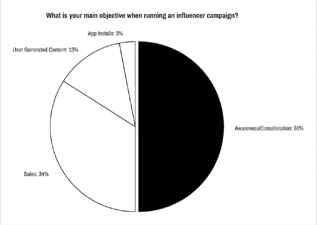
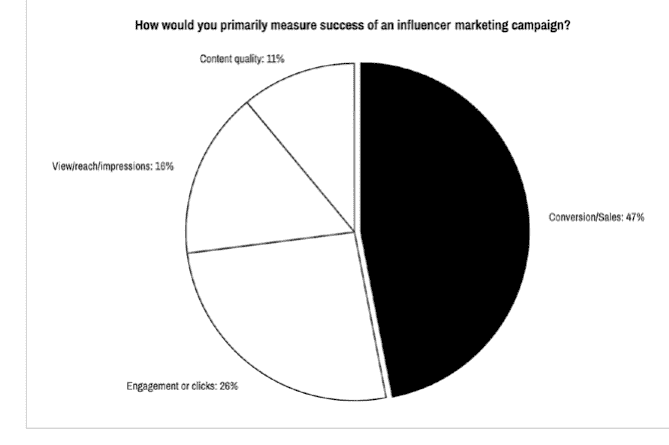
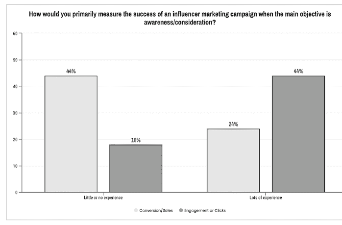

# Chapter 7 | The Four-Step Influencer Marketing Framework

一个分步框架，用于建立一个可扩展的媒体渠道，该渠道与你的整体营销计划完全一致。

> Give me six hours to chop down a tree and I will spend the first four sharpening the ax.
> —Unknown

**Key Questions** 如何定义你的主要营销目标？网红营销的四种不同营销目标是什么？为什么品牌通常为其营销目标选择错误的 KPI？如何为你的活动想出一个强有力的创意点子？你应该在网红营销上花费多少钱，它又花费多少？

**Core Principles**

1. The Four-Step Influencer Marketing Framework.
2. Conversion is the outcome, not the strategy.
3. S.M.A.R.T. goals.
4. The four campaign types.
5. The disconnect between marketing objectives and KPIs.
6. The seven questions that lead to creativity.
7. The insights-opportunity-idea questionnaire.

数字媒体格局每小时都在变得更加复杂，网红营销也不例外。需要结构和清晰度。没有框架和路线图，你就无法解决网红营销如何与整体营销策略相契合的问题。它会阻碍你提升雄心壮志并让其他内部利益相关者与你的计划保持一致。这就是 Four-Step Influencer Marketing Framework 发挥作用的地方。

*First*，你将确定你的主要营销目标、目标受众和成功定义。*Second*，它们将成为平台策略的输入。*Third*，你的平台策略将指导创意、创作者和内容，*finally*，概述你的预算、目标和媒体计划。这个四步流程将为你提供所需的结构，将网红营销转变为可扩展的媒体渠道，使组织内部的利益相关者保持一致，并简化你的活动规划流程。

### Step 1: Marketing objective, target audience, and definition of success

第一步的目标是回答三个问题。*What is your primary marketing objective? Who is your target audience? What is your definition of success?* 让我们逐一回顾。

#### Question 1: What is your primary marketing objective?

你的目标应是一个明确定义的目标，其中概述了你希望实现的目标。挑战自己设定一个与整体业务和营销策略完全一致的目标——这样更易于阐明你的网红营销计划如何与业务或长期营销策略的整体目标保持一致。

2019 State of Influencer Marketing Report¹ 揭示，全部 82% 的受访者目前正在 Facebook 上做广告。考虑到这一点，你很可能熟悉在该平台上配置广告活动的各种方式。因此，品牌和媒体买家为其在 Facebook 上的广告设定目标的方式可以作为网红营销的绝佳代理。这一方法有两个明确的好处：一致性清晰（跨主要数字广告渠道和网红营销）以及熟悉度（两者之间命名惯例相似）。

这里还有另一个与在 Facebook 上做广告的重要平行关系和重要建议：每个活动只能有一个主要目标。如果需要多个目标，请为每个目标分别规划活动。使用 Table 7-1 来选择你的主要网红营销活动目标。

**Table 7-1. Your objective and goals**

| Objective | Your Goal |
|---|---|
| Awareness | Brand awareness or reach. Increase people’s awareness of your business, brand, product, or service and get in front of as many consumers as possible in your target audience. |
| Consideration | Encourage people to learn more about you and what you have to offer. Optimize for engagement and video views or spark a dialog with your target audience. |
| Conversion or action | Encourage people to take a specific action, such as downloading your app, visiting a retail location or website, or buying your product. |
| Production | Unlike Facebook or other advertising channels, influencer marketing can be used specifically with the goal of creating branded content for your brand. |

当你定义了营销目标后，将其写下来。

### Conversion is the outcome, not the strategy

你会很想选择多个目标并认为每个目标同等重要。同样，你也会很想决定最终目标是唯一重要的事情：转化事件、收入和销售。不幸的是，“performance marketing” 已成为转化的同义词——很容易让你陷入认为它是漏斗中唯一值得优化的部分的推理。

这里有另一种观点：根本不存在 *brand* 或 *performance* marketing。只有表现好和表现差的营销。Awareness、consideration，然后让客户走进店门购买你的产品，所有这些对达成销售都至关重要。

企业内整个营销职能的目标是推动底线利润（除非，当然，你的公司是 *nonprofit*），并且产生销售显然应该是你将资金投入营销的成果；但这正是：它是所有导致转化事件的事情的结果和成果。考虑 The Coca-Cola Company——世界上最有价值的品牌之一。他们的营销团队每年在 above-the-line 广告上投资超过 40 亿美元，这笔投资转化为超过 400 亿美元的年销售额。他们的营销团队明白，获取事件是整体营销策略的结果。因此，一个高效的营销活动来推动认知度和考虑度确实是一场 *performance marketing campaign*。它推动了认知度目标的表现。结果是公司底线利润的提升。

要明确的是，行动导向的营销目标并没有什么问题——只要记住客户获取永远不是孤立努力的结果，而是多项营销举措的结合。

#### Question 2: Who is your target audience?

在明确定义了营销目标后，是时候定义你的目标受众了。你需要根据人口统计、兴趣和其他相关价值观列出目标受众的属性。这与定义你正在寻找的创作者或网红的类型不同，而是他们受众是谁。请参阅 Table 7-2。


**表7-2.** 受众参数

| 受众参数 | 值（示例） |
|---|---|
| 所在地 | 美国 |
| 兴趣与喜好 | 时尚与生活方式 |
| 年龄段 | 21–34岁 |
| 性别 | 女性 |
| 其他 | 不适用 |

## 问题3：你对成功的定义是什么？

你对成功的定义应当回答：你的营销活动关键绩效指标（即KPI）是什么？这些指标与你先前定义的*营销活动目标*相关。你是否听说过，你的目标或目的应该是S.M.A.R.T.的吗？该表述及其首字母缩略词最早由乔治·T.多兰于1981年提出³，它意味着你的目标应该是：

- **具体的（Specific）**——具体而言，要创造商业价值需要做什么。
- **可衡量的（Measurable）**——追踪、量化，或至少提出一个进展指标。
- **可实现的（Achievable）**——该目标得到了负责实现它的人的认可。
- **现实的（Realistic）**——说明在现有资源条件下，哪些结果是可以现实地实现的。
- **有时限的（Timed）**——明确结果何时能够实现。

S.M.A.R.T.这一助记法可以在你制定目标和成功定义时起到很好的提醒作用。但你又该如何为影响者营销设定*具体的*目标，或者知道应该*衡量*哪些指标呢？你又如何让团队和其他利益相关者在正确的时限内，就什么是*可实现的和现实的*达成一致？

你需要使用一个经过验证的框架，涵盖四种不同的、经过验证的影响者营销活动类型，如表7-3所示。

> ³ 多兰，G. T.（1981）。“有一种S.M.A.R.T.的方式书写管理层的目的与目标。” *管理评论*。70（11）：35–36

### 表7-3. 四种营销活动类型

| 营销活动类型 | 注意力营销活动 | 兴趣营销活动 | 行动营销活动 | 内容营销活动 |
|---|---|---|---|---|
| 目标 | 认知 | 考虑 | 转化 | 生产 |
| KPI | 品牌提升、触达、eCPM | 视频观看量、单次互动成本、购买意向、兴趣、好感度、情绪、对话 | 网站流量（自然流量、直接流量）、安装量、销售额、单次获取成本 | 质量、互动、单资产成本对比传统生产、速度 |
| 主要平台 | Instagram | YouTube、Instagram | YouTube、Instagram | Instagram |
| 单位成本 | 受众触达、CPM | 总互动量、单次互动成本、单次观看成本 | YouTube上的单次观看成本、目标单次获取成本 × 总预算 | 单资产成本 |

如果你的首要目标是提升认知度，你就应该通过品牌提升、总触达和每千人有效成本（eCPM）等指标来衡量营销活动的影响。你的首选平台主要是Instagram，营销活动的成本会随着你试图触达的总受众规模（单位成本）而上下浮动。如果你的主要目标是推动转化，你会选择行动营销活动。KPI会随之改变，你的目标设定在网站流量、单次获取成本或总销售额等方面。

## 四种营销活动类型

### 注意力营销活动

当你开展影响者营销的注意力营销活动时，你的主要目标是在新的或现有的目标受众中建立认知。你的策略是什么？以尽可能低的成本，用尽可能大的影响力，触达尽可能多的相关消费者。要理解触达营销活动的真实业务影响，建议在条件允许的情况下，通过品牌提升研究来衡量重要指标。当你这样做时，你就超越了展示次数、观看量或粉丝数，而是通过向接触过营销活动的目标消费者提出正确的问题，来了解该活动在整个消费者旅程中对认知或行为产生了什么影响。

### 典型的品牌提升调研问题：

- 消费者是否记得该营销活动？
- 我的目标消费者是否对我的品牌更加熟悉？
- 该活动是否促使人们考虑我的品牌或产品？
- 消费者是否更认同我的品牌信息/形象？
- 消费者是否打算购买我的产品？
- 人们是否对我的品牌/产品更感兴趣？

然而，品牌提升研究可能成本高昂——而且对于预算较小的营销活动可能并不适用。在这种情况下，eCPM⁴和总触达可能就足够了——只要与之前类似的营销活动进行比较或基准对照。当一个品牌进入新市场或新细分领域，或者当目标细分市场中消费者有提示或无提示的认知度总体较低时，认知营销活动通常比较适用。

请考虑以下示例和机会：

随着越来越多的消费者追求健康导向的生活方式，饮料行业中的品牌正在提供更多无酒精产品。显而易见，这对规模达数万亿⁵美元的无酒精饮料行业来说是一个巨大的机会。坏消息呢？这些产品的认知度极低。2019年末一项关于早期采用者饮酒习惯的趋势研究⁶显示，希望减少酒精摄入的消费者并不会优先考虑无酒精鸡尾酒或饮料品牌，主要是因为他们不知道市面上有哪些产品（56%）。

这是一个典型的、会因认知度提升而受益的行业示例。

### 兴趣营销活动

在这个人们可以随时随地、随心所欲地观看、阅读或收听任何内容的时代，捕捉兴趣比以往任何时候都更加重要。在营销漏斗的这个阶段，你的目标是提高消费者的考虑程度，并鼓励他们更多地了解你和你的产品。是时候解决你的产品如何……

⁴ 每千人有效成本或每千次成本
⁵ https://www.grandviewresearch.com/press-release/global-nonalcoholic-beverage-market
⁶ N=2,267“2020年相关趋势影响者健康报告”

你不太可能急着去购买一件从未听说过、甚至从未考虑过的产品……你的客户也是如此。当你有行动导向的营销目标时，你是在与那些准备购买你所售产品的人对话。

第二个考量是你的行动号召和激励措施。我的观点和经验是：如果你希望消费者放下手头的一切来跟随你的引导，你最好给他们一个非常好的理由。大多数人都同意这一点，但这种推理也充满了矛盾——通常源于这样一个前提：过于慷慨的折扣或过于强烈的行动号召可能会贬损品牌价值。

> “我们不是那种提供……折扣的品牌。”

当然，许多世界顶级奢侈品牌，如路易威登、香奈儿、爱马仕、古驰、劳力士和卡地亚，绝不会向新客户甚至现有潜在客户发放30%的折扣码或促销套餐——但它们也不会以行动导向为目标来策划营销活动。然而，只要看看同一份热门品牌列表，你就会发现像苹果、《纽约时报》、迪士尼、Spotify、维多利亚的秘密、Kate Spade和Revolve等公司，它们则会提供特别优惠、促销活动和折扣码来推动客户购买其产品。

我们并不会因为它们慷慨的折扣码、0.99美元的试用、硬件捆绑或店内“买二送一”促销而看低它们。我们反而更喜欢它们。

你听说过40-40-20法则吗？它最初由直效营销专家埃德·梅耶斯于20世纪60年代提出。他发现，直邮营销活动的成功，40%归因于目标受众的精准定位，40%归因于有吸引力的报价，20%归因于创意。换句话说，一个没有吸引力的报价和瞄准错误受众一样糟糕。那么底线是什么？如果你的营销活动的主要目标是推动消费者采取行动，要意识到你是在与一小群潜在客户对话，并且他们需要一个真正充分的理由才会掏钱。

### 内容营销活动

前述每种营销活动目标都依赖于让影响者为其受众创作内容——但实际的内容生产本身也可以被视作你的主要目标，独立于认知、考虑或转化目标。在这里，核心优势在于对抗传统的品牌内容生产方式（无论是内部制作还是通过传统创意机构），这种传统方式既昂贵又费时。当你与创作者合作生产内容时，这正是你要解决的核心目标……


# 第7章 | 影响者营销四步框架

为你的品牌创造内容。目标是什么？为你的社交媒体渠道（无论是付费还是自有数字渠道）提供稳定的品牌内容流。

通过这类活动，你将影响者营销转变为内容生产的手段，而非媒体分发，这打开了一个独特的机会。突然之间，你可以优化审美、品味和创意，而不只是受众、互动或触达。

### 营销目标与KPI之间的脱节

设定目标是一回事，衡量结果并理解成果是另一回事。2019年初，我的公司采访了351个营销团队⁹，以更好地了解他们的主要影响者营销目标是什么，以及他们如何衡量活动结果。这项研究的目的有两个：第一，更深入地了解他们为何开展影响者营销活动；第二，他们如何定义成功。

50%的受访者表示，他们进行影响者营销的主要目标是品牌认知或购买考虑，其次是销售（34%）。内容生产排在第三位，占13%（图7-1）。



**图7-1.** 你在开展影响者活动时的主要目标是什么？

> ⁹ N=351，“Relatable发布的2019年影响者营销状况”

毫不意外，这些见解得出的结论是，营销人员认为影响者营销可以用于品牌认知、购买考虑、转化和内容生产——按此顺序排列。

在这个问题之后，同一批受访者被问及他们主要如何衡量活动是否成功——以了解他们的主要关键绩效指标是什么，以及这些指标与营销目标的关系。

47%的受访者表示，转化或销售是他们衡量成功的主要方式。其次是互动或点击（26%）、浏览/触达/曝光（16%）和内容质量（9.5%）。但这让我觉得奇怪。见图7-2。



图7-2. 你主要如何衡量一场影响者营销活动是否成功？

整整47%的人会根据转化或销售来评估他们影响者营销的成功，而销售本身仅仅是34%受访者的主要营销目标。这表明目标和结果之间存在脱节，而且似乎与我们交谈的营销团队瞄准的是一个目标，衡量的却是另一个。

为了更深入地研究，受访者根据其主要目标被分为两组：一组是品牌认知/购买考虑，另一组是销售。见表7-4。



图7-3. 按经验水平比较脱节的可能性

当主要目标是品牌认知/购买考虑时，经验丰富的营销人员更可能选择“互动或点击”作为衡量活动结果的主要方式（44%），而对于经验很少或没有经验的营销团队，指标实际上发生了逆转（18%）。

考虑到这一点，请确保你的营销目标和成功定义清晰一致且明确界定——否则，你自己的组织极有可能像我们的研究结果一样分散。

### 第2步：正确的活动策略

还记得第4章《创意的艺术与科学》中提到的23种不同的活动和创意策略吗？有了明确的营销目标、目标受众和成功定义，是时候制定你的平台策略了。

为了方便起见，请查看表7-5中的概述（更多信息请参阅第4章《创意的艺术与科学》）。

**表7-5. 活动类型：Instagram和YouTube**

| Instagram | YouTube |
|---|---|
| 单篇信息流帖子活动 | 产品教程/演示 |
| 仅限快拍的活动 | 产品评测 |
| 信息流帖子与快拍搭配 | 购物分享 |
| 多帖活动（大使计划） | 开箱 |
| 放大品牌体验 | 穿搭图册 |
| 爆发式活动 | 梗图和喜剧 |
| 实时招募 | 游戏实况 |
| 直播追求最大真实感 | 品牌/产品提及 |
| 支持主打品牌活动 | 最爱/推荐 |
| 通过投票驱动购买考虑 |  |
| 超本地化活动 |  |
| 上滑获取线索 |  |
| 为广告创作内容 |  |
| 将影响者用作演员/人才 |  |

通过检验每种策略的特点，并将其主要优势与本章第一步中的活动类型特征进行比较，你应该会得到一份包含2到5种活动策略的清单，这些策略将指导影响者营销四步框架中的下一步。

### 第3步：创意、创作者和内容

**创意**

一切开始步入正轨，是时候为你的活动、项目或推广勾勒出创意概念了。这将是你信息传达、定位以及简报中向创作者和影响者提出要求的基础。

正如第4章《创意的艺术与科学》所讨论的那样，将新的、富有想象力的想法变为现实，实际上是一种艺术形式。因此，我们手头并没有万无一失的公式。相反，建议从那些在类似活动策略中成功运用创意想法的人身上寻找灵感。这也是创意机构（或内部创意团队）能够大展身手、价值千金的地方。

考虑到这一点，以下问题可以帮助激发你的创意，并找到一个能与创作者、他们的社群以及你的客户产生共鸣的信息。

- 关于你的目标受众或行业，你是否有任何独特的洞察¹⁰？
- 基于这些洞察，机会在哪里？
- 当下文化中有哪些流行且相关的内容？
- 什么能与你的受众在更深层次上产生连接，并跨越文化边界？
- 什么能与公众建立情感连接？
- 什么话题因其共鸣性和意义而具有讨论价值？
- 什么能够吸引、分化、激发或娱乐创作者的受众？

最后，你需要考虑你所识别和提议的内容，对参与的影响者来说是否切实可行、便于制作和执行。当你确定活动的创意概念后，将这三个问题的答案进行总结。

**表7-6. 洞察-机会-创意问卷**

| 问题 | 答案 |
|---|---|
| 独特的洞察是什么？ | |
| 机会是什么？ | |
| 创意是什么？ | |

回答这三个问题将有助于内部甚至外部利益相关者看到全貌。最后，确保创意概念与你前面第1步和第2步中概述的营销目标、目标受众、成功定义和活动策略保持一致。

**创作者选择流程和内容类型**

有了创意概念后，是时候为你的活动找到合适的人才，并匹配合适的内容类型。在此框架的语境下，你只需确定指导活动执行的参数——而不是一份具体的影响者或创作者名单。

他们位于哪里？他们的个性特点如何？他们与你的品牌共享哪些价值观？他们属于哪些品类？每位影响者将创作并发布多少条内容？你将与少量影响者（每位都有更多受众）合作，还是相反？见表7-7。

**表7-7. 选择流程、创作者参数和价值观**

| 创作者参数 | 数值 |
|---|---|
| 所在地 | |
| 品类 | |
| 共享价值观 | |
| 每位创作者发帖或快拍数 | |
| 活动参与者总数 | |
| 平均粉丝数或区间 | |

### 第4步：预算、目标和媒体规划

你已经到达影响者营销框架的第四步，也是最后一步。与我们之前的成功定义类似，现在我们将确定实现总体活动目标所需的具体目标和关键绩效指标。你的最终任务是，基于总体目标、KPI和单位成本，概述具体的项目目标。第1步中的表7-3列出了四种活动类型（触达、关注、行动、内容），将有助于指导你应该衡量什么以及如何衡量。

让我们从决定影响者营销活动范围的自然因素开始：预算。

**预算**

*我们应该在影响者营销上花多少钱？它的成本又是多少？*

越来越多的品牌和营销团队正在为影响者营销分配专门的媒体预算。影响者营销中心（Influencer Marketing Hub）[^1]在2019年对800家营销机构和品牌进行的一项调查发现，86%的受访者拥有影响者营销的专项营销预算，而在2017年这一数字仅为37%。同一项研究还显示，营销团队不仅在影响者营销上投入的媒体资金比以往任何时候都多，而且三分之二的受访者计划在未来一年进一步增加支出。

[^1]: https://influencermarketinghub.com/influencer-marketing-2019-benchmark-report/


## Targets

不同类型的 campaign 各自包含一组变量，用来决定你的 campaign 目标：每个都是单位成本。如果你目标是内容制作，单位成本就是每项资产的成本。每项资产的成本决定了在整体预算下你可以制作多少资产，依此类推。如果 campaign 目标是提升知名度，而 KPI 是覆盖面，则单位成本为 CPM——即每千人的成本。

你的目标是确定一个对公司有价值的单位成本目标——在当前市场费率、基准和行业平均水平之间取得平衡。下面是表 7-8 中的一个示例：

Table 7-8. Campaign goals and examples

| Campaign Type | Attention Campaign | Interest Campaign | Action Campaign | Content Campaign |
|---|---|---|---|---|
| Objective | Awareness | Consideration | Conversion | Production |
| KPIs | Reach | Total engagement | Sales | Quality |
| Primary platform | Instagram | YouTube, Instagram | YouTube, Instagram | Instagram |
| Budget | $80,000 | $80,000 | $80,000 | $80,000 |
| Unit cost | $35 CPM | $0.75 cost per engagement | $100 cost per order | $800 cost per asset |
| Target | 2.3 million reach | 100,000+ interactions | 800 new clients | 100 social media-ready assets |
| Business impact | +10% Brand lift | +25% consideration | $100,000 in sales | -30% production cost |

正如你所见，我使用了预算和单位成本来确定目标，并通过一个项目行进一步细化了目标，该项目行针对实际的业务影响。这能保证并确保目标可以实现吗？这取决于你是否现实，就像任何其他媒体投资一样。最后，你现在可以根据这些目标，结合你在第 3 步中解决的值和参数，准确地概述你的 campaign 中将使用多少位影响者。下面是表 7-9 中的一个示例：

**Table 7-9.** Creator parameters and values

| Creator Parameter | Value |
|---|---|
| Location | United States |
| Category | Fashion |
| Shared values | Sustainability, Equality, Eco-Friendly |
| Per creator posts or stories | 2 |
| Total campaign participants | 10 |
| Average following, or range | 100,000 |

你可能需要根据你的总预算和单位成本来修改你的假设——这完全没问题。如果你的目标是覆盖 230 万人，并且每位 campaign 参与者有 10 万粉丝，并且每人分享两篇帖子或故事，那么你需要一个总共 12 位 campaign 参与者的池子才能达到你的目标。

```
2.3 million reach/(100,000 followers x 2 posts) = 11.5 influencers (rounded to 12).
```

如果你的目标是相反的，即创造互动、内容制作、视频观看或销售，你将有一组不同的值。

## The Four-Step Influencer Marketing Framework cheat sheet

按照本章概述的步骤进行，你每次构建影响者营销 campaign 时都会有一个结构化的工作流程。计划或项目。我强烈鼓励你改进和调整这一通用流程，以满足你组织的独特需求。表 7-10 是四步框架的速查表。

## Table 7-10. Four-step framework cheat sheet

| Steps | Recap/Summary |
|-------|---------------|
| Step 1 | What's your marketing objective? Who's your target audience? How do you define success? Which of the four proven influencer marketing campaign types will suit your needs? |
| Step 2 | Examine the traits of the 23 different campaign strategies on YouTube and Instagram, and write down a list of 2–5 that suits your marketing objective, target audience, and definition of success |
| Step 3 | **Your creative idea:** What is the unique insight? What is the opportunity? What is the idea? **Creator selection process:** Where will they be based? What are their personality traits like? What values do they share with your brand? What categories are they in? How many pieces of content will each influencer create and post? Will you be working with a smaller number of influencers (each with a larger audience) or the other way around? |
| Step 4 | What's your total budget for this project? Identify your unit cost, target, and business impact using the four campaign types from Step 1. Use values and parameters from Step 3: Creator selection process, to identify your overall campaign scope. |
