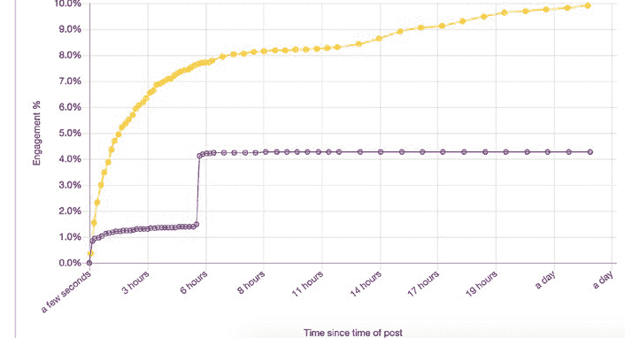

## Measuring What Matters

The untracked majority, rise of the bots, longevity on YouTube, and how to amplify your efforts with paid media

> Not everything that counts can be counted, and not everything that can be counted counts.
> 
> —William Bruce Cameron

# Chapter 8 | Measuring What Matters

**Key Questions** How do you measure the organic, untracked, impact of your influencer marketing? Why does influencer marketing on YouTube become cheaper, and not more expensive, over time? How do you deal with fraud, fakes and bots on Instagram? When, why and how do you amplify your organic content with paid advertising?

**Core Principles** 1. The untracked majority. 2. The longevity of distribution on YouTube. 3. A three-step process for tackling fraud. 4. Amplify organic reach with paid media.

几年前，我与一家健身和营养行业的客户合作。影响者营销在 YouTube 上对他们非常有效。他们的主要目标是为 App Store 创造流量并为其应用安装。我们建立了复杂的端到端跟踪，以便确切知道观看视频、点击链接并安装应用的人发生了什么。

但他们（因此我的团队和我）有一个问题。我们*不知道这些努力带来的有机增长是多少*。比如，有多少人会观看视频并安装应用，而不会点击任何跟踪链接？当然，这是一个常见问题。其他媒体渠道也是如此。你会在电视上看广告，第二周就在商店买产品。因此，归因建模（以及广告的因果关系）是营销人员自古以来就一直在努力解决的问题。但如果你投资了一个媒体渠道，你就想知道。差别很大，如果你获得一个客户或五个客户，不是吗？

这个数字*将*决定或破坏你整个投资回报率。为了帮助我们的客户解决挑战，我们建立了一个模型，查看标准化平均流量、增长、与视频观看的相关性等，最后确定了一个我们感到舒适的数字和归因模型。

对于每个我们可以直接归因的安装，我们会获得额外三到四次有机安装。这意味着有机增长的乘数是 +300% 到 +400%。这些数字似乎好得令人难以置信。自然地，我有所怀疑。我们查看了不同的市场、日期、队列和视频，但无法得出其他结论。正如伟大的虚构侦探夏洛克·福尔摩斯曾经说过，

> *When you have eliminated the impossible, whatever remains, however improbable, must be the truth.*²

我们越想越觉得有道理。事实证明，答案就在我眼前——而且相当明显。消费者不太可能在观看视频时停下来，打断他们正在观看的内容，并遵循视频中的号召性用语。

² Arthur Conan Doyle, *The Sign of Four* (1890)

你正在用手机观看你喜欢的 YouTube 创作者的视频。他们推荐了一款智能手机应用，你会稍后再查看，而不是放弃正在观看的内容。或者你正在电脑上观看视频，看到了该应用，然后拿起手机获取该应用，因为，嗯，它是为手机准备的。在任何一种情况下，直接归因都会丢失。

但仍然，当你的代理机构（我在这个例子中）告诉你（客户）事情比你在仪表板中看到的数字好四倍时，你最好确保它们在正确的范围内。别误会——我对我的团队和我们构建这些模型的能力充满信心，但数据集有限，总是会有误差。并非所有重要的东西都能被计数，而且 Facebook、YouTube 或 Instagram 都不允许任何第三方在其平台上进行跟踪。为了拥有真正无懈可击的归因模型，你必须分析确切观看了视频的人以及谁去了 App Store。

但我或我的公司都没有访问该数据，因为我不是 Apple、Google 或 Facebook。想想看。甚至 Facebook 或 Apple 也没有这些数据，因为他们不被允许跟踪 YouTube 上的用户行为。但 Google 同时运营 YouTube 和 Play 商店。他们知道我们观看了什么以及我们安装了什么应用。碰巧的是，他们发布了一份白皮书³，介绍他们如何为 YouTube 上的影响者营销构建自己的归因模型，以应对我们有限的跟踪能力，并帮助营销人员从假设过渡到实际数据。

在获得一小群应用发行商和游戏开发商的许可后，Google Play 团队分析了总共 250 个视频，累计总观看量达 6000 万次。该研究是通过查看已登录的 Android 用户的匿名队列及其在 YouTube 和 Google Play 上的旅程，在各个细分市场和游戏类别中进行的——以回答以下问题：

观看影响者视频的用户是否随后在 Google Play 上实际下载了游戏？而且这个数字是否可能高于开发人员通过跟踪链接测量的数字？换句话说：是否存在迄今为止无人能证明的增量上行空间？

在调查观看后的用户旅程并将结果与每个开发者的跟踪工作进行比较后，研究团队发现，对于每个点击 YouTube 上影响者视频跟踪链接的人，

另外还有四个人虽然没有点击，但在观看后四天内仍然下载了游戏。Google 将这类用户称为“非追踪多数”，而这个 4 倍乘数恰好与我们在一个完全不同的垂直领域中使用截然不同（但同样准确）的方法所得出的结论吻合。

请注意，你的“非追踪多数”占比会有所不同。4 倍听起来不错，但它并非放之四海而皆准（我见过从 1.2 倍到 12 倍不等的差异），而理解你自己的归因指标至关重要。无论你的乘数是多少，你现在都已经看到了“非追踪多数”会给你的业务带来的巨大好处，尤其是当你在推动应用安装或电商销售时。

## 下载疲劳

同一项研究还揭示了另一个有趣且相关的见解，它直接适用于那些正在借助 YouTube 推动销售、应用安装或网站访问量的品牌。在推广了一段关于手机游戏的网红视频后，如果同一创作者的第二段视频在 12 个月内发布，其下载量最高只有第一段的三分之一。

这并不排除长期合作或与同一创作者制作多支视频的可能性，但它确实有助于预测这些努力的成果。请记住，如果一位创作者的第一支视频表现非凡，即使第二支视频的结果“差”到只有原来的三分之一，仍有可能优于平均水平。最终需要你来判断。

换一个角度看，第二支视频对于其他营销目标而言也可能是一种有效策略，例如重新激活不活跃或已流失的用户群体。

## YouTube 内容分发的长效性

虽然与 YouTube 创作者合作需要更长的准备时间、更多的工作量和更大的前期投入，但该平台提供了一项世界上任何其他付费媒体渠道都无法匹敌的优势：无限的生命周期。当创作者在自己的频道上发布一段以你的品牌为特色的视频时，该视频的成本通常按其发布后前 30 天内预计累积的观看量来计算（参见“行业费率”，第 5 章：以创作者为中心的策略）。

但与其他广告方式不同（甚至包括 Instagram，上面大多数内容在大约一周后就几乎不再获得曝光），YouTube 上的视频在首次发布后很长时间内仍会持续累积观看量。第 30 天并不代表你的营销活动结束，而恰恰是开始。请考虑以下假设：

### 第 1 个月

- 视频成本：$10,000
- 30 天预计观看量：100,000
- 30 天预计单次观看成本：$0.10

你启动营销活动，并按预期在 30 天后达到了目标预估观看量。但随后，一件强大的事情发生了——视频会在 YouTube 的搜索、发现和推荐中继续累积观看量，当视频达到 200,000 次观看时，你的有效单次观看成本将减半。这可能会在 60 天、80 天或 180 天后发生，但请放心，这种长效性对你有利，而不是有弊。营销行业中最接近的类比是搜索引擎优化——你前期投入制作内容，随着时间推移获得自然访问流量；只不过与搜索引擎优化不同的是，你还能看到初期的流量爆发。总体而言，虽然我应该指出结果取决于多种因素，但你可以假设增长轨迹类似于表 8-1。

表 8-1. YouTube 视频的月度环比增长

| 月份 | 环比增长 | 示例观看量 |
| --- | --- | --- |
| 1 | 100% | 100,000 |
| 2 | 30% | 130,000 |
| 3 | 12% | 142,000 |
| 4 | 12% | 154,000 |
| 5 | 10% | 164,000 |
| 6 | 7% | 171,000 |
| 7 | 7% | 178,000 |
| 8 | 5% | 183,000 |
| 9 | 5% | 188,000 |
| 10 | 5% | 193,000 |
| 11 | 5% | 198,000 |
| 12 | 5% | 203,000 |

将你的目标获客成本、平均视频点击率⁴、自然流量提升⁵以及网站（或应用内）转化率纳入考量，你就有了一个为你在 YouTube 上的网红营销效果进行建模的工具。与传统广告不同，每条视频的长效性是一个新的维度，也是一种不公平优势——现在，你可以利用时间来改善营销投资回报率，对抗传统广告和网红营销广告成本的不断上涨，或者同时实现以上目标。

⁴ 2019 年 9 月，平均 1.5%–5%，不包括自然流量提升。

⁵ 通过识别你的非追踪多数。

## 借助品牌内容广告扩大你的网红营销效果

在任何 24 小时的时间段内，被生产出来的内容远多于我们在同一时间内可能消费的内容。内容生产的供给远远超过了对注意力（或一天中的时间）的需求。

从许多方面来看，这对消费者是件好事，因为他们的选择更多，内容生产的门槛也更高了。理论上，这也不应对生产者产生任何经济影响，因为他们较低的单位成本应该会被更高的产量所抵消。然而这只是理论——在实践中，我们一天只有 24 小时，因此我们对内容的需求严格限于我们能够消费的量。但消费者并不是用金钱为内容付费，而是用注意力来为内容付费，于是突然之间，一种注意力经济应运而生。

你看，如果你恰好成长在 70 年代、80 年代或 90 年代，那么你很可能记得你在电视上看到的最早的那些广告。这并不是因为那些广告拍得有多好，而是因为需求（注意力）超过了供给（内容），而我们也慷慨地付出了自己的注意力。那么从那时到现在发生了什么？当然是个人电脑、互联网和智能手机。根据经典经济学理论，这样的事件被称为正供给冲击。技术提高了生产效率，从而增加了产出。

同样简单的经济学理论也适用于局部层面。当社交媒体上的内容多到我们无法消费完时，像 Facebook 这样的公司就不得不构建算法和过滤器，帮助筛选争夺我们注意力的信息。否则，社交媒体就会失去其相关性，我们会转向其他地方。

Instagram 就是一个典型的例子。当数千万用户在这里生产和消费内容时，把所有内容展示给所有人是合理的。然而，当用户达到数亿，而且每个人都拥有了更多的关注者和关注对象时，内容供给突然过剩，这促使 Instagram 重新定义了其平台上的内容消费方式。⁶ 公告称，所有帖子仍然还会在那里，只是顺序不同。但如果用户基数再翻倍至十亿，并且技术进一步升级，实现更高效的内容生产（新的叙事形式、直播、美颜滤镜、更好的智能手机摄像头和更快的网络速度），就会迎来又一次*正供给冲击*。但我们的需求（注意力）并没有增长——这意味着你必须从别人那里夺取注意力，才能扩大自己的受众。

*这就解释了为什么像 Instagram 和 Facebook 这样的平台上的自然分发量在下降。基于这些基本的供需法则，我预测，在未来几年里，创作者和品牌都将持续看到自然触达和分发量的下降。取决于你的营销目标，这或许会成为你最终需要应对的挑战，也或许不会。同时，这也为创作者和品牌催生了新的机遇。*

2019 年，Instagram 加大了对品牌内容工具的投入，帮助企业将其网红营销活动的覆盖范围扩大到最初的自然触达之外。通过将原始帖子或快拍的分发规模扩大到创作者的受众之外（定向特定受众，并使用其广告平台中的工具衡量效果），这种方法让品牌、创作者或其网红营销合作伙伴能够在原始活动之外使用营销内容。虽然类似的策略（通过复杂的变通方式）以前当然也是可行的，但 Instagram 提供的整套平台和官方支持让实际操作变得非常顺畅。我预测，当你读到这部分内容时，将会有更多工具可供你使用。

我强烈建议你熟悉 Instagram 的官方文档⁷，因为此处概述的分步说明在你阅读时可能已经有所变化。无论如何，我将简要介绍工作流程和体验。

首先，这一策略要求你与参与活动的创作者和网红充分协作——这也应该是你创意简报的一部分。设置很简单，但要使其生效，仍需一步一步地执行。不过要记住——用额外的媒体预算放大他们的品牌帖子和快拍，并让更大的受众看到，这是一件双赢的好事！

其次，在发布帖子或快拍时，创作者应使用官方品牌内容工具，并将你标记为其业务合作伙伴。要让这生效，你的品牌需要在自己的账号中批准该创作者。在发布快拍或帖子时，创作者还必须选择“允许业务合作伙伴推广”，这样你才能推广他们的帖子。

接下来，一旦创作者在品牌内容帖子中标记了你的企业，并授予你推广权限，你只需执行以下简单步骤：

- 1. 前往广告管理器并创建广告。
- 2. 为你的品牌内容选择一个可用的营销目标。
- 3. 在“版位”步骤中，选择 Instagram 信息流或快拍。
- 4. 在广告层级，你的品牌内容将出现在“使用现有帖子”部分。在“选择帖子”窗口中，导航到“品牌内容”标签页。你会看到创作者已授权你推广的品牌内容帖子列表。

这样一来，你的网红营销工作就扩展到了重定向、特定受众属性、高级频次设置等领域。如果你愿意，你甚至可以构建一套完全围绕网红营销的付费社交媒体策略。不仅如此，你还通过让创作者获得更大的受众群和更高的互动率来支持他们，同时还能突破 Instagram 的算法。还记得创作者和网红们最常提到的挑战吗？通过放大他们的内容，你正在同时解决清单上的第 2、3、4 项。

## 欺诈、假粉与机器人的兴起

如果你担心网红营销欺诈，你并不孤单。事实上，有 75% 的营销团队和代理机构对虚假粉丝和机器人账号感到担忧，而只有 20% 声称在自己的营销活动中遇到过欺诈。当一个媒体渠道在主流中获得真正的立足点时，这或许不可避免——但这也是网红营销平台、代理机构和品牌内部团队必须面对的挑战，以确保他们没有浪费金钱。

2018 年年中，联合利华对网红欺诈采取了立场，其首席营销官基思·威德（Keith Weed）向在平台上购买粉丝和点赞的网红宣战。这一声明成了新闻报道的头条，这完全合理，但广告欺诈自互联网出现以来就存在，据估计每年给广告主造成超过 230 亿美元的损失。⁸ 社交媒体平台本身也在打击机器人账号和虚假粉丝，但你在建立营销活动时，如何避免自己的营销活动中出现欺诈呢？

首先需要指出的是，由不活跃账户或机器人账号组成的受众很可能是完全无意的。如果你的账号在 Instagram 这样的平台上是公开个人资料，任何人都可以点击关注按钮。不要纠结于某人的粉丝是真是假，而是通过以下行动来打消你的顾虑。

## 1. 正确的受众

以受众为先的网红营销方法（见第 3 章“寻找合适的创作者”：“影响力是结果，而非职业”）是你确保其受众不仅真实、而且正确所采取的首要行动。如果他们的粉丝中有 80% 来自你营销目标国家以外的地区，那么这些粉丝是真是假就无关紧要了——不是吗？

## 2. 真实互动

即使受众是真实的，实际互动（评论和点赞）也可能是人为制造的。但你如何分辨呢？观察点赞和评论随时间的分布情况。请看图 8-1 中的图表，其中有两个真实场景。

图 8-1. 自然互动与欺诈对比

每条线代表来自两位不同创作者的 Instagram 信息流帖子的互动率。24 小时后，其中一篇帖子的互动率为 10%，另一篇为 4%。为了保密，用户名已被移除，但分析显示，其中一篇帖子的互动率很可能是人为刷高的。你看，其中一条帖子的互动率在 1% 左右走平，然后瞬间跳到 4%，之后又保持不变？这没有任何自然之处，而是互动欺诈的表现。

## 3. 超越虚荣指标

Instagram 和 YouTube 都为创作者和品牌提供账户分析和洞察，品牌通常会要求对方提供截图或授权访问这些洞察。如果粉丝受众或互动率还不够，那么访问信息流帖子覆盖人数或快拍展示次数等指标，可以作为打击欺诈的预防措施。
