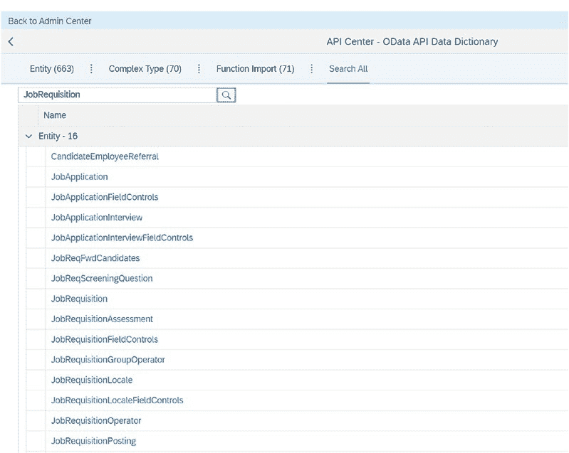
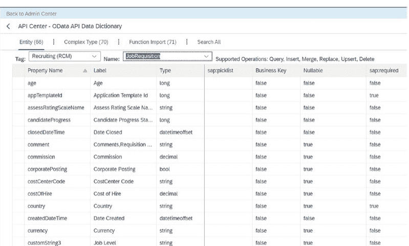
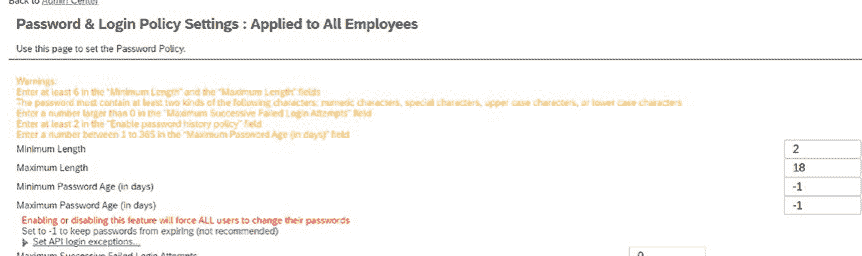
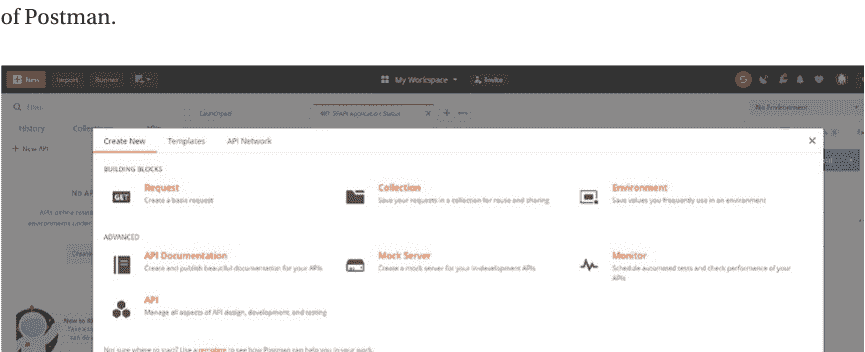
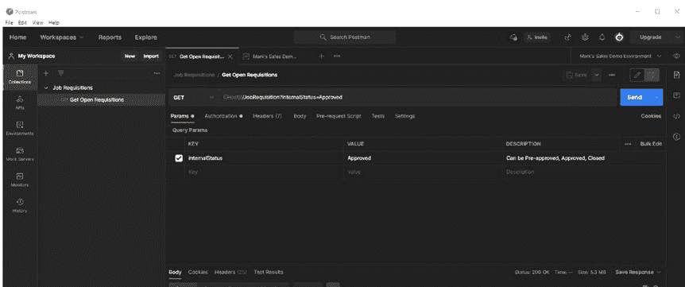
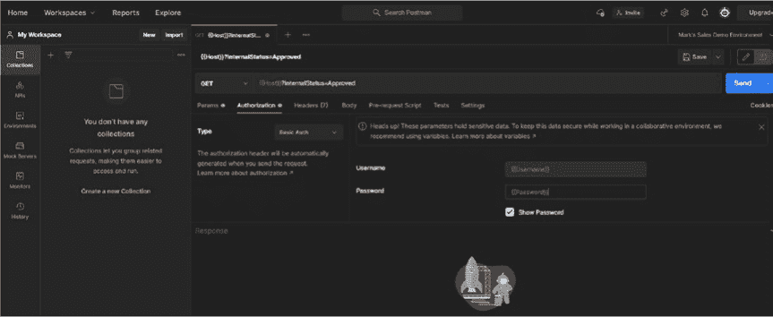
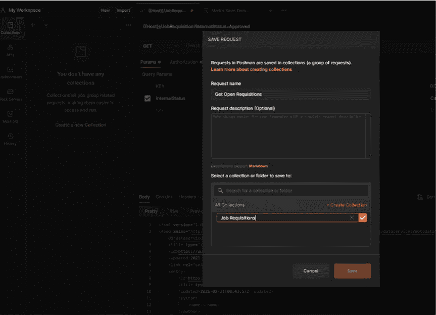
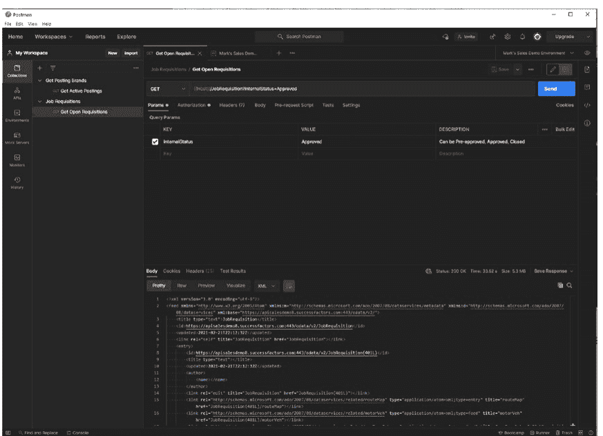
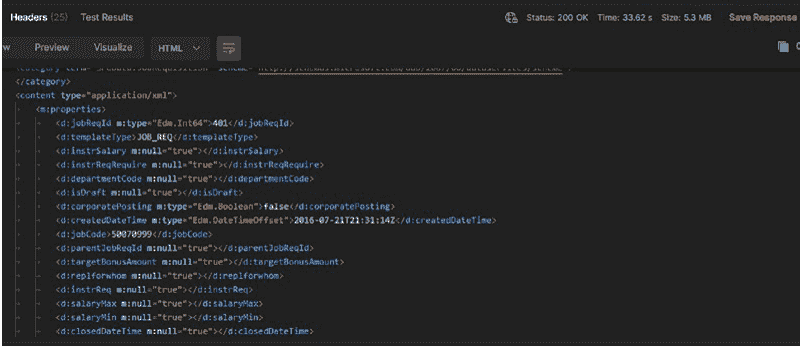

## 第 1 章 引言

您即将学习使用免费工具获取 SAP SuccessFactors 数据的基础知识。在本章中，我们将通过连接 SAP SuccessFactors 并获取一些职位申请来为本书的其余部分奠定基础。我们将使用 ODATA 和 REST 协议。本章将首先描述 SOAP 网络服务与 ODATA 和 REST 的区别。

### 什么是 ODATA？

SAP SuccessFactors 人类体验管理 (HXM) 套件通过全面的应用程序编程接口 (API) 支持与第三方解决方案的扩展和集成。这些 API 用于访问整个套件中的数据。这些 API 基于 ODATA 协议，并提供 CRUD（创建、读取、更新和删除）方法。由 Microsoft 最初开发的 ODATA 协议提供了一种访问 API 的标准方式。ODATA 协议取代了 SFAPI SOAP 网络服务。

### SOAP 网络服务和 ODATA 有何不同？

SOAP 是一种消息协议，用于通过网络服务交换结构化信息。网络服务执行特定目的并围绕流程设计。在招聘中，RequestBackgroundCheck 可能是一个服务。它是异步的，具有预期的结构化响应，例如背景调查订单 ID。消息交换的内容称为有效负载 (Payload)。有效负载由 HR 科技行业标准驱动，例如 HR-XML 协议。SOAP API 对特定软件数据库进行了抽象，因此软件应用程序可以通信，而无需了解彼此的数据模型。

ODATA REST 服务是轻量的，用于与数据库表直接交互。它们是无状态的，意味着不支持具有异步来回通信的通信会话。每个请求都会产生一个简单的响应。

### 数据模型导航

可以将 ODATA 实体视为数据库表。对于在线商店，客户实体与订单相关联，订单又与产品相关联。在 SAP SuccessFactors 招聘中，职位申请与申请相关联，申请又与候选人相关联。

SOAP 网络服务的设计是供技术人员阅读的，使用在整个 HR 科技行业中公认的 XML 元素（如 RequestInterviewResults），而 ODATA 直接表示数据模型，使用表示实体的通用方式。

使用网络服务 RequestInterviewResults 可能会传递职位申请 ID 并返回每位候选人的面试结果。响应可能如下所示：

```xml
<InterviewResults>
    <InterviewAssessment>
        <Candidate>
            <CandidateID>1234</CandidateID>
            <Name>Charlie Brown</Name>
        </Candidate>
        <InterviewDate>12/21/214</InterviewDate>
        <InterviewScore>A-</InterviewScore>
    </InterviewAssessment>
    <InterviewAssessment>
        <Candidate>
            <CandidateID>4321</CandidateID>
            <CandidateName>Lucy</CandidateName>
        </Candidate>
        ....... Etc.
    </InterviewAssessment>
</InterviewAssessments>
```

使用 ODATA，我们使用请求参数来导航实体，而不是由驱动网络服务的预定义逻辑来处理。使用前面的相同示例，我们可以将数据模型导航显示在图 1-1 中。


图 1-1. 从职位申请到面试评估的数据模型导航

CRUD（创建、读取、更新、删除）操作在 ODATA 实体上执行。SAP SuccessFactors 中有数百个实体。这既强大又令人困惑。别担心，文档和本书是你的朋友。

在 SAP 帮助门户中，以下有用的指南提供了更多信息：

- SAP SuccessFactors HXM 套件 OData API：开发者指南 (Dev Guide)
- SAP SuccessFactors HXM 套件 OData API：参考指南 (Reference Guide)

### ODATA 数据模型示例

现在我们已经描述了 ODATA 的工作方式，让我们深入了解 SAP SuccessFactors 系统来看看 ODATA 模型。可以在 ODATA 数据模型中查看数据模型的交互式视图。在屏幕右上角的搜索栏中，输入“ODATA API Data Dictionary”。一旦开始输入，就会出现选项。

当数据字典屏幕出现时，点击 Entity（实体），然后选择 Tag Recruiting (RCM) 和 Name JobRequisition。这将显示图 1-2 中的屏幕。


## 第1章 引言



图1-2. ODATA数据字典中与职位申请（JobRequisition）相关的实体列表

选择“职位申请（JobRequisition）”，该实体将详细显示，各字段的定义如图1-3所示。



图1-3. ODATA数据字典中职位申请（JobRequisition）实体的字段

除了展示职位申请（JobRequisition）实体内的字段外，还显示了支持的操作。这些操作包括：查询（Query）、插入（Insert）、合并（Merge）、替换（Replace）、更新或插入（Upsert）和删除（Delete）。并非所有实体都支持所有操作。某个实体可能支持的操作可以在ODATA数据字典和参考指南中找到。

我们探索数据模型的第二种方式是通过集成中心（Integration Center）。这将在第2章中介绍。

### 如何执行简单的ODATA调用

### 前提条件

我们可以快速获取所有实体的列表，同时确认我们可以使用系统管理员提供的用户名和密码访问ODATA API。您还需要SAP SuccessFactors公司ID。

访问ODATA API的端点URL取决于托管您的SAP SuccessFactors实例的数据中心。我们将在示例中使用一个演示系统。端点为 https://apisalesdemo8.successfactors.com/。

访问您的数据中心的数据中心URL可以在知识库文章（KBA）中找到，链接在此 <https://launchpad.support.sap.com/#/notes/2605498>。您需要一个SAP用户（例如S用户）才能访问此站点。

要查询实体列表，URL为 `<Endpoint>/odata/v2`。我们的URL是 `<https://apisalesdemo8.successfactors.com/odata/v2>`。

系统会提示您输入用户名和密码。用户名格式为 `<user@companyid>`。该用户应为集成用户，且对系统的访问权限有限。如果您负责创建角色和用户，请阅读“设置所需的用户和权限”部分。

### 设置所需的用户和权限

集成用户应仅拥有足以发出ODATA请求的权限，不应有更多权限。他们不应访问任何人工用户会执行的前端功能。他们的密码还应设置为永不过期，因为过期的密码会导致SuccessFactors收到的任何API调用失败。

应为集成用户创建一个单独基于角色的权限（RBP）角色和组。假设您在阅读本书时已了解基于角色的权限的基础知识。图1-4显示了为招聘集成用户推荐的权限。可能并非所有ODATA权限都是必需的。基础对象或MDF对象权限（如地点（Location））也可能需要读取访问权限。

| 角色权限部分 | 权限 | 备注 |
| :------------------------- | :------------------------- | :------------------------- |
| 常规用户权限 | 用户登录 | |
| | 登录方式（密码） | 如果启用了SSO |
| | 创建表单的权限（勾选任何职位申请模板） | 如果将通过集成创建职位申请 |
| 招聘权限 | 勾选所有ODATA权限 | |


如果您在自己的计算机上执行API测试，并且您是唯一使用该集成用户的人，那么密码过期并不是什么大问题。在生产环境中，这对集成来说是灾难性的。需要对密码过期策略进行例外处理。

要设置密码过期例外，请在SuccessFactors屏幕右上角的操作搜索中键入“密码（Password）”。“密码和登录策略例外”将是选项之一。也可以使用Admin Center中的搜索工具，如图1-5所示。

Admin Center



图1-5. 密码和登录策略设置屏幕

点击“设置API登录例外”。现在您可以通过点击“添加”按钮来添加例外。输入集成用户名，并将最大密码期限设置为“-1”以表示永不过期，或根据您组织的策略设置其他期限。需要设置IP地址限制。这将限制用户可以从哪些IP地址调用您的SuccessFactors实例。例如，调用SuccessFactors的评估解决方案的IP地址。

### 从浏览器调用SuccessFactors

打开您最喜欢的浏览器，输入您的SuccessFactors实例的ODATA端点。对于我们的演示实例，它是 https://apisalesdemo8.successfactors.com/odata/v2。系统会提示您输入用户名和密码。用户名格式为 username@companyid。点击登录后，您将看到所有ODATA实体的列表，如图1-6所示。恭喜！您已成功执行了第一个ODATA API请求。

此XML文件似乎没有任何相关的样式信息。文档树如下所示：

```xml
<?xml version="1.0" encoding="utf-8"?>
<workspaces>
  <collection title="Default" />
  <collection title="GoalComment_1" />
  <collection href="BenefitProgramEnrollmentDetail" title="BenefitProgramEnrollmentDetail" />
  <collection href="JobRequisitionPostingFieldControls" title="JobRequisitionPostingFieldControls" />
  <collection href="GoalPermission_101" title="GoalPermission_101" />
  <collection href="InnerMessage" title="InnerMessage" />
  <collection href="JobApplicationStatusLabel" title="JobApplicationStatusLabel" />
  <collection href="BenefitInsuranceDependentDetail" title="BenefitInsuranceDependentDetail" />
  <collection href="ReportSmartMapping" title="ReportSmartMapping" />
  <collection href="SpotAwardProgramAdvancedSettings" title="SpotAwardProgramAdvancedSettings" />
  <collection href="TodoAction" title="TodoAction" />
  <collection href="UserResult" title="UserResult" />
  <collection href="InterviewOverallAssessment" title="InterviewOverallAssessment" />
</workspaces>
```

图1-6. 简单ODATA请求的结果

我们究竟做了什么？我们执行了一个 *GET* 请求，这意味着我们请求数据，而不请求对SuccessFactors数据库进行任何更改。进行此类更改需要用到POST请求。我们没有指定想要查看的实体类型，例如职位申请（requisition）。每个ODATA请求都是通过http(s) URI（统一资源标识符）完成的。我们没有指定任何参数来表明我们想要返回哪些数据，因此返回了完整的数据模型。可以完全使用浏览器来执行请求。一旦您开始在不同的环境中工作，将请求串联起来使请求参数基于先前请求的结果，以及诸如自动化测试等其他需求，您就需要投资一个API应用程序，我们将在第1.3节中看到。熟悉一个应用程序所需的小小学习曲线与它带来的好处相比显得微不足道。

### 示例：使用Postman读取职位申请

我们的目标是检索所有状态为“已批准（Approved）”的职位申请。我们将读取 *JobRequisition* 实体，并针对标记为“内部状态”的字段进行筛选。该字段名为 *internalStatus*。该字段的值会在职位申请被创建、批准和关闭时发生变化。

### Postman入门

有许多用于测试和自动化HTTP API交互的桌面应用程序和基于浏览器的工具。我们打算使用Postman，因为它有一个免费版本，并且是较常用的工具之一。它还非常适合协作。您可能与同事（例如集成顾问或后端Web开发人员）一起工作。能够快速构建API调用并将其导出以供同事使用，可以极大地提高工作效率。

Postman应用程序可以在 www.postman.com/downloads/ 找到。它适用于Mac、Windows和Linux。Postman也有一个网页版本。我们将演示使用桌面应用程序。我们将只教授足以执行必要API调用的Postman知识，但建议您查看位于 https://learning.postman.com/docs/getting-started/introduction/ 的Postman学习中心。图1-7显示了Postman的初始视图。



图1-7. Postman初始视图或点击新建（New）

我们将开始创建一个新环境（New Environment）。这意味着我们不必记住SuccessFactors API URI。将来，它还将使我们能够轻松地在演示环境或客户环境之间切换。

点击“环境（Environment）”，然后将名称从“新环境（New Environment）”更改为有意义的名字，例如“Mark的演示环境”。在其下方，添加一个变量名“Host”，并将初始值设置为您的数据中心对应的ODATA API URL，例如 https://apisalesdemo8.successfactors.com/odata/v2 。添加一个用户名字段变量，使其为 user@companyid。


创建一个名为 *password* 的变量并设置其值。请注意，这些示例使用基本身份验证仅用于演示目的——到 2022 年 11 月，证书将很快取代 OData 调用中的基本身份验证。请确保右侧眼睛图标旁边的环境名称是您的环境名称，而不是“No Environment”。

## 使用 Postman 执行请求

现在我们已经安装了 Postman 并设置了环境，可以创建第一个请求了。点击屏幕左上角附近的 + 按钮来创建新请求。

对于左侧的方法，请确保选择了 GET。对于主机，输入 {{Host}}/JobRequisition。这将使用正确的主机并请求 JobRequisition 实体。

在 Params 选项卡下，输入 KEY 为“internalStatus”，VALUE 为“Approved”。请注意，参数将自动更新 URL。您也可以输入描述。在图 1-8 中，我们使用描述来包含有效的职位申请状态选项。



*图 1-8. 创建我们的 API 请求*

点击“Authorization”选项卡并选择“Basic Auth”。在真实环境中应使用 OAuth 2.0。我们使用基本身份验证是为了方便。对于用户名，输入 {{Username}}；对于密码，点击眼睛图标显示密码并输入 {{Password}}。身份验证值将从您的环境中自动传递。使用这些变量的一个优点是，您可以在不共享登录信息的情况下共享 API 请求。

图 1-9 显示了 Postman 中服务的授权选项。



*图 1-9. 基本授权信息*

点击右侧的保存磁盘图标来保存您的 API 请求。将其命名为“Get Open Requisitions”。点击“+ Create Collection”并将集合命名为“Job Requisitions”。



*图 1-10. 保存请求并创建集合*

### 最终结果

点击 Send 执行请求。您将看到如图 1-11 所示的结果。



**图 1-11.** *职位申请请求的结果*

右侧绿色的 Status 200 表示我们的请求已成功。

返回的每个申请都由一个 `<entry>` 元素表示。如果向下滚动，您将看到申请中的字段值，如图 1-12 所示。



如果您想离线保存结果以供日后共享或查看，请点击右侧的“Save Response”。

### 结论

您已经迈出了释放 SuccessFactors OData API 力量的第一步。您现在了解了如何使用 Postman 发起调用来检索职位申请。您已经学会了如何设置 Postman 环境，以便轻松切换要调用的 SuccessFactors 实例。此外，您还知道了如何使用参数来筛选职位申请。

无论您是否是 SuccessFactors 系统管理员，您都已经了解了进行 OData 调用所需的权限。除了在您自己的测试实例中进行实验外，这还将使您能够就所需权限向系统管理员提供建议，并执行故障排除。
