## 第 2 章：申请创建与更新自动化

在第 1 章中，我们向您介绍了进行 OData 调用的基础知识。在本章中，我们将引导您完成在招聘流程中进行这些调用的第一个实际应用：申请创建。我们首先介绍一些可能触发构建此类自动化需求的实际业务场景。然后，我们回顾您将用于构建此类自动化的相关 SAP SuccessFactors OData API 对象。最后，我们将运用您目前所学到的知识，带您完成两个案例研究。让我们开始吧！

### 业务场景

在本节中，我们将介绍一些在 SAP SuccessFactors Recruiting 中自动化申请创建的实际业务场景。

首先，需要了解的是，如果您是 Employee Central 或 SAP 本地部署客户，并且希望将这些系统中的申请创建集成并自动化到 SAP SuccessFactors Recruiting 中，SAP 提供了这些系统之间的标准集成和自动化。因此，我们不会介绍这些场景，而是介绍涉及第三方系统或需要标准之外自动化的场景。

#### 简单场景：小型企业薪资系统

在最简单的场景中，一家拥有 2,500 名员工的小型企业增长迅速，并计划进一步扩张。为了助力增长，他们希望实施 SAP SuccessFactors Recruiting。该公司只有一套薪资系统，尚未准备好部署具备职位管理能力的完整人力资源信息系统（HRIS）。然而，他们确实有一些难以持续填补的关键职位类型。因此，他们希望当薪资系统中有人入职或离职时，能够触发对几个关键申请的空缺职位数量进行更新。这几个申请 ID 可以设置在配置表中，或作为源薪资系统中的简单变量，这样我们就不必建立双向通信，只需向这些已有的申请发送简单更新即可。这将把开发和实施工作量降到最低。图 2-1 说明了这一场景。


**图 2-1.** *单一薪资系统通过单向通信更新申请空缺职位数量*

> **注意** 许多薪资系统可能不够强大，无法自行发起 OData 调用，可能需要中间件来协调这些调用。如果不需要实时传输，基于文件的传输也可能是一个有效的可选方案。

#### 中等复杂场景：中型企业 HRIS

在第二个场景中，一家拥有 10,000 名员工的中型企业拥有一个具备职位管理能力的 HRIS 与薪资组合系统。他们决定实施 SAP SuccessFactors Recruiting，并希望在 HRIS 系统中的空缺职位与 SuccessFactors Recruiting 中的开放申请之间保持紧密集成。因此，只要 HRIS 中的职位对象为空且未关闭，就会在 SuccessFactors 中触发一个申请。如果该职位在 HRIS 中关闭，则在 SuccessFactors Recruiting 中也会关闭相应的申请。因此，需要双向通信来同步职位与申请——例如，通过回传申请 ID。这样，更新和关闭操作也可以在一个或两个系统中进行跟踪，并保持职位和申请对象的同步。图 2-2 说明了这一场景。

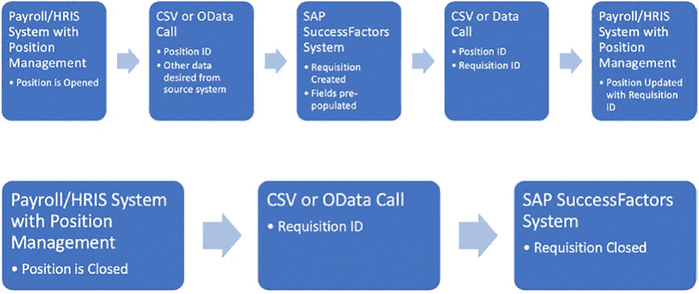

> *图 2-2. 单一 HRIS/薪资系统通过双向通信触发申请创建*

#### 复杂环境场景

在第三个场景中，一家拥有 80,000 名员工的控股公司收购了世界各地多家较小的企业，这些企业在不同国家各有自己的 HRIS 和/或内部/第三方薪资系统，但都没有招聘系统。这些系统在 25 个国家中维护着规模从 10 人到 20,000 人不等的员工数据。该公司认为，立即整合到像 Employee Central 这样的单一 HRIS 与薪资组合系统并不合理，因为这需要大量的前期资本投入，而员工或潜在员工几乎看不到明显收益。然而，在这个特定行业中，人才难求。此外，母公司拥有强大的品牌，而被收购的公司在招聘中几乎不为人知，且经常相互争夺资源。因此，对于该公司来说，建立一个统一的招聘候选人入口和人才库是有意义的，有助于协调招聘工作并利用最强品牌效应。这也将使公司能够在激烈的“人才争夺战”中建立整合的人才库。同时，这也能为公司带来更快的价值实现时间和战略竞争优势。在这种场景下，多个不同的 HRIS 系统在一个 SuccessFactors Recruiting 系统中创建申请是合理的，同时对于某些最小的国家，也允许手动创建申请来代替集成。图 2-3 说明了该场景的技术架构。


首先分配“集成中心”权限，以及所有与读取和创建 ODATA 对象相关的招聘权限：

- 1. 在搜索栏中键入并选择“集成中心”。
- 2. 集成中心主菜单将显示。点击“数据模型导航器”。
- 3. 在新的弹出窗口中，在搜索框中输入“JobRequisition”，勾选“JobRequisition”旁边的复选框，然后点击“关闭”。
- 4. 实体将如图 2-4 所示出现。

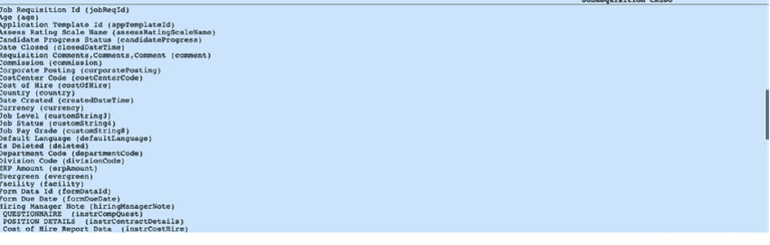

*图 2-4. 数据模型导航器中 JobRequisition 实体的示例视图*

> **注意** *您可以在此弹出窗口中选择多个实体，以可视化它们之间的关系。*

根据我们的经验，数据模型导航器的布局难以阅读。有时，如果您只是想查看实体中存在哪些字段，可以按照以下步骤操作：

- 1. 在搜索栏中键入并选择“集成中心”。
- 2. 集成中心主菜单将显示。点击“我的集成”。
- 3. 点击“创建”按钮。
- 4. 在出现的下拉菜单中，选择“Scheduled Simple File Output Integration”。
- 5. 在“Search for Entities by Entity Name”（按实体名称搜索实体）字段中，输入“JobRequisition”。
- 6. 选择“Job Requisition”下方出现的第一个选项。
- 7. 屏幕右侧将更新显示 JobRequisition 实体中所有字段和导航的列表。示例如图 2-5 所示。

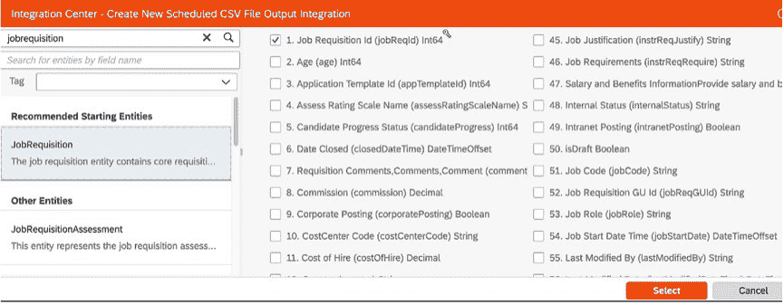

*图 2-5.* 从“Create New Scheduled CSV File Output Integration”（创建新的计划 CSV 文件输出集成）屏幕查看 Job Requisition 字段

在这里，您可以检查存在哪些字段。这里有一些字段命名约定和概念需要注意：

- 1. 首先显示字段的文本标签，括号内的值是技术字段名称，随后是数据类型。
- 2. Job Requisition Id（职位请求ID）是主键（如钥匙图标所示）。
- 3. 以“instr”开头的字段是只读视觉标签/说明，不包含数值——在接口开发中，通常可以忽略这些字段。
- 4. 通常，SAP 和实施顾问知道自定义字段应以“cust”开头——但是，系统并没有强制这样做的硬性要求。
- 5. 导航（Navigations）是将职位请求与其他实体通过该相关实体的主键链接起来的字段。例如，任何单选列表字段将包含该特定请求值对应的 PicklistOption ID（选项值ID），或者“Last Modified By”（最后修改人）将包含最后修改该请求的用户ID，可用于查找有关该用户的更多详细信息。
- 6. 显示的字段是系统中加载的所有职位请求模板中所有字体的混合体。在创建请求时，选择正确的模板 ID 至关重要，以便为特定模板创建有效的字段。

### 导出示例请求数据

在尝试创建用于生成请求的接口之前，最好从手动创建的请求中导出请求信息。这样，您可以从已经过系统检查（用于创建特定于您的系统配置的请求）确认有效的数据中，获得每个字段值应如何格式化的可靠示例。按照此建议，让我们继续之前中断的地方，查看用于创建包含有效字段值的示例 .CSV 文件的字段。从同一屏幕开始，执行以下步骤：

- 1. 通过点击每个字段旁边的复选框，选择您希望输出到文件中的字段和导航。至少，我们建议根据您特定的模板 ID 选择所有必需字段，以及接口所需的其他字段。
- 2. 完成后，点击“Select”（选择）按钮。
- 3. 您将进入如图 2-6 所示的屏幕。为集成命名，并确保将输出文件类型选择为“CSV”，将头部类型选择为“Simple Header”（简单头部）。点击“Next”（下一步）。

## 第 2 章 请求创建和更新自动化

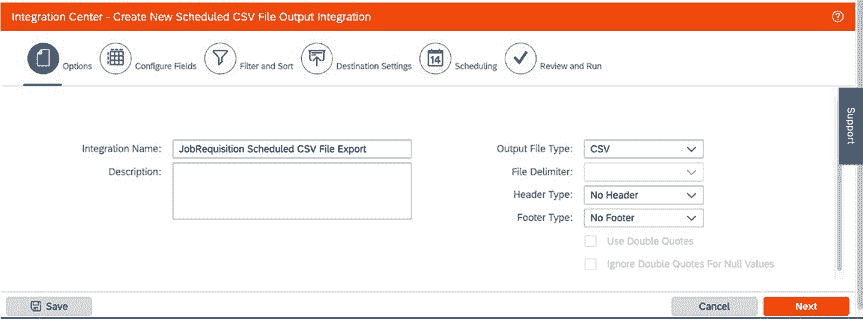

**图 2-6.** *集成中心计划 CSV 文件输出创建屏幕*

- 4. 您将进入一个屏幕，显示您在上一步屏幕中选择的字段在系统中的示例值。示例如图 2-7 所示。检查字段并点击“Next”（下一步）。

> **注意** 在此预览屏幕上，某些字段不会显示其真实值的格式！最佳做法是实际生成并下载 .CSV 文件以查看真实格式。这需要您拥有可用的 SFTP 服务器。SAP SuccessFactors 通常向所有客户提供 SFTP 服务器用户 ID/密码。

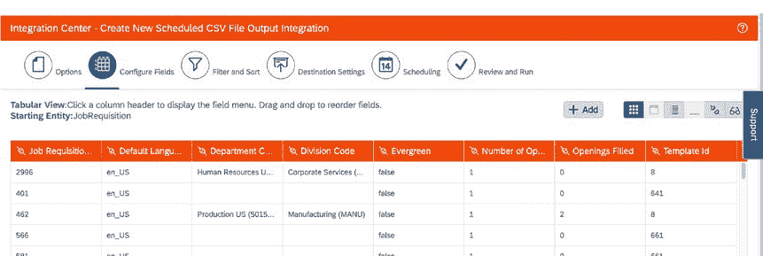

### 图 2-7. 示例字段值屏幕

5. 下一个屏幕，如图 2-8 所示，将允许您筛选结果。您可以使用此屏幕查找您手动创建的特定职位请求，作为接口将创建内容的示例。您可以点击“Advanced Filters”（高级筛选器）旁边的箭头图标，然后选择 Job Requisition Id（职位请求ID）字段以这种方式进行筛选。在设置筛选条件后，您也可以返回上一个屏幕以检查是否获得了所需结果（屏幕将更新以仅显示符合筛选标准的值）。完成后，点击“Next”（下一步）。

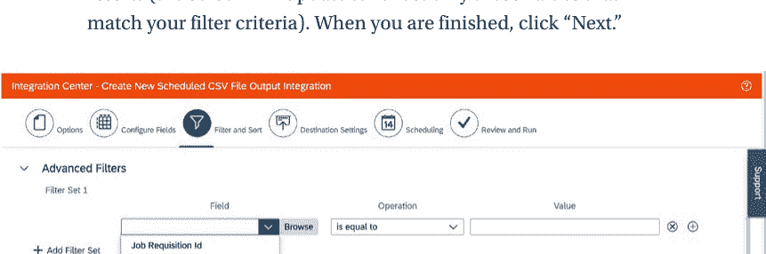

### 图 2-8. 选择筛选条件

- 6. 下一个屏幕将要求您输入 SFTP 服务器主机地址、用户名、密码和文件名，如图 2-9 所示。完成后点击“Next”（下一步）以进入计划屏幕。

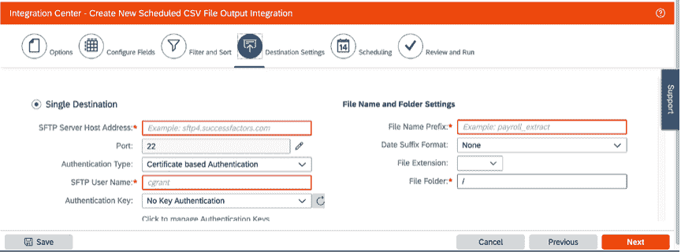

**图 2-9.** *SFTP 设置屏幕*

- 7. 由于这是一次性运行，您可以跳过计划屏幕。在此屏幕上点击“Next”（下一步）。然后在“Review and Run”（检查和运行）屏幕上点击“Run Now”（立即运行），如图 2-10 所示。您可以通过点击“Last Run Time”（最后运行时间）旁边的刷新按钮来检查运行状态。（如果您尚未保存集成，系统可能会提示您先保存集成。）

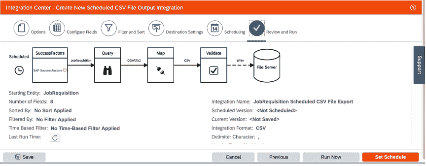

**图 2-10.** *检查和运行屏幕*

8. 运行完成后，登录 SFTP 服务器并下载文件。您可以打开文件并在文本编辑器中查看，如图 2-11 中的示例所示。

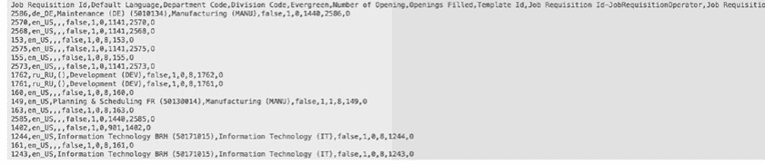

> 注意 根据我们的经验，像 Microsoft Excel 这样的程序会重新格式化日期等字段。最好在文本编辑器（如 Notepad++ 或 BBEdit）中查看文件，以查看每个字段正确的格式。

恭喜！您已构建一个简单的 .CSV 文件输出！此外，它也是创建或更新请求的输入文件外观的一个可靠示例。在接下来的章节中，我们将在一个案例研究中进一步扩展该示例，在那里我们将创建一个可用的请求更新接口。

## 案例研究：使用 CSV 文件更新请求

既然我们已经了解了围绕请求创建和更新的一些实际业务场景，并且熟悉了 SuccessFactors 中可用于操作的技术对象，我们就可以着手进行实际应用了。在我们的第一个案例研究中，我们将查看第一个业务场景示例：一家拥有 2,500 名员工的公司，其薪资系统希望更新一些预配置好的请求。

## 简单业务场景回顾

为了快速回顾，示例公司仅有一个薪资系统，没有完整的人力资源信息系统（HRIS）。当处于大规模招聘岗位的员工从薪资中终止时，薪资系统将需要更新 SAP SuccessFactors 招聘系统中特定请求上的空缺数量。由于许多薪资系统无法自行发起 ODATA 调用，因此使用每晚的 .CSV 文件传输到 SFTP 服务器，由 SAP SuccessFactors 获取文件作为通信方式是合理的。

#### 实施步骤

开始之前，我们可以编辑上一节中创建的文件。按照以下步骤准备文件，使其能用作接口模板：

- 1. 在文件编辑器中打开该文件。
- 2. 除您希望更新的请求（例如您的测试请求）外的所有行。
- 3. 除“Requisition Id”（请求ID）和“Number of Opening”（空缺数量）字段外，删除所有列标题和关联的行值。示例如图 2-12 所示。
- 4. 保存文件。

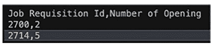

图 2-12. 编辑后的示例 .CSV 文件模板

> 注意 考虑到接口，由于通信是单向的，薪资系统不知道 SAP SuccessFactors 招聘系统中已经存在多少空缺。因此，我们通常使用“空缺数量”列来表示基于薪资系统中主要大规模招聘岗位总离职人数需要额外增加的空缺数量。然而，为了简化示例，我们将直接覆盖


文件中的值。我们需要一个中间件应用程序来查询系统以获取当前值，执行计算，然后更新该字段。你可以在下一章了解更多关于中间件的内容。如果您已正确配置 SAP SuccessFactors 招聘系统，每次候选人被标记为“已雇用”状态时，“职位空缺数量”标准字段的计数会自动减少一。因此，我们永远不需要从薪资系统中发送负数/扣减计数来处理雇用。

现在我们已经准备好了文件，并确定了该文件从薪资系统输出时的样式。我们可以将其移交给薪资系统开发人员，作为其输出内容的模板。在我们这边，让我们使用它来构建进入 SAP SuccessFactors 的入站接口！请遵循以下步骤在 SAP SuccessFactors 中构建入站接口：

+   1. 在搜索栏中输入并选择“集成中心（Integration Center）”。
+   2. 将出现集成中心主菜单。点击“我的集成（My Integrations）”。
+   3. 点击“创建（Create）”按钮。
+   4. 选择“定时 CSV 输入集成（Scheduled CSV Input Integration）”，如图 2-13 所示。

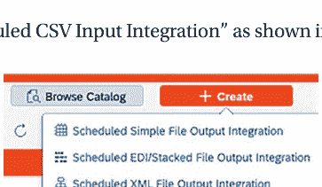

图 2-13. 创建定时 CSV 输入集成

+   5. 在“按实体名称搜索实体（Search for Entities by Entity Name）”字段中，输入“JobRequisition”。
+   6. 点击左侧第一个搜索结果中出现的 JobRequisition 对象，如图 2-14 所示。然后点击“选择（Select）”。

## 第 2 章 职位申请的创建与更新自动化

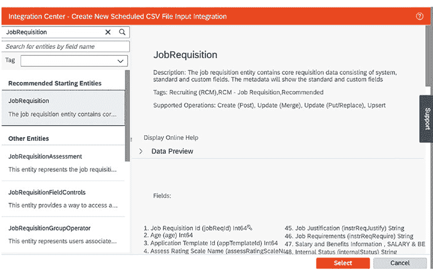

*图 2-14. 为入站接口选择 JobRequisition 实体*

+   7. 输入集成名称，然后点击“下一步（Next）”。
+   8. 在“配置字段（Configure Fields）”屏幕上，点击右上角的“上传样本 CSV（Upload Sample CSV）”按钮。点击“浏览（Browse）”。选择您在本节之前更新的模板，然后点击“上传（Upload）”。示例如图 2-15 所示。

图 2-15. 上传集成文件模板

9. 您将在系统中看到内容更新，显示文件的详细内容，如图 2-16 所示。

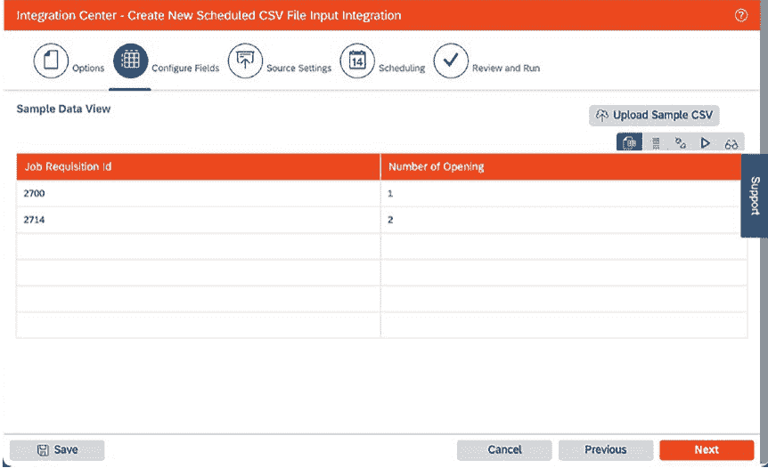

图 2-16. 上传 .CSV 模板的结果

10. 现在我们需要将文件中的每一列与 SAP SuccessFactors 中 JobRequisition 对象的正确字段进行映射。点击屏幕右侧显示两个插头连接的图标。屏幕将更新为字段映射视图（Field Mapping View）。

11. 确保中间的“操作（Operation）”下拉菜单设置为“批量插入或更新（Upsert Multiple）”。将左侧 .CSV 文件模板中的源字段拖放到中间对应的 JobRequisition 对象字段上。您会注意到，每完成一次映射，中间每个已映射字段前面的图标都会变为闭合的插头。此外，右侧预览中的示例 ODATA 代码也会随之更新（在后台，集成中心实际上只是一个用于设计和运行 ODATA 调用的前端）。示例如图 2-17 所示。

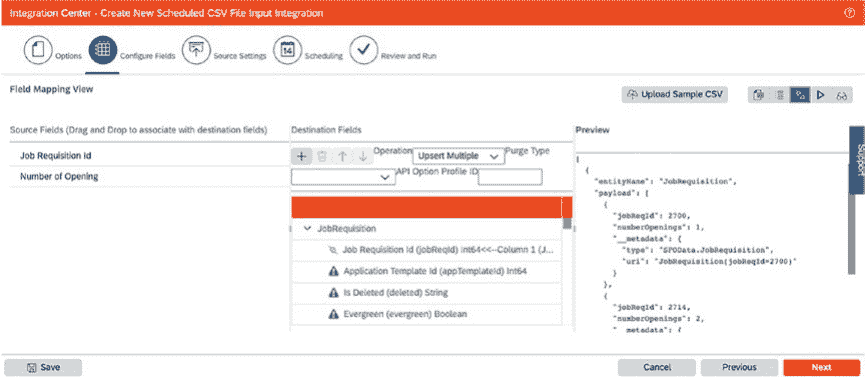

图 2-17. 字段映射视图示例

+   12. 点击“下一步（Next）”按钮。屏幕将更新为如图 2-18 所示的样子。
+       输入您的 SFTP 连接详情和文件命名约定。

> **注意**
> *对于每日批处理更新，我们建议在文件名末尾包含当前日期。在这里，您可以使用“日期后缀格式（Date Suffix Format）”字段来定义将出现在文件名末尾的日期格式。您还应将“文件扩展名（File Extension）”字段选择为“CSV”。*

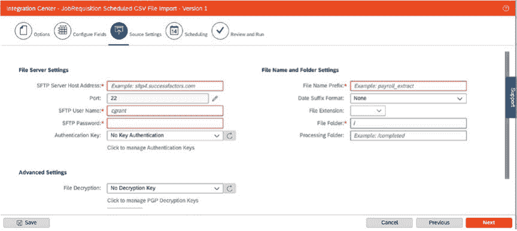

图 2-18. 入站集成的 SFTP 设置

## 第 2 章 职位申请的创建与更新自动化

13. 点击“下一步（Next）”。屏幕将更新到计划设置屏幕。在这里，您可以设置每日任务以接收由薪资系统生成的文件。由于我们只是执行一个一次性示例，我们将跳过此屏幕。再次点击“下一步（Next）”。

14. 屏幕将更新为如图 2-19 所示。请确保将样本文件上传到 SFTP 服务器的指定文件位置，并使用您在第 12 步中指定的文件名。点击“立即运行（Run Now）”以执行集成。您可以点击“最后运行时间（Last Run Time）”右侧的刷新按钮，系统将使用运行结果更新该字段。（如果您尚未保存集成，系统也可能提示您先保存集成）。

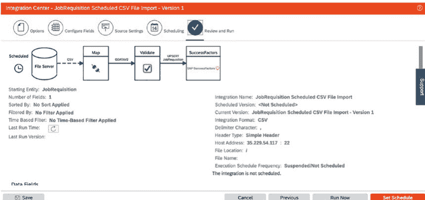

图 2-19. 审查和运行屏幕

15. 如果您收到如图“最后运行时间”字段中所示的任何错误或警告，您可以点击该字段中显示的值，以查看集成运行的详细信息，如图 2-20 所示。

> 注意 看到警告（如图 2-20 中系统指示缺少必填字段那样）并不罕见。然而，只要系统指示记录已成功写入，我们就知道接口能够完成更新。

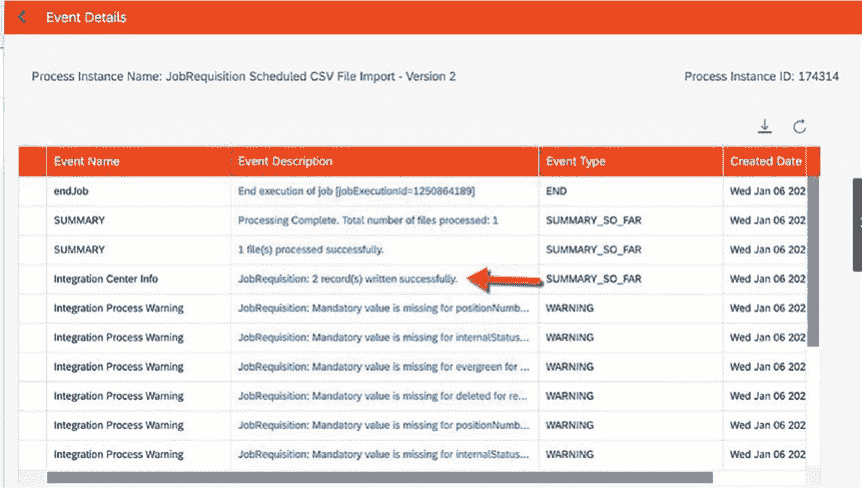

图 2-20. 最后接口运行详情，显示记录已成功写入

16. 为了再次检查您的工作，您还可以导航到您的职位申请，并在职位申请详情视图的右上角点击“i”图标。您应该会在变更历史中看到 ODATA 更新，如图 2-21 所示。这是您的集成接口正在进行的更新！

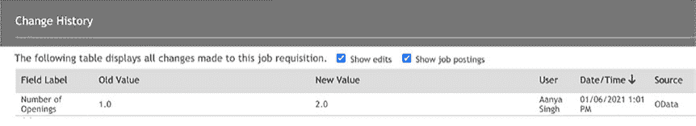

图 2-21. 接口更新的职位申请变更历史示例

完成了！您现在已经实现了一个简单且实用的职位申请更新接口！对于我们的下一个案例研究，让我们变得更加复杂一些，直接使用 ODATA 而不是使用集成中心。我们不仅可以建立单向连接，还可以建立双向连接。

### 案例研究：使用双向 ODATA 通信创建职位申请

至此，我们在本章中完成了一个简单的基于文件的单向集成。利用我们在本章和第 1 章中获得的技能，让我们更进一步，使用 ODATA 调用创建双向通信。

#### 中等复杂度业务场景回顾

在本案例研究中，我们将遵循我们的第二个业务场景，其中具有职位管理功能的 HRIS 系统发送一条消息以创建职位申请，而 SAP SuccessFactors 返回一个职位申请编号。如果 HRIS 系统中的职位空缺被关闭，系统可以调用 SAP SuccessFactors 来关闭该职位申请。

#### 实施步骤

对于创建职位申请的出站调用，我们可以简单地修改我们已创建的集成，以收集一个示例 ODATA 调用，该调用将用于替代 .CSV 文件行！回想一下，在图 2-17 中，我们看到 SAP SuccessFactors 集成中心在读取 .CSV 文件时执行的 ODATA 调用。类似地，我们可以创建另一个集成，并使用其创建的示例调用作为从 HRIS 系统（或中间件）发起的 ODATA 调用模板，以创建职位申请。请遵循以下步骤创建集成并生成示例 ODATA 调用：

+   1. 在搜索栏中输入并选择“集成中心（Integration Center）”。
+   2. 点击“我的集成（My Integrations）”。
+   3. 从系统中的集成列表中，通过点击其名称旁边的铅笔图标，编辑您在本章中最后创建的那个集成。

+   4. 点击顶部的“配置字段（Configure Fields）”，然后点击右上角的插头图标。屏幕应显示为如图 2-17 所示的样子。
+   5. 在“操作（Operation）”下，将选择更改为“创建/发布（Create/Post）”。
+   6. 您会注意到多个字段移至顶部，且其左侧带有感叹号。这些是成功创建职位申请所需的必填字段。示例如图 2-22 所示。表 2-1 中列出了每个字段的说明。

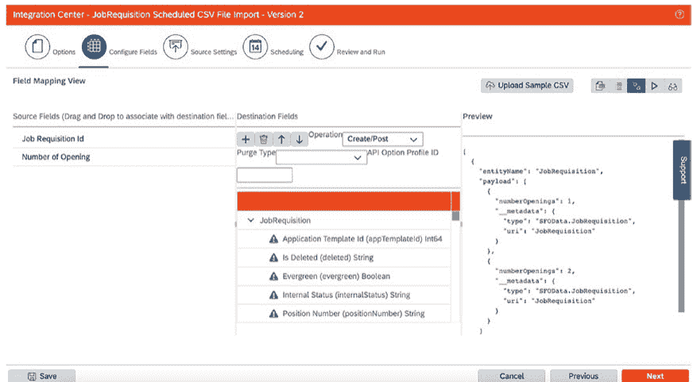

图 2-22. 创建职位申请所需字段的示例


### 表 2-1. *创建 requisition 所需字段*

| Field Name | Technical Name | Field Type | Description |
|---|---|---|---|
| Application Template Id | appTemplateId | Int64 | Indicates which XML template to use to create an application when someone applies to the requisition (which defines the fields and permissions of the application). This corresponds to the unique identifier assigned to an application template when the template XML is uploaded to provisioning by SAP or a SuccessFactors-certified partner for the first time. The ID is unique per system. We will need to obtain this ID from the XML or use a sample requisition to obtain it. |
| Is Deleted | Deleted | String | Indicates if the requisition has been deleted or not. Valid values are “Deleted,” 1, and “Not Deleted,” 0. In our example, since we are creating a new requisition, we should indicate the requisition is not deleted. However, we found that while this is marked as required, an error was given when we included the field in requisition creation. When we left it blank, it created successfully. |
| Evergreen | Evergreen | Boolean | Indicates if the requisition is an evergreen requisition or not with values of “true” or “false.” Evergreen requisitions allow for parent/child relationships and are used for high-volume positions where a one-to-one relationship is desired for each requisition and position. For our example, we will indicate the requisition is not an evergreen. |
| Internal Status | internalStatus | String | Indicates where the requisition is in the process, specifically as “Pre-approved,” 0 (has not gone through the route map); “Approved,” 1 (route map has been completed); or “Closed,” 2. This defines which set of permissions will be used when viewing the requisition as an end user as well. For our example, we will set the requisition to “Pre-approved” since it will be brand new and still have to go through the requisition approval process. |
| Position Number | positionNumber | String | If Employee Central is activated and integrated, this field is required and corresponds to the Employee Central Position number (it shows in our example since our demo system also has EC). Most likely, this field will not be used in our discussed business scenarios. |
| Application Status Set ID | statusSetId | Int64 | Unique identifier determined by the system when the Applicant Status Set Configuration is created the first time. This is unique by system as well. The Applicant Status Set defines what statuses will exist throughout the application process (such as applied, background check, hired, etc.). We would need to gather this information from the person who configured it, or for our example, we will grab this ID from a preexisting requisition. |
| Template Id | templateId | Int64 | Indicates the XML template to use when creating the requisition. This XML defines the fields and permissions that exist in the requisition. We will need to get this ID from the XML or, as in our example, use an example of an existing requisition. |

> **注意：** 在设置 requisition 创建接口时，最重要的决策之一是确定发起人是谁。由于在 SAP SuccessFactors 中创建 requisition 后的第一步是启动路由图，因此需要确定发起人，因为他们将在路由图的第一步拥有访问 requisition 的权限。根据我们的经验，发起人通常是主要招聘人员。您需要在每次通过接口创建 requisition 时发送此发起人的用户 ID。对于申请的内部候选人以及招聘人员或其他 requisition 团队成员，您需要确保这些用户 ID 在 SAP SuccessFactors 系统中存在。这需要设置标准用户数据文件集成或手动导入。我们在本书中不会介绍 UDF。有关更多信息，请参阅 SAP Note 2088000。为了简化，我们将把发起人留空，它将默认为通过 OData 调用登录并创建 requisition 的用户。

7. 我们需要导出一个示例 requisition 以收集我们所有字段应是什么。点击“Save”然后“Save As”以创建一个新的导入集成。我们稍后会返回它。点击“Cancel”关闭新集成并返回“我的集成”屏幕。
8. 通过点击其名称旁边的铅笔图标，编辑本章中首次创建的示例 requisition 导出集成。
9. 点击顶部“Configure Fields”，然后点击“+ Add”按钮。
10. 添加表 2-1 中列出的任何尚未包含在输出中的必填字段。此外，添加 requisition XML 中所需的任何字段。示例显示在图 2-23 中。您可能还想包含您希望从 HRIS 系统默认的任何其他字段。

### 图 2-23. 包含创建 requisition 所需所有字段的示例 requisition 导出

11. 点击“Save”按钮，然后“Save As”。在弹出窗口中，为新导出命名并点击“Save”按钮。
12. 您可能还想在“Destination Settings”屏幕上为文件命名。准备好运行后，点击“Review and Run”，然后点击“Run Now”按钮。
13. 在文本编辑器中打开文件，并选择根据表 2-1 具有所需值的行。删除不包含所需示例数据的任何不需要的行。示例显示在图 2-24 中。

### 图 2-24. 用于导入创建 requisition 的示例 .CSV

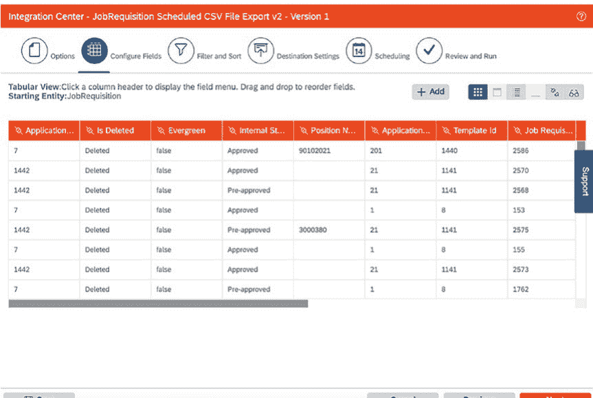

> **注意：** 您需要将“Not Deleted”的值更改为 0。虽然导出显示标签“Not Deleted”，但创建/更新 requisition 所需的代码是“0”。此外，请确保 Internal Status 字段值设置为数值。

14. 现在我们将使用此文件完成修改我们的 requisition 更新集成，使其成为创建 requisition 的集成。通过点击“Cancel”返回“我的集成”屏幕。
15. 通过点击其旁边的铅笔图标，编辑我们之前编辑的 requisition 导入集成。
16. 点击顶部“Configure Fields”。
17. 点击“Upload Sample CSV”按钮并选择您刚刚更新的 CSV 文件。示例显示在图 2-25 中。

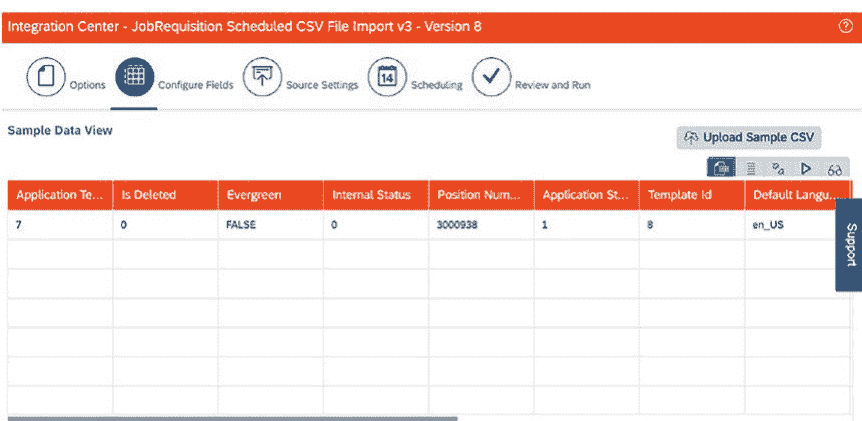

**图 2-25.** 上传 requisition 创建 CSV 的示例结果

Message. 此错误最好通过查找已存在 requisition 中的示例字段并为这些字段从您已上传作为 requisition 创建接口模板的示例导出 CSV 创建映射来修复。您可以随时修改接口进行故障排除，直到解决所有错误。

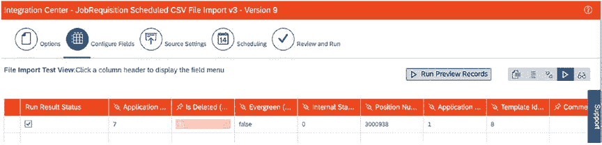

**图 2-27.** *示例 requisition 创建执行成功*

20. 您现在可以导航到 Recruiting ➤ Requisitions 并点击最后创建的 requisition 以查看您创建的详细信息。如图 2-28 所示，我们已成功创建了一个处于“Pre-approved”状态的新 requisition，准备开始其在路由图中的旅程。

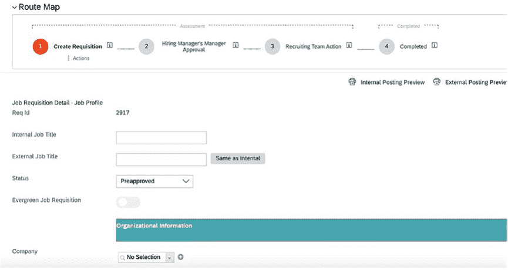

**图 2-28.** *成功创建 requisition 的示例终端用户视图*

恭喜！您现在已创建了一个示例 OData 调用；您可以让您的 HRIS 系统（或中间件）填充数据以创建 requisition！我们的示例如下所示。利用您在本章和第 1 章中获得的技能，您应该能够调用系统来创建 requisition！

```json
[
  {
    "entityName": "JobRequisition",
    "payload": [
      {
        "appTemplateId": 7,
        "evergreen": false,
        "internalStatus": "0",
        "positionNumber": "3000938",
        "statusSetId": 1,
        "templateId": 8,
        "country": "United States",
        "defaultLanguage": "en_US",
        "filter1": [
          {
            "__metadata": {
              "type": "SFOData.PicklistOption",
              "uri": "PicklistOption(id=5616)"
            }
          }
        ],
        "filter2": [
          {
            "__metadata": {
              "type": "SFOData.PicklistOption",
              "uri": "PicklistOption(id=11962)"
            }
          }
        ]
      }
    ]
  }
]
```


## 第 2 章：招聘需求创建与更新自动化

```
"filter3": [
    {
        "__metadata": {
            "type": "SFOData.PicklistOption",
            "uri": "PicklistOption(id=3979)"
        }
    }
],
"hiringManager": [
    {
        "userName": "cbraun",
        "__metadata": {
            "type": "SFOData.JobRequisitionOperator",
            "uri": "JobRequisitionOperator"
        }
    }
],
"location_obj": [
    {
        "__metadata": {
            "type": "SFOData.FOLocation",
            "uri": "FOLocation(externalCode='undefined',startDate=datetime'1900-01-01T05:00:00')"
        }
    }
],
"state": [
    {
        "__metadata": {
            "type": "SFOData.PicklistOption",
            "uri": "PicklistOption(id=11626)"
        }
    }
],
"__metadata": {
    "type": "SFOData.JobRequisition",
    "uri": "JobRequisition"
}
}
]
}
```

现在我们已经创建了招聘需求，我们剩下的任务是向 HRIS 系统（或中间件）发起一次后续的 OData 调用，以表明招聘需求创建成功并提供招聘需求 ID。为此，我们只需像之前做过两次那样再创建一个 OData 查询。我们的查询只需要包含职位（例如职位 ID）的 HRIS 系统唯一标识符，并获取招聘需求的唯一 ID。

1. 在搜索栏中输入并选择“集成中心”。
2. 点击“我的集成”。
3. 点击上次创建的导出集成旁边的铅笔图标进行编辑。
4. 点击顶部的“配置字段”，然后点击右上角的项目符号列表图标。
5. 删除除招聘需求 ID 和职位 ID 之外的所有字段。
6. 通过点击“+ 添加”按钮并搜索字段，添加字段“jobReqId”和“positionNumber”（或用于存储 HRIS 系统职位唯一 ID 的任何唯一 ID）。
7. 点击顶部的“筛选和排序”，然后点击“高级筛选”。在“字段”列中输入“职位编号”，在“值”列中输入职位的编号。示例见图 2-29。

   > **注意：** 这假设职位与招聘需求之间为 1:1 关系。此外，您可能希望使用自定义字段来存储第三方 HRIS 职位编号，而不是标准职位字段，因为该标准字段由 Employee Central 使用。

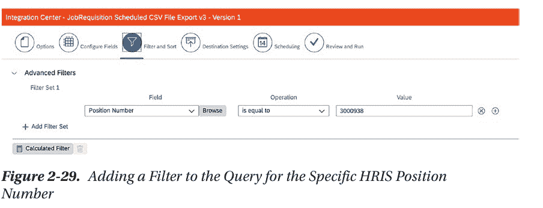

**图 2-29.** 为特定 HRIS 职位编号向查询添加筛选器

8. 点击“配置字段”查看数据的预览。查询应返回您在上一步骤中创建的招聘需求的招聘需求 ID！示例见图 2-30。


**图 2-30.** 特定职位编号查询的结果

9. 点击“保存”，然后点击“导出集成规范”。

10. 使用文本编辑器打开规范文件，并从文档最后一行复制查询 URL。

太好了！您现在拥有一个示例查询，可根据 HRIS 系统职位编号从 HRIS 系统获取招聘需求 ID！您现在可以将此查询存储在 HRIS 系统中，并在后续调用中使用，例如在职位关闭时关闭招聘需求。示例查询如下所示：

```
/odata/v2/JobRequisition?$select=jobReqId,positionNumber&$filter=positionNumber eq '3000938'
```

使用您现在获得的技能，您应该能够弄清楚在 HRIS 系统中职位关闭时如何关闭招聘需求（提示：保存我们在第一个案例研究中创建的招聘需求更新集成的另一个版本，并将 internalStatus 字段更新为“2”）。

我们现在已成功在 SAP SuccessFactors 与外部 HRIS 系统之间建立了双向通信，以打开和关闭招聘需求！

### 结论

我们希望您喜欢本次创建和更新招聘需求的分步演练！到目前为止，您应该对需要创建和更新招聘需求的业务场景有了良好的理解。此外，您应该熟悉招聘需求对象以及如何检索、更新和创建该对象的数据。此外，我们还通过几个示例案例研究向您展示了如何构建一些实用的招聘需求更新和创建集成的示例。在下一章中，我们将深入探讨使用中间件创建招聘需求的更多细节。
