## 第 3 章：使用中间件的招聘需求自动化

在第 2 章中，我们介绍了使用集成中心自动创建和更新招聘需求的过程。集成中心对于没有复杂逻辑的简单用例非常好用。它也是在与非 SAP SuccessFactors 应用程序集成同事共享之前，测试和排查 OData 调用前的绝佳工具。当更新需求超出简单计算时，我们需要考虑其他工具。

在本章中，我们将回顾用于更新招聘信息的常用工具以及每个工具的示例用例。然后我们将展示两个用例：一个使用业务规则，另一个使用 SAP Cloud Platform Integration（CPI）作为中间件集成工具。本章以职位招聘需求为例，但同样的原则可应用于 SAP SuccessFactors 所有模块中的数据。

中间件如 CPI 通常用于与第三方解决方案集成，例如与评估供应商、背景调查解决方案或推荐解决方案集成。然而，有时 CPI 也可用于在没有第三方集成的情况下自动化 SuccessFactors 中数据的处理。一个常见问题是“如果我们没有第三方解决方案，为什么要使用中间件？”答案是它有效。SAP SuccessFactors 业务规则中的限制通常可以通过使用集成来克服。示例包括招聘需求问题的处理/创建、offer 函的自动生成等。之所以在 SAP SuccessFactors 与 SAP SuccessFactors 集成时使用 CPI，是为了进行数据操作。

### 评估操纵招聘数据的解决方案

SAP SuccessFactors HXM Suite 功能强大且灵活，内置了多种操纵数据的工具。由于模块套件可通过 OData 访问，因此它也可以接收和发送非 SuccessFactors 应用程序的数据。我们在整本书中考察的四种数据操纵工具是

- 集成中心
- 由用户操作触发的业务规则（例如招聘人员）
- 批量执行的业务规则
- SAP Cloud Platform Integration（CPI）

在四种解决方案中，我们只将 CPI 分为中间件，尽管集成中心也有一些属于中间件的使用和功能。

那么，什么是中间件？中间件是位于两个应用程序之间并将一个系统的请求转换为另一个系统可消费的内容的解决方案。中间件的示例任务包括重构请求格式、将一个系统的字段值映射到另一个系统可接受的值（示例：一个下拉值集到另一个）、使用逻辑确定如何处理请求以及错误处理。中间件还充当守门员，以确保应用程序仅识别来自特定 IP 地址的请求，从而仅处理有效请求。

SAP Cloud Platform Integration 远非唯一的集成中间件提供商。其他示例有 Dell Boomi、MuleSoft、TIBCO 和 Informatica。

选择用于更新招聘数据的工具时需要考虑三个主要因素：

1. **业务逻辑复杂性** - 您是否有 If/Then/Else 类型的逻辑，例如“如果薪酬等级 > X，则将股票期权资格设为是”？集成中心在逻辑复杂性方面有限制。业务规则应该是首先考虑的工具。一个很好的集成中心用例示例是，如果我想因主数据或选项列表更改而批量更新一个字段。可以接收包含新数据的文件并导入。

2. **要读取和写入的数据** - 可供评估和操作的数据类型取决于工具。集成中心和 CPI 可以读取和写入 SAP SuccessFactors 数据模型中的任何内容。然而，集成中心有限制，即一个集成一次只能处理一组数据的读写。例如，如果我想处理一些逻辑然后同时写入 offer 审批和候选人申请，CPI 将是唯一选择。

   业务规则功能强大，但在可读取和写入的数据类型方面有限制。一些业务规则无法使用的招聘信息示例是招聘需求特定的申请问题、元数据框架（MDF）以及与招聘需求关联且标准不支持的基础对象，例如职位。例如，如果我想从位置基础对象中提取地址详细信息并用其填充电子邮件令牌，业务规则不支持。

   如果用于操纵数据的业务逻辑依赖于在自定义 MDF 对象中存储配置，则 CPI 是唯一选择。

3. **谁来执行工作？** 业务规则和集成中心设计为由系统管理员作为客户端使用。客户端可能有可以构建 CPI 集成的开发人员。如果工作可以以简单方式完成而无需开发人员和 CPI 集成的维护，则应使用业务规则。如果需要批量业务规则，则需要配置访问权限。SAP 支持或认证顾问将需要执行和安排批处理作业。

每种解决方案的用途可见于表 3-1。

### 表 3-1. 选择解决方案时的考量因素

| 决策因素 | 批处理业务规则 | 用户触发业务规则 | 集成中心 | CPI |
|---|---|---|---|---|
| 技术难度 | 低 | 低 | 中 | 高 |
| 评估逻辑（如果/那么） | 是 | 是 | 有限 | 是 |
| 读取/写入多个对象 | 否 | 否 | 否 | 是 |
| 访问所有 ODATA 对象 | 否 | 否 | 是 | 是 |
| 基于自定义 MDF 对象的业务逻辑 | 否 | 否 | 否 | 是 |
| 由客户端管理员执行 | 需协助 | 是 | 是 | 否 |

查看该表，CPI 似乎是最佳的整体解决方案。然而，CPI 存在一些缺点，如果存在其他解决方案，应尽量避免使用：

- 工作量 – CPI 集成通常涉及功能规范、技术规范、额外的开发以及测试工作。
- 技术债务 – 客户从本地部署迁移到云端的原因之一是为了停止拥有需要长期维护的自定义解决方案。
- 所有权与流程敏捷性 – 如果招聘系统管理员能够在流程变化时进行更改，他们就能更迅速地响应其客户（招聘人员）的需求。

本书不会详细介绍构建 CPI 集成。其目的是教您如何选择合适的工具，以及在 CPI 的情况下，需要与集成开发人员共享哪些需求。

## 案例研究：自动为远程职位名称添加“Remote”

在职位申请表中添加了一个指示远程职位的字段。客户希望外部面向职业网站以及招聘平台的职位名称为职位名称，如果远程招聘字段为“是”，则在其后加上“(Remote)”。职位名称始终默认为职位，且招聘人员无法更改。远程指示符默认为职位，但招聘人员可以更改。因此，外部职位名称的更改需要自动化。

外部职位名称已经通过使用在从职位创建职位申请时触发的业务规则进行填充。我们希望在远程工作字段的值被用户（如招聘人员）更改时更新该标题。由于 SAP 对此已有非常完善的文档记录，我们将不会在此详述创建业务规则的具体步骤。

我们只需创建一个由与申请表的远程工作字段关联的 onChange 条件触发的规则。然后该规则检查 Remote Job 是否等于 Yes。如果此条件为真，则外部职位名称更改为职位名称 + “(Remote)”。如果为假，则将职位名称设置为职位名称。这确保了如果申请从远程招聘切换为本地招聘，单词“remote”会被移除。

## 案例研究：自动向申请表添加问题

### 申请表问题背景

SAP SuccessFactors 招聘模块中的求职申请实体功能强大且灵活，能够根据招聘国家/地区、申请状态（例如，申请人首次申请时与接受录用通知时）、申请人是现有员工还是外部申请人，以及所使用的申请表模板（例如，专业招聘与实习生）来捕获求职申请信息或后续信息请求。

问题是在创建申请表时，在发布到内部和外部招聘平台之前添加到单个申请表中的。在图 3-1 中，我们可以看到问题是如何添加到申请表中，进而添加到申请人填写的申请表单中的。问题可以从预定义的库中选择，也可以在创建申请表时创建。虽然问题选择是一个简单的过程，但选择它们

### 问题

你至少年满 18 岁吗？多选题

你有项目管理经验吗？多选题

答案格式：多选题

答案范围：是

否

添加另一个答案

正确答案：是

关闭

["Yes"] 你有多少年的项目管理经验？多选题

答案格式：多选题

答案范围：1-3 年

3-5 年

5-10 年

10 年以上

添加另一个答案

正确答案：1-3 年

关闭

### 图 3-2. 向申请表添加级联问题

维护一个按类别组织的、一致的预筛问题库，有助于确保对申请人进行一致且无偏见的筛选。如果招聘人员有不在库中的专业问题，它们可以在图 3-3 所示的“我的已保存问题”下创建。

### 图 3-3. 向个人偏好设置添加问题

保存在个人偏好设置下的问题随后可以在申请表的“我的已保存问题”下使用，如图 3-4 所示。

### 图 3-4. 从我的已保存问题向申请表添加问题

组织有序的申请表问题库是确保筛选问题一致性的第一步。然而，仍然存在招聘人员根据预筛要求向申请表添加问题的人为因素。这既增加了创建申请表的工作量，又引入了

人为错误的 possibility。这就是自动化的用武之地。我们默认申请表问题的选项有限。目前，业务规则不支持此类数据。由于能够访问所有 ODATA 实体对象，如职位申请筛选问题，中间件在这里显得非常有用。

为了这个示例的目的，我们将保持自动化简单且实用。对于使用申请表问题自动淘汰候选人的组织，要求是根据招聘需求始终包含正确的淘汰问题。招聘人员也是人。有时他们会忘记在申请表中添加必要的问题。更糟糕的是，有时问题是在某些申请人完成申请后才添加的，这会导致因同一职位区别对待申请人而引发的法律和合规问题。

我们将使用问题库中现有的问题，并使用申请表模板来确定要添加的问题。申请表模板的例子包括实习生、专业人员、特定国家或特定部门。通常，申请表模板越少，对于同质化的全球业务流程越好，系统维护工作量也越低。区分要添加问题的其他标准可能包括职位族、国家以及其他许多因素。

## 相关 ODATA 实体回顾

我们可以从图 3-5 中看到，多个问题可能关联到一个申请表，并且一个申请表问题可能有多个选项。当多个问题选项用于一个问题时，它们将不会与文本回答（类型为 TEXT_QUESTION）或数字回答（类型为 NUMERIC_QUESTION）关联。

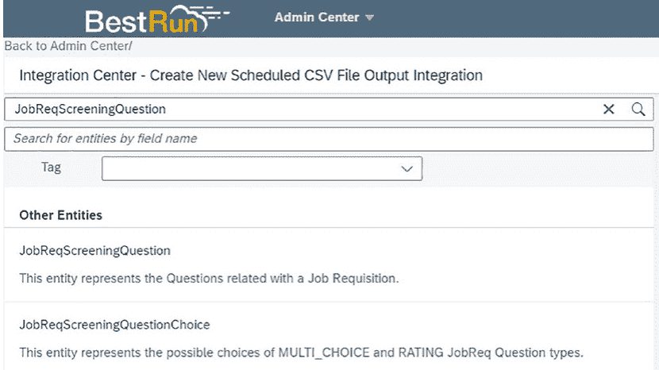

### 图 3-6. 从 JobReqScreeningQuestion 开始查询

然后，我们将选择希望在输出中包含的字段以及我们要导航到的实体。在图 3-7 中，我们导航到问题选项和申请表。如果我们选择 JobRequisition 作为起始实体，则我们会选择 JobReqScreeningQuestion 作为要导航到的实体。导航部分始终显示可以从起始实体立即导航到的实体。

## 第 3 章 使用中间件进行申请表自动化

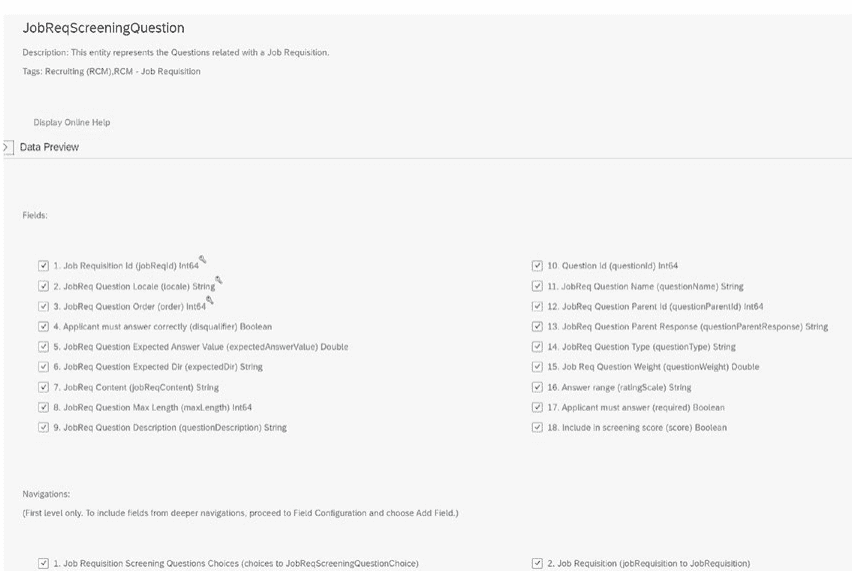

如图 3-8 所示，为你的集成选择一个名称并点击下一步。由于我们仅测试字段输出，因此无需担心文件类型或其他信息。

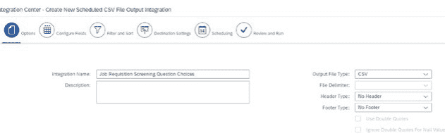

图 3-9 中的“配置字段”屏幕显示了数据输出的预览。由于我们将执行简单的列输出，这里仅展示部分功能。

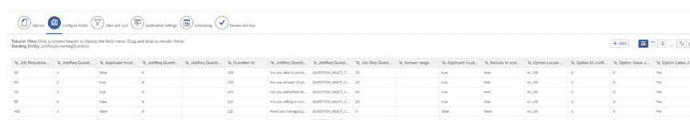

### 图3-9：数据输出预览

为了添加 JobRequisition 和 JobReqScreeningQuestionChoice 字段，我们将使用“+ Add”按钮，然后从菜单中选择“Add Field”来添加列。字段将从左侧的 Entity Tree View 选项中选择。向下滚动到 JobRequisition 以添加 JobRequisition 字段，再滚动到 JobReqScreeningQuestionChoices 以显示多项选择的问题选项。选择某个实体后，该实体的字段或导航选项将出现在右侧。图3-10显示了通过 choices 导航添加 Option Label 字段的过程。要在此屏幕上添加多个字段而无需离开，请勾选左下角的“Add Another”，并在选择每个字段后点击“Add Association”。完成后点击 Cancel。

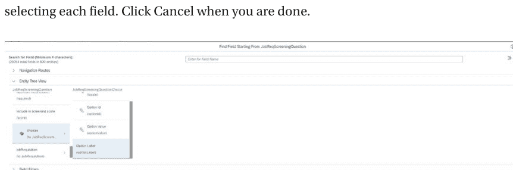

### 图3-10：向集成输出添加字段

当查看图3-11中的输出时，我们会发现一些奇怪之处。每个多项选择题只有一行。考虑到有多个选项，我们本期望会有多行。Question Id 列显示与问题库中 GUID 匹配的 Question Id。每个问题都只有一行。

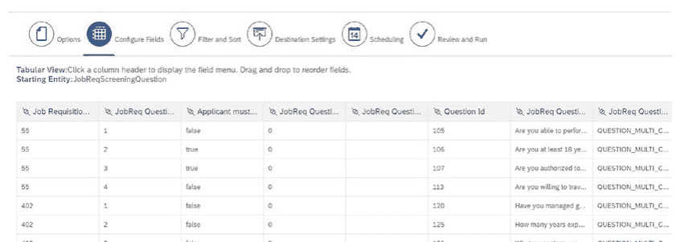

### 图3-11：职位申请问题输出示例

Integration Center 专为简单输出而设计，而我们刚刚展示了一个限制。我们将使用 Postman 来更全面地了解 JobRequisitionScreeningQuestion 和 JobReqScreeningQuestionChoice 实体。

## 使用 Postman 请求职位申请问题选项

在第1章中，我们使用 Postman 向 SAP SuccessFactors 发出了一次 ODATA 调用，以检索一些职位申请信息。在本示例中，我们将拉取与该职位申请关联的实体。除了多项选择题的选项外，我们还将请求与该职位申请关联的问题。

登录 SAP SuccessFactors Recruiting 的测试或演示环境，找到一条关联了不止一个问题的职位申请。其中应至少有一个多项选择题。如果你没有这样的数据，可以新建一个带问题的职位申请，或向现有职位申请添加问题。记下该职位申请的 ID。

打开 Postman 应用，确保选择了你在第1章中创建的环境，如图3-12所示。在使用多个环境时，一个常见错误是以为数据或 HTTP 请求出了问题，而实际上只是选错了环境。

我的职位申请的 URI 是 {{Host}}/JobReqScreeningQuestion?$format=json&$select=jobReqId,jobReqContent,questionId,questionName,questionType&$filter=jobReqId eq 55。

让我们来检查一下上述参数：

$format=json

在第1章中，ODATA 响应的消息正文使用的是 XML 格式。JSON 格式是一种开放、轻量级的数据交换标准，具有“自描述”性，也就是说，机器和人都很容易阅读。它被 Web 应用程序与服务器通信时广泛使用。你会注意到，这种输出读起来容易得多。

$select=jobReqId,jobReqContent,questionId,questionName,questionType
$filter=jobReqId eq 55

这指定职位申请 ID 为55。对于你的 SAP SuccessFactors 系统，这个 ID 很可能不同。在第1章中，我们使用了 URI host/JobRequisition?internalStatus=Approved。那么现在为什么还需要使用 filter 参数呢？因为我们不是直接访问职位申请，而是通过 JobReqScreeningQuestion 访问。

点击 Send 运行查询，然后查看 JSON 格式的结果。结果应如图3-14所示。

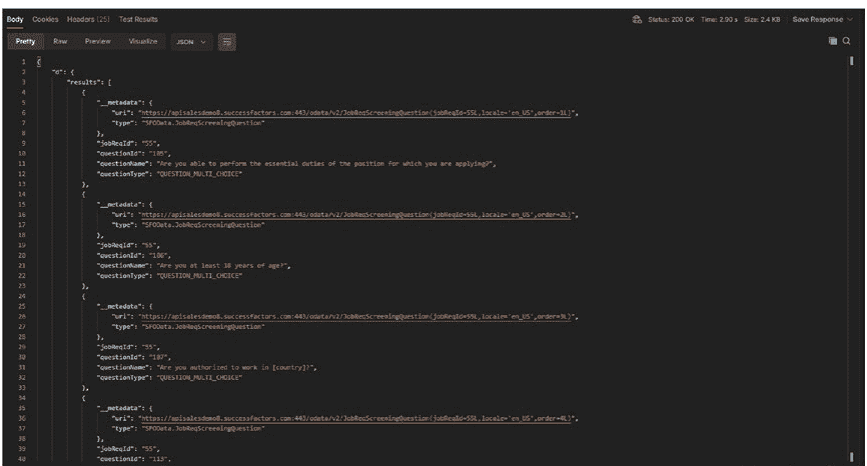

图3-14：JSON 格式的 ODATA GET 响应

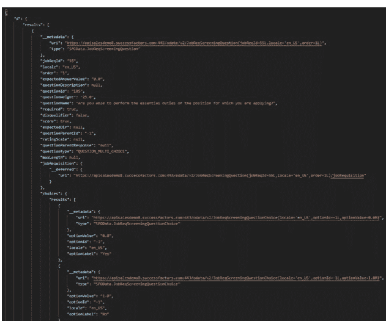

### 图3-15：JobReqScreeningQuestion 的 JSON 结果（包含选项）

在 results 标签内，每个问题由以下内容表示：

- URI – 直接访问该实体的 URI
- Type – ODATA 实体的类型
- 实体字段和值的列表
- 一个用于职位申请的 URI
- 每个问题的选项嵌套列表，包括选项的 URI、类型 JobReqScreeningQuestionChoice，以及每个选项的字段和值列表

你会注意到，选项 URI 中引用的实体是 JobReqScreeningQuestionChoice，而我们使用了 `$expand` 值“choices”，结果中也包含了选项的内容。这是因为，虽然 JobReqScreeningQuestionChoice 是实体，但从 JobReqScreeningQuestion 到 JobReqScreeningQuestionChoice 的导航值是“choices”。

在第一个示例中，我们使用的 URI 是 {{Host}}/JobReqScreeningQuestion?$format=json&$select=jobReqId,jobReqContent,questionId,questionName,questionType&$filter=jobReqId eq 55，结果中只包含了少量字段。第二个 URI `{{Host}}/JobReqScreeningQuestion?$expand=choices&$filter=jobReqId eq 55&$format=json` 除了包含每个选项的所有字段外，还包含问题的所有字段。既然第二个 URI 更简单，又能提供我们需要的所有信息，为什么不直接使用它呢？

在生产系统中，返回大量数据会降低响应速度。通过使用 `$select` 只返回足以应用业务逻辑的信息，随后便可用返回的 URI 拉取所需问题的数据。例如，如果只需要问题名称中包含“electronics”或“engineering”的题目的选项信息，就需要检索 questionName。原因是 questionName 不是可筛选字段。任何筛选都需要由中间件处理。

`$filter` 参数包含一些非常有用的运算符，例如 eq 表示等于、ne 表示不等于、gt 表示大于、lt 表示小于，此外还有 And、Or、Not 等。

ODATA V2 还有一些有用的筛选函数，例如 `substringof(string to match, field to match against)`。这方面的示例是 `/JobRequisitions$filter= substringof('Engineer',jobReqLocale/jobTitle) eq true`。这只会包含职位名称中含有字符串“Engineer”的职位申请。

有关运算符和函数的完整列表，请参见 www.odata.org/documentation/odata-version-2-0/uri-conventions/。

## 使用自定义配置向职位申请添加问题

正如我们在前言中所说，本书不会教你如何使用 SAP 云平台集成（CPI）等工具构建中间件集成。虽然集成开发人员会从本书中受益，但其目的是教客户和功能顾问如何构建概念验证，并正确描述接口所需规范。在这里，你将看到以下内容：

- 一个向职位申请添加问题的流程
- 一个用于配置在职位申请上创建问题的自定义元数据框架（MDF）对象示例
- 一个使用 Postman 调用向职位申请添加带多个选项的问题的示例

## 向职位申请添加问题的流程

- 触发向职位申请添加问题。
- 使用 MDF 对象配置将哪些问题添加到哪些职位申请中。
- 向职位申请添加问题。
- 更新职位申请，以表明更新成功。

## 触发向职位申请添加问题

任何需要添加到职位申请的问题都必须在职位申请发布前完成添加。我们不希望在问题添加之前，求职者就已经开始申请该职位。自动添加问题也应在招聘人员手动添加任何问题之前完成，否则他们可能会做无用功。

主要有两种方法可以触发向职位申请添加问题：

- 使用智能服务中心（ISC）中的“Update of Job Requisition”事件。
  - ISC 允许 SAP SuccessFactors 预定义的事件触发操作，例如发起出站 Integration Center 调用。
  - 由于每次创建或更新职位申请时都会触发该事件，因此可以使用 Integration Center 中的筛选器来确定哪些事件应触发添加问题。
  - 第12章将更详细地介绍 ISC 的使用。
- 使用来自云平台集成（CPI）的定期调度调用。该调用将检查尚未自动添加问题的职位申请。

在这两种方法中，我们更倾向于使用 ISC 的实时触发。它会在职位申请创建后的最早时间添加问题。它还免去了对 SAP SuccessFactors 的频繁调用，从而减少了 CPI 的开销。

为了简化集成并减少读取 JobReqScreeningQuestions 的开销，我们建议在职位申请中添加一个简单的布尔字段，用于表示问题已添加。然后，在确定是否需要添加问题时，可以将其用作筛选条件。由于该字段仅用于集成，因此不应让招聘用户看到。

### 自定义MDF对象以确定要添加到招聘需求中的问题

设置逻辑以始终将特定问题添加到特定类型的招聘需求中，主要目的是自动淘汰不合格的申请人，并确保这些筛选问题得到一致的应用。申请字段不会自动淘汰申请人（尽管借助集成功能，它们也可以做到这一点）。申请字段的另一个缺点是，申请字段的差异化会导致额外的申请模板和招聘需求模板。申请字段可以按招聘国家以及申请人是否为外部人员或现有员工来进行区分。

使用特定于招聘需求的问题有以下缺点：

-   它们不能用于报表（尽管可以通过集成中心实现）。
-   它们不能用作电子邮件/录用通知书中的令牌。
-   它们之后不能在业务规则中使用。
-   在查看申请列表时，它们不能用作列。
-   它们总是同时呈现给内部申请人和外部申请人。

鉴于筛选问题应当保持一致，不应对特定人群产生不利影响，并且应当是职位所真正必需的，那么应使用何种标准来确定问题呢？以下是一些示例：

-   **招聘需求模板** – 例如，正式职位与实习职位。
-   **国家/地区** - 用于确定特定国家/地区的招聘资格，或排除不能询问的问题。
-   **职位族或角色** – 这些通常属于不太严格和绝对化的筛选问题。例如，必需的驾驶执照或认证。

图3-16展示了一个自定义MDF对象的示例，该对象用于根据招聘需求模板自动添加问题。如果您需要默认设置的问题很少且逻辑简单，为什么不直接告诉开发人员要默认设置哪些问题，而要添加自定义MDF对象呢？需求会随着流程的变化而不断改变。系统管理员需要能够自行更新规则，而不是请求开发人员。

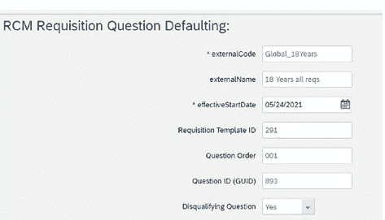

图3-16. 用于默认设置招聘需求问题的自定义MDF对象

在上述示例中，我们使用了externalCode“Global_18Years?”来更方便地识别该问题，并表明它对所有招聘需求模板均有效。请注意，我们将招聘需求模板ID留空，以表示该问题适用于所有招聘需求模板。我们在此不指定问题类型或可能的答案。相反，我们引用的是Question ID，即该问题的GUID，可以通过导出问题库来获取。

维护之前的配置将是一个持续进行的过程，由招聘管理员执行。因此，必须按照图3-17使用基于角色的权限（RBP）对其进行保护。

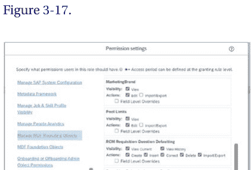

图3-17. 问题默认设置配置的基于角色的权限示例

图3-18展示了在职位招聘需求上默认设置问题的高级步骤。

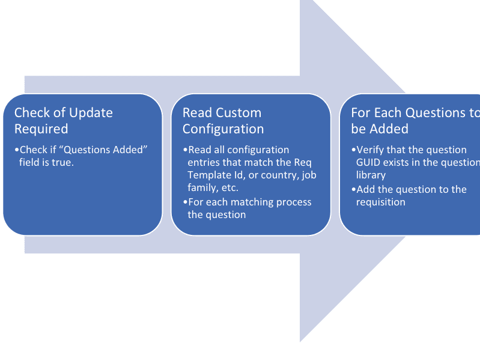

图3-18. 向职位招聘需求添加问题

当集成被触发时，需要执行以下操作：

-   检查招聘需求问题是否已自动添加。
-   读取自定义配置，以确定要添加哪些问题、它们是否为筛选问题，以及是否为必填项。
-   对于与职位招聘需求相关的每个问题
    -   从问题库中读取问题和选项（如果是多选）。
    -   针对该招聘需求创建职位招聘需求筛选问题。
    -   针对新创建的职位招聘需求筛选问题创建可能的答案（如果是多选）。

### 添加职位招聘需求筛选问题的Postman调用示例

向职位招聘需求添加问题相当简单直接。由于我们使用的是问题库中的问题，因此不需要指定问题选项。如图3-19所示，我们使用了简单的URI端点/upsert?format=JSON。选择“Body”选项卡后，选择“raw”并指定JSON格式。

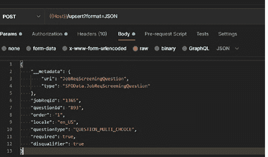

图3-19. 使用Postman向招聘需求添加问题

请求体metadata部分中的URI和type用于指定特定的实体和类型。URI可以包含一个参数，指示要更新的现有实体。在这种情况下，这没有必要，因为我们使用UPSERT方法添加的是新问题。

在图3-20中，我们可以查看结果。一个JobReqScreeningQuestion已成功添加到招聘需求1365中。

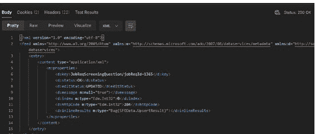

图3-20. 添加职位筛选问题后的结果

如果我们添加的不是来自现有题库的多选题，这将需要将选项作为实体JobReqScreeningQuestionChoice进行添加。这不是推荐的做法。

### 结论

您现在已经学会了如何为招聘自动化选择合适的工具。这将有助于您理解客户需求以及如何解决这些需求。在决定需求是否可以通过业务规则、集成中心或第三方中间件（如CPI）解决时，这将非常宝贵。

您还了解了在捕获申请人信息时，何时使用职位招聘需求问题与申请字段。为了支持职位招聘需求问题的默认设置，您了解了JobRequisition、JobReqScreeningQuestion、JobReqScreeningQuestionChoice和JobReqQuestions这些实体是如何协同工作的。

在第一章所学内容的基础上，我们深入研究了第一个ODATA Upsert操作，以实现向职位招聘需求添加问题。为此，我们使用了Postman工具。在此过程中，我们学习了如何使用JSON格式构建GET请求。

您还学习了如何使用自定义MDF对象来配置职位招聘需求问题的添加。

在下一章中，我们将讨论职位发布的自动化，并再次探讨ODATA，展示如何在WordPress中显示职位数据。
