## 第4章：候选人吸引

在上一章中，我们探讨了如何使用自动化工具来减少招聘人员在管理任务上花费的时间，例如反复向招聘需求添加相同的申请问题。招聘技术的目标之一是解放招聘人员的时间，以便更好地与未来的员工互动。第5章将讨论候选人在招聘网站上的互动，以及一旦访问者和申请人迈出第一步——访问网站并提供一些自身信息后，如何自动与他们互动。那么，如何首先将访问者吸引到网站呢？

在本章中，我们将探讨如何将访问者吸引到您的招聘网站，无论是直接引导至职位发布还是特定内容。

### 候选人吸引概述

大多数组织都需要努力寻找和雇用最优秀的人才。很少有雇主能够有幸在其所在行业或地区被视为首选雇主。即使是那些幸运的少数组织，也仍然会有一些专业职位，需要合适的营销方法和媒介来吸引这类人才填补这些专业岗位。

人才营销是让合适的人愿意在您的组织工作的策略、过程和方法。这与吸引和留住客户的过程类似。它包括但不限于：

-   吸引具有多元背景和经验的候选人
-   在人才社区聚集之处保持存在感并发出声音：网络论坛、招聘会、高校、网站、校友协会等。
-   制作能引起候选人共鸣的、有说服力的职位发布
-   在能够触达具有合适经验的候选人的渠道上发布职位
-   发挥员工的力量，使其成为雇主大使、社交联络人和候选人推荐人
-   在您所做所说的一切中强化雇主价值主张（EVP，即“为什么在这里工作？”）
-   确保招聘渠道、招聘人员、招聘经理和员工能够以同一个声音阐述EVP
-   创建易于使用的招聘网站，提供超越初次申请的引人入胜的体验
-   为潜在候选人提供价值，如职位匹配、职业建议以及员工分享的关于其工作的真实感受

人才营销是一项艰巨的任务，需要针对合适的人才和竞争激烈的招聘环境制定相应的策略。技术可以自动化这一过程，并将您的信息传递给更广泛的受众。如果您的雇主价值主张不够真实和引人入胜，再多的技术也无法弥补。

### 提高候选人吸引力的策略与工具

图4-1展示了可以将网站访问者吸引到职位发布页面的部分渠道。从中心绿色的职位发布开始向外延伸，您可以看到黄色的不同渠道网站类型，即职位发布可以展示的地方，一直到图表外缘白色的这些渠道的具体示例。可选方案数量庞大，所选择的组合将基于您的目标人才常访问的地点、您对某一人才细分群体的招聘量，当然还有预算。本书的目的是支持招聘领域的技术创新和自动化，而非教授人才营销。


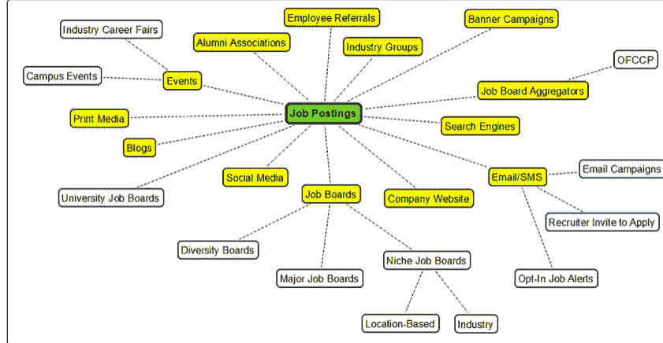

### 图 4-1 候选人的来源示例

人才营销与寻源明显不同。在寻源中，寻源人员通过 Google 简历搜索、LinkedIn、社交媒体等渠道主动联系被动候选人（即没有在找工作的人）。申请人跟踪系统（ATS）中的候选人池是候选人的一个来源，但通常不会在其中找到被动候选人。招聘（Recruiting）是为特定招聘需求管理申请人招聘活动的过程。寻源和招聘的职责可能会混合在一起，尤其是在规模较小的组织中。

将候选人吸引到职位发布的初始环节只是候选人生命周期的一部分，如图 4-2 所示。从左到右可以看到候选人生命周期：

- 吸引（Attract）：职位发布被发布到不同渠道。
- 个性化（Personalize）：候选人可以选择订阅职位提醒和营销信息，以便收到与其兴趣相关的新职位发布通知。
- 互动（Engage）：候选人与招聘网站互动，通过聊天机器人、短信、电子邮件等各种渠道接收信息。
- 转化（Convert）：候选人通过主动表明对特定职位的兴趣而成为申请人的阶段。

• 招聘（Recruit）：这是传统意义上的申请人跟踪。

申请人会被筛选、面试、录用或淘汰。

先前寻源工作的努力会得到回报，因为可以邀请现有合格人才库中的候选人申请。此外，AI 搜索和匹配可以找到符合招聘需求的现有候选人。

招聘（Recruit）也成为未来人才互动的来源，因为那些合格但因其他候选人更胜一筹而被淘汰的候选人被视为“银牌获得者”，并被放入人才库，供未来的寻源和互动使用。

• 发展（Develop）：既支持内部流动，也利用员工推荐。

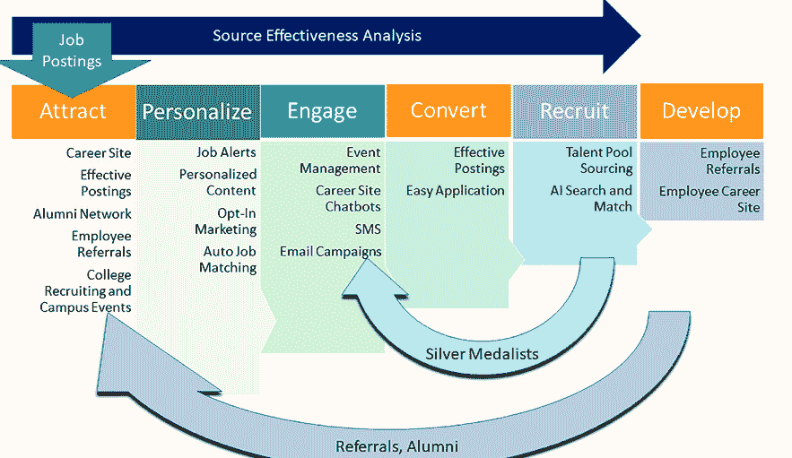

### *候选人生命周期*

除了通过职位发布分发来开展人才营销外，候选人生命周期还包括候选人关系管理（CRM），即通过候选人自我兴趣识别、人才库管理和电子邮件活动自动与候选人互动，如前文“个性化”和“互动”阶段所述。

没有任何招聘解决方案能够解决所有问题。SAP SuccessFactors Recruiting 处于与它集成的互补解决方案生态系统之中。你可以在 SAP Store 上找到许多第三方解决方案（参见图 4-3）：https://store.sap.com/dcp/en/search/recruiting。请注意，第三方解决方案并不一定要在 SAP Store 上才能与 SAP SuccessFactors Recruiting 兼容。

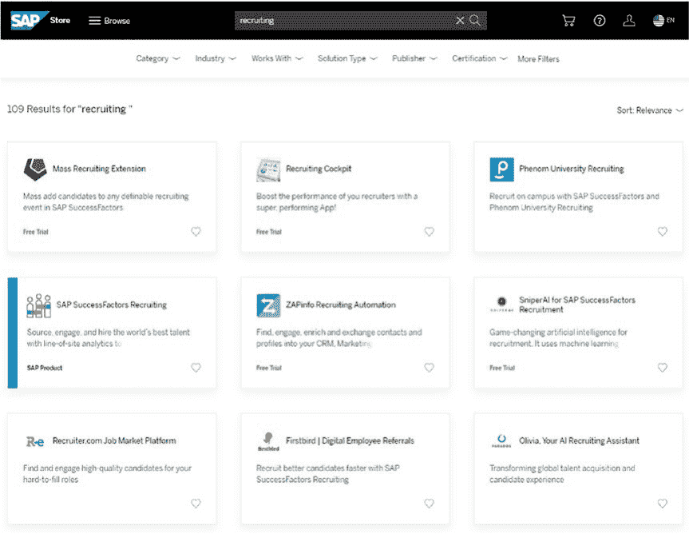

## 需要集成的候选人吸引相关业务场景

表 4-1 列出了常见的人才营销和寻源需求、可满足这些需求的第三方解决方案、与 SAP SuccessFactors Recruiting 集成所需的类型，以及示例供应商。请注意，所列供应商仅为示例，并非推荐。

## 第 4 章　候选人吸引

**表 4-1.** *需要集成的候选人吸引业务场景示例*

| 需求 | 解决方案 | 集成方式 | 示例供应商 |
|---|---|---|---|
| 校友寻源 | 校友解决方案集成 | 使用 Intelligent Services 和 Integration Center 导入候选人，通过 XML feed 发布职位 | Enterprise alumni, PeoplePath |
| 发布到小众招聘网站（如 OFCCP） | 招聘网站聚合器 | Recruiting Marketing XML feed | Direct employers |
| 早期职业/实习生招聘 | 大学招聘网站 | Recruiting Posting | |
| 通过短信进行互动式寻源 | AI 聊天机器人解决方案 | Integration Center 和 Intelligent Services | Paradox |

本章重点讨论如何通过将职位发布分享到所需人才经常访问的网站来吸引候选人。

尽管本书的主题是利用 SAP SuccessFactors 提供的广泛 API 进行创新，但大多数利用职位发布开展的候选人触达都是通过 SuccessFactors 预先提供的功能完成的，或者也可以提出请求。这通过两种方法实现：XML feed 和 Recruiting Posting 解决方案。

最常见的职位发布分发场景可以通过标准 XML feed 功能或使用 Recruiting Posting 来处理。

除了将职位发布到现有招聘网站之外，组织可能还希望在 Recruiting Marketing (RMK) 之外，将职位发布和搜索功能嵌入其现有网站。现有网站可能使用内容管理系统（CMS），如 Drupal 或 WordPress。乍一看，与组织的 Web 开发团队合作进行 ODATA 调用、拉取招聘需求和发布数据似乎顺理成章。然而，XML feed 是更好的选择。原因如下：

-   它省去了构建 ODATA REST 调用和解析 XML 或 JSON 结果的工作，因为 XML feed 被设计为只包含恰当信息的简单职位发布信息。
-   无需 API 用户即可调用。这是公开可用的 XML feed。这降低了复杂性，也减少了向 SAP SuccessFactors 发起调用的第三方数量。
-   如果发布需要按特定国家/地区、部门、职位职能等进行分类，则可以使用规则对 feed 进行预过滤。
-   申请 URL 可以为特定规则分配活动代码参数（UTM_Campaign 参数），以提供更准确的进阶分析信息。

## 案例研究：使用 WordPress 重新发布

一家企业软件咨询公司在其网站上有一个博客，涵盖许多主题，包括 SAP SuccessFactors Recruiting。该博客使用 WordPress 平台。当博客文章专注于 SAP SuccessFactors Recruiting 咨询主题时，公司希望将相关职位发布嵌入到博客文章中。职位列表需要自动更新，而无需编辑博客文章。我们的示例站点如图 4-4 所示。

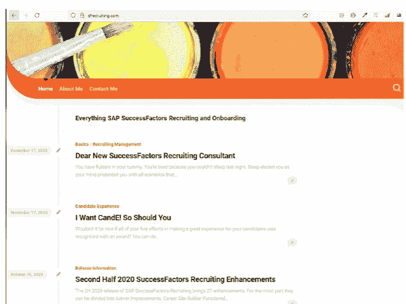

图 4-4. 包含博客文章的示例网站

## 第 4 章 候选人吸引

以下是一些关键要求：

-   面向顾问的博客文章应在底部自动包含相关职位发布列表。
-   每个职位发布都应在博客文章中作为带链接的内容呈现，并链接回 Recruiting Marketing 主招聘网站上的对应职位。我们的人才营销专家告诉我们，这些链接有利于搜索引擎优化（SEO）。
-   我们的首页通常会显示博客文章列表。我们不希望在这里包含职位发布，因为这会让网站看起来像招聘网站，而不是有实用内容的博客网站。

图 4-5 和图 4-6 展示了 Recruiting Command Center。

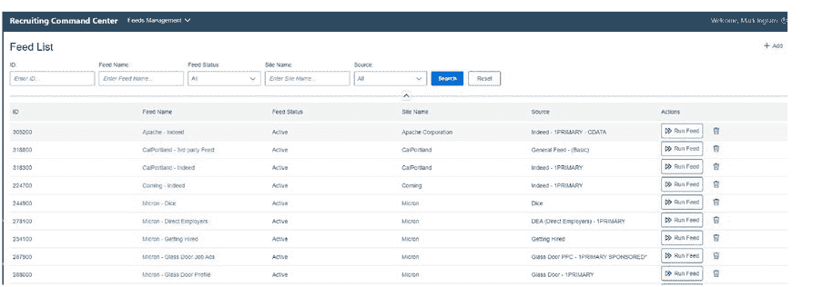

**图 4-5.** *Recruiting Command Center Feed 列表*

## 第 4 章 候选人吸引

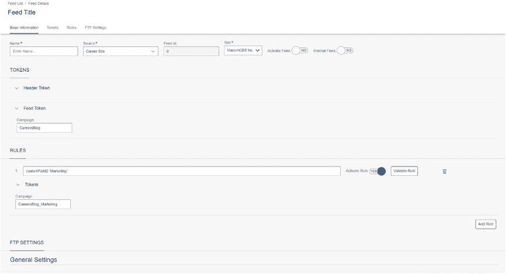

### 图 4-6. Recruiting Command Center Feed 详情

职位发布 feed 的 XML 示例如下所示。请注意，你的 XML feed 可能会有所不同。

我们不希望所有职位发布都发送到 WordPress 网站。我们希望将博客读者与他们关心的职业相关的特定职位发布连接起来。在之前的示例中，我们使用了一条规则，只包含标题中包含“SuccessFactors Consultant”的职位发布。

```xml
<?xml version="1.0" encoding="UTF-8" ?>
<source>
  <publisher>myTestRMKSite</publisher>
  <publisherurl>jobs.myTestRMKSite.com</publisherurl>
  <jobs>
    <job>
      <title>Consultant</title>
      <date>Fri, 25 06 2021 00:00:00 GMT</date>
      <referencenumber>540-en_US</referencenumber>
      <url>https:// jobs.myTestRMKSite.com/job/Consultant-WA-98020/86338550/?feedId=18876&utm_source=WordPress&utm_campaign=SomeTestBlog</url>
    </job>
  </jobs>
</source>
```


<company>My Test Company</company>
<city>Edmonds</city>
<state>WA</state>
<country>US</country>
<postalcode>98020</postalcode>
<department>Consulting</department>
<description>This is a test job posting for a SuccessFactors Consultant. We should have some job description here.</description>
<segments></segments>
	<category>Full-Time</category>
</job>
<job>

The XML feed is automatically generated using the Command Center. Currently certified consultants and SAP support have access to Recruiting Command Center. Most of the XML is self-explanatory. Note some key values:

- **Title** – Posting title
- **Date** – Posting date
- **Reference number** – This is the job requisition ID plus the language locale. There may be multiple postings in different languages.
- **URL** – This is a link for a candidate to apply. It takes the candidate to the posting within RMK. Within the link are two URL parameters that are used by advanced analytics:
  - *Utm_source* – We will use the predefined source of “WordPress.”
  - *Utm_campaign* – We will use this to differentiate between blogs. I’m using a test one *SomeTestBlog.*

Once the feed is generated, we can use the feed URL to populate WordPress. On our WordPress site, we are going to do the following:

- Automatically import external job postings, creating a WordPress post for each one.
- List the current job postings dynamically on any blog post that uses relevant shortcodes. Shortcodes are a way of embedding dynamic content within posts.
- Automatically exclude job postings from displaying on the WordPress home page.

> **Note** This is an example of how to include job postings within your content management system (CMS). Other examples are:
> 
> - Create a WordPress plugin to show hot jobs.
> - Import job posting feed XML to a non-RMK search page hosted by the customer.
> - Explore other prebuilt tools such as the WordPress “WP Job Manager” plugin (https://wpjobmanager.com). This can be used to support search pages, set up job alerts, etc. This plugin should be of limited use as you should generally use the native RMK search.

Remember to not reinvent the wheel if SAP SuccessFactors already supports functionality. In every posting technology decision you make, consider whether accurate source reporting via advanced analytics will be supported. The technology used will be mostly driven by the client’s in-house tools of choice, such as Drupal or WordPress, homegrown solutions.

This book does not introduce WordPress administration. For this example, we are using an already hosted WordPress site and already existing plugins to avoid complexity. You can also install WordPress locally on your computer to test this scenario.

The following are the WordPress plugins that we are using:

- Ultimate Category Excluder (UCE) https://wordpress.org/plugins/ultimate-category-excluder/
- WP All Import Pro www.wpallimport.com/
- WP All Import Scheduling Subscription (only needed in a production environment)

## CHAPTER 4 CANDIDATE ATTRACTION

Figures 4-7 and 4-8 show the WordPress Admin plugins page. This is where plugins are added and activated. It will initially show the existing plugins that have been loaded.

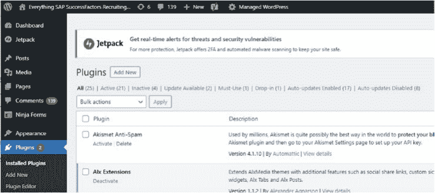

*Figure 4-7. Plugins Within WordPress Admin*

Figure 4-8 shows the results when we search for the Ultimate Category Excluder. The Ultimate Category Excluder (UCE) makes it possible to easily exclude categories from your front page, archives, feeds, and searches. You will need to install and activate this as well as the WP All Import plugin.

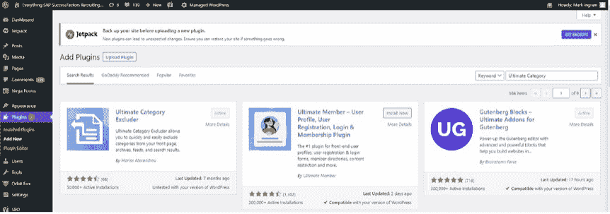

*Figure 4-8. Searching for the Ultimate Category Excluder Plugin*

After the plugins Ultimate Category Excluder and WP All Import Pro (or non-pro version, which is free) have been installed and activated, let’s put them to work.

First, we want to set up and import job for the job posting XML feed that we previously created in Command Center.

On the main menu, click **All Import** as shown in Figure 4-9. This is the plugin that we previously activated. Then click *“New Import.”* We do this in Settings. When we click Settings on the left side, any activated plugins that have settings will be shown below the Settings menu.

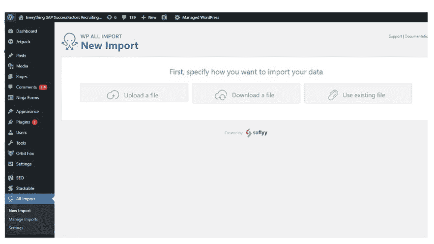

**Figure 4-9.** *Starting the Initial Setup and Posting Load for WP All Import*

Click “Download a file” and then “From URL.”

We will then provide the URL of the job posting XML feed, per Figure 4-10.

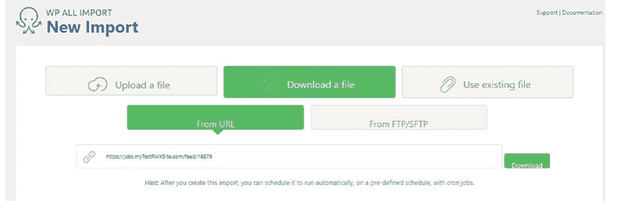

**Figure 4-10.** *Specifying the RMK Posting XML Feed for WP All Import*

In Figure 4-11, we choose to make WordPress posts for each uploaded job entity in the XML. This could also be used to create pages.

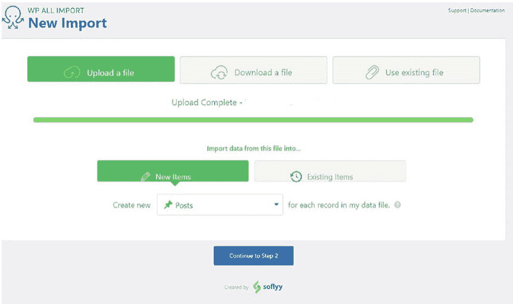

Figure 4-11. Post Import Options for WP All Import

Figure 4-12 shows the selection of the data that will be used for a WordPress post. WP All Import will read the XML and show it on the right side, along with equivalent buttons on the left side. Click the XML element that should be used to create a post. In this case, it will be the job as we want a post creating for each job.

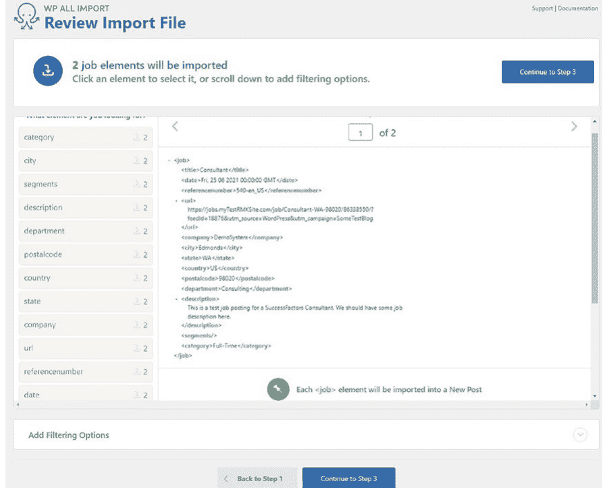


Figure 4-13 shows how to define a template for a WordPress post, using data from the XML. Specify where the title comes from, the job description, locations, etc. Elements from the XML are selected by choosing them on the right side. Text such as "Location:" can be added to the template and it can also be formatted. When creating a hyperlink, click the chain icon to edit the link properties.

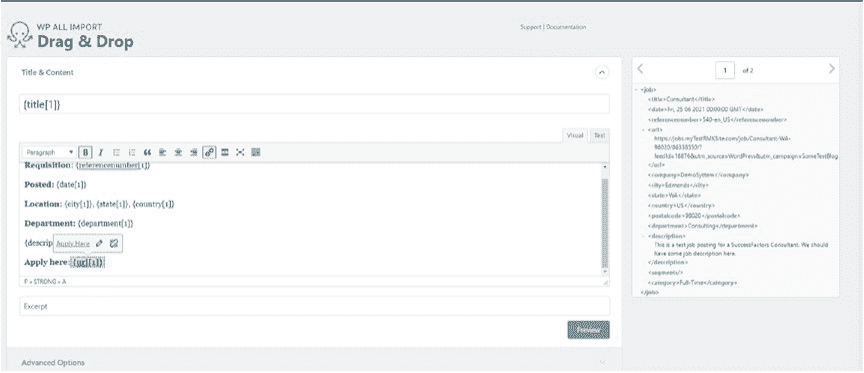

*Figure 4-13.* Specifying the Layout of Each Post by Dragging XML Elements to the Text Editor and Adding Text, Formatting

In order for the Apply Here link to work as a link and also not just show the hyperlink, we need to specify it as a link. We want to change the label and have it open as a new tab, as shown in Figure 4-14 with a URL of *http://{url[1]}* and Link Text of Apply Here and a check mark next to the Open link in new tab option.

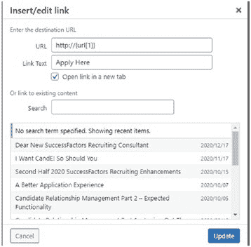

*Figure 4-14.* Adding the Hyperlink for Applying for a Job

Click “Preview” to see what the posting will look like, as shown in Figure 4-15. If we were embedding real postings as WordPress posts, we would format the post to make it match the style of the rest of the site.

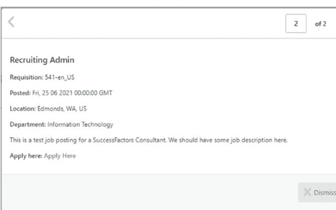

### **Figure 4-15.** *Preview of Automatically Generated Post with Link to Apply*

We then specify the category that the posts will be assigned to, as shown in Figure 4-16; in this case, we are specifying the category JobPosting. This is important for embedding posting links in WordPress posts and for excluding job postings from the blog home page.

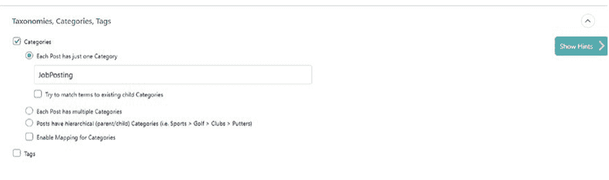

### **Figure 4-16.** *Taxonomies, Categories, Tags*

We then determine which XML element to be the unique identifier of the post and what to do when the job XML is updated or removed in scheduled updates. This can be seen in Figure 4-17.

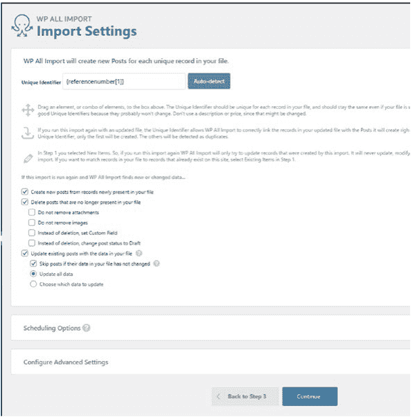

*Figure 4-17. Import Settings*

Figure 4-18 shows the final settings confirmation. We can now run the import for the first time.

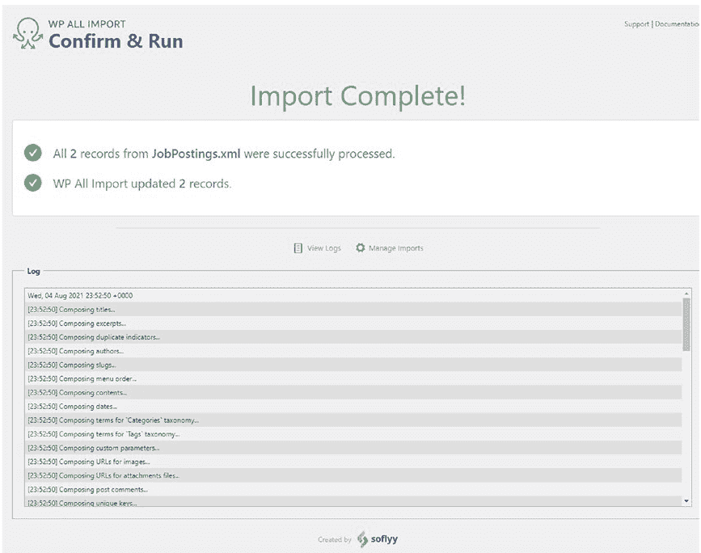

### Figure 4-19. Confirmation Message

We then set the import schedule as shown in Figure 4-20. Once a day is recommended, just as we already do with the Recruiting Management to Recruiting Marketing job synch in provisioning.

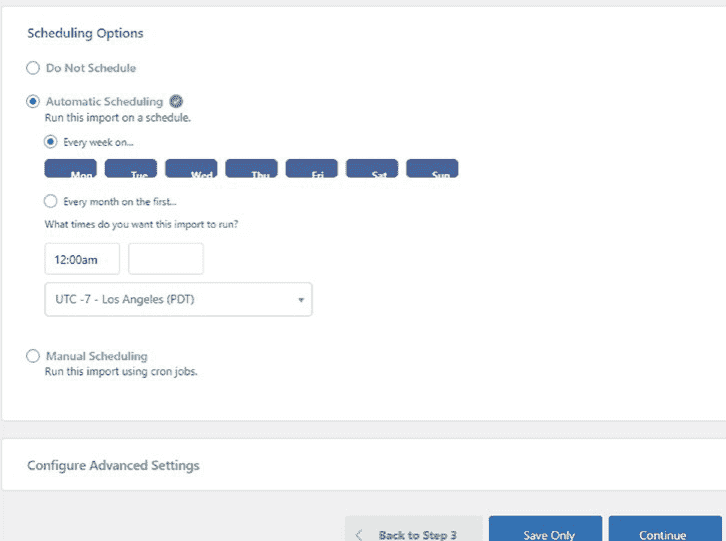

### **Figure 4-20.** Scheduling Options

In Figure 4-21, we can see that the two job postings are displayed on the home page as blog posts. We want them to be excluded.

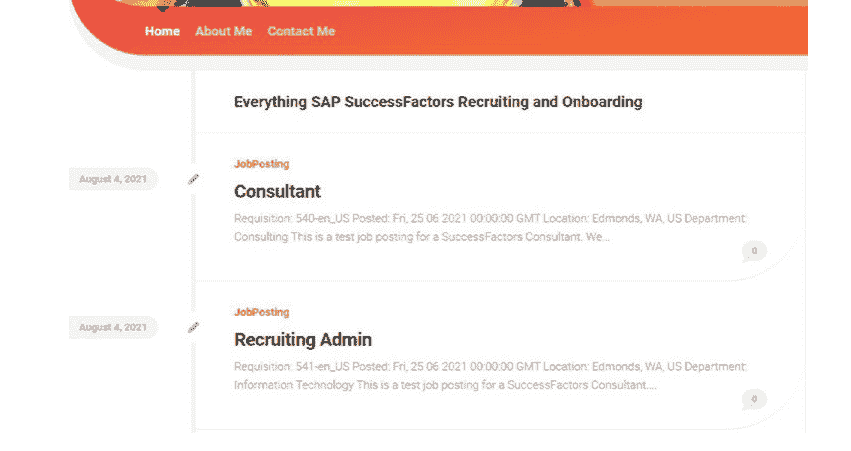

### **Figure 4-21.** Home Page Showing Job Postings as Blog Posts


## 第四章 候选人吸引

我们现在将使用 WordPress Ultimate Category Excluder 从主页中移除职位招聘信息。在 WordPress 管理界面中，点击左侧的“设置”，如图 4-22 所示。随后，您将在左侧看到额外的“设置”选项。点击“设置”下方的“分类排除器”，如图 4-22 所示。

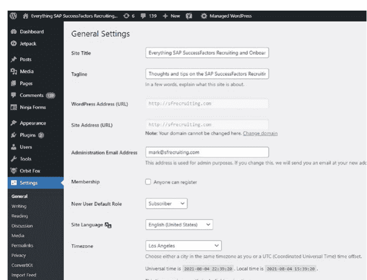

图 4-22. WordPress 通用设置和设置菜单选项

图 4-23 展示了分类排除器的选项。在导入过程中，我们将来自职位招聘 XML 源的任何内容都设置为分类为“JobPosting”。我们将使用该分类来从主页中排除这些招聘信息，方法是选择 JobPosting 行中的“从主页排除？”选项，并保留该行其他选项未选中。我们将保留其他区域（如搜索结果）中的招聘信息。

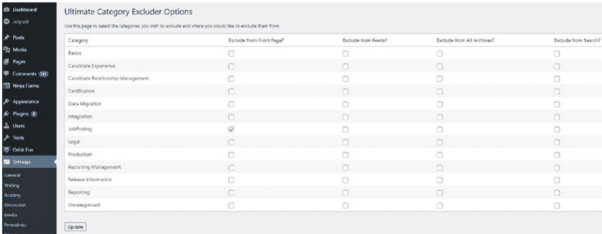

图 4-23. WordPress 分类排除器选项

点击“更新”并返回主页后，我们会发现招聘信息已经消失。如果它们没有消失，您可能需要清除缓存。要执行此操作，请前往 WordPress 管理设置并点击“清除缓存”。在这种情况下，“清除缓存”位于浏览器页面顶部的“托管 WordPress”下。

下一步是创建一个测试博客文章，其中动态包含一个职位招聘信息列表。我们使用了一个名为 JobPosting 的分类来实现这一点。如果您希望向不同的 WordPress 文章提供不同的职位信息，您可以使用多个分类，例如“SuccessFactorsRecruitingJobs”和“SuccessFactorsOnboardingJobs”。拥有多个分类在博客涵盖多种人才领域（如编程、市场营销、设计、工程等）并希望将正确的职位发布到正确的博客时变得尤为重要。

我们将创建一个简单的 WordPress 文章，包含标题页眉、一些介绍性文本，然后动态显示职位招聘信息列表。如图 4-24 所示。

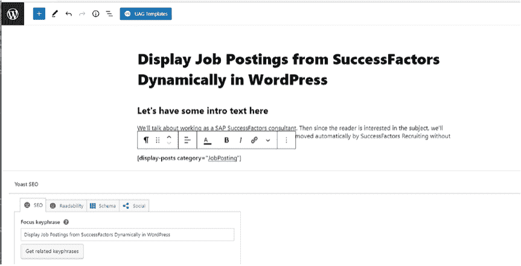

图 4-24. *带有短代码的简单示例 WordPress 文章*

请注意文章底部使用的*短代码* `[display-posts category="JobPosting"]`。这声明所有属于“JobPosting”分类的 WordPress 文章都应列在该文章中。我们可以在右方括号前添加其他条件，例如*orderby="title"*。

发布文章后，我们将在主页上看到它的预览。点击它，我们会看到如图 4-25 所示的文章。

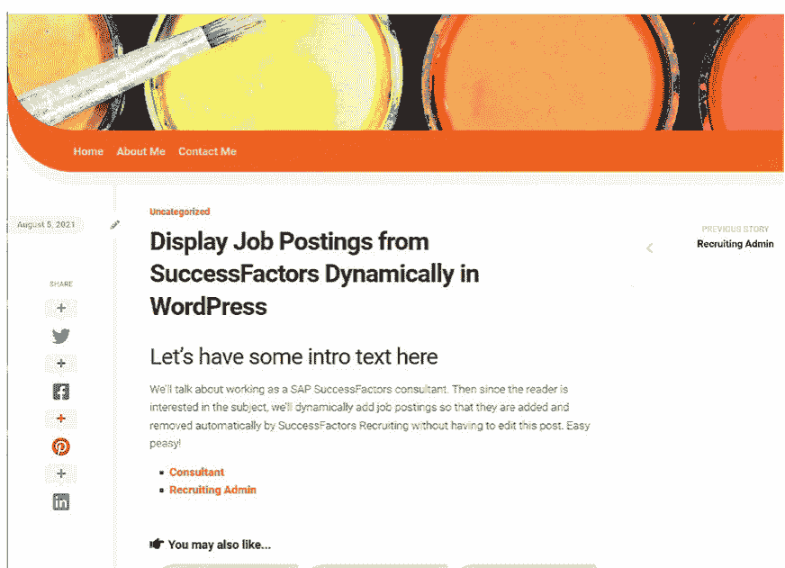

图 4-25. 带有动态包含职位招聘链接的 WordPress 博客文章示例

如果我们点击职位名称，我们将看到由 SuccessFactors XML 源生成的 WordPress 文章。如图 4-26 所示。请注意，如果您使用本章的代码重新创建示例并点击测试文章中的“在此申请”，您会收到一个错误，因为示例代码不会提交到真实的招聘营销职业网站。

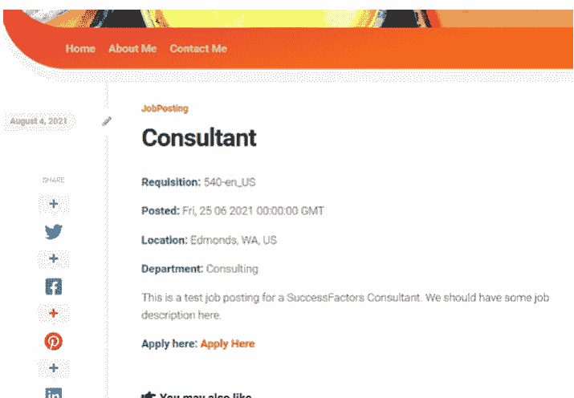

图 4-26. 动态生成的 WordPress 职位招聘示例

### 结论

您现在已了解以下内容：

- 人才营销有很多选项，应根据所需人才类型和来源的有效性进行选择。
- 吸引候选人超越了职位招聘（尽管它们非常重要），但要注意不要重造轮子。
- 招聘营销 XML 源是一个绝佳的解决方案，可用于职位板招聘之外。无需调用 OData！
- WordPress 拥有许多插件，可以低成本且零代码地将相关职位招聘信息拉入您的 WordPress 网站。
- 在 WordPress、Drupal 和其他内容管理系统中，有很多方法可以将招聘信息嵌入到相关网站内容中。
