## 第五章 增强候选人互动

在上一章中，我们学习了如何增强 SAP SuccessFactors 的职位发布能力。现在我们来查看流程中的下一步：候选人互动。候选人互动描述了增加候选人在您的招聘活动中的参与度的过程。换句话说，一旦您营销了可用的职位，您如何帮助最大限度地增加申请这些职位的合格候选人数量？如果候选人没有看到让他们感兴趣的职位，您如何保持他们的兴趣，直到合适的职位可用？

### 增加候选人互动的策略和工具

候选人互动在整个招聘过程中至关重要，公司已采用各种策略来增加候选人互动。在现代招聘系统出现之前，这是通过招聘人员手动拿起电话或向候选人发送信函或电子邮件来完成的。随着招聘系统的发展，技术使得招聘人员需要执行的手动工作量减少，同时增加了招聘人员可以互动的候选人数量。例如，开箱即用，SAP SuccessFactors 提供了一套候选人关系管理工具，旨在帮助增加互动。这些工具允许招聘人员收集候选人数据，并用吸引人的内容对候选人进行目标定向。例如，公司在招聘会上可以创建一个落地页，以收集基本的候选人信息，如姓名、电子邮件和职位兴趣。收集数据后，招聘人员可以将关于候选人的数据组织成具有共同兴趣和/或资质的候选人池。这使得更容易使用特定内容对候选人进行目标定向。使用电子邮件活动功能，招聘人员随后可以向这些候选人池发起有针对性的电子邮件活动。通过这种方式，招聘人员可以更了解候选人的兴趣或什么可能是合适的职位匹配，并主动用相关内容与候选人互动。

前面的示例假设候选人有动机点击链接并填写信息；然而，情况并非总是如此。有时，候选人在提供信息前需要提示。这就是创建 SAP SuccessFactors 增强功能（例如聊天机器人）有用的地方。聊天机器人可以与候选人互动并询问他们问题，以建立包括联系信息和兴趣在内的候选人档案。这是通过编程自动完成的，而不是招聘人员使用在线聊天手动与候选人互动。例如，当用户在招聘网站上导航了一定时间且未申请工作或创建档案时，聊天机器人可能会在您的招聘网站上激活。然后，聊天机器人可以提示用户提供姓名、电子邮件和兴趣，以代表他们创建档案。通过这种方式，尽管候选人没有申请任何特定职位，但他们仍然受到互动，并且可以稍后用内容进行目标定向，并提示他们申请可能匹配的职位。

关于候选人互动的进一步策略集中在候选人已经申请或部分申请后保持他们的互动上。例如，如果候选人保存了申请但未提交，聊天机器人可以向申请中保存的移动电话发送短信，提醒用户申请未完成。聊天机器人可以询问用户是否打算完成申请，或者是否应关闭申请。它甚至可以提示用户填写一份问卷，了解他们决定不完成申请流程的原因。在另一种场景中，如果申请已完成，可以在申请流程的不同阶段定期发送短信或电子邮件，让候选人了解他们处于流程的哪个阶段，以及候选人需要采取什么行动（SAP SuccessFactors 可以使用标准功能实现这一点）。

即使候选人已经经历了申请流程且未被选中，这也不意味着关系结束。聊天机器人在这方面也可以提供帮助。例如，如果自动后续电子邮件显得过于非人性化，可以使用聊天机器人来执行此任务。该聊天机器人可以向用户存档的移动电话发送消息，查看他们对新职位是否感兴趣。它还可以联系用户，查看他们是否仍然对公司感兴趣，并鼓励他们更新招聘网站上的信息。


图5-1说明了如何将各种候选人互动策略结合使用，以实现让合格候选人完成申请的共同目标。牢记这些业务场景和策略，我们现在可以看看有哪些数据和工具可用于创建增强功能和自动化，以提高候选人互动。

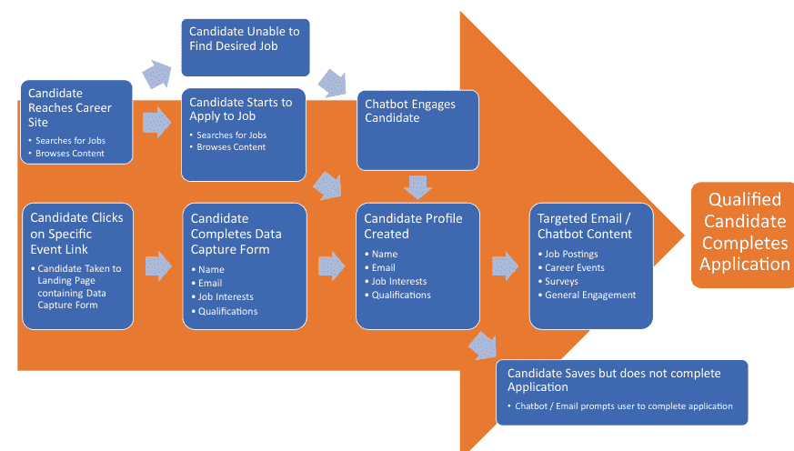

图5-1. 用于候选人互动的协作式自动化方法

## 案例研究：招聘网站聊天机器人

至此，本章我们已经了解了为什么要创建聊天机器人，以及SAP SuccessFactors中有哪些工具和数据可支持创建聊天机器人。现在，让我们深入探讨一个具体场景，看看如何构建一个聊天机器人。

在本节中，我们将进一步阐述本章开头描述的场景：候选人找不到工作，因而没有提交申请。在设定的一段时间后，招聘网站会提示候选人提供更多关于他们正在寻找何种工作的信息，并收集用户的一些基本信息。最终目标是在SAP SuccessFactors系统中创建候选人档案，以便招聘人员和其他系统自动化能够与该候选人互动。

## 聊天机器人简介

在深入创建聊天机器人自动化之前，让我们回顾一些关于聊天机器人的基本概念。

“聊天机器人”这个词是“聊天”和“机器人”的组合。“机器人”是一组自动配置和/或编程，用于执行重复性或可编程任务。“聊天”表示与用户对话的能力。因此，“聊天机器人”就是可以与你“聊天”的“机器人”。更具体地说，该程序能够使用自然语言提示用户，以获取命令或“意图”，然后解释用户说出或输入的自然语言，并将其匹配到提供给它的命令/意图之一。

一旦你告诉机器人你想做什么（例如，一个命令或意图），它可能还需要命令中包含的补充信息。你可以将这一附加信息视为执行所需的字段/变量或“槽位”。下面是一个我们中有些人可能在智能手机上使用的示例：

用户：你好，聊天机器人，把当前播放的歌曲添加到播放列表“迈克的超赞播放列表”。

聊天机器人：好的，我已经把这首歌添加到播放列表“迈克的超赞播放列表”了。

在前面的示例中，用户的意图是将歌曲添加到播放列表，并提供了必要的槽位信息：要添加哪首歌以及添加到哪个播放列表。在我们逐步分析案例研究时，记住这两个概念很重要：意图和槽位。前面的示例中还发生了很多其他事情。例如，聊天机器人能够解析用户提供的句子结构，并识别意图和槽位。这称为“自然语言处理”。好消息是，市面上有大量相互竞争的云聊天机器人服务，可以为你处理这部分工作。由于可用服务如此之多，我们无法深入探讨每个服务的工作原理。你必须理解的主要内容是：无论使用哪个服务来构建聊天机器人，你都需要知道你的意图和槽位是什么。这将使你能够定义聊天机器人具体要做什么，进而确定聊天机器人需要在SAP SuccessFactors上调用哪些API和数据对象。

## 系统架构

图5-2展示了一个聊天机器人解决方案的示例系统架构。到目前为止，你可能已经意识到，除非你想开发自己的自然语言处理程序，否则你需要使用云聊天机器人服务来处理与候选人的意图和槽位的输入输出。由于候选人在招聘网站上，该网站将作为我们的主要用户界面。

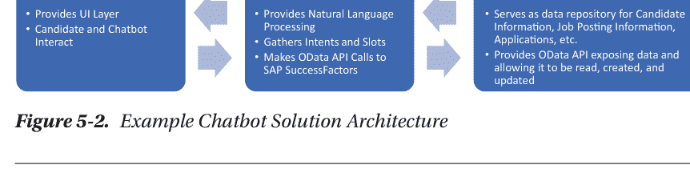

图5-2. 示例聊天机器人解决方案架构

注意：如果你使用SAP SuccessFactors招聘候选人体验（也称为招聘营销），你会注意到招聘网站构建器功能并不附带聊天机器人组件。你可能需要使用自定义组件创建聊天机器人前端层，或者在招聘网站构建器之外创建自己的网站，以便创建聊天机器人。

## 流程与数据流

在充分理解聊天机器人的工作原理以及所涉及的架构之后，我们现在可以深入探讨我们希望聊天机器人实现的具体功能。具体来说，用户将能够调用哪些意图，以及每个意图关联哪些槽位？

## 故事板/示例脚本

为了为聊天机器人设计出一些出色的意图，进行一点角色扮演会很有帮助。就我们选择的场景而言，我们将假装自己是在网站上浏览的候选人。在浏览招聘网站一段时间后，聊天机器人出现在屏幕上。接下来，我们可以编造一段候选人与聊天机器人之间有用的假设对话，然后反向推导，将对话转换为定义聊天机器人功能范围的特定意图和槽位。

聊天机器人：你好！感谢你访问我们的招聘网站！有什么我可以帮你查找的吗？

候选人：我正在查找公司为员工提供的医疗保险信息。

聊天机器人：公司为所有全职员工提供全面的医疗保险。有关福利的更多信息，可以通过点击顶部导航中的“福利”访问公司福利页面。还有什么我可以帮你查找的吗？

候选人：谢谢！我还想找项目经理的工作。

聊天机器人：我们目前有两个与搜索词“项目经理”匹配的职位发布。“项目经理：人力资源系统”和“项目经理：供应链”。你想了解这些职位的更多信息，还是有什么其他我可以帮你查找的？

候选人：这些职位我都不感兴趣。

聊天机器人：很抱歉。你希望我在有更多项目经理职位时提醒你吗？

候选人：是的。

聊天机器人：好的。首先，请告诉我你的名字。

候选人：Joe。

聊天机器人：谢谢你，Joe。你的姓氏是什么？

候选人：Schmoe。

聊天机器人：好的，Joe Schmoe。你希望我们使用哪个电子邮件地址来联系你关于职位的信息？

候选人：test1@test.com

聊天机器人：太好了！你是否还愿意提供一个电话号码，以便我们可以通过短信联系你？

候选人：愿意，号码是5555555555。

聊天机器人：谢谢！请放心，你的隐私对我们很重要。我们的隐私政策基于居住国家/地区。请问你的居住国家/地区是哪里？

候选人：美国。

聊天机器人：谢谢！请阅读此处的隐私协议<链接>，并告知我你是否同意这些条款。输入“是”即表示你同意这些条款，我将根据你的电子邮件地址和电话号码创建职位提醒。

候选人：是的。

聊天机器人：谢谢！你的职位提醒已创建！还有什么我可以帮你查找的吗？

候选人：没有了，谢谢！

聊天机器人：感谢你访问我们的招聘网站。再见！

> **注意** *所提供的脚本被称为“快乐路径”脚本，即没有发生错误或聊天机器人无法理解的术语。为了简洁起见，我们不会涵盖一个健壮的聊天机器人所需的所有负面测试。然而，当聊天机器人遇到无法理解的表述时，你需要准备一组陈述来帮助引导用户转向聊天机器人可以理解的内容，例如：“抱歉，我不明白您说的话。您可以问我诸如此类的问题……”*

## 定义意图和槽位

有了我们创建的示例脚本，看起来我们定义了几个意图和相应的槽位。让我们从脚本中的第一个交互开始。候选人说他们正在查找“医疗保险”的“信息”。这可以被分析为“内容查询”意图，带有一个<内容类型>槽位。这类意图可能不会访问SAP SuccessFactors来获取信息。相反，在内容查询意图的情况下，聊天机器人将被配置为访问知识库。知识库会根据请求的内容类型槽位存储应给出的响应类型。可以将其视为一个预置响应表。通常，这个知识库会存储在你选择的云聊天机器人解决方案中。在这种情况下，聊天机器人的脚本逻辑将是：当询问医疗保险问题时，返回响应“公司为所有全职员工提供全面的医疗保险。有关福利的更多信息，可以通过点击顶部导航中的‘福利’访问公司福利页面。还有什么我可以帮你查找的吗？”

在下一组对话中，候选人表示他们“正在寻找……工作”。我们可以将其等同于“职位搜索”意图，带有一个<搜索词>槽位，在本例中为“工程”。由于SAP SuccessFactors存储了这些信息，我们知道必须让聊天机器人使用ODATA API查询系统，以收集响应信息。

在职位搜索之后，候选人表示他们找不到自己想要的职位。这会触发“创建档案和职位提醒”意图。该意图需要提示用户提供多个槽位的值：<名字>、<姓氏>、<电子邮件>、<手机号码>和<同意>。此外，我们已经知道用户对工程职位感兴趣，因此我们也会将其视为一个<搜索词>槽位。


## 第 5 章 提升候选人参与度

最后，候选人表示已结束聊天，这会触发“注销”意图且不需要任何槽位。我们可以在图 5-3 中看到定义聊天机器人范围的意图和槽位的视觉表示，以及聊天机器人针对每个意图执行的后续脚本。

> **注意** *我们还包含了一个 `<locale>` 槽位，以确定聊天机器人和用户进行意图的语言，用于国际化实施，并且因为 SAP SuccessFactors 中的某些对象在查询和创建对象时需要此信息。此外，`<country>` 是必需的，以确定向候选人显示哪个国家的同意声明。*

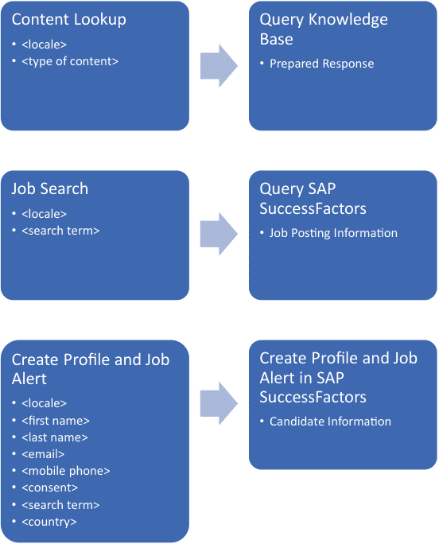

**图 5-3。** *示例聊天机器人的意图范围*

### 相关 OData API 对象和函数

现在我们已经确定了聊天机器人范围内的具体意图和槽位，我们可以确定这些意图和槽位将在 SAP SuccessFactors 中调用的 API 和对象。让我们从职位搜索意图开始。与我们在第 2 章中所做的类似，我们可以使用 Integration Center 来探索相关的 OData 对象，甚至开始构建 OData 调用。让我们开始吧！

### 职位搜索意图

为了收集执行职位搜索意图所需的数据并构建所需的 OData 查询，请按照以下步骤操作：

1. 在搜索栏中输入并选择“Integration Center”。
2. Integration Center 主菜单将会出现。点击“My Integrations”。
3. 点击“Create”按钮。
4. 在出现的下拉菜单中，选择“Scheduled Simple File Output Integration”。

> **注意** 你可能会想，为什么我要创建文件输出，而我想要对 OData 进行调用以向我的聊天机器人提供信息？答案是我们将向你展示一个技巧，通过在 Integration Center 中使用这种类型的集成，可以节省你从头构建 OData 调用的时间。继续阅读以了解详情！

5. 由于我们有兴趣搜索活跃的职位发布以实现我们的聊天机器人意图，我们将从 JobRequisitionPosting 对象开始。在“Search for Entities by Entity Name”字段中输入“JobRequisition”并点击左侧的第一个结果。屏幕应如图所示 5-4。

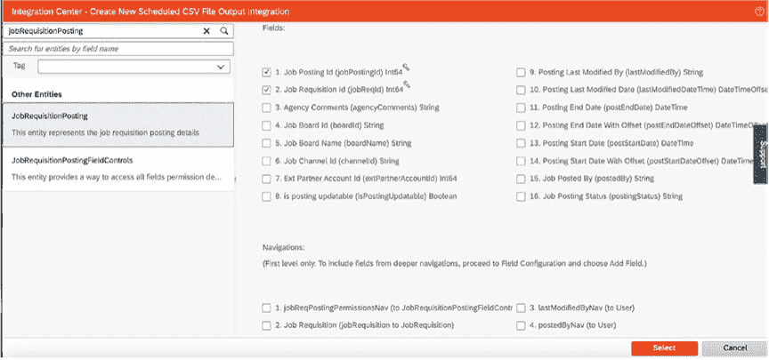

**图 5-4。** *JobRequisitionPosting 对象字段*

6. 我们的搜索还需要筛选仅当前在外部职业网站上公开且活跃的职位发布。选择“Job Posting Status”和“Job Board ID”字段，然后点击“Select”按钮。

7. 选项屏幕将显示，如图 5-5 所示。在“Header Type”字段的下拉菜单中选择“Simple Header”。点击“Next”按钮。

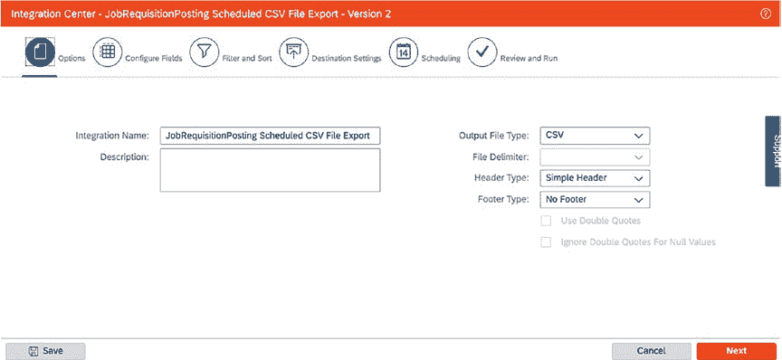

**图 5-5。** *选项屏幕*

8. 配置字段屏幕将会显示。你将看到字段的预览。你可能会注意到内部职业网站或代理等的大量职位发布，或状态值为已过期。我们希望确保我们的聊天机器人只向用户告知外部职业网站上活跃的职位发布。因此，我们将设置一些筛选器。点击“Next”按钮以进入“Filter and Sort”屏幕。

9. 我们的第一个筛选集将简单地表示我们只想查看外部职业网站的职位发布。选择“Job Board ID”作为筛选集 1 的“Field”列。将“Operation”设置为“is equal to”，并将“Value”设置为“_external”。

10. 点击“Add Filter Set”以添加另一组筛选参数。此第二个筛选器将确保只显示活跃的职位发布，而不是已删除或过期的职位发布。选择“Job Posting Status”作为“Field”列，“is equal to”作为“Operation”。在“Value”列中输入“Success”。点击该行末尾的“+”号以向同一筛选集添加另一个参数。点击“Filter Set 2”下方的“Or”切换。输入“Job Posting Status”作为“Field”列，“is equal to”作为“Operation”，并在“Value”列中输入“Updated”。结果应如下图 5-6 所示。

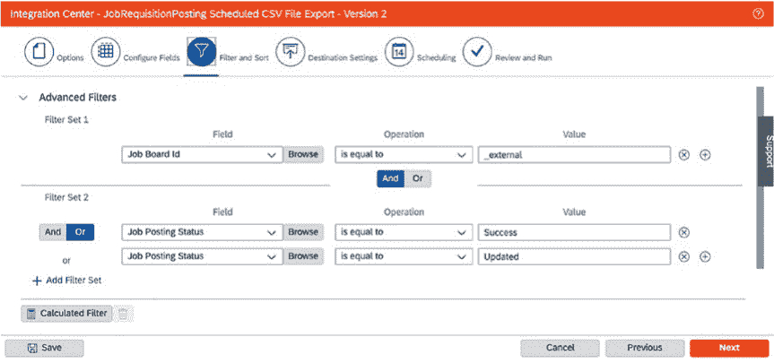

**图 5-6。** *输入筛选参数的结果*

11. 点击“Previous”按钮返回到“Configure Fields”屏幕。你现在应该只看到“Job Board ID”等于“_external”且“Job Posting Status”为“Updated”或“Success”的结果。示例显示在图 5-7 中。

> **注意** 这假设你在 SAP SuccessFactors 系统中在外部职业网站上有活跃的已发布招聘需求。

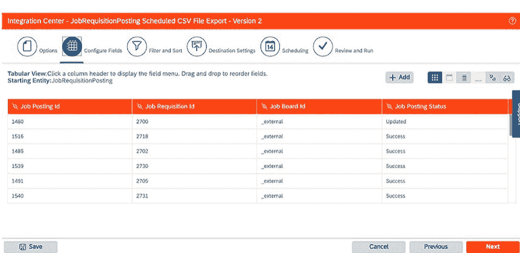

**图 5-7。** *职位发布对象查询的示例筛选结果*

12. 太好了！我们现在有了想要的结果。点击“Save”按钮，然后选择“Save”保存你的集成。

> **注意** 如果你想下载 .CSV 文件以查看数据会是什么样子，你可以按照第 2 章中的说明指定 SFTP 位置并执行集成。

13. 接下来我们将向你展示一个技巧，你可以在集成规范文件中看到集成在幕后用于收集此数据的 OData 查询。这非常有用，因为很可能无论你使用哪种云聊天机器人

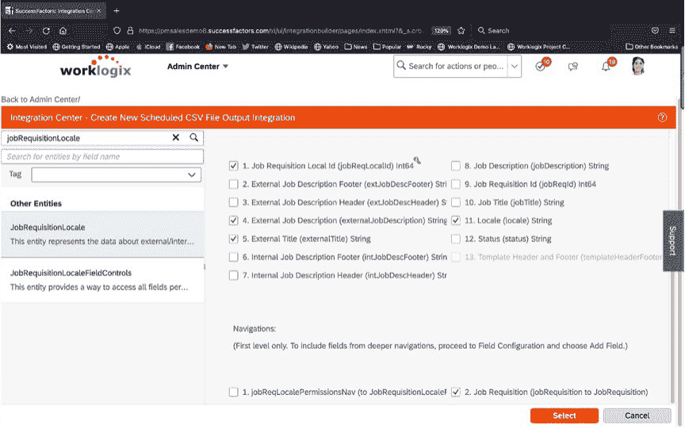

**图 5-9。** *JobRequisitionLocale 字段*

8. 选项屏幕将会出现。点击屏幕顶部的“Filter and Sort”图标。我们只想查看上次查询中获得的活跃职位列表，并且也是用户语言中的职位。在我们的示例中，我们将只筛选一个职位需求 ID 并使用 en_US（美国英语的区域设置）。在高级筛选器下，选择“Locale”作为“Field”列，“is equal to”作为“Operation”列，并输入你的职位发布区域设置作为“Value”列（在我们的示例中，我们使用“en_US”）。点击该行右侧的“+”图标。选择“Job Requisition Id-JobRequisition”作为“Field”列，“is equal to”作为“Operation”列，并输入上次构建的查询中其中一个招聘需求编号作为“Value”列（在我们的示例中，我们使用“2700”）。根据上次查询返回的所有招聘需求重复此操作。示例显示在图 5-10 中。

**图 5-10。** *JobRequisitionLocale 的筛选示例*

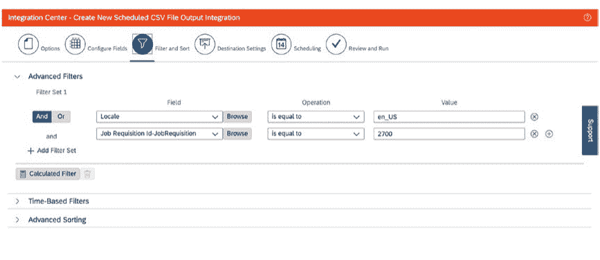

9. 点击顶部的“Configure Fields”图标返回到字段预览。你应该会看到你的结果。示例显示在图 5-11 中。

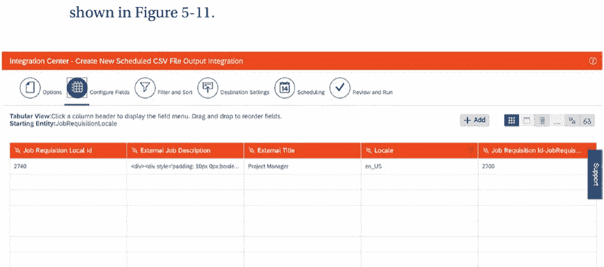

**图 5-11。** *JobRequisitionLocale 筛选的示例结果*

10. 点击左下角的“Save”按钮，在出现的菜单中点击“Save”。在出现的弹出窗口中点击“Save”。

11. 再次，我们将想要获取集成规范文件中的 OData URL 调用。要下载集成规范，请点击“Save”，然后点击“Export Integration Specification”。

12. 使用你的文本编辑器打开文件。你应该会看到生成的 OData 调用 URL。示例显示如下：

```
/odata/v2/JobRequisitionLocale?$select=jobReqLocalId,
externalJobDescription,externalTitle,locale,
jobRequisition/jobReqId&$expand=jobRequisition&$filter=
(locale eq 'en_US' and jobRequisition/jobReqId eq 2700)
```

你现在拥有了第二块拼图，使你的聊天机器人能够访问职位发布的內容并将其传递给职业网站上的候选人！有了它，我们就拥有了从 SAP SuccessFactors 完成职位搜索意图所需的所有信息！在下一节中，我们将查看创建个人资料和职位提醒意图。

> **注意** 你可以使用自己的搜索模式对该内容进行排序以查找搜索词（在我们的示例中为“Project Manager”），或者你可以使用 OData $search 参数。有关更多信息，请参阅 SAP 的 API 规范：https://api.sap.com/api/RCMJobRequisition/resource。

### 创建个人资料和职位提醒意图

我们聊天机器人范围内需要与 SAP SuccessFactors 进行 OData 交互的第二个意图是创建个人资料和职位提醒意图。在此意图中，聊天机器人收集用户的名字、姓氏、电子邮件地址、手机号码，以及他们同意创建 ID 并就其搜索词相关的未来职位机会与他们联系的同意。这涉及对候选人个人资料进行 OData 调用以创建个人资料。与我们在第 2 章中所做的类似，我们将通过 Integration Center 了解候选人在我们系统中的数据示例是什么样的，然后创建以正确格式创建数据的调用。请记住，了解系统希望


不违反任何隐私法律。我们还建议在创建候选人时始终包含候选人区域设置，以避免下游流程出错。例如，每当创建申请时，系统都会根据候选人区域设置来决定该申请的区域设置。

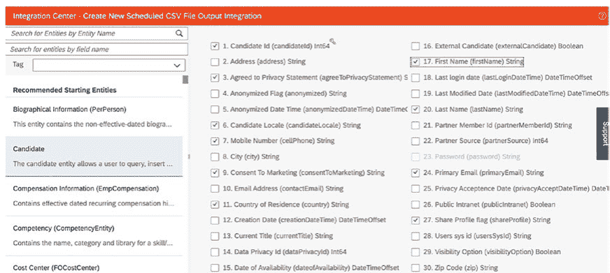

图 5-12. 用于聊天机器人创建候选人档案的选定相关字段

8. 您将进入“选项”屏幕。在“页眉类型”字段中选择“简单页眉”。示例如图 5-13 所示。

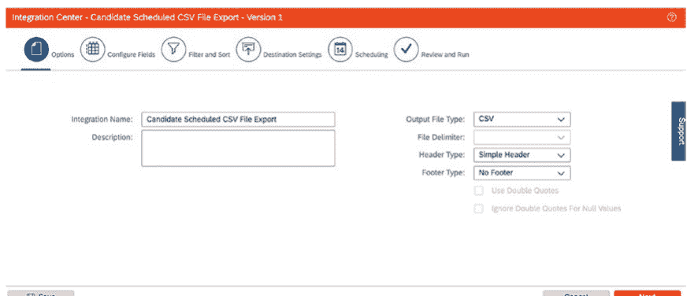

图 5-13. 用于候选人对象 CSV 文件导出集成的选项屏幕

9. 我们需要导出 .CSV 文件，以便编辑文件并用于导入。单击屏幕顶部的“目标设置”图标，填写 SFTP 主机地址、用户名和密码信息。确保为文件命名并添加 .CSV 扩展名。示例如图 5-14 所示（不含 SFTP 站点）。

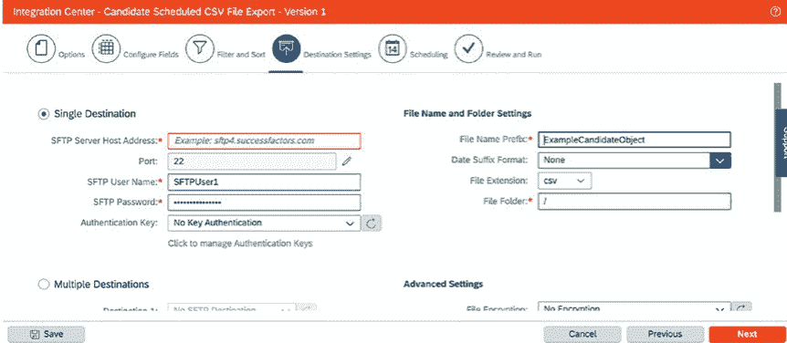

图 5-14. 示例候选人对象导出的 SFTP 目标设置

10. 单击屏幕顶部的“审阅并运行”图标，然后单击“立即运行”（如果尚未保存集成，系统可能提示您保存）。您将收到如图 5-15 所示的成功消息。

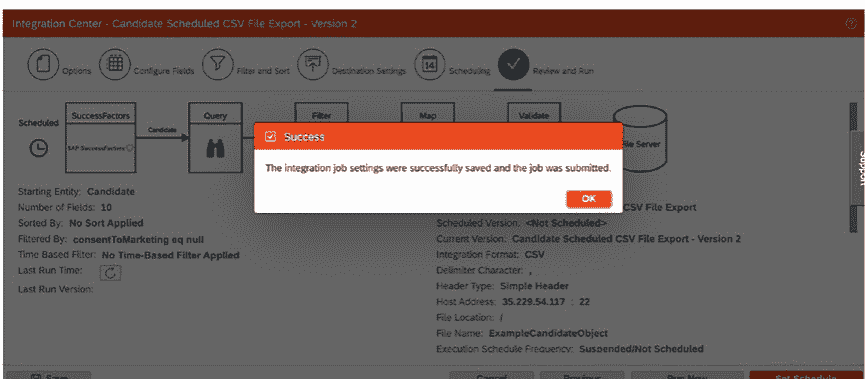

图 5-15. 集成运行提交的成功消息

11. 定期单击“上次运行时间”旁边的刷新图标，查看集成是否已成功完成运行。完成后，检查 SFTP 站点并下载生成的文件。

> 注意：或者，如果您的数据量有限和/或没有可用的 SFTP 服务器，可以在“配置字段”屏幕中，单击屏幕右上角的眼镜图标，在屏幕上查看文件。示例如图 5-16 所示。

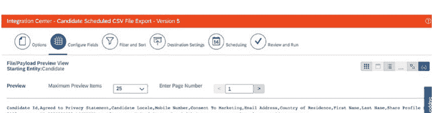

图 5-16. 在线预览 .CSV 文件

与我们在第 2 章中的做法类似，现在需要打开 .CSV 文件并进行编辑。删除不需要的行，只保留一个良好的示例候选人。删除“候选人 ID”列及相应值。您还需要创建一个新的测试电子邮件地址，因为这是在创建新候选人对象时检查的唯一标识符。此外，将“共享个人资料标志”的值更改为“0”。这将帮助您避免在后续步骤中出现错误——稍后我们会更详细地解释这一点。示例 .CSV 文件内容如图 5-17 所示。

```
Candidate,Locale,Agreed to Privacy Statement,Mobile Number,Consent To Marketing,Primary Email,Country of Residence,First Name,Last Name,Share Profile flag
en_US,true,5555555555,ACCEPTED,test@test.com,United States,Joe,Schmoe,0
```

图 5-17. 用于构建和创建候选人集成的示例 .CSV 文件

现在我们已经有了一些良好的示例数据，让我们构建一个用于创建候选人的集成！再次强调，我们可以使用 Integration Center 来构建该集成，然后获取生成的 ODATA 调用！按照以下步骤创建 ODATA 调用：

- 1. 在搜索栏中输入并选择“Integration Center”。
- 2. 将出现 Integration Center 主菜单。单击“我的集成”。
- 3. 单击“创建”按钮。
- 4. 选择“计划 CSV 输入集成”。
- 5. 在“按实体名称搜索实体”字段中，输入“Candidate”。
- 6. 单击左侧第一个搜索结果中的“Candidate”对象，如图 5-18 所示，然后单击“选择”。

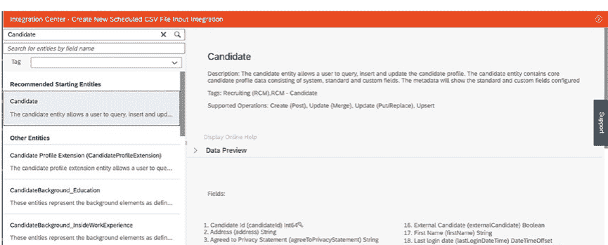

图 5-18. 选择用于输入的 Candidate 对象

- 7. 为集成输入名称，然后单击“下一步”按钮。将出现“配置字段”屏幕。
- 8. 单击“上传示例 CSV”按钮，选择先前步骤中创建的 .CSV 文件。最终结果示例如图 5-19 所示。

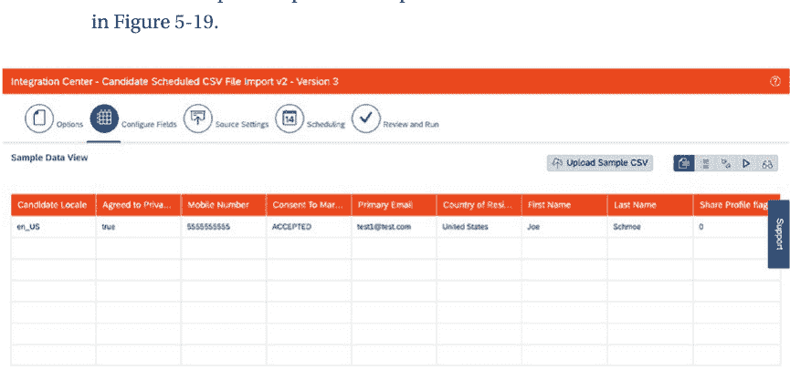

图 5-19. 加载到 Integration Center 中用于创建候选人集成的示例 .CSV 文件

您将进入“字段详情”视图。单击左侧的“Anonymized Flag”字段。在“默认值”字段中，输入“false”。示例如图 5-21 所示。

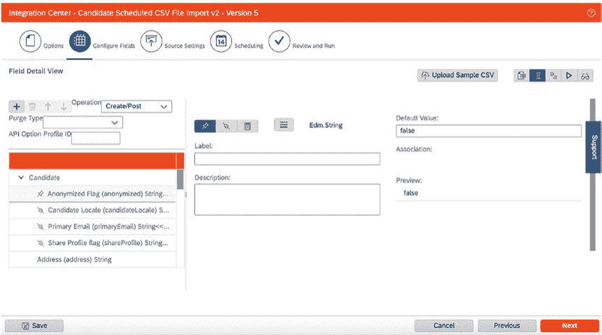

图 5-21. 为“Anonymized Flag”字段设置默认值

- 11. 单击屏幕右上角的眼镜图标，查看所构建 ODATA 调用的更新内容。示例展示如下：

```
[
  {
    "entityName": "Candidate",
    "payload": [
      {
        "anonymized": "false",
        "candidateLocale": "en_US",
        "primaryEmail": "test1@test.com",
        "shareProfile": "0",
        "agreeToPrivacyStatement": "true",
        "cellPhone": "5555555555",
        "consentToMarketing": "ACCEPTED",
        "contactEmail": "test1@test.com",
        "country": "United States",
        "firstName": "Joe",
        "lastName": "Schmoe",
        "__metadata": {
          "type": "SFOData.Candidate",
          "uri": "Candidate"
        }
      }
    ]
  }
]
```

12. 接下来，我们可以测试 ODATA 调用。单击屏幕右上角的播放图标，然后点击“运行预览记录”按钮。屏幕将更新，在“运行结果状态”列中显示运行状态。如果运行成功，该列会出现一个复选框。示例如图 5-22 所示。

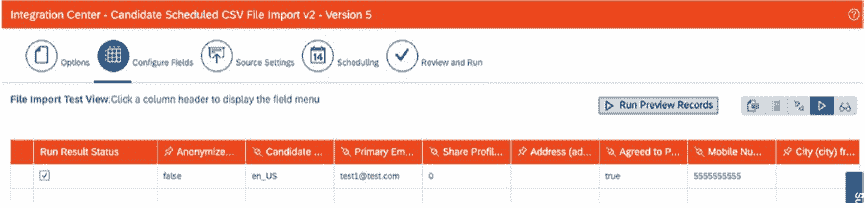

**图 5-22.** *成功创建新的候选人对象*

> **注意** 有时，Integration Center 集成输出的数据并不完全符合 SAP SuccessFactors 输入所需的格式（有关 shareProfile 标签的说明，请参阅 SAP Note 2874787）。我们之前让您在 CSV 文件中更改的“shareProfile”字段就属于这种情况。输出的是长字符串值，而输入需要的则是每个值对应的代码。幸运的是，我们可以从错误消息中看到期望值，本例中为“0”、“1”或“2”。通过反复试验或加载测试值，我们可以发现“0”对应我们想要的值“任何公司招聘人员”，并在调用中使用“0”值。示例如图 5-23 所示。

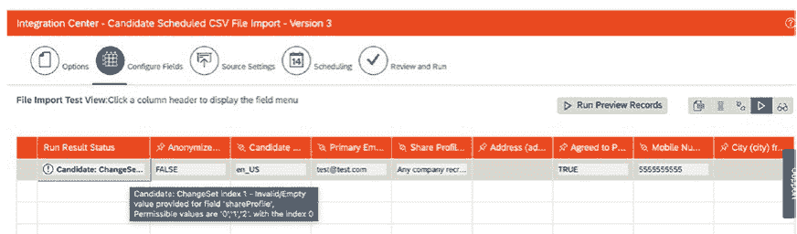

图 5-23. 如果“任何公司招聘人员”的值未更改为“0”，则会显示此错误

恭喜！您已创建了一个 Candidate 对象，现在有了一个 ODATA 调用示例，可以使用它从云聊天机器人解决方案调用 SAP SuccessFactors 系统，创建更多候选人！

在我们已知的“创建个人资料和工作告警”意图字段中，还有一个我们尚未说明的槽位：搜索词。到目前为止，在我们的示例中，我们只查看了标准字段。由于没有标准字段或 API 可用来创建标准工作告警，我们的建议是将其存储在自定义字段中。可以在 Candidate 或 CandidateProfileExtension 对象上创建自定义字段来存储此搜索词。然后，该搜索词可用于将候选人组织到人才库中，并利用标准电子邮件营销活动功能，根据自定义字段中存储的值与候选人进行沟通。或者，另一个自定义聊天机器人可以定期联系这些人才库。

## 跨意图和槽位的数据流

现在我们已经深入研究 SAP SuccessFactors 中支持聊天机器人范围的具体字段和 API，我们可以退后一步，构建一张图来展示数据在 SAP SuccessFactors 与云聊天机器人解决方案之间的流动方式。我们的图如图 5-24 所示。

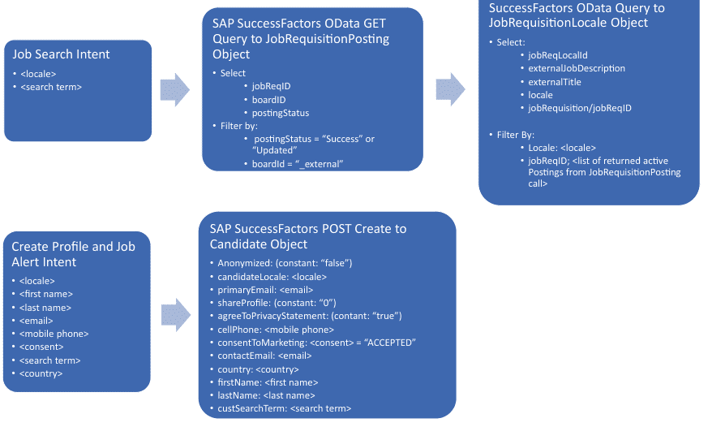

## 案例研究最终结果

我们现在已经具备了在 SAP SuccessFactors 中构建聊天机器人所需的工具，无论我们选择的聊天机器人平台是什么。例如，我们现在知道如何查询职位发布和创建候选人档案！有了此档案，我们可以更深入地与候选人互动。招聘人员可以使用标准的 SAP SuccessFactors 候选人搜索功能查看候选人信息，并将候选人与职位发布进行匹配。此外，如果我们构建了其他自动化和增强功能，例如向候选人提醒即将到来的招聘会或职位发布的聊天机器人或电子邮件，这些自动化和增强功能现在就可以利用该候选人的信息与候选人互动。


### 结论

恭喜！你现在已经了解了在 SAP SuccessFactors 中提升候选人在候选人体验全过程中参与度的不同策略和工具。此外，你还通过一个实际示例了解了如何使用 SAP SuccessFactors ODATA API 创建一个聊天机器人，该机器人可在公司职业网站上协助候选人并提高候选人参与度。此时，你应该能够理解第一部分中列出的这些其他策略如何实现。我们希望能激发你的创造力！使用这种为职业网站设计和创建聊天机器人相同的方法，我们希望你能够为候选人体验流程创建自己独特的候选人体验增强功能和自动化。其中最令人兴奋的方面之一是 SAP SuccessFactors 是一个坚实的平台，许多增强功能可以在此构建并协同工作以提升候选人体验。
