## 第 6 章
### 机器人流程自动化

在本章中，我们将介绍机器人流程自动化（RPA）的基础知识，以及如何使用这些技术改进或增强你的 SAP SuccessFactors 招聘实施。

#### 引言

随着软件系统随时间推移而不断演进和变得更加复杂，需要找到廉价且大规模运行系统的方法。机器人流程自动化就是其中一种方法。什么是机器人流程自动化（RPA）？维基百科将其定义为“一种基于隐喻的软件机器人（bots）或人工智能（AI）数字员工的业务流程自动化技术。有时也被称为软件机器人（不要与机器人软件混淆）。”

RPA 简化了工作流程，使组织更盈利、更灵活、更敏捷、更具响应性。其理念是让员工摆脱执行例行琐碎任务，从而提高员工满意度、参与度和生产力。作为一种自动化形式，它包括屏幕抓取，这也是早期恶意软件的来源之一。将 RPA 引入现有软件系统的采用障碍通常是技术性的：并非总是有经济可行性将新界面改造到现有系统中。RPA 软件在这种情况下提供了一种务实的部署新服务的方式，机器人只需模仿人类与软件交互的行为。这种方法之所以有用，是因为不需要新的信息技术转型或投资。

#### 厂商选择

自然地，出现了几家厂商希望兑现 RPA 的承诺，即使自动化更便宜且可重复。你可以通过 https://research.aimultiple.com/robotic-process-automation-rpa-vendors-comparison/ 开始搜索不同的厂商。在这个快速扩张的市场中，有几家纯粹的 RPA 厂商。示例包括 UI Path、Automation Anywhere、Blue Prism、Workfusion 和 Pegasystems。一些企业厂商将其作为其现有企业软件的自然延伸或与纯粹的 RPA 厂商合作，拥有自己的解决方案。示例包括 SAP 自家的 iRPA 和 Oracle Integration Cloud。还有一些开源 RPA 替代方案可以无需任何许可成本实现。示例包括 Robot Framework RPA、openRPA、UI.Vision、Robocorp、Taskt 和 TagUI。我们建议你先从开源版本开始小规模尝试，然后随着你获得更多专业知识，扩展到许可版本。这样，你将保持成本低廉，并随着需求变化而扩展。

选择 RPA 解决方案将取决于产品路线图的深度、用户界面、你是否想要有人值守或无人值守的机器人，以及 RPA 平台上的 AI 和 ML 水平。

## 相关业务场景

RPAs 在整个行业中找到了多种用途，具体取决于它们试图解决的具体问题。 without going into specifics，其应用包括客户服务、发票处理、销售订单、工资单、价格比较、存储客户数据、处理人力资源信息、处理快速退款、招聘，以及结合光学字符识别（OCR）从不同格式中提取数据。

#### 采用 RPA 的利弊

像每一种新技术/方法一样，我们需要意识到使用 RPAs 的承诺和实际挑战。

**优点：**

- RPAs 相对便宜，并且有大量工具可用，包括许可和免费。
- 一些 RPAs 需要很少或不需要技术技能即可实施。然而，领域知识的深度将是实施成功的决定因素。
- 越来越多的客户了解 RPA 工具及其在自动化重复任务方面的承诺。
- 它们比基于 API 的解决方案更容易实施；然而，由于它们依赖 UI 组件，其范围可能有限。
- 在某些情况下，唯一的要求是理解 UI 组件，而无需关注底层基础设施。
- 如果 UI 得到充分理解并且自动化的执行路径可预测，RPAs 将证明具有良好的投资回报。

**缺点：**

- 虽然它们相对便宜，但 API 在可以完成的工作和实现方面本质上更强大。
- RPA 机器人要求实施者非常了解 UI 流程和执行路径，并且需要客户用户的投入才能真正有效。
- 对于许多客户来说，RPAs 将是一个安全挑战，因为他们可能不愿意向外部实体公开用户名和密码。
- 由于 RPAs 依赖 UI 行为，对于多语言环境实施来说可能更复杂。
- 如果底层解决方案的 UI 经常更改，RPAs 需要持续更新和维护。
- 如果 UI 具有交互行为，例如 UI 根据下拉值选择而更改，RPA 实施可能会变得相当复杂和具有挑战性。
- 范围蔓延在你尝试实施自动化解决方案时始终是一个挑战。

#### 何时为招聘使用 RPAs？

在本节中，我们将介绍 SuccessFactors 招聘中 RPAs 的一些用例。招聘内置了自动化来处理多个任务，例如复制职位申请、根据所选职位填充某些职位申请字段，甚至在 SuccessFactors Employee Central 内创建职位申请。除了内置自动化之外，SuccessFactors 招聘还具有多个 ODATA API。本书的第 1 章和第 9 章涉及 ODATA API 的不同方面、其使用和应用。

其本质上，SuccessFactors 招聘是一个相当庞大的系统，具有许多技术方面和业务功能。如本章介绍所述，RPAs 可以有多种用途，但何时使用 RPAs 的决定并非微不足道。为了成功为客户的招聘实施 RPA，以下是向客户提出的一些建议问题：

- 他们目前是否面临招聘任务占用大量招聘人员时间和精力的挑战？
- 他们的招聘实施在招聘模板、成功职位申请所需提供的字段数量以及相关申请人工作流（也称为申请人状态工作流）方面有多复杂？
- 他们目前是否在招聘实施中自动化任务？
- 他们是否有技术基础设施和/或中间件来帮助其自动化？
- 是否有可用于他们希望实现的自动化类型的 API？
- 他们是否外包了任何招聘任务？在某些情况下，RPA 可能会减轻外包的需求。
- 他们是否有可用于构建基于 API 集成的人员？
- 客户的招聘是集中式还是分布式？答案将推动你的 RPA 工作。
- 他们想要有人值守的 RPA 还是无人值守的 RPA？答案将推动你选择 RPA 工具。
- 客户是否可以通过使用业务规则来自动化其招聘实施？第 11 章涵盖了业务规则的实际实施。

问题列表绝非详尽或全面。与客户咨询至少会让你走上了解客户挑战的道路，并调查 RPA 方法是否能满足客户的需求。任何自动化或确实 RPA 的意图都是推动效率并保持所有权成本低。

#### 招聘中机器人流程自动化的用例

鉴于本章中我们所描述的内容，现在提出一个很好的问题是，招聘中 RPA 的可能用例是什么？几乎不可能列出全面的用例列表，因为它将取决于特定的客户情况。对于一些客户来说，使用 API 实现自动化可能具有挑战性，因为技术资源和预算方面的资源限制相同的问题可能对一个客户来说很容易解决，而对另一个客户来说可能是一个挑战。对大型客户来说可能是一个挑战（因为实施的复杂性）的问题可能对小型客户来说很容易解决。

描述招聘的用例在很大程度上取决于之前对招聘实施的经验和当前客户的实施。让我们看一下 RPAs 的几个用例：

1. 自动为职位申请设置评估包

如果你在 SuccessFactors 中创建职位申请，你需要提供必填字段；否则，你将无法完成职位申请。虽然这是预期的行为，但向职位申请添加评估，定义上并不是必需的。许多组织发现将评估添加到职位申请是一项耗时活动。不幸的是，在撰写本文时，

在创建职位申请时，没有编程方式或API可以设置评估。图6-1展示了一个必须添加评估的职位申请示例。

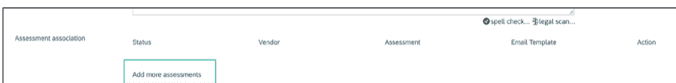

### 图6-1. 向职位申请添加评估

第8章将更详细地介绍如何设置评估集成。就本章而言，只需理解评估必须添加到客户将提供的职位申请列表中即可。当然，SuccessFactors招聘系统也提供了一定程度的自动化。例如，图6-2展示了如何复制一个申请并生成多个副本。

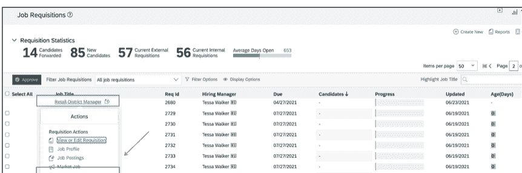

### 图6-2. 如何复制职位申请

图6-3显示了一个要求您确认要创建多少份副本的截图。

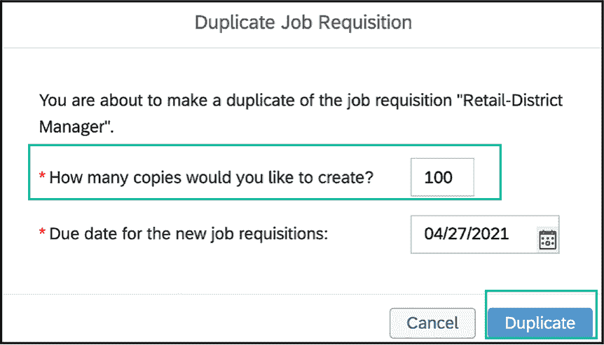

*图6-3.* 弹出窗口截图，显示您要创建的申请副本数量

假设您有多个复制的职位申请副本，下一步是使用RPA机器人将评估与申请关联起来。一旦您的RPA机器人设置完成，合理的下一步是让机器人自动关联评估。图6-1显示了一个应添加评估的截图。鉴于这种情况，您应该了解客户的配置，以便实现有意义的自动化。以下列表列出了需要与客户协商的几个问题：

- 客户实例中有多少评估供应商？如果答案只有一个供应商，您的解决方案会简单得多。
- 存在多少种评估供应商和套餐的唯一组合？根据情况，您可能需要为每种唯一的供应商和套餐组合设置相应数量的机器人版本。为每种组合唯一命名您的机器人是个好主意。
- 客户是否为供应商/套餐组合使用单独的电子邮件模板？根据答案，您可能需要调整机器人设置。
- 客户是否对评估使用hardstopStatus？如果是，您可能需要调整RPA机器人。有关此要求的更多详细信息将在第8章“评估集成”中讨论。

### 2. 为职位申请选择资格问题

许多客户要求每个职位申请都包含资格问题，以帮助筛选和过滤那些正确回答了资格问题的候选人。图6-4显示了一个可以将问题添加到职位申请的截图。请注意，我们展示的是基本筛选问题的部分列表。

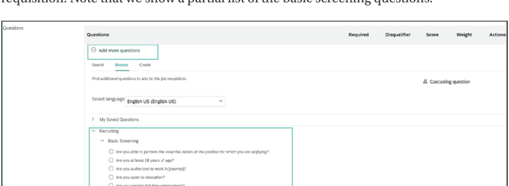

### 图6-4. 显示职位申请初始筛选问题的截图

图6-5显示了一个示例职位申请，其中添加了一些问题，包括取消资格问题。

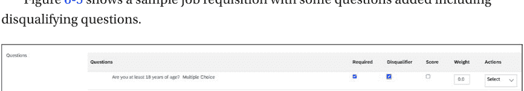

### 图6-5. 手动添加到职位申请的示例问题

将资格问题添加到职位申请的流程看起来很简单；但如果您必须为数百甚至数千个职位申请执行相同的步骤，这将变得耗时且重复。在这种情况下，考虑RPA机器人解决方案是值得的。然而，要获得高效的解决方案，您必须与客户协商确切的需求。在得出最终方案前，这里有几个示例问题需要考虑：

- 客户是否考虑使用第3章中提出的元数据框架（MDF）解决方案？虽然已经提出了使用元数据框架（MDF）的不同解决方案来解决这个问题，但它确实需要对MDF和集成中心有所了解。
- 大量申请或部分申请中的资格问题是否相同？根据答案，您可能需要调整RPA机器人，以针对不同类型的职位申请处理不同的问题集。
- 创建职位申请的招聘人员是否位于不同的区域（en_US、fr_CA、de_DE等），甚至不同的地理位置？根据此问题的答案，您必须调整RPA以应对这种情况。您需要考虑的区域越多，RPA机器人就必须变得越复杂。很可能每个区域都需要一个RPA。

### 3. 为候选人重新触发评估

这不是一个常见的用例，但尤其在客户拥有大量数据（职位申请、求职申请和候选人）时是有可能的。如果您阅读了第8章“管理评估”，可能会遇到一种不常见的情况：供应商系统因某种原因不可用。在这种情况下，数百甚至数千个求职申请已在SuccessFactors中触发了评估，但由于供应商系统不可用，SuccessFactors候选人摘要页面将显示一条消息：“错误：无法启动评估。”当供应商系统恢复可用时，简单的解决方法是重新初始化评估。然而，如前所述，问题在于需要手动启动的评估数量。挑战在于，截至撰写本文时，还没有用于重新初始化评估的API解决方案。在这种情况下，使用RPA机器人重新初始化评估是有意义的。与RPA机器人的每个用例一样，您必须讨论解决方案的范围。以下是一些建议的讨论要点：

- 评估是与一个职位申请关联，还是分布在多个职位申请中？此问题的答案将决定RPA的执行路径。
- 另一个选择是让供应商自己重新触发通知候选人进行评估。由于供应商已经知道哪些评估是从SuccessFactors触发的但失败了，只需了解有多少评估失败即可。然后，供应商可以查询JobApplicationAssessmentOrder API，以获取有关候选人、职位申请和求职申请的详细信息。

图6-6显示了一个可以在候选人摘要页面上批量重新初始化评估的截图。要执行此操作，请选择一个或多个候选人，然后点击“操作”标签下的下拉菜单。但是，在此截图中，“启动评估”标签不可用，因为这些示例候选人已经完成了评估。

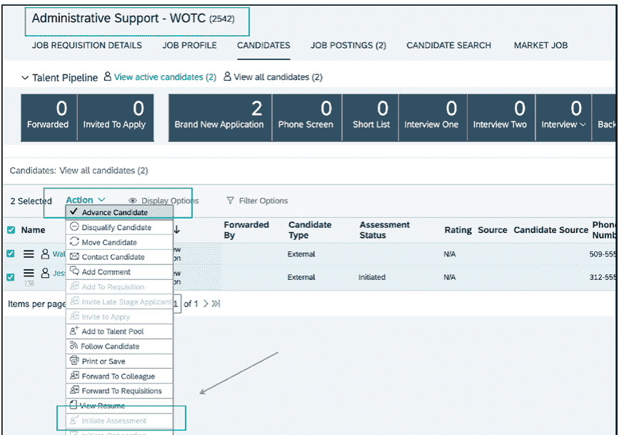

图6-6. 候选人摘要页面截图，可在其中批量启动评估

### 4. 在UI中推进候选人

图6-6显示，“操作”下拉菜单中的可用选项之一是为一个或多个候选人“推进候选人”。推进候选人意味着在申请人工作流中将候选人向前移动一步。在大多数配置中，通常不需要一次一步地推进候选人；然而，在某些配置中，可能需要某一步骤，并且如果用户不提供理由，则不能跳过该步骤。在这种情况下，RPA机器人可以派上用场。请注意，此需求完全取决于配置。

以下是与客户协商的一些问题：

- 客户在申请人工作流中是否有必需的步骤，招聘用户是否需要为跳过某个状态提供理由？如果是，那么值得询问客户理由的性质是什么。在某些情况下，可能只是一个需要点击的复选框或提供的评论。您的RPA机器人应考虑此复选框或评论。
- 客户是否要求每个候选人一次推进一个步骤？您的RPA机器人理想情况下应配置为处理每个状态更改。您最终可能会得到与要推进的状态数量一样多的机器人，每个状态只需进行少量更改。在此阶段提醒一下，RPA机器人的目标应该是大规模自动化任务，而不是陷入为少量案例设计机器人的困境。在实例很少的情况下，手动完成这些任务可能更简单。

### 5. 在UI中将候选人移动到指定步骤

这是上一步骤的一个变体。在这种情况下，候选人被推进到申请人工作流中的指定步骤。当然，这取决于客户的招聘配置。图6-7显示了将两个或更多候选人移动到工作流中指定步骤的示例。

### 图 6-7：显示如何移动候选人的屏幕截图

图 6-8 显示了系统在移动一个或多个候选人时显示的弹出确认信息。

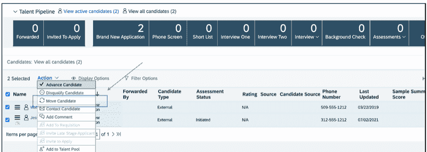

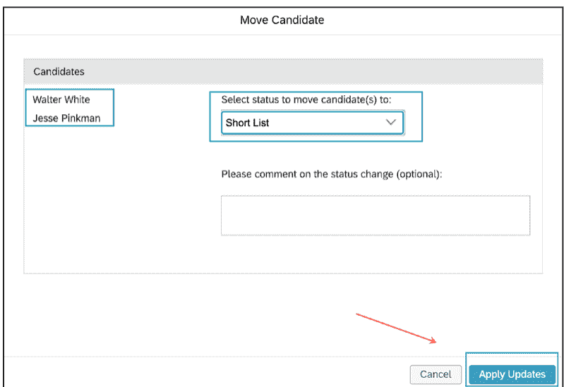

### 图 6-8：请求确认所选状态的确认屏幕

这在大多数情况下可能有效；但是，“移动候选人”操作可能因以下原因无法正常工作：

- 1. 测评上可能配置了 hardstopStatus（硬停止状态），该状态会阻止将候选人移动到目标状态。有关更多信息，请参阅本书第 8 章关于测评集成的内容。
- 2. 客户可能设置了带有必填字段的不可跳过状态。在这种情况下，唯一的选择是将候选人移动到候选人工作流中最后一个可跳过的状态。

图 6-9 展示的是图 6-10 的另一种变体，其中某个特定状态可能包含子状态或子项。所显示的选项取决于单个客户的配置。

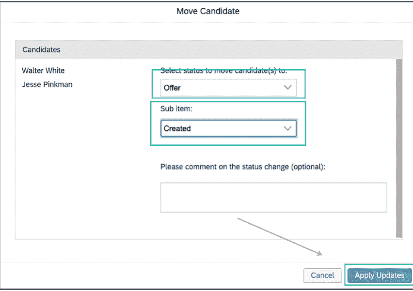

**图 6-9：显示带子项状态的确认屏幕**

要应对这种 RPA 情况，你需要与客户沟通。以下是一些需要考虑的问题：

- 客户是否在其租户中配置了一个或多个测评？他们是否为这些测评定义了 hardstopStatus？请记住，hardstopStatus 是在招聘需求级别配置的，并且在客户内部也会因招聘需求而异。这会影响你定义 RPA 机器人的方式。
- 客户是否存在不可跳过的状态？如果存在不可跳过的状态，你的 RPA 机器人必须满足这一要求。
- 客户在目标状态之前是否有必填字段？如果是这种情况，你可能需要修改 RPA，使其先移动到有必填字段的步骤，填写必填字段，最后再将候选人移动到目标步骤。此时需要记住，如果 RPA 机器人变得复杂，自动化带来的收益就会被开发 RPA 机器人的复杂性所抵消。

### 6. 为职位申请准备录用审批

这是职位申请中的一个阶段，在此阶段为候选人准备录用审批。这为 RPA 机器人提供了一个很好的用例，尤其是当该职位属于大规模招聘时。图 6-10 显示了可发起录用审批的屏幕截图。

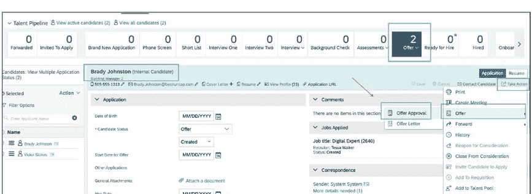

图 6-10：显示可为候选人发起录用审批的屏幕截图

在图 **6-11** 中，我们已经将两名候选人推进到录用审批阶段。每位候选人都需要先通过录用审批，才能被考虑录用。图 **6-10** 只显示了两名处于 Offer 状态的候选人。在实际情况中，尤其是用于大规模招聘的招聘需求，一个职位可能会有数百名甚至数千名候选人。在这种情况下，RPA 机器人可以帮助自动化部分任务。图 **6-11** 显示了可准备录用审批的屏幕截图。

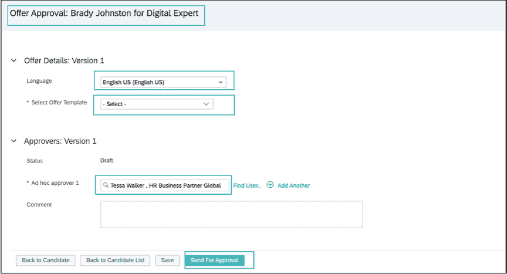

***图 6-11：一个录用审批屏幕示例***

此截图来自演示系统。在实际的客户租户中，根据区域设置和职位的不同，可能会有 10–15 种语言和数十个录用模板。将这种组合再乘以一个职位的数百名候选人，你很快就会意识到人工解决方案将非常耗时。除了选择语言和录用模板之外，你还可能会遇到多级审批。虽然这些组合会迅速产生许多变体，但你必须判断在什么情况下使用 RPA 机器人才合理。职位在组织中的级别越高，制作录用通知所需的人工工作量就越大。图 **6-12** 和图 **6-13** 展示了录用审批中常见的字段。当然，实际屏幕会因客户配置的不同而有所差异。

## 第 6 章 机器人流程自动化

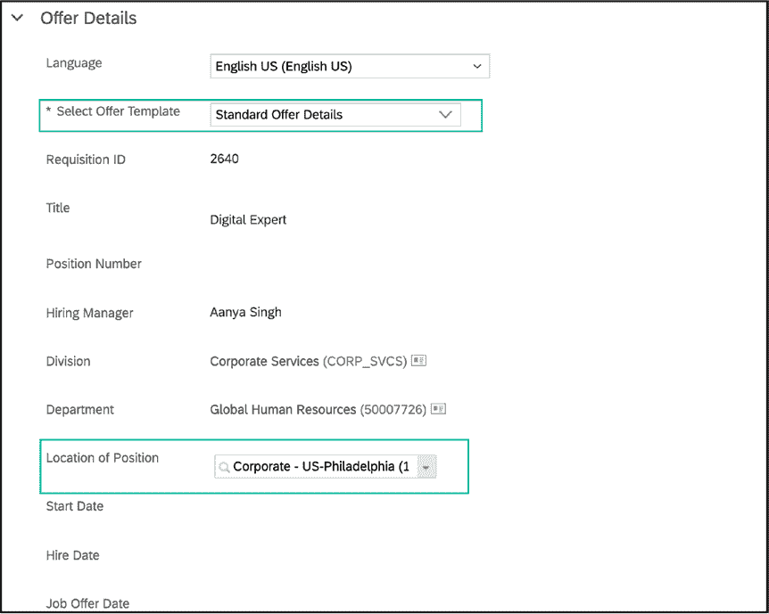

**图 6-12.** *显示示例字段的录用审批屏幕顶部*

你的 RPA 机器人可能需要兼容图 [6-12](#) 和图 [6-13](#) 中显示的字段。你必须与客户就这些字段的使用进行沟通。

### **图 6-13.** *录用审批模板上的其他字段*

以下是一些可与客户讨论的要点，以便让你的 RPA 机器人高效处理录用审批：

- 客户的痛点是大规模招聘场景，还是更复杂的职位？这一决定将影响 RPA 机器人的设计。
- 客户是否为同一职位配置了多个录用审批模板，还是为大规模招聘职位只配置一个模板？显然，录用审批模板越少，RPA 机器人的设计就越简单。
- 对于大规模招聘，客户是否有多级审批工作流？通常情况下，大规模招聘的审批工作流比较简单。根据客户的不同，你也可以实现审批链的自动化。请记住，你可以利用 SuccessFactors 提供的 Proxy Now 功能来解决此问题。
- 客户是否根据区域设置提供多个版本的职位审批模板？如果是这种情况，你可能最终需要为每个区域设置和招聘需求组合维护多个版本的 RPA 机器人。
- 客户是想自动化整个职位审批流程，还是仅自动化大规模招聘？由于处理各种组合时存在固有的复杂性，整个职位审批流程的自动化可能并不容易实现。

### 7. 向候选人发送录用通知书

在 SuccessFactors Recruiting 中，管理候选人的录用通知书是另一个适合使用 RPA 机器人的场景。可参考图 6-10，但请选择“录用通知书”选项，而不是“录用审批”选项。图 6-14 显示了录用通知书的着陆页。与录用审批一样，也需要考虑录用通知书模板和区域设置。此外，还有一个“国家/地区”下拉框。

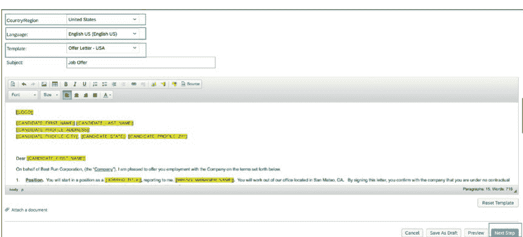

图 6-14：显示一些预选值的示例录用通知书

图 6-15 显示了生成录用通知书时屏幕顶部的内容，图 6-16 显示了屏幕底部的内容。录用通知书的正文会根据所选录用模板自动预填。

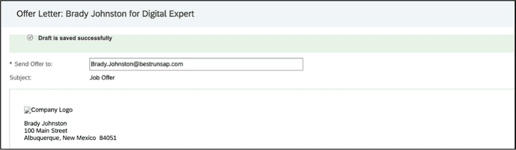

*图 6-15.* 显示录用通知书屏幕顶部的截图

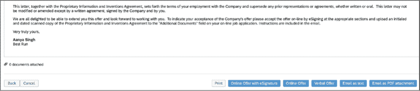

*图 6-16.* 显示可向候选人发送录用通知书的选项的截图

以下是一些可与客户讨论的要点，以便让你的 RPA 机器人高效管理录用通知书：

- 客户的痛点是大规模招聘场景，还是更复杂的职位？这一决定将影响 RPA 机器人的设计。
- 客户是否为同一职位配置了多个录用通知模板，还是为大规模招聘职位只配置一个模板？显然，录用通知模板越少，RPA 机器人的设计就越简单。
- 客户是否根据区域设置和国家/地区的组合提供多个版本的录用通知模板？如果是这种情况，你可能最终需要为每个区域设置和招聘需求组合维护多个版本的 RPA 机器人。
- 客户是想自动化整个录用通知流程，还是仅自动化大规模招聘？由于处理各种组合时存在固有的复杂性，整个录用通知流程的自动化可能并不容易实现。
- 客户是否有随录用通知一起发送的附件？在许多情况下，同一职位会使用相同的附件；当然，只有客户才能提供这些信息。

### 安全注意事项

请务必记住，在任何客户场景中，安全始终是需要考虑的因素。客户通常会为你的 RPA 机器人创建一个单独的用户，并限制允许 RPA 机器人访问的 IP 地址。创建用户后，客户通常会使用如图 6-17 所示的“密码和登录策略设置”来设置例外，包括允许 RPA 机器人访问并执行任务的特定 IP 地址。

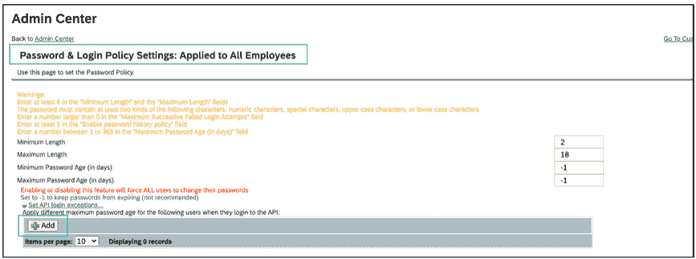

图 6-17：访问密码和登录策略设置

单击“+Add”按钮后，将显示如图 6-18 所示的屏幕。客户可以选择添加专门创建的 RPA 机器人用户，并添加可发起请求的 IP 地址。这种方法的一个优点是防止对客户系统的未经授权访问。在与客户讨论 RPA 解决方案时，你应该提出这一点。越早处理这个问题，安全相关的问题就越少。

#### 创建新用户安全设置

使用此页面创建新的用户安全设置。

- 用户名：* RPAbot
- 最大密码有效期（天）：* -1
  - 设置为 -1 可使密码永不过期（不推荐）
- IP 地址限制：*
  - 仅当用户从以下 IP 地址（例如 10.20.30.41、10.20.30.40-10.20.30.50）访问时才应用最大密码有效期：
  - 169.145.42.45

取消   保存并关闭

### 图 6-18. 指定用户名和密码的弹出屏幕截图

假设客户已为 RPA 机器人设置了特定用户并指定了 IP 地址限制，客户可能不会在 SuccessFactors 中共享已建立用户的密码。在这种情况下，客户可以利用 SuccessFactors 提供的“Proxy Now”功能，允许 RPA 机器人以命名用户的身份代理，并将访问限制在招聘的特定部分。这种方法的优点是系统安全性仍然得到维护，同时仍可提供外部访问以执行特定功能。审计跟踪将显示您的 RPA 机器人代表命名用户执行了操作。

### 结论

本章向读者介绍了考虑使用机器人流程自动化（RPA）方法来解决 SuccessFactors 招聘中的特定挑战。 本章中提到的示例绝非详尽无遗，只有在实践中不断积累经验才会发现更多应用这些原则的机会。与其他自动化方法一样，在开发 RPA 机器人所需的工作量与可实现的自动化程度之间始终存在权衡。经验法则是，如果 RPA 解决方案使重复的手工干预减少 5 倍，则是值得采用的方法。随着 RPA 解决方案应用于可预测、重复性任务且在大批量场景下，自动化收益会自然提高。我们对实施 RPA 解决方案的建议是先从小处着手，专注于特定问题。随着您对 RPA 解决方案的专业知识不断积累，可以扩大解决方案的范围。请记住，RPA 解决方案非常依赖客户，具体方案并不适用于所有客户。客户的意见在开发 RPA 解决方案中至关重要。也就是说，在开始实施前先解决安全问题，将有助于提高效率。
