## 使用集成中心进行自动化

招聘技术的目标之一是让招聘人员从低价值的行政任务中解脱出来，以便更好地与未来员工互动。招聘非常适合自动化。在上一章中，我们研究了如何使用机器人流程自动化（RPA）工具来减少招聘人员在行政任务上花费的时间，例如一遍又一遍地向招聘需求添加相同的申请问题。RPA 由用户根据规则执行的可预测的一组操作驱动。RPA 利用应用程序的用户界面通过复制用户操作来自动化流程，而集成中心则使用后端 API 调用来实现更改。本章将逐步指导您如何设置此类调用。

在第 12 章中，我们将讨论智能服务如何使用预定义的事件来触发操作，例如执行集成中心作业。 此类事件的示例包括更新职位申请信息、批准录用通知以及更新职位申请状态。

虽然智能服务事件用于实时触发操作，但本章将重点介绍如何批量更新大量招聘信息。集成中心将用于此目的。

业务规则也可以是触发数据更改的良好选择，将在第 11 章中介绍。使用业务规则更新职位申请数据时需要考虑的重要一点是，业务规则在候选人申请或更改数据时不会被触发。如果启用了移动响应式候选人体验（应始终启用），则业务规则不会由候选人触发。业务规则将在招聘人员等 HR 用户更改申请数据（例如申请状态）时触发。

## 相关业务场景

表 7-1 显示了可能的集成场景示例以及推荐使用的集成方法。

**表 7-1. 相关业务场景**

| 需求 | 使用的集成 | 原因 |
|---|---|---|
| 如果申请人在申请问题中回答“是”，询问他们是否为前员工，则在他们申请后立即将他们置于“重新雇佣资格检查”状态。 | 智能服务触发的集成中心 | 这不会有超高音量并支持实时解决方案。 |
| 有志成为咖啡师的申请者申请全市范围的常青招聘需求，并根据其门店位置偏好转发到基于门店的招聘需求。 | 集成中心计划作业 | 音量会相当高，并且需要为常青招聘需求中的所有申请人运行。 |
| 将申请人移至“请求安排面试”状态会为员工设置提醒标志，以便他们与现任经理交谈。 | 业务规则 | 因为是招聘人员对申请数据进行更改，所以我们可以自动触发业务规则。 |
| 如果招聘需求标题包含“项目经理”，并且申请人的候选人资料上带有“项目经理银牌得主”标签，则在申请后将其提升至“立即审核”状态。 | 智能服务触发的集成中心 | 音量不会对智能服务来说太高。也可以使用集成中心计划作业。 |

本章重点介绍集成中心计划作业的使用。有几种方法可以执行计划作业。在我们的案例研究中，我们将使用 SuccessFactors 作为源系统和目标系统。我们首先研究使用单独的导入和导出作业来执行招聘信息的大规模更新的作用。

### 使用单独的集成中心作业进行招聘数据的大规模更新

有些情况下，您需要一次性更新大量数据。与通过业务规则、智能服务事件或计划集成作业进行的流程自动化不同，这是一次性运行以解决特定问题。 用例示例有：

- 对职位招聘需求的成本中心进行大规模更新
- 为迁移的员工创建历史职位申请
- 对职位招聘需求的位置进行大规模更新
- 对职位申请字段进行大规模更正

使用两个作业进行批量更新包括导出作业和导入作业，如图 7-1 所示。

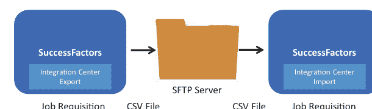

图 7-1. 批量更新流程

使用集成中心，SAP SuccessFactors 解决方案可在同一集成作业中用作源系统和目标系统。为什么我们要创建两个单独的作业？对于常规批量更新，使用单个作业是个好主意。对于一次性更新，使用一个集成中心作业生成 .CSV 文件供另一个作业使用的好处在于，它给了您在导入前检查生成文件 的机会。

## 使用集成中心通过 SuccessFactors 作为源系统和目标系统来自动化招聘

### 为什么要进行 SuccessFactors 到 SuccessFactors 集成

为什么要将 SAP SuccessFactors 实例与其自身集成？通常，它用于使用一组规则更新系统中的数据。“等等，”你喊道。“这不是业务规则的工作吗？”通常是的。在第 7.4 节中，我们将有一个逐步的案例研究。让我们看看为什么我们可能会将 SuccessFactors 用作源系统和目标系统。

招聘自动化很大程度上涉及使用某些业务逻辑在状态之间移动申请。如果我是招聘人员，将筛选评分更新为 10/10，则可以使用业务规则自动将申请移至“提交给招聘经理”状态。业务规则在招聘人员点击保存时触发，并根据筛选分数更改申请状态。

系统越早被自动化越好，因为申请量越高，因此招聘人员的工作量也越大。

理想的开始位置是新申请。业务规则在候选人申请时不会被触发。也没有由申请触发的智能服务事件。更新申请和更新申请状态的事件不会由新申请触发。糟糕。

这就剩下定期检查新申请并根据其他申请数据更新申请状态的选项。这也可以通过分别具有外向和内向接口来实现，基本上一个导出说明哪些申请相关，另一个更新申请。这种方法是不必要的，并且如果导出和导入作业运行之间申请信息发生变化，会产生时序问题。

## SuccessFactors 到 SuccessFactors 集成概述

使用 SAP SuccessFactors 解决方案同时作为源类型和目标类型的集成，可以通过图 7-2 得到最好的说明。这是在选择 SuccessFactors 到 SuccessFactors 集成类型时，集成“查看并运行”屏幕上显示的流程。

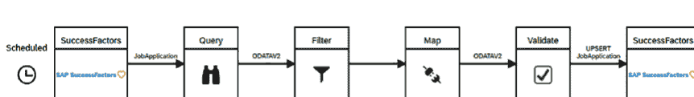

图 7-2. 以 SAP SuccessFactors 解决方案同时作为源类型和目标类型的集成流程

该集成流程执行以下操作：

- **查询** – 从起始实体（在我们的示例中为 JobApplication）开始，包含所有需要读取的字段，既可直接从 JobApplication 实体读取，也可通过关联实体（如 JobApplication）读取。
- **筛选** – 使用筛选器仅读取所需数据，例如职位申请的状态或申请的状态集（例如，有经验候选人状态集与实习生状态集）。
- **映射** – 将源字段映射到目标字段。这些字段通常相同，例如，JobApplication-Application ID 映射到 Application ID。某些目标字段可能是计算字段或固定值。
- **验证** – 在对目标系统进行更新之前，必须进行验证。示例包括检查选择列表值是否有效、必填字段是否存在等。

要创建 SuccessFactors 到 SuccessFactors 的集成（即同一个 SuccessFactors 实例），请转到 Integration Center 主页，选择“我的集成”。然后在右上角单击“创建”，再单击“更多集成类型”，如图 7-3 所示。

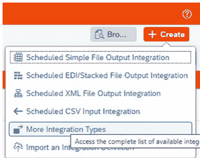

### 图 7-3. 创建更多集成类型的菜单路径

选择“已计划”作为触发器类型，因为我们希望这是一个持续运行的自动化。选择 SuccessFactors 作为目标类型和源类型。正确的选项如图 7-4 所示。

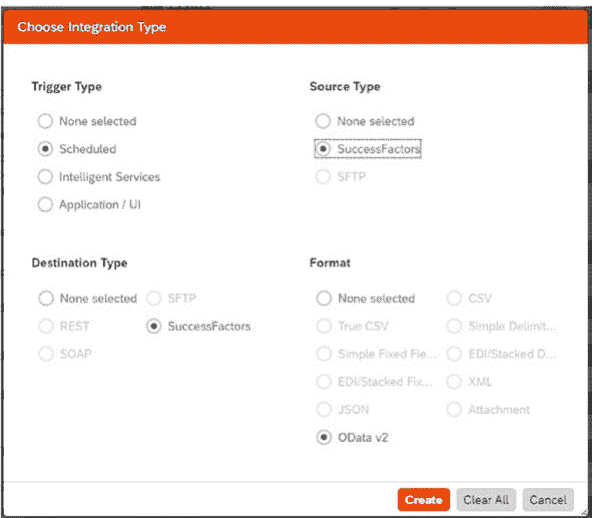

### 图 7-4. 选择集成类型

在下一个屏幕上，您选择起始 ODATA 实体，如之前章节中所做的那样。您可以按实体名称或字段名称搜索实体。在处理申请时，JobApplication 很可能是我们的起始实体。在实体显示在左侧搜索结果中后，选择该实体。所有字段和导航均被预先选中，并且无法更改。单击右下角的“选择”以完成此步骤。JobApplication 实体的选择如图 7-5 所示。

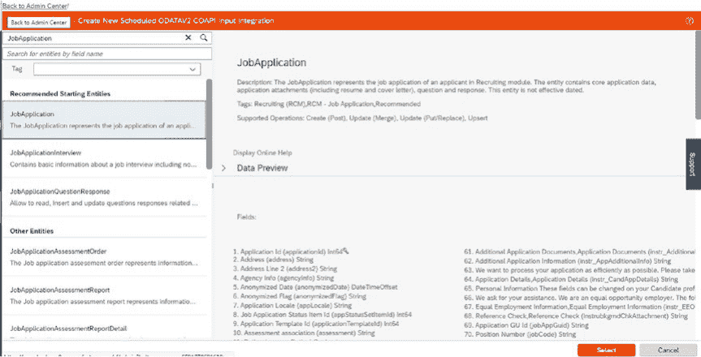

**图 7-5.** *选择 JobApplication 实体*

选择起始实体后，您可以在屏幕顶部看到配置步骤，如图 7-6 所示。您会注意到没有目标设置。这是因为您已选择 SuccessFactors 同时作为目标类型和源类型。

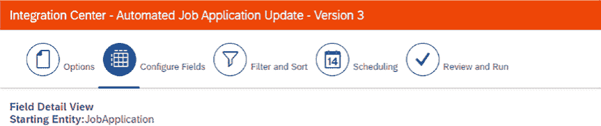

**图 7-6.** *Integration Center 中的配置步骤*

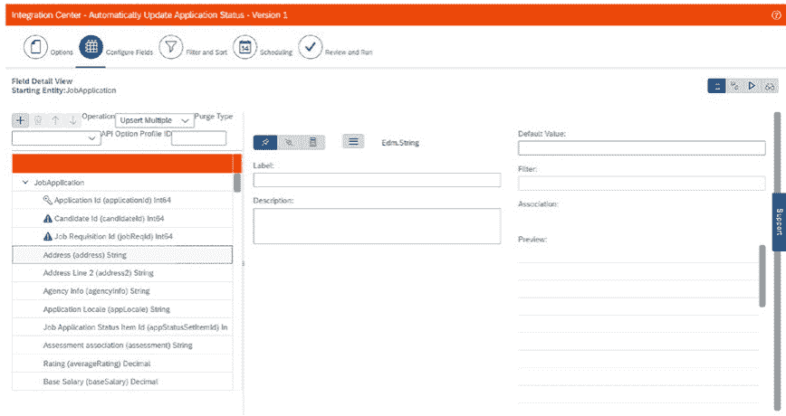

### 图 7-8. Integration Center 中的配置字段页面

请注意，此处目标字段显示在左侧。

用于填充字段的字段选项从左到右显示，如图 7-9 中突出显示的那样。它们是：

- 设置为固定值字段 - 设置默认值。
- 设置为关联字段 - 映射到另一个字段。这也可以在“字段映射视图”中完成。
- 设置为计算字段 - 执行计算、If/Then 条件等来填充该字段。
- 将操作数与字段关联 - 这允许编辑计算字段、用于映射的关联字段等。

### 图 7-9. Integration Center 中用于填充字段的图标

我们已经介绍了使用“设置为关联字段”进行字段映射。这可以通过“字段映射视图”来展示，如图 7-10 所示。请注意，左侧是源字段，右侧是目标字段。可以将源字段从左侧拖到右侧，以将它们分配给目标字段。

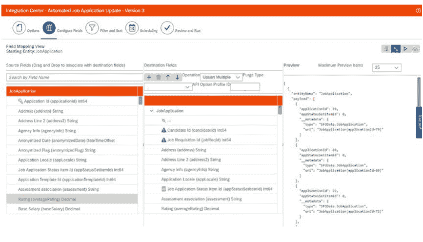

图 7-10. Integration Center 中的字段映射视图

计算字段和筛选条件对于招聘自动化非常重要。让我们来看一下计算字段的用法。图 7-11 显示了计算字段值的不同选项。请注意，可以有多个语句行。语句可以嵌套，并位于不同级别。

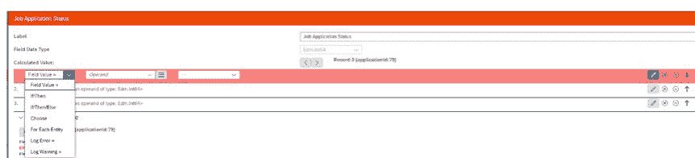

### 图 7-11. 计算字段值的选项

语句的选项如下所示：

字段值 – 根据一个或多个指定字段作为操作数以及一个操作来设置字段值。示例：

- 使用“开始日期”作为操作数，“加上年龄计算”作为运算符，设置“距开始日期的天数”自定义字段。然后，这可以用作接近开始日期的新员工申请的仪表板警报。

If/Then – 当 If 条件为真时，一个或多个语句将作为一个块执行。这可能就像设置一个值一样简单。示例：

- 如果申请状态为“默认”，并且“前雇员”为真，则将状态设置为“检查重新雇佣资格”。由于这涉及两个条件，逻辑如下所示：
  - 如果申请状态等于“默认”，则
  - 如果“前雇员”等于真，则
  - 将申请状态设置为“检查重新雇佣资格”

If/Then/Else – 这与 If/Then 语句相同，但如果条件被确定为假，则执行一组不同的语句。

选择 – 根据输入字段的值，将字段设置为一组值之一。对于有编程背景的人来说，这就像一个 case 语句。它避免了大量嵌套的 if/then/else 语句。示例：

- 对于咨询职位的申请人，如果他们在候选人档案中指定的出差意愿为10%或以下、10%至25%或25%至50%，则将其置于“不愿出差”的拒绝状态。

**对于每个实体** – 循环遍历一个关联实体（如 Application ▶ Candidate ▶ Education）并检查值。它通常用于 Employee Central，循环遍历多个薪酬组成部分。一个招聘用例可以是检查申请人是否曾在某个竞争对手公司工作过，并基于此设置申请字段。

## 案例研究：基于属性推进候选人

我们的客户在有效获取某些人才群体方面面临许多挑战。其中一个群体是拥有项目管理经验的高素质候选人。最大的人才来源之一是 SAP SuccessFactors Recruiting 解决方案中已注册候选人和员工的现有人才库。当有人从一份候选人名单中被录用到一个职位时，经常会有出色的亚军申请人，有时被称为银牌得主。招聘人员希望能够看到申请人是否是其另一个项目经理职位的银牌得主。由于申请量巨大，他们不想花费精力去挖掘信息或通过多次点击进行导航。

## 技术解决方案

识别银牌得主候选人的一些选项包括查看申请上的“已申请职位”portlet，和/或在候选人档案上使用“项目经理银牌得主”标签。对这些候选人进行分组和推广的另一个好方法是将他们放入“项目经理银牌得主”人才库。然后，该人才库可用于定向电子邮件活动。

目前无法使用 Integration Center 按候选人与人才库的关联进行筛选。因此，我们将使用候选人档案标签来识别银牌得主项目经理。如果我们还想在列表中跟踪这些候选人，我们可以创建一个人才库，通过夜间搜索根据银牌得主标签分配候选人。这样，我们就两全其美了。

我们将使用 Integration Center 来完成以下操作：

- 使用以下条件筛选申请：
  - 职位名称以“项目经理”开头。
  - 申请状态为“默认”（新申请）。
- 对于这些申请，我们将执行以下操作：
  - 循环遍历候选人档案上的标签。
  - 如果任何标签为“项目经理银牌得主”，则将新申请状态设置为“入围”。

## 步骤 0

确保有有效的测试数据可用。申请必须处于默认状态，职位名称必须以“项目经理”开头，并且候选人档案必须带有“项目经理银牌得主”标签。参见图 7-12。

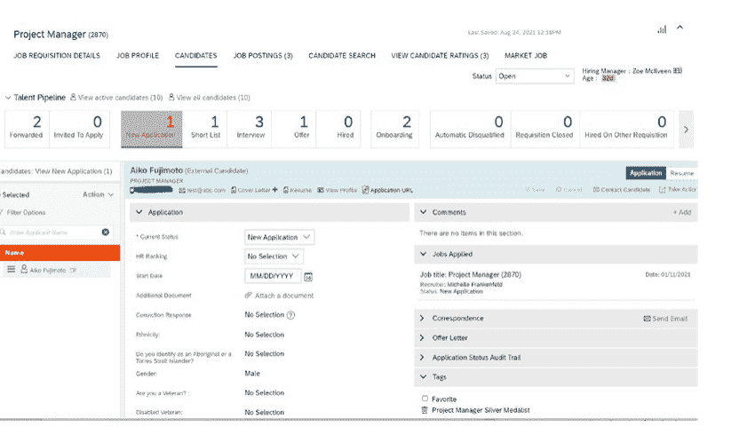

*图 7-12. 项目经理职位上的新申请*

## 步骤 1

使用“更多集成类型”创建新集成。

## 步骤 2

选择“职位申请”作为起始实体。

### 图 7-14. 设置高级筛选器

## 步骤 5

对于第二个筛选器，选择 jobAppStatus ► 申请状态名称，如图 7-15 所示。

### 图 7-15. 选择申请状态名称作为第二个筛选器

## 步骤 6

将状态筛选器设置为“默认”，即“新申请”，如图 7-16 所示。

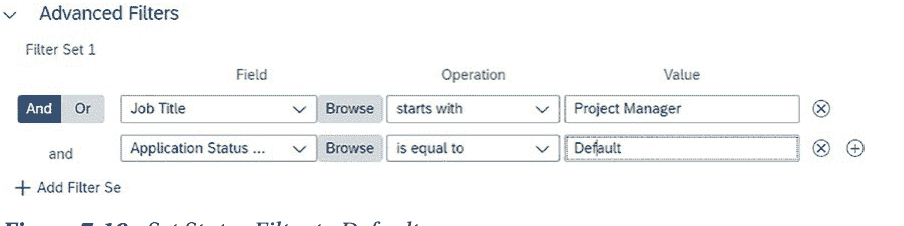

*图 7-16. 将状态筛选器设置为“默认”*

## 步骤 7

在“配置字段”选项卡上，将源申请 ID 映射到目标申请 ID。

## 步骤 8

确保您处于详细信息视图，点击“职位申请状态项目 ID”，然后点击右侧的计算字段图标，如图 7-17 所示。

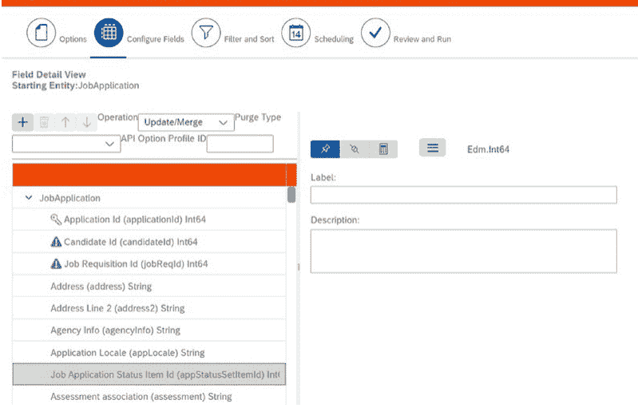

*图 7-17. 选择计算字段图标*

## 步骤 9

为计算字段指定一个标签，如图 7-18 所示。对于第一条语句，选择“For Each Entity”选项，因为我们将循环遍历与申请关联的候选人档案上的标签。

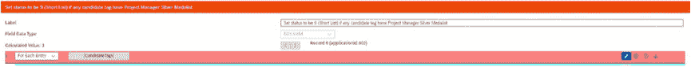

***图 7-18.*** *定义字段标签*

## 步骤 10

通过点击 <Specify an Entity>，然后导航到 Candidate ► tags，选择要循环遍历的实体，如图 7-19 所示。

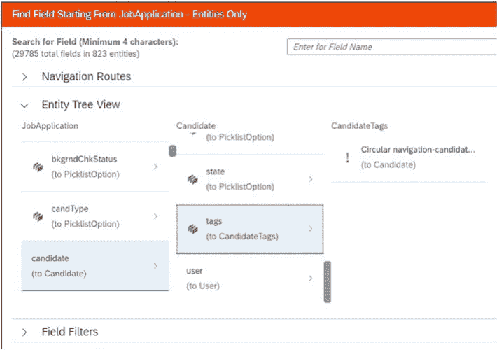

***图 7-19.*** *候选人标签*

## 步骤 11

然后，我们在 For Each Entity 循环中使用 If/Then 语句检查标签是否为“项目经理银牌得主”。参见图 7-20。

## 第 7 章 使用 Integration Center 实现自动化

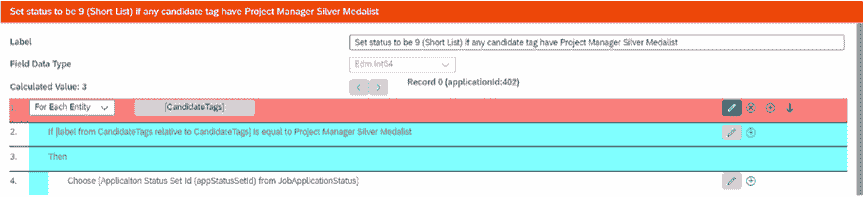

*图 7-20. 定义 If/Then 语句*

### 步骤 12

我们想要确保被标记为银牌得主的申请能够优先处理，并直接移动到“入围”状态。为此，我们使用申请状态 ID 更新申请状态。申请状态属于状态集，状态集代表一个独特的招聘流程。默认状态和入围状态的状态 ID 对于每个申请状态集都是不同的。客户可能有多个不同的状态集来支持不同的流程。

我们将检查当前的申请状态 ID。该数字会告诉我们它属于哪个状态集，因为它们是唯一的。然后，这将告诉我们应使用哪个“入围”状态 ID。

例如，默认状态 ID 为 63，告诉我们状态集是“简单状态集”，其代码为 21。该状态集中的“入围”状态是 68。在此示例中，我们需要将新状态设置为 68，以将候选人移动到入围状态。如果我们尝试将状态 ID 设置为不属于此状态集的值，集成任务将报错。

我们将使用 Choose 语句将默认状态 ID 映射到正确的入围状态 ID。这可以在图 7-21 中看到。

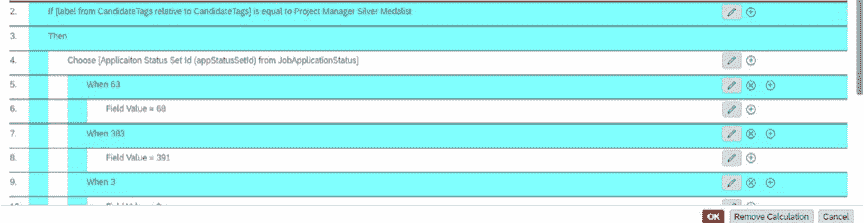

*图 7-21. 将状态 ID 映射到状态集*

### 步骤 13

如果 Choose 语句无法识别状态 ID，则该值保持为零。退出 For Each Entity 循环后，我们将检查状态 ID 是否仍为零。如果是，我们将新状态设置为与旧状态相同。这意味着申请将保持在默认状态。如图 7-22 所示。

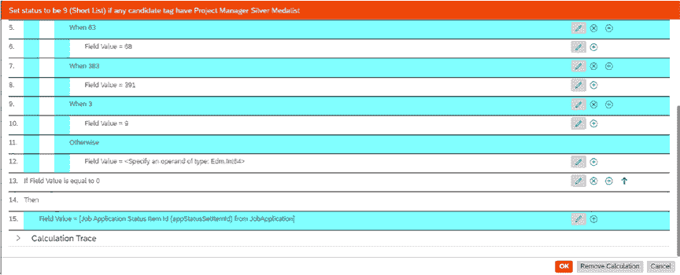

### 图 7-22. *If/Then 逻辑*

以上就是我们设置计算字段的步骤，测试除外。计算字段的逻辑可以通过使用预览记录（在本例中为申请）并检查每条记录的处理方式来验证。这是通过 Calculation Trace 完成的。

#### 使用 Calculation Trace

Calculation Trace 对于故障排除非常方便。我们将使用它来验证已知应移动到“入围”状态的申请是否生成了正确的状态 ID。对于每个实体，逻辑如下所示，同时显示任何条件的评估结果（真或假）。在图 7-23 中，我们可以看到存在相关的银牌得主标签，并且由于默认状态 ID 为 63，我们将新状态 ID 设置为 68（入围）。

### 图 7-23. Calculation Trace

注意：如果没有足够的预览记录来测试所有逻辑，可以通过返回并转到 Configure Fields ► Field Mapping View，然后更改 Maximum Preview items 来扩展记录数量，如图 7-24 所示。

### 图 7-24. 调整最大预览项数

## 步骤 14

保存集成后，我们将选择“Review and Run”选项卡并点击“Run Now”，如图 7-25 所示。我们可以通过点击“Last Run Time”旁边的刷新图标来跟踪进度。如果有任何错误，我们可以进行故障排除。

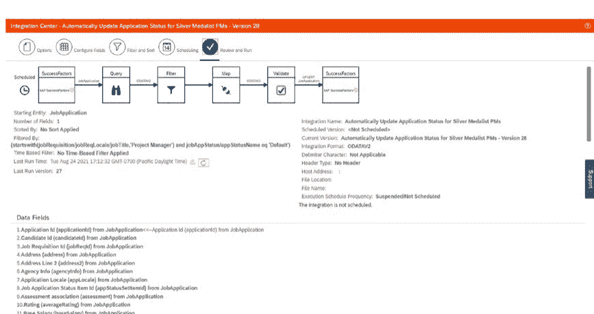

### 图 7-25. Integration Center 中的 Review and Run 选项卡

## 步骤 15

现在，我们可以返回测试申请，确保它已自动移动到“入围”状态，如图 7-26 所示。成功完成进一步测试后，我们应将集成移至生产环境并安排其运行。

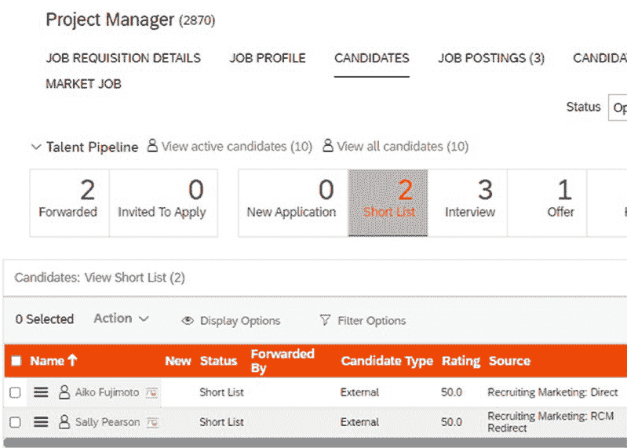

### 图 7-26. 查看入围状态的候选人

恭喜！您已使用 Integration Center 自动将申请移过招聘流程。

### 结论

您现在已学习以下内容：

- 如何确定适合申请人自动化的正确工具。Intelligent Services 事件非常适合实时移动。Integration Center 计划任务应用于高容量处理。
- 使用 SAP SuccessFactors 同时作为源系统和目标系统简化了自动化更新，并且无需使用 SFTP。
- 如何根据职位申请的本地化设置执行复杂筛选（例如基于职位头衔）。
- 计算字段是使用逻辑确定字段更新方式的极其强大的工具。
- 计算字段中的 If/Then 语句、For Each Entity 循环和 Choose 语句之间的区别。
- 如何使用 Calculation Trace 准确了解预览记录的逻辑是如何处理的。
