## 第 8 章

### 评估集成框架

在前几章中，我们介绍了如何在候选人评估期间自动化 SAP SuccessFactors 系统。在本章中，我们将重点介绍如何与评估供应商集成。行业中有众多评估供应商，以满足不同地理位置、特定职位和行业客户的需求，这些供应商拥有专有实现。SAP SuccessFactors Recruiting 定义了一个框架，抽象了每个供应商的实现细节，并提供了一种标准的集成方式。评估供应商可以通过针对特定职位定制的标准化测试，并将评估整合到申请人工作流程中，极大地帮助公司及时筛选出最合格的候选人。添加评估供应商可以将任务委派给不同的评估供应商，从而释放招聘人员的时间，使其专注于申请流程本身。

传统上，SAP SuccessFactors Recruiting 有两家评估供应商，SHL 和 PeopleAnswers，使用 Boomi 或 SAP Cloud Platform Integration (CPI) 中间件实现。SAP SuccessFactors Recruiting 产品管理团队于 2017 年年中发布了评估框架，用于使用基于旧版 Web 服务的 SFAPI 框架建立直接的点对点评估集成。2019 年底，该框架升级为最新的 ODATA 框架。

#### 第 1 步：预配置 – 检查预配置设置

注意：在阅读本文档时，请注意后端的预配置工具仅合作伙伴和 SAP 支持人员可访问。


假设您是作为 WOTC（工作机会税收抵免）的一部分实施税务筛选评估的合作伙伴。按照本章所述的步骤操作后，您将能够设置客户的实例以接受 WOTC 资格认定。您需要执行多个步骤，其中一些在 Provisioning（配置管理）中完成，另一些在 Admin Center（管理中心）中完成。我们已标明每个步骤的设置位置。

导航至 Provisioning ► Company Settings。在 Recruiting settings（招聘设置）下，确保已启用 Assessment Integration（评估集成），如图 8-1 所示。此步骤可能并非必需，但您仍应检查一下。

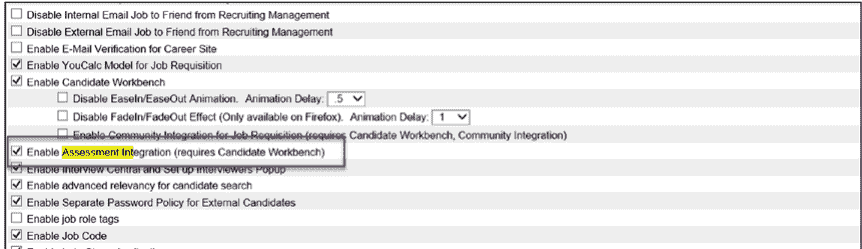

图 8-1. 检查配置管理设置

#### 步骤 2：配置管理 – 启用评估集成功能

您需要在职位申请模板上以及每个适用状态下启用评估的功能权限。在以下示例中，评估集成已针对“Default”状态启用。请确保您在 Provisioning 中上传修改后的职位申请模板。

```
<feature-permission type="assessmentIntegration">
    <description><![CDATA[The following roles can launch interview assessment during statuses with an Assessment category]]</description>
    <role-name><![CDATA[S]]></role-name>
    <role-name><![CDATA[O]]></role-name>
    <role-name><![CDATA[R]]></role-name>
    <role-name><![CDATA[G]]></role-name>
    <role-name><![CDATA[V]]></role-name>
```

```
<role-name><![CDATA[Q]]></role-name>
<status><![CDATA[Default]]></status>
</feature-permission>
```

#### 步骤 3：配置管理 – hardstopStatus 的可选配置

hardstopStatus 是招聘模块提供的标准字段，定义为名为 jobReqStatus 的选择列表，但在申请人工作流中被视为一种状态。此功能可防止求职申请在未完成评估的情况下继续在申请人管道中推进。实际应在何处强制实施 hardstopStatus，可以在创建职位申请时通过用户界面进行设置。示例请参见图 8-15。

由于它的行为类似于标准字段，因此其权限必须像其他字段一样在职位申请中进行设置。字段定义如下所示：

```
<field-definition id="hardstopStatus" type="picklist" required="false" custom="false">
<field-label><![CDATA[Hard Stop Status]]></field-label>
<field-label lang="en_US"><![CDATA[Hard Stop Status]]></field-label>
<field-description><![CDATA[Hard Stop Status]]></field-description>
<field-description lang="en_US"><![CDATA[Hard Stop Status]]></field-description>
<picklist-id>jobReqStatus</picklist-id>
</field-definition>
```

完成更改后，请记得上传您的职位申请。

#### 步骤 4：管理中心 – 评估集成的权限

评估需要两类权限：用于启用评估关联的管理权限和 API 用户权限。在大多数客户环境中，这两类权限是分开的。表 8-1 总结了评估集成所需的权限。根据客户的特定情况，有些客户可能只有一个角色，也可能有多个角色。

**表 8-1. 评估集成所需权限汇总**

| 系统角色 | 权限类别 | 权限列表 |
| :--- | :--- | :--- |
| 系统管理员 | 管理招聘 | – 管理评估供应商 |
| API 用户 | 一般用户权限 | – 用户登录<br>– SFAPI 用户登录 |
| API 用户 | 招聘权限 | – ODATA API 申请创建<br>– ODATA API 申请导出<br>– ODATA API 申请审核导出<br>– ODATA API 申请更新 |
| API 用户 | 管理集成工具 | – 访问事件通知订阅<br>– 访问事件通知审核日志<br>– 访问出站信任管理器 |

#### 步骤 5：管理中心 – 导入/导出评估供应商文件

在 Admin Center 中，导航至 Manage Assessment Vendors（管理评估供应商）。

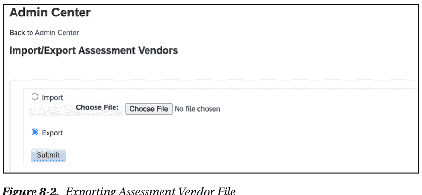

如图 8-2 所示，选择 Export 选项，然后点击提交以下载 CSV 文件。您可以选择激活现有供应商，也可以使用自己的供应商。再次导入该文件。示例供应商的截图如图 8-3 所示。

|  | A | B | C | D | E |
|---|---|---|---|---|---|
| 1 | externalPartnerCode | clientId | active |  |  |
| 199 | HIKERIGHT | HIKERIGHT | N |  |  |
| 200 | IKM | IKM | N |  |  |
| 201 | DUMMY | DUMMY | Y |  |  |
| 202 |  |  |  |  |  |

图 8-3. 导入评估供应商文件

#### 步骤 6：配置管理 – 上传供应商评估包

向下滚动以找到以下部分。

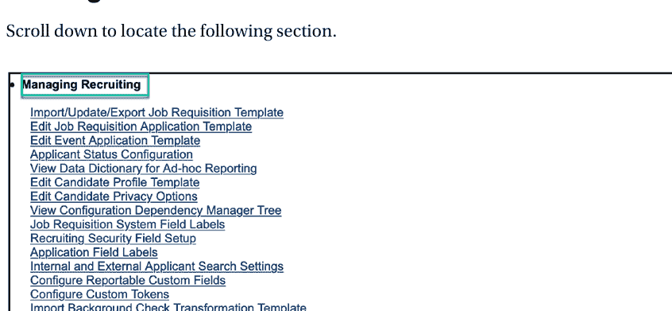

图 8-4. 配置管理 – 导入/导出评估供应商包

如图 8-4 所示，导出现有的供应商包模板。按图 8-5 所示填写评估供应商包文件，然后导入该文件。

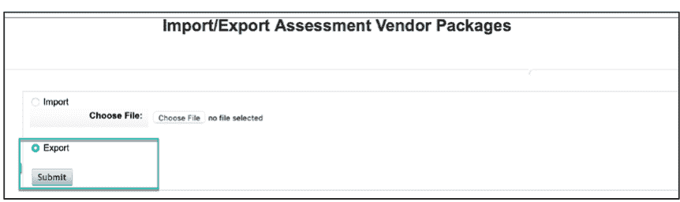

### 图 8-5. 导入/导出评估供应商包

一个完整的 CSV 文件示例如图 8-6 所示。

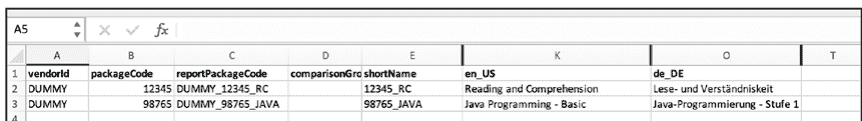

### 图 8-6. 示例评估供应商包文件

## 备注：

- 1. 唯一必需的列是 vendorId、packageCode、shortName，以及取决于您配置的本地化描述。
- 2. 每个客户实施都有特定的包，一旦导入，便无法删除。
- 3. 作为供应商，您只会收到如图 8-6 所示的 packageCode。shortName 列会在用户界面中显示。
- 4. 对现有包的任何新增都需要配置管理访问权限。

### 步骤 7：管理中心 – 设置事件通知订阅

导航至 Admin Center ➤ Tools ➤ Event Notification Subscription（事件通知订阅）。

“Event Notification Subscription”中的第一步是定义订阅者。您可以通过点击“Edit Subscriber”添加新订阅者。唯一重要的字段是 Subscriber Id，您可以将其设置为相同的值。

图 8-7 是已完成订阅者的示例。

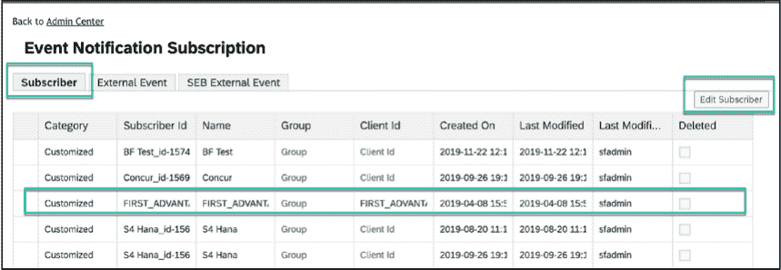

*图 8-7. 事件通知订阅*

## 备注：

- 1. 需要配置的重要字段是 Subscriber Id（与步骤 5 中的 vendorId 匹配）、Name 和 Client Id。
- 2. 如果您连接的供应商对所有客户都有公共端点，较好的做法是为每个客户设置唯一的客户端 ID。

下一步是定义外部事件。

## 第 8 章 评估集成框架

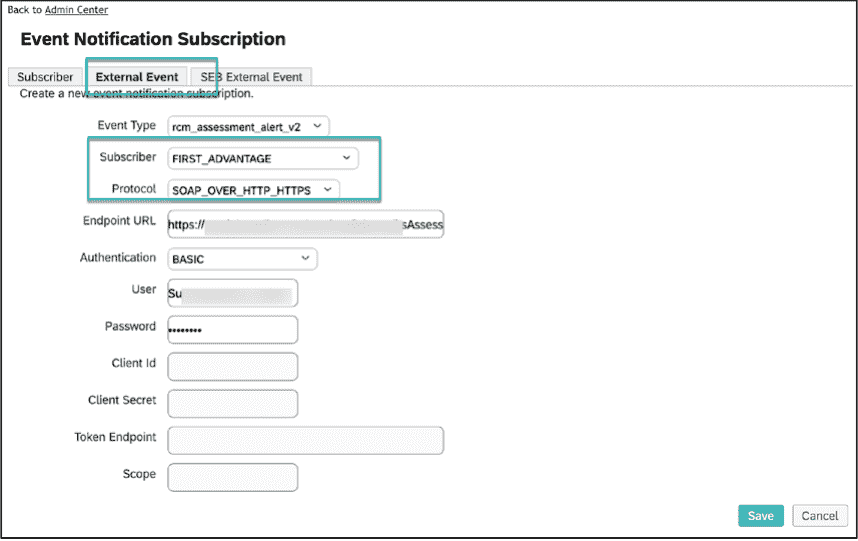

**图 8-8.** *设置外部事件*

## 备注：

**Event Type（事件类型）** – 应如图 8-8 所示。此下拉列表中的其他值是为了向后兼容。

**Subscriber（订阅者）** – 与前一屏幕中的 Subscriber Id 相同。

**Protocol（协议）** – 仅为 SOAP_OVER_HTTP_HTTPS。

**Endpoint URL（端点 URL）** – 这是合作伙伴系统中将接收此评估通知的端点。

**Authentication（身份验证）** – 有三个选项：NONE、BASIC 或 CLIENT_CREDENTIALS。基本身份验证将在 2021 年底弃用，2022 年后不再支持。

如果您的身份验证方式为 BASIC，则需要以下字段：

**User（用户）** – 这是供应商软件为启用来自外部来源（例如 SAP SuccessFactors Recruiting）的集成而需要的用户 ID。

**Password（密码）** – 无需解释。

如果您的身份验证方式使用 CLIENT_CREDENTIALS 且已由您的软件设置，则需要以下字段：

**Client Id（客户端 ID）** – 您系统上的唯一标识符，用于指示评估请求的来源。为生产使用，您应为每个客户规划唯一的客户端 ID。

**Client Secret（客户端密钥）** – 与客户端 ID 类似，这是一个只有您和客户/实施合作伙伴知道的值。

**Token Endpoint（令牌端点）** – 此 URL 是根据输入的客户端 ID 和客户端密钥生成令牌的端点。

**Scope（范围）** – 这是一个可选参数。

### 步骤 8：管理中心 – 设置与评估关联的电子邮件模板

导航至 Admin Center ► Manage Recruiting Email Templates（管理招聘电子邮件模板）。

SAP SuccessFactors Recruiting 为您提供了许多电子邮件模板。您可以创建自己的电子邮件模板，也可以通过修改来利用现有模板。在本示例中，我们使用了一个预交付的电子邮件模板，名为“D6: Assessment details needed”（D6：需要评估详细信息），如图 8-9 所示。

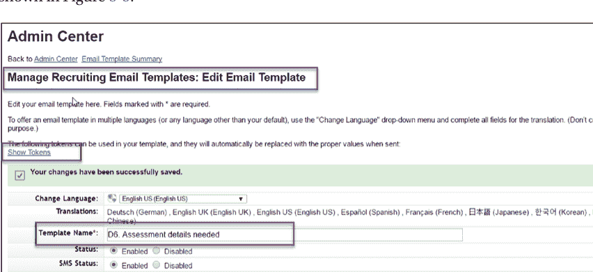

*图 8-9. 管理招聘电子邮件模板*


## 第 8 章 评估集成框架

点击“显示标记”（Show Tokens）并向下滚动，确保如图 8-10 所示，两个标记正在显示中。

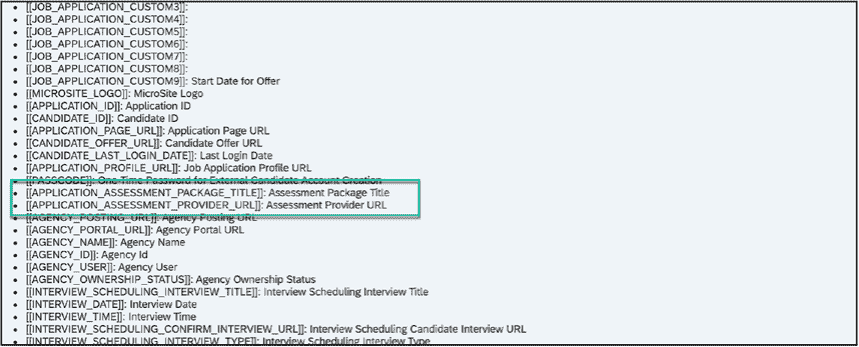

图 8-10。*将标记与电子邮件模板关联*

请按照图 8-11 所示点击“显示标记”，确保以下标记已被添加。

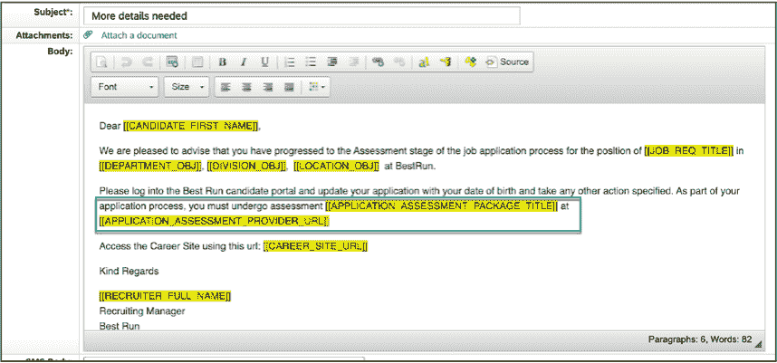

图 8-11。*使用标记验证电子邮件模板*

**注意** 如果您的标记未以黄色高亮显示，这意味着引用不正确。快速解决此问题的方法是按照图 8-10 所示精确复制并粘贴该标记。

#### 步骤 9：招聘——创建包含评估和 hardstopStatus 的工作职位

本章不涵盖创建工作岗位时涉及的各类注意事项。图 8-12 展示了一个已完成的工作职位，其中不仅配置了评估，还配置了 hardstopStatus。

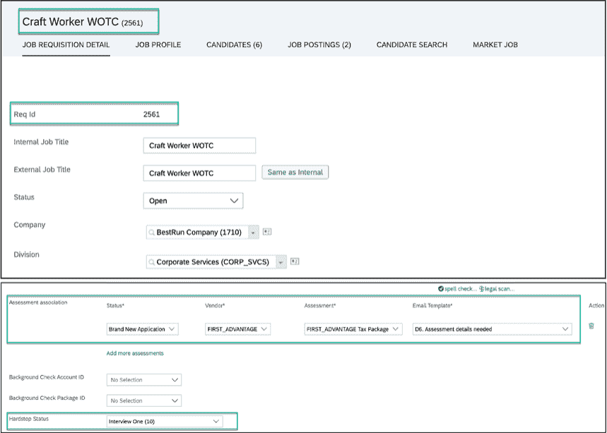

*图 8-12。* 包含评估和 hardstopStatus 的已完成工作职位示例

#### 步骤 10：招聘——发布工作岗位

一旦职位确定，您必须发布该工作岗位。详细步骤已在第 4 章中介绍。

#### 步骤 11：候选人——参加评估

如果发布了包含关联评估的工作职位，候选人将按照标准流程在客户的职业门户网站上注册并申请该职位。如果工作职位配置为在“全新申请”（Brand New Application）中有关联评估（见图 8-12），则候选人在提交求职申请后应立即参加评估。候选人将看到如图 8-13 所示的屏幕截图。

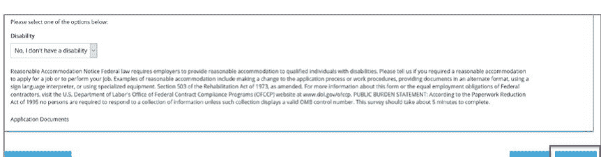

图 8-13。突出显示申请按钮的求职申请屏幕截图

图 8-14 中的确认屏幕会将候选人引导至评估页面，图 8-15 显示了评估的第一页。

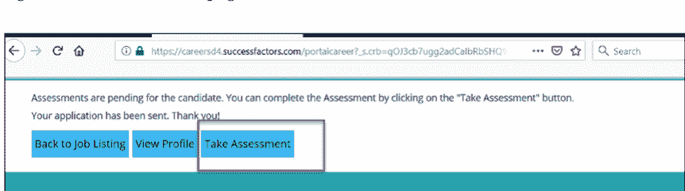

图 8-14。进行评估的屏幕截图

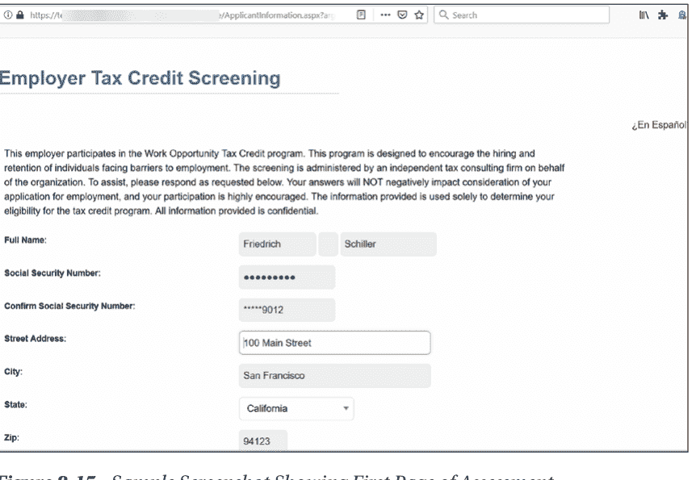

图 8-15。评估的第一页

#### 步骤 12：候选人——查看电子邮件通知

如果评估配置的状态不是“全新申请”（Brand New Application），候选人将收到步骤 8 中描述的电子邮件。然后，候选人将点击 APPLICATION_ASSESSMENT_PROVIDER_URL 标记以参加并完成评估。有关评估的详细信息如下所述。

#### 步骤 13：评估订单——请求和响应

成功创建评估订单后，SAP SuccessFactors 将创建一个 SOAP 请求，并期望获得同步的 SOAP 响应：

```xml
<?xml version="1.0" encoding="UTF-8" standalone="yes"?>
<ns7:createRcmAssessmentRequest xmlns:ns6="http://schemas.xmlsoap.org/soap/envelope/" xmlns:ns5="com.successfactors.alert" xmlns:ns7="http://alert.successfactors.com" xmlns:ns2="http://www.boomi.com/connector/wss" xmlns:ns4="http://notification.event.successfactors.com" xmlns:ns3="com.successfactors.event.notification">
<ns7:rcmAssessmentRequest>
<ns7:entityId>182</ns7:entityId>
<ns7:entityName>AssessmentOrder</ns7:entityName>
</ns7:rcmAssessmentRequest>
</ns7:createRcmAssessmentRequest>
```

##### 评估请求元素

**createRcmAssessmentRequest** – 请求操作的根元素。

**rcmAssessmentRequest** – 承载 RCM 评估请求信息的负载。

**entityId** – 评估订单 ID。

**entityName** – 被共享的实体，对于所有招聘评估，"AssessmentOrder" 都是其值。

您的供应商软件应能够以下列格式生成响应：

```xml
<?xml version="1.0" encoding="UTF-8" standalone="yes"?>
<ns7:createRcmAssessmentRequestResponse xmlns:ns6="http://schemas.xmlsoap.org/soap/envelope/" xmlns:ns5="com.successfactors.alert" xmlns:ns7="http://alert.successfactors.com" xmlns:ns2="http://www.boomi.com/connector/wss" xmlns:ns4="http://notification.event.successfactors.com" xmlns:ns3="com.successfactors.event.notification">
<ns7:rcmAssessmentResponse>
<ns7:assessmentUrl>https://test.jobcredits.com/jobcredits/quest/default.asp?arg=a4c4e89f-d386-4d98-86e2-6cacb042a7b2</ns7:assessmentUrl>
<ns7:entityId>182</ns7:entityId>
<ns7:receiptId>a4c4e89f-d386-4d98-86e2-6cacb042a7b2</ns7:receiptId>
<ns7:status>2</ns7:status>
<ns7:statusDate>2019-12-19T00:00:00-05:00</ns7:statusDate>
<ns7:statusDetails>Acknowledged</ns7:statusDetails>
</ns7:rcmAssessmentResponse>
</ns7:createRcmAssessmentRequestResponse>
```

**assessmentUrl** - 候选人的评估 URL。此 URL 来自真实的供应商，且为必填字段。可以通过 JobApplicationAssessmentOrder 实体查询 assessmentUrl（步骤 16）。

**entityId** - 用于参考的订单 ID。必填字段，且应与请求中的 entityId 匹配。

**receiptId** - 这是您针对某次评估的唯一回执 ID。您可以按任意方式构建它，主要要求是能够唯一标识每个评估请求，并将其与回执 ID 进行关联。

**status** - 必填状态值。以下枚举值标识了每个状态值的含义：

- 2 - INITIATED（预期在初始订单确认中出现）
- 1 - IN_PROGRESS（预期在状态更新期间出现）
- 0 - COMPLETED（预期在接收到评估完成更新时出现）
- 99 - INITIATION_FAILED（预期在供应商端处理评估请求时出错时出现）

**statusDate** - 按照 XML 标准，交易执行日期。请记住以 UTC（带时区偏移量）格式发送日期信息。

**statusDetails** - 成功的订单提交预期为“Acknowledged”（已确认）。

**注释：**

- 1. 系统期望在 60 秒内收到来自供应商的同步确认。否则，审计日志中将显示超时。
- 2. 如果由于某种原因供应商端的服务器未正确配置，我们将看到一个通用错误，指示“无法分发消息”。某些错误需要在服务器日志中检查。
- 3. 唯一相关的 XML 命名空间是与 http://alert.successfactors.com 关联的那个，即 ns7。命名空间的实际值“ns7”将取决于运行时环境。

#### 步骤 14：招聘——查看成功的评估

如果您的评估集成成功，您可以以两种不同的方式检查进度。图 8-16 显示了突出显示评估状态的候选人摘要页。如果评估状态为“已发起”（Initiated）或“已完成”（Completed），则表明您的集成设置正确。

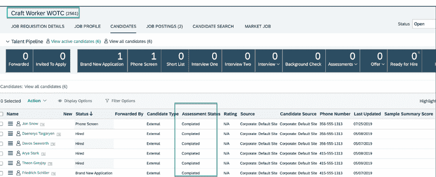


图 8-17 显示了评估部件（Assessments portlet）中结果的详细信息。点击图 8-16 中候选人的姓名，并向下滚动至求职申请的评估部件。

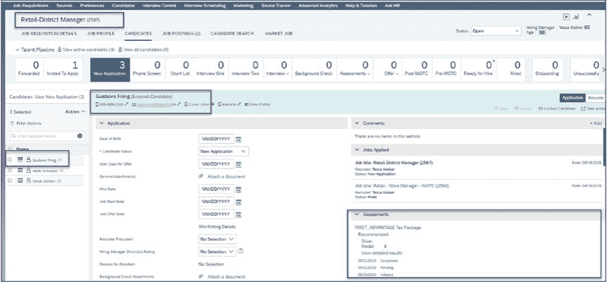

*图 8-17。突出显示评估部件的求职申请详情页。*

在图 8-17 中，结果表明该候选人被推荐，并获得了“银牌”（silver medal），数值评分为 3。

#### 步骤 15：管理中心——故障排除您的集成

导航至管理中心（Admin Center）➤ 事件通知审计日志（Event Notification Audit Logs）。请参阅表 8-1 了解如何设置权限。如果状态显示为“启动订单出错”（Error Initiating Order）（图 8-19），则应查看事件审计日志。如果以下状态字段指示 DELIVERED（已送达），则您的集成成功。如果状态指示 FAILED（失败），则您必须点击每个错误对应的“查看”超链接。审计日志将显示请求和响应。

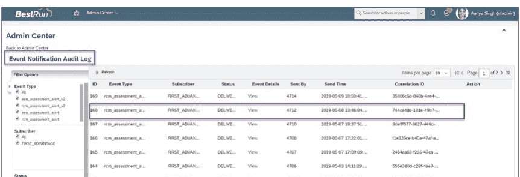

图 8-18。事件通知审计日志

#### 步骤 16：OData API 调用

此示例中的端点是 https://apisalesdemo4.successfactors.com/odata/v2/JobApplicationAssessmentOrder。

##### 查询 JobApplicationAssessmentOrder

查询 JobApplicationAssessmentOrder 以了解评估订单的详细信息以及相关的求职申请字段：请注意，这些 OData API 调用需要基本身份验证（Basic Authentication）才能工作。图 8-19 和 8-20 中显示的以下示例使用 Postman 执行 API 调用。


## 第 8 章 评估集成框架

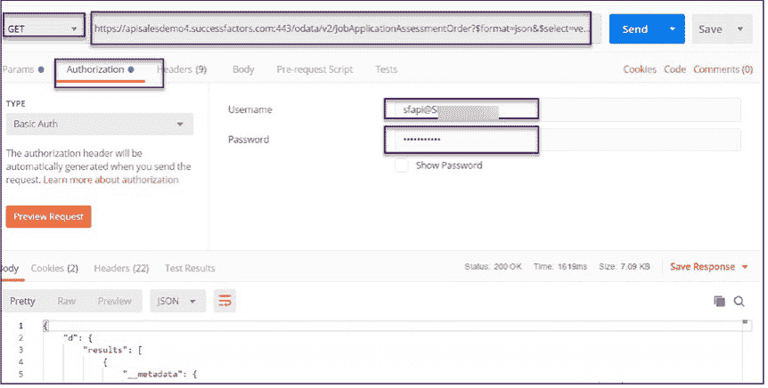

### 图 8-19. 对 JobApplicationAssessmentOrder 的 ODATA API GET 调用

```
GET: https://apisalesdemo4.successfactors.com:443/odata/v2/JobApplicationAssessmentOrder?$format=json&$select=vendorCode,packageCode, id,assessmentUrl,handbackUrl, jobApplication/firstName, jobApplication/country,jobApplication/lastName, jobApplication/contactEmail,jobApplication/dateOfBirth,jobApplication/address,jobApplication/address2,jobApplication/city/jobApplication/ gender,jobApplication/zip,jobApplication/state,jobApplication/applicationId,jobApplication/status, jobApplication/state/picklistLabels/label&$filter=id eq '182' and jobApplication/state/picklistLabels/locale eq 'en_US'&$expand=jobApplication,jobApplication/state/picklistLabels
```

响应负载（仅部分显示）：

```json
{
  "d": {
    "results": [
      {
        "__metadata": {
          "uri": "https://apisalesdemo4.successfactors.com:443/odata/v2/JobApplicationAssessmentOrder(182L)",
          "type": "SFData.JobApplicationAssessmentOrder"
        }
      }
    ]
  }
}
```

（注：响应负载的原始 OCR 文本在页面间拆分，且部分缺少闭合括号。上述代码块是对源文件中 JSON 结构开头的语法校正表示，保持了关键信息。源文件第 205-207 页显示了嵌套元数据和选项列表的片段。）

```json
{
  "__metadata": {
    "uri": "https://apisalesdemo4.successfactors.com:443/odata/v2/PicklistOption(11674L)",
    "type": "SFODdata.PicklistOption"
  },
  "id": "11674",
  "minValue": "-1",
  "externalCode": "state_United_States_New_Mexico",
  "maxValue": "-1",
  "optionValue": "-1",
  "sortOrder": 49,
  "mdfExternalCode": "state_United_States_New_Mexico",
  "status": "ACTIVE",
  "parentPicklistOption": {
    "__deferred": {
      "uri": "https://apisalesdemo4.successfactors.com:443/odata/v2/PicklistOption(11674L)/parentPicklistOption"
    }
  },
  "picklistLabels": {
    "results": [
      {
        "__metadata": {
          "uri": "https://apisalesdemo4.successfactors.com:443/odata/v2/PicklistLabel(locale='en_US',optionId=11674L)",
          "type": "SFOData.PicklistLabel"
        },
        "optionId": "11674",
        "locale": "en_US",
        "id": "12105",
        "label": "New Mexico",
        "picklistOption": {
          "__deferred": {
            "uri": "https://apisalesdemo4.successfactors.com:443/odata/v2/PicklistLabel(locale='en_US',optionId=11674L)/picklistOption"
          }
        }
      }
    ]
  }
}
```

#### 注释：

- 1. ODATA 协议不允许对子实体进行过滤。因此响应将包含 PicklistOptions 和 PicklistLabels 的所有语言环境。你可以过滤掉不需要的语言环境。
- 2. handbackUrl 是 2020 年 11 月版本中引入的新属性，用于在启动评估前将候选人重定向回原始位置。

## Upsert #1：指示评估正在进行中

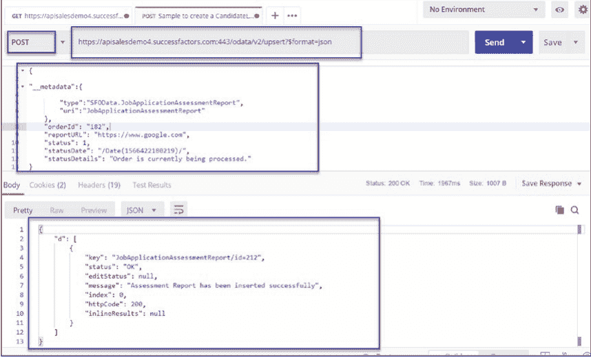

```
POST https://apisalesdemo4.successfactors.com:443/odata/v2/upsert?$format=json

{
  "__metadata": {
    "type": "SFOData.JobApplicationAssessmentReport",
    "uri": "JobApplicationAssessmentReport"
  },
  "orderId": "182",
  "reportURL": "https://www.google.com",
  "status": 1,
  "statusDate": "/Date(1566422180219)/",
  "statusDetails": "Order is currently being processed."
}
```

响应负载：

```json
{
  "d": [
    {
      "key": "JobApplicationAssessmentReport/id=212",
      "status": "OK",
      "editStatus": null,
      "message": "Assessment Report has been inserted successfully",
      "index": 0,
      "httpCode": 200,
      "inlineResults": null
    }
  ]
}
```

#### 注释：

- 1. orderId 字段是前面查询中 JobApplicationAssessmentOrder 的主键。
- 2. status 字段可取以下值：
  - a. 2（INITIATED – 在 UI 中显示为 Initiated）
  - b. 1（IN_PROGRESS – 在 UI 中显示为 Pending）
  - c. 0（COMPLETED – 在 UI 中显示为 Completed）
  - d. 99（INITIATION_FAILED – 在 UI 中显示为 Error ordering assessment）
- 3. statusDate 始终以 Unix 纪元时间传递。在前面的示例中，1566422180219 表示 2019 年 8 月 21 日，太平洋夏令时下午 2:16:20。Current Milliseconds 是此方面的优秀资源。

结果可在候选人资料的 Assessments portlet 中看到，如图 8-21 所示。

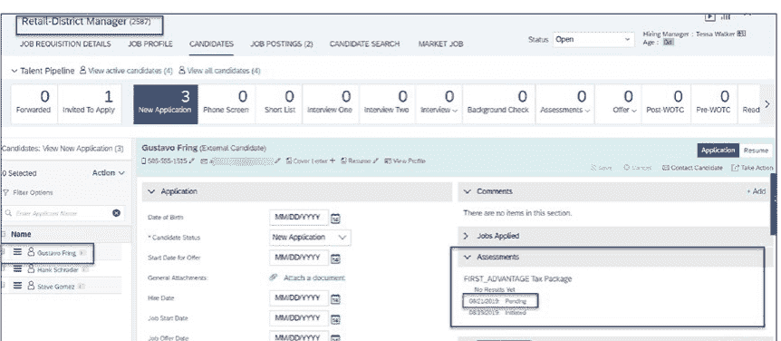

**图 8-21. 显示待处理结果的 Assessments Portlet**

## Upsert #2：指示评估已完成

图 8-22 显示了 Postman 中的 JSON 响应，表明评估结果已成功插入。

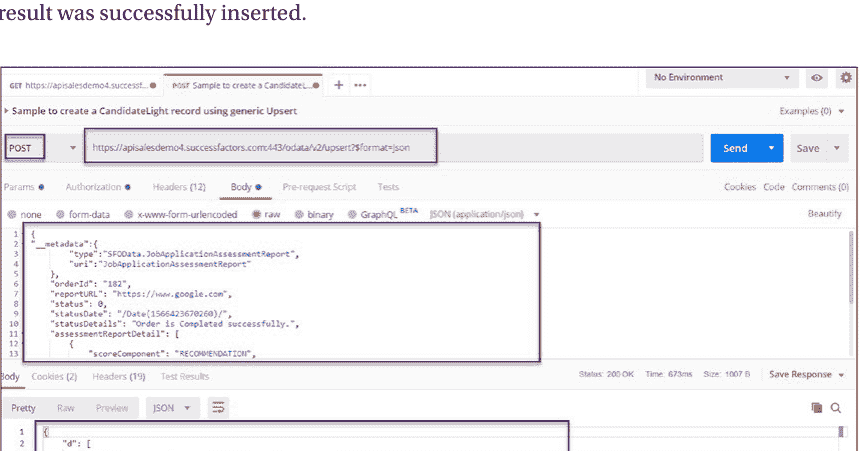

**图 8-22. 指示评估完成的示例 Upsert**

实际负载：

```
POST https://apisalesdemo4.successfactors.com:443/odata/v2/upsert?$format=json

{
  "__metadata":{
    "type":"SFOData.JobApplicationAssessmentReport",
    "uri":"JobApplicationAssessmentReport"
  },
  "orderId": "182",
  "reportURL": "https://www.google.com",
  "status": 0,
  "statusDate": "/Date(1566423670260)/",
  "statusDetails": "Order is Completed successfully.",
  "assessmentReportDetail": [
    {
      "scoreComponent": "RECOMMENDED",
      "scoreValue": "1"
    },
    {
      "scoreComponent": "Silver Medal",
      "scoreValue": "3"
    }
  ]
}
```

响应：

```json
{
  "d": [
    {
      "key": "JobApplicationAssessmentReport/id=213",
      "status": "OK",
      "editStatus": null,
      "message": "Assessment Report has been inserted successfully",
      "index": 0,
      "httpCode": 200,
      "inlineResults": null
    }
  ]
}
```

#### 注释：

- 1. orderId 字段是前面查询中 JobApplicationAssessmentOrder 的主键。
- 2. status 字段可取以下值：
  - a. 2（INITIATED – 在 UI 中显示为 Initiated）
  - b. 1（IN_PROGRESS – 在 UI 中显示为 Pending）
  - c. 0（COMPLETED – 在 UI 中显示为 Completed）
  - d. 99（INITIATION_FAILED – 在 UI 中显示为 Error ordering assessment）
- 3. statusDate 始终以 Unix 纪元时间传递。在前面的示例中，1566423670260 表示 2019 年 8 月 21 日，太平洋夏令时下午 2:41:10。
- 4. [ 和 ] 字符表示详细信息作为数组传递给 JobApplicationAssessmentOrderReport 实体上的 assessmentReportDetail 可导航实体。底层 ODATA 实体是 JobApplicationAssessmentReportDetail。
- 5. 你不能直接 upsert 到 JobApplicationAssessmentReportDetail 实体。你将看到如下错误响应：

```json
{
  "d": [
    {
      "key": null,
      "status": "ERROR",
      "editStatus": null,
      "message": "Entity JobApplicationAssessmentReportDetail is not editable. Please check the entity setting in Admin Center > OData API Data Dictionary or the entity metadata.",
      "index": 0,
      "httpCode": 400,
      "inlineResults": null
    }
  ]
}
```

- 6. JobApplicationAssessmentReportDetail 实体上的 scoreComponent 和 scoreValue：虽然该实体是一个数组，但建议将第一对这些值按前面所示发送。

可接受的值为：

- a. scoreComponent: RECOMMENDED, scoreValue: 1
- b. scoreComponent: RECOMMENDED_WITH_QUALIFICATION, scoreValue: 2
- c. scoreComponent: RECOMMENDED_WITH_RESERVATION, scoreValue: 3
- d. scoreComponent: NOT_RECOMMENDED, scoreValue: 4

- 7. 你可以在完成时发送任何额外的 scoreComponent/scoreValue 名称/值对。没有关于可以发送什么值的建议。在之前的示例中，我使用了 scoreComponent: “Silver Medal”，scoreValue = “3”。

### 结论

恭喜！你现在已成功在客户实例中设置了一个新的评估供应商。良好的做法是保留你所做的更改记录，以便在另一个客户实例中重复此过程或设置全新的供应商。

## 附加自定义 ODATA 集成

本章的第一部分将描述在与招聘行业其他解决方案合作时使用 SAP SuccessFactors ODATA API 的上下文。其余章节将用于探索额外的 ODATA 用例。

在之前的章节中，我们探索了在处理招聘集成时使用的关键实体。这些包括职位申请、求职申请和候选人。我们还学习了如何使用 Postman 和 SAP SuccessFactors 的 Integration Center 功能过滤这些实体并导航到其他实体。在本章中，我们将探索更多非常有用的 ODATA 实体及其用例。我们将以使用第三方 AI 工具将候选人匹配到职位申请和人才库的案例研究结束。

### 开放标准的使用

本书重点介绍使用 SAP SuccessFactors 技术构建招聘问题创新解决方案，使用 ODATA API。任何与 SAP SuccessFactors 的集成都需要使用 ODATA 进行数据交换。尽管许多供应商直接向 SAP SuccessFactors 解决方案发出 ODATA API 调用，但 SAP Cloud Platform Integration（CPI）通常用于将 ODATA 请求和响应转换为第三方解决方案提供的现有 API。

在与其他解决方案集成时，开放标准在许多行业和技术中被使用。在人力资源领域，HR Open Standards Consortium 被用作供应商、客户和系统之间的通用词汇，以简化集成。以前称为 HTR-XML Consortium，该联盟在其 4.x 版本中已从 XML 迁移到 JSON。迁移到 JSON 进一步简化了集成并提高了灵活性。更多信息请访问 www.hropenstandards.org。


开放标准意味着我们拥有在系统间表示请求的通用方法，例如背景调查请求、候选人搜索以及在线评估结果。此外，不同类型的请求之间还共享一些通用实体。示例包括候选人、技能和职位空缺。软件供应商通常需要传递标准中未涵盖的额外信息。因此，开放标准具有可扩展性。SAP 与其他软件提供商一样，为这些标准做出了巨大贡献。本书的一位作者曾在 2000 年代初参与制定所谓的人员配备交换协议（Staffing Exchange Protocol），这是 HR-XML 联盟的一项标准。如果开放的人力资源标准和协作是您所关注的领域，他会建议加入这个优秀的社区进行协作。

如果 SAP SuccessFactors 需要借助行业标准（例如 HR 开放标准联盟定义的标准）与非 SAP 系统进行通信，则会使用 SAP 云集成平台（CPI）将数据在 ODATA 和基于标准的第三方解决方案 API 之间的表示形式进行转换。

### 针对第三方解决方案的预构建接口

在与第三方解决方案提供商集成时，许多工作可能已经为您完成，在某些情况下甚至全部完成。正如我们在第 4 章中已经提到的，SAP Store 中列出了许多招聘解决方案提供商（见图 9-1）。解决方案出现在商店中表明很可能存在预构建的集成和文档。这也表明，在添加至商店时，该解决方案与 SAP SuccessFactors 计划推出的功能没有冲突。请注意“在……时”这一时间限定。路线图会发生变化。

另一种方法是动态读取招聘模板属性和用户权限以构建表单。幸运的是，SAP 提供了 API，既可以检索招聘模板的字段作为元数据，也可以检索特定用户的权限。图 9-2 展示了招聘模板、字段控制（权限）和用户（招聘经理或审批人）之间的关系。

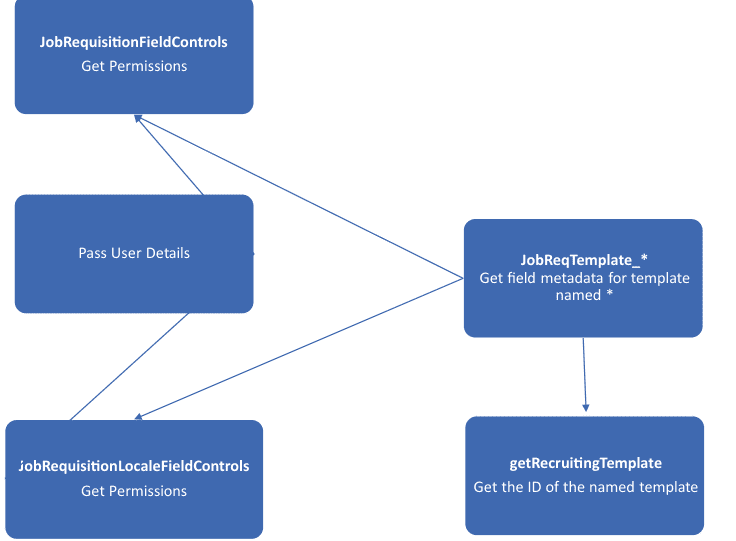

图 9-2. 用于确定用户招聘行为的函数和实体

### 使用集成中心提取申请表问题响应

针对特定招聘广告的申请问题报告是一项常见请求，但标准临时报告并不支持此类需求。在需要此类报告时，通常会通过从 JobApplication 实体导航到 jobApplicationQuestionResponse 来获取每日的集成中心 .CSV 作业申请提取文件。

由于招聘人员通常无法访问存储问题响应的 FTP 文件夹，因此通常会将结果文件复制到招聘人员可访问的 Sharepoint 文件夹中。

### 使用集成中心提取面试评估

这是与前述申请表问题响应场景类似的报告请求，采用相同的解决方案，通过 JobApplicationInterview 实体（即面试）进而访问 InterviewOverallAssessment 和 InterviewIndividualAssessment 实体。

### 录用流程

与招聘广告的创建和审批流程类似，录用审批也可以得到支持。在此功能在标准中受到支持之前，该功能此前用于支持批量录用审批。

自动化录用函以及批量生成录用函是一个常见需求。

自动生成录用函是理想的，因为录用函中有许多段落，可以根据录用细节（例如新员工是否有资格获得签约奖金）进行添加或删除。如果没有自动化，可能会产生许多版本的录用函模板，从而导致高维护成本。

结合使用 JobOffer 实体读取已批准的录用信息，并生成和发送录用函以自动向申请者发送录用函，这一组合非常强大。

在创建 OfferLetter 实体时，可以使用 sendMode 来指示申请者应如何接收录用函。然而，选项仅限于 email、emailaspdf、print、verbal 和 pending。使用 SuccessFactors 原生录用接受功能的在线录用，以及使用 DocuSign 的电子签名均不受支持。

如果使用第三方解决方案生成录用函并利用电子签名，则 sendMode 应设置为“pending”。然后，招聘人员可以查看生成的录用函，并选择适当的方法，包括电子签名。

另一种方法是定义录用函段落为录用审批中的令牌字段，并使用业务规则进行填充。

对于大批量录用函生成，例如针对实习生等大批量类似招聘对象，使用第三方文档生成器可能是合适的。SAP SuccessFactors 可用于使用 OfferLetter 实体生成录用函，然后将该信函的副本发送到第三方解决方案。

### 关于招聘 OData 实体的更多技巧

除了上述参考指南外，查找最新 OData 实体信息的一个好地方是 SAP API 业务中心。您可以在 https://api.sap.com 找到它。

选择 SuccessFactors ▶ APIs ▶ Packages ▶ SAP SuccessFactors Recruiting。正如您在图 9-3 中所见，您可以导航到各个实体。

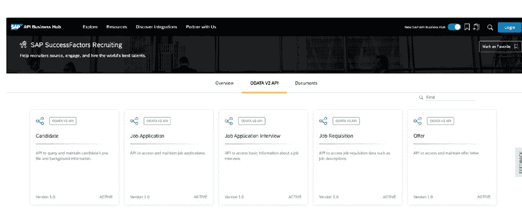

图 9-3. SAP API 业务中心中可用的招聘实体

在那里，您可以查看数据模型、文档，甚至尝试 API。正如您在图 9-4 中所见，甚至可以查看访问实体的代码片段。

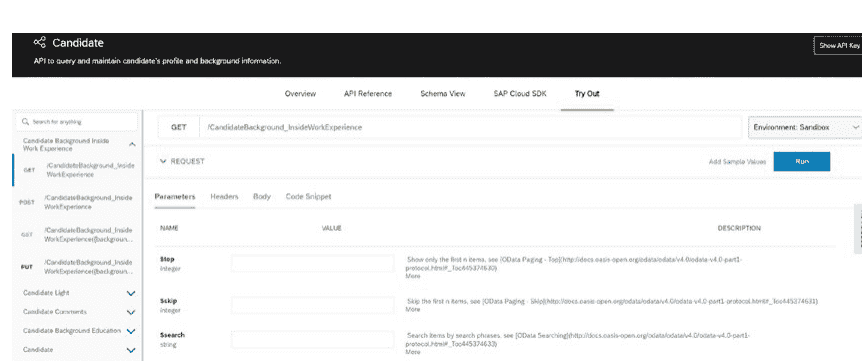

图 9-4. 有沙箱环境可用于尝试 ODATA 实体

凭借 SAP 提供的集成资源，可能性是无限的。

### 案例研究：使用 AI 将申请匹配到招聘广告

在第 5 章中，我们看到了使用 AI 聊天机器人与网站访客互动的应用，从而创造更好的候选人体验并提高网站访客到申请的转化率。人工智能以及作为 AI 子集的机器学习被用于招聘过程的许多阶段。图 9-5 展示了 AI 在招聘中的其他一些用途。

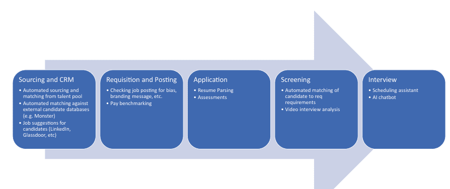

来自候选人和招聘经理调查、社交媒体等的自然语言处理（NLP）情感分析。

**图 9-5. 人工智能在招聘过程中的应用**

当然，AI 能做更多事情，包括提供竞争力分析、入职聊天机器人协助、导师匹配等等。可能性是无限的！

**买家须知：** 机器学习的好坏取决于用于训练它的数据。招聘领域极易产生偏见。如果学习数据中嵌有偏见，AI 既可能减少无意识偏见，也可能加剧偏见。

在撰写本文时，SAP 刚刚宣布收购 SwoopTalent，这是一个针对人才生命周期的 AI 驱动平台。这将对员工体验、外部候选人参与和组织人才分析方面的能力产生巨大影响。针对员工的使用示例包括学习推荐、职业发展、内部项目和职位匹配。

人才智能是新的流行词！SwoopTalent 平台的初步重点似乎是内部流动性和分析，但这必然会对招聘产品产生影响。

AI 的一个常见招聘用例是将职位招聘广告与候选人进行匹配。这可能用于以下情况：

- 挖掘和匹配已向其他招聘网站（如 Monster.com）提供其信息的 talent（人才）。这可能针对的是当前活跃的招聘广告。
- 挖掘和匹配已在人才数据库中的人才：员工、以前的申请者等。
- 针对特定招聘广告的已申请候选人进行匹配和排名。

在我们的案例研究中，我们将使用最后一个示例。自动对申请进行排名并与职位招聘广告进行匹配的业务理由很简单。招聘人员通常负责管理许多职位招聘广告，而这些招聘广告又可能有许多申请。在杂乱无章的申请中筛选，招聘人员将更多时间花在重复性的简历审查上，从而减少了与合适的候选人以及招聘经理有效沟通的时间。

我们将使用第三方解决方案自动对申请进行排名并与职位招聘广告进行匹配。与之前的示例一样，我们将展示 SAP SuccessFactors 端 API 的使用示例，而不推荐特定的解决方案。

在执行自动匹配时，我们有以下假设：

- 我们想使用职位资料构建器（Job Profile Builder）以确保一致的要求和职位描述。我们的职位描述已经通过第三方工具扫描，以确保它们符合品牌标准且不包含性别偏见。
- 我们的组织尚未验证申请与我们所有职位角色的匹配。因此，我们只会在招聘广告与特定职位角色绑定时才进行匹配。据告知，匹配解决方案将处理此问题。
- 我们希望招聘人员对匹配结果提供反馈，以便匹配引擎能够学习。


