## 第9章
附加自定义ODATA集成

如图9-6所示，需要执行的步骤如下：

1. 读取具有相关职位角色的空缺职位申请，包括带有描述、能力等的职位档案。

2. 读取此职位申请的相关应聘及其简历、背景信息等。可按照其状态（例如，仅限新申请）以及第三方匹配引擎是否已提供匹配分数进行筛选。

3. 在第三方匹配引擎中为每个应聘生成匹配分数。

4. 使用匹配分数更新 SAP SuccessFactors 应聘记录。

5. 如适用，招聘人员通过点击指向匹配解决方案的链接提供反馈。

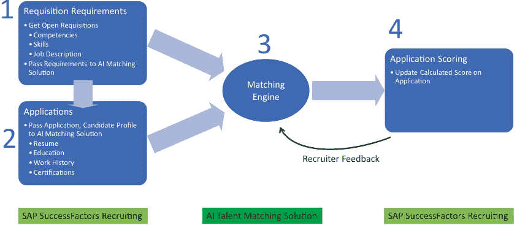

**图 9-6.** *自动匹配示例中的步骤*

我们需要几个额外的应聘字段，这些字段将由匹配引擎填充，并对招聘人员定义为只读。这些字段是：

- **职位需求匹配分数** – 这将是一个百分比。
- **匹配信息和反馈** – 这将是一个超链接，利用单点登录（SSO）将招聘人员带到匹配应用程序。然后他们能够对分数提供反馈。

图 9-7 显示了应聘模板中的示例匹配字段定义。可在 *管理模板* ► *招聘管理* ► *职位申请* 下找到。然后选择合适的应聘模板。自动匹配可能不会用于所有应聘模板。例如，它可能不适用于制造业车间职位，因为这类职位中简历不常见，且申请时可能不需要简历。请注意，**完整转发**（Forward Intact）应改为“否”，因为匹配分数和后续结果链接应为每个职位申请和应聘单独处理。

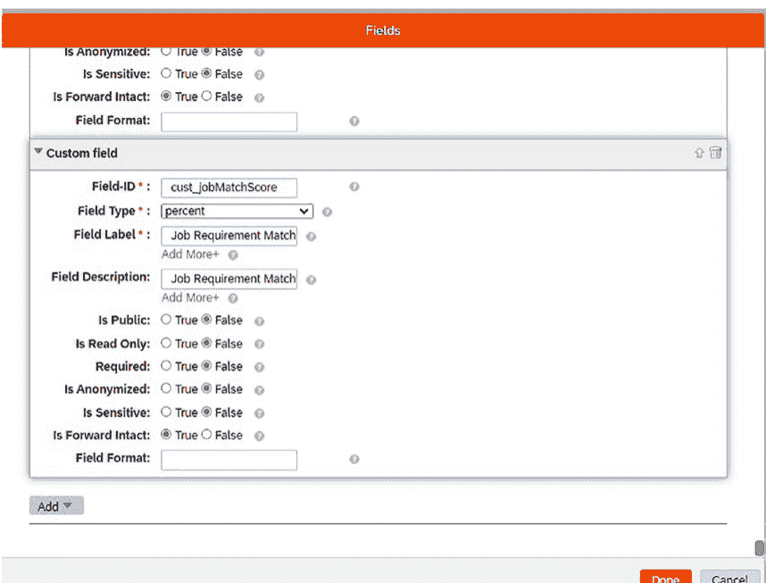

图 9-7. 示例匹配字段定义

我们还将添加一个超链接类型的应聘字段。该字段也将由匹配解决方案填充，并作为指向匹配解决方案内匹配结果的深层链接。参见图 9-8 中的招聘人员视图。

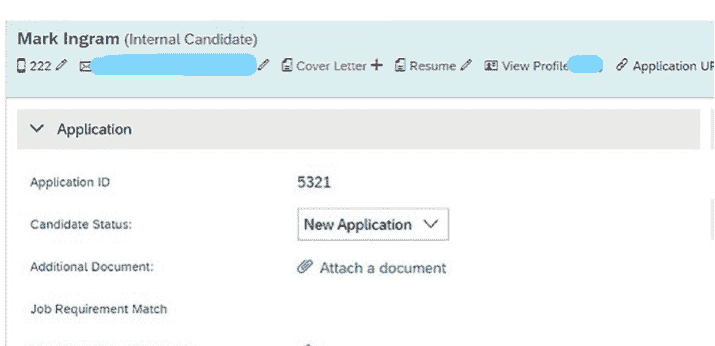

### 图 9-8. 招聘人员查看应聘上的匹配分数。

匹配分数只是帮助招聘人员的初步指标。您可能希望在筛选阶段之后对招聘人员隐藏此字段的可见性。根据您的招聘流程和合规实践，您可能需要在整个流程中保持其可见。

在我们的示例中，要匹配的职位角色将是有限的。最初，它们将仅限于软件开发人员。我们还将使用职位档案来确保职位描述和要求的一致性。参见图 9-9 中高级前端开发人员的示例职位档案。对于职位档案，职位摘要、职位描述、能力、技能和教育背景都将显示在职位发布中。

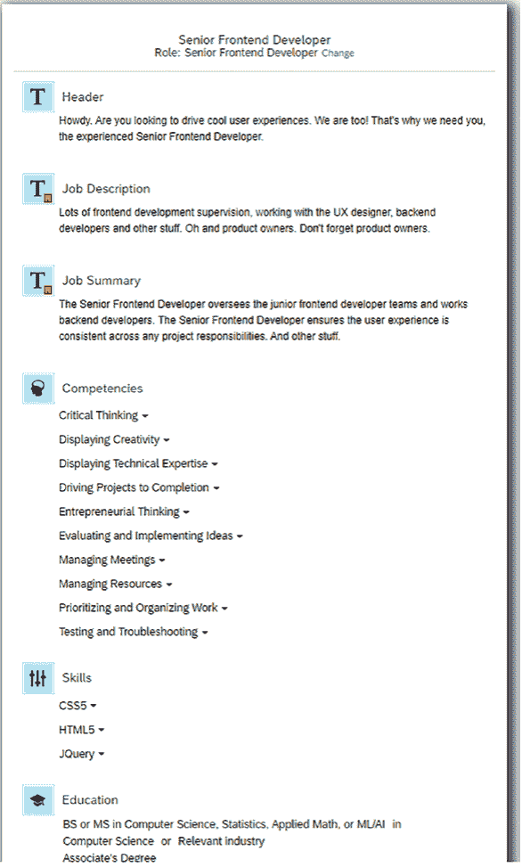

图 9-9. *高级前端开发人员的示例职位档案*

让我们首先分解 SAP SuccessFactors Recruiting 与匹配解决方案之间的集成点。表 9-1 将集成分为五个步骤。请注意，某些步骤可以合并。例如，职位描述可以与职位申请 ID 一起返回。这取决于匹配解决方案的需求。

### 表 9-1. 用于在新申请状态中更新应聘的集成步骤

| 步骤 | 集成 | 传递的过滤器 | 返回的数据 | 集成类型 |
|---|---|---|---|---|
| 1 | 从 SuccessFactors 请求职位申请 | 职位代码列表，职位申请应为开放状态。 | 职位申请 ID 列表 | ODATA 获取查询 |
| 2 | 从 SuccessFactors 请求职位描述 | 职位申请 ID | 职位描述 | ODATA 获取查询 |
| 3 | 从 SuccessFactors 请求应聘 | 职位申请 ID，职位申请状态为“默认”（新申请）。匹配分数为空。 | 应聘 ID 列表 | ODATA 获取查询 |
| 4 | 从 SuccessFactors 请求应聘简历 | 应聘 ID | 简历 | ODATA 获取查询 |
| 5 | 更新 SuccessFactors 中的应聘 | 应聘 ID | 不适用 | ODATA 更新插入 |

让我们分解这些步骤：

1) 从 SuccessFactors 请求职位申请

我们只需要获取技术状态为“已批准”且具有有效职位代码的职位申请的职位申请 ID 列表。在我们的案例中，职位代码为 7000027 或 99999。99999 仅用于演示如何传递多个职位代码。我们的数据集中有一个职位申请，使用的是职位代码 7000027。

利用第8章中的巧妙技巧，我们可以创建一个出站集成，导出集成规范，然后从下载文件的最后一行获取信息。其中包含用于进行调用的 URL：

```
/odata/v2/JobRequisition?$select=jobReqId&$filter=(
internalStatus eq 'Approved' and jobCode in '7000027',
'99999')
```

凭借在前几章中积累的经验，我们还可以使用 GET 请求将 URL 直接放入 Postman。我们将看到图 9-10 中的结果。

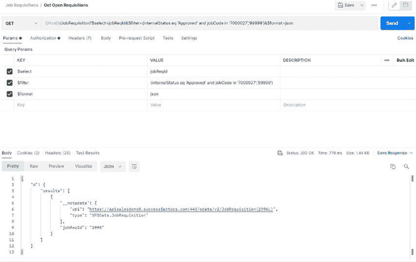

**图 9-10.** *在 Postman 中显示的 GET 操作，用于检索特定职位代码的开放职位申请*

太好了！我们已经返回了一个高级前端开发人员的职位申请。

### 2) 从 SuccessFactors 请求职位描述

让我们获取职位描述（或者本例中的单个职位描述）。我们使用美式英语作为职位描述的区域设置。请注意，我们本可以在返回职位申请 ID 的同时返回职位描述。两种方式都可以，取决于第三方匹配解决方案需要如何集成。

如果我们同时请求所有相关的职位描述和职位申请 ID，我们可以这样构造 GET 请求：

```
/JobRequisition?$select=jobReqId,jobReqLocale/externalJobDescription&$expand=jobReqLocale&$filter=(internalStatus eq 'Approved' and jobCode in '7000027','99999')&$format=json
```

我们在原始请求的基础上构建，将 `$select` 参数改为包含 jobReqLocale/externalJobDescription。我们还添加了一个 `$expand` 参数 $jobReqLocale。`$expand` 参数指示查询通过从 jobRequisition 实体导航来读取 jobReqLocale。

图 9-11 显示了 GET 请求以及 Postman 中的结果。

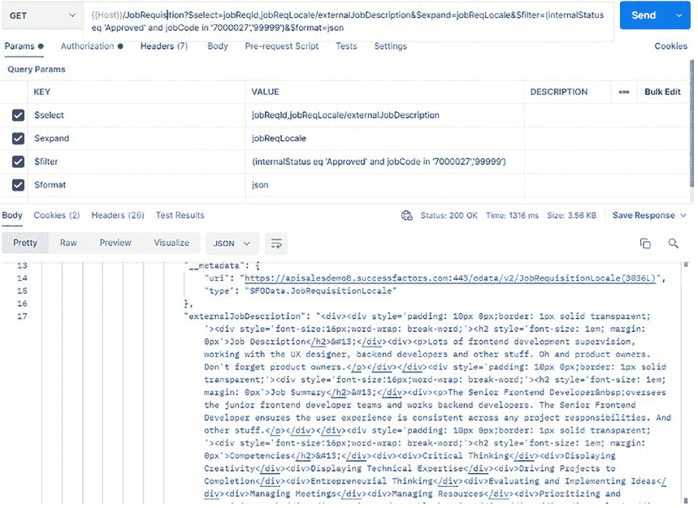

*图 9-11.* 在 Postman 中显示的检索职位描述的 GET 操作结果

### 3) 从 SuccessFactors 获取应聘

让我们在招聘人员失去耐心并开始筛选应聘之前获取一些应聘。

第三方匹配解决方案将传递一个或多个职位申请 ID。然后返回应聘 ID 和简历的列表。请注意以下几点：

- 应聘和候选人档案的完整结构化提取数据也可以传递给匹配解决方案。我们仅以简历作为示例。
- 简历将需要通过第二次调用 SAP SuccessFactors 来提取。原因在于文档并不直接存储在职位申请或候选人档案中，存储的只是文档引用。

在图 9-12 中，我们可以看到使用 Integration Center 提取的数据示例。我们不需要构建 Integration Center 集成。此处仅用于说明目的。

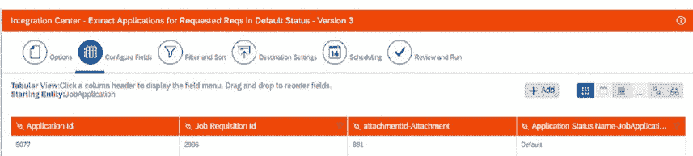

图 9-12. 在 Integration Center 中从应聘中提取附件 ID

图 9-13 显示了我们将用于提取职位申请的过滤器。我们仅传递一个职位申请 ID 列表，并指定职位申请状态应为“默认”，即表示新申请。将申请状态名称列为列并非必需。我们只是想检查其正确性。

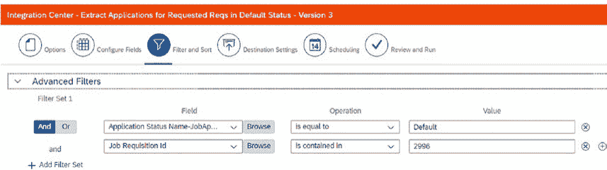

图 9-13. 在 Integration Center 中提取新应聘的过滤器


### Figure 9-13. Selecting Applications in Default Status in Integration Center

如果我们提取 ODATA 请求并移除不必要的申请状态，则为

```
/odata/v2/JobApplication?$select=applicationId,jobReqId,resume/attachmentId&$expand=resume,jobAppStatus&$filter=(jobAppStatus/appStatusName eq 'Default' and jobReqId in '2996')&$format=JSON
```

GET 调用和响应可以在图 9-14 的 Postman 中看到。

### Figure 9-14. The Results of Requesting Attachment IDs of Applications Using Postman

下一步是请求简历。对于每个申请 ID 和简历附件，我们需要请求附件的内容。好处是，附件的请求已在第 13 行显示。通过 JSON 请求的任何资源也会显示获取该资源的 URI。

如果您以前从未尝试过使用集成用户获取附件，您可能缺少权限“ODATA API Attachment Export”。您可以在图 9-15 中看到所需的权限。

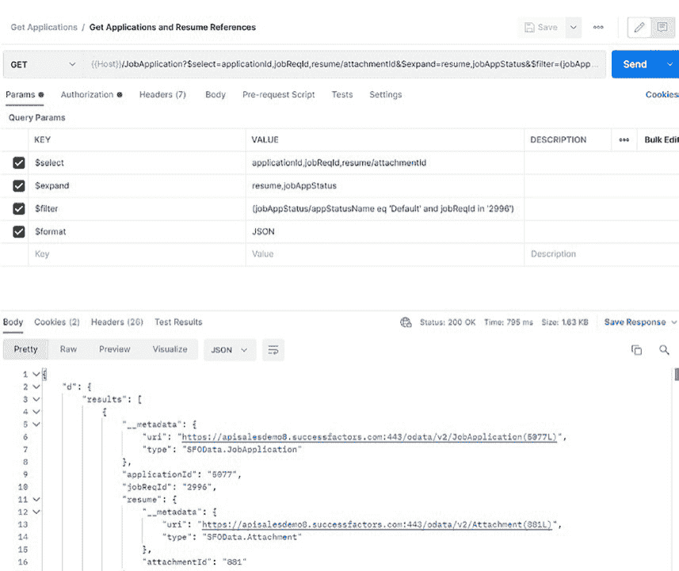

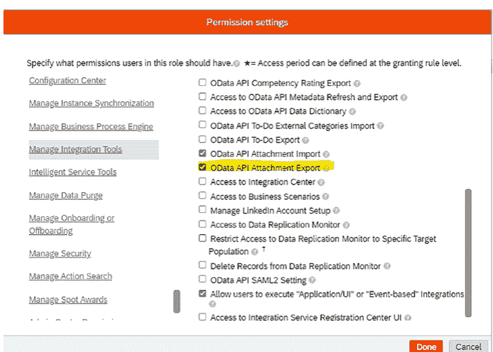

Figure 9-15. Role-Based Permission Needed to Extract Attachments

图 9-16 显示了使用 Postman 检索附件的调用，包括结果。

### Figure 9-16. Results of Requesting Attachment Using Postman

图中未显示文件内容。它是二进制形式，除非您是基于 AI 的简历到职位匹配排名系统，否则阅读起来并不有趣。

### 4) Update Application in SuccessFactors

计算职位描述和简历得分的工作随后由匹配系统完成。这将需要许多步骤，其中第一步可能是删除可能导致排名引擎产生偏差的任何简历信息，例如姓名、地址、年龄和照片（在某些国家/地区）。

一旦我们有了这个神奇的匹配分数，我们将要求 SuccessFactors 更新它，同时更新一个超链接字段，该字段将招聘人员带到匹配引擎中该匹配的详细信息。我们将以使用基于文件导入的方式在 Integration Center 中说明集成。之后，我们将展示如何在 Postman 中执行此操作。

```
<?xml version="1.0" encoding="utf-8"?>
<entry xmlns="http://www.w3.org/2005/Atom" xmlns:m="http://schemas.microsoft.com/ado/2007/08/dataservices/metadata" xmlns:d="http://schemas.microsoft.com/ado/2007/08/dataservices" xml:base="https://apisalesdemo8.successfactors.com:443/odata/v2/">
  <id>https://apisalesdemo8.successfactors.com:443/odata/v2/Attachment(8811)</id>
  <title type="text"></title>
  <updated>2021-09-09T00:30:10Z</updated>
  <author>
    <name></name>
  </author>
  <link rel="edit" title="Attachment" href="Attachment(8811)"></link>
  <link rel="http://schemas.microsoft.com/ado/2007/08/dataservices/related/userNav" type="application/atom+xml;type=entry" title="userNav" href="Attachment(8811)/userNav"></link>
  <link rel="http://schemas.microsoft.com/ado/2007/08/dataservices/related/candidateNav" type="application/atom+xml;type=entry" title="candidateNav" href="Attachment(8811)/candidateNav"></link>
  <category term="SFODataservice.Attachment" scheme="http://schemas.microsoft.com/ado/2007/08/dataservices/schema"></category>
  <content type="application/xml">
    <m:properties>
      <d:attachmentId m:type="Edm.Int64">8811</d:attachmentId>
      <d:country m:null="true"></d:country>
      <d:fileName>Rick Resume (002).docx</d:fileName>
      <d:lastModifiedDateTime m:type="Edm.DateTimeOffset">2018-03-18T20:59:01Z</d:lastModifiedDateTime>
      <d:ownerIdType>CANDIDATE_ID</d:ownerIdType>
      <d:documentType m:null="true"></d:documentType>
      <d:deletable m:type="Edm.Boolean">false</d:deletable>
      <d:description m:null="true"></d:description>
      <d:language m:null="true"></d:language>
      <d:mimeType>application/vnd.openxmlformats-officedocument.wordprocessingml</d:mimeType>
      <d:moduleCategory>RESUME</d:moduleCategory>
      <d:donneeId></d:donneeId>
      <d:deprecable m:type="Edm.Boolean">false</d:deprecable>
    </m:properties>
  </content>
</entry>
```

我们在 Integration Center 中需要使用的操作是 Update/Merge。这将更新所提供键（ApplicationID）的任何申请信息，同时保留其他字段不变。上传一个简单的 .CSV 文件，其中包含列 ApplicationID、Score 和 Hyperlink 以及一行测试数据后，我们点击“Upload Sample CSV”，如图 9-17 所示。

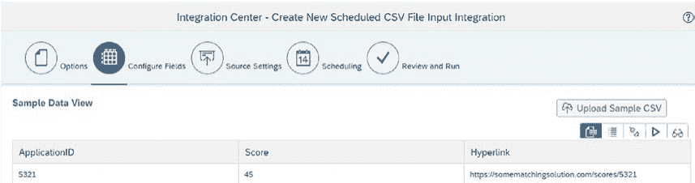

Figure 9-17. Application Fields for Matching Example, Shown in Integration Center

如果我们点击 Field Mapping View（从左数第三个），然后我们可以仅映射所需的字段，如图 9-18 所示。

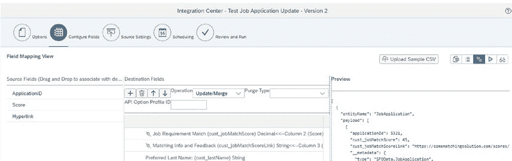

Figure 9-18. Mapping of Application Fields and Resultant Preview of the Necessary Payload

如果我们查看右侧的 Preview 面板，payload 部分是一个很好的示例，我们可以将其复制粘贴到 Postman 中进行测试。您可能希望将其保存在记事本文件中以备后用。

打开 Postman 桌面客户端应用程序并使用以下步骤创建一个新的 HTTP 请求。

首先按图 9-19 所示创建新的 HTTP 请求。

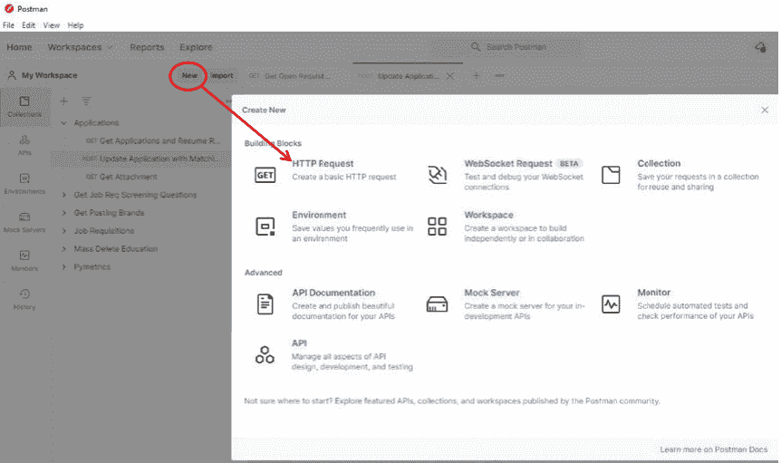

*Figure 9-19. Creating a New HTTP Request*

将请求类型从 GET 改为 Post 并将 URL 改为 {{$host}}/**Application(5321)**，然后选择 Authorization 选项卡并选择 Basic，使用 {{username}} 作为用户名和 {{password}} 作为密码，如图 9-20 所示。这样将重用您的主机、用户名和密码环境变量。

> **Note** Basic Authentication 只是为了简化示例。不要在客户端环境中使用它。

## CHAPTER 9  ADDITIONAL CUSTOM DATA INTEGRATIONS

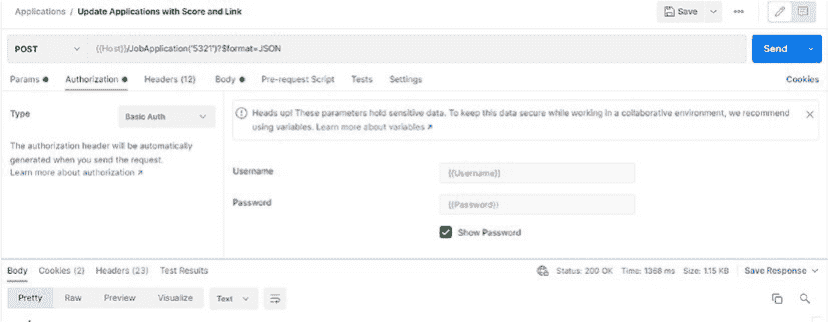

**Figure 9-20.** *POST URL and Authorization for New Request*

点击 Headers 选项卡并输入 Content-Type 为 application/json 和 X-Http-Method 为 MERGE（必须为大写），如图 9-21 所示。

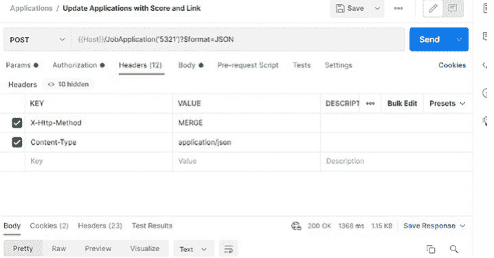

**Figure 9-21.** *Header Information for New Request*

我们现在可以添加请求的正文。我们以前在 Postman 中从未做过此操作，因为我们只执行了 GET 请求而没有执行 POST。见图 9-22 中的正文。

### Figure 9-22. Body of New Request

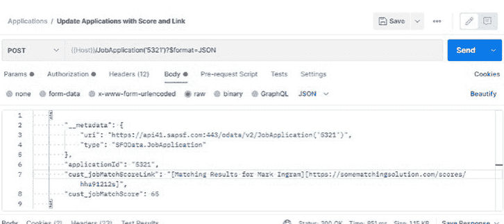

请注意匹配结果 URL 字段周围的方括号。第一对方括号包含超链接应显示的方式。第二对包含实际超链接。如果两者相同，则将 URL 放在两对方括号中。SAP 的知识库文章（KBA）3047601 在此处 https://launchpad.support.sap.com/#/notes/3047601 解释了它。

您可以在图 9-23 中看到更新后的申请。他们可能不会得到这份工作。

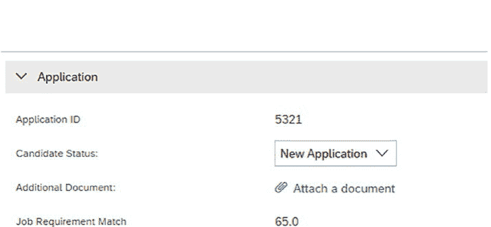

### Figure 9-23. The Updated Application in SuccessFactors

我们现在已完成了读取职位描述和简历以及更新申请所需的所有步骤。我们正在合作的集成开发人员可能无法访问 SAP SuccessFactors。如果我们想提供帮助，我们可以通过导出到 JSON 文件来帮助他们。这是可以被开发人员理解的东西，而无需任何 SuccessFactors 知识。他们然后可以将 JSON 文件导入到本地 Postman 以尝试 API。您可以通过点击保存服务下的集合右侧的“...”，然后选择 Export 来导出 JSON，如图 9-24 所示。

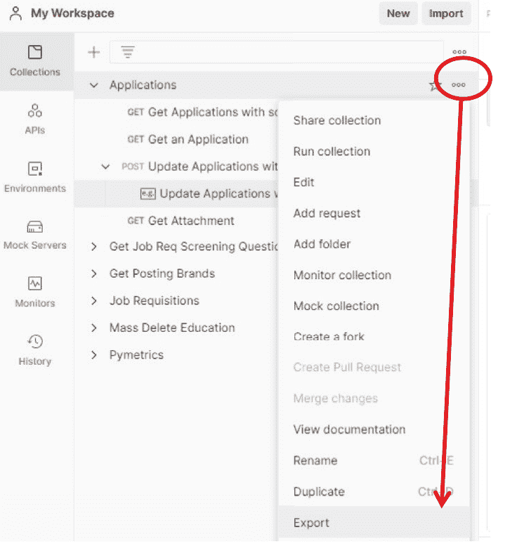

Figure 9-24. Exporting the Collection of Requests as a JSON File

做得好！您在此处完成的练习适用于其他场景和 ODATA 实体。

### Conclusions

您现在已学习了以下内容：

- SAP SuccessFactors 提供的 ODATA API 如何支持许多不同的用例，从读取招聘模板配置以用于自定义 UI 到支持新的候选人体验。
- 人工智能和机器学习如何在招聘流程的各个环节中使用。
- 如何使用 SAP SuccessFactors 中的 Integration Center 或 Postman 使用 MERGE 更新职位申请。相同的信息可应用于其他 ODATA 实体。


