## 第 10 章 背景调查集成

背景调查是任何公司招聘系统的组成部分。这些调查被整合到整体的招聘工作流程中，通常在企业向候选人发出正式录用通知之前启动，尽管某些客户可能更希望在实际入职前进行这些调查。自动化背景调查集成大大简化了整体招聘流程，并释放了招聘专员的资源，使其能够专注于招聘过程。

SAP SuccessFactors 招聘系统提供了一个框架，利用现有工具和技术来集成第三方背景调查供应商。与 SuccessFactors 集成的第一个背景调查供应商是 First Advantage，它仍然作为标准文档的一部分存在。该行业在美国有几家巨头公司，并且它们的受欢迎程度在全球范围内正在增加，尤其是在亚太地区。想象一下，客户要求你构建一个针对某供应商的集成。你会如何处理？在本章中，我们将使用一家名为 MYTHICAL 的背景调查供应商，通过几个步骤来进行演示。

### 一般说明

- 在技术上，一个客户实例中可以有多个背景调查供应商共存；但是，其中一个（通常是现有供应商）被指定为默认值，其结果将在背景调查小组件中显示。其他所有供应商都必须通过工作申请中的自定义字段进行配置。
- 背景调查包必须在创建工作职位时手动定义在工作需求（job requisition）上。
- 系统一次只能返回一个包的结果。例如，如果您有一个用于就业核查（Employment Check）的包，如示例所示，您只能返回就业核查的结果。您不能将其分解为子请求，例如 a) 当前就业核查，b) 以前就业核查，以及 c) 地址核查。由您决定如何根据客户需求配置这些包。

SAP SuccessFactors 招聘系统为您提供了实施背景调查集成的选项：

- **选项 1** – 通过用户界面中的招聘专员操作，下文简称为 APPUI。
- **选项 2** – 使用智能服务（Intelligent Services），下文简称为 IS。

表 10-1 列出了这两个选项及其配置。

### 选项 1 (APPUI) 和选项 2 (IS) 之间的差异

**表 10-1。** 背景调查中 APPUI 和智能服务触发器的比较

| 项目 | 选项 1 | 选项 2 | 备注（如适用） |
| --- | --- | --- | --- |
| 如何启用管理中心集成 | Admin Center > Background Check Central | Intelligent Services | |
| 如何通过 Take Action 发起 UI | Initiate Background Check | 将工作申请状态更改为 "Background Check" | 状态的实际名称在工作需求模板中配置 |
| 智能服务事件 | N/A | 更新工作申请状态 | |
| 集成中心模板 (ICD) | 可以从 SAP API Business Hub 下载起步 ICD | JobApplication | 可以从 https://api.sap.com/search?filter=(type%20eq%20(ICD)) 下载示例模板 |
| ICD 中的起始实体 | JobApplicationBackgroundCheckRequest | JobApplication | |
| ICD 模板的关联 | 通过 Admin Center > Manage Data > Recruiting Vendor Mapping | 通过 Admin Center > Intelligent Services Center > Update of Job Application Status (Event) > Integration | |
| 同时进行的背景调查请求数 | 1 | 多个 | 在智能服务中心中触发并可查看多个事件 |
| ICD 中是否允许筛选？是/否 | 否 | 是 | 筛选基于为背景调查配置的申请状态名称（因配置而异） |
| 是否需要进行 JSON 响应字段映射？是/否 | 是。预期在实体 JobApplicationBackgroundCheckRequest 中填入供应商订单号、订单状态和其他字段 | 否。预期供应商将创建具有供应商订单号、订单状态等的 JobApplicationBackgroundCheckRequest 记录 | |
| 集成触发器 | triggerType="APPUI" | triggerType="IS" | |

### 第 1 步：管理工具中的权限 – 启用背景调查集成

以管理员身份登录客户实例，并导航至 Admin Tools ➤ Manage Permission Roles。选择 System Admin 作为权限角色，并确保选中以下内容。SAP SuccessFactors 招聘系统需要为不同角色设置若干权限。表 10-2 显示了适用的权限列表。

**表 10-2。** *背景调查所需的基于角色的权限*

| 系统角色 | 权限类别 | 权限列表 |
| --- | --- | --- |
| 系统管理员 | Manage Recruiting | – Background Check Central |
| 系统管理员 | Metadata Framework | – MDF OData API 管理访问<br>– Manage Data |
| 招聘专员 | Recruiting Permissions | – Background Check Initiate Permission<br>– Background Check Update Permission |
| API 用户 | General User Permissions | – User Login<br>– SFAPI User Login |
| API 用户 | Recruiting Permissions | – Background Check Initiate Permission<br>– Background Check Update Permission<br>– ODATA API Application Create<br>– ODATA API Application Export<br>– ODATA API Application Audit Export<br>– ODATA API Application Update |
| API 用户 | Manage Integration Tools | – 访问事件通知订阅<br>– 访问事件通知审计日志<br>– 管理 OAuth2 客户端应用程序<br>– 访问 ODATA API 审计日志<br>– 管理 ODATA API 基本身份验证<br>– 访问 API 中心<br>– 访问 ODATA API 元数据刷新和导出<br>– 访问 ODATA API 数据字典<br>– 访问集成中心<br>– 允许用户执行 "Application/UI" 或 "Event-based" 集成 |
| API 用户 | Intelligent Service Tools | – Intelligent Services Center (ISC) |

### 第 2 步：创建背景调查的拾取列表（Picklists）

背景调查集成基于供应商根据工作需求模板为每种类型的检查定义包。有关此类拾取列表定义，请参见图 10-1。

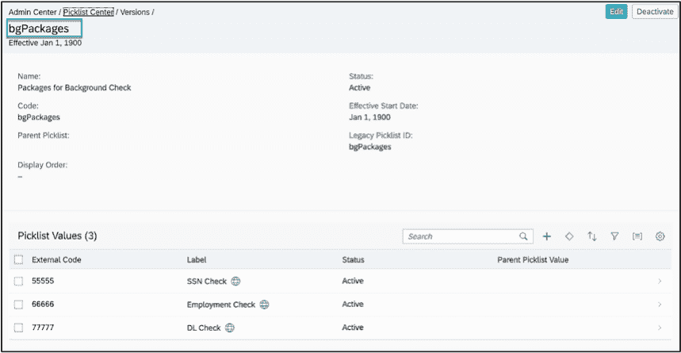

**图 10-1。** *背景包的包定义*

一些背景调查供应商可能需要根据公司位置、部门或分部进行可选配置，以关联账户。图 10-2 显示了此类账户的示例拾取列表定义。

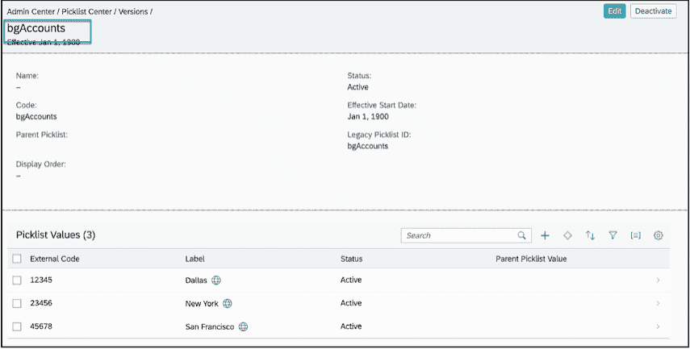

**图 10-2。** *定义账户代码的示例拾取列表*

### 第 3 步：供应 – 更新工作需求模板

导出所需的工作需求模板，并确保拾取列表字段定义包含在工作需求模板中。示例代码显示如下：

```
<field-definition id="bgAccount" type="picklist" required="false" custom="true">
  <field-label><![CDATA[Background Check Account ID]]></field-label>
  <field-label lang="en_US"><![CDATA[Background Check Account ID]]></field-label>
  <field-description><![CDATA[Background Check Account ID]]></field-description>
  <field-description lang="en_US"><![CDATA[Background Check Account ID]]></field-description>
  <picklist-id>bgAccounts</picklist-id>
</field-definition>
<field-definition id="bgPackage" type="picklist" required="false" custom="true">
  <field-label><![CDATA[Background Check Package ID]]></field-label>
  <field-label lang="en_US"><![CDATA[Background Check Package ID]]></field-label>
  <field-description><![CDATA[Background Check Package ID]]></field-description>
  <field-description lang="en_US"><![CDATA[Background Check Package ID]]></field-description>
  <picklist-id>bgPackages</picklist-id>
</field-definition>
```

请注意，示例中省略了 field-permissions 部分。这两个字段必须添加到工作需求 XML 模板中相应的 field-permission 部分。

确保还包括背景调查的功能权限。


示例代码如下：

```
<feature-permission type="backgroundCheck">
<description><![CDATA[The following roles can launch background check]]></description>
<role-name><![CDATA[S]]></role-name>
<role-name><![CDATA[O]]></role-name>
<role-name><![CDATA[R]]></role-name>
<role-name><![CDATA[G]]></role-name>
<role-name><![CDATA[V]]></role-name>
<role-name><![CDATA[Q]]></role-name>
<status><![CDATA[**Background**]]></status>
</feature-permission>
```

> **注意** 此处定义的状态名称“Background”必须与“申请人状态配置”中的状态名称一致。参见图 **10-3**。

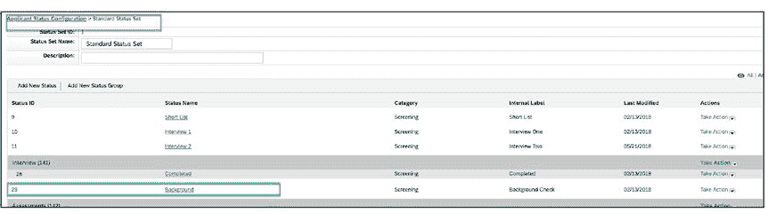

**图 10-3. 申请人状态配置显示背景检查详情**

在你的职位申请模板中完成所需更改后，将其重新导入 Provisioning，并确保模板中没有错误。绿色警告仅为提示信息，你也可以选择修正它们。

## 第 10 章 背景检查集成

### 步骤 4：管理工具 – 启用其他背景检查供应商

导航至 管理中心 ► 背景检查中心，并确保你的界面与图 10-4 一致。

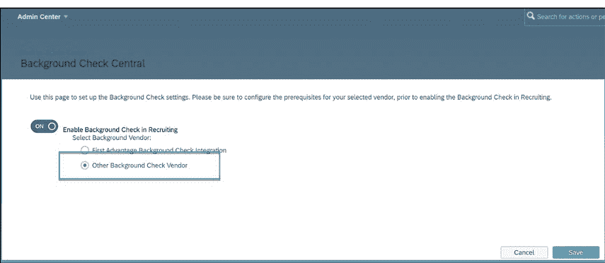

图 10-4. 启用其他背景检查供应商的确认界面

### 步骤 5：我应该选择哪种工具 – 集成中心还是智能服务？

选择使用哪种工具主要取决于供应商软件是否支持 JSON/XML，或者它是否基于 SOAP。如果供应商支持 JSON/XML，则集成中心将是绝佳选择。然而，如果外部系统仅支持 SOAP，那么就只能选择智能服务。本章其余部分将详细讨论如何使用集成中心来构建集成。至于智能服务，你需要依赖 help.sap.com 上提供的标准文档。

## 第 10 章 背景检查集成

现在，单击“浏览目录”，如图 10-5 所示，并找到名为“SuccessFactors 集成中心 – 招聘背景检查功能集成模板（RCM）”的模板。直接链接是 <https://api.sap.com/package/SuccessFactorsIntegrationCenterTemplatefortheRecruitingBackground> <https://CheckFunctionalityRCM?section=Overview>。请注意，你需要拥有一个有效的合作伙伴用户 S-User ID，或通过 <https://community.sap.com> 自行注册。你需要将集成中心定义（ICD）文件下载到你的 SuccessFactors 租户中。或者，你也可以参考第 7 章并创建自己的 ICD。请确保你在集成中心中的起始实体是 JobApplicationBackgroundCheckRequest。图 10-6 显示了一个起始实体示例。

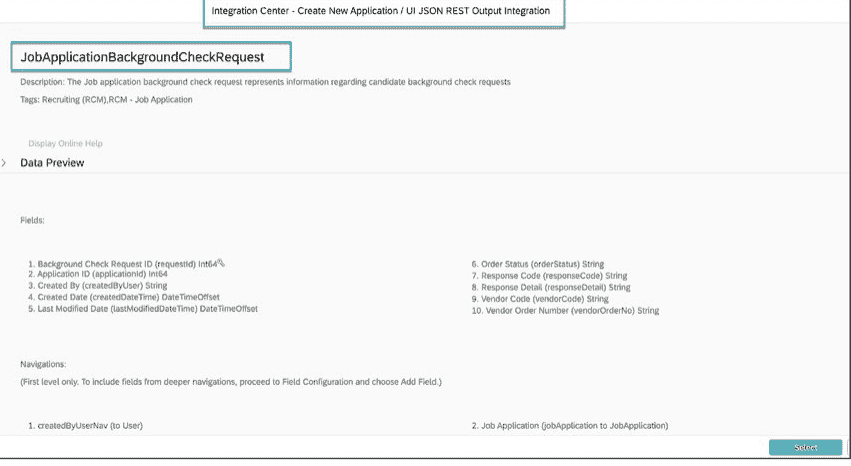

**图 10-6.** *手动创建新的背景检查集成*

关于“目标设置”选项卡的说明 – 适用于选项 1（APPUI）和选项 2（IS）：

- REST 服务器设置可以针对背景检查集成单独设置，也可以使用安全中心中的公共设置。
- 认证选项为：无、基本认证或 OAuth（带 SAML 断言）。
- 如果认证方式为“无”，则供应商软件应检查负载内容以决定如何处理。
- 不建议使用基本认证，并且将在 2022 年底前完全禁用。

图 10-7 显示了“目标设置”选项卡。

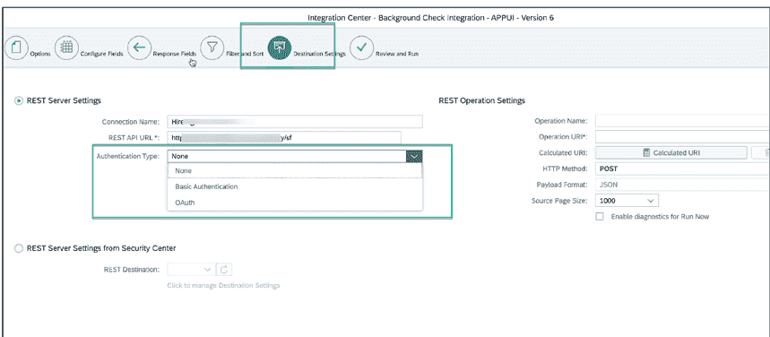

### 图 10-7. 集成中心中的目标设置

关于“响应字段”映射的说明 – 适用于选项 1（APPUI）：

- backgroundCheckRequestOrderStatus、backgroundCheckRequestVendorOrderNumber、backgroundCheckRequestResponseCode 和 backgroundCheckRequestResponseDetail 应映射到“响应字段”选项卡中。
- 操作应设置为“Upsert Single”。
- 如果供应商软件无法生成同步响应，则可手动将记录 Upsert 到 JobApplicationBackgroundCheckRequest 中。
- 如果响应延迟超过 60 秒，系统将记录超时失败，并且必须重新发起背景检查。

图 10-8 显示了已完成的响应字段示例。

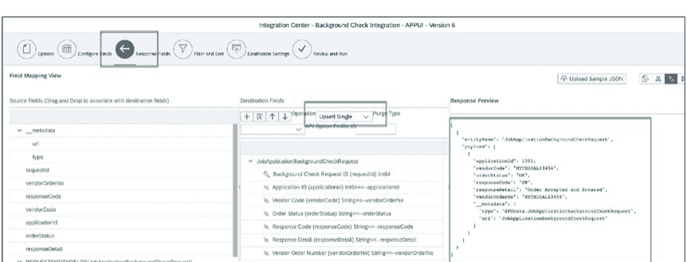

### 图 10-8. 响应映射选项卡

关于“筛选器”选项卡的说明 – 适用于选项 2（IS）：

- “高级筛选器”用于在背景检查应触发时映射申请状态。请参阅步骤 3 了解其定义方式。
- 你可以使用状态 ID 代替状态名称，只要确保值保持一致。
- 如果你的招聘配置有多个模板，筛选器状态应涵盖所有模板。

图 10-9 显示了已完成的“筛选器”选项卡。

## 第 10 章 背景检查集成

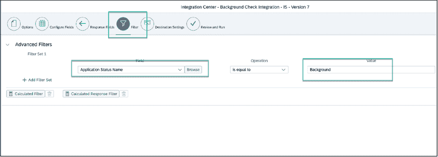

*图 10-9. 选项 2（IS）的筛选器选项卡示例*

我们不会详细讲解创建和完成集成模板的步骤，但最终结果对于选项 1（APPUI）应类似于图 10-10。

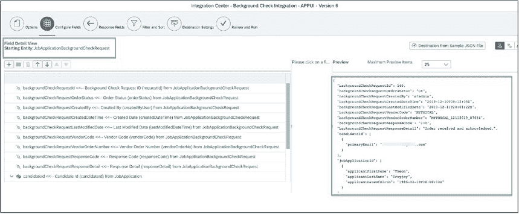

*图 10-10. 选项 1（APPUI）已完成集成的预览。*

图 10-11 显示了选项 2（IS）的已完成 ICD 示例。

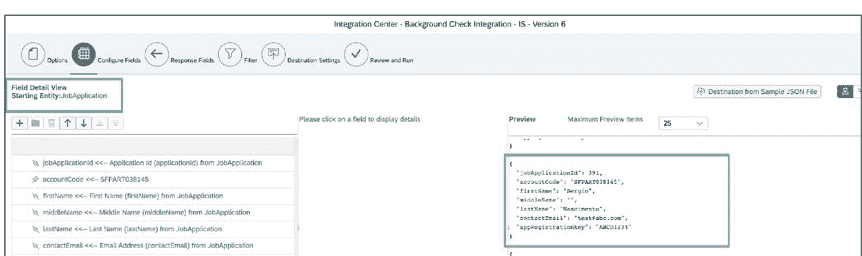

图 10-11. 图 10-12 显示了选项 2（IS）已完成集成的预览

### 步骤 8：管理工具 – 定义招聘供应商，适用于选项 1（APPUI）和选项 2（IS）

既然集成已基本设置完成，让我们来看一个实际场景。假设客户要求你实现与一个名为 MYTHICAL 的供应商进行背景检查集成。第一个合乎逻辑的步骤是在 SuccessFactors 中定义该供应商。假设你具有步骤 1 中所述的足够权限。你将导航至 管理中心 ► 管理数据，并选择“创建新项”选项。向下滚动或选择“招聘外部供应商”。请注意，此步骤对于选项 1（APPUI）和选项 2（IS）都是通用的。

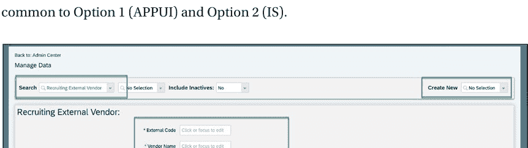

图 10-12. 定义新的背景检查供应商

完成的“招聘外部供应商”应类似于图 10-13。如果出现错误，你随时可以单击“采取操作 ► 进行更正”。

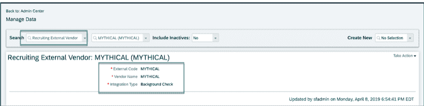

图 10-13. 完成的背景检查供应商定义。

### 步骤 9：管理工具 – 将集成中心模板与供应商关联，适用于选项 1（APPUI）和选项 2（IS）

与步骤 8 类似，你将导航至 管理中心 ▶ 管理数据，单击“创建新项”，并选择“招聘供应商集成映射”。你的页面将类似于图 10-14。

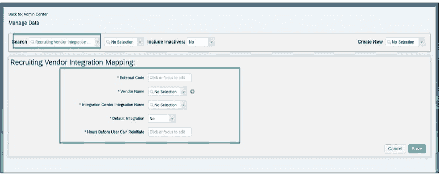

图 10-14. 关联集成中心模板

注意：

- 外部代码可以是任何内容，但我们建议你将其与供应商名称保持一致。
- 供应商名称将显示在下拉列表中。
- 集成中心集成名称 – 请选择适当的 ICD，并在故障排除时特别注意 ICD 版本号。
- 默认集成 – 始终设置为“是”。
- 每个供应商和映射的组合只能有一个，但你可以在一个 SuccessFactors 租户中拥有多个背景检查供应商。
- “用户可以重新发起的小时数”在本文发布时没有实际功能。

完成的映射如图 10-15 所示。

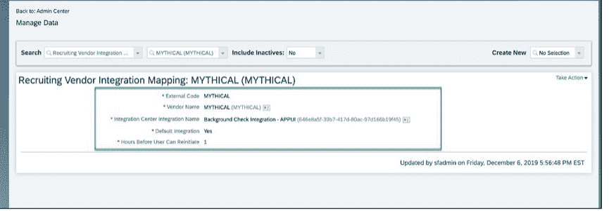

*图 10-15. 完成的供应商映射*

### 步骤 10：创建职位申请

第 2 章详细介绍了创建职位申请的步骤。图 10-16 显示了一个已启用背景检查字段的示例职位申请。请注意，“背景检查账户 ID”字段是可选字段，对实际背景检查没有影响。


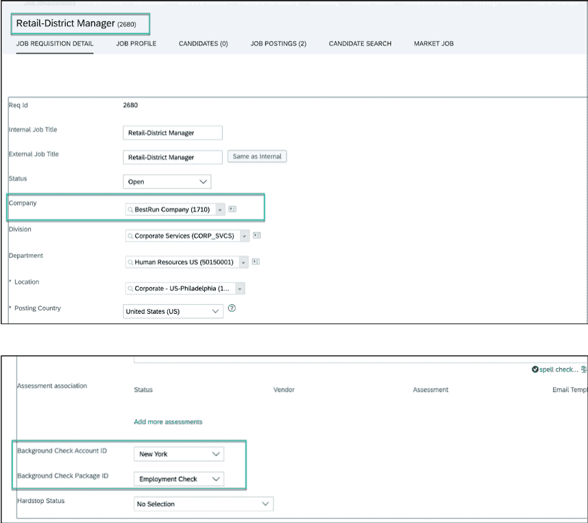

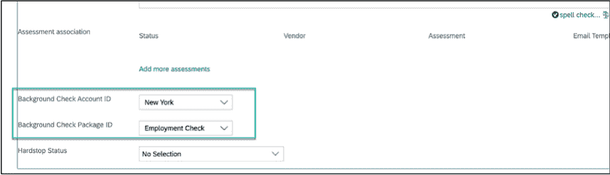

> *Figure 10-16.* Sample Completed Job Requisition with Background Check Fields Chosen

### Step 11: Recruiter Actions – Initiate Background Check

Login as the recruiter or proxy and navigate to Recruiting ➤ Job Requisitions. Select the job requisition you want to work on and move (or advance) the candidate to the Background Check status. The option to move or advance is dependent on the customer configuration. A note on the screenshots is shown – they are taken from different job requisitions and candidate, but the concept holds regardless of which candidate and job requisition combination you work with.

Figure 10-17 shows a sample job requisition with two candidates who are in the Background Check status.

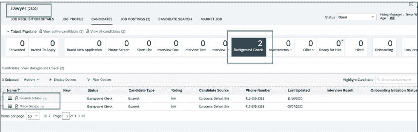

Figure 10-17. Job Requisition with Two Candidates in the Background Check Status

Click a desired candidate and go to Take Action ▶ Initiate Background Check as shown in Figure 10-18.

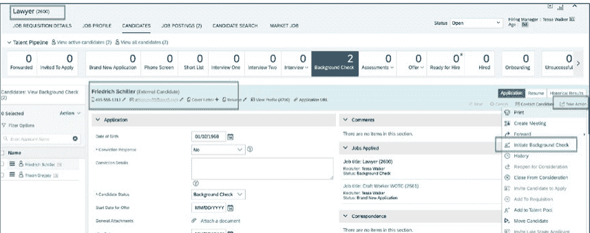

Figure 10-18. Screenshot Showing How to Initiate a Background Check

If the background check submission is successful, you should see a screenshot as in Figure 10-19.

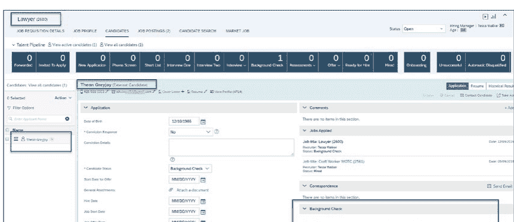

Figure 10-19. Sample Screenshot Showing Successful Initiation of a Background Check

If you have made it this far, congratulations. You have successfully defined MYTHICAL as a background check vendor and have been able to initiate a background check from the Recruiting Job Application UI, namely, Option 1. We will examine Option 2 (IS) shortly.

But what happens if there is an error showing that your background check failed?

### Step 12: Integration Center – Checking Results of Outbound Execution

Navigate to Admin Center ► Integration Center and click Monitor Integrations as shown in Figure 10-20.

#### Figure 10-20. Integration Center Highlighting the Integration Monitor

The Execution Manager screen will open in a new pop-up where you can see the results of current and past executions. By default, the Execution Manager will show the executions in the last seven days. The filters can be adjusted depending on the time filter and optional the Process Status. An example is shown in Figure 10-21.

#### Figure 10-21. Screenshot of the Execution Manager Showing Summary of Executions in the Last Seven Days

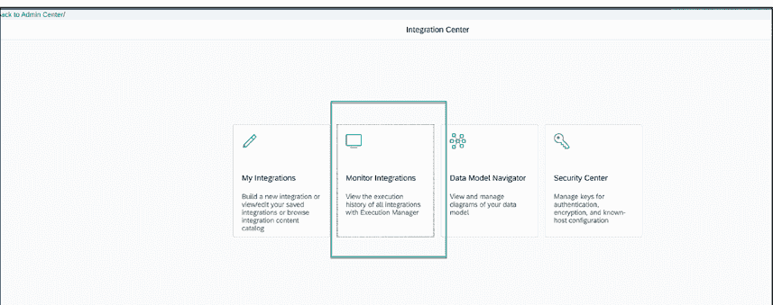

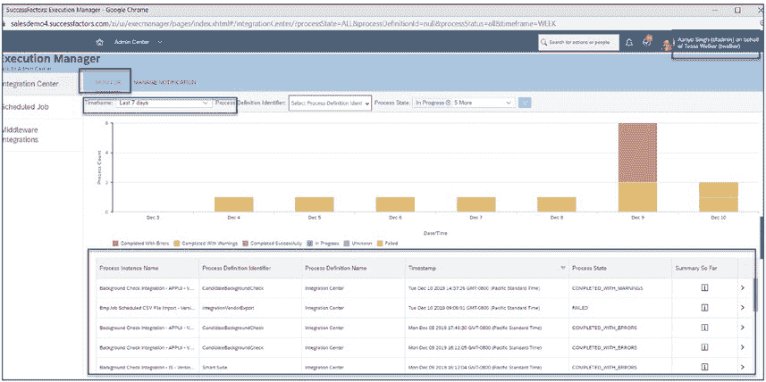

Figure 10-22 shows the drill-down details of the first execution shown in Figure 10-21. To get the details, click the arrow and view the screen.

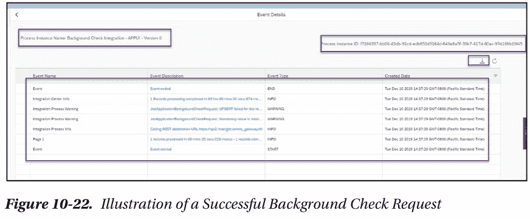

*Figure 10-22. Illustration of a Successful Background Check Request*

Detailed documentation on the Execution Manager is available on the standard Help Portal.

- **Notes:**
  - 1. This should be the starting point for troubleshooting any integrations.
  - 2. Customers will often use the download link to export a CSV file for support issues.
  - 3. You (or the customer) can optionally choose to notify an email address or an inbox by clicking Manage Notifications.
  - 4. If the customer is initiating background checks in the user interface, you should see only one record per background check.

### Step 13: Setting Up the Integration Using Intelligent Services Center (Option 2)

In the beginning of this chapter, we described two ways to integrate background checks, namely, via the UI (Option 1) and via Intelligent Services (Option 2). Chapter 12 of this book goes into some detail on how to use Intelligent Services. In this step, we will highlight how to set up the integration. Figure 10-23 shows a screenshot with the Update of Job Application Status highlighted.

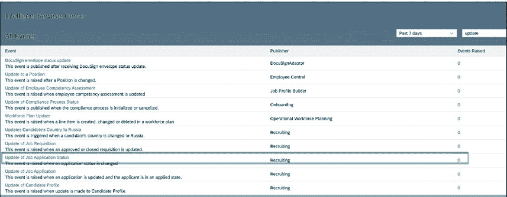

#### Figure 10-23. Intelligent Services Center with Update of Job Application Status Highlighted

Figure 10-24 shows where to create a new integration. In the beginning of this chapter, we mentioned that the underlying starting entity for the background check is JobApplication. You can associate an existing Integration Center template (ICD) or create a new one – you will be prompted by the system. You may refer to Chapter 7 on the Integration Center to create your integration or use an existing one.

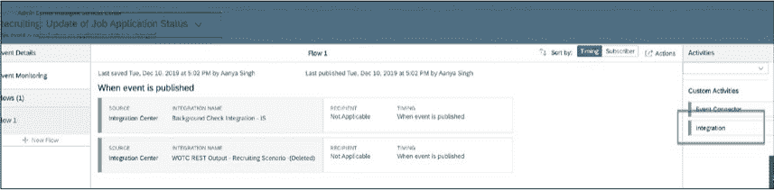

#### Figure 10-24. Screen Showing How to Add a New Integration to an Event

Regardless of whether you create a new ICD or use an existing one, please be sure to click Save Flow as shown in Figure 10-25. If you don’t save your flow, your background check will be initiated and the event will be raised, but your integration will not fire and consequently never reach the endpoint.

### Step 16: Intelligent Services Center – Checking the Results of Outbound Execution

If your integration is all set up, the next logical step is to change the status of the job application to Background Check and examine the results of your integration. The first step is to examine if an event associated with the status change has been raised. Figure 10-28 shows such an example showing that the Update of Job Application Status has indeed been raised and there are two possible events to examine. Click the number of executions in the right column.

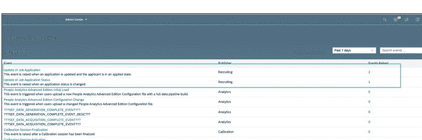

Figure 10-28. Intelligent Services Center Showing Number of Events Raised Against Events

The highlighted items show the two events for Update of Job Application Status Intelligent Services event. Click the number 1 to view the execution status as shown in Figure 10-29. There will be one event per update of job application status.

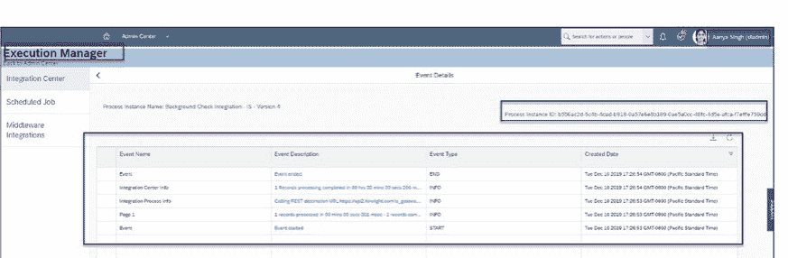

Figure 10-31. Sample Illustration of the Execution Manager for the Raised Event for Background Check

If you have gotten this far, your outbound integration for the background check has been set up, and it is now time to perform the API operations so that customers can receive the results from the background check vendor and view them in the recruiting user interface. Please refer to Chapter 1 on how to use and leverage ODATA APIs.

### Step 17: Query JobApplicationBackgroundCheckRequest for Option 1

If the outbound Integration Center is set up successfully and the background vendor is able to receive the request and respond synchronously, the JobApplicationBackgroundCheckRequest should be completely populated:

```
GET: https://apisalessdemo4.successfactors.com:443/odata/v2/JobApplicationBackgroundCheckRequest?$format=json&$filter=requestId eq 140
```

RESPONSE:

```
```
{
    "d": {
        "results": [
            {
                "__metadata": {
                    "uri": "https://apisalessdemo4.successfactors.com:443/odata/v2/JobApplicationBackgroundCheckRequest(140L)",
```
```

```
```json
"type": "SFOD ata.JobApplicationBackgroundCheckRequest"
},
"requestId": "140",
"vendorOrderNo": "MYTHICAL_12112019_87654",
"lastModifiedDateTime": "/Date(1576094482000+0000)/",
"createdByUser": "sfadmin",
"createdDateTime": "/Date(1575936725000+0000)/",
"orderStatus": "OK",
"applicationId": "3040",
"responseDetail": "Order received and acknowledged.",
"responseCode": "200",
"vendorCode": "MYTHICAL",
"jobApplication": {
    "__deferred": {
        "uri": "https://apisalesdemo4.successfactors.com:443/odata/v2/JobApplicationBackgroundCheckRequest(140L)/JobApplication"
    }
}
}
]
}
```
```

#### Notes:

- 1. requestId is the SuccessFactors-generated primary key for the JobApplicationBackgroundCheckRequest entity and cannot be changed. There will be one or more requests per background request.
- 2. vendorOrderId is the value set by the vendor as part of the synchronous response. You will use this vendorOrderId to send subsequent results.
- 3. vendorCode is set during the outbound Integration Center set up in Manage Data. Please refer to step 8 of this chapter.


+   4. `orderStatus` 作为响应的一部分被发送。可接受的值只有两个：OK 和 ERROR。通常，如果供应商无法对同步请求作出响应，则设置为 ERROR。
+   5. `responseDetails` 和 `responseCode` 也由供应商设置。这些仅用于信息目的。

### 步骤 18：为选项 2 创建 JobApplicationBackgroundCheckRequest 实体

当背景调查通过 Intelligent Services 发起时，适用此步骤。由于控制完全在供应商手中，该记录可以通过 API 调用创建。如果没有匹配的背景调查请求，系统将插入一条新记录，响应字段 `editStatus` 显示为 INSERTED，否则为 UPDATED。

实际的 API 调用为：POST https://apisalesdemo4.successfactors.com:443/odata/v2/upsert?$format=json

```
{
  "__metadata": {
    "uri": "JobApplicationBackgroundCheckRequest",
    "type": "SFOData.JobApplicationBackgroundCheckRequest"
  },
  "vendorCode": "MYTHICAL",
  "requestId": 140,
  "vendorOrderNo": "MYTHICAL_12112019_87654",
  "orderStatus": "OK",
  "applicationId": 3040,
  "responseCode": "200",
  "responseDetail": "Order received and acknowledged."
}
```

响应载荷：

```json
{
  "d": [
    {
      "key": "JobApplicationBackgroundCheckRequest/requestId=140",
      "status": "OK",
      "editStatus": "UPDATED",
      "message": "JobApplicationBackgroundCheckRequest Updated successfully for request 140",
      "index": 0,
      "httpCode": 204,
      "inlineResults": null
    }
  ]
}
```

步骤 17 中的注意事项同样适用于此操作。

### 步骤 19：背景调查 – 获取候选人详细信息

本节介绍了如何构建您的集成。以下示例使用 JobApplicationBackgroundCheckRequest 作为顶级实体，并导航到其他实体以获取应用程序的额外信息。关于是否使用 JobApplication 或 Candidate 实体来构建查询，没有具体指导。选择权在您。响应仅显示部分结果。

```http
GET: https://apisalesdemo4.successfactors.com:443/odata/v2/JobApplicationBackgroundCheckRequest?$format=json&$select=vendorCode,applicationId,jobApplication/firstName,jobApplication/country,jobApplication/lastName,jobApplication/contactEmail,jobApplication/dateOfBirth,jobApplication/address,jobApplication/address2,jobApplication/city,jobApplication/gender,jobApplication/zip,jobApplication/state,jobApplication/status,jobApplication/state/picklistLabels/label&$filter=requestId eq '140'&$expand=jobApplication,jobApplication/state/picklistLabels
```

响应：

```json
{
  "d": {
    "results": [
      {
        "__metadata": {
          "uri": "https://apisalesdemo4.successfactors.com:443/odata/v2/JobApplicationBackgroundCheckRequest(140L)",
          "type": "SFOData.JobApplicationBackgroundCheckRequest"
        },
        "applicationId": "3040",
        "vendorCode": "MYTHICAL",
        "jobApplication": {
          "__metadata": {
            "uri": "https://apisalesdemo4.successfactors.com:443/odata/v2/JobApplication(3040L)",
            "type": "SFOData.JobApplication"
          },
          "zip": "94123",
          "firstName": "Theon",
          "country": "United States",
          "lastName": "Greyjoy",
          "address": "100 Main Street",
          "gender": "Male",
          "contactEmail": "athanur+24@gmail.com",
          "address2": null,
          "city": "San Francisco",
          "dateOfBirth": "/Date(534574800000+0000)/",
          "status": "Open",
          "state": {
            "results": [
              {
                "__metadata": {
```
```
"uri": "https://apisalesdemo4.successfactors.com:443/odata/v2/PicklistOption(11645L)",
"type": "SFData.PicklistOption"
},
"id": "11645",
"minValue": "-1",
"externalCode": "state_United_States_California",
"maxValue": "-1",
"optionValue": "-1",
"sortOrder": 20,
"mdfExternalCode": "state_United_States_California",
"status": "ACTIVE",
"parentPicklistOption": {
"__deferred": {
"uri": "https://apisalesdemo4.successfactors.com:443/odata/v2/PicklistOption(11645L)/parentPicklistOption"
}
}
},
"picklistLabels": {
"results": [
{
"__metadata": {
"uri": "https://apisalesdemo4.successfactors.com:443/odata/v2/PicklistLabel(locale='en_US',optionId=11645L)",
"type": "SFData.PicklistLabel"
```

```
},
"optionId": "11645",
"locale": "en_US",
"id": "12076",
"label": "California",
"picklistOption": {
  "__deferred": {
    "uri": "https://apisalesdemo4.successfactors.com:443/odata/v2/PicklistLabel(locale='en_US',optionId=11645L)/picklistOption"
  }
}
},
{
  "__metadata": {
    "uri": "https://apisalesdemo4.successfactors.com:443/odata/v2/PicklistLabel(locale='fr_FR',optionId=11645L)",
    "type": "SFOData.PicklistLabel"
  },
  "optionId": "11645",
  "locale": "fr_FR",
  "id": "120541",
  "label": "Californie",
```

```
"picklistOption": {
  "__deferred": {
    "uri": "https://apisalesdemo4.successfactors.com:443/odata/v2/PicklistLabel(locale='fr_FR',optionId=11645L)/picklistOption"
  }
}
},
}
(...only partial response shown...)
]
}
}
```

### 步骤 20：向 JobApplicationBackgroundCheckResult 插入记录

注意：SuccessFactors 并不隐含特定的包构建结构，因为该解决方案必须适用于所有供应商。规范越严格，第三方供应商实施就越困难。在本示例中，我们将模拟一个背景调查请求，它是完全任意的。

结构如下：

综合背景调查（主包）– 与此相关的 API 调用将包含一个显示在 UI 中的占位 reportUrl：
- 驾照（子包）
- 雇佣记录（子包）

包之间没有隐含的层级关系。因此，我们建立了一种伪父子关系。您可以将此作为示例，或者简单地在每个背景调查中使用一个包。

POST: https://apisalesdemo4.successfactors.com:443/odata/v2/JobApplicationBackgroundCheckResult?$format=json

请求载荷：

```
{
  "vendorOrderNo": "MYTHICAL_12112019_87654",
  "vendorCode": "MYTHICAL",
  "stepName": "Driver's License",
  "stepStatus": "Received",
  "stepMessage": "Background Check is in process. Please check back later",
  "finalStep": false
}
```

响应载荷：

```
{
  "d": {
    "__metadata": {
      "uri": "https://apisalesdemo4.successfactors.com:443/odata/v2/JobApplicationBackgroundCheckResult(140L)",
      "type": "SFODdata.JobApplicationBackgroundCheckResult"
    },
    "vendorOrderNo": "MYTHICAL_12112019_87654",
    "vendorCode": "MYTHICAL",
    "stepName": "Driver's License",
    "stepStatus": "Received",
    "stepMessage": "Background Check is in process. Please check back later",
    "finalStep": false,
    "statusId": "140"
  }
}
```

**注意事项：**

+   1.  `stepName` 和 `stepStatus` 被视为键值对，并在 UI 中可见。如何构建完全由供应商定义。
+   2.  系统仅检查 `stepName` 是否在上一次调用中存在。请密切注意此值。“Driver’s License”与“Drivers License”不同。系统将在 UI 中创建两条条目，一条用于“Driver’s License”，另一条用于“Drivers License”。
+   3.  `stepMessage` 仅在 ODATA 审计日志中可见，仅供信息参考。
+   4.  `finalStep` 旨在显示结果已完成，尽管在技术上对将值设置为 true 或 false 的次数没有限制。
+   5.  `statusId` 是系统生成的值，无法更新。

图 10-32 展示了一个确认 API 调用结果的示例 UI 屏幕。

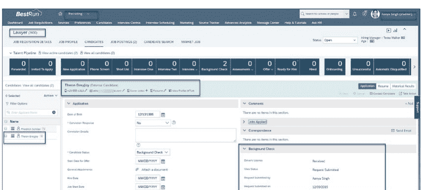

**图 10-32.** *API 调用的 UI 确认*

以下是更新先前调用结果的示例：

POST: https://apisalesdemo4.successfactors.com:443/odata/v2/JobApplicationBackgroundCheckResult?$format=json

请求载荷：

```
{
  "vendorOrderNo": "MYTHICAL_12112019_87654",
  "vendorCode": "MYTHICAL",
  "stepName": "Driver's License",
  "stepStatus": "Completed - no discrepancies",
  "stepMessage": "Background Check is in process. Please check back later",
  "finalStep": false
}
```

响应：

```
{
  "d": {
    "__metadata": {
      "uri": "https://apisalesdemo4.successfactors.com:443/odata/v2/JobApplicationBackgroundCheckResult(141L)",
      "type": "SFOData.JobApplicationBackgroundCheckResult"
    },
    "vendorOrderNo": "MYTHICAL_12112019_87654",
    "vendorCode": "MYTHICAL",
    "stepName": "Driver's License",
    "stepStatus": "Completed - no discrepancies",
    "stepMessage": "Background Check is in process. Please check back later",
    "finalStep": false,
    "statusId": "141"
  }
}
```


图 10-33 显示了第二次 API 调用的结果在用户界面中的确认情况。

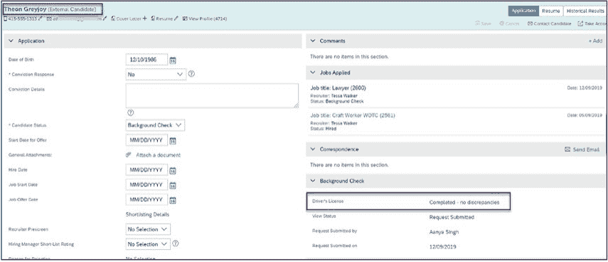

### 图 10-33. *API 调用结果的用户界面确认（第二张截图）*

以下 API 调用基于本步骤开头定义的任意软件包结构：

POST: https://apisalesdemo4.successfactors.com:443/odata/v2/JobApplicationBackgroundCheckResult?$format=json

请求负载（Request Payload）：

```json
{
  "vendorOrderNo": "MYTHICAL_12112019_87654",
  "vendorCode": "MYTHICAL",
  "stepName": "Employment",
  "stepStatus": "Submitted - pending verification",
  "stepMessage": "Background Check is in process. Please check back later",
  "finalStep": false
}
```

响应（Response）：

```
{
    "d" : {
        "__metadata" : {
            "uri" : "https://apisalesdemo4.successfactors.com:443/odata/v2/JobApplicationBackgroundCheckResult(142L)",
            "type" : "SFData.JobApplicationBackgroundCheckResult"
        },
        "vendorOrderNo" : "MYTHICAL_12112019_87654",
        "vendorCode" : "MYTHICAL",
        "stepName" : "Employment",
        "stepStatus" : "Submitted - pending verification",
        "stepMessage" : "Background Check is in process. Please check back later",
        "finalStep" : false,
        "statusId" : "142"
    }
}
```

图 10-34 显示了名为“Employment”（就业）的 `stepName` 在用户界面中的确认情况。

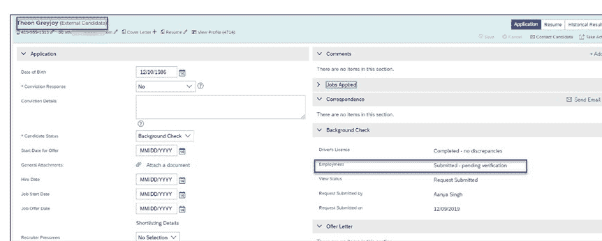

以下内容仅是对上一个 API 调用的更新：

POST: https://apisalesdemo4.successfactors.com:443/odata/v2/JobApplicationBackgroundCheckResult?$format=json

请求负载（Request Payload）：

```
{
  "vendorOrderNo": "MYTHICAL_12112019_87654",
  "vendorCode": "MYTHICAL",
  "stepName": "Employment",
  "stepStatus": "Completed - missing 2 years gap",
  "stepMessage": "Background Check is in process. Please check back later",
  "finalStep": false
}
```

响应（Response）：

```
{
  "d": {
    "__metadata": {
      "uri": "https://apisalesdemo4.successfactors.com:443/odata/v2/JobApplicationBackgroundCheckResult(143L)",
      "type": "SFOData.JobApplicationBackgroundCheckResult"
    },
    "vendorOrderNo": "MYTHICAL_12112019_87654",
    "vendorCode": "MYTHICAL",
    "stepName": "Employment",
    "stepStatus": "Completed - missing 2 years gap",
    "stepMessage": "Background Check is in process. Please check back later",
    "finalStep": false,
    "statusId": "143"
  }
}
```

表示背景调查完成的最终 API 调用：

POST: https://apisalesdemo4.successfactors.com:443/odata/v2/JobApplicationBackgroundCheckResult?$format=json

### 请求负载（Request Payload）：

```json
{
  "vendorOrderNo": "MYTHICAL_12112019_87654",
  "vendorCode": "MYTHICAL",
  "stepName": "Comprehensive Background",
  "stepStatus": "Completed - Missing information. Proceed with caution.",
  "stepMessage": "Background Check completed.",
  "reportUrl": "https://partneredge.sap.com/en/partnership/manage/mmp.html",
  "finalStep": true
}
```

### 响应负载（Response Payload）：

```json
{
  "d": {
    "__metadata": {
      "uri": "https://apisalesdemo4.successfactors.com:443/odata/v2/JobApplicationBackgroundCheckResult(144L)",
      "type": "SFOData.JobApplicationBackgroundCheckResult"
    },
    "vendorOrderNo": "MYTHICAL_12112019_87654",
    "vendorCode": "MYTHICAL",
    "stepName": "Comprehensive Background",
    "stepStatus": "Completed - Missing information. Proceed with caution.",
    "stepMessage": "Background Check completed.",
    "reportUrl": "https://partneredge.sap.com/en/partnership/manage/mmp.html",
    "finalStep": true,
    "statusId": "144"
  }
}
```

图 10-35 显示了 ODATA API 调用的最终结果，表明背景调查已完成。

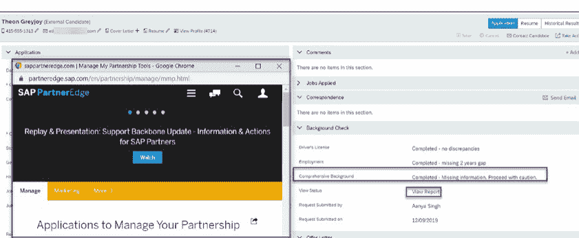

图 10-35. 显示带有结果 URL 的已完成背景调查的截图

### 结论

如果您遵循了上述列出的步骤，您应该能够以两种不同的方式为 SAP SuccessFactors 招聘客户成功构建背景调查集成。第一种情况是，当招聘人员或其他授权用户在职位申请用户界面中发起该操作时。第二种情况是，当使用智能服务（Intelligent Services）和集成中心（Integration Center）的组合将职位申请移至背景调查状态时。

## 常见问题解答

- 1. 在 SAP SuccessFactors 招聘实例中，是否可以共存两个或更多的背景调查供应商？
- 2. 可以，但有一个例外情况。只有一个背景调查供应商可以利用背景调查小部件（portlet）。换言之，小部件上仅显示由一个供应商传递的结果。第二个供应商必须在职位申请中添加自定义字段以返回结果。
- 3. 能否在不使用集成中心的情况下构建背景调查集成？
- 4. 如果您打算使用从职位申请 UI 内部发起的背景调查，则必须使用集成中心。如果使用智能服务，则没有限制。
- 5. 我能否在候选人流管道的不同步骤中发起背景调查？
- 6. 可以，只要第 3 步中的功能权限在申请人工作流的每个状态中重复即可。
- 7. 如果客户拥有多个职位申请表模板或职位申请模板，会发生什么情况？
- 8. 集成中心模板必须适应每个模板的每个适用状态。
- 9. 如果背景调查供应商无法支持同步 JSON 请求/响应，该怎么办？
- 10. 集成中心模板将不会包含响应字段映射。在这种情况下，供应商完全控制 `JobApplicationBackgroundCheckRequest` 对象的构建方式。
- 11. 集成中心支持哪些认证机制？
- 12. 集成中心支持以下认证机制：无认证、基本认证（Basic Authentication）或采用 SAML 流程的 OAuth 2.0、采用密码（Password）作为授权类型的 OAuth 2.0，以及采用客户端凭据（Client Credentials）作为授权类型的 OAuth 2.0。请注意，基本认证将于 2021 年 11 月弃用，并于 2022 年 12 月彻底停用。
- 13. 我如何对集成进行故障排除？
- 14. 如果集成是通过职位申请 UI 中的“发起背景调查”（Initiate Background Check）启动的，那么起点将是集成中心的执行监视器（Execution Monitor）。每个背景调查将有一次执行。执行监视器将提供条目顺序列表以识别问题源头。如果集成使用智能服务，起点应为智能服务中心（Intelligent Services Center）➤ 职位申请状态更新事件（Update of Job Application Status Event）➤ 事件监视器（Event Monitor），以及可选的集成中心执行监视器（如果其作为集成的一部分被采用）。

## 第 10 章 背景调查集成
