## 使用业务规则的候选人 Offer 自动化

随着本书的推进，我们展示了招聘过程各个阶段的各种集成和自动化方法。迄今为止，本书的每一章都专注于涉及第三方系统、创建文件或发起/接收外部调用的集成或自动化。然而，有一些自动化可以完全在 SuccessFactors 系统内部执行。随着我们接近招聘过程的 Offer 阶段，我们借此机会回顾这类自动化，因为创建 Offer 不太可能需要集成（除了文档签名等标准集成之外的情况）。这类内部自动化的一个典型例子是业务规则。让我们来看看！

## 业务规则概述

业务规则是 SAP SuccessFactors 的一项功能，允许管理员构建 If/Then 条件逻辑，并在满足条件时执行相应的脚本化行为。该功能并不适用于系统中的所有对象和数据，但其列表正在随着每个版本的发布而扩展。一般来说，涉及字段初始化、更改和保存场景的业务规则适用于职位申请、Offer、候选人和申请。然而，我们在以下注释中涵盖了许多例外情况。

### 配置业务规则

> **注意** 有关在 SAP SuccessFactors 招聘模块中管理业务规则的完整详情，请参阅 SAP 笔记 2618607 和 2515173。有关职位需求业务规则支持的字段类型详情，请参阅 SAP 笔记 2675870。有关录用通知（Offer）业务规则的详情，请参阅 SAP 笔记 2860149。有关不会触发的申请业务规则场景详情，请参阅 SAP 笔记 2866437。有关不会触发的候选人业务规则场景详情，请参阅 SAP 笔记 2781775。
>
> 一般来说，我们不建议针对候选人更新的业务规则，因为这些规则与移动申请功能不兼容。在大多数场景中，允许候选人在移动设备上轻松申请的优点超过了针对这些对象使用业务规则的优点。

通常，当条件满足时，业务规则的结果是更新字段的值或执行其他流程或规则。用英语表达，一个业务规则示例是：“当录用详情屏幕加载时，将字段 X 的值复制到字段 Y。”另一个示例是：“当职位需求更新时，如果字段 X 大于字段 Y，则将字段 X 复制到字段 Z；否则，将字段 Y 复制到字段 Z。”我们将在本章稍后详细介绍诸如前述语句如何转换为业务规则配置的具体内容。

到目前为止，我们已经简要解释了业务规则，并提供了大量 SAP 笔记供参考。理解业务规则的工作原理及其局限性可能令人望而生畏。完全理解的最佳方式是深入系统，亲自查看一下。让我们开始快速演练！

我们非常简单的场景将在用户进行修改时发出警告，如果该职位需求已经超过五周。为了开始，我们将首先为用户创建一个简单的警告消息：

- 1. 在搜索栏中输入并选择“Manage Data”。
- 2. 点击下拉菜单。
- 3. 按照图 11-1 所示填写屏幕内容。在“Text”字段中，输入“Warning, this requisition is already late! Please avoid significant changes!”。将“External Code”设置为“LATE_REQUISITION”，将“Name”设置为“Late Requisition”。确保“Status”设置为“Active”。
- 4. 点击“Save”。

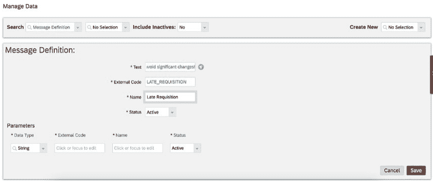

#### 图 11-1。示例消息定义

接下来，我们将创建我们的业务规则。要访问招聘的业务规则，请遵循以下步骤：

> 注意 请确保您拥有权限并且已配置 Provisioning。请参阅 SAP 笔记 2515173 了解先决条件。

- 1. 在搜索栏中输入并选择“Configure Business Rules”。业务规则管理屏幕将加载。
- 2. 点击右上角的“+”图标。创建业务规则屏幕将加载。
- 3. 您将在左侧看到不同业务规则类型的列表。招聘规则仅限于底部显示的用于 Offer 和 Requisition 对象的“Basic”类型。点击“Basic”旁边的箭头，然后点击“Basic”旁边的单选按钮。

**注意** *如果您想为这些对象之一创建业务规则，也可以在“Recruiting”下选择“Configure Business Rules on Candidate Profile”或“Job Application: Basic Business Rule Scenario”。*

- 4. 屏幕将根据图 11-2 所示更新。输入规则名称。
  规则 ID 将根据规则名称自动填充。如果您希望规则仅在特定的开始日期生效，您可以选择开始日期；或者如果您希望规则始终生效，可以保留默认的 01/01/1900。

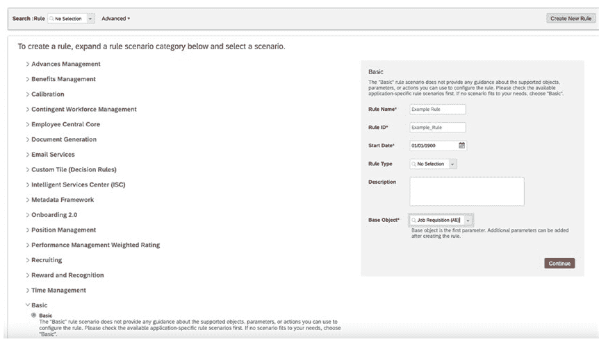

#### 图 11-2。创建示例业务规则

- 5. 选择一个基础对象。在我们的示例中，我们选择“Job Requisition
  (All)”，这指的是任何职位需求模板（而不是单独列出的个别模板）。
- 6. 点击“Continue”。规则详情屏幕将加载，如图 11-3 所示。

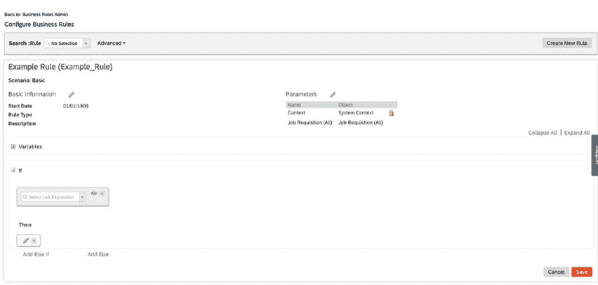

#### 图 11-3。业务规则详情屏幕

7. 在屏幕顶部，您可以点击“Basic Information”旁边的铅笔图标来编辑您在先前屏幕中设置的元数据。您也可以点击“Parameters”旁边的铅笔图标来引入系统其他区域的信息（例如，其他对象）。默认情况下，您将拥有系统上下文（如果您熟悉 JAVA 或类似的编程语言，上下文本质上是登录用户是谁，我们也可以通过它查找关于用户的其他信息）以及您在上一屏幕中选择的基础对象作为所选参数（在我们的情况下是 Job Requisition）。为了本次演练的目的，我们将保持这些设置不变，以便 Job Requisition 和 Context 作为参数引入。

8. 您可以点击“Variables”旁边的“+”图标来展开变量区域。就像在 JAVA、C++ 或其他面向对象编程中一样，该区域允许您创建包含值的变量，这些值可用于业务规则的 If/Then 逻辑中。使用变量的优势在于，它将在所有 If 和 If/Then 表达式/条件的范围内可用。通过在空白字段中输入名称来给变量命名。然后点击“=”符号右边的字段。您将看到在先前步骤中引入业务规则的参数列表，以及如图 11-4 所示的标准函数列表，例如 Add() 或 Minus()。在我们的示例中，我们将点击 Minus() 函数来减去两个值。

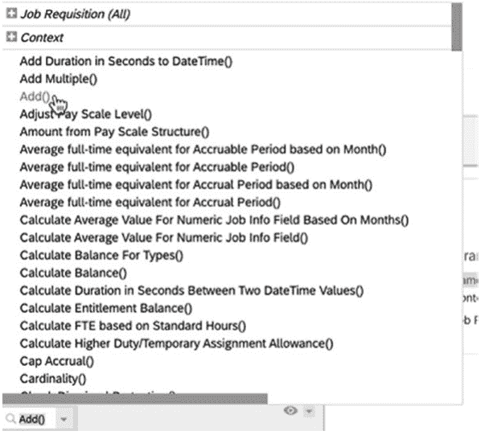

*图 11-4。* 参数和标准函数列表

- 9. 图 11-5 展示了一个示例，其中我们创建了一个名为 var_FiveWeeksAgo 的变量，该变量使用 Minus() 标准函数来计算五周前是当月的第几周。按照图 11-5 所示填写屏幕。虽然该变量在执行当天可能是常量，但我们也可以使用变量来计算逻辑过程中的持续总和。

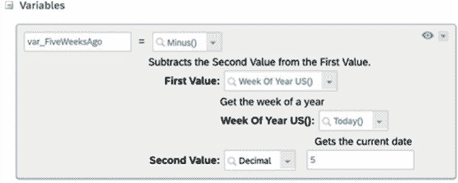

*图 11-5。* 示例变量

10. 下面的“Variables”部分是您构建“If”区域的地方。这是决定“Then”逻辑是否执行的有条件逻辑。在图 11-6 中，我们可以看到有一个选项可以将其设置为“Always True”，使得“Then”逻辑始终执行。

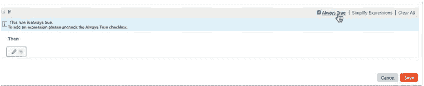

*图 11-6。* 示例设置将“If”设置为“Always True”以使“Then”逻辑始终执行

11. 如果我们不希望逻辑始终执行，那么我们必须想出一些有条件逻辑。就像创建变量时一样，点击“If”旁边的字段将显示引入业务规则的参数对象列表（在我们的情况下是 Requisition Object 以及 Context）以及类似我们在图 11-4 中看到的标准函数列表。对于我们的演练，我们将使用我们的变量来比较职位需求是否已在五周或更久之前获批。按照图 11-7 所示填写 If 逻辑。

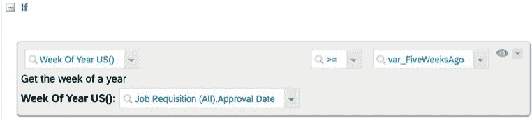

**图 11-7。* 检查职位需求是否已在五周前获批的示例 If 条件，使用示例变量

- 12. 接下来，我们定义条件满足时发生什么。
  
  当您点击第一个框时，可以看到我们可以执行各种功能。我们可以设置所选参数中字段的值，我们可以引发消息，我们可以创建或删除对象，我们可以执行其他功能，或者我们可以添加到其他对象。这在图 11-8 中有说明。在我们的演练中，我们将引发本节早些时候创建的警告消息。在第一个框中，选择“Raise Message”。

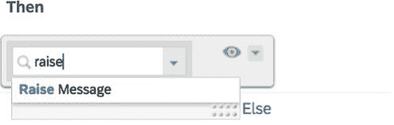

**图 11-8。* “Then”部分中可发起的可用操作

- 13. 接下来，我们将选择我们创建的消息。在“Message”字段中，选择“LATE_REQUISITION”并将“Severity”设置为“Warning。” 示例如图 11-9 所示。

### 图 11-9. “Then”逻辑示例

+   14. 点击“保存”。

恭喜！您已完成业务规则的定义！最终的规则逻辑应如图 11-10 所示。

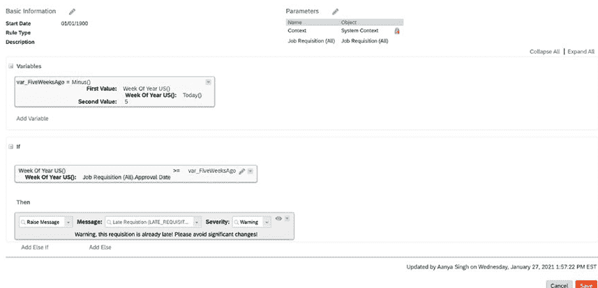

### 图 11-10. 最终的整体业务规则逻辑

作为最后一步，我们现在需要将业务规则与招聘申请对象关联，并定义其执行时机。请按照以下步骤操作：

-   1. 在搜索栏中输入并选择“在招聘中管理规则”（Manage Rules in Recruiting）。
-   2. 屏幕应默认显示招聘申请（Job Requisition）对象。选择您希望启用该规则的特定招聘申请模板。
-   3. 业务规则可以在字段发生变化、模板首次加载到屏幕上或保存时执行。我们希望每当招聘申请发生变化时都显示此警告。因此，在“字段更改规则”（Field Change Rules）部分下，选择您希望运行业务规则检查并可能显示警告消息的字段。在图 11-11 的示例中，我们选择了外部发布和外部职位名称。

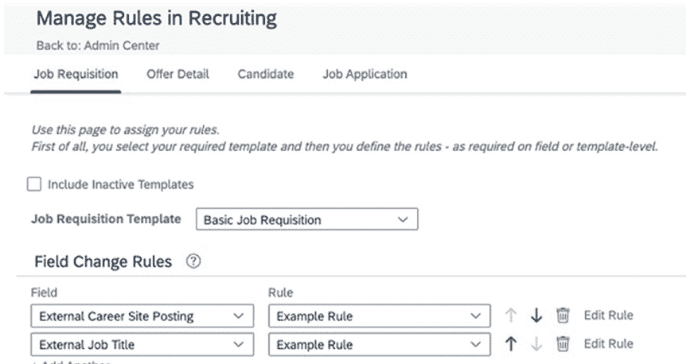

#### 图 11-11. 将业务规则与特定招聘申请模板上的字段更改关联

-   4. 点击“保存”。

干得漂亮！您现在已经设置了第一条业务规则！我们现在应该可以测试更改您指定的字段，并立即收到您设置的警告消息。图 11-12 显示了一个示例：我们在一个已于五周或更早之前获批的现有招聘申请上更改了“外部职位名称”字段，并按预期收到了警告消息。

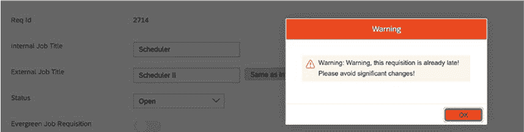

*图 11-12.* 在符合规则条件的现有招聘申请上更改“外部职位名称”字段后收到的警告消息

## 相关业务场景

既然我们了解了业务规则的工作原理，就可以看到有无数相关的业务场景可以通过它们提供实用的解决方案。让我们仔细看看其中几个。

在我们的演练中，当对较旧的招聘申请进行编辑时，我们弹出了一条警告消息。在类似的场景中，如果薪资字段超出范围，我们可以弹出警告消息。如果职位空缺数量设置得过高且需要额外授权，我们也可能会发出警告。此外，我们还可以在保存时强制停止，让用户知道薪资受限，或者职位空缺数量超过某个临界点后需要多个招聘申请获得批准。

除了简单的警告消息或强制停止之外，我们还可以根据先前字段的值计算新值或更改其他字段。例如，如果用户选择了某个公司代码或部门，而这些代码或部门只有一个地点，我们可以自动将地点字段设置为该唯一地点。

我们还可以更进一步，让数据在系统之间、对象之间传递，从而影响下游流程。在这个综合示例场景中，HRIS 系统创建一个招聘申请，并为其提供最低和最高薪资字段的值。此外，候选人在发出录用通知之前，还会在招聘过程中获得评估分数。当招聘人员打开录用通知时，我们可以使用业务规则将最低薪资、最高薪资和评估分数纳入考量，得出建议录用金额。在下一节中，我们将更详细地逐步介绍如何设置业务规则来实现这一点。

## 案例研究：计算建议录用金额

现在我们已经了解了业务规则的功能，并且有了一个全面的业务场景，可以开始构建了！首先，在教您如何构建解决方案之前，我们先来看一下我们的业务场景。

### 业务场景

快速回顾一下，在我们的场景中，HRIS 系统通过招聘申请创建界面（如您在第二章中构建的界面）将最低和最高建议薪资值传递给了我们的招聘申请。此外，评估供应商也将评估分数传递给了我们的应用程序（如第八章中构建的内容）。利用这些输入，我们现在可以构建一条规则，在录用模板上填充建议薪资。图 11-13 显示了此数据流的示意图。

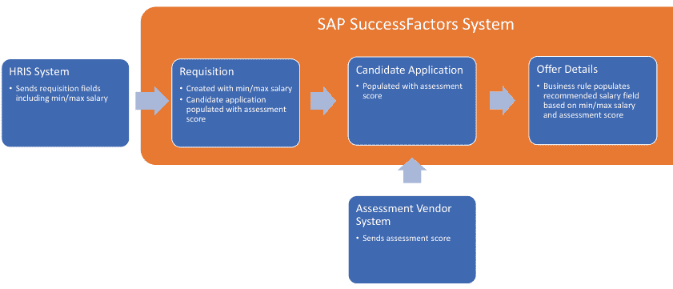

图 11-13. 薪资建议案例研究的数据流

实施如图 11-2 所示的解决方案将为招聘人员节省大量时间，确保数据准确且不易出现人为错误，并通过免去这些麻烦来提高士气。如果没有这样的解决方案，当招聘人员进入录用详情阶段时，他们必须登录 HRIS 系统查找最低/最高薪资，然后登录评估供应商系统查找候选人的分数。接着，他们很可能需要将数据粘贴到电子表格中，并通过计算得出最终的薪资建议。然后，他们还必须将此建议粘贴到 SuccessFactors 中。这涉及很多步骤，而且处处都可能出错！而在我们的解决方案中，建议会自动为招聘人员生成。这将帮助招聘人员节省大量时间并减少挫败感！

## 实施方案

要开始创建业务规则，请按照以下步骤操作：

> 注意：在本示例中，我们假设已经构建了集成，用于填充招聘申请上的“薪资下限”（Salary Min）和“薪资上限”（Salary Max）字段，以及职位申请上的“平均评分”（Average Rating）字段。

-   1. 在搜索栏中输入并选择“配置业务规则”（Configure Business Rules）。系统将加载“业务规则管理”屏幕。
-   2. 点击右上角的“+”图标。系统将加载“创建业务规则”屏幕。
-   3. 您会在左侧看到不同的业务规则类型列表。请注意，招聘规则仅限于“基本”（Basic）类型，该类型位于底部，适用于录用（Offer）和招聘申请（Requisition）对象。点击“基本”旁边的箭头，然后点击“基本”旁边的单选按钮。
-   4. 输入规则名称，并使用默认的规则 ID 和开始日期。将基础对象输入为“录用审批（全部）”（Offer Approval (All)）。点击“继续”。图 11-14 显示了一个示例。

-   > 临时劳动力管理
-   > Employee Central Core
-   > 文档生成
-   > 电子邮件服务
-   > 自定义磁贴（决策规则）
-   > 智能服务中心 (ISC)
-   > 元数据框架
-   > 入职
-   > 职位管理
-   > 绩效管理加权评级
-   > 招聘
-   > 奖励与认可
-   > 时间管理
-   ✓ 基本
-     ○ 基本
-     “基本”规则场景不提供有关可用于配置规则的支持对象、参数或操作的任何指导。请检查可用的

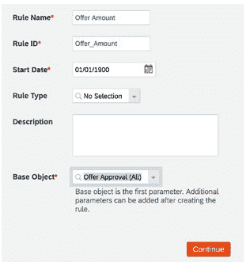

### 图 11-14. 录用审批业务规则的示例元数据

5. 我们可以保留默认参数，然后开始专注于变量。我们首先需要设置建议薪资水平的计算。我们将较低薪资设为最低薪资的 1.1 倍，中等薪资设为最低薪资的 1.25 倍，较高薪资设为最高薪资的 0.9 倍。首先为每个变量命名，然后选择乘法函数，再选择最低或最高薪资字段，乘以相应的数字。当您点击“值”（Value）字段旁边的框时，您会看到“招聘申请”（Job Requisition）对象作为可用对象出现在“录用审批”（Offer Approval）对象下方，这样您就可以选择其中的“薪资下限”（Salary Min）或“薪资上限”（Salary Max）字段。图 11-15 显示了这组完善变量的示例。

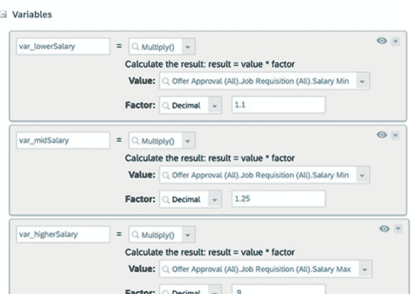

### 图 11-15. 声明薪资水平的示例变量

6. 现在变量已经设置好了，我们可以构建 If/Then/Else 逻辑。我们假设评估评分量表为五分制。我们需要声明：如果职位申请上的评分低于 1，则将建议的基础薪资设置为招聘申请中的最低薪资；如果评分大于或等于 1 但低于 2，则推荐较低薪资变量；如果评分大于或等于 4，则将较高薪资变量设置为建议薪资；在所有其他情况下，薪资将设置为中等薪资建议。为此，请按照我们在业务规则演练中的做法，构建如图 11-16 所示的逻辑。（提示：要向 If 语句添加“and”，请点击表达式最右侧的向下箭头图标，然后选择“添加”（Add），再选择“父级 And”（Parent And），如图 11-17 所示。）

Figure 11-16. Example If/Then/Else Logic Setting Recommended Base Salary

Figure 11-17. Adding a “Parent And”

+   7. Be sure to click “Save” to save your work.

+   8. Now we will associate our business rule with our available offer templates and make sure it executes when the template loads so that recruiters can see the recommended salary on the form as they fill it out. Type and select “Manage Rules in Recruiting” in the search bar.

+   9. When the “Manage Rules in Recruiting” screen appears, click the “Offer Detail” tab.

+   10. Under “Template-level Rules,” click “Add Another” and then choose your business rule. Your final result should look like the example in Figure 11-18.

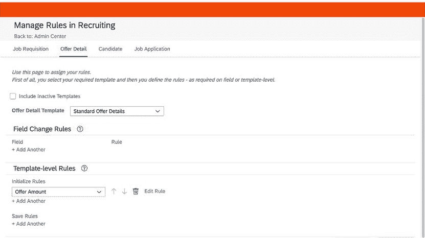

Figure 11-18. Associating the Offer Amount Rule to an Offer Template to Load Upon Initialization

+   11. Click “Save.”

Great job! You’ve got your business rule set up, and now you can test it out! When you select a requisition that has the “Salary Min” and “Salary Max” fields populated (and optionally an assessment score since by default we will recommend a mid-level salary

if there is no score), we can see that the “Base Salary” field auto-populates with our calculated recommendation as soon as we create an offer detail. An example is shown in Figure 11-19.

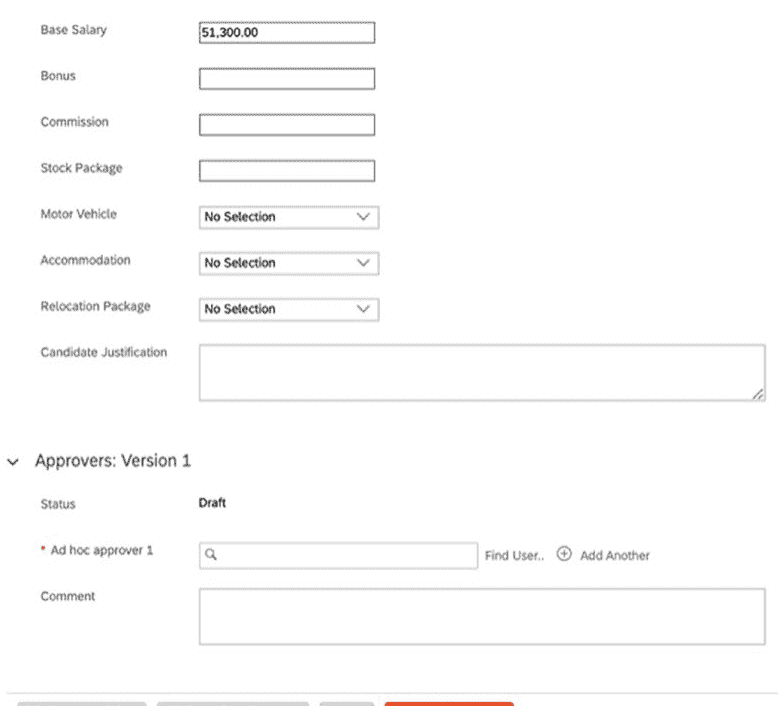

Figure 11-19. Example New Offer Approval Form with “Base Salary” Field Auto-populated Based on Business Rule Logic

Congratulations! With your new business rule in place, recruiters will no longer have to calculate the recommended salary offer on their own. You have now set up a time-saving business rule building on the knowledge you have obtained across multiple chapters! You can now see how business rules can be used independently or in conjunction with other integrations to provide useful automations.
