## CHAPTER 12

### Intelligent Services

Enterprise applications have been in use for a long time, and as time has progressed, the need to integrate has become central to any enterprise application. In the 1990s, the primary mechanism for extracting data and adding data was FTP and its recent variant Secure FTP. With the advent of Java as a programming language in the mid-1990s, messaging has been part and parcel of the programming language, primarily Java Message Queue. Over time, this methodology has spread to several enterprise applications including SuccessFactors.

This term is commonly referred to in the industry as “webhooks.” Wikipedia defines webhooks as *user-defined HTTP callbacks. They are usually triggered by some event, such as pushing code to a repository or a comment being posted to a blog. When that event occurs, the source site makes an HTTP request to the URL configured for the webhook. Users can configure them to cause events on one site to invoke behavior on another.* So, what exactly is Intelligent Services? Intelligent Services simplifies the user experience for employees, managers, and business partners by integrating into a single experience the individual transactions in a multistep HR process that cross the traditional boundaries of HCM applications and organizational departments. Intelligent Services links with external systems that allow seamless integration with third-party applications. For example, if a hiring manager goes on leave, not only does the core HR system require updates, but potentially other systems such as the Applicant Tracking System, performance management system, learning system, payroll system, benefits carrier, and more.

End users often cannot navigate the complexity of Human Experience Management (HXM), and companies are forced to spend large sums of money for shared HR services or business process outsourcing to ensure that all downstream processes are completed. With Intelligent Services, users no longer figure out what’s next, or which system to access, or rely on shared HR services or business partners. Less help is required from shared HR services, reducing the workload and cost of HR shared services.

At the heart of Intelligent Services are events, publishers, and subscribers. Different modules in SAP SuccessFactors raise events, for example, when a new hire is completed, a job requisition is updated, or when a learning event is completed. Each event has a publisher, the underlying SAP SuccessFactors module. An external system (or even another SAP SuccessFactors module) can subscribe to an event and react to it to perform downstream activities. Each publisher defines the event structure and the associated payload.

#### Step 1: Permissions in Admin Tools – Enable Intelligent Services

Log into the customer’s instance as an administrator and navigate to Admin Tools ➤ Manage Permission Roles. Choose System Admin as the Permission Role and ensure the following are selected. The SuccessFactors Recruiting system requires several permissions to be set up for different roles. Table 12-1 shows the applicable list of permissions.

**Table 12-1.** *Necessary Role Based Permissions for Intelligent Services*

| System Role | Permission Category | List of Permissions |
|---|---|---|
| API User | General User Permissions | – User Login<br>– SFAPI User Login |
| API User | Intelligent Service Tools | – Intelligent Services Center (ISC) |
| API User | Manage Integration Tools | – Access to Event Notification Subscription<br>– Access to Event Notification Audit Log<br>– Access to ODATA API Audit Log<br>– Access to API Center<br>– Access to ODATA API Metadata Refresh and Export<br>– Access to ODATA API Data Dictionary<br>– Access to Integration Center<br>– Access to Outbound Trust Manager |
| API User | Metadata Framework | – Admin Access to MDF ODATA API |

If the customer instance you’re working in was created before Q1 2017 release, you may have to explicitly enable Intelligent Services. If this is the case, you have to navigate to Admin Center ▶ Upgrade Center. Search for Recommended Upgrades and locate Intelligent Services and choose Learn More and Upgrade Now. Confirm your changes and Intelligent Services should be enabled.

If the customer instance was created after Q1 2017, Intelligent Services was enabled by default, but you need to ensure that the business rules were imported. This step applies for Employee Central, but it is a good idea to do it, nevertheless. Navigate to Admin Center ▶ Monitor Job and verify that the rules were imported. Figure 12-1 shows a sample screenshot from a prior import. Instances created more recently may not show the import processes, since they were pre-delivered.

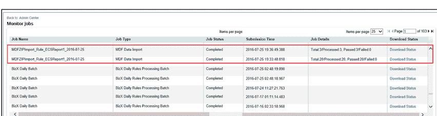

Figure 12-1. Checking the Status of Your Business Rule Import

#### Standard Event Framework

Most Intelligent Services publishers use the Standard Event Framework, to publish events to SAP and outside of SAP.

Intelligent Services uses existing ODATA APIs to fetch additional information about the event and comprises records of the same type.

Some events only publish to other internal SAP SuccessFactors subscribers, or to external third-party applications, or both.

#### Service Event Bus

The Service Event Bus Architecture allows the event message to flow from publisher to subscribers. The Service Event Bus utilizes ODATA database tables that contain connected entities that allow internal SAP SuccessFactors applications to receive notifications from publishers. This architecture framework allows external third-party applications to subscribe to Intelligent Services.

Most Intelligent Services events publish to subscribers using the Service Event Bus. There are events available as a result of integration work between Employee Central and SAP Jam or from form routing workflow using Performance Management forms for a new hire.

#### Business Rules

Business rules are used for most Intelligent Services events. Most Employee Central business rules are packaged as part of SuccessStore. There are two Employee Central events that require manual creation:

- Expiration of Work Order
- Initiate Performance Form

You can create the business rule manually to associate with a specific Performance Management form for the Initiate Performance Form event for a new hire. See related links at the end of this topic for more information about business rules and how to set up and manage employees using Employee Central.

> **Note** Business Rules cannot be used currently for recruiting.

#### Event Structure and Payload for Recruiting

The official documentation shows the event structure and payload for the events as shown in Table 12-2. The source for all SAP SuccessFactors events for recruiting is MODULE_RCM.


**表12-2.（续）**

| 事件名称 | 事件描述 | 事件类型 | OData 实体类型 | 实体键和数据类型 | 参数键和数据类型 |
|---|---|---|---|---|---|
| 候选档案更新 | 当候选档案发生更新时触发此事件。 | CandidateProfile.Updated | Candidate | candidateId (string) | None |
| 启动职位发布 | 当职位发布到外部招聘网站时触发此事件。 | JobPosting.Change | JobRequisitionPosting | jobPostingId (string) | jobReqId (string) jobPostingType (string) |
| 将候选人的国家/地区更新为俄罗斯 | 当候选人的国家/地区更改为俄罗斯时触发此事件。 | CandidateProfileUpdated.CountryUpdated | Candidate | candidateId (string) | isCountryChangeEvent (string) |

第1章介绍了OData API的基本内容。你也可以通过执行 GET <<endpoint>>odata/v2/getExtEventMetaDataDefinition 来获取客户实例（或任何实例）中的事件；但请记住，没有筛选条件，你将获得实例中的所有事件。

## 订阅事件

设置与智能服务集成的第一步是确定要订阅哪个事件。为此，请导航至管理中心 ➤ ISC（智能服务中心）。图12-2展示了本文档所述的七个招聘事件。本节将全程以“Update of Job Requisition”作为示例进行说明。

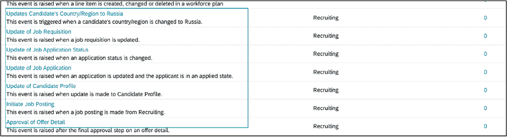

*图12-2. 智能服务中心部分截图，展示招聘事件*

为了说明这一点，我们将重点关注 Update of Job Requisition 事件，并展示代码的编程示例。选择 Update of Job Requisition 后，将进入 ISC 主页面，如图12-3所示。

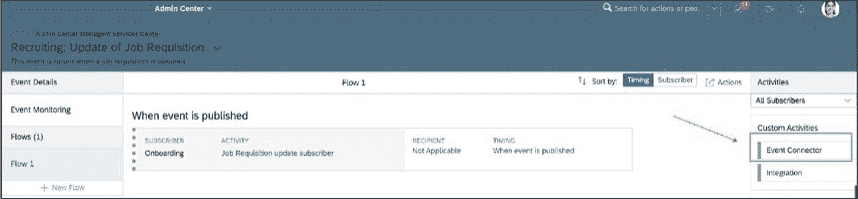

*图12-3. Update of Job Requisition 事件的详细信息*

点击 Event Connector 打开定义连接器的页面。请注意，第10章展示了使用 Update of Job Application Status 的另一个示例。点击图12-3中的 Event Connector 以显示事件连接器。图12-4展示了事件连接器。

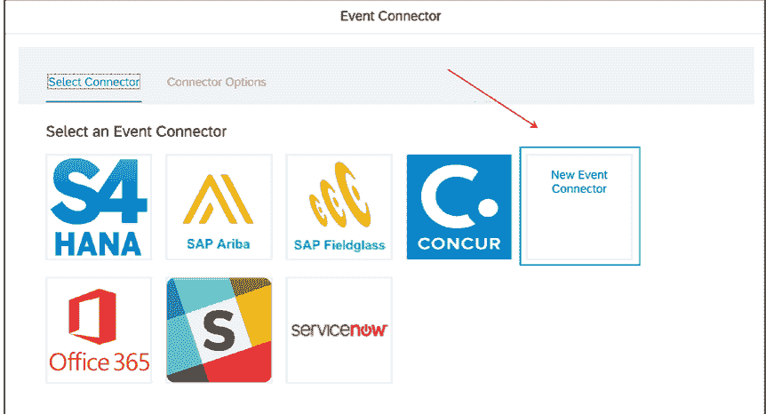

*图12-4. 定义事件连接器*

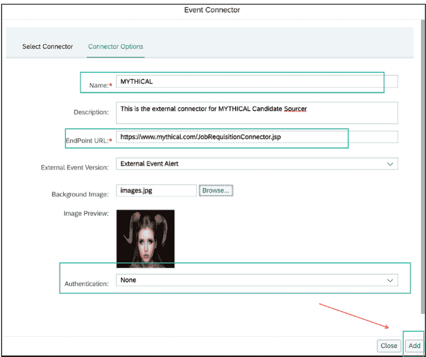

*图12-5. 定义虚构的事件连接器*

图12-5展示了一个未配置任何身份验证的完整事件连接器。请注意，Name 和 Endpoint URL 是必填字段，且 Endpoint URL 是虚构的。

SAP SuccessFactors 提供三种身份验证选项：

-   无（None）（如图12-5所示）
-   基本（Basic）（如图12-6所示）

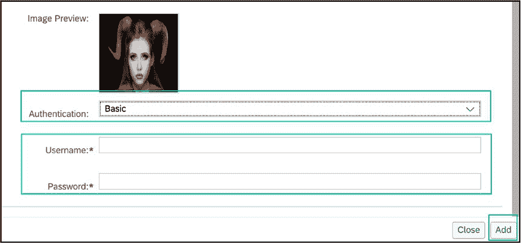

*图12-6. 使用基本身份验证的事件订阅*

必填字段为用户名和密码。

> **注意** 基本身份验证将于2021年底弃用，到2022年底将不再作为选项提供。因此，你应该提前规划，使用“None”或“OAuth2 with Client Credentials Grant”。

-   OAuth2 with Client Credentials Grant（如图12-7所示）。

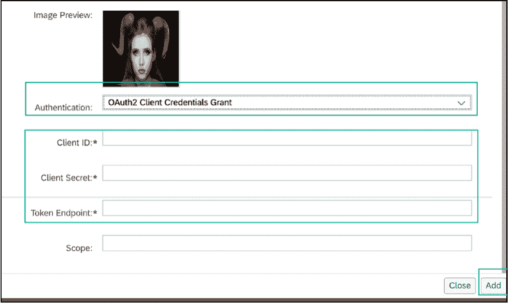

*图12-7. 使用 OAuth2 with Client Credentials Grant 的事件订阅*

必填字段为 Client ID、Client Secret 和 Token Endpoint，而 Scope 是可选的。这些属性在第三方平台上定义。无论选择哪种身份验证选项，都必须点击“Add”来注册订阅。最后一步是确保你的流程已保存，如图12-8所示。

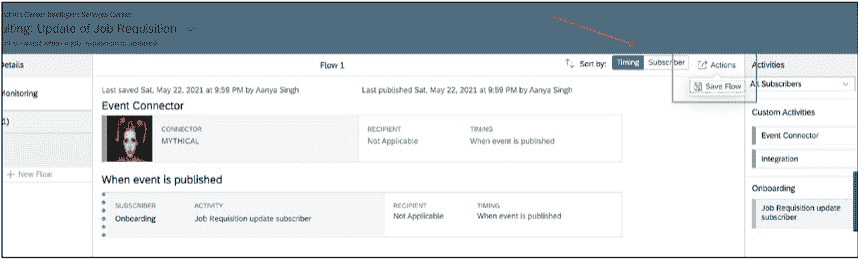

*图12-8. 保存你的最终流程*

在本章前面，我们描述了如何通过执行 GET <<endpoint>>odata/v2/getExtEventMetaDataDefinition（在 Postman 或浏览器中）以编程方式获取所有事件。以下是“Update of Job Requisition”事件的响应负载：

```json
{
  "description": "This event is raised when an approved or closed requisition is updated.",
  "effectiveDated": false,
  "entity": "JobRequisition",
  "entityKeys": {
    "results": [
      {
        "description": null,
        "descriptionMessageKey": null,
        "name": "jobReqId",
        "type": "STRING"
      },
      {
        "description": null,
        "descriptionMessageKey": null,
        "name": "startDate",
        "type": "DATE"
      }
    ]
  },
  "name": "Update of Job Requisition",
  "params": {
    "results": [
      {
        "description": null,
        "descriptionMessageKey": null,
        "hasValueAlways": false,
        "name": "updatedFieldsList",
        "type": "STRING"
      },
      {
        "description": null,
        "descriptionMessageKey": null,
        "hasValueAlways": false,
        "name": "isOnboardingInitiated",
        "type": "STRING"
      }
    ]
  },
  "publisher": "Recruiting",
  "topic": "com.successfactors.recruiting.JobRequisition.Updated",
  "type": "JobRequisition.Updated"
}
```

配置好订阅并成功连接外部系统后，负载将通过 SOAP 消息传递，如下所示：

```xml
<?xml version="1.0" encoding="UTF-8" standalone="yes"?>
<ns6:ExternalEvent xmlns:ns6="http://notification.event.successfactors.com" xmlns:ns5="http://schemas.xmlsoap.org/soap/envelope/" xmlns:ns7="com.successfactors.event.notification" xmlns:ns2="com.successfactors.alert" xmlns:ns4="http://alert.successfactors.com" xmlns:ns3="http://www.boomi.com/connector/wss">
    <ns6:externalEventMeta>
        <ns6:externalEventId>b772edb5-9f59-4b53-8595-6e45d08c0756</ns6:externalEventId>
        <ns6:type>com.successfactors.recruiting.JobRequisition.Updated</ns6:type>
        <ns6:publishedAt>1621793760938</ns6:publishedAt>
        <ns6:publishedBy>sfadmin</ns6:publishedBy>
        <ns6:repost>false</ns6:repost>
    </ns6:externalEventMeta>
    <ns6:events>
        <ns6:event>
            <ns6:eventId>fa477244-08c2-4293-aa65-2bad255b75d9</ns6:eventId>
            <ns6:entityType>JobRequisition</ns6:entityType>
            <ns6:publishedAt>1621793760929</ns6:publishedAt>
            <ns6:publishedBy>sfadmin</ns6:publishedBy>
            <ns6:repost>false</ns6:repost>
            <ns6:entityKeys>
                <ns6:entityKey>
                    <name>jobReqId</name>
                    <value>2561</value>
                </ns6:entityKey>
            </ns6:entityKeys>
            <ns6:params>
                <ns6:param>
                    <name>updatedFieldsList</name>
                    <value>workHours[en_US], experienceReq</value>
                </ns6:param>
                <ns6:param>
                    <name>isOnboardingInitiated</name>
                    <value>false</value>
                </ns6:param>
            </ns6:params>
        </ns6:event>
    </ns6:events>
</ns6:ExternalEvent>
```

关于 SOAP 负载的说明：

1. 有效负载是在成功检索事件后从外部系统获取的。在此示例中，外部系统是 SAP 的业务技术平台（BTP），一个中间件。
2. 适用于外部实体的唯一命名空间是 ns7。但是，最佳实践是确保第三方软件设置为忽略命名空间。
3. externalEventId 是应用于整个数据中心的属性，而 eventId 特定于当前实例。
4. publishedAt 以相对于 UTC 的 Unix 纪元时间表示。注意，有两个 publishedAt 属性，相隔几毫秒。以 https://currentmillis.com 作为参考，我们可以确定 1621793760929 转换为 UTC 日期和时间是“Sun May 23 2021 18:16:00”，本地时间（太平洋夏令时间）是“Sun May 23 2021 11:16:00”。
5. publishedBy 是当前客户实例中用户的 userId。在此示例中，它是销售演示实例中的 twalker（Tessa Walker）。
6. updateFieldsList 参数集合表明，属性“workHours[en_US]”和“experienceReq”已在 JobRequisition 的“entityType”上发生更改。你可以使用这些参数来确定后续操作。
7. SOAP 负载中的“type”属性表示所涉及的基础事件，即 JobRequisition.Updated。

## 集成故障排除

集成设置完成后，接下来的合理步骤是确定集成是否正常工作。为此，请访问管理中心 ➤ ISC（智能服务中心）。你将看到 SuccessFactors 中触发的事件。

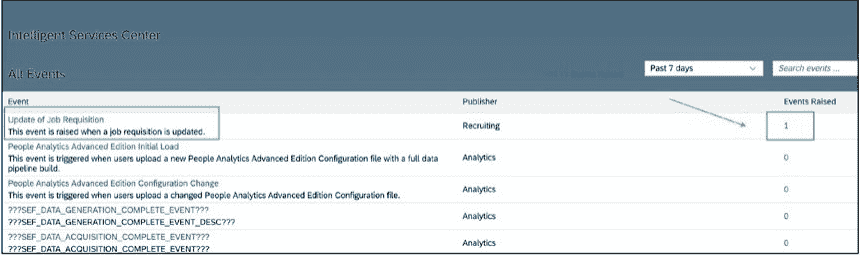

*图12-9. 智能服务中心显示为 Update of Job Requisition 触发的事件*


点击显示在“Events Raised”（引发的事件）列下方的数字所在的链接。图 12-10 展示了这样一个示例。

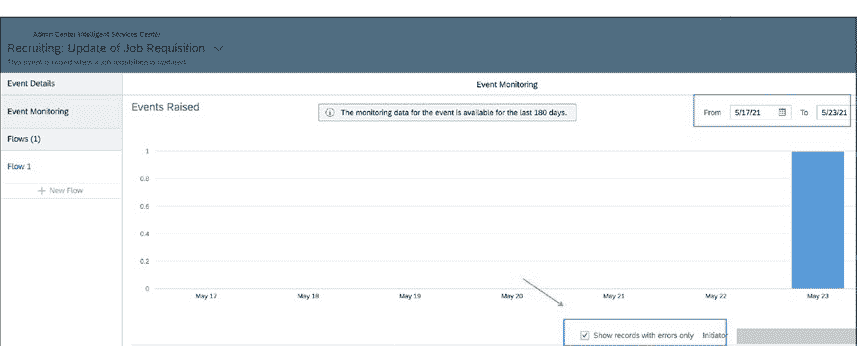

图 12-10. 智能服务中心截图，显示引发的事件

你可以选择仅查看未成功的事件，方法是点击“Show records with errors only”（仅显示有错误的记录）复选框，如图 12-10 所示。请注意，你可以使用日期过滤器来缩小或扩大你的结果范围。执行记录仅限于过去 180 天。现在，点击你感兴趣的事件以查看详细信息，如图 12-11 所示。


图 12-11. 智能服务中心 – 事件监视器，显示执行摘要

请注意，MYTHICAL 连接器的事件显示为“Failed”（失败）状态，并有一个弹出窗口显示执行的详细信息。你可以直接点击“Show Details”（显示详情）的弹出窗口，或者访问图 12-15 中所示的事件通知审计日志。图 12-11 适用于事件较少且你想快速查看详情的情况。

以下负载显示了 SuccessFactors 实际发送到设置中定义的端点（即 www.mythical.com/JobRequisitionConnector.jsp）的请求。图 12-12 展示了 SuccessFactors 发送到前文定义的外部实体 MYTHICAL 的请求 SOAP 负载的示例。

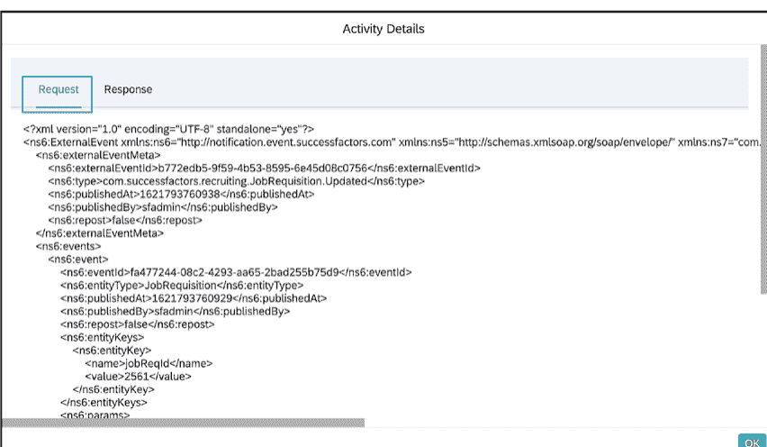

图 12-12. 显示请求负载的活动详细信息

图 12-13 展示了 SuccessFactors 尝试连接由 MYTHICAL 连接器定义的端点（www.mythical.com/JobRequisitionConnector.jsp）时生成的响应。

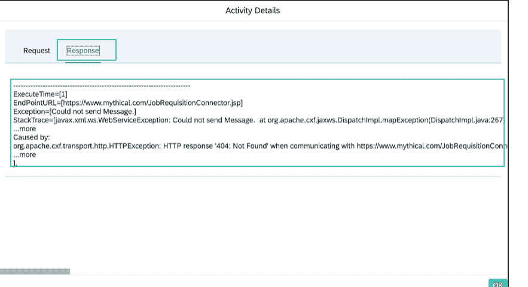

图 12-13. 显示响应负载的活动详细信息

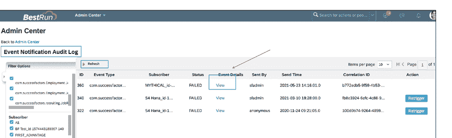

图 12-14. 事件通知审计日志的着陆页

如果你有大量事件，访问 Admin Center（管理中心）> Event Notification Audit Log（事件通知审计日志）可能会很有用，如图 12-14 所示。

事件按执行顺序列出。如果执行记录很多，你可以使用图 12-14 中显示的过滤器选项来缩小事件范围。在示例中，相关事件是 com.successfactors.recruiting.JobRequisition.Updated。你也可以点击 Refresh（刷新）以获取最新的执行记录。你可以点击“Event Details”（事件详情）列下的“View”（查看）超链接来查看执行详情。请求和

- 在决定使用“Update of Job Application”（更新求职申请）和“Update of Job Application Status”（更新求职申请状态）事件时要谨慎，因为这两个事件都基于 JobApplication 实体。如果你只关注状态变更，应强烈考虑使用“Update of Job Application Status”事件。关于此的示例可在第 12 章关于背景调查中找到。
- 对于大型数据提取，请使用第 7 章中描述的集成中心（Integration Center）中的定时流程。
- 如本章前面所述，SuccessFactors 将在 2021 年底弃用基本身份验证，并在 2022 年底完全不可用。因此，应尽可能努力迁移使用基本身份验证的现有事件集成。在最坏的情况下，你可以使用 None 作为身份验证，但你必须评估客户的需求。
- 谨慎使用“Update of Candidate Profile”（更新候选人个人资料）事件。如果你使用此事件，将产生比所需更多的交易，且你的软件应能够丢弃不需要的交易。

## 结合智能服务与集成中心

如本章前面所述，智能服务将为每个引发的事件生成一个异步 SOAP 消息。如果你需要更多关于引发事件的基础实体的详细信息，你需要进行显式的 ODATA API 调用。利用内置工具的另一种方法是使用集成中心，它允许你增强负载并以 JSON、纯 XML 或甚至 SFTP 的形式交付负载，如果这是从 SuccessFactors 获取信息的唯一方式。让我们以之前 MYTHICAL 的示例为例，现在在集成中心中定义一个集成模板。请在图 12–15 中查看添加此集成的位置。

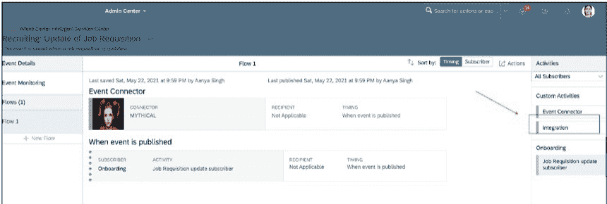

图 12-15. 将集成与事件关联

当你点击如图 12-15 所示的集成时，你会看到一个弹出窗口，表明你还没有定义任何集成。确认该弹出窗口后，你会看到如图 12-16 所示的弹出窗口，现在你可以创建一个新的集成。

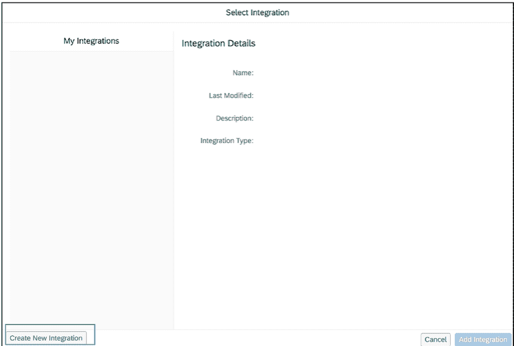

图 12-16. 创建新集成的弹出窗口

现在你将看到一个弹出窗口，询问你要构建哪种类型的集成。图 12-17 展示了以 REST 和 JSON 为格式的一个示例。点击“Create”（创建）按钮。

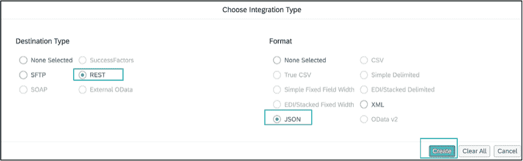

图 12-17. 定义格式的集成中心弹出窗口

第 7 章详细介绍了如何使用集成中心。为了本章的目的，假设你已经增强了负载并定义了一个端点。图 12-18 展示了一个集成完全定义的示例截图。请确保保存你的集成，然后点击“Go to Intelligent Services Center”（前往智能服务中心）。

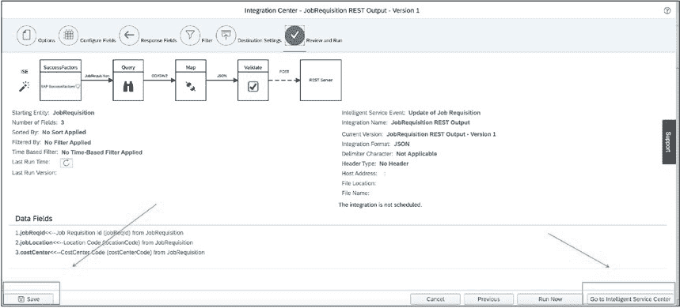

图 12-18. 集成中心中的示例已完成集成

## 使用智能服务和集成中心排查组合集成的故障

如果你的集成结合了智能服务和集成中心，并且你想排查故障，你有两个选项，选择取决于你当前的集成状态：

- 在最初设置集成时，你需要使用智能服务中心（Intelligent Services Center）► 事件监视器（Event Monitor），如图 12-11 所示，或者通过导航至管理中心（Admin Center）► 事件通知审计日志（Event Notification Audit Log），如图 12-14 所示。
- 如果你的集成已经运行，你可能希望开始排查现有集成。你可以通过导航至管理中心（Admin Center）► 集成中心（Integration Center）► 监控集成（Monitor Integrations）来开始此操作，如图 12-21 所示。

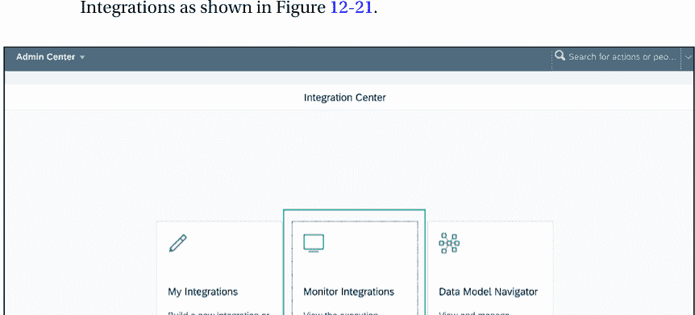

图 12-21. 在集成中心内访问监控集成

当你点击“监控集成”（Monitor Integrations）时，SuccessFactors 将启动执行管理器（Executions Manager）弹出窗口。图 12-22 显示了当前被高亮的集成。

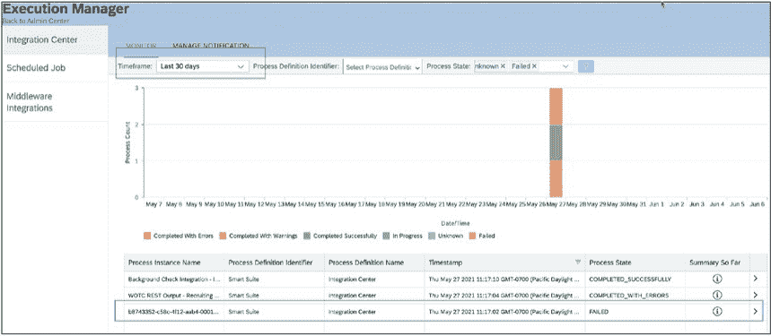

图 12-22. 显示集成中心内执行管理器的截图

你会注意到集成状态显示为失败。这是因为我们在图 12-18 中选择的虚构端点实际上并不存在，导致连接失败。图 12-22 还显示了一个使用第 10 章背景调查功能的成功完成的集成。点击箭头以查看执行的更多详细信息，如图 12-23 所示。你可以点击下载图标将结果导出为 CSV 文件。如果你希望与支持工单共享结果详情，附上错误日志会很有用。

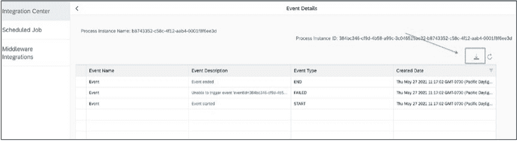

图 12-23. 关于事件触发的示例详情

既然你已经了解了如何使用智能服务和集成来设置集成，让我们考察一个实用用例，以了解如何在客户实例中设置此类集成的过程。

## 用例：候选人招募

假设你被客户聘请，作为一个候选人招募平台。根据你在本章中阅读的信息，你应该能够构建一个可用的集成，向客户的招聘系统提供候选人。让我们将这个候选人招募平台称为 MYTHICAL。

在开始这样的集成解决方案之前，让我们先做出几个假设：

- 客户希望你从 MYTHICAL 平台引入外部候选人。此外，客户希望你更新现有候选人的信息。
- 你需要使用 OAuth2.0 以符合客户和 SAP SuccessFactors 的安全要求。
- 职位申请表（Job Requisitions）应先外部发布，然后你才能招募候选人。
- 利用 ODATA API，你将在 SuccessFactors 中创建候选人记录，以及任何支持附件，如简历和求职信。
- 候选人应能近乎实时地获知客户发布的任何新职位申请。
- 你应该以尽可能标准化的方式设计集成，以便你可以将相同的原则应用于多个客户，只需最少定制。
- 客户将授予你访问各种招聘实体的权限。示例权限列在本章开头。
- 最低限度，MYTHICAL 平台必须能够从 SuccessFactors 接收 SOAP 消息。一个良好的特性将是平台能够从 SuccessFactors 接收 JSON 消息（如果你打算将智能服务与集成中心结合使用）。


- MYTHICAL 平台还能够调用客户招聘 API 的 OData 接口。
- 如果由于某种原因，MYTHICAL 平台在消费事件方面存在限制，您应该与客户一起针对该限制做出相应的调整。
- 就本章而言，我们假设候选人寻源仅限于北美地区。

构建解决方案所涉及的步骤可以遵循业界公认的软件开发生命周期方法。通常，所需步骤包括需求收集与分析、设计、实施、测试、部署和维护。对这些步骤的详细讨论不在本章范围内。基于上述假设和客户需求，您应该能够完成第一步，即需求收集与分析。

为了完成需求收集与分析，您可能需要在与潜在客户进入下一步——设计——之前进行多次讨论。您需要访问哪些对象/实体？至少，您需要访问以下 API：Candidate、JobRequisition 和 JobApplication。第 2 章介绍了使用 OData 的基础知识。请参阅该章节以获取更多信息。

### 候选人寻源——流程集成流：

1. 客户创建职位申请、更新职位申请并将其对外发布以供寻源。

2. MYTHICAL 平台将首先批量获取所有相关的职位申请。职位申请的信息量取决于 MYTHICAL 平台的需求，通常只是 SuccessFactors 职位申请中维护信息的一小部分。

3. 客户会定期更新职位申请。

4. MYTHICAL 平台将通过订阅“职位申请更新智能服务”事件来获知职位申请的更新，并随后在 MYTHICAL 平台上更新职位申请。

- MYTHICAL 平台是否只能接收异步 SOAP 消息？如果是这种情况，则集成中心不予考虑。这意味着故障排查将仅限于管理中心 ➤ 事件通知审计日志。
- 如果 MYTHICAL 平台能够接收并响应同步 JSON 消息，则可以将该事件与集成中心结合，并传送同步 JSON 消息。这意味着在 SuccessFactors 中可以在两个位置进行故障排查：集成中心 ➤ 监控消息和管理中心 ➤ 事件通知审计日志。
- 如果 MYTHICAL 平台只对某些职位申请状态消息感兴趣，您可以在集成中心的模板上为此集成添加过滤器。此外，您可以增强负载，只选择与平台相关的那些字段/属性。
- 此集成是为满足单个客户还是多个客户的需求？如果只需要满足一个客户，您可以直接使用智能服务 ➤ 事件连接器。但这意味着您无法利用集成中心的功能来增强负载。如果您正在为多个客户设计集成，则最好利用集成中心，并添加一个静态属性来标识客户的实例。
- 如果您正在为多个客户设计此集成，请考虑保存集成中心定义（ICD）模板，并提前与客户共享 ICD 模板。这将节省单个客户的实施时间。
- 如果您正在为其他地理区域的客户设计此集成，请注意 SuccessFactors 拥有多个数据中心，每个数据中心都有各自的基础 URL 和 API 服务器。
- 您需要考虑每个客户在不同的数据中心上会有多个实例，包括生产环境、预览环境和开发环境。不要假设集成只针对一个 URL/API 服务器进行设计。

- 基于前面描述的流程集成，MYTHICAL 将关注两个智能服务事件：职位申请更新和职位申请状态更新。
- 由于并非所有事件通知和/或更新都与 MYTHICAL 相关，您应当为忽略更新提供相应的原因说明。
- 在调用 API 检索职位申请或候选人时，请务必不要每次都全量加载所有职位申请和候选人。最好使用 JobRequisition 实体上的 `lastModified` 过滤属性和 Candidate 实体上的 `lastModifiedDateTime` 过滤属性来获取增量加载。
- 要通过 OData API 创建候选人，请考虑使用 CandidateLight 而不是 Candidate 实体，因为它包含的必填字段较少，并且在不同客户之间几乎总是相同的。请记住，招聘配置因客户而异，并且可能使您的集成复杂化，尤其是在您试图为多个客户设计此集成的情况下。

### 结论

完成本章后，您应该对 SuccessFactors 招聘发布的智能服务事件有深入的了解。遵循上述设计注意事项，您应该能够成功地为一个或多个客户构建外部候选人寻源解决方案。
