## 第 13 章：与非 SAP 系统的招聘集成

我们已经走到了招聘流程的终点。现在还剩最后一步——录用候选人！但是，如果我们没有使用 SAP SuccessFactors Employee Central 或 SAP HCM 本地部署的标准集成，我们如何集成招聘流程？在本章中，我们将探讨可用于设置此自动化的相关数据和工具。

### 招聘时的示例集成和自动化

招聘集成的主要示例是将候选人的数据传递给 HRIS 系统。在最常见的场景中，一旦您决定录用候选人，HRIS 系统就需要一些基本信息，例如姓名、税号和地址，这些信息已经从候选人那里收集到了。因此，自动发送这些信息是有意义的，而不是让新员工和/或人力资源管理员重新输入这些信息。此外，薪酬和奖金等信息可能需要从招聘系统发送到工资系统。

> 注意 请咨询当地国家法律顾问和人力资源管理员，确定收集税号的最合适阶段——在某些国家/地区，税号是在招聘过程中收集的，而在另一些国家/地区则不是。

通常，入职系统位于招聘系统和核心 HRIS/工资系统之间。这些入职系统可以在 HRIS 和工资系统之间提供中间层，潜在新员工可以在其中完成文书工作，例如政府表格、审阅并签署公司要求的政策。这有助于确保员工不会在入职第一天花时间填写文书工作，并使系统和人力资源管理员有机会在将潜在员工确认为 HRIS/工资系统中的已录用员工之前处理其信息（这也有助于在潜在员工第一天没有出现时减轻冲击）。

除了入职、HRIS 和工资系统之外，您可能还希望触发其他有助于入职和招聘活动的事件。例如，我们可以将信息发送到工单系统，并自动创建工单以申请笔记本电脑或制服等设备。您可能还有第三方供应商需要获取新员工的基本信息以安排培训活动。我们还可以发送信息来设置学习系统或特定于角色的专业系统的用户 ID，这些系统是员工在第一天高效工作所必需的。

显然，有许多非常实用的节省时间和成本的业务场景！因此，了解我们可以使用哪些数据来利用这些场景非常重要。让我们在下一节中一探究竟！

### 相关数据

在本节中，我们快速回顾招聘集成和自动化中最常访问的数据，并提供关于每个对象通常何时使用的指导。图 13-1 展示了上述业务场景中最常用数据的高级结构。了解哪些信息存储在哪里以及对象之间如何相互关联非常重要，以便您创建的任何接口或自动化都能从最相关的对象中获取数据。例如，这些对象之间经常存在冗余数据，那么您应该在什么场景下从哪个对象提取数据？我们将在以下各节中更详细地介绍每个对象。

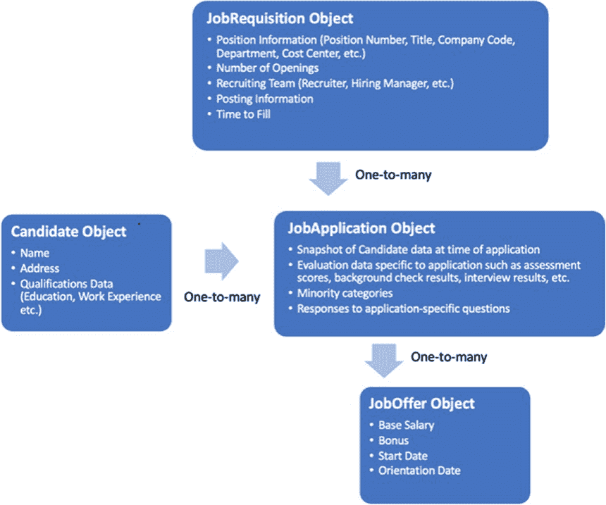

> _图 13-1. 与招聘集成和自动化最常用的数据对象的高级结构_

## 候选人对象

候选人对象在以下任一时刻创建：候选人在外部招聘网站上创建账户、内部 SuccessFactors 用户访问内部招聘网站，或者招聘人员手动创建候选人（或者您构建的接口创建了一个候选人！）。它包含个人的基本信息，如名和姓、地址，以及资格数据，如教育背景、先前工作经验或任何其他已配置的背景元素。通常，您会希望从该对象中拉取新员工的任何个人信息。这是因为该对象是系统中新员工最容易更新的对象。申请数据包含候选人信息；但它是候选人申请时的快照。从候选人申请到准备好被录用之间，可能会发生很多事情！姓氏可能改变，学位可能获得，住址可能变化等。因此，最好从候选人能够轻松更新的地方获取这些信息，并确保招聘人员知道要告知候选人保持这些信息最新，以便下游系统获得准确数据。

## 职位需求对象

JobRequisition 对象在用户点击招聘模块中的“创建职位需求”按钮时创建，或者从 Employee Central 职位管理创建职位需求，或者通过集成从第三方系统创建。它包含职位信息，如职位名称、公司代码和部门。还包含其他信息，如空缺职位的数量和职位需求关闭后的最终填补时间。此外，与发布相关的信息也关联到此对象，以及与招聘团队的关联，如招聘人员和用人经理。通常，我们会看到职位信息从该对象提取到 HRIS 系统，例如与 HRIS 系统中的职位 ID 相对应的职位 ID。成本中心信息也可以拉取到工资系统中，以了解应向员工支付多少费用。在薪资根据职位固定的情况下，也可以从该对象中提取薪资信息。

## 职位申请对象

每当候选人申请职位发布或招聘人员将候选人添加到职位需求时，就会创建 JobApplication 对象。我们倾向于将 JobApplication 视为候选人和职位需求的并集（这也有助于理解为什么系统始终要求用户在申请职位发布之前先创建候选人资料）。如候选人对象部分所述，JobApplication 对象会在申请时截取候选人资料的快照，并将其存储在 JobApplication 上。因此，在录用时传输数据时，务必考虑到这一点（例如，JobApplication 上的候选人数据在准备录用时可能已过时）。JobApplication 还与其他对象关联，如评估、背景调查、面试等。此外，根据我们的经验，我们倾向于向此对象添加自定义字段（在模板 XML 中定义），其中包含与候选人相关的重要信息（例如，候选人是否是被重新雇用的人，是否通过了重新雇用检查，旧系统 ID 等）。在某人实际申请之前我们不想在候选人资料上捕获的项目，也往往存在于 JobApplication 对象中。例如，种族信息、税号、出生日期等敏感数据，我们倾向于在需要之前避免收集，因此通常会在招聘流程接近结束时在 Job Application 上收集这些数据。

### 录用通知书对象

JobOffer 对象是在录用审批屏幕后面存储数据的对象。当您在申请上创建录用审批时，就会创建此对象。它通常用于捕获 HRIS 和工资系统的财务信息，以防这些信息未存储在申请或职位需求上。由于 JobOffer 对象是 JobApplication 对象的子对象，而 JobApplication 是 JobRequisition 对象的子对象，因此它提供了可用的最具体的信息（例如，它针对特定候选人，而不是整个职位需求，并且针对当前的最新录用）。但是，它可能并非在所有场景中都使用（例如，对于按固定小时工资雇佣所有员工的计时工作）。在大多数常见场景中，基本工资以及可能的任何奖金信息都会从此对象发送到 HRIS/工资系统。有时，工作开始日期、入职日期等也可能包含在此处。

> **注意** *除了并非所有职位都需要外，还要记住，一个 JobApplication 对象可能关联多个 JobOffer 对象（例如，当候选人拒绝第一个录用通知后又提出新的录用通知时）。因此，我们建议在任何接口中加入逻辑，检查 JobOffer 对象是否存在，如果存在，则仅从最新的一个获取信息。*

### 案例研究：使用自定义 CSV 格式将录用数据发送到工资系统

现在，我们已经了解了招聘过程中收集的不同类型的数据以及它们的存储方式，既然您已准备录用候选人，我们就可以开始将相关数据传输到其他系统。本书开头我们探讨了如何从工资系统创建职位需求。为了继续这个场景，并且由于将录用数据录入工资系统涉及大量数据，并且这是最实际的场景，因此进一步探讨是有意义的。通常，工资系统希望以预定义的 CSV 格式导入数据，该格式无法更改。无需编码即可创建包含所需数据的 CSV 文件，有助于避免中间件和开发人员成本。让我们看看如何实现！

> 注意 如果您已经阅读了前面的章节，您可能已经熟悉使用 Integration Center 来收集所需的对象并创建 CSV 文件。在这里，我们将更详细地讨论如何从多个对象收集数据，并将输出格式更改为 CSV 文件以满足更严格的格式要求。

为了开始我们的旅程，我们假设 HRIS 系统管理员给了我们一个示例 CSV 文件，如图 13-2 所示。为了能够加载到工资系统中，我们必须以与图 13-2 所示相同的格式输出数据。首先要注意的是，这是一个字符分隔文件，而不是逗号分隔——用于分隔数据的字符是管道符“|”。创建文件时，我们需要确保使用该字符而不是逗号进行配置，此外还要确保从整个系统中收集的所有字段的标题和顺序都是相同的格式。

### 图 13-2. 示例工资系统输入文件

> 注意 工资文件上可能还会有更多字段，例如薪酬类型（计时工资/固定工资）、工作分类等。我们精简了这个文件，以向您展示如何从不同对象获取不同类型的字段，而不做到完全全面。

6. 现在，我们将确保使用管道分隔格式。在“选项”屏幕上，为集成指定一个名称。确保“输出文件类型”设置为“简单分隔”，“文件分隔符”设置为“管道符 (|)”，并且“标题类型”设置为“简单标题”。示例如图 13-3 所示。

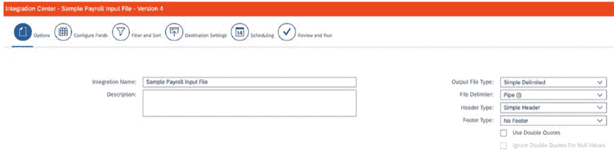

图 13-3. 创建示例工资系统输入文件时的选项屏幕示例

7. 接下来，我们将添加主筛选器。点击顶部的“筛选和排序”。点击“高级筛选”，然后在“字段”字段中，点击“浏览”。在新弹出的窗口中，点击“实体树视图”。这将允许我们导航到相关实体。向下滚动到“jobAppStatus”并点击此对象以展开它。点击“Application Status Id”。示例如图 13-4 所示。准备好设置筛选条件后，点击“将关联更改为 Application Status Id”。

### 图 13-4. 为筛选器选择“应用程序状态 ID”

+   8. 接下来，在“值”列中录入“Ready to Hire”（待录用）的状态 ID，以便我们仅查看处于此状态的应用程序。示例如图 13-5 所示。

### 图 13-5. 设置筛选器，使输出中仅显示“Ready to Hire”申请人

> 注意 您需要查找申请人状态集中的状态 ID。为此，请确保保存您的接口，然后输入并选择“Edit Applicant Status Configuration”（编辑申请人状态配置）。点击与您要导出申请人的职位模板相关联的状态集。您将在左侧看到状态集中每个状态的状态 ID。示例如图 13-6 所示。

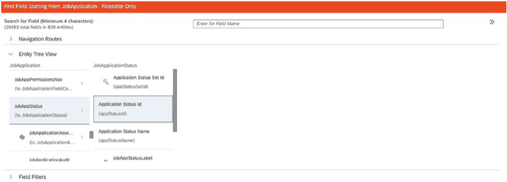

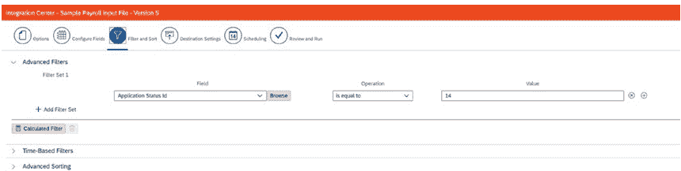

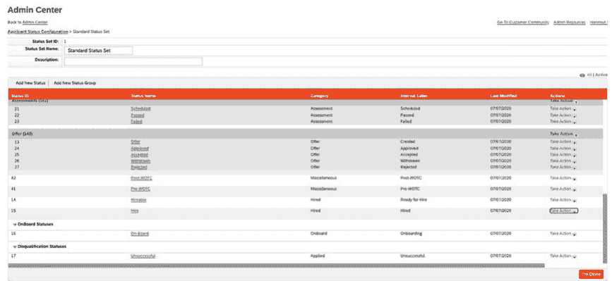

### 图 13-6. 显示状态 ID 的申请人状态集配置

9. 接下来，我们在 jobApplication 上有一个字段是一个可翻译为多种语言的列表。由于薪资系统文件需要英语中州的拼写全称，我们将不得不使用一个特殊的子筛选器来获取此翻译标签。点击“+ 添加字段”。在实体树视图下，点击“state”，然后是 picklistLabels，接着是“label”。在其下方，点击 FieldFilters。点击“picklistOption”并选择 <first>（因为只会选择一个选项，默认选择第一个是安全的）。然后点击“PicklistLabel”，在“字段”列下选择“locale”，并在“值”列中键入“en_US”。点击“Add Association”（添加关联）按钮。示例如图 13-7 所示。

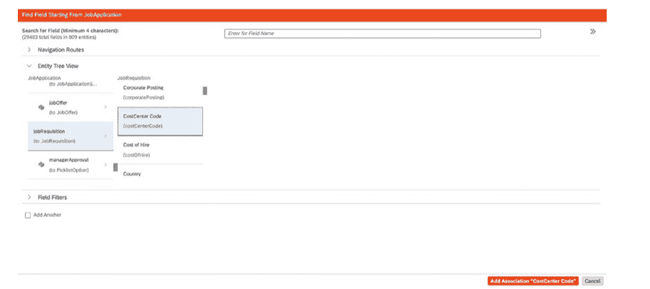

**图 13-8. 从 jobRequisition 添加 CostCenter 代码示例**

13. 在国际实施中，您的数据也可能以不同的区域设置存储在职位申请表中。若要添加“en_US”（美国英语）下的职位名称，请点击“+ Add Field”按钮。在弹出的窗口中，在“实体树视图”下，选择“jobRequisition”，然后是“JobReqLocale”，再是“Job Title”（职位名称）。点击“Field Filters”（字段筛选器），然后点击“JobRequisitionLocale”。在“字段”列下选择“Locale”（区域设置），然后在“值”列下键入“en_US”。点击“Add Association”（添加关联）按钮。示例如图 **13-9** 所示。

### 图 13-9. 从“jobRequisition”对象添加翻译的“职位名称”字段

14. 接下来，我们将添加薪资字段。由于单个 jobApplication 可能关联多个 jobOffer，我们还需要指定选择哪个 jobOffer 对象。再次点击“+ Add Field”，然后在左侧选择“jobOffer”。然后在右侧选择“Salary Base”（基础薪资）。点击底部的“Field Filters”部分，然后在“字段”列中选择“<Last>”（最后一个）。这将选择最后创建的可用 JobOffer 对象。点击“Add Association”（添加关联）。示例如图 13-10 所示。

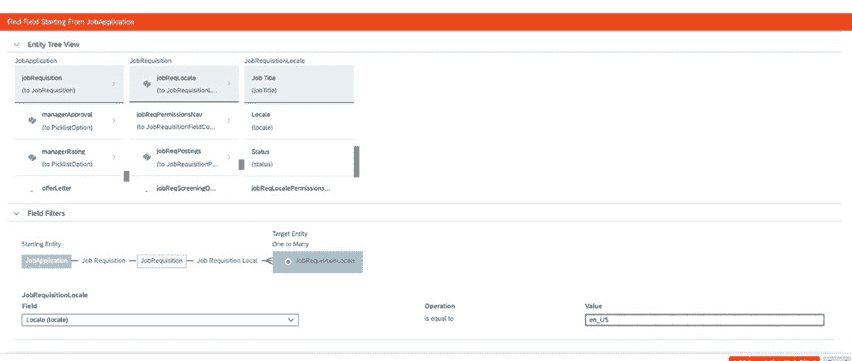

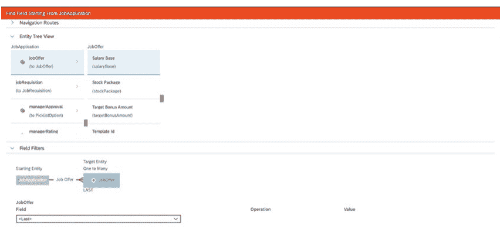

### 图 13-10. 在应用筛选器时从职位提供中添加字段

15. 既然我们拥有了所有需要的字段，就可以开始重新格式化文件以符合指定格式。首先，让我们从删除我们不需要的字段开始（有一些 ID 字段已作为导航的一部分自动添加）。点击顶部的“Configure Fields”（配置字段）图标。

16. 点击顶部标题栏中的“Application Id”列，并选择“Remove Field”（移除字段）。示例如图 13-11 所示。对“Offer Approval Id-Job Offer”、“Job Requisition Id-JobRequisition”和“id-PicklistOption”字段重复此步骤。

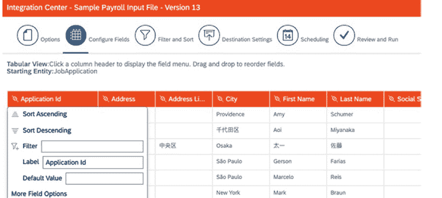

图 13-11. 移除列

17. 接下来，通过拖动和放置每个列标题，使它们处于示例文件所需的顺序。示例如图 13-12 所示。

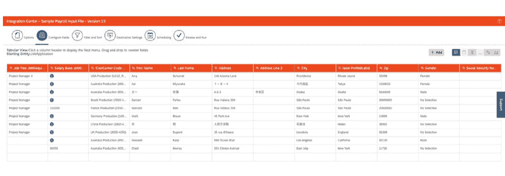

图 13-12. 最终列顺序示例

18. 现在让我们更改标题以匹配示例文件中的内容。点击每一列，并在菜单中设置“Label”（标签）字段为示例文件中对应的标签，然后按回车键。示例如图 13-13 所示。

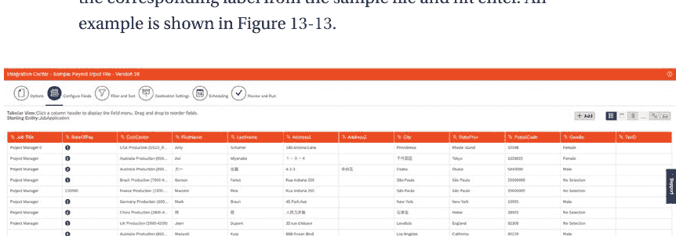

图 13-13. 重新标记列标题示例

19. 我们几乎完成了！现在让我们看看数据格式化。当我们查看包含示例数据的预览屏幕时，第一个观察结果是，在我们特定的示例系统中，RateOfPay（支付费率）列并不是每条记录都有值（这取决于您系统中的数据而有所不同）。这是一个常见问题，因为招聘人员可能绕过了提供审批步骤。解决此问题并避免薪资系统回退的一种方法是将其设置为接口上的必填字段。点击列标题并选择“More Field Options”（更多字段选项）。在弹出的窗口中，勾选“Value Is Mandatory”（值必填）。示例如图 13-14 所示。

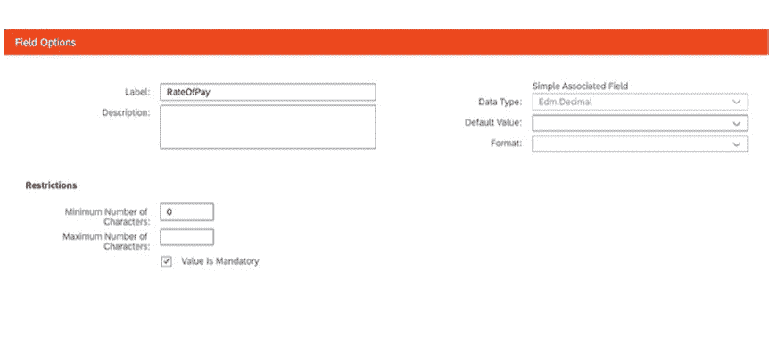

### 图 13-14. 将列设置为必填

> 注意 这将导致运行接口时抛出错误，以帮助提醒系统管理员该字段缺失。这是首选方式，以便可以采取手动步骤来纠正问题 – 如果我们只是过滤掉空白值，没有人会知道存在问题，也不知道为什么候选人从未转移到薪资系统！

20. 继续检查屏幕上的示例数据，剩下需要处理的项是成本中心字段和性别（您会在图 13-13 中注意到 TaxID 也缺失，但这是在我们的截图中出于安全目的隐藏的 – 我们假设数据存在）。查看集成中心截图中显示的示例数据（图 13-13），似乎 SuccessFactors 中的成本中心代码既有标签也有代码，而在薪资系统中则是不同的代码。类似地，“Gender”（性别）显示为“Male”（男）、“Female”（女）或“No Selection”（未选择），而不是“M”、“F”或空白。解决此问题的一种方法是创建一个查找表。点击顶部的列名称，然后点击“Value Lookup Table”（值查找表）。在弹出的窗口中，点击“+ New”（新建）。给表命名，然后对于每个要转换的值，在“Input Code”（输入代码）列中填写原始值，在“Output Code”（输出代码）列中填写转换后的值。示例如图 13-15 所示。点击“+”向表中添加更多行，并为所有要转换的值填写列。完成构建表后，点击“Save”（保存）。然后点击“OK”（确定）。对第二列重复操作，以便“CostCenter”（成本中心）和“Gender”（性别）字段都得到纠正。

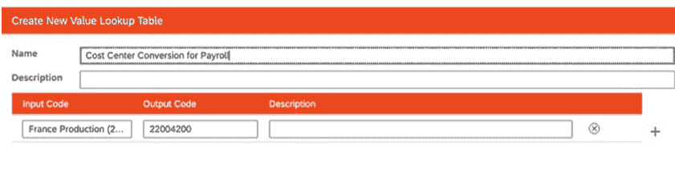

图 13-15. 创建值查找表

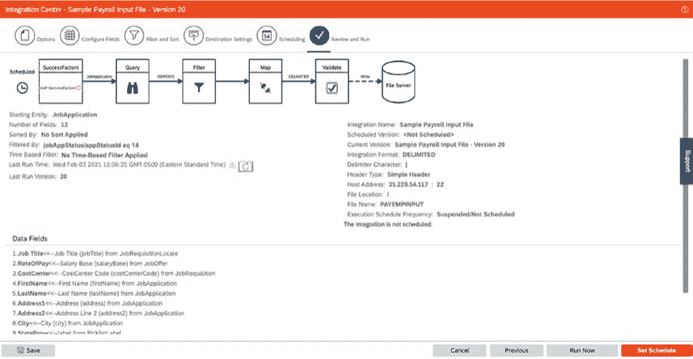

### **图 13-17. _带有警告的接口运行示例_**

+   23. 点击最近一次运行的时间戳以查看运行详情。  
+   在图 13-18 中，您可以看到缺失的必填值被标记为警告。这些行已从输出中排除（这是好事！），并且提供了应用程序编号，以便系统管理员可以联系招聘人员并修正应用程序。

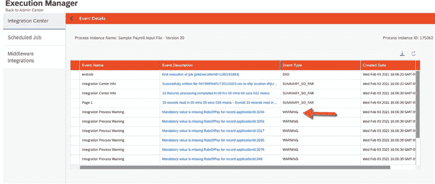

### **图 13-18. _针对缺失字段抛出警告的示例_**

24. 您现在可以从 SFTP 服务器下载最终输出文件，并与薪资提供商合作进行测试。示例如图 13-19 所示。

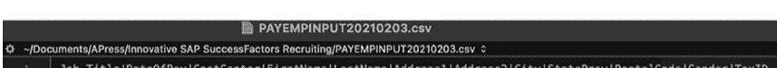

图 13-19. 从集成中心构建的薪资输入文件示例

恭喜！您现在已经创建了所需格式的薪资输入文件！现在您应该能够根据特定薪资系统的需求创建类似的文件。

### 结论

在本章中，我们重点讨论了招聘候选人的最后一步：雇用。我们首先讨论了一些实际场景，在这些场景中，招聘数据可以与各种系统共享，以帮助简化雇用流程。然后我们详细回顾了通常在入职和雇用过程中传递给其他系统的相关数据。最后，我们通过一个具体的案例研究，介绍了设置特定格式的员工导出以输入到薪资系统的具体步骤。重要的是要注意，尽管这可能是最实用和常见的场景之一，但正如本章开头所讨论的那样，还存在许多其他场景，并且可以使用本书中涵盖的各种方法（如 ODATA）来实现。

