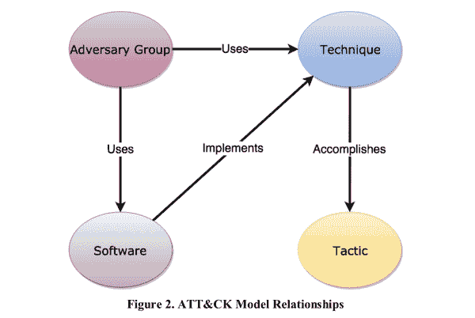

# 第 4 章 开发利用

> “如果你只关注敌人，你将忽视威胁。”
>
> —— Walter Piatt 上校

此时，通常会交付最终的事件响应报告，响应人员转而处理下一项需要关注的事务，但本书并未就此结束。在整个调查过程中，事件响应团队收集了大量关于攻击者的数据，在其网络内查找额外信息，并采取了影响攻击者行动的措施。现在，我们需要收集所有这些数据，分析其情报价值，并将其整合到不仅包括检测和预防方法，还包括风险评估、工作优先级排序和未来安全投资等更具战略层面的举措中。要达到能做所有这些事情的程度，你必须启动 F3EAD 循环的情报部分：开发利用、分析和分发。

大多数安全团队无法完成 `F3EAD` 循环的原因并非秘密：生成情报已经够难了，但管理情报则是一系列全新的头疼问题。处理流程、时效、时效性、访问控制和格式足以让任何人晕头转向。然而，尽管这些问题不可否认地复杂，但必须直面解决。妥善提取和捕获事件相关信息，并确保对其进行跟进，这可能意味着彻底修复对手对您网络的访问权限，与仅仅延缓他们的回归和最终成功之间的区别。利用事件响应过程中生成的情报，可确保投入到识别、理解和修复事件中的所有时间和精力，进一步支持整体的网络防御和响应流程。至少对您自己的组织如此，理想情况下也适用于许多其他组织。本章介绍了您在 `F3EAD` 的 `Exploit` 阶段应执行的各项任务，将使该过程不那么令人生畏，甚至可以说，可能还有点令人兴奋。

### Note

我们已经讨论过军事术语与通用信息安全行话之间偶尔存在的差异，而 `Exploit` 恰好是其中一个主要差异。在信息安全领域，我们倾向于几乎专门使用 exploit 一词来指代利用漏洞，从而使对手获得系统访问权限或信息。相比之下，在军事术语中，exploit 更广泛地意味着利用、发挥作用，不仅用于系统漏洞的语境，还用于许多其他语境。在 `F3EAD` 的语境下，它指提取在前期行动过程中收集的信息。当与传统情报周期对齐时，`Exploit` 阶段可被视为收集（尽管通常更多是内部收集信息的聚合）和处理的结合，以将该信息转化为可用格式以便分析。

## 战术 `OODA` 循环与战略 `OODA` 循环

在第 2 章中，我们介绍了 `OODA` 循环模型，并讨论了它如何应用于事件响应。回顾一下，`OODA` 代表观察、调整、决策、行动，一般经验法则是：第一个完成 `OODA` 循环的一方将通过率先基于完整信息采取行动而获得竞争优势。在 `F3EAD` 的前三个阶段——`Find`、`Fix` 和 `Finish` 中，我们经历了一个旨在为事件响应人员提供**战术竞争优势**的 `OODA` 循环。在 `F3EAD` 的后半部分——`Exploit`、`Analyze` 和 `Disseminate` 中，目标是获得**战略竞争优势**。简而言之，我们想要如此深入地了解对手，以至于他们的常规战术和技术不再对我们奏效。对手将不得不退一步、重整旗鼓、尝试想出不同的方法来执行任务——所有这些都需要时间，并会使他们的任务和生活更加困难。这也给了我们更多时间来继续构建针对他们的防御和弹性。

根据您团队的结构（我们将在第 10 章详细讨论），您实际上可能会同时运行这两个 `OODA` 循环。您团队的事件响应部分可能正埋头苦战于战术 `OODA` 循环中，而您的情报团队则开始收集其战略 `OODA` 循环所需的信息。如果这些职能合二为一，以战术为重点的 `OODA` 循环可能会优先，并且您将在开始执行 `Exploit` 阶段之前完成 `Find`、`Fix` 和 `Finish`。无论哪种方法都可以，重要的是您确实要进入第二阶段操作，因为战术优势可能只持续几天或几周，但战略优势将产生长远影响，并给您提供所需时间以准备应对未来无疑将到来的入侵。

在战略 `OODA` 循环中，`Exploit` 阶段涵盖观察和调整这两个步骤。在这些步骤中，您开始筛选事件响应行动期间收集的海量数据，收集或聚合来自与该事件相关的先前事件或外部来源的额外信息，并捕捉这些信息对您的组织在过去、现在以及未来的潜在意义。这可能看起来是一项艰巨的任务，因此知道从何处入手会有所帮助。

## 利用什么？

当 `F3EAD` 未正确实施或未完整执行时，您很可能会发现自己反复应对相同的入侵或类型的事件，而且很可能就在不远的将来。这不仅浪费时间，而且如果入侵导致敏感客户数据丢失，还可能招致额外的审查。2017 年 9 月，信用报告公司 Equifax 遭遇入侵，导致 1.47 亿人的高度敏感信息被未经授权访问。2019 年，美国联邦贸易委员会提起诉讼，指控 Equifax 未能妥善解决其 Web 应用程序系统中的已知漏洞，从而导致了该泄露事件。这一指控为未来公司在事件发生后，其安全实践（包括事件响应流程和跟进工作）接受严格评估奠定了基础。专注于 `Exploit` 阶段将使识别额外风险并指出彻底处理事件所需的行动变得容易得多。

在该循环之前的 `Find`、`Fix` 和 `Finish` 阶段，我们专注于特定攻击、特定对手以及处理该特定事件所需的特定行动。如果您碰巧识别或缓解了利用类似战术的对手的攻击，这只是一个幸运的巧合，绝非有意为之。在 `ROAD RUNNER` 入侵事件的 `Finish` 阶段结束时，我们已识别出大量围绕该入侵、其背后的行为体及其作案手法的信息。但即使这些信息的组织方式有利于事件响应的快速响应性质，也不一定意味着它采用了适合后续情报分析的正确格式。

在 `Exploit` 阶段，我们开始一个确保我们不仅处理，而且*从中吸取教训*的过程。我们关注威胁，而不仅仅是敌人。因此，重要的是我们不仅要提取与特定攻击相关的技术指标（如恶意软件样本和命令与控制 IP 地址），还要提取导致入侵并使攻击者至少在一定程度上取得成功的总体因素。这包括攻击中被针对的漏洞或弱点信息、被针对的信息或系统，以及可能阻碍我们更早识别和行动的流程弱点。我们不仅仅是试图保护网络免受完全相同的攻击重演，而是要了解导致入侵成功的各种因素，如策略、技术漏洞或可见性差距，并为它们开发防护或检测措施。因此，我们认为几乎没有信息是*不*应该被利用和分析的——但这当然增加了管理这些信息的复杂性。

为了使该过程更易于管理，我们倾向于将信息分解为以下类别：

*   `Technical indicators`（技术指标）- IP、域名、哈希、证书等及其上下文信息
*   `Tactics and techniques`（战术和技术）- 对手如何开展行动，最常使用 `VERIS` 或 `ATT&CK` 记录——我们将在本章后面详细介绍。`CVEs` 或 `CWEs` 也可以归入此类别。

*   **支持信息** - 入侵的非技术性或战术性细节 - 谁被攻击了，公司内部（或世界上）发生了什么可能促使了这次入侵。影响是什么？
*   **链接或参考** 指向与事件或对手相关的信息，这些信息被共享、公开可用，或在调查过程中被用作参考。
*   **采取的内部行动或提出的请求** - 一个绝不能忽视的非常重要的方面是针对事件采取了什么响应措施，以及为未来提出了哪些额外行动请求。例如，如果事件响应报告指出，更频繁地监控地下论坛上的公司凭证将防止未来发生类似攻击，那么该建议（甚至可能是承诺！）不应在事后被遗忘。

在决定应利用什么信息后，有必要从事件数据中提取该信息、将其标准化，并存储起来以供未来分析和参考。这将需要一个流程 - 理想情况下是一个有文档记录且可与他人共享的流程，以便日后能够重复和改进。流程因团队而异，然而所有以利用为重点的流程都应具备几个关键组成部分：收集信息、存储信息和管理信息。

## 收集信息

如果你的组织像我们见过的大多数组织一样，在调查结束时，你会有一份“官方毁灭电子表格”（外加五六个非官方版本）、十三个笔记文件、几张白板照片，以及一个塞满假设、外部文档链接和各种“我们以后再跟进这个”的评论的 Slack 频道。这与我们见过的最优秀的流程驱动型团队的区别在于，更先进的团队会在过程中定期清理整理 - 我们从未见过、遇到过，甚至听说过哪个团队在激烈的事件中间没有某种混乱、富有创造力但有效的流程。如果你面对着一座由无序数据组成的大山，其结构之多与团队成员数量相当，请不要烦恼。利用流程将帮助你理清头绪，以便你能够向前学习和适应。

根据你管理事件响应数据的方式，利用阶段最困难的部分完全可能是从调查中找到重要的情报碎片。在收集事件响应数据方面，我们什么都见过 - 从精心设计的系统，到 Excel 电子表格，再到贴在白板上带有 IP 地址的便利贴。收集这些数据没有错误的方式，但如果你想能够提取它们以便将来分析和使用，当然有一些方法可以让这个过程更轻松。

当你处理从以往事件中利用信息时，你通常受限于现有的可用数据。情报驱动事件响应的目标之一是确保事件响应流程捕获情报分析所需的信息，但如果你刚开始整合运营和情报的流程，你可能还无法影响收集了什么信息（目前）。利用阶段的一个良好起点是准确了解你到底有什么可用。我们发现，目前可用的信息通常分为两类：高层级信息，以及恶意软件分析等技术细节。

如果你只有以事件叙述形式呈现的高层级信息，你将着眼于提取战略层面的细节。如果你有详细的恶意软件分析，你可以提取关于恶意软件功能的战术层面细节。最初，你可能只能访问其中一层信息，但理想情况下，随着你在组织中实施此流程，你将能够同时收集事件的技术细节以及所针对信息和影响的战略信息。能够跨所有层级组合信息是情报最强大的体现之一。

## 信息收集目标

无论数据来源是什么，收集数据时首先要考虑的是你的目标是什么。这些目标种类繁多，但最常见的有：

**失陷指标**  
大家总爱说失陷指标没用了，但即使是最优秀的对手也不总是改变一切。虽然可能有更持久的追踪对手的方法，但如果你不把痛苦金字塔底部的 IOC 拿出来加到你的威胁数据堆里，那你就犯错了。

**特征签名**  
虽然并不总是可用，取决于产品，但你可能能够以特征签名的形式提取更高级的复合指标。Snort 和 Yara 最常见，这通常取决于你的技术栈，但即使是特定产品的签名也可以转换为其他工具使用。

**战术、技术与程序**  
虽然不那么原子化，但在 ATT&CK 框架兴起后，另一种常见方法是以 TTP 的形式提取对手如何运作。

**战略数据**  
这有点模糊，但在很多情况下，尤其是阅读第三方数据时，非技术性数据往往最有趣。关于归因和对手动机的信息可能更难捕获，但通常价值极高。

那么我们从哪里提取这些数据呢？

## 挖掘以往事件

如果你阅读本书是为了了解如何开始整合运营和情报，重要的是要注意，你不必从下一个事件开始；你可以回溯以往的事件并利用那些信息。事实上，这种活动是让组织中的人员熟悉 F3EAD 流程、并在构建威胁画像时帮助他们对其感到舒适的好方法。挖掘和分析以往的事件数据能让你很好地了解面临网络的威胁类型，并识别出你在前进过程中可能需要解决的可见性或信息差距。只要可能（希望总是可能），在从以往事件中挖掘信息时，请包含日期和日期范围。

## 收集外部信息（即进行文献综述）

除了事件的内部信息，我们还可以从外部来源收集关于对手的大量信息。虽然你是一个独一无二的组织，但你的对手很可能并非全新出现，也并非只专注于你一个目标。他们极有可能以前以其他组织为目标，或者其他组织曾分享过关于战术、技术或其他被攻击组织的信息。重要的是要记住，基于“看起来相似”进行归因，通常无法为你的组织应该做什么或如何应对事件创建一份精确的路线图，但它有助于提供额外的背景信息或态势感知。它有助于了解与其他已知事件的相似之处和不同之处，以及在哪里可能需要采取不同的行动或分析。从这个意义上说，它类似于学术研究中的文献综述。文献综述涉及研究人员查看之前进行了哪些研究、论文或分析，它们得出了什么结论，哪里与你自己的研究相似，哪里不相似。文献综述的目标有两方面——确定你研究中填补前人研究空白的独特之处，以及在前人基础上构建并进一步加深对某一主题的整体理解。在情报驱动的事件响应中，我们希望在自身知识的基础上构建，如果条件允许共享，进一步增进对威胁的集体理解，帮助整个社区变得更强大、更具韧性。无论你扩展知识的范围如何，了解外部报告中关于行为体、妥指标或与你自身事件相关的其他信息都很重要。然而，就像文献综述一样，请记住，在此过程中发现的信息不应在没有明确引用的情况下直接与你自己的数据和发现混合。在许多情况下，这种“文献综述”应保存在单独的章节中，并在 F3EAD 的下一步——分析阶段——中被引用。

## 提取和存储威胁数据

在调查结束时——无论是紧随其后还是事后六个月——你很可能会拥有大量数据。你在利用阶段的任务是获取这些信息，无论其外观如何，并将其构建为一种可供今后分析和使用的格式。虽然组织处理此任务的方式有很多种，但我们发现它们通常分为两类——主要是手动方式和平台化方式。我们将通过两种专业工具——通用的电子表格和更奇特的基于图的集中式情报平台——来演示这两种不同的方法，但首先让我们谈谈标准。

## 存储威胁数据的标准

没有对各种数据标准的讨论，威胁情报的讨论就不算完整。无论是在 Twitter 上还是在各种安全大会的走廊里，人们已经进行了许多辩论——关于哪些标准最好，哪些只是一时的时尚，哪些正在经历“回潮”。撇开这些辩论不谈，你选择的标准首先取决于你组织的独特需求，你的选择可能与他人不同。我们即将深入探讨各种数据标准的细节，这可能会让你从此不想再谈论它们，但请耐心读下去。一旦你找到适合自己的标准，数据标准会让你的生活轻松得多——如果这有帮助，把自己想象成一位正在规划 `mise en place`（备料/准备工作）的厨师，决定哪种刀工和哪种容器能让上菜服务最顺畅。

## 指标的数据标准和格式

有几类常用于存储和共享技术威胁数据的数据标准。尽管业界竭尽全力，但没有任何一个神奇的标准能一统天下，所以最好的方法是了解存在哪些标准，并确定其中是否有一个适合你。例如，如果你属于使用 `STIX`/`TAXII` 共享数据的共享组织，那可能是存储你自己数据的一个好选择。如果你的组织已经投资于使用特定格式（如 `OpenIOC`）的安全工具，那可能效果最好。如果你需要使用不止一个标准（这种情况我们经常见到），次优的方法是确保你理解各种标准的基础知识，并准备好进行数据字段映射，因为你迟早可能会处理这些数据格式之一的信息。

### OASIS 套件 - 即 `STIX`/`TAXII`

`STIX` 最初于 2010 年创建，旨在标准化关于网络事件所捕获的信息，并促进组织间信息的自动化共享。它最初由 `MITRE` 公司代表国土安全部进行维护。`OASIS` 网络威胁情报 TC（`OASIS` 开放标准组织的一个组成部分）接管了 `MITRE` 在支持 `CybOX`、`STIX` 和 `TAXII` 数据格式方面的角色。这些标准是较为知名的标准之一，部分原因是美国政府采用了这一套件。因此，许多威胁情报平台都集成了 `STIX`——无论是 `STIX 1` 还是 `STIX 2.X`，以及 `STIX` 数据的传输机制 `TAXII`。

#### `STIX` 1

结构化威胁信息表达（`STIX` 1）的原始版本是用称为“`CybOX`”的构建块构建的，即网络可观测表达。`CybOX` 由可观测对象组成，这些对象是*具有状态和可度量属性的定义对象*。`CybOX` 有多种用例，范围从事件管理到恶意软件分析和信息共享。有大量的 `CybOX` 对象用于捕获可观测对象，尽管并非所有对象都直接与事件响应相关。 <ref [`https://stixproject.github.io/getting-started/whitepaper/`](https://stixproject.github.io/getting-started/whitepaper/)>

在 `STIX` v1 中，`CybOX` 是基本单元，然而标准的“`STIX`”部分允许向 `CybOX` 对象添加更多上下文细节。这支持进一步分析，并在共享威胁数据时提供巨大优势。这些额外的上下文字段包括 `Threat Actors`（威胁行为体）、`Campaigns`（攻击活动）、`Victim Targets`（受害目标）和 `TTPs`（战术、技术与过程）。这使你能够获取通过 `CybOX` 捕获的单个可观测对象，将它们串联起来并添加更多上下文。这就是威胁数据真正开始转化为威胁情报的时刻。虽然知道某个文件是恶意的很好，但从分析角度来看，知道该文件被用于针对特定行业受害者的特定攻击活动中，且在文件执行后，行为体试图窃取知识产权，这更有用。

虽然回顾 `STIX` 1 很有趣，可以看到系统是如何发展的，但一个关键点是 `STIX` 1 实际上并非供人直接使用，而是旨在与一组特定工具紧密集成。随着信息交换和共享的需求超越了仅仅一小群志同道合的组织，该标准也需要随之演进。它确实演进了。

#### `STIX` 2.X

## STIX 2

STIX 2 引入了多项改进，使其更易于许多从业者采用。一项重大变更是 STIX 2 使用 JSON 格式而非 XML。STIX 2 还通过将两个数据标准（CybOX 和 STIX）合并为一个名为 STIX 网络可观测对象的标准，降低了复杂性。STIX 2 还引入了两个顶层关系对象——“Relationship”（关系）和“Sightings”（目击），它们更清晰地定义了不同可观测对象之间的关联。 <ref [https://oasis-open.github.io/cti-documentation/stix/compare]>

当 STIX 或任何标准被充分使用时，它可以成为分析的绝佳工具，但请记住，需要付出努力才能捕获所有信息！STIX 内置于许多网络威胁情报平台中，使其更易于使用，但拥有一个可靠的流程来决定以这种格式捕获什么内容，并确保事件中的洞察信息不会因为从未从笔记本进入平台而丢失，这一点仍然至关重要。

### TAXII

TAXII 是一个传输和共享框架，包含四项服务：发现、轮询、收件箱和源管理。TAXII 是实体或组织之间共享 STIX 的方式。TAXII 有三种主要的传输和共享模型：

**订阅者**：在该模型中，一个中心组织向合作伙伴组织共享信息，而合作伙伴组织不回传任何信息。这也是威胁情报提供商（无论是商业还是开源）向客户发送信息时最常见的模型。

**中心辐射型**：一个组织或来源作为信息共享的中央权威机构。它向其他组织推送信息，当这些组织想要共享回传时，它们将信息发送给中央组织，由后者重新分发给群组。

**对等互联**：该模型可供任意两个或更多希望直接共享信息而无需通过中心化组织的组织使用。一些网状网络也采用此模型。

在大多数情况下，TAXII 被用作自上而下的分发模型，例如来自 ISAC（信息共享与分析中心），这意味着采用订阅者模型。如果使用其他模型，我们尚未见过。

### MILE 工作组

除了 OASIS 套件外，另一组数据标准由托管事件轻量级交换（MILE）工作组积极维护和更新，其中包括以下内容：

#### 事件对象定义和交换格式 (IODEF)

[RFC 5070](https://www.ietf.org/rfc/rfc5070.txt) 于 2007 年首次发布，将 IODEF 定义为“一种数据表示，为计算机安全事件响应小组（CSIRT）常交换的关于计算机安全事件的信息提供共享框架。”IODEF 是基于 XML 的标准，被反钓鱼工作组和 ArcSite 等团体使用。它包含用于敏感度和置信度的标签。[#iodef_scanning_event](https://atlas.oreilly.com/oreillymedia2/intelligence-driven-incident-response/editor/master/07-exploit.html#iodef_scanning_event) 展示了一个 IODEF 格式捕获原始 RFC 中扫描信息的示例。

#### IODEF 扫描事件

实时互联网络防御 (RID)。正如 STIX 有 TAXII 来促进 STIX 格式信息的交换一样，IODEF 和 IODEF-SCI 有 RID。RID 的目标是允许拥有事件数据的不同组织以安全、易于管理的方式共享该信息。RID 定义于 [RFC 6545](https://tools.ietf.org/html/rfc6545)，基于 HTTPS 的 RID 定义于 [RFC 6546](https://tools.ietf.org/html/rfc6546)。与 TAXII 类似，RID 有多种信息交换模型选项，包括直接对等、网状对等和客户端到订阅者。

#### IODEF—结构化网络安全信息 (IODEF-SCI)

该 IODEF 扩展为捕获事件数据周围的额外上下文提供了框架。[RFC 7203](https://tools.ietf.org/html/rfc7203) 定义了 IODEF-SCI 的标准，于 2014 年首次发布。IODEF-SCI 为将额外上下文信息嵌入 IODEF 文档提供了结构，包括 Mitre 的通用攻击模式枚举与分类 (CAPEC)、通用漏洞披露 (CVE)、通用漏洞评分系统 (CVSS) 以及其他多个标准。

### OpenIOC

正如我们之前讨论的，*IOC*（入侵指标）一词由 Mandiant 推广。除了创造该术语外，Mandiant 还开发了一种捕获 IOC 的标准，称为 OpenIOC。*OpenIOC* 是一种基于 XML 的模式（你可能已经注意到这一趋势了），旨在捕获和分类来自受损主机的取证工件，以及与恶意通信或其他恶意活动相关的网络指标。Mandiant 确定了 500 多种可使用 OpenIOC 记录的可能工件。然而，该框架也允许自定义和根据使用 OpenIOC 的组织需求创建新字段。OpenIOC 与 STIX 互操作，并已发布了关于[如何在两个标准之间转换](https://github.com/STIXProject/openioc-to-stix)的文档。

你很可能会发现自己需要在共享和接收威胁数据及情报时，将数据从一种标准转换为另一种标准。了解各种标准的字段和组件非常重要，因为当你在它们之间转换时（例如从 STIX 转到 OpenIOC），可能会丢失或增加某些数据字段。如果你不了解标准之间的差异，可能会发现自己在寻找一些你*知道*已经捕获的东西，但它们却未能在转换过程中保留下来。在将一种数据标准转换为另一种时，请务必确定当前标准中的重要字段，然后确定目标标准中对应的等效字段。

虽然 OpenIOC 曾是一个雄心勃勃的项目，但到目前为止它已基本被弃用，因为 Mandiant 与 FireEye 合并、合并技术栈，随后又在公司分拆时将其拆分。除了 Mandiant 之外，OpenIOC 从未真正获得足够的关注成为行业标准，最终输给了 STIX2。

## 战略信息的数据标准和格式

正如我们之前提到的，使用上述格式捕获的指标只是你想要捕获的全貌的一半。指标对于检测和响应极其有用，但收集其他将支持战略分析的上下文信息也很重要。虽然这些信息可以使用 STIX 等格式存储，但用于捕获技术信息的标准往往并不适合存储战略信息。通常，如果此类信息被捕获的话，最终往往存储在文档或 PowerPoint 幻灯片中。用于存储战略信息的选项不如存储技术信息的多，但可以利用框架来避免丢失事件信息的这一关键组成部分。我们将探讨三种用于存储战略信息的主要标准：ATT&CK、VERIS 和 CAPEC。

### ATT&CK

我们在本书中已经多次提到 ATT&CK，因为它在过去几年里确实席卷了威胁情报社区。随着从仅关注 IOC 转向关注行动者战术（从而沿着痛苦金字塔向上）以及关注技术的呼声从 2018 年左右开始变得越来越响亮，Mitre 的 ATT&CK 已准备好回应这一号召。

## 威胁情报框架

## MITRE ATT&CK

Mitre 的对手战术、技术和通用知识（ATT&CK）创建于 2013 年，旨在对攻击生命周期中的攻击者行为进行分类，最初专注于针对 Microsoft Windows 的攻击。它关注战术——被描述为攻击中对手的短期战术目标，以及技术——对手实现其战术目标的手段。（参考[`www.mitre.org/sites/default/files/publications/pr-18-0944-11-mitre-attack-design-and-philosophy.pdf`](https://www.mitre.org/sites/default/files/publications/pr-18-0944-11-mitre-attack-design-and-philosophy.pdf)）此后，它扩展至包含针对 Linux 和 MacOS 的攻击，以及描述攻击前活动（PRE-ATT&CK）、移动平台（Mobile ATT&CK）、工业控制系统、云系统，甚至 Docker 和 Kubernetes 等容器的额外矩阵。

ATT&CK 对象结构包括标签、字段和关系。标签是可用于筛选或透视分析的数据点；字段用于自由文本以描述不同的战术或技术，关系是定义不同实体间关系的字段。

该模型及其关系如下图所示（图 4-1）。每个实体、对手组织、技术、战术和软件都有自己的字段，可用于捕获额外的相关信息，这使得 ATT&CK 成为一个可用于捕获战术和战略信息的模型。

## VERIS

事件记录和事件共享词汇表（VERIS）是一个基于 JSON 的标准，因支持 Verizon 数据泄露调查报告（DBIR）而广为人知。VERIS 框架捕获的信息分为四类，称为“四个 A”：行动者、资产、行动和属性，它们都回答了关于事件的一个问题。

**行动者**：行动者字段回答“谁的行为影响了该资产？”该字段捕获对事件负责的行动者的高层信息。行动者的数据模式枚举包括行动者是内部、外部还是合作伙伴行动者，以及行动者的动机。

**行动**：行动字段回答“何种行为影响了该资产？”行动包括攻击者如何获取访问权限，例如使用恶意软件、黑客攻击或社会工程学。它还包括具体载荷，如利用已知漏洞或使用钓鱼邮件。

**资产**：该字段回答“哪些资产受到了影响？”——从战略角度来看，这是一个极其重要的问题。枚举包括受影响资产类型的信息，以及其可访问性和管理信息。

**属性**：属性字段回答“资产是如何受影响的？”它使用传统的机密性、完整性、可用性三要素。

VERIS 还捕获事件时间线和影响的信息。这些字段提供了记录识别、遏制和修复事件所需时间，以及对受影响组织影响严重程度的位置。

VERIS 的主要用例不是生成规则或警报，而是帮助组织了解其面临的风险。因此，该信息不如 STIX 或我们之前提到的格式中捕获的信息那样详细或技术性强。然而，它可用于讲述特定事件发生的更完整故事。

## CAPEC

通用攻击模式枚举与分类（CAPEC）框架最初旨在协助安全软件的开发。CAPEC 背后的理念是，如果软件开发人员能够了解攻击者针对和利用软件的常见方式，他们就能设计和构建不易受这些攻击影响的软件。CAPEC 不仅捕获具体的技术细节，还试图将攻击的全貌作为攻击模式捕获，其中包括攻击前提条件、相关弱点、相关漏洞和攻击者步骤的信息。

当事件的清晰图景可用并被 CAPEC 捕获时，组织可以从攻击中学到很多东西。随时间推移对攻击模式的分析可以提供对攻击者运作方式、他们如何适应安全措施，以及保护组织所需的任何额外措施的理解。

## 提取流程

一旦你确定了想要（或需要）捕获数据的格式以及存储位置，制定一个提取所有相关信息的流程就很重要了。这是“利用”阶段中理论联系实际的部分。虽然我们希望能在本节中列出你应该使用的确切分步流程，但事实是，就像网络威胁情报中的其他事物一样，每个 CTI 项目都有独特的组成部分，这会导致这些流程因情况而异。相反，我们将概述制定流程的流程，目标是帮助你规划出一个长期有效且在需求变化时易于修改的方案。

## 步骤 1：明确目标

这里要尽可能具体，不要只说“我们的目标是管理事件数据”，虽然这可以是个好的开始。明确的目标应包括利用阶段的预期成果、支持对象和预期影响。*“捕获所有信息——包括 IOC、TTP、目标信息和战略信息——存入电子表格，并附上事件执行摘要，以便我们目前的 5 名情报分析师团队能进一步分析并提出额外的检测和缓解建议。”* 像这样写下来，目标就变成了你将遵循流程的路线图。

## 步骤 2：确定工具

我们在这里非常宽泛地使用“工具”一词。工具是任何有助于实现步骤一中概述目标的事物。有些组织拥有威胁情报平台（或 TIP，本章后面将介绍），它们可能具有自动指标提取和分类等内置功能。如果你没有 TIP，仍有许多其他资源可提供帮助，包括脚本、电子表格、非 TIP 数据库，以及生产力和协作工具。在这个阶段，你还应该指出是否拥有实现既定目标的正确工具——例如，如果目标涉及与五名分析师的团队共享信息，你将需要某种协作工具。如果没有任何工具能促进信息共享，那么你将很难实现该目标。

## 步骤 3：确定将使用的系统或流程

这可能是这三个步骤中最多样化的一个，因为分析师将数据导入实现步骤 1 中确定的利用目标所需工具的方式有很多种。以系统化、理想情况下有文档记录的方式处理这项任务，是确保其彻底完成且过程中无信息遗漏或疏忽的最佳途径。一个流程可能包含以下任务：

* 确定将作为利用流程一部分进行聚合的所有数据源的位置。
* 创建所有来源的清单，以跟踪已利用的内容。

*   根据您的工具，完成必要的后勤步骤以准备利用它们——无论这意味着基于模板创建新文件、确定将数据录入数据库时使用的标签，还是开始一个新的 Wiki 页面来存放此事件的所有信息。
*   按照您创建的待聚合数据清单，开始将来自不同来源的数据移入您选择的工具中，完成一个来源后就将其勾选掉。

拥有一个清晰的流程，能让您从事件后堆积如山的数据中，得到一套结构化、全面的信息集以供分析，这是为成功奠定基础的最佳方式之一。您开发的系统可能涉及多人专注于系统内的不同职能，也可能只是一个供您个人使用的流程。您可以在流程中加入时间线或里程碑以保持进度和责任感，也可能会发现每起事件差异巨大，以至于时间线不如单纯推进步骤那般重要。关键在于记录下您将如何推进数据提取流程，并能够随着目标、工具或需求的变化，舒适地更新或修订该流程。

## 步骤 4：启动与迭代

这就是您深入实施的地方。这可能是整个过程中最难的部分——即使您拥有合适的工具和可靠的流程，也必须真正开始有条不紊地执行步骤。尝试各种方法，看看什么有效，哪里遇到了障碍。不要害怕调整流程，开始识别可能需要的新工具，或能让流程更轻松的新技能。如果您发现某种特别有用的方法或途径，请务必将其记录下来，以供未来的分析师（或未来的您）参考。

## 管理信息

管理信息不仅仅涉及捕获调查中的单个妥指标或工件。还需要捕获大量额外信息，以便您知道如何管理和处理未来所有类型的信息。

有几个关键要素对于帮助管理信息至关重要：

**日期：** 何时看到这条数据或信息？这将有助于分析，同时支持数据的过期或退役，实质上是确定数据何时仍可用于行动和分析，以及何时不再有效。

**来源：** 没有什么比不知道一条信息何时、何地来自更令人沮丧的了。捕获信息来源将有助于您在需要时回溯获取更多信息，或为该信息分配置信度，这两者在分析阶段都非常有用。

**数据处理信息：** 数据通常需要根据其敏感度和来源进行不同的处理。我们建议使用 `DHS` 的交通灯协议 (`TLP`)，它规定了信息如何共享。`TLP` 标准于 2022 年 8 月更新，更多信息请见[此处](https://www.first.org/tlp/)。

**`TLP:CLEAR`：** 可公开获取的信息，可通过任何方式与任何人共享。

**`TLP:GREEN`：** 可与同行和合作伙伴共享的信息，但不得通过公开渠道共享，例如发布在博客上或推送给记者。千万别这么做。

**`TLP:AMBER`：** 此信息可与您组织内部人员及其客户共享，但不得对外共享，也不得通过公开渠道共享。`TLP` v2 通过明确包含组织的客户，并引入新的限制条件 `TLP:AMBER+STRICT`，消除了关于 `TLP:AMBER` 使用的一些困惑，后者意味着信息必须留在与其共享的组织内，不得与外部方（包括客户）共享。`TLP:AMBER` 和 `TLP:AMBER+STRICT` 信息不得通过公开渠道共享。

**`TLP:RED`：** 这是极度敏感的信息，通常与正在进行的事件或调查有关。未经事先批准，不得在特定接收人之外共享，甚至不得在接收人的组织内部共享。通常一旦情况解决，`TLP:RED` 信息会被重新分级为 Amber 或 Green。

**重复数据：** 重要的是要确保您不会因意外多次捕获同一事件数据或威胁报告而导致数据重复。然而，有时您会从多个来源收到相同信息，此时捕获这一事实非常重要。从多个地方（如内部调查*和*来自 `FBI` 的威胁报告）接收相同的指标可能有严重影响，但如果您无法捕获围绕这两个来源的细节，就会严重阻碍您接下来将要进入的分析过程。

在开始存储和管理数据时牢记这些事项，将使数据的使用和维护变得更加容易。

## 威胁情报平台

从我们对标准的介绍以及管理调查期间所利用的所有信息的众多要求来看，捕获和分析所有这些信息绝非易事。威胁情报平台常被用来简化这一过程，使收集、存储和搜索这些信息变得更加容易。

威胁情报平台 (`TIP`) 是专门设计用于处理威胁信息的数据库和用户界面。存在各类威胁情报平台——有的专注于信息共享，有的则侧重于大量 `IOC` 的存储和管理。大多数 `TIP` 可以摄入前文所述战术格式的信息，并捕获管理信息所需的额外信息。使用 `TIP` 将显著减少 `F3EAD` 中利用阶段所需的工作量。有多个流行的开源平台可用，也有各种商业解决方案。我们接下来将讨论这些选项。

### MISP

恶意软件信息共享平台 (`MISP`) 是管理基于恶意软件的威胁数据的免费选项。`MISP` 由一群开发人员联合 `NATO` 的计算机事件响应能力 (`NCIRC`) 共同创建。`MISP` 包含一个带有用户界面的数据库，使组织能够存储与攻击相关的技术和非技术信息，以促进威胁信息的关联和共享。`MISP` 可以 `OpenIOC`、纯文本、`CSV`、`MISP XML` 和 `JSON` 格式导出信息，以便用于支持入侵检测和防御。`MISP` 还具有强大的共享功能，使用户能够与其他 `MISP` 用户或群组共享。您可以在 [GitHub](https://github.com/MISP/MISP) 上获取更多关于 `MISP` 的信息。

### CRITs

协同威胁研究 (`CRITs`) 是另一个用于管理和共享威胁数据的开源工具。`CRITs` 由 `MITRE` 开发，因此设计为可与 `STIX` 和 `TAXII` 配合工作。`CRITs` 存储威胁信息，并包含为已捕获指标添加置信度和严重性的功能。它与 `TAXII` 服务集成以促进共享，因此是许多从政府或其他使用 `STIX/TAXII` 的组织接收或交换信息的组织的良好选择。`CRITs` 可以将数据导出为 `CSV`、`STIX` 和 `JSON` 格式。关于安装和使用 `CRITs` 的信息和文档可在 [GitHub](https://github.com/crits/crits) 上找到。

### YETI

## Your Everyday Threat Intelligence (YETI) 平台

`YETI`（Your Everyday Threat Intelligence）平台是一种较新的威胁情报管理工具，于 2017 年 3 月发布供公众使用。`YETI` 旨在让分析师能够在一个地方组织和分析威胁情报的各个组成部分。它支持可观测对象、妥协指标、TTP（战术、技术和流程）以及威胁相关的常识。`YETI` 的一大优势在于，除了存储你已发现的威胁信息外，它还能执行一些指标丰富化操作，包括域名解析和 WHOIS 查询，以及你想要配置的任何其他集成。`YETI` 可以从 `MISP` 实例、`JSON` 源、`XML` 源以及各种恶意软件沙箱中摄取数据。`YETI` 专门设计用于支持威胁情报分析师近年来发现的许多挑战，并保持灵活性，因为许多分析师通常需要相同的信息，但拥有不同的流程或工作流。`YETI` 拥有一个 [GitHub 仓库](https://github.com/yeti-platform/yeti)，你可以在其中找到有关安装和文档的更多信息。

### 商业解决方案

同样有各种商业解决方案可用于威胁情报管理。大多数商业解决方案包含与 `MISP`、`CRITs` 和 `YETI` 类似的功能，但也负责管理系统配置、承担设置和硬件管理的责任，并为故障排除或功能请求提供支持。对于希望找到易于设置和维护的解决方案、且开发资源有限的组织来说，商业解决方案可能是理想选择。

所有威胁情报平台，无论开源还是商业，都具有许多相同的特性和功能，但可能是针对特定用例设计的，无论是基于恶意软件的威胁信息、特定的信息共享，还是支持和启用分析流程。从开源威胁情报平台入手的好处之一是，你可以为你的组织找到最合适的平台。如果工具的安装和支持对你的组织来说是个问题，一旦你确定了最适合你组织的整体平台类型，就可以探索几种商业解决方案。

## 结论

从调查中获得的信息不应在行动结束后被遗忘——无论该调查发生在你自己的组织内部，还是发生在别处而你有幸获得了这些数据。这些信息需要被分析和传播，以便组织能够学习并适应威胁。然而，如果不首先经历关键的开发阶段（在此阶段收集信息、将其处理为可用格式并存储以供分析），则无法进行分析和传播。正如你在本章所学，你有许多处理和存储这些信息的选择，从存储格式到实际使用的数据库以及用于访问的界面，因此请花时间探索你的选择，找到适合你的系统或系统组合。一旦完成 `Exploit phase`（开发阶段），就更容易进入 `F3EAD` 循环的下一阶段：`Analyze`（分析阶段）。
