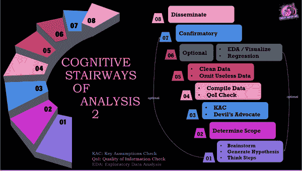

# 第 5 章 分析

> “如果你不知道如何提出正确的问题，你将一无所获。”
>
> W. Edward Deming

你收集的所有信息都已被开发利用，并以格式化和标准化的形式存放在数据库或威胁情报平台中。那么现在该怎么办？这些信息放在那里没什么用，直到被分析为止。`F3EAD` 的 `Analyze phase`（分析阶段）是最难阐述的阶段之一，但也是最重要的阶段之一。这是我们获取数据和信息并将其加工成情报的阶段。本章涵盖分析的基本原则、诸如 `target-centric`（以目标为中心）和 `structured analysis`（结构化分析）等模型，以及分配置信度和应对认知偏差的流程。

## 分析基础

要正确分析你拥有的信息，你必须经历另一个（幸运的是，更小的）情报循环版本。你必须确定你的需求是什么，换句话说，就是你要回答什么问题。你需要收集将用于回答这些问题的信息。大部分收集工作将来自你在整个调查过程中收集并在 `Exploit phase`（开发阶段）标准化的信息，但还需要其他信息来丰富或补充这些信息，以便进行适当的分析。因此，当你进入 `Analyze phase`（分析阶段）时，可能需要继续收集数据。`F3EAD` 的 `Analyze phase` 涵盖了整个情报周期，如 `图 5-1` 所示。


在应对 `Road Runner` 入侵事件期间，我们识别出了其行动中利用阶段和 `command-and-control`（命令与控制）阶段使用的域名和 IP 地址。该信息帮助我们完成了 `Fix`（修复）和 `Finish`（终结）阶段，并将继续帮助我们分析该入侵事件，但方式不同。我们不再仅仅识别攻击的技术细节以便响应和修复，而是可以分析那些相同的域名和 IP，以识别可用于更好地理解攻击者战术的模式。此过程涉及收集关于域名和 IP 的更多信息，包括它们注册给谁，以及攻击者如何使用它们，以确定模式是否可用于识别或预测未来行为。然后分析这些新信息，识别情报空白（进行分析所需的关键信息），并根据需要收集更多信息。

## 双重过程。相反，我们需要“慢思考”——尽管可能仍然有截止日期（通常甚至是很短的截止日期）。


## 快思考与慢思考

“快思考与慢思考”的概念由丹尼尔·卡尼曼在同名书籍（*Thinking, Fast and Slow*）中推广；然而，双重思维过程理论已被研究数十年。其核心观点是存在两种思维模式：“快思考”，也称为*系统 1 思考*，是一种快速、自动的过程，通常基于联想和经验，严重依赖预先存在的心智模型。当时间紧迫、需要迅速行动时，这种思维能帮我们摆脱困境。使用该系统时，大脑会假设直觉判断中微小缺陷相关的风险，不如行动不够快的风险显著。*系统 1 思考*相关的缺陷包括认知偏差和误用的心智模型，这在逃离老虎时可能不算严重，但在做出会长期影响你的决策时，却可能引发大量问题。第二种系统，慢思考或*系统 2 思考*，是一种旨在对抗*系统 1*中那些行之有效的冲动性偏见的深思熟虑的推理过程。运用*系统 2 思考*时，你不仅需要花时间对抗偏见等问题，还需要确保你牢固掌握所分析的不同信息片段的背景，并思考二阶和三阶效应。理解复杂网络和局势需要时间，若缺乏深思熟虑的时间，极有可能得出至少一些错误的判断。

在本章中，我们将重点关注*系统 2*思维过程，作为一种有助于产生更深刻见解的方式，这些见解可以被清晰地阐述、捍卫，并与他人分享，使他人能够跟随推理逻辑，得出大致相同的分析结论。这并非易事；然而，贯穿全章，我们将介绍不同的方法、途径和框架，以支持这种分析。我们还将介绍一些额外的心智模型，帮助分析师进入“思考思考”（即元认知）的正确心态，这一概念自古希腊哲学家亚里士多德时代起就已被讨论和辩论。

## 归纳、演绎与溯因推理

在思考如何解决问题时，我们通常不会思考我们是如何思考问题的。这有点像开车上班：很容易就选一条“常规”路线，无论发生什么都走同一条路。但事情并不总是那么简单，对吧？有时堵车，有时施工，有时你需要顺道去商店，有时你只是想换个风景。在这些情况下，你可能会走不同的路线到达同一个地方。推理也是如此。

开始之前，了解一点很重要：推理和我们做的许多事情一样，当你询问哪种推理类型最好时，遵循典型的智力公理：视情况而定。就像你的驾车行程一样，你使用哪种推理取决于你想要实现的目标，这没问题。问题在于当你不知道为什么选择现在的方法时。事实上，在许多情况下，分析师做着同样的事，却不真正思考为什么（有点像你开车时处于精神自动驾驶状态）。在许多情况下，分析师（无论是情报还是安全领域）以相同的方式进行同类推理。你甚至可能自己也在这么做。所以，退一步，让我们思考一下我们如何解决问题，以及为什么我们应该重新考虑不同的方法。

### 演绎推理

> **演绎**：通过推理得出结论，具体指：从一般或普遍前提中必然得出关于个别事物的结论的[推论](https://www.merriam-webster.com/dictionary/inference)
>
> [Merriam Webster, 定义 2a.](https://www.merriam-webster.com/dictionary/deduction)

大侦探夏洛克·福尔摩斯让演绎推理名声大噪，但演绎推理通常并非人们想象的那样。简而言之，演绎推理始终基于普遍接受的前提。另一种理解方式是：从一个想法出发，对原因进行观察或一系列观察，然后对预期结果得出结论。

演绎推理通常非常直接且简单，并非我们在调查中所设想的那种。例如，回想高中几何。几何学的一条规则是所有三角形的内角和为 180 度。如果你有一个有两个 45 度角的三角形，那么根据 180 度法则，你可以演绎出第三个角必须是 90 度（根据另一条规则，任何有一个 90 度角的三角形都是直角三角形，你可以更进一步断定这也必须是一个直角三角形）。

虽然贝克街的居民侦探喜欢频繁引用它，但大多数侦探并不靠演绎破案。在大多数演绎推理的例子中，既有简单的前提，也有近乎完美的信息。演绎推理常有助于理解基本生活，但不适用于调查。我们很少拥有足够完美的信息，也很少能制定普遍规则。

### 归纳推理

> **归纳**：从个别事例推断出普遍结论的[推论](https://www.merriam-webster.com/dictionary/induction)
>
> [Merriam Webster, 定义 2a.](https://www.merriam-webster.com/dictionary/induction)

大多数调查中最常见的第一种推理方法是归纳。归纳是指你从一堆数据开始，可能是一个单独的例子，也可能是几个不同的例子，然后找出一个符合所有数据的规律。你可以将其简化为：归纳是利用一组特定的因果关系来构建通用规则的过程。

归纳推理通常是一种捷径。例如，假设你有位新同事，第一个周一午餐吃了花生酱果冻三明治。周二、周三、周四也都吃同样的花生酱果冻三明治。那么周五呢？归纳推理可能会让你说“显然，他们每天都吃花生酱果冻三明治，所以显然周五也会吃”，也许他们真会吃，但你的新同事周五邀请其他人出去吃午饭。

归纳推理总是受益于更多信息，因为这能进一步优化你正在匹配的理论。这些归纳理论只能与可用数据一样好，但这种不完美的数据也使得得出的概括可能不是 100% 正确的，比如假设同事会在连续四天一种午餐后，第五天继续。第一周后，我们可能会优化理论，假设他们周五总是出去吃午餐，但第二周可能又得改，如果你发现他们第一个周五出去只是为了见同事。所以，你可能需要再次优化。这常表现为“相关性不等于因果性”。

数据越多，理论越好，但这在安全调查中是个挑战。我们无法知道掌握了多少数据，是看到 10% 还是 100%。我们无法知道理论有多好，假设它们太好则很危险。我们在使用 Maltego 等链接分析工具时常见这种情况。人们常将数据扔到力导向图上，开始建立归纳理论。这可能只是简单地查看图中的网络流，假设连接最多的节点一定是最重要的。真是这样吗？好吧……有时是，但问问任何恶意软件分析师，有多少恶意软件会访问 [google.com](http://google.com) 或 [microsoft.com](http://microsoft.com) 以验证网络连接？这意味着那些是坏网站吗？显然不是。

### 溯因推理


> 溯因推理：一种三段论，其中大前提显而易见，但小前提以及因此得出的结论仅具有或然性。
>
> [梅里亚姆-韦伯斯特词典，‘演绎’与‘归纳’与‘溯因’](https://www.merriam-webster.com/words-at-play/deduction-vs-induction-vs-abduction)

## 溯因推理在安全调查中的应用

此时，你可能已经猜到，溯因推理是我们在安全调查中最终最常使用的推理方式。溯因推理在某些方面是另外两种推理的结合（也是福尔摩斯实际所指的推理方式）。溯因推理是获取可用信息、应用过去的规则和事实，并以此推导出一组合理原因的过程。这与归纳法不同，归纳法旨在创建这些基本规则而非应用它们；也与演绎法不同，演绎法是获取一组案例和规则并用它们来预测结果。

溯因推理始终是思考调查的最佳方式，因为与归纳法和演绎法不同，它考虑到我们很少拥有完美信息，也很难基于现有信息得出普适规则。此外，我们调查的通常目标是发现原因。例如，如果你说“我们的网站因流量过大而瘫痪”（一个结果）和“勒索性 DDoS 是流量过大的常见原因”（一条规则），那么你可以推导出原因“我们正遭受勒索性 DDoS 攻击”。

## 为什么要谈论推理？

网络安全中许多最常见的问题和挑战，归根结底都是对问题的错误推理和错误的基本假设。一个例子是将恶意软件归因于特定的威胁行为体。多年来，WINNTI 恶意软件家族通常被认为仅由单一威胁行为体使用，威胁行为体与恶意软件被混为一谈，这在本例中是一条错误规则。这本身就是归纳法出错的一个例子。结果，这条错误规则被多次应用，导致对真正攻击组织的对手产生困惑，因为对手的行为与原始 WINNTI 威胁行为体不符，该规则导致了混淆。如果你查看 MITRE ATT&CK WINNTI 组，混淆显而易见，因为他们指出了与 Axiom、APT17 和 Ke3chang 的重叠。

简而言之，如果你不知道自己是如何处理问题以及为何以那种方式处理，就很容易引入错误，导致后续出现困惑甚至分析失败。最先发现 WINNTI 恶意软件并将其与单一行为体关联的分析师可能并没有错，但这种关联被广泛接受的方式后来成了许多组织的问题。关键假设检查结构化分析技术旨在帮助你质疑并避免这类错误，但最好的做法是从一开始就考虑如何构建你的思维框架，在问题出现前就避免它们！

## 案例研究：OPM 入侵事件

至今仍可能影响无数个人和实体的最重大入侵事件之一，是 [美国人事管理办公室 (OPM) 遭遇的入侵](http://bit.ly/2uI6oD1)，该事件导致超过 2000 万接受过安全许可背景调查的个人的个人高敏感信息泄露。除了被盗信息的规模和敏感性外，OPM 入侵事件之所以引人注目，是因为错失了多次识别和阻止攻击的机会。此次入侵是一场跨越数年的复杂行动，包括窃取 IT 手册和网络拓扑图、攻陷两家拥有 OPM 网络访问权限的承包商，以及直接攻陷 OPM 本身。即使单个入侵事件被发现，也没人将这些点串联起来，以识别出需要应对更大的威胁。

甚至在攻击者发起行动之前，就已存在机会，利用我们对攻击者及其行动方式的了解，识别出：一个掌握所有持有安全许可的美国人高度敏感、高度可操作的个人信息的政府机构，是国家级攻击者的高价值目标。

入侵的完整时间线是一堂课，展示了如果分析得当且及时，如何能防止或减轻成功行动的毁灭性影响。它还展示了当事件响应人员、管理者和高管未能串联线索、洞察全局时，后果有多严重。OPM 入侵事件是一个经典且令人沮丧的例子，即使所有信息都可用，却仍未能进行分析。

## 分析流程与方法

在事件响应中，网络、入侵和其他网络安全基础方面的经验，是快速准确决策、识别恶意活动模式并确定缓解措施的关键。正如我们在“发现、定位、终结”章节所学，使用杀伤链和钻石模型等模型，可以帮助我们组织思路和事件相关数据。在分析中，我们依赖一套独立的技能，这些技能与网络入侵和网络安全的知识经验相关，但属于情报分析独有。这些可以被视为支撑任何特定内容专业领域的认知技能。认知技能包括记忆、认知加工、逻辑推理、注意力和认知灵活性。这些技能——在生活各方面都有帮助——也由一套流程和框架支持，帮助将它们应用于特定主题。在情报驱动的事件响应中，我们使用结构化分析技术和分析框架，如目标中心分析和受害者中心分析，来指导我们的流程（详见下文）。

本节描述的流程和方法是常见的分析方法，可单独使用或组合使用。在情报分析中，起决定性作用的不是对特定主题的经验，而是对开展情报分析整体流程的经验。

## 结构化分析技术

关于结构化分析技术 (SATs) 最好的入门读物之一是 Randolph Pherson 和 Richards Heuer Jr 合著的 *Structured Analytic Techniques for Intelligence Analysis*，目前已出到第三版。虽然 SATs 适用于所有类型的情报分析，但有些技术更适用于情报驱动的事件响应，因此我们将重点关注这些技术。

使用结构化分析技术的目标是为分析师提供一种（或多或少）分步骤的方法，该方法可重复、可向参与分析过程的其他人解释，并可被他人复现或回溯步骤。SATs 专门设计用于对抗本章开头提到的“系统 1”缺陷类型：认知偏见和错误应用的心智模型。《情报分析结构化技术》将 SATs 分为六大类：

### 整理组织

这一类技术帮助分析师在分析过程开始时，面对一堆数据却无从下手的情况。包括排序、排名和清单等方法。幸运的是，在情报驱动的事件响应中，你不是从白板开始——你在整个事件响应过程中一直在收集、排序和组织数据，通常不是从零开始。然而，如果你决定花时间梳理未充分分析的旧事件数据，从这一类方法入手可能会很有用。

### 探索技术


## 该系列技术可帮助分析师提出新方法、重新审视既有观点，或开始突破那些告诉我们某事*不可能*的偏见界限。探索技术侧重于头脑风暴和创建思维导图等方法，通常关注不同要素之间的关系。

## 诊断技术

这一系列技术在情报驱动的事件响应中被频繁使用——事实上，我们将在下文中深入探讨其最常用的方法之一：竞争假设分析。诊断技术最接近我们年轻时学到的科学方法，但有一个警示：在情报分析中，我们几乎从未拥有完整的图景，且通常无法完全测试任何生成的假设。该系列中的其他方法包括多假设生成、诊断性推理和欺骗检测。

## 重构技术

这些技术是任何分析师工具包中的关键核心，专门设计用于帮助识别偏见或误用的思维模型何时可能正在影响分析。本章后面介绍的许多“反向技术”，包括红队分析和假设分析，都被视为重构技术。这些技术最好由小组完成，以便更好地识别个人可能存在的思维模型缺陷，但个人分析师也可以执行，例如通过结构化自我批判练习。

## 预见技术

“预测性情报”是每一位安全经理和 CISO 都希望其团队能定期产出的成果。虽然遗憾的是无法完美预测未来，但有一套 SATs 旨在帮助识别可能预示未来结果的驱动力，并做好监控准以预判变化。在情报驱动的事件响应中，一个特别有用的方法是指标生成、验证与评估，我们将在下一节介绍。

## 决策支持技术

有很多时候——事实上是非常多的时候——分析师进行分析不是为了确定自己的后续步骤，而是为了知道该向高层领导或决策者呈现什么，以帮助*他们*做出决策。幸运的是，有一系列技术有助于梳理信息并以支持决策的方式构建结构。这些技术包括商业情报中也常用的重量级方法，如 SWOT 分析和决策树。

以下是几个步骤，将指导您为高效分析做好准备，帮助您决定使用哪种 SAT 并确定谁 else 应参与该过程。

1.  确定您要回答的问题，最好使用来自领导层的具体需求。您可以进行多次结构化分析迭代，以回答需求中存在的多个问题，但正如您不会在单个实验中尝试测试多个变量一样，最好不要试图用同一次分析回答多个问题。即使流程仅略有不同，最好也将它们分开，以避免判断模糊或结论受污染。如果存在时间限制，请专注于最紧迫的问题/需求并开始着手处理。

2.  确定您试图通过分析回答的问题的性质。是面向未来的？也许您应该回顾预见系列的技术。您是否试图描述最近一次入侵如何符合贵组织应对过的整体威胁模式？诊断技术可能更有帮助。不仅要捕捉问题，还要捕捉问题的*性质*，这将帮助您走上正轨。

3.  审查您利用的数据，以确定您是否拥有生成一个或多个假设以回答问题所需的所有信息。这涉及梳理调查中收集的信息，并可能需要收集额外的丰富信息，我们将在本章后面讨论这一点。

4.  如前所述，结构化分析可以由个人分析师完成，但许多技术作为团队一部分执行时最为有效，因此请考虑您的团队应由谁组成。如果您已经作为一个充满活力的分析师团队的一员工作，那么这可能很容易——而且您非常幸运！如果不是这种情况，您仍然可以让其他人参与分析。关键事件响应人员、恶意软件分析师、红队成员——所有这些群体都习惯于。我们将在下一节介绍的核心技术包括关键假设检查、竞争假设分析，以及指标生成、验证与评估。我们还将介绍一些非常有用的反向技术，以帮助应对偏见，正如我们将了解到的，偏见会严重阻碍分析。

### 关键假设检查

关键假设检查是最常用的结构化分析技术之一，这是有充分理由的。正如我们之前讨论的，我们的大脑会在任何可能的地方寻找捷径。它们经常求助的一个地方是假设，这些假设往往成为我们分析的基础，无论它们是否应该。公平地说，有时它们*应该*成为基础，但我们有意识地对待我们对局势的根本信念非常重要。例如，在“Road Runner”入侵事件中，我们假设因为我们从另一个活动中获得了威胁情报，当我们在网络中发现相同的指标时，那是*因为*我们是一个活动的目标。虽然这是一个合理的假设，并且在发现、修复和完成阶段似乎确实帮了我们，但这并不意味着我们永远不应质疑该假设。关键假设检查支持这一质疑过程。

关键假设检查是一种系统的方法，用于识别用于填补关键信息空白的假设，并确定这些假设是否有效、是否应保留在分析过程中。理想情况下，这应在分析工作开始时进行，因为正如我们在学习其他常见的结构化分析技术时将看到的，其中许多技术都依赖于对作为分析一部分的假设和先入之见有牢固的掌握。

Heuer Jr. 和 Pherson 概述了进行关键假设检查的流程：

1.  召集将参与关键假设检查的小组。这应包括熟悉项目或主题的人员，以及一些不熟悉该问题的受人尊敬的分析师，他们能提供新的视角。

2.  会议开始时确定要讨论的具体主题，并要求每位参与者默默写下他们对该主题的假设。对于“Road Runner”案例，这可能包括“选举活动是复杂行为体的目标”，以及“共享小组传递给我们的信息是合法的入侵，而非虚假旗帜行动或错误信息行动” 等内容。


## 关键假设检查

3. 收集每位参与者的回答并将其写在白板上，如果是虚拟会议，则写在协作文档上或通过屏幕共享展示。

4. 作为一个小组，回顾已识别的假设并开始头脑风暴寻找其他假设。一个推动此环节的好问题是：“哪些假设过于基础和根本，以至于我们从未想过要质疑它们？”

5. 一旦你有了一个可靠的清单，逐一检查每个假设并针对其提出关键问题，例如：“我们为什么认为这是真的？”“有多少证据支持这一假设为真？”“如果这在过去是真的，我们为什么认为它现在仍然是真的？”提出反面假设也很有帮助——不一定是该假设的完全相反面，而是一个会显著改变对局势看法的替代假设。

6. 对于每个假设，作为一个小组评估它是否合理可靠，是否有支持但附带一些警示，或者是否无支持或存疑。Heuer Jr. 和 Pherson 建议使用这三个类别；然而，其他从业者使用 1 到 5 的等级来评估对假设的信心，其中 1 代表完全无根据的推测，5 代表有大量证据支持的假设。任何评分在 3 分或以下的假设都应包含一个收集更多信息的计划，以帮助确定该假设是否应保留在分析中——它们被称为“关键不确定性”，而非关键假设。

7. 还有一条额外建议，特别是当有几个关键假设在信心量表上得分较低时，将每个关键假设放置在一个衡量高/低确定性和高/低潜在影响的 2 x 2 矩阵中。一旦根据小组共识全部分配好位置，低确定性/高影响的假设就是最需要优先解决的。


需要注意的是，你不能在某一时间点进行一次关键假设检查，然后就坚持认为这些假设将永远保持有效（或根据你的发现判定为无效）。关键假设检查并不能将假设变为事实或证据；它仍然是一个假设，这意味着在某个时刻，额外的信息可能会使其变得更有效或无效。定期重新检查你的关键假设非常重要，只要它们仍然是你分析的核心，就应持续检查。

### 竞争假设分析

竞争假设分析（Analysis of Competing Hypotheses，简称 ACH）是由 Richards Heuer 开发的一种方法，用于评估多个备选假设并根据证据确定最可能的假设。ACH 是一个八步流程，旨在迫使分析师审视所有可能性，而不是基于直觉确定一个假设，然后寻找支持该假设的证据。这八个步骤如下：

1. 确定待考虑的可能假设。Heuer 建议使用由不同背景、不同视角的分析师组成的小组来头脑风暴各种可能性。在此步骤中，区分 `unproven`（未证实）假设和 `disproven`（已证伪）假设也很重要。`unproven` 假设是指没有证据表明其正确的假设，而 `disproven` 假设是指有证据表明其不正确的假设。无论多么不可能，都应将 `unproven` 假设纳入 ACH 流程，但不要包含 `disproven` 假设。

2. 列出支持和反对每个假设的重要证据。如果你已经完成了关键假设评估的过程，这一步应该相对简单；你已经拥有了支撑各种假设的关键证据。

3. 创建一个矩阵，顶部列出假设，侧边列出证据，评估每项证据是支持还是反驳每个假设。请参阅 图 5-3 了解该矩阵的示例。填写矩阵有几种方法。Richard Heuer 建议通过标记 `C` 表示每项证据与假设一致，标记 `I` 表示不一致，如果是中性或不适用，则标记 `N/A`。其他人建议使用权重标度，例如用加号（`+`）表示证据中度支持假设，用两个加号（`++`）表示强力支持，依此类推。


在 图 5-3 的矩阵中，我们可以看到 `H3` 没有任何证据支持，因此应从矩阵中移除。同样，`E3` 不适用于任何假设，而 `E5` 与每个假设都不一致，因此分析师需要回头重新评估这些证据，以确保它们既与分析相关又准确。有缺陷或有偏见的证据可能通过了评估阶段，这提供了另一个机会来判断某事项是否应纳入分析考量。

4. 进行初步分析以优化矩阵。完成步骤 3 后，矩阵应显示出一些情况：某些假设可能对每项证据都获得了不一致（`I` 或 `-`）的评估。虽然这不能证伪一个假设，但如果没有证据支持它，则应将其从矩阵中移除（请参阅 图 5-3）。同样，如果一项证据对每个假设的评估都是 `N/A`，分析师应将其从矩阵中移除，或者，如果它确实是关键证据，则应重新评估是否还有其他假设需要考虑。

事件响应人员有时会遇到一种情况：来自独立、无关入侵的证据混入了分析中，仅仅是因为它被发现的时间与其他证据大致相同。当某事项与任何其他证据都不吻合时，最好将其从当前分析中移除，单独进行分析。

5. 对每个假设的可能性得出初步结论。重点在于证伪假设，而非证明其正确。在矩阵初步优化后，你可以根据有多少证据支持来评估每个假设的可能性。在 图 5-3 的示例中，`H1` 拥有最多的支持证据，如果分析师判定 `E5` 不是有效信息，则没有证据反驳该假设。因此 `H1` 会被视为最可能的假设。`H2` 和 `H4` 都有支持证据，但也有与之不一致的证据；因此它们可能性较小。如果任何被标记为不一致的证据证明这些假设不正确，它们将被视为 `disproven`（已证伪）假设。证伪一个假设比证明一个假设绝对为真更容易。

6. 分析你的结论在多大程度上依赖于单一证据。重新分析导致你判断出最可能假设或导致某假设被证伪的信息。是否有单一证据起了决定性作用？如果有，你对该证据有多大信心？这将有助于确定判断的总体信心。如果来自不同来源的多项证据强力支持一个假设，评估的信心会比仅基于单一来源的一两条关键信息做出判断时高得多。


## 步骤 7：报告所有假设的结论

报告你对所有假设可能性的结论，而不仅仅是最可能的那个。记录并报告所有被考虑的假设，以及导致最终判断的证据，这一点至关重要。如果分析将要经历红队分析流程，这一点尤为重要，我们将在本章后面讨论该流程。如果提供了新信息，这也有助于判断分析是否需要重新评估，这将我们带入 ACH 流程的最后一步。

## 步骤 8：确定重新评估触发条件

确定在何种情况下需要重新评估分析。Richard Heuer 指出，所有分析都应被视为暂定性的，并且随时可能出现新证据，从而要求进行新的分析。如果发现任何情报空白，或任何你已知当前缺失但有可能改变判断的信息，都应记录在案，以协助未来的分析。在“Road Runner”入侵案例中，一个例子是增加了另一个遭受类似入侵的组织的信息，或者由于采取了额外的安全措施，在未来检测到了攻击者的活动。在这些情况下，你将获得新的日志信息。如果发生上述任一情况，我们都需要重新审视判断。

设定预先确定的标准来决定何时应审查并可能修正判断的概念，是我们将在本章接下来讨论的最后一个核心 SAT（结构化分析技术）的核心组成部分。

## 指标生成、验证与评估

在传统的网络威胁情报术语中，指标等同于妥协指标，即 IOC，我们在本书前半部分已经详细介绍过。在结构化分析中，指标不仅仅意味着 IOC，尽管在某些情况下它们在此技术中很有用。相反，此处的指标是指一组观察结果，用于跟踪事件、识别趋势，或提供预警，表明某些意外情况正在发生或即将发生。事实上，这有一个完整的学科领域，称为指标与预警情报，如果你经常利用这种结构化分析技术，值得单独深入研究。

### 准备指标清单

该技术的第一步是生成一个指标清单，用于识别表明特定活动正在发生或未发生的模式。针对“Road Runner”，我们可以捕获一系列行为清单，当这些行为组合在一起时，会显示我们的组织正在成为目标。

- 我们从事的一项活动历史上一直是各类恶意行为者的攻击目标
- 发现模仿我们独特运营活动的恶意邮件，例如提供捐赠或志愿者支持
- 对手依赖需要用户交互的利用机制
- 公开身份的组织成员遭受更严重的针对性攻击
- 我们观察到的类似战术也被用于攻击其他与我们类似的组织
- 我们收到来自政府和其他共享组织关于被攻击目标的预警

这份指标清单描述了我们当前运营的现状，这些行为中的任何变化都可能意味着我们面临的威胁发生了变化。例如，我们收到的可疑或恶意邮件类型发生变化，可能表明威胁态势已发生变化，要么是我们的对手正在转向我们应警惕的新战术，要么是我们正被不同的行为者盯上，而我们应努力去了解他们。

对于每一个证明现状的迹象，都可以生成一个指标，让你知道情况正在发生变化，无论是你这边还是对手那边。这些将是我们主动寻找的指标。例如，我们的指标清单可能如下所示：

- 战役结束，我们不再从事备受关注的活动
- 发现包含新颖主题的恶意邮件
- 我们见过的针对我们的对手开始利用不需要用户交互的漏洞
- 我们看到针对员工的攻击范围扩大，包括那些未公开与我们有关联的人员
- 其他组织、政府或共享组织开始报告我们此前未发现的新战术和攻击目标

这份清单可以根据你的意愿详细到任意程度，并可以包含正在使用的具体战术或被利用的漏洞，前提是你有监控它们的计划。事实上，生成指标清单的一个额外好处是，它有助于为未来的监控工作建立收集需求。无论你倾向于监控现状的维持，还是监控事物发生变化的直接迹象，你生成的指标在投入运营使用前，都需要经过验证和评估。

### 验证和评估指标

指标与预警风格的指标与 IOC 重叠的一个领域是验证阶段。什么构成一个好指标的标准在两者之间大致相同。迹象必须是可观察的，无论是直接还是间接，否则它们只能用于事后分析。迹象必须作为某事物保持一致或正在发生变化的可靠标志。如果其存在或缺失可能受各种无关因素影响，那么它可能不是一个好的监控对象。最后，它应该是具体的，指向一件可监控或可观察的事情，而不是可能独立变化的多种因素的组合。例如，在上面的指标清单中，我们将恶意邮件模仿预期战役活动列为一个指标，而利用过程需要用户交互列为另一个单独的指标。虽然这两个指标都描述了我们收到的钓鱼邮件，但它们是两个可能独立变化的不同因素，应单独监控。

与 ACH 类似，指标可以根据上述标准进行评估，并分类为理想指标（极有可能识别出其设计场景或情境下的活动，且极不可能指示替代活动）或非诊断性指标（可能在许多不同的无关场景中被观察到）。许多指标将介于两者之间，应仔细记录备选场景或可能性，以便在需要时支持分析。

在完成所有指标生成、验证和评估后，重要的是要记住你**并没有完成**。你需要制定一个流程，定期监控这些指标，无论是每周、每月还是其他固定间隔。与我们介绍的所有核心技术一样，你还应安排时间定期评估你的发现，确保其保持有效和有用。在重新评估时，利用一些专门设计用于测试既定发现并试图反驳它们的结构化分析技术会很有帮助。当你已经对某事建立了观点时，可能需要一些额外的工具来避免偏见并保持客观，而反向技术提供了这些工具。

## 反向技术


## 对立分析方法

最后一类结构化分析技术包含若干被视为*对立面*的方法，这意味着它们旨在通过提供不同的视角来违背现有的标准或规范。在某些情况下，初始分析是使用对立方法进行的；而在其他情况下，对立技术被用来质疑现有的判断，以确保分析在所有可能的情况下都站得住脚。这种类型的分析并非在所有案例中都必需，但强烈建议用于判断错误会导致严重后果的分析，或判断预期会受到争议的分析。

### 魔鬼代言人

魔鬼代言人用于通过采取对立观点并评估现有证据是否真正反驳了另一种观点，来挑战对某种形势广为接受的分析。魔鬼代言人方法并非真意在于证明另一种观点正确且公认分析错误。相反，它旨在暴露原始分析中的任何弱点，揭示未被考虑在内的任何偏见，并帮助原始分析经受住严格审查。

[添加示例]

### “假设”分析

这种分析试图向形势中引入新变量，以观察这将如何改变分析结果。例如，“假设这条关键证据是对手欺骗行动的一部分？”又或是“假设这份日志数据被篡改过？”同样，这种分析并不试图直接反驳某个假设，事实上它有助于评估总体判断的置信度，方法是判断即使某些情报受到质疑，分析是否依然站得住脚。该技术在 `ACH` 过程的第 6 步中很有用，当时分析师需确定分析在多大程度上依赖于一两条证据。

### 红队分析

该技术旨在分析对手在特定形势下会如何思考或行动。分析师试图设身处地站在攻击者的角度，并提出诸如“在这种形势下什么对我来说很重要？”以及“什么行动会导致我偏离计划？”等问题。在进行红队分析时，分析师采用对手的人设至关重要。该技术通过强迫分析师识别对手思维何时会与自身不同，有助于对抗镜像投射或镜像偏见。红队演练有助于识别分析师最初可能未曾考虑的其他因素。

红队演练是信息安全行业公认的概念，重要的是要了解这种分析依赖于对对手的理解，包括基于对手的社会、政治和文化倾向做出决策，这与某些采取“只要管用就行”方法的红队演练形成对比。

## 未来轮

我的一位教授曾将历史描述为“一件事引出另一件事”。这是一种简单的思考方式，却蕴含着深刻的哲理。在大多数情况下，一个决策不仅仅产生单一结果，而是引发多重后果。未来轮技术是一种预测技术，其目的不仅在于询问“有哪些可能性？”，更在于询问“如果发生这种情况，会发生什么？”。它通过从一个真实或预测的事件创建大纲，然后从该事件延伸出一组假设性可能性。关键在于考虑这些可能性各自包含的内容并重启该过程，针对每一种可能性创建一组新的假设性可能性。这种延展能让你看清一组决策如何导致意想不到的可能性，从而在考虑三级、四级或 N 级效应后做出更好的决策！

## 目标中心分析

结构化分析技术为分析师提供详细的、通常是分步骤的方法来解决不同的分析问题，极其有用。正如本书中介绍的不同模型一样；它们可以单独利用，也可以与其他分析方法论结合使用。我们将详述另一种在情报驱动的事件响应中很有用的方法论——目标中心分析。

在《情报分析：以目标为中心的方法》一书中，Robert Clark 对传统情报周期提出了新见解，该见解聚焦于分析师-客户和分析师-收集者的关系。通过强调这些关系，该过程试图构建并维护态势的集体心智模型，使客户易于提问，分析师易于提供可操作的情报。

Clark 写道：“目标中心过程为情报收集者、分析师和客户勾画了一种协作方法，使其能协同应对日益复杂的对手。我们不能只是向客户提供更多情报；他们已拥有超出其处理能力的信息，信息过载会导致情报失误。”他进一步阐述，近期的情报失误很少是因为没有正确信息，主要源于未能共享信息、未能客观分析信息，以及情报共享后客户未能采取行动。大多数分析师在其职业生涯中都曾经历过这三种情况，且往往印象深刻。目标中心情报旨在通过打破角色间的孤岛并缩短传统情报各步骤间的时间来解决这些失误。

目标中心情报分析过程的一个示例见 图 5-4。


与详述具体方法论的结构化分析技术不同，目标中心分析的核心是围绕被分析实体构建的概念模型。*概念模型*是系统的一种表征，帮助他人理解系统包含什么及如何运作——我们在“发现、定位、终结”中讨论的许多模型都是概念模型，包括 `Kill Chain` 和 `Diamond Model`。概念模型的目标是建立一个被接受的表征，说明被建模对象是什么，以便在不同利益相关者间讨论并支持协作。既然这两点是目标中心分析的主要目标，模型便成为该过程的关键部分。

有几个步骤可帮助你开始目标中心分析：

**步骤 1**

：获得其他利益相关者对改变工作方式的支持。如果你通常以几乎没有角色间直接协作的方式运作，那么这将是一个重大变革。由于有效的目标中心情报涉及决策者的投入，请花时间阐述启动新方法的商业理由及其对组织的益处。你可以举例说明事件响应人员与威胁情报分析师之间更一致的协作如何支持了有效的事件响应流程，以及这种新的情报方法将如何进一步延伸这种优势。

**步骤 2**

：


## 步骤 3

开始开发你的“目标”概念模型。许多（尽管并非所有）目标都是对手网络，理解它们的目的是确定如何最好地预防、检测和应对你可能从它们那里经历的任何恶意活动。根据对手的不同，你可能掌握关于他们是谁、在哪里的具体信息，但这对于建立一个良好的模型并非必要。即使没有任何身份识别信息，你仍然可以捕捉并描述威胁行为者反复出现的行动模式，理解他们针对你的行动的关键组成部分，并详述他们在试图攻陷你的组织时所依赖的行为、物理和功能节点。建立这种对威胁的共同理解应严重依赖迄今为止整个过程中所利用的信息。这正是“利用”阶段如此重要的众多原因之一，尽管有时它可能让人感到乏味。为以目标为中心的情报分析开发初始模型也可以利用多种结构化分析技术，包括头脑风暴和关键假设检查等。

## 步骤 4

模型开发完成后，你还需要概述将遵循的操作流程，以确保你真正在开展以目标为中心的情报分析，这种分析是协作的、迭代的，有时也是预测性的。尽管该流程需要涉及其他利益相关者，如你的情报客户、收集人员和其他分析师，但你要主导推动流程，并找到一种方法让其他团队参与进来，而不给他们增加过重的负担——这是确保你能保持协作方式的一种途径。概述后勤安排，例如每周同步会议以回顾发现并确定新问题。设立内部聊天频道以便提出时效性问题，并指定备用联系人，以便在主要利益相关者不在办公室或因其他事务无法参与时顶替。这些任务可能看起来不那么令人兴奋，但它们对这种方法的成功至关重要。

## 步骤 5

现在开始实干。一旦概念模型开发完成并概述了标准操作程序，我们就开始理解客户围绕模型提出的问题、我们已有的答案以及我们仍需的答案。我们已有的答案被视为`可操作情报`，即可以采取行动或回答问题的情报。可操作情报将与客户共享，如果需要更多或不同的信息，则更新模型，并再次回到收集和分析流程中。以目标为中心的分析遵循迭代流程：收集信息，分析其是否有助于回答提出的问题，并偶尔产生新的需求。如果需要更多或不同的信息，则重新启动收集和处理阶段，确保所有必要信息可供集体群体使用。这种方法还允许分析师频繁与客户沟通，了解情况和需求是否发生变化。虽然每个分析师都希望认为自己能在结论仍被需要时做出分析判断和结论，但诚实面对时间限制以及事态可能变化的速度非常重要，因为这些因素可能会改变情报需求。

根据需要重复，并对变化保持开放态度。使用以目标为中心的分析方法的好处在于，它涉及流程中各利益相关者之间的多次沟通确认。虽然你可能只有少数客户是以目标为中心方法的常规参与者，但与所有分析接收者（无论是 CISO 还是 SOC 分析师）进行沟通是有益的，以确保所提供的内容满足他们的需求，并确定他们的需求是否已发生变化。这不仅是确保源自分析的共同理解持续增长的好方法，也是识别何时客户可能成为应更频繁参与流程的关键利益相关者的好方法。

一旦你确定了将用于分析的方法，但在开始分析流程之前，退一步，审视你要回答的问题的背景以及你正在分析的形势。正如我们在本章开头讨论的那样，这一停顿是从系统 1 切换到系统 2 的关键步骤。

## 开展分析

我们在本章的前半部分构建了分析工具包，可用于以一种对抗偏见、可重复且允许分析师解释他们如何得出特定判断的方式来进行分析。现在工作可以开始了——只要你知道你在分析什么。

## 分析什么？

如果你不知道要分析什么，开展分析将非常困难。人们一提到分析，往往会联想到有人站在墙前，墙上杂乱地贴着照片和报纸剪报，等待那个“顿悟”时刻，一切突然变得清晰。又或者你会想到牛顿坐在树下，一个苹果砸在头上，这是一个简单（且过度简化）的故事，讲述一个事件如何带来突然的清晰感，让你困惑的一切突然变得合理。

如果你的方法是盯着收集到的所有数据，只有一个模糊的想法想了解其含义，那么你分析它的难度将远大于向数据提出具体问题，例如，“为什么我们会成为目标？”或“本可以如何预防这次攻击？”你当然可以向信息提出多个问题，这些问题可以相互叠加，以加深你对攻击及其影响的理解，但如果没有起点，许多分析师会发现很难完成这一阶段。正如我们在本章开头讨论的那样，分析往往似乎模仿一个微型情报周期，因此确定或重新审视需求——即你试图回答的问题——是第一步。

如果你没有针对领导层或其他内部团队正在分析的具体需求，你可以提出一组标准问题，这些问题有助于分析每起事件。然而，有些问题将始终是你组织或事件特有的，所以不要将以下示例视为你`唯一`应该分析的内容。以下是一些你可以开始入手的问题：

### 为什么我们会成为目标？

这个问题将提供大量信息，说明如何识别额外的入侵以及如何保护你的组织免受未来攻击。攻击的性质，无论攻击者针对的是你数据的完整性、机密性还是可用性，无论他们是否利用攻击访问第三方连接网络，以及他们在找到目标后采取的行动，所有这些都能为你未来需要关注的内容提供洞见。战术和技术可能会改变，但攻击者的目标改变得不那么频繁。

### 谁攻击了我们？


## 关键分析问题

这通常是高管们提出的第一个问题，但我们并非首先提及它，自有特定原因。无论是什么使你成为特定犯罪集团的有效目标，可能并非该集团独有；具有相似目标的另一个集团也可能以相同信息为目标。因此，最好不要只关注你碰巧在该特定事件中捕获到的那个集团，而忽视了整体威胁。不过，一旦你确实理解了他们的目标，深入了解特定攻击者就会变得很有用。分析关于攻击者的信息可能包括他们采用的战术、攻击目标、他们的谨慎程度、活跃时间、使用的基础设施、是个人还是团体作案，以及通过分析数据可以识别出的任何其他模式。

### 如何才能预防此事发生？

分析的一个重要目标是了解发生了什么以及为什么会发生，以便在未来加以预防。回答这个问题时，你将关注自己网络内部出现的问题。是否存在攻击者利用的未修补漏洞？是否有触发但无人调查的 IDS 警报？用户是否重复使用了之前在无关入侵事件中泄露的密码？这通常不是一项令人愉快的分析，因为没人喜欢听到或看到自己做错了什么，但如果你的组织只是从系统中擦除一段恶意软件，而不了解或解决它是如何进入的，那么你很可能不得不再次经历完整的事件响应流程，因为根本原因未被识别或解决。

### 如何检测到此类攻击？

这就是你收集的所有令人欣喜的指标发挥作用的地方。在经历了分析如何预防攻击这一有时痛苦的过程后，知道你可以采取措施来预防或检测未来的攻击，是一件好事。你能做什么很大程度上取决于你现有的安全系统。在回答这个问题时，重要的是要关注此次特定攻击独有的方面，例如恶意软件哈希值和命令与控制 (C2) IP 地址，以及入侵中不那么短暂的方面，例如被攻击的系统或攻击者在网络中横向移动时使用的战术。

### 是否存在可识别的模式或趋势？

当将内部事件与通过信息共享组织或开源渠道报告的事件进行比较时，这种类型的分析尤为相关。回答这个问题时，你可以尝试在不同层面识别模式——从可能表明某个战役的组织目标模式，到识别重复或共享攻击基础设施的模式，再到攻击者使用的社会工程学手段中的模式。

你在该阶段进行的分析输出应当能够驱动行动，无论该行动是更新威胁概况、修补系统，还是创建检测规则。专注于上述问题以及你组织特有的任何其他问题或需求，将有助于确保你在该阶段所做的工作能够回流到 `F3EAD` 的运作阶段中。

## 丰富你的数据

一旦你确定了试图通过分析来回答的问题，可能需要进入微型情报周期的下一步——识别所需的任何额外收集工作。幸运的是，我们在情报驱动的事件响应过程中花费了大量时间进行收集，甚至已经开发利用了这些数据——即组织、排序并确保我们能在分析中充分利用它们。然而此时，你可能会意识到，为了回答你正在关注的特定问题，你需要关于已收集数据的更多信息。这个过程称为**丰富**，无论你是试图回答围绕特定恶意软件家族的战术层面问题，还是回答关于为何成为目标的战略层面问题，它都很有用。

`Enrichment data`（丰富数据）包含关于指标或活动模式的额外细节，这些细节通常不用于检测，而是用于更多地了解特定指标及其被发现时可能意味着什么。这类丰富数据可以包括 `WHOIS` 信息、自治系统编号 (ASN)、网站内容、近期和历史域名解析记录、关联恶意软件以及许多其他额外细节。丰富数据的目的是收集更多关于你已识别指标的上下文，以便你能更好地解读其含义。在分析阶段查看丰富数据时，你应该关注从数据中浮现的模式，而不要过多纠结于某一条具体信息。许多人最终导致误报并拥有成百上千个封锁列表指标的主要原因之一，就是他们将丰富信息当作指标来处理。

### 丰富来源

将使用的丰富数据类型取决于你正在调查的指标和分析目标。大多数丰富来源提供的信息对多种用例都有益，但也有一些是特定的，因此在花费大量时间深入挖掘某个特定丰富来源之前，请确保你知道自己在找什么。对于所有丰富来源，记录数据被识别的日期至关重要，因为它未来很可能会发生变化。没有什么比找到一条对你的分析至关重要的信息，却在它再次变化后无法确定何时或如何找到它更令人沮丧的了！

以下是一些丰富信息的类型和来源：

#### WHOIS 信息

获取关于攻击中使用的域名或 IP 地址的额外上下文和信息，最基本的方法之一是获取关于谁注册或拥有它的信息。`WHOIS` 协议在 [RFC 3912](https://tools.ietf.org/html/rfc3912) 中定义，最初旨在传递关于原始互联网 ARPANET 用户的额外信息。最初可以通过命令行查询获取 `WHOIS` 信息，该功能至今仍然有效，尽管现在有了额外的资源，包括用于获取当前和历史数据的网站和工具。

随着用户群增长和互联网范围大幅扩展，`WHOIS` 经历了多次更新。目前，`WHOIS` 包含注册人的姓名、电子邮件地址和其他联系信息。`WHOIS` 信息可以通过以下几种方式丰富分析：

*   追踪攻击者基础设施
    *   有些（并非全部！）攻击者在注册域名时会重复使用信息。通过识别恶意行为者使用的姓名或化名，可能可以识别出与同一攻击者团体相关的其他恶意域名。
*   识别被入侵的域名
    *   在许多情况下，合法域名可能已被入侵并被攻击者利用。了解 `WHOIS` 信息有助于识别域名是由攻击者运营，还是仅仅被入侵了。
*   识别研究人员运营的基础设施和黑洞
    *   互联网上许多研究人员从事的活动看起来与攻击者相似，但用于研究或在实际攻击者之前识别漏洞。在大多数情况下，用于此研究的 IP 地址将通过 `WHOIS` 记录被识别出来，这可以防止分析师花费过多时间深入挖掘非恶意 IP 地址。

#### 被动 DNS 信息


## DNS 和被动 DNS

互联网上的主机最初识别和通信的方式是使用一个包含所有主机名称和 IP 地址的单一测试文件。该文件被恰当地命名为 `HOSTS.TXT`，并通过 FTP 传输到互联网上的所有机器。正如图 5-5 所示，当互联网上的主机数量有限时，该解决方案是可持续的。然而，它难以维护，且随着文件增长，传输所需的带宽越来越多。


开发出了一种更可持续的解决方案，称为域名系统（`DNS`）。它本质上仍然是域名和主机的列表，但不再是共享给所有人的单个文件，而是列表存在于域名服务器上，当主机需要查找内容时会查询这些服务器。`DNS` 定义在 [RFC 1034](https://www.ietf.org/rfc/rfc1034.txt) 和 [RFC 1035](https://www.ietf.org/rfc/rfc1035.txt) 中，[RFC 7719](https://tools.ietf.org/html/rfc7719) 于 2015 年发布，定义了现代 `DNS` 术语。`Passive DNS`，最初称为 `Passive DNS Replication`，是 Florian Weimer 于 2004 年发明的一种技术，用于从全局 `DNS` 收集和重构信息。2004 年 FIRST 会议上发表的论文“[被动 DNS 复制](http://bit.ly/2tNacPc)”中确定的原始用例是识别与僵尸网络命令控制 IP 相关的域名。Weimer 指出，僵尸网络 C2 通常使用多个域名而非硬编码 IP 地址，且这些域名可解析为多个 IP 地址，使得过滤变得困难。为了识别某域名在任意给定时间解析到的 IP 地址（或反之），需要提前收集信息并存储在数据库中，以便需要时查询。

`Passive DNS` 为分析师提供调查期间识别的 IP 地址和域名信息。它还可提供活动性质的信息。当 `Passive DNS` 信息与 `WHOIS` 信息结合使用时，对于获取指标的更完整图景特别有用。只需记住，`Passive DNS` 信息与 `WHOIS` 信息一样，并非静态的，因此请务必关注时间范围。

### 证书

现代加密和代码签名证书的基础是另一个信息丰富的来源。因为证书来自签名机构，而签名机构要求的信息比注册域名或 IP 地址更多，所以它们有多个可供支点分析的侧面。不同类型的证书（代码签名与网络 TLS）和不同的提供商将收集不同的信息。鉴于许多提供商在信息、验证和成本方面为获取证书设置了高门槛，攻击者可能被迫重用证书，这使其成为极佳的支点。

### 恶意软件信息

恶意软件信息在分析中极其有用，且与 `Passive DNS` 信息类似，围绕某恶意软件的许多细节会随着时间推移和更多信息的发现而变化。`VirusTotal` 等资源是活体资源，随着新条目的添加、新检测的记录或用户识别出样本的更多细节，信息也会随之变化。以下是恶意软件丰富信息的示例（表 5-1）：

**表 5-1. 恶意软件丰富信息**

| 类别 | 说明 |
| --- | --- |
| Detection ratio | 此数字会随时间变化，可作为已识别样本独特性的有用指标。当样本首次出现并被分析时，检测数（即将该样本标记为恶意的防病毒厂商数量）较低。随着时间的推移，该数字会增加。 |
| File details | 包括关于文件的已识别信息，随着更多个人或组织分析样本而更新。即使您已对特定恶意软件样本进行了自己的分析，查看其他分析结果也有助于填补空白，并可指示部署的广泛程度。了解某样本是仅针对您的网络使用，还是在多个行业的许多网络中被发现，这很有帮助。 |
| Malware behavior | 除了恶意软件样本哈希等静态信息外，还可识别恶意软件行为的其他方面，包括安装位置、执行所调用或依赖的其他文件、以及执行时采取的任何自动化或脚本化操作。这些细节有助于理解您网络上可能发现的其他恶意活动，并窥见攻击者的复杂程度，以及该恶意软件是独特的还是常见恶意软件家族的变体。 |

### 内部丰富信息

并非所有丰富信息都来自外部来源。内部丰富信息提供关于受损主机、用户或账户等的额外细节。需了解的内部信息包括以下内容（表 5-2）：

**表 5-2. 内部丰富信息**

| 类别 | 说明 |
| --- | --- |
| Business operations | 了解事件发生时您的网络和组织内发生的情况，有助于回答为何成为目标以及为何攻击成功的问题。您最近是否宣布了新合作伙伴关系？是否涉及新的合并或收购？这些重要细节有助于理解攻击性质，通常只能通过与组织内部人员交谈获得。 |
| User information | 识别被针对或受损的用户，有助于了解攻击者可能追求的信息（如果您尚未识别出被盗内容）。它还可提供攻击者战术的信息；例如，如果他们最初针对 HR 员工，然后尝试转向权限更高的用户（如系统管理员）。 |

## 利用信息共享

了解某指标是否曾被识别及识别时间，有助于将您的特定事件置于合理视角。您应在 Find 阶段识别出其中一些信息，但查看有何变化或是否有关于分析中使用的任何指标的新信息也很有用。

此类及时、非公开信息的良好来源是与其他组织的共享关系。公开信息也有用，应用于分析，但信息共享组织可提供通常不进入公共领域的细节，包括指标被发现的具体时间、如何被识别、以及在哪个行业被发现。这些是许多组织不愿公开但常愿与合作伙伴组织共享的细节，尤其是当其他组织也在共享此类敏感信息时。存在正式的共享组织，如信息共享与分析中心（`ISACs`）、信息共享与分析组织（`ISAOs`）、公私合作伙伴关系和非正式团体。许多正式团体围绕行业或其他共同兴趣群体组织。在某些情况下，从共享组织获得的信息可用于检测恶意活动，但就分析事件而言，它也可作为丰富来源，帮助构建您正在分析的入侵的理解。

一旦所有信息经过评估和丰富，便进入下一步：建立假设。


在收集信息的过程中，你很有可能会潜意识地开始针对你试图回答的任何问题形成假设，这便是分析的开端。分析涉及获取你拥有的所有信息，并对其进行综合和解读，以确定其含义，并理想地确定应采取什么行动。为了使分析判断完整、准确且可复现，最好遵循结构化流程来开展分析。

## 假设制定

在这个阶段，我们开始进入实际分析，其起点是清晰地陈述你的假设。如前所述，你通常会在收集/丰富过程中开始针对你的问题提出一些工作性答案。在假设制定阶段，你应该开始记录那些工作性答案，无论它们多么推测性或牵强附会；后续的分析过程会剔除那些显而易见的错误想法。确保在记录想法时尽可能详尽，如果在收集过程中发现的特定信息导致了某个特定假设的形成，务必记录下是什么信息。这将有助于日后评估该假设。如果你无法清晰地阐述一个想法，或者你发现它太模糊或无法回答你提出的问题，那么它就不是一个好的工作性想法，你可以继续探讨下一个可能的假设。

就我们的“Road Runner”入侵事件而言，我们首先想了解的是我们是否被专门针对。我们从该对手身上看到的一切迹象表明，他们是一个成熟的威胁组织，其目标选择是蓄谋已久的，但我们想分析手头的数据以确认我们确实是被针对的。我们的假设基于调查期间收集的信息以及关于我方组织中谁成为目标的内部丰富数据，即这实际上是一针对性攻击，旨在获取与我们战役相关的敏感信息。该假设具体且基于我们的研究，但仍需通过完成结构化分析流程的其余部分来验证。

在你的职业生涯中，制定假设会变得更容易，原因有几个。首先，许多事件有相似之处，识别特定行为的迹象会变得更容易。虽然这可以缩短执行分析过程所需的时间，但重要的是*不*要假设这个答案是正确的；它仍然只是一个假设。确保即使答案显而易见，你也要完成其余流程，并确保你考虑到了假设和偏见，我们接下来将讨论这些内容。

假设制定变得更容易的第二个原因是，随着你经历大量调查并多次迭代这个过程，头脑在生成可能的答案时往往会变得更有创造性、顾虑更少。在经历分析过程并习惯了坏主意*将*被识别和剔除这一事实后，分析师可以探索所有可能的想法，往往能想出他们以前未曾识别出的新想法。

无论生成假设是容易还是困难，一旦你有了一个工作性假设，流程的下一步就是评估该假设所依赖的假设，以便你在知晓并考量自身偏见的情况下进入判断和结论阶段。

## 评估关键假设

正如我们在结构化分析技术一节中讨论的，*关键假设*是指假设中依赖于预先存在的判断或信念的任何部分。在继续分析之前，团队或个人应花费几分钟或几小时来识别这些关键假设，并确定它们是否有效且应为分析做出贡献。例如，如果分析师制定了一个关于如何预防特定攻击的假设，这基于一个关于攻击是如何实施的假设，而这在“发现、修复和终止”阶段应该已被识别。评估该假设是否正确应该相对容易，但仍应记录并讨论，以确保所有分析师对促成该假设的信息有相同的理解。

我们在本章前面概述了用于进行关键假设检查的 SAT 流程，然而在分析的不同阶段还有其他评估假设的方法。CIA 的职业技能入门 概述了如何在假设生成后评估关键假设，并强调了经历这一过程的诸多益处。这些益处包括加深对促成假设的关键问题的理解、识别错误逻辑，以及激发分析师之间的讨论。评估关键假设的流程如下：

1. 识别关于某形势或假设的所有关键假设。
2. 确定做出该假设的原因。
3. 评估对该假设的信心程度。
4. 确定信心等级是如何确定的。
5. 质疑每一个假设，并判断它是否为真且在当前形势下依然成立。
6. 移除任何不真实或信心较低的假设；这些不应用于分析。重要的是要注意，你不必移除一个已生成的假设，仅仅是因为它与被移除的假设相关联，但重要的是必须仍有其他证据或其他更高信心的假设，以使该假设保持合理。

我们关于“Road Runner”入侵专门针对我们的假设基于几个假设。首先，我们假设针对我们的行为体是“Grey Spike”，而我们称为“Road Runner”的活动是该行为体试图访问多个类似我们战役的尝试。这是一个关键假设，它基于这样一个事实：我们获得的关于该行为体的信息与我们在网络中发现的相符，包括战术、技术、技术指标和目标选择。基于技术细节和时间点，我们对该假设的准确性充满信心。我们意识到，额外信息，特别是关于攻击者欺骗活动的信息，可能会改变这一假设，如果发现此类新信息，我们将准备好调整我们的分析。

假设并不总是容易评估的，它们包括认知偏见等因素，这些是逻辑谬误或思维缺陷，很容易模糊分析师的判断。无法将偏见从分析中完全移除。

## 判断与结论


## 制定分析判断与结论

在评估了支持假设的证据相关假设并考量了偏见后，分析师便可以着手对该假设做出判断和结论。分析师可以使用多种方法来解读证据，判断假设是否可能成立，或者是否需要部分或完全生成新的假设。判断是分析师必须脱离已知信息，利用其知识、经验和逻辑来填补已知信息的空白，以回答面临问题的步骤。`结构化分析技术`和`以目标为中心的分析`都能帮助你明确证据的界限及其指向，理解你的假设和推测及你对其有效性的信心程度，并识别出哪些新信息或变化的信息会影响这些假设。此时，分析师需要将这些信息打包为一项分析判断。

一个常见的误区是，认为判断就是确定正确的假设，并回答作为情报需求一部分的问题。虽然那可能是你在传播阶段向大多数受众呈现的判断，但每当你认定某个假设不成立时，实际上也需要做出判断。如果你使用`ACH`等方法，这一步骤会自然地从流程中衍生出来，因为`ACH`的后续步骤涉及形成初步结论，这些结论通常会进一步通过反面技术进行评估。即使你未使用`ACH`进行分析，其最终步骤的变体仍可引入任何类型的分析中：

*   根据现有证据评估假设的可能性。重点在于证伪假设而非证实假设。识别是否有任何信息能推翻某个假设。

*   回顾导致你对假设做出判断的信息，无论该假设被采纳还是拒绝。是否有单一证据起了决定性作用？如果有，你对该证据有多大信心？这将有助于确定判断的总体信心水平。

*   记录你对每个假设的结论，包括引用得出结论的证据和评估的信心水平。这应直接关联到支持或反驳该假设的证据，并清晰阐述，以便其他分析师能够复查证据并清晰地遵循逻辑。这里的经验法则是：分析师不必“成为你”就能理解调查结果。

*   阐述需要发生何种变化才会导致你认定分析需要重新评估。这些标准应成为你指标生成的一部分。

## 构建判断

一个捕捉判断的好公式如下：

```
I/we assess with [`low`, `moderate`, `high`] confidence that [`state your judgment`] based on [`state the evidence reviewed`]. I/we will be monitoring [`state your indicators`] to further support or refute this judgement.
```

如果你遵循此方法，即使最终在传播阶段修改了措辞，你也会知道自己拥有制定和支撑分析判断与结论所需的所有要素。

## 会让你栽跟头的东西，即分析偏见

我们介绍了多种使用结构化流程和分步方法进行分析的方式，目的都是为了让`系统 2`介入处理情境。

## 考量偏见

认知偏见并不总是坏事，它们确实能节省大量时间，但在情报分析中，它们可能会产生负面影响，导致分析师做出假设并草率下达错误判断。认知偏见发挥作用的另一个例子是使用先前已识别的恶意软件，例如`Poison Ivy`。听闻或经历过多起复杂攻击者使用复杂、前所未见的恶意软件的分析师，可能会自动假设该攻击者*不*复杂。在这种情况下，他们使用了一种称为*锚定效应*的认知偏见，让单一证据在缺乏合理分析判断的情况下覆盖了其他所有证据。

存在多种类型的偏见。以下是情报分析和事件响应中常见的一些偏见概述，以及你可以利用本章介绍的技能来对抗它们的方法。

### 确认偏见

由于确认偏见，我们倾向于寻找或关注支持我们预存判断或结论的证据。如果我们在潜意识里认为会发现特定类型活动的证据，任何似乎支持该结论的证据都会比反驳或质疑该判断的证据获得更高的权重。在`Road Runner`场景中，我们可能会遇到这样一位分析师：因为过去见过该战术，便假设攻击者企图窃取凭证。如果一封钓鱼邮件看起来像凭证诱饵，该分析师可能会假设只要未提供密码就不存在残留威胁，而不再进一步调查邮件本身。同一分析师还可能指出攻击者使用了密码猜测技术（这也是技术不成熟的攻击者常用的），以此来证明自己的假设。这种判断要求分析师忽略复杂攻击者也使用密码猜测的历史案例，或降低其权重。确认偏见是为什么在做出最终判断前必须进行关键假设评估练习的主要原因之一。

### 锚定偏见


### 锚定偏差

在锚定偏差中，分析师往往会过度依赖或更看重他们听到的第一条信息。任何后续信息或证据都会与该初始证据进行比较，分析师往往会无意识地争论新证据是支持还是反驳第一条证据，从而使该第一条信息成为调查的核心。如果分析师在分析入侵事件的过程中被告知“我们认为是俄罗斯干的”，那么每一条证据都会影响他们对“是否为俄罗斯”的判断，而这实际上并不是分析师本应回答的问题。锚定偏差是一些专家（如 [Robert M. Lee](http://www.robertmlee.org/tag/attribution/)）认为真正的归因（归因于特定政府或民族国家）会使分析师更难开展工作的原因之一，因为这种归因成为了他们判断的依据（锚点），而不是分析中可纳入的有用证据。同样，经历聚焦需求和实际提问是什么、建立假设、评估关键假设的过程，应有助于分析师考量并对抗锚定偏差。

### 可得性偏差

在可得性偏差中，会过分强调可获得的信息，无论该信息本身是否已被分析。Richard Heuer 称这种偏差为“生动性标准”，意指你亲身经历或最熟悉的信息会变得比你不太熟悉的信息更重要。这也被称为“我认识个家伙”偏差，例如：“我认识个家伙，每天抽一包烟，活到了 100 岁；所以抽烟没那么坏。”“我认识个家伙”偏差的新版本是“我在网上看到的”偏差。

事件响应人员和情报分析师尤其需要意识到这种偏差，因为这会让他们以往的经验起反作用而非助益。如果他们因为以前见过而专注于最熟悉的特定证据，那么他们可能会过分看重那一点，或低估其他他们不太熟悉的证据。

### 随大流效应

随大流效应发生在：随着同意某假设的人越来越多，该假设看起来更可能为真。虽然证据分析后达成的群体共识有一定道理，但偏差出现在这种判断发生在分析之前，或者“他人支持该假设”这一事实成为相信该假设为真的依据时。随大流效应背后有一些有趣的心理机制，因此很难克服，但重要的是要注意，“因为大家都这么说”不是将假设标记为准确的有效理由。如果有证据支持群体共识，重要的是看证据，而不是看大家都同意这一事实。

Heuer 还提到“过度敏感于一致性”，并写道：“信息可能仅因为高度相关或冗余而保持一致，在这种情况下，许多相关报告可能不比单份报告更有信息量。”为克服此问题，Heuer 建议分析师确保熟悉先前分析所依据的证据主体，包括样本量和可用信息，并质疑在样本量更大或信息更多的情况下，是否仍可能得出相同的一致结论。这在媒体报道攻击者时尤为有用。多份媒体报道可能都基于单一事件，所以仅仅因为有多份报道，并不意味着发生了多起事件。

### 镜像效应

镜像效应，或镜像偏差，发生在分析师假设研究目标的思维方式与自己相同，因此会做出与分析师相同的决策时。这导致分析师基于自身经验（往往与目标完全不同）来推测对手会或不会做什么。受此偏差影响的分析师不使用证据来指导判断，而是用自己对“合乎逻辑的下一步”或“我会怎么做”的看法来判断假设是否正确。镜像效应常用于生成工作构想阶段，但在评估阶段，重要的是识别何时是镜像效应而非证据构成了假设的基础，并从分析中移除该偏差。

## 结论

如果有一句话能概括分析最有效的方法，那就是 `slow down`。这不仅有助于在你需要立即投入下一起入侵事件或其他紧迫任务之前，启动系统 2 思维过程。虽然转向其他事情似乎很紧迫，但你还没完全结束。花一点时间了解最近的事件是否以及如何融入贵组织对战略威胁形势的理解，是一项长远来看会带来回报的任务。这是确保组织真正从事件中吸取教训，并以更具韧性、更明智的方式前进的最佳途径之一。


事件响应人员往往不得不面对同一种情况以同一种方式再次发生。同样的漏洞、同样的横向移动，甚至可能是完全相同的被盗或重复使用的密码，而且通常还是同一个对手。此时，许多人会感到愤懑不已，质问这怎么可能发生。我们难道没有从上次事件中吸取教训吗？我们难道没有修复问题吗？遗憾的是，答案往往是否定的。上一次事件解决后，还有其他事情需要担心，其他问题需要从安全团队到 IT 经理再到 CIO 的所有人关注，既然问题已被“解决”，就没有更多时间花在流程上，以及你如何利用它，无论你的团队是 1 人还是 100 人。

## 什么是战略情报？

没有任何事情是在真空中发生的——甚至（尤其是！）网络入侵。一切都发生在特定的背景下——战略环境——而这种背景在整个 F3EAD 流程乃至更广泛的范围内都具有极其重要的意义。战略环境远远超出了你自己的网络、数据以及入侵的战术和操作层面影响。它包括地缘政治、经济、社会和技术问题，以及许多其他变量。战略情报为规划未来的行动和政策提供必要信息，并帮助决策者应对长期项目和计划。

战略情报之所以得名，不仅因为它涵盖的主题——通常是对具有长期影响的信息进行高层分析——还因为它最常见的受众。战略情报面向拥有行动能力和权力的决策者（最常见的是企业/机构高层领导），因为这种情报应当塑造未来的政策和战略。然而，这并不意味着领导层是唯一能从这些洞察中受益的群体。战略情报对各级人员都极其有用，因为它能帮助他们理解其特定层面所处理问题的周围背景。帮助个人理解为何制定某些政策，或为何重点关注某一特定领域，将有助于他们更有效地履行职责。

在他的论文“[战略分析的现状](https://www.cia.gov/static/789d2c84e758c9111bdaaa2adb8c628a/the-state-of-strategic-intelligence.pdf)”中，John Heidenrich 写道：“战略并非真正的计划，而是驱动计划的逻辑。”当这种逻辑存在且传达清晰时，分析师可以用一种支持战略努力背后总体目标的方式来处理问题，而不是将每个单独的情况视为独立的实体。当这种逻辑**不**存在时，遵循任何计划都会变得极其困难，而知道何时应修改计划则更难。

战略情报通过帮助分析师确定响应优先级、识别入侵何时对其组织尤为重要，以及确保从每次事件中吸取的教训得到分析和采取行动，来支持情报驱动的响应流程。如果没有战略情报，情报驱动的事件响应仍能为事件响应流程提供洞察和支持，但有了战略情报，它能极大地提升组织理解并调整自身姿态以预防、识别和应对后续入侵的能力。但如何*获得*战略情报？当有如此多其他时间敏感的需求争夺你的注意力时，你如何识别出将帮助制定你将遵循的计划的逻辑？

## Sherman Kent：美国情报分析之父

Sherman Kent 被称为美国情报分析之父，他确实用其著作《世界政策的战略情报》（*Strategic Intelligence for World Policy*，距今近 60 年仍是佳作）为情报分析“写了教科书”。他对情报学科的贡献如此之大，以至于 CIA 培训新情报分析师的学校被称为 Sherman Kent School for Intelligence Analysis（谢尔曼·肯特情报分析学院）。

Kent 在耶鲁大学获得历史学博士学位并在该校任教，直到第二次世界大战爆发，他加入了新成立的战略情报局（Office of Strategic Services，OSS，CIA 的前身）下属的一个新部门——研究与分析处（Research and Analysis Branch，R&A）。在那里，Kent 利用其历史学家的经验，结合领导能力，汇聚了经济学家、科学家、哲学家、诗人和军事人员，开展了战争期间一些最具影响力的分析工作。Kent 和 R&A 分析师并非在规划行动或战术冲突；他们在分析敌方及作战环境的根基。他们分析文化和可用资源（粮食、财政和交通），以帮助美国确定哪些行动对国家战略影响最大。他们产出的战略情报不仅有助于单一任务，更助力了整个战争努力。

在许多情况下，战略情报与战术或即时情报最显著的区别之一在于建模过程。在战术和即时情报中，分析师使用现有的模型——无论该模型是行动者档案还是内部网络地图——来解决手头的问题。在战略分析中，这些模型通常正在被更新或首次开发。事实上，当战略分析师开始仅利用预先存在的模型（无论是心智模型还是有形模型）时，他们就冒着错过世界运作方式重大变化的风险，导致分析效果降低，甚至在某些情况下完全错误。

虽然在将这些原则应用于现代情报驱动的事件响应时，回顾过往的成果库是有益的，但了解自第二次世界大战以来世界发生了怎样的变化，以及这如何改变情报分析师所依赖的某些教条，同样重要。

## 战略情报在 IDIR 中的作用

Sherman Kent 时代的战略情报旨在告知战略层面的决策者他们需要知道什么以做出正确决策。分析师通常能获取他人无法获取的信息，并能提供决策者原本可能错过的洞察。时代已经发生了很大变化，现在领导者往往面临的是信息*过多*而非过少。


## IDIR 中的战略情报

正如我们所提到的，战略情报可被视为计划背后的逻辑，因此战略情报在 IDIR 中的主要作用通常发生在事件发生之前或之后，而非期间，仅有少数例外。

在事件发生前利用战略情报，可以塑造响应流程本身，帮助确定响应流程对组织的关键程度，以及是否有任何特定要求需要牢记——例如关于何时以及如何报告事件的法律要求，以及哪类数据泄露需要报告。它还可以基于对战略威胁态势的理解，以及任何可能影响安全的重大世界事件，帮助部署防御措施。

事件发生后，是将通过情报驱动的事件响应流程所获得的新信息，整合到对领导者和高管常问的关键问题的现有理解中的时刻，这些问题主要包括：

*   谁在针对我们的组织？
*   他们图谋什么？
*   我们在防范攻击方面有多有效？
*   成功入侵的影响是什么？

重要的是要注意，虽然纳入自身事件的信息以更新这些问题的答案至关重要，但这些答案也可能受到发生在其他地方的入侵事件的影响，这些事件是你通过威胁信息共享或媒体报道了解到的。然而，如果你是基于媒体报道来更新战略情报，那么在对组织看待威胁的方式做出重大改变之前，确保你对发生了什么有足够的洞察，并信任该报道的有效性，这一点很重要。

一如既往，存在例外情况。虽然战略情报最常应用于事件前和事件后，但有时也可以在事件响应过程中直接加以利用。在这些情况下，分析师通常不生成战略情报——毕竟事件响应的直接焦点往往具有战术性质，这需要不同的活动方式。本章我们将讨论战略情报，即威胁情报如何用于帮助组织领导层做出更好的决策，但许多其他安全决策也受益于决策支持。

### 红队演练

将情报用于战术/作战防御行动之外的首种方式，是用它来指导对抗性行动。在红队演练中，内部团队扮演对手角色，以挑战入侵检测和事件响应团队。在许多组织中，红队会开发自己的“人设”，这通常基于红队工程师的能力。如果团队知道如何构建零日漏洞，那么红队对手就会利用零日漏洞。如果红队工程师通常使用 `Metasploit Framework`，那么模拟对手就会使用 `Metasploit`。甚至更复杂的是，如果红队工程师懂 `Python` 等编程语言，那么对手的工具最终会用 `Python` 编写。

你可能已经注意到，到目前为止我们讨论的唯一对手是人造对手。这就是问题所在。给蓝方一个对手去跟踪和响应，教会他们如何跟踪和响应那个模拟对手。但如果模拟对手与组织面临的真实对手不够相似，那么蓝方就不会学到有用的经验教训。例如，如果红队使用 `HTTP` 信标通过 `80/tcp` 通信（因为构建或下载仅使用 `HTTP` 等成熟协议的远程访问木马样本更容易），但组织的主要对手使用 DNS 编码通信，那么蓝方在响应红队时开发的工具、技术和流程（没错，蓝方也有 `TTPs`）可能并不十分有效。

那么有什么更好的方法呢？嗯，最显而易见的方法是让红队的行为更像真实的对手。不幸的是，大多数红队不知道真实对手的行为模式。这在一定程度上是意料之中的。大多数红队成员从其他三个角色之一转行而来，这解释了他们……视角的局限性（抱歉了，红队成员们！）：

**应用安全分析师**

他们专注于在代码中挖掘漏洞。有些人编写修复代码，有些人编写利用代码。无论哪种方式，他们的方法总是更侧重于漏洞/利用本身，而非它们在现实世界中真正被如何利用。

**漏洞分析师**

这些人大多专注于使用扫描器等工具来了解网络漏洞所在。他们知道如何解读这些工具的输出，但不了解对手追求的目标类型，也不了解初始利用后的阶段。

**前进攻工程师**

虽然罕见，但确实有少数人曾是“真正的”进攻工程师。这些人通常曾在政府机构工作，实际实施过入侵行动。他们确实知道对手的技艺是什么样子的，至少在过去的某个时间点是知道的，但通常无法透露。他们可能会潜意识地模仿它，但并非所有国家级对手的运作方式都相同，而且你新招的红队成员的前雇主极有可能不是你公司目前的对手（如果是，那你麻烦可能更大了）。

事实是，大多数红队成员会欢迎变得更具相关性和实用性。某些不成熟的红队成员认为他们的工作是*弹 Shell 和* *拿下* *靶机*，但大多数人意识到红队其实就是蓝队，只是关注点不同。目标是帮助防御方尽可能有效。通过花时间分享和审视组织面临的对手画像，红队可以调整其 TTP，以更好地模拟防御方实际将面临的威胁，例如更有效地测试、使用更逼真的工具，甚至搭建类似的基础设施。所有这些都有助于你的防御方更好地准备应对真实对手。

### 漏洞管理

与之密切相关的是漏洞管理。漏洞管理旨在通过识别、缓解和修复漏洞来减少攻击面，从而在对手利用它们之前消除隐患，通常通过与组织的补丁管理团队合作，或成为该团队的一员来实现。


## 漏洞管理与威胁情报

大多数安全运营都建立在指标之上，但漏洞管理比大多数更依赖指标。无论是通用漏洞评分系统（CVSS）、补丁发布以来的时间、系统的关键性、是否是满月，还是以上所有因素的某种组合！虽然 CVSS 评分确实考虑了是否存在公开漏洞利用代码等因素，但已知对手正在使用它、如何部署以及用于投递什么载荷，这些都可能产生影响。

例如，考虑针对 [CVE-2021-44228、CVE-2021-45046 和 CVE-2021-44832](https://www.microsoft.com/en-us/security/blog/2021/12/11/guidance-for-preventing-detecting-and-hunting-for-cve-2021-44228-log4j-2-exploitation/) 的 Log4Shell 攻击。早期报告主要来自 GreyNoise 和 CISA，将 Log4J 漏洞利用的主要载体确定为针对 Java Web 服务（如 Tomcat）和游戏（如 Minecraft）。虽然这些完全有效，但情报团队很快听说了一些其他利用方式，例如将 Log4Shell 漏洞利用字符串放入通过内容代理（如 Web 安全网关）的文档中。这一认知导致漏洞管理团队需要关注的系统发生根本性转变，重点突然从面向外部的系统转移到了种类更广泛的内部系统。这发生在 CVSS 评分更新以考虑此因素之前。

请查看 [CISA 的已知被利用漏洞目录](https://www.cisa.gov/known-exploited-vulnerabilities-catalog)。

### 架构与工程

好的……前两点相当直接，但请听我们解释。实际上，威胁情报有很多方式可以更好地为网络甚至应用工程和架构提供参考。在很大程度上，这是我们漏洞分析讨论的延伸：通过了解对手如何攻击系统，我们可以通过最合理的方式更好地提高这些系统的韧性。归根结底，系统工程和架构是一系列关于权衡的决策，更好的信息意味着更好的决策，而情报就是决策支持。

#### 韧性的（极其）简短介绍

虽然这是一个日益增长的话题体系，但韧性是指系统抵抗外部威胁并恢复其有效运行能力的能力。根据犹他州立大学预见性情报中心的说法，这由 4R 组成：

**抵抗力**
: 你防住威胁的效果如何？

**保持力**
: 在中断期间如何维持系统的核心功能运行？

**恢复力**
: 系统核心功能能多快恢复？

**复苏力**
: 中断后如何让系统变得更强大、更智能？

其中只有抵抗力是*爆炸前*（left of boom），即在漏洞利用之前。其余三个发生在对手开始获取控制权之后。结果是这些发生在这样一个节点：通过情报，我们可以利用过去的知识预判对手将采取的步骤，并准备好应对它们。

### 隐私、安全与物理安全

人类系统也存在漏洞、威胁，也需要韧性。这些挑战很多都被技术放大了，虽然技术无法解决这些问题，但我们有责任构建不加剧这些问题的系统。这最终取决于具体系统，超出了本书范围，但绝对值得铭记。这是一种不同类型的系统，但仍可从战略级威胁情报提供的同类决策支持中受益。

现在我们更了解战略情报在情报驱动的事件响应及其他方面的作用，可以进入困难的部分——实际开展并利用战略分析。

## 利用战略情报构建框架

丹尼尔·卡尼曼和阿莫斯·特沃斯基，他们的[开创性研究](http://www.stat.columbia.edu/~gelman/surveys.course/TverskyKahneman1981.pdf)关于框架和决策制定，对心理学和经济学等领域产生了深远影响，他们主张建立所谓的“宽框架”来进行决策。在 CFA 协会会议的演讲中，卡尼曼敦促我们要“将一个决策视为一类你可能必须做出的决策中的一员”，而不是一个孤立的、独立的决策。

情报分析中的传统“框架”就像墙上的相框。你所观察的一切都包含在框架内，而观察者在外部向内看。构建框架是一种定义观察对象、将问题或议题分解为组成部分以便更深入研究的方法。框架通常提供一种可视化手段来识别问题的各个部分，以便独立查看。从这个意义上说，我们可以把第 4 章和第 8 章介绍的许多模型视为分析框架。然而，对于战略情报而言，我们的框架必须同时基于分析和综合，这更为关键。除了战略分析——即将大规模概念分解为各个部分以便理解——我们还需要批判性地思考*战略综合*——即理解在复杂系统中不同部分如何协同工作。正如乔什·科贝尔在其论文“[美国情报界的创造力挑战](https://nationalinterest.org/feature/the-us-intelligence-communitys-creativity-challenge-11451)”中所解释的，复杂环境不仅由其组成部分定义，还由这些部分以往往不可预测和意想不到的方式相互作用来定义。在复杂情况下，仅靠分析无法帮助理解复杂系统中的局势。对于真正复杂的系统，除了将问题分解为部分外，框架构建还必须包含不同部分如何相互作用以及在何种情况下部分会影响其他部分的信息。这个过程称为综合，是日益复杂的世界中战略情报框架构建的关键部分。事实上，综合是将情报驱动的事件响应发现纳入战略情报如此重要的主要原因之一——它有助于识别并指出系统各部分之间的关系，并突显组织或企业运营环境的变化本质。

框架可以是解决问题的心智框架、向他人呈现问题的描述性方式，或者如上所述，系统或情况的可视化表示。战略情报被从分析师到 CEO 等许多不同角色的人使用，一个有文档记录的、通常是可视化的框架，是让所有必要方保持一致的最佳方式之一。在接下来的章节中，我们将介绍一些有助于战略情报框架构建的模型。

### 战略情报模型

在《情报分析心理学》中，理查兹·休尔指出模型是克服分析师面临的几个缺陷的关键方法，包括工作记忆的局限性，以及在任何给定时间点清晰回忆多个细节、它们的联系及其往往复杂的背景的能力。我们在本书中以几种不同方式使用模型，正是因为它们是支持分析的绝佳工具。对于战略情报，我们将主要使用模型来创建问题的详细可视化表示，以协助框架构建、分析和综合。

#### 目标模型


## 目标模型

在某些方面，`Target models` 是用于框架构建的终极模型类型。如果我们延续这个艺术类比，目标模型就是一幅由注重细节的艺术家以写实风格绘制的风景画。整体来看，这幅画讲述了某个时间点的故事，包含足够多有趣的细节和组成部分，能帮助观察者看得越久，对局势的理解就越深。回到目标模型本身，它们是关注领域的表征。它们可以描述广泛的问题领域（如粮食不安全）、特定实体（如公司或国家），甚至是一个过程（如勒索软件分发生命周期）。目标应当是展示组成部分以及不同方面之间的关系。

开发这些模型可能很耗时，目标越大或越复杂，模型也会越复杂。不要因此而止步不前——一旦开发完成，目标模型可以成为理解特定问题最有用的工具之一，并且当发现新信息时（例如从情报驱动的事件响应过程中获得的信息）可以轻松更新。开发目标模型的第一步是确定你希望通过创建它来解释或理解什么。如果你希望了解组织网络中哪里发生了最多的成功或尝试性入侵，可以从网络基础设施图开始，然后叠加近期入侵的信息。如果你关注的是更广泛的内容，例如网络安全问题如何影响新兴跨国市场，那么你的目标图可能会更广泛地关注跨国市场的组成部分，然后叠加每个组成部分的网络安全影响示例。在这两种情况下，从手绘的构想图开始都是完全可以接受的，这是一种入门的好方法。在许多情况下，开始是整个过程中最难的部分。 [图 6-1]


一旦你开发出一个可用的目标模型，最难的部分就完成了，然而模型很少是静态的；必须定期更新以保持适用性和有效性。例如，组织的网络基础设施图必须经常更新以保持最新。对于组织架构，每当发生重组或关键领导层变动或离职时，就有必要更新它们，这发生的频率可能几乎与网络变化一样高。开发模型是一项投资，但将为未来的分析提供可靠的框架，无论是用于支持下一次入侵响应，还是用于提出增加安全预算或事件响应/威胁情报团队人员配置的计划。

除了可以代表几乎任何主题的目标模型外，还有一些专门的目标模型形式在特定情况下很有用。

### 层级模型

某些信息集合（如组织架构）最适合用 `hierarchical models` 来表示。这些模型利用父子关系来说明目标的指挥链或领导架构。这可以帮助分析师识别目标中所有需要进一步分析的组成部分。它还可以帮助识别可能至关重要的关键节点或瓶颈。这些信息可以从许多来源收集，并需要随着人员或组织架构的变化定期更新。层级模型最适合用于显示一个封闭系统，该系统不太可能因外部变量而改变。

图 6-2 显示了一个层级模型的示例。


层级模型传统上用于显示人员或角色，但层级模型的一个独特应用是用它来识别对组织重要的数据以及哪些部门负责这些数据。数据的层级模型包括广泛的数据类别，如财务信息、客户信息和敏感公司信息。任何对组织有价值且攻击者可能试图以某种方式访问或影响的信息都应被识别出来。采用这种方法时，尽可能具体地划分数据类型很有用。财务信息可进一步细分为信用卡信息、员工薪资信息和期货预测。所有这些数据可能分散在组织的不同位置，由不同的团队负责维护和保护。每种数据类型的所有者信息也应构建到模型中。这种模型将帮助组织了解他们正在保护的数据及其存放位置，并可用于识别哪些数据类型随时间推移最受攻击。与本章讨论的所有模型一样，构建一个准确的模型需要一些时间，不应在活跃事件期间进行。

### 网络模型

`Network models` 在表示以非层级方式互联的个人或群体之间的关系或交互时很有用。网络模型常用于开发计算机网络图，既包括组织自己的网络，也常包括攻击者的基础设施。在 SANS 网络威胁情报峰会的主题演讲中，Chris Sanders 博士谈到了“友方情报”除了“威胁情报”之外的重要性。友方情报包括关于我们试图保护事物的情报，在情报驱动的事件响应中，我们通常试图保护我们的网络。拥有一个定义明确、最新且准确的网络模型对防御者来说极其宝贵，应成为战略情报工作的一部分。除了构建网络的物理和逻辑连接外，包含与组织运营相关的其他细节也很有帮助，包括网络任何部分的法规合规要求，如果组织在全球运营，则包括国际要求。

从威胁情报角度来看，战略级威胁情报网络模型也被用来展示攻击者群体之间的关系以及入侵受害者之间的关系。随着越来越多的高级机会主义攻击发生，了解受害者之间的关系有助于更好地理解威胁本身的性质。网络模型比此处讨论的任何其他数据类型都需要更频繁地更新，因为它们有许多快速且频繁变化的变动因素。 图 6-3 显示了一个示例网络图。


### 过程模型


## 过程模型

过程模型展示了构成结构化过程的各种动作和决策点。过程模型在作为团队一部分进行分析时尤为重要，因为它有助于让人员在整个分析过程中保持步调一致。网络入侵杀伤链是另一种过程模型。在第 4 章、第 5 章和第 6 章中，它被用来捕获特定事件的指标，但杀伤链也可用于记录攻击者在更战略层面采取的步骤，以协助开发目标模型。设计支持战略分析的过程模型时，有两种方法。您可以查看您正在执行的那些通常未记录的过程或 SOP（标准作业程序），并将它们构建成一个过程；或者您可以浏览不同类型分析中使用的过程模型示例，挑选一个最适合您工作方式的并将其作为自己的模型采用。任选其一均可——过程模型旨在实用，而非规定您如何工作，因此不必觉得需要更改一个已经很好的过程，仅仅为了适应某人推荐的模型。然而我们发现，浏览他人开发的模型确实提供了一个反思和优化现有方法的良机。

除了杀伤链，还有其他几种模型可用作开发战略情报过程模型的指南。2020 年，在回顾了从犯罪心理学到气象学等领域的多个过程模型后，Nicole Hoffman 推出了她的模型——认知分析阶梯。Nicole 在她的[博客文章](https://threathuntergirl.com/2022/11/01/the-cognitive-stairways-of-analysis/)中描述了发布该模型的动机：“大家都在谈论分析，但没人详细说明如何执行分析”。认知阶梯模型包含分析师采取的遵循固定模式的“步骤”，不过该模式可调整以适应您正在执行的任何特定任务。在她的头脑风暴示例中——这是任何类型分析的关键组成部分，她包含以下步骤：

1. 头脑风暴/生成假设/思考步骤 - 此步骤将帮助您确定将分析重点放在何处 - 类似于您的情报需求（尽管并不总是那么具体）
2. 确定范围 - 确定您将在分析中关注的框架 - 您将通过其进行分析的背景。
3. 关键假设检查 - 您将带入分析的假设是什么 - 确保在开始前假设有效，否则需要将其抛弃。
4. 汇编数据/信息质量 (QoI) 检查 - 收集与您关注主题相关的数据，同时评估数据的来源和完整性。
5. 清洗数据/剔除无用数据 - 为了在分析中正确使用数据，数据需要采用一种格式和分类法，使您能够在分析中既利用又引用它。
6. 探索性数据分析 (EDA)/可视化与回归 - 您收集的数据对某主题说明了什么？尽量不要过多关注您在步骤 1 中制定的总体假设或思考步骤——那一步的目标是让您步入正轨，但现在您必须审视数据，必要时利用可视化和回归，以理解数据指示的内容。此步骤中的发现可能要求您回到步骤 4 再次收集更多数据，这完全没问题。
7. 确证 - **这**才是您根据最初的思考步骤或假设检查分析和发现，从而得出分析判断的步骤。
8. 传播 - 这是您结束分析并分享发现的地方，理想情况下包括更新任何可能因新发现而改变的预先存在的目标模型。



过程模型可以采取多种形式，最重要的是您拥有一个适合您、已文档化且可被他人利用的过程模型。

## 时间线

时间线是显示活动间基于时间的关系的线性模型。事件响应人员最熟悉显示事件期间采取特定行动时间的攻击时间线，但在事件响应情况下，许多其他时间线也很有帮助。了解从漏洞发现到修复的时间线有助于网络防御者知道他们将在多长时间内对特定攻击保持脆弱状态，并可帮助决策者确定何时需要采取行动。指示不同威胁行为者群体何时被发现使用特定漏洞利用或工具的时间线，可以帮助分析师确定该恶意软件的威胁，以及了解工具被识别后工具重用传播的速度快慢。

可视化各种活动的时间方面，为分析师提供了一个框架，以理解这些方面将如何影响其组织的目标和宗旨。

## 战略情报周期

第 2 章相当详细地涵盖了情报周期，但主要关注战术和作战层面的情报——遵循周期以应对特定且往往紧迫的威胁。在战略层面，情报周期遵循相同的过程，但每个步骤（从设定需求到传播）与应对紧迫威胁时的样子不同。让我们来探讨这些差异。

## 设定战略需求

设定战略层面的需求似乎比战术情报更模糊。有了战术情报，有一个具体的威胁可供关注，这有助于指导需求。战略情报往往并非如此；当需求被下达时，它们通常很模糊，比如“告诉我我们需要知道什么”。尽管范围和时间跨度大得多，需求仍应具体。

战略需求通常遵循军事指挥官意图的概念。指挥官意图使大型分散部队能够就是何时以及如何开展行动做出决策。利用作为战略过程一部分而开发的模型，指挥官、CEO 或 CISO 可以陈述其目标或宗旨（即意图），并信任所有决策者步调一致，将采取支持该目标的行动，而无需微观管理。例如，如果意图是确保公司新产品首创上市，那么确保制造图纸、营销计划和其他敏感信息不泄露就是属于指挥官意图范畴内的任务。开发可能针对该敏感信息的攻击者模型，是支持保护该信息能力所必需的战略情报需求。


## 战略需求

与战术或操作需求不同，战略需求拥有时间的优势。需求可以提前很久进行规划，因此根据组织的需要，其范围可以更大或更广，并且还可以指定时机或周期性。例如，一项战略需求可能是每年更新公司威胁模型两次，或者分析如果企业进军新市场或新地理区域，哪些新威胁可能会影响业务。在设定战略需求时，尽早确定该需求是否持续进行、分析何时需要完成，以及调查结果需要多久审查或更新一次，这很有帮助。定期审查现有的战略需求以确定它们是否仍然相关且必要，也很重要。战略需求就像战术和操作需求一样，如果不再相关，就会变得陈旧。然而，意识到战略需求已陈旧可能需要更长的时间。

## 收集

本书迄今为止重点关注的收集类型主要集中在日志和外部来源，如威胁情报源和信息共享。尽管这些类型的收集在战略情报中仍发挥作用，但收集内容的范围和来源将大大增加，这对我们这些内心深处是情报迷的人来说非常令人兴奋。根据您的需求——这些需求已经被专门指出了，*对吧*？——您可能会发现自己在收集经济、政治和文化来源的信息，或其他任何数量的来源。这种类型的收集也将比战术收集更广泛，在战术收集中，超过几天甚至几小时的信息可能就已过时。而在战略情报中，您可能会搜索几年前的信息，以捕捉趋势或寻找变化。以下章节描述了用于收集的有用战略信息类型。

### 地缘政治来源

*地缘政治情报*提供关于世界正在发生什么的信息，包括特定地区的冲突、联盟、紧张局势以及与国际关系相关的其他因素。曾有一段时间，许多人，甚至可能包括一些正在阅读（或撰写）本书的人，在事件响应方面都忽视了地缘政治。因为可以从世界任何地方入侵网络，那么世界某些地区存在冲突又有什么关系呢？事实证明，地缘政治对事件响应很重要的原因有很多。虽然可以从世界任何地方访问网络，但这并不意味着地区冲突或国际紧张局势对入侵目标选择和规划没有影响。在过去十年中，理解地缘政治情报对于理解和应对网络攻击至关重要的例子不胜枚举。以下是一些示例：

- 2008 年，俄罗斯和格鲁吉亚之间持续的冲突升级，伴随着一系列针对格鲁吉亚国家政府的 DDoS 攻击，具体目标包括总统网站以及通信和金融专用网站。在这些攻击开始后不久，实体军事行动随即展开，这成为首个官方的联合网络-实体攻击行动案例。
- 2011 年，针对加利福尼亚州富勒顿市警察殴打并最终导致一名流浪汉死亡一事，公众哗然。随着对涉事警官的调查和听证会进行，该市和警察局均遭遇针对其网站的 DDoS 攻击，以及针对市政资产的其他尝试性攻击。攻击者至少有一次成功瘫痪了警察局网站。

无论发生在自家后院还是全球另一端，世界上正在发生的事情都关系到战略网络威胁情报。了解政治气候、冲突、触发因素和对手战术，有助于战略规划。

虽然关注国际威胁是正常的，但地缘政治的某些方面是本地的，也应予以考虑。地缘政治情报的良好来源包括同行评审文章、白皮书和评估报告。对于此类情报，寻找有关某一形势的历史信息以及当前信息通常很有用。理解趋势和模式在地缘政治情报中特别有用，因为历史往往似乎在重演。

### 经济来源

*经济情报*对网络防御至关重要。经济学研究财富的生产、消费和转移，不仅有助于态势感知，还能帮助理解许多威胁行为体的动机。绝大多数入侵都以经济利益为目的，无论是窃取信用卡以直接变现，还是窃取知识产权以获取战略经济利益，经济情报来源都能提供对对手动机的洞察。

经济情报来源多种多样，可以包括有关被盗信息如何变现的信息、罪犯针对的信息类型、被用于工业间谍活动的目标信息类型，以及可能针对您或过去曾针对您的民族国家相关的经济信息。即使仅具备广泛的经济学知识，这类信息也能帮助组织理解其面临的战略威胁。专业知识能提供更深层次的洞察，尽管在网络安全团队中很难找到专门研究经济学的人才。

### 历史来源

*历史来源*，例如分析一个国家在以往冲突中的战术或优先级，是在应对网络威胁时情报分析中另一个常被忽视的方面。互联网相对较新，那么历史来源如何可能支持网络威胁情报呢？如果我们将网络领域视为物理世界的延伸，那么发生在物理世界中的任何活动最终都可能在网络领域显现。因此，历史变得重要。如果我们能了解对手在互联网出现之前是如何攻击组织的，我们就能开始洞察他们将如何利用新战术和新媒介实现相同目标。

这也是为什么从孙子的《孙子兵法》到卡尔·冯·克劳塞维茨的《战争论》等军事理论，常被引用在网络安全演示中的原因之一。仅仅因为它们写于现代事件响应之前，并不意味着它们与在这个新领域预防和检测攻击无关。

骗子在电子邮件发明之前就已存在，他们使用的许多战术与现代网络钓鱼骗局相似，后者只是为其骗局提供了新途径。将历史来源整合到战略情报分析的一种策略是，审视组织遇到的最常见威胁，无论是针对员工的网络钓鱼邮件，还是旨在获取企业信息的定向入侵，然后寻找这些攻击在过去是如何实施的。此类分析的目标是识别任何经验教训或模式，以帮助组织更好地理解威胁，并更好地调整防御姿态以抵御这些威胁。

### 业务来源


战略情报在用于支持业务运营时，很大程度上依赖于对防守方组织业务的理解。许多安全专业人员难以支持战略层面的业务决策，因为他们没有花时间去了解业务面临的问题，或哪些信息对运营至关重要。如果不了解业务，情报分析师或事件响应人员几乎不可能产出有助于领导者为其组织安全做出最佳决策的战略情报。

就像安全领域的所有事物一样，业务运营和优先级并非一成不变，因此随着新信息的出现，持续更新和收集新信息非常重要。`Business sources`（业务来源）包括组织所在市场、竞争对手、业务面临的挑战、业务计划拓展的新区域或市场、关键人员变动，以及其他被认定为重要的业务运营方面的信息。

除了这些信息来源（地缘政治、经济、历史和业务）——它们比前几章讨论的其他收集来源更侧重战略层面——将以往事件的信息纳入战略分析也很重要。这样做使分析师能够呈现网络中所见情况的全貌，并结合对可能影响组织面临威胁的历史、政治和经济趋势的额外洞察。所有这些信息将在战略分析阶段汇总。

## 分析

战略层面的分析遵循第 8 章所述的相同流程。需求被明确陈述，进行收集和处理，并通过研究和审查支持或反驳假设的证据来开发和测试假设。然而，战略情报团队必须分析更大、更多样化的数据集，因此应利用一个背景和经验多样化的更大团队。在进行战略层面分析时，您应牢记以下几点：

- 待考量的证据不仅来自网络信息（这在事件响应中常见），还来自许多分析师可能具备或不具备主题专业知识或实质性了解的来源。在这些情况下，了解信息来源尤为相关，因为分析师往往最终会照单全收地接受信息。寻找来自同行评审、信誉良好的来源的信息。如果在竞争性假设分析等过程中，某条证据被视为关键，最好尝试找到不止一个报告相同信息的来源。
- 偏见可能在战略情报中泛滥，因为那里通常战术证据较少，而更多证据可供解读。

## 战略情报流程

某些特定流程更有利于战略层面的情报工作，而另一些则在该层面效果差得多。例如，以目标为中心的模型，对于调查入侵或在作战和战役层面工作的分析师来说是一项资产，但在战略层面不那么有用，因为正如我们所讨论的，许多目标模型是在分析过程中开发的。

有几种分析模型和流程被证明对战略情报特别有用，包括 SWOT 分析、头脑风暴和清理。

### SWOT 分析

`Strength`（优势）、`Weakness`（劣势）、`Opportunity`（机会）和 `Threat`（威胁）（SWOT）是风险管理中常用的模型。SWOT 考虑内部方面（优势和劣势）以及外部方面（机会和威胁）。它也适用于网络安全和防御周围的战略情报，因为在许多情况下它会识别出需要解决的全局性问题和关注点。它要求组织对其核心竞争力和擅长领域有扎实的了解，诚实且直面其面临的问题，并了解面临的外部威胁。SWOT 分析的基本大纲如 图 6-5 所示。


例如，如果文档显示 90% 的成功网络入侵源自钓鱼邮件，这表明组织存在一个需要解决的弱点。识别优势有助于确定可采取的措施以缓解这些弱点。

SWOT 分析不仅有助于确定组织自身的优势和劣势。它还可用于分析外国政府、犯罪组织或攻击团体。进行此分析时，大量汲取收集阶段完成的研究成果非常重要。使用此类 SWOT 分析的一个重要部分是寻找对手优势与贵组织弱点相吻合的地方。这些是需要解决的地方。

### 头脑风暴

战略情报分析不应是一个人的工作。正如我们提到的，让多位背景不同的分析师专注于识别将对组织未来产生重大影响的问题，这是有帮助的。对以往情报失败的分析（可以说是对分析的分析）发现，情报失败往往是群体思维的结果，这会抑制创造力和跳出框架的思考。詹姆斯·马蒂斯将军曾说，群体思维没有立足之地，尤其是在涉及国家政策时（[`washex.am/2trKeBt`](http://washex.am/2trKeBt)）：

> “正如您所知，国家安全决策过程需要不同的观点被有力地论证。您不想要群体思维的共识暴政。”

头脑风暴，尤其是由不同学科人员组成的小组进行，通过鼓励解决问题的新颖创造性方法，是对抗群体思维的好方式。头脑风暴可以单独使用，也可以与几乎任何其他分析方法结合使用。虽然听起来似乎没有结构，但 CIA 的《职业技艺入门》指出，头脑风暴应当结构化以达到最高效果。成功头脑风暴最关键的组成部分之一，是在过程开始时预留足够时间，让小组探索各种各样的可能性。当小组时间紧迫或感到匆忙时，他们更倾向于选择一小组听起来现实的假设，而不是探索一组更大的可能性，后者可能会产生对问题的新见解。确保至少有一名与团队角色或方法不同的人参与头脑风暴，这也是个好主意。虽然召集一组事件响应人员进行头脑风暴可能会带来不止一个观点，但这仍可能局限于事件响应人员的典型经验。引入外部人员，无论是系统管理员、安全架构师还是人力资源人员，小组拥有新的不同视角也将抑制群体思维，并迫使团队其他成员考虑新的角度。


## 头脑风暴与严格审查

头脑风暴应产生一组新的假设，此时团队可专注于从收集的信息中识别具体证据，以支持或反驳假设，然后使用诸如 `ACH` 之类的分析方法完成分析。即使整个小组无法共同把分析进行到底，这也没关系。头脑风暴最重要的方面之一是让小组成员在场，以便在分析过程开始时识别新假设、指出我们未经证实的假设并识别偏见。如果由一名或多名分析师主导完成分析，他们仍至关重要地需要不时咨询或与小组核对。

## 严格审查

*严格审查*（也称为“模拟答辩委员会”）一词最初是为了描述一种帮助候选人准备口头陈述的过程而创造的。在严格审查中，分析师向审查委员会汇报其发现，委员会不仅会质疑发现本身，还会质疑得出该结论所使用的分析过程。通过这一过程，可以识别分析中存在的任何偏见、任何未经验证的关键假设，以及任何缺乏证据支持的分析跳跃。即使分析合理且不存在明显错误，严格审查也能帮助分析师清晰表达所用过程并解释方法和发现，而这正是许多情报分析师所苦于的。当被问及某个结论是如何得出时，尤其是在战略层面，涉及更多变量和需要关联的要素，分析师往往会退而使用模糊的术语或轶事来解释他们如何进行分析，这种解释往往无法让决策者信服。做好准备不仅描述结论，还描述分析过程本身，是一项需要时间和实践来培养的技能。

来自英国的分析师 Rob Dartnall 在其演讲“[网络威胁情报中的传统情报分析](https://www.youtube.com/watch?v=jzHw8lkocXA)”中提醒了我们严格审查的重要性，尤其是在风险极高的战略情报方面。

当你完成的分析即将直接导致重要且可能剧烈的行动时，不仅要求你的分析经得起推敲，更要求你准备好在严格审视下为其辩护，这至关重要。

## 传播

*传播*在战略层面仅略有不同，这些差异源于战略情报的范围和性质。所提出的建议有可能显著影响企业未来的运营，因此，除非有特定的时间要求，否则准确性和彻底性优先于速度。

我们在第 9 章讨论的许多相同原则直接适用于战略层面的传播，但也有一些独特之处。具体而言：

*   受众是此层面的关键，因此在开始撰写或创建最终交付成果之前，确定受众是谁非常重要。如果多个受众希望以不同方式接收信息，最好确保以对每个受众最有用的方式向其呈现信息。然而，要确保不同版本的情报产品或报告讲述同一个故事。你最不希望看到的是，组织内的不同领导者对分析及其含义有不同的解读。

*   在战略情报中，专门指出任何情报空白或将导致分析发生变化的触发事件非常重要。很难告诉领导层分析结果存在疑虑，但设定这些预期将使后续沟通变化变得更加容易。

## 迈向预期性情报

俗话说“所有模型都是错的，但有些是有用的”。战略情报终究是一个模型，虽然它今天有用，但它并不（也从未）完美。因此，像许多模型一样，它将演变或被取代。从核心来看，美国情报界的战略情报概念基于 20 世纪 50 年代起源的“两体问题”——美国与苏联之间的冷战冲突。几乎所有事物在战略层面都被视为这两个对手之间的冲突，甚至次要和第三级冲突也被归纳其中，假设在战略层面最终关乎美国对苏联。越南越共的行动实际上只是苏联情报和军事机器的代理人。20 世纪 70 年代阿富汗的圣战者是美国情报界的代理力量。然而，现代时代远非如此简单直接。存在多组对手利用非对称威胁（网络只是其中之一），以及加密货币和气候变化等新兴问题。

战略情报旨在为决策者提供关于长期、宽泛主题的信息，这些主题被认为在未来几年对国家安全有影响。它需要时间进行扎实的情报分析，而当情况发生时尚未来得及形成完整的分析图景，决策往往在没有它的情况下做出。这在商业决策背景下往往仍是主要关注点，并越来越多地导致意外后果的行动。随着世界和需求的变化，许多人认为战略情报也该改变了。一种可能开始对大大小小的组织和政府更有意义的方法是*预期性情报*——通过研究态势及其周围的背景、环境和相关态势，以预测未来事件及其影响。这不同于预测具体事件——这是大多数分析师希望能定期做到的。预测狭隘且描述特定事件或结果，而预期性情报则揭示更广泛的可能结果范围。强烈主张转向预期性情报的 Josh Kerbel 提出了一个新的预期性情报定义：“一种情报过程或实践，通过培养整体视角，预见源自日益复杂的安全环境的潜在新兴发展。”

好消息是，转向预期性情报不需要全新的情报流程——只需重新应用现有流程和实践，以及新的方式，在未来几年发挥作用。

## 结论

我们认为战略情报是计划背后的逻辑，难怪许多事件响应者难以找到时间进行这种层面的分析。在许多组织中，事件响应者甚至很难找到一个计划，更别说理解计划背后的逻辑了。战略情报若经过妥善分析并被领导层采纳，不仅能告知领导层组织面临的长期威胁，还能为事件响应者提供政策和程序，支持他们满足组织需求的能力。


## 事件响应的战略情报

事件响应的战略情报不仅能让您就网络可见性做出明智决策，还能直接为战术和操作层面的分析需求提供支持，并帮助您向预判性情报迈进。它将帮助您回答以下问题：

*   哪些威胁最为严重，以便事件响应能够确定优先级并专注于这些威胁
*   哪些类型的信息对于捕获至关重要，以及什么情况值得向首席信息安全官（CISO）或其他高管汇报
*   随着外部世界的变化，可能会出现什么情况？
*   财务危机、全球冲突或大流行病等外部形势如何影响组织的安全态势？

存在一种误解，认为根本没有时间进行战略情报工作。每天都有太多事情发生——在事件响应领域，有时甚至是每小时都有——以至于许多人因试图在战术层面跟上进度而感到不堪重负。战略情报常被视为“锦上添花”而非“必不可少”，因此被归入“有时间再做”的待办事项堆中，而时间却很少允许。然而，战略情报对我们履行职责至关重要，虽然它确实会占用处理日常应急事件的时间，但它能让我们更有利地应对这些紧急情况，因此不应被忽视。发生的所有行动都可以追溯到战略需求。当您理解需求背后的逻辑和推理（并开始自行补充该逻辑）时，您将能够在情况变化时进行调整和响应，而无需重新审视整个流程。战略情报需要时间，但如果做得正确，它可以为整个项目的长远成功奠定基础。这非常值得投入时间和精力。

## 关于作者

**Rebekah Brown** 在情报界工作了十多年；她之前的职务包括美国国家安全局（NSA）网络战分析师、美国海军陆战队网络部队行动主任以及美国网络司令部培训和演习负责人。Rebekah 曾帮助联邦、州和地方层面以及多家财富 500 强企业开发威胁情报和安全意识项目。

**Scott J. Roberts** 每次被问到头衔时都会编一个，所以我们就称他为“坏人抓捕总监”。他曾为 900 磅级安全巨头、政府安全巨擘和精品公司以及金融服务安全公司工作，并在这些地方尽最大努力追踪坏人。他发布并贡献了多个用于威胁情报和恶意软件分析的工具。Scott 也非常擅长用第三人称说话。
