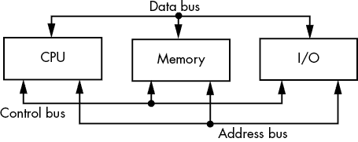

# 第 1 章：搭建舞台


我们将从简要概述计算机硬件如何被视为组织成三个子系统开始。目的是确保我们拥有一个通用的框架，用于讨论事物是如何组织以及如何契合在一起的。在这个框架内，你将学习程序是如何被创建并执行的。

本书包含相当数量的编程内容。为了帮助你准备编程工作，本章最后一节将描述如何搭建编程环境，以我的系统为例。

## 计算机子系统

你可以将计算机硬件视为由三个独立的子系统组成：*中央处理器* (*CPU*)、*内存* 和 *输入/输出* (*I/O*)。它们通过*总线*连接，如图 1-1 所示。



让我们依次看看这些组件：

1. **中央处理器 (CPU)** 控制数据在内存和 I/O 设备之间的流动。CPU 对数据执行算术和逻辑运算。CPU 可以根据算术和逻辑运算的结果决定操作顺序。它包含少量速度极快的内存。

2. **内存** 为 CPU 和 I/O 设备提供可随时访问的存储空间，用于存放 CPU 的指令及其操作的数据。

3. **输入/输出 (I/O)** 与外部世界以及大容量存储设备（例如磁盘、网络、USB 和打印机）通信。

4. **总线** 一条物理通信路径，带有一个协议，精确规定了该路径的使用方式。

正如图 1-1 中的箭头所示，信号可以在总线上双向流动。`address bus`（地址总线）用于指定特定的内存位置或 I/O 设备。程序数据和程序指令在 `data bus`（数据总线）上流动。`control bus`（控制总线）传输信号，指定每个子系统应如何使用其他总线上的信号。

图 1-1 中显示的总线表示必须在三个子系统之间传递的信号的逻辑分组。给定的总线实现可能没有为这三种信号类型中的每一种提供物理上分离的路径。例如，如果你曾在计算机中安装过显卡，它很可能使用了外设组件互连高速 (`PCI-E`) 总线。`PCI-E` 总线上的相同物理连接在不同时间传输地址和数据。

## 程序执行

`program`（程序）由存储在内存中的一系列指令组成。当你创建一个新程序时，你会使用 `editor`（编辑器）为你的新程序编写 `source code`（源代码），通常使用高级语言（例如 C、C++ 或 Java）。`editor` 程序将你新程序的 `source code` 视为数据，通常存储在磁盘上的文件中。然后你使用 `compiler`（编译器）将高级语言语句翻译成存储在磁盘文件中的机器码指令。就像 `editor` 程序一样，`compiler` 程序将你的 `source code` 和生成的机器指令都视为数据。

当程序执行时，CPU 将指令从机器码磁盘文件加载到内存中。大多数程序包含一些常量数据，也会被读入内存。CPU 通过从内存中读取（通常称为 `fetching`，取指）每条指令并执行它来运行程序。数据也会根据程序需要被取出。

当 CPU 准备好执行程序中的下一条指令时，该指令在内存中的位置被放置在 `address bus` 上。CPU 还在 `control bus` 上放置一个 `read`（读）信号。内存子系统响应将指令放置在 `data bus` 上，供 CPU 复制。如果 CPU 被指示从内存读取数据，会发生相同的事件序列。

如果 CPU 被指示在内存中存储数据，它将数据放在 `data bus` 上，将数据要存储的内存位置放在 `address bus` 上，并在 `control bus` 上放置一个 `write`（写）信号。内存子系统响应将 `data bus` 上的数据复制到指定的内存位置。

这种编辑-编译-执行方案存在变体。`interpreter`（解释器）是一种将编程语言翻译成机器指令的程序，但它不将指令保存在文件中，而是立即执行它们。另一种变体是 `compiler` 将编程语言翻译成一种中间简写语言，存储在文件中，由 `interpreter` 执行。

大多数程序也会访问 I/O 设备。有些旨在与人类交互，例如键盘、鼠标或屏幕。其他的用于机器可读的 I/O，例如磁盘。与 CPU 和内存相比，I/O 设备非常慢，且它们的时序特性差异很大。由于这些时序特性，I/O 设备与 CPU 和内存之间的数据传输必须显式编程。

对 I/O 设备进行编程需要彻底了解设备的工作原理及其与 CPU 和内存的交互方式。我们将在本书接近尾声时探讨一些通用概念。同时，本书编写的几乎每个程序都将至少使用终端屏幕，这是一个输出设备。操作系统包含执行 I/O 的功能，C 运行时环境提供了一个面向应用程序的函数库来访问操作系统的 I/O 功能。我们将使用这些 C 库函数执行大部分 I/O 操作，将 I/O 编程留给更高级的书籍。

这些段落旨在为你提供计算机硬件组织方式的总体概览。在更深入地探讨许多这些概念之前，下一节将帮助你设置本书其余部分编程所需的工具。

## 编程环境

在本节中，我将描述我如何设置计算机以完成本书中描述的所有编程工作。根据你使用的 Linux 发行版和个人偏好，你可以选择不同的方式。

我使用 Ubuntu 20.04 LTS 自带的 GNU 编程工具，运行在台式机上，既作为主操作系统，也在 Windows Subsystem for Linux (`https://docs.microsoft.com/en-us/windows/wsl/install-win10/`) 下运行，来创建和执行本书中的程序。你可以在 `https://ubuntu.com/` 下载免费的 Ubuntu 副本。安装的编译器 `gcc` 和 `g++` 版本为 9.3.0，汇编器 `as` 版本为 2.34。


您可能刚开始接触 Linux 命令行。在讲解程序的过程中，我会展示我用来创建它们的命令，但这只能为您提供基础知识。如果您花时间熟悉命令行的使用，工作效率会高得多。我发现 William Shotts 编著的《*The Linux Command Line*》（第二版，No Starch Press，2019 年出版）是一份极佳的资源。

您还应熟悉 Linux 中为我们将要使用的编程工具提供的文档。最简单的是内置在大多数程序中的帮助系统。您可以通过输入程序名称并仅加上 `--help` 选项来访问帮助。例如，`gcc --help` 会显示可用于 `gcc` 的命令行选项列表，并简要说明每个选项的作用。

大多数 Linux 程序都包含一份手册，通常称为 *man page*，它提供的文档比帮助工具更完整。可以使用 `man` 命令后跟程序名称来阅读。例如，`man man` 会显示 `man` 程序的手册页。

GNU 程序附带更完整的文档，可以使用 `info` 命令后跟程序名称来阅读。例如，`info info` 会显示 `info` 的使用手册，如下所示：

```
Next: Stand-alone Info,  Up: (dir)

Stand-alone GNU Info
********************

This documentation describes the stand-alone Info reader which you can
use to read Info documentation.

   If you are new to the Info reader, then you can get started by typing
'H' for a list of basic key bindings.  You can read through the rest of
this manual by typing <SPC> and <DEL> (or <Space> and <Backspace>) to
move forwards and backwards in it.

* Menu:

* Stand-alone Info::            What is Info?
* Invoking Info::               Options you can pass on the command line.
* Cursor Commands::             Commands which move the cursor within a node.
* Scrolling Commands::          Commands for reading the text within a node.
* Node Commands::               Commands for selecting a new node.
* Searching Commands::          Commands for searching an Info file.
* Index Commands::              Commands for looking up in indices.
* Xref Commands::               Commands for selecting cross-references.
* Window Commands::             Commands which manipulate multiple windows.
* Printing Nodes::              How to print out the contents of a node.
* Miscellaneous Commands::      A few commands that defy categorization.
* Variables::                   How to change the default behavior of Info.
* Colors and Styles::           Customize the colors used by Info.
* Custom Key Bindings::         How to define your own key-to-command bindings.
* Index::                       Global index.

-----Info: (info-stnd)Top, 31 lines --All-------------------------------------------
Welcome to Info version 6.7.  Type H for help, h for tutorial.
```

以 `*` 开头并以 `::` 结尾的项目是指向手册中其他页面的超链接。使用键盘上的方向键将光标移至此类项目内的任意位置，然后按回车键即可调出该页面。

为了获取 `info` 文档，我必须安装以下 Ubuntu 软件包：

1. `binutils-doc` 为 GNU 汇编器 `as`（有时称为 `gas`）添加有用的文档
2. `gcc-doc` 为 GNU `gcc` 编译器添加有用的文档

您需要安装的软件包可能因您使用的 Linux 发行版而异。多年来，我甚至不得不针对不同版本的 Ubuntu 更改此列表。

在大多数情况下，我使用无优化选项（`-O0` 选项）编译程序，因为目标是研究概念，而不是创建最高效的代码。只要安装了 `gcc`、`g++` 和 `as`，示例应该可以在任何 x86-64 GNU 开发环境中运行。然而，编译器生成的机器码可能因其特定配置和版本而异。您将在本书约一半处开始看到编译器生成的汇编语言。随着您继续阅读本书的其余部分，任何差异都应保持一致。

您还将使用文本编辑器进行所有编程。**请勿使用文字处理器。** 文字处理器会添加大量隐藏控制字符来格式化文本。这些隐藏字符会干扰编译器和汇编器，导致它们无法工作。

Linux 下有几款优秀的文本编辑器，每款都有其独特的风格。我最喜欢的编辑器时常会变。我建议您尝试几款可用的编辑器，然后决定您更喜欢哪一款。

以下是我用过的文本编辑器：

1. `nano` 一款简单的文本编辑器，包含在大多数 Linux 安装中。它使用命令行用户界面。文本可直接插入。Ctrl 键和“Meta”键用于指定操作文本的键盘序列。
2. `vi` 所谓的安装在所有 Linux（和 Unix）系统上。它提供面向模式的命令行用户界面。通过键盘命令操作文本。有几个命令可将 `vi` 置于文本插入模式。Esc 键用于返回命令模式。大多数 Linux 安装包含 `vim`（Vi IMproved），它具有编辑程序源代码时有用的额外功能。
3. `emacs` 使用命令行用户界面。文本可直接插入。Ctrl 键和 Meta 键用于指定操作文本的键盘序列。
4. `gedit` 如果您使用 GNOME 桌面，可能已安装。它使用图形用户界面，如果您习惯使用文字处理器，这可能会让您感到熟悉。
5. `kate` 如果您使用 KDE 桌面，可能已安装。它使用图形用户界面，如果您习惯使用文字处理器，这可能会让您感到熟悉。
6. Visual Studio Code 微软提供的一款免费编辑器，可在 Windows 7/8/10、Linux 和 macOS 上运行（[`code.visualstudio.com/`](https://code.visualstudio.com/)）。它使用图形用户界面，可用于编辑远程服务器和 Windows Subsystem for Linux 安装上的文本文件。它还允许您打开一个终端窗格以输入命令。

`vi` 和 `emacs` 也都有图形用户界面可用。

这些编辑器中的任何一个，以及许多其他编辑器，都是本书所涵盖编程工作的绝佳选择。不要花太多时间试图挑选“最好”的那一个。

## 您已学到的内容

1. **中央处理器 (CPU)** 控制计算机大部分活动的子系统。它还包含少量速度极快的内存。
2. **内存** 为程序和数据提供存储的子系统。
3. **输入/输出 (I/O)** 提供与外部世界及大容量存储设备通信手段的子系统。
4. **总线** CPU、内存和 I/O 之间的通信路径。
5. **程序执行** 程序运行时，三个子系统和总线如何被使用的概述。
6. **编程环境** 如何设置本书编程所需工具的示例。

在下一章中，您将开始学习数据如何在计算机中存储，初步接触 C 语言编程，并开始学习如何将调试器作为学习工具使用。
