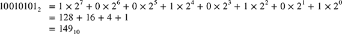
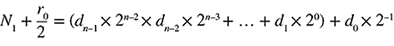
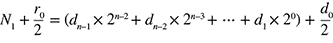
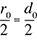
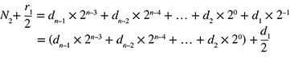
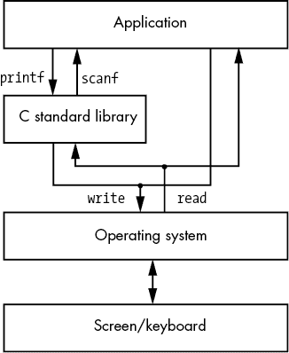

# 第 2 章：数据存储格式


在本书中，我们将从一个不同的角度来审视计算机：我们不再把计算机看作程序、文件和图形的集合，而是将其视为数十亿个双态开关以及一个或多个*控制单元*——能够检测和改变开关状态的设备。在第 1 章中，我们讨论了通过输入和输出与计算机外部世界进行通信。在本章中，我们将开始探索计算机如何对数据进行编码以存储在内存中；然后我们将编写一些 C 语言程序来探究这些概念。

## 描述开关和开关组


计算机上发生的一切——你编写的代码、使用的数据、屏幕上的图像——都由一系列双态开关控制。每种开关组合代表计算机可能处于的一种状态。如果你想描述计算机上正在发生的事情，可以列出一种开关组合。用通俗的英语表达，这类似于“第一个开关是开启的，第二个也是开启的，但第三个是关闭的，而第四个是开启的。”但用这种方式描述计算机会非常困难，尤其是现代计算机使用数十亿个开关。相反，我们将使用一种更简洁的数字表示法。

## 使用位表示开关

你可能熟悉*十进制系统*，它使用 10 个数字（0 到 9）来书写数字。我们需要一种用数字表示开关的方法，但开关只有 2 种状态，而不是 10 种。这时，*二进制系统*——一种使用 `0` 和 `1` 的两位数字系统——将派上用场。

我们将使用*二进制数字*（通常简称为*位*）来表示开关的状态。一个位可以有两个值：`0` 表示开关“关闭”，`1` 表示开关“开启”。如果我们愿意，可以给这些数字分配相反的值——重要的是我们保持一致。让我们用位来简化关于开关的陈述。在前面的例子中，我们有一台计算机，其中第一个开关开启，第二个开启，第三个关闭，第四个开启。在二进制中，我们将其表示为 `1101`。

## 表示位组

即使使用二进制，有时位太多导致数字难以阅读。在这种情况下，我们使用*十六进制数字*来指定位模式。十六进制系统有 16 个数字，每个数字可以代表一组 4 位。

表 2-1 显示了所有 16 种 4 位组合及其对应的十六进制数字。使用十六进制一段时间后，你可能会记住这个表，但如果忘记了，在线搜索可以快速找到十六进制到二进制的转换器。

**表 2-1：四位的十六进制表示**

| 一个十六进制数字 | 四个二进制数字（位） |
|------------------|----------------------|
| `0`              | `0000`               |
| `1`              | `0001`               |
| `2`              | `0010`               |
| `3`              | `0011`               |
| `4`              | `0100`               |
| `5`              | `0101`               |
| `6`              | `0110`               |
| `7`              | `0111`               |
| `8`              | `1000`               |
| `9`              | `1001`               |
| `a`              | `1010`               |
| `b`              | `1011`               |
| `c`              | `1100`               |
| `d`              | `1101`               |
| `e`              | `1110`               |
| `f`              | `1111`               |

使用十六进制，我们可以用单个数字写出 `1101`（即“开、开、关、开”）：`d`[16] = `1101`[2]。

*八进制*系统基于数字 8，不太常见，但你偶尔会遇到。八个八进制数字从 `0` 到 `7`，每个代表一组三位。表 2-2 显示了每种可能的三位组合与其对应的八进制数字之间的对应关系。例如，如果我们想简要表示前面示例中的前三位，可以直接使用 `6`[8]，它等同于 `110`[2]。

**表 2-2：三位的八进制表示**

| 一个八进制数字 | 三个二进制数字（位） |
|----------------|----------------------|
| `0`            | `000`                |
| `1`            | `001`                |
| `2`            | `010`                |
| `3`            | `011`                |
| `4`            | `100`                |
| `5`            | `101`                |
| `6`            | `110`                |
| `7`            | `111`                |

## 使用十六进制数字

当我们需要指定一组（例如 16 个或 32 个）开关的状态时，十六进制数字特别方便。我们可以用一个十六进制数字代替每组四位。以下是两个示例：

`6c2a16 = 01101100001010102`

和

`0123abcd16 = 000000010010001110101011110011012`

单个位通常不适合存储数据。计算机中一次可访问的最小位数定义为*字节*。在大多数现代计算机中，一个字节由八位组成，但也存在八位字节的例外。例如，CDC 6000 系列科学大型主机计算机使用六位字节。

在 C 和 C++ 编程语言中，用 `0x`（零和小写 x）作为数字前缀表示该数字以十六进制表示，仅用 `0` 作为前缀表示八进制。C++ 允许我们通过用 `0b` 作为前缀来指定二进制值。虽然用 `0b` 表示法指定二进制不是标准 C 的一部分，但我们的编译器 `gcc` 允许这样做。因此，在本书编写 C 或 C++ 代码时，以下含义相同：

```
100 = 0x64 = 0144 = 0b01100100
```

但如果你使用另一个 C 编译器，可能无法使用 `0b` 语法指定二进制。

## 二进制与十进制的数学等价性

在上一节中，你了解到二进制数字是展示计算机内部开关状态的自然方式。你还了解到我们可以用十六进制用单个字符显示四个开关的状态。在本节中，我将介绍*二进制数制*的一些数学属性，并展示它如何与更熟悉的*十进制*（基数 10）*数制*相互转换。

### 了解位置表示法

按照惯例，书写数字时我们使用*位置表示法*。这意味着符号的值取决于它在一组符号中的位置。在熟悉的十进制数制中，我们使用符号 0、1、…、9 来表示数字。

在数字 50 中，符号 5 的值是 50，因为它位于*十位*，该位置上的任何数字都乘以 10。在数字 500 中，符号 5 的值是 500，因为它位于*百位*。符号 5 在任何位置都相同，但其*值*取决于它在数字中占据的位置。

进一步来说，在十进制数制中，整数 123 被理解为：

1 × 100 + 2 × 10 + 3

或

1 × 10² + 2 × 10¹ + 3 × 10⁰

在这个例子中，最右边的数字 3 是*最低有效位*，因为它的值对数字总值的贡献最小。最左边的数字 1 是*最高有效位*，因为它贡献的值最大。

十进制数制的*基数*或*底数*——唯一数字的数量——是 10。这意味着有 10 个符号表示数字 0 到 9。将一个数字向左移动一位会使其值增加 10 倍。向右移动一位会使其值减少 10 倍。位置表示法推广到任何底数 *r*，如下所示：

d[n–1] × r^(n–1) + d[n–2] × r^(n–2) + … + d[1] × r¹ + d[0] × r⁰

其中数字中有 *n* 位，每个 *d*[*i*] 是一个满足 0 ≤ *d*[*i*] < *r* 的单个数字。

这个表达式告诉我们如何确定数字中每位的值。我们通过从右向左计数（从零开始）来确定数字中每位的位置。在每个位置，我们将底数 *r* 提升到其位置的幂，然后将该数乘以该位数字的值。将所有结果相加得到该数字表示的值。

二进制数制的底数是 2，因此只有两个符号表示数字；这意味着 *d*[*i*] = `0`、`1`，我们可以将此表达式写为：

d[n–1] × 2^(n–1) + d[n–2] × 2^(n–2) + … + d[1] × 2¹ + d[0] × 2⁰

其中数字中有 *n* 位，每个 *d*[*i*] = `0` 或 `1`。

在下一节中，我们将把二进制数转换为无符号十进制数，反之亦然。*有符号*数可以是正数或负数，但*无符号*数没有符号。我们将在第 3 章讨论有符号数。

### 将二进制转换为无符号十进制

你可以通过计算 2 的位置幂的值，然后乘以该位置上位的值，轻松地从二进制转换为十进制。这是一个例子：




### 二进制转十进制

以下算法总结了将二进制转换为十进制的过程：

```
Let result = 0
1 Repeat for each i = 0,...,(n - 1)
    add 2^i * d_i to result
```

在每个位位置 `i` 处，该算法计算 `2^i` 的幂，然后乘以相应的位值，即 `0` 或 `1`。

### 无符号十进制转二进制

如果我们要将一个无符号十进制整数 `N` 转换为二进制，我们将其等于二进制数的前一个表达式，从而得到以下方程：

`N = d[n-1] * 2^(n-1) + d[n-2] * 2^(n-2) + ... + d[1] * 2¹ + d[0] * 2⁰`

其中每个 `d[i]` = `0` 或 `1`。我们将等式两边同时除以 2，右边每个 2 的项的指数减 1，得到以下结果：



其中 `N[1]` 是整数部分，余数 `r[0]` 对于偶数是 `0`，对于奇数是 `1`。稍微改写一下，我们得到等价方程：



右边括号内的所有项都是整数。等式两边的整数部分必须相等，小数部分也必须相等。即：

`N[1] = d[n-1] * 2^(n-2) + d[n-2] * 2^(n-3) + ... + d[1] * 2⁰`

和



因此，我们看到 `d[0] = r[0]`。从展开方程的两边减去 `r[0] / 2`（等于 `d[0] / 2`）得到：

`N[1] = d[n-1] * 2^(n-2) + d[n-2] * 2^(n-3) + ... + d[1] * 2⁰`

再次，我们将两边同时除以 2：



使用与前面相同的推理，`d[1] = r[1]`。我们可以通过从右向左工作，反复除以 2，并使用余数作为相应位的值，来生成一个数的二进制表示。这总结在以下算法中，其中正斜杠 (`/`) 是整数除法运算符，百分号 (`%`) 是取模运算符：

```
quotient = N
i = 0
d_i = quotient % 2
quotient = quotient / 2
While quotient != 0
    i = i + 1
    d_i = quotient % 2
    quotient = quotient / 2
```

某些编程任务需要特定的位模式，例如，对硬件设备进行编程。在这些情况下，指定位模式——而不是数值——更自然。我们可以将位按四个一组来考虑，并使用十六进制来指定每组。例如，如果我们的算法需要使用交替的零和一，`0101 0101 0101 0101 0101 0101 0101 0101`，我们可以将其转换为十进制值 431655765，或者用十六进制表示为 `0x55555555`（此处采用 C/C++ 语法）。一旦你记住了表 2-1，你会发现用十六进制处理位模式容易得多。

这两节的讨论只涉及无符号整数。有符号整数的表示取决于 CPU 的一些架构特性，我们将在第 3 章讨论。

## 在内存中存储数据

我们现在拥有了开始讨论数据如何存储在计算机内存中所需的语言。你将首先了解内存是如何组织的。计算机中用于存储程序指令和数据的内存主要有两种：

### 随机存取存储器 (RAM)

1. 一旦一个位（开关）被设置为 `0` 或 `1`，它将保持该状态，直到控制单元主动改变它或电源关闭。控制单元既可以读取位的状态，也可以改变它。
2. *随机存取存储器* 这个名称容易产生误解。这里的 *随机存取* 意味着访问内存中任何字节所需的时间相同，并不意味着读取字节时涉及任何随机性。我们将 RAM 与 *顺序存取存储器* (SAM) 进行对比，后者访问字节所需的时间取决于它在某个序列中的位置。你可以把 SAM 想象成磁带：访问字节所需的时间取决于该字节相对于磁带当前位置的物理位置。

### 只读存储器 (ROM)

1. ROM 也称为 *非易失性存储器* (NVM)。控制单元可以读取每个位的状态，但不能改变它。你可以使用专用硬件重新编程某些类型的 ROM，但位在断电后仍保持新状态。

### 表示内存地址

内存中的每个字节都有一个位置，或地址，很像办公楼里的房间号。特定字节的地址永远不会改变。也就是说，从内存开头开始的第 957 个字节将永远是第 957 个字节。然而，任何给定字节中每个位的状态（内容）——即 `0` 或 `1`——都可以被改变。

计算机科学家通常用十六进制表示内存中每个字节的地址，编号从零开始。因此，我们会说第 957 个字节位于地址 `0x3bc`（十进制为 956）。

内存中的前 16 个字节的地址为 `0`、`1`、`2`、`3`、`4`、`5`、`6`、`7`、`8`、`9`、`a`、`b`、`c`、`d`、`e` 和 `f`。使用以下表示法

```
<address>: <content>
```

我们可以像表 2-3 那样显示内存前 16 个字节的内容（此处内容为任意值）。

**表 2-3：内存前 16 字节的任意内容**

| 地址 | 内容 | 地址 | 内容 |
| --- | --- | --- | --- |
| `0x00000000:` | `0x6a` | `0x00000008:` | `0xf0` |
| `0x00000001:` | `0xf0` | `0x00000009:` | `0x02` |
| `0x00000002:` | `0x5e` | `0x0000000a:` | `0x33` |
| `0x00000003:` | `0x00` | `0x0000000b:` | `0x3c` |
| `0x00000004:` | `0xff` | `0x0000000c:` | `0xc3` |
| `0x00000005:` | `0x51` | `0x0000000d:` | `0x3c` |
| `0x00000006:` | `0xcf` | `0x0000000e:` | `0x55` |
| `0x00000007:` | `0x18` | `0x0000000f:` | `0xaa` |

每个字节的内容由两个十六进制数字表示，它们指定了该字节八个位的确切状态。

但字节的八个位的状态能告诉我们什么？程序员在将数据存储到内存时需要考虑两个问题：

1. 需要多少位来存储数据？要回答这个问题，我们需要知道特定数据项允许多少个不同的值。看看我们在表 2-1（四位）和表 2-2（三位）中可以表示多少个不同的值。我们可以看到，在 `n` 位中最多可以表示 `2^n` 个不同的值。还要注意，我们可能不会使用分配空间内所有可能的位模式。
2. 存储数据的代码是什么？我们在日常生活中处理的大多数数据不是用零和一表示的。要将其存储在计算机内存中，程序员必须决定如何用零和一对数据进行编码。

在本章的剩余部分，我们将看到如何利用一个或多个字节中位的状态来在内存中存储字符和无符号整数。

### 字符

编程时，你几乎总是在操作文本字符串，它们是字符数组。你写的第一个程序很可能是“Hello, World!”程序。如果你用 C 语言编写，你可能使用了如下语句：

```c
printf("Hello, World!\n");
```

或者在 C++ 中如下：

```cpp
cout << "Hello, World!" << endl;
```

当将这些语句中的任何一个翻译成机器码时，编译器必须做两件事：

* 将每个字符存储在控制单元可访问的内存位置
* 生成在屏幕上写入字符的机器指令

我们将从考虑单个字符如何存储在内存中开始。

#### 字符编码


用于计算机存储的字符编码最常用标准是 `Unicode UTF-8`。它使用一到四个字节来存储一个称为 `code point`（码位）的数字，该数字代表一个字符。Unicode 码位写作 `U+h`，其中 `h` 是四到六位十六进制数字。操作系统和显示硬件将一个或多个码位与一个 `glyph`（字形）关联起来，这就是我们在屏幕或纸上看到的内容。例如，`U+0041` 是拉丁大写字母 `A` 的码位，在本书所用字体中其字形为 A。

UTF-8 与一种较旧的标准向后兼容，即 `American Standard Code for Information Interchange`（`ASCII`——读作 “ask-ee”）。`ASCII` 使用七位来指定 128 字符集中的每个码位，该字符集包含英文字母（大写和小写）、数字、特殊字符和控制字符。在本书中，我们将在所有编程中仅使用 UTF-8 的 ASCII 子集 `U+0000` 到 `U+007F` 中的字符。

表 2-4 显示了用于表示十六进制数字的字符的 Unicode 码位，以及在我们的编程环境中存储在内存中的相应 8 位模式。稍后在本书中，当你学习如何将整数的字符表示转换为其二进制表示时，你将有机会使用此表。现在，请注意，虽然数字字符按连续的位模式序列组织，但它们与字母字符之间存在间隔。

**表 2-4：十六进制字符的 UTF-8 编码**

| 码位 | 字符描述 | 字符字形 | | 位模式 |
| --- | --- | --- | --- | --- |
| `U+0030` | 数字零 | `0` | | `0x30` |
| `U+0031` | 数字一 | `1` | | `0x31` |
| `U+0032` | 数字二 | `2` | | `0x32` |
| `U+0033` | 数字三 | `3` | | `0x33` |
| `U+0034` | 数字四 | `4` | | `0x34` |
| `U+0035` | 数字五 | `5` | | `0x35` |
| `U+0036` | 数字六 | `6` | | `0x36` |
| `U+0037` | 数字七 | `7` | | `0x37` |
| `U+0038` | 数字八 | `8` | | `0x38` |
| `U+0039` | 数字九 | `9` | | `0x39` |
| `U+0061` | 拉丁小写字母 a | `a` | | `0x61` |
| `U+0062` | 拉丁小写字母 b | `b` | | `0x62` |
| `U+0063` | 拉丁小写字母 c | `c` | | `0x63` |
| `U+0064` | 拉丁小写字母 d | `d` | | `0x64` |
| `U+0065` | 拉丁小写字母 e | `e` | | `0x65` |
| `U+0066` | 拉丁小写字母 f | `f` | | `0x66` |

虽然十六进制数值部分与码位 `U+0000` 到 `U+007F` 的位模式相同，但这不一定适用于其他字符。例如，`U+00B5` 是微号的码位，在内存中作为 16 位模式 `0xc2b5` 存储，在本书所用字体中其字形为 µ。

UTF-8 使用每字符一个字节来存储码位 `U+0000` 到 `U+007F`。字节中的第 6 位和第 5 位（回想一下，位是从右向左编号，从 0 开始）指定四组字符，如 表 2-5 所示。特殊字符主要是标点符号。例如，空格字符是 `U+0020`，`;` 字符是 `U+003B`。

**表 2-5：码位 U+0000 到 U+007F 中的字符组**

| 第 6 位 | 第 5 位 | 字符类型 |
| --- | --- | --- |
| `0` | `0` | 控制 |
| `0` | `1` | 数字和特殊 |
| `1` | `0` | 大写字母和特殊 |
| `1` | `1` | 小写字母和特殊 |

你可以通过在 Linux 终端窗口中输入命令 `man ascii` 来生成一个与 ASCII 字符对应的码位表。（你可能需要在计算机上安装 `ascii` 程序。）它相当大，不是你想要背诵的那种东西，但它有助于大致了解其组织方式。

你可以在 [`www.unicode.org/releases/`](https://www.unicode.org/releases/) 了解更多关于 Unicode 的信息。关于 Unicode 如何诞生的更非正式讨论，我推荐阅读 [`www.joelonsoftware.com/`](https://www.joelonsoftware.com/) 上的 “The Absolute Minimum Every Software Developer Absolutely, Positively Must Know About Unicode and Character Sets (No Excuses!)”（每个软件开发人员绝对、必须了解的关于 Unicode 和字符集的最低限度知识（没有借口！））。

## 存储文本字符串

回到 `Hello, World!\n`，编译器将此文本字符串存储为一个常量字符数组。为了指定此数组的范围，`C-style string`（C 风格字符串）在字符串末尾使用码位 `U+0000`（ASCII `NUL`）作为 `sentinel`（哨兵）值，这是一个指示字符序列结束的唯一值。因此，编译器必须为此字符串分配 13 字节：`Hello, World!` 占 11 字节，换行符 `\n` 占 1 字节，`NUL` 占 1 字节。例如，表 2-6 显示了此文本字符串如何从内存位置 `0x4004a1` 开始存储。

**表 2-6：内存中存储的 “Hello, World!”**

| 地址 | 内容 | 地址 | 内容 |
| --- | --- | --- | --- |
| `0x4004a1:` | `0x48` | `0x4004a9:` | `0x6f` |
| `0x4004a2:` | `0x65` | `0x4004aa:` | `0x72` |
| `0x4004a3:` | `0x6c` | `0x4004ab:` | `0x6c` |
| `0x4004a4:` | `0x6c` | `0x4004ac:` | `0x64` |
| `0x4004a5:` | `0x6f` | `0x4004ad:` | `0x21` |
| `0x4004a6:` | `0x2c` | `0x4004ae:` | `0x0a` |
| `0x4004a7:` | `0x20` | `0x4004af:` | `0x00` |

C 使用 `U+000A`（ASCII `LF`）作为单个换行字符（在本例中位于地址 `0x4004ae`），尽管 C 语法要求程序员写两个字符 `\n`。文本字符串以 `0x4004af` 处的 `NUL` 字符结束。

在 Pascal（另一种编程语言）中，字符串的长度由字符串中的第一个字节指定，该字节被视为一个八位无符号整数。（这是 Pascal 中文本字符串限制为 256 字符的原因。）`C++ string class`（C++ 字符串类）具有额外功能，但实际文本字符串作为 `C-style text string`（C 风格文本字符串）存储在 `C++ string instance`（C++ 字符串实例）中。

## 无符号整数

由于无符号整数可以用任何基数表示，存储它最明显的方法可能是使用二进制数制。如果我们从右向左给字节中的位编号，则最低位存储在位 0，次低位存储在位 1，依此类推。例如，整数 123[10] = `7b`[16]，因此存储它的字节状态将是 `01111011`[2]。

仅使用一个字节将无符号整数的范围限制在 0 到 255[10]，因为 `ff`[16] = 255[10]。在我们的编程环境中，无符号整数的默认大小为四字节，允许的范围为 0 到 4,294,967,295[10]。

使用二进制数制的一个局限性是，你需要在对十进制数执行算术运算之前，将其从字符串转换为二进制数制。例如，十进制数 123 以字符串格式存储为四个字节 `0x31`、`0x32`、`0x33` 和 `0x00`，而以无符号整数格式存储则为四字节二进制数 `0x0000007b`。在另一端，二进制数需要转换为其十进制字符表示，以满足大多数现实世界的显示目的。

`Binary Coded Decimal`（`BCD`，二进制编码十进制）是另一种用于存储整数的编码。它为每个十进制数字使用四位，如 表 2-7 所示。

**表 2-7：二进制编码十进制**

| 十进制数字 | BCD 编码 |
| --- | --- |
| 0 | `0000` |
| 1 | `0001` |
| 2 | `0010` |
| 3 | `0011` |
| 4 | `0100` |
| 5 | `0101` |
| 6 | `0110` |
| 7 | `0111` |
| 8 | `1000` |
| 9 | `1001` |

例如，在一个 16 位存储位置中，十进制数 1234 在 BCD 中将存储为 `0001 0010 0011 0100`（在二进制数制中，它将是 `0000 0100 1101 0010`）。


# BCD 和 COBOL 压缩 BCD 格式

由于 16 种可能的组合中仅使用了 10 种，我们可以看到有六种位模式被浪费了。这意味着如果我们使用 BCD，一个 16 位的存储位置其值的范围是 0 到 9,999，而如果我们使用二进制，范围则是 0 到 65,535，因此这是一种内存利用效率较低的方式。另一方面，正如你将在第 16 章看到的那样，字符格式与整数格式之间的转换在 BCD 中更为简单。

BCD 在主要处理数值型业务数据的专用系统中很重要，因为这些系统打印数字的频率往往高于对它们执行数学运算的频率。COBOL 是一种面向商业应用的编程语言，它支持一种压缩 BCD 格式，其中两个数字（采用 BCD 码）存储在每个八位字节中。在这里，`最后一个`（四位）数字用于存储数字的符号，如表 2-8 所示。所使用的具体代码取决于实现。

**表 2-8：COBOL 压缩 BCD 格式的符号代码示例**

| 符号 | 符号代码 |
|------|-----------|
| +    | `1010`    |
| −    | `1011`    |
| +    | `1100`    |
| −    | `1011`    |
| +    | `1110`    |
| 无符号 | `1111` |

例如，`0001 0010 0011 1010` 表示 +123，`0001 0010 0011 1011` 表示 −123，而 `0001 0010 0011 1111` 表示 123。

接下来，我们将使用 C 编程语言探讨其中的一些概念。如果你是 C 语言新手，这部分讨论将为你介绍这门语言。

## 使用 C 语言探索数据格式

在本节中，我们将编写第一个 C 语言程序。这些特定的程序说明了数字在内存中的存储方式与人类阅读方式之间的差异。C 语言让我们能足够接近硬件以理解核心概念，同时处理了许多底层细节。你不应觉得本书中使用的简单 C 程序太难，特别是如果你已经懂得如何用另一种语言编程的话。

如果你学习编程时使用的是 C++、Java 或 Python 等高级语言，那么你很有可能学过面向对象编程。C 语言不支持面向对象范式。C 是一种 `过程式编程语言`。C 程序被划分为函数。`函数` 是一组已命名的编程语句。其他编程语言也使用 `过程` 和 `子程序` 等术语，它们之间有一些细微的区别，取决于具体语言。

### C 和 C++ I/O 库

大多数高级编程语言都包含一个标准库，可以将其视为语言的一部分。标准库包含可在语言中用于执行常见任务的函数和数据结构，例如终端 I/O——写入屏幕和从键盘读取。C 语言包含 `C 标准库`，C++ 包含 `C++ 标准库`。

C 程序员使用 `stdio` 库中的函数，C++ 程序员使用 `iostream` 库中的函数进行终端 I/O。例如，从键盘读取一个整数，给它加 100，并将结果写入屏幕的 C 代码序列如下所示：

```c
int x;
scanf("%i", &x);
x += 100;
printf("%i", x);
```

C++ 代码序列看起来像这样：

```cpp
int x;
cin >> x;
x +=100;
cout << x;
```

在两个示例中，代码都从键盘读取字符，每个字符作为一个单独的 `char`，并将 `char` 序列转换为相应的 `int` 格式。然后它给 `int` 加 100。最后，代码将生成的 `int` 转换为 `char` 序列并将其显示在屏幕上。前面代码中的 C 或 C++ I/O 库函数会完成 `char` 序列与 `int` 存储格式之间必要的转换。

图 2-1 展示了 C 应用程序、I/O 库和操作系统之间的关系。



图 2-1：I/O 库与应用程序及操作系统的关系

当从键盘读取时，`scanf` 库函数首先调用 `read` `系统调用` 函数（操作系统中的一个函数）从键盘读取字符。键盘上的输入形式是一个字符串，每个字符采用 `char` 数据类型。`scanf` 库函数执行将此字符串转换为应用程序所用的 `int` 数据类型的操作。`printf` 库函数将 `int` 数据类型转换为 `char` 数据类型中对应的字符串，并调用 `write` 系统调用函数将每个字符写入屏幕。

正如你在图 2-1 中所见，应用程序可以直接调用 `read` 和 `write` 函数来传输字符。我们将在第 16 章探讨这一点，届时我们将编写自己的转换函数。虽然 C/C++ 库函数能更好地完成这项工作，但自己动手做的练习将让你更好地理解数据如何存储在内存中并被软件操作。

### 编写并执行你的第一个 C 程序

大多数编程书籍都从一个简单的程序开始，该程序只是在计算机屏幕上打印“Hello, world”，但我们将从一个程序开始，该程序读取一个十六进制值，既作为无符号整数又作为文本字符串（参见清单 2-1）。

```c
1 /* intAndString.c
 * 读取并显示一个整数和一个文本字符串。
 */

2 #include <stdio.h>

3 int main(void)
{
4 unsigned int anInt;
  char aString[10];

5 printf("Enter a number in hexadecimal: ");
6 scanf("%x", &anInt);
  printf("Enter it again: ");
7 scanf("%s", aString);
8 printf("The integer is %u and the string is %s\n", anInt, aString);

9 return 0;
}
```

清单 2-1：展示整数与文本字符串区别的程序

我们以一些文档开始代码，给出文件名 1 和程序功能的简要描述。编写自己的源文件时，你还应将你的姓名和编写日期作为文档的一部分包含在内（为了节省纸张，我在本书示例程序中省略了它们）。`/*` 和 `*/` 之间的所有内容都是 `注释`。它是供人类阅读的，对程序本身没有任何影响。

第一个实际影响程序的操作是包含另一个文件 2，即 `stdio.h` `头文件`。正如你将了解到的，C 编译器需要知道传递给函数或从函数返回的每个数据项的类型。头文件用于为每个函数提供 `原型声明`，以指定这些数据类型。`stdio.h` 头文件定义了 C 标准库中许多函数的接口，这使编译器在遇到对这些函数的调用时知道该怎么做。`stdio.h` 头文件已安装在编译器已知的计算机位置。

接下来你看到的是 C `main` 函数 3 的定义。所有 C 程序都由函数组成，其一般格式如下：

```
return_data_type function_name(parameter_list)
{
  function_body
}
```

当执行 C 程序时，操作系统首先建立一个 `C 运行时环境`，它设置计算机上的资源以运行程序。然后 C 运行时环境调用 `main` 函数，这意味着你编写的程序必须包含一个 `function_name` 为 `main` 的函数。`main` 函数可以调用其他函数，而其他函数又可以调用更多函数。但程序控制权通常最终会回到 `main` 函数，随后它返回给 C 运行时环境。


# 函数调用与参数

在 C 语言中，当调用一个函数时，调用函数可以在调用中包含一个 `arguments` 列表作为传递给被调用函数的输入。这些输入在被调用函数执行的计算中作为 `parameters`。例如，在 清单 2-1 中，程序启动时，`main()` 函数带一个参数（文本字符串 5）调用 `printf()` 函数。`printf()` 函数使用该文本字符串确定在屏幕上显示什么内容。我们将在第 14 章详细探讨参数如何传递给函数，以及它们如何在函数中作为参数使用。清单 2-1 中的 `main()` 函数不需要来自 C 运行时环境的任何数据，这在其定义中通过对 `parameter_list` 使用 `void` 来表示。

## 函数返回值

函数执行完成后，通常返回到调用函数。被调用函数在返回时可以向调用函数传递一个数据项。`main()` 函数应向 C 运行时环境返回一个整数，指示程序执行过程中是否检测到错误。因此，`main` 的 `return_data_type` 是 `int`。清单 2-1 中的 `main()` 函数向 C 运行时环境返回整数 `0`，后者将此值传递给操作系统。值 `0` 告诉操作系统一切顺利。

## 变量定义

在 清单 2-1 中，我们在 `main()` 函数的 `function_body` 开头定义了两个变量：一个名为 `anInt` 的无符号整数和一个名为 `aString` 的文本字符串。大多数现代编程语言允许我们在代码的任何位置引入新变量，但 C 语言要求它们列在函数的开头。（此规则有一些例外，但超出了本书范围。）可以将其视为在给出使用说明之前列出烹饪食谱的配料。我们通过引入变量名并指定其数据类型来 `define` 一个变量。`[10]` 符号告诉编译器为 `aString` 变量分配一个包含 10 个 `char` 的数组，这允许我们存储最多 9 个字符的 C 风格文本字符串（第 10 个 `char` 将是终止符 `NUL` 字符）。我们将在第 17 章详细讨论数组。

## `printf` 格式字符串

程序使用 C 标准库的 `printf()` 函数在屏幕上显示文本。对 `printf()` 的调用中的第一个参数是一个 `format string`，它是由要在屏幕上显示的普通字符（`%` 除外）组成的文本字符串。

`printf()` 最简单的格式字符串只是你想要打印的文本，不包含任何要打印的变量。如果你想打印变量的值，格式字符串将作为你想要打印的文本的模板。文本字符串中你想要打印变量值的位置用 `conversion specifier` 标记。每个转换说明符以 `%` 字符开头。变量名按其各自的转换说明符在模板中出现的相同顺序列在格式字符串之后。

以转换说明符开头的 `%` 字符后面紧跟一个或多个转换代码字符，以告诉 `printf()` 如何显示变量的值。表 2-9 显示了一些常见的转换说明符。

### 表 2-9: `printf` 和 `scanf` 格式字符串的常见转换说明符

| 转换说明符 | 表示内容 |
| --- | --- |
| `%u` | 无符号十进制整数 |
| `%d` 或 `%i` | 有符号十进制整数 |
| `%f` | 浮点数 |
| `%x` | 十六进制 |
| `%s` | 文本字符串 |

转换说明符可以包含其他字符，用于指定显示的字段宽度、值在字段内是左对齐还是右对齐等属性。我们这里不深入细节。你可以阅读 `printf` 的 `man` 第 3 页以了解更多（在 shell 中输入 `man 3 printf`）。

## `scanf` 格式字符串

对 C 标准库函数 `scanf()` 的调用中的第一个参数也是一个格式字符串。我们在格式字符串中使用相同的转换说明符来告诉 `scanf()` 函数如何解释键盘上输入的字符。我们需要通过在变量名 `anInt` 上使用 `address of` 运算符 `&anInt` 来告诉 `scanf()` 在哪里存储输入的整数。当将数组名传递给函数时，C 语言传递的是数组的地址，因此当调用 `scanf()` 从键盘读取文本字符串时，我们不使用 `&` 运算符。

除这些转换说明符外，包含在 `scanf()` 格式字符串中的任何其他字符必须与键盘输入完全匹配。例如：

```
scanf("1 %i and 2 %i", &oneInt, &twoInt);
```

要求输入如：

```
1 123 and 2 456
```

这将从键盘读取整数 123 和 456。你可以阅读 `scanf` 的 `man` 第 3 页以了解更多（在 shell 中输入 `man 3 scanf`）。

## 程序返回与示例输出

最后，`main()` 函数向 C 运行时环境返回 0，后者将此值传递给操作系统。值 0 告诉操作系统一切顺利。

在我的计算机上编译并运行 清单 2-1 中的程序得到了以下输出：

```
$ gcc -Wall -masm=intel -o intAndString intAndString.c
$ ./intAndString
Enter a hexadecimal value: 123abc
Enter it again: 123abc
The integer is 1194684 and the string is 123abc 
$
```

清单 2-1 中的程序演示了一个重要概念——十六进制作为人类陈述位模式的一种便利。数字本身并不固有地是二进制、十进制或十六进制。它只是一个值。特定的值可以在这三种数制中等价地表示。事实上，它可以在任何数制（2、16、285）中等价地表示。但由于计算机由二进制开关组成，所以用二进制数制来思考存储在计算机中的数值是合理的。

# 使用调试器检查内存

现在我们已经开始编写程序，你需要学习如何使用 GNU 调试器 `gdb`。`debugger` 是一个允许你在观察和控制程序行为的同时运行程序的程序。当你使用调试器时，就像你是一个木偶师，而你的程序是一个受精心控制的木偶。你的主要控制工具是 `breakpoint`；当你设置一个断点且程序运行时到达它，程序将暂停并将控制权返回给调试器程序。当控制权在调试器手中时，你可以查看程序变量中存储的值，这有助于你找出 bug 所在。

如果这一切似乎为时过早——我们目前的程序很简单，似乎不需要调试——我保证在一个简单的例子上学习如何使用调试器，比在一个无法工作的复杂程序上学要好得多。

即使你编写无 bug 的程序，`gdb` 也是学习本书内容的宝贵工具。例如，在下面的 `gdb` 会话对话中，我将向你展示如何确定变量在内存中的存储位置，以及如何查看那里存储的内容，包括十进制和十六进制。你将看到如何在一个活程序上使用 `gdb` 来说明前几页讨论的概念。

这里列出的 `gdb` 命令足以让你入门。你将在第 10 章看到更多。

1.  `b source_filename:line_number` 在源文件 `source_filename` 的指定 `line_number` 处设置断点。当遇到 `line_number` 时，代码将在断点处停止运行，并将控制权返回给 `gdb`，允许你测试代码的各个元素。
2.  `c` 从当前位置继续程序执行。
3.  `h command` 关于如何使用 `command` 的帮助。


## GDB 命令参考

4. `i r` 显示 CPU 寄存器内容（`info registers`）。（您将在第 9 章了解 CPU 寄存器。）

5. `l` `line_number` 列出以指定 `line_number` 为中心的 10 行源代码。

6. `print` `expression` 对 `expression` 求值并打印结果。

7. `printf` `"format", var1, var2, ...` 以给定格式显示 `var1, var2, ...` 的值。`"format"` 字符串遵循与 C 标准库中 `printf` 相同的规则。

8. `r` 开始执行已在 `gdb` 控制下加载的程序。

9. `x/nfs memory_address` 从 `memory_address` 开始，以格式 `f`、大小 `s` 显示（检查）内存中的 `n` 个值。

## 使用调试器

让我们使用 `gdb` 演练清单 2-1 中的程序，探索迄今为止涵盖的一些概念。建议您在电脑上跟随操作：亲自使用 `gdb` 更容易理解。请注意，您在电脑上看到的地址可能与示例中的不同。

首先使用 `gcc` 命令编译程序：

```
$ gcc -g -Wall -masm=intel -o intAndString intAndString.c
```

`-g` 选项告诉编译器在可执行程序中包含调试信息。`-Wall` 选项告诉编译器对代码中正确但可能非预期的 C 代码发出警告。例如，它会警告您在函数中声明了从未使用的变量，这可能意味着您遗漏了什么。

本书后面编写汇编语言时，我们将使用 Intel 和 AMD 文档中指定的语法，并使用 `masm=intel` 选项告诉编译器使用相同语法。目前不需要此选项，但建议习惯使用，因为稍后会用到。

`-o` 选项指定输出文件名，即可执行程序。

编译完成后，可使用以下命令在 `gdb` 控制下运行程序：

```
$ gdb ./intAndString
--snip--
Reading symbols from ./intAndString…
(gdb) l
1	/* intAndString.c
2	 * Using printf to display an integer and a text string.
3	 */
4	
5	#include <stdio.h>
6	
7	int main(void)
8	{
9	  unsigned int anInt;
10	  char aString[10];
(gdb) 
11	
12	  printf("Enter a number in hexadecimal: ");
13	  scanf("%x", &anInt);
14	  printf("Enter it again: ");
15	  scanf("%s", aString);
16	  
17	  printf("The integer is %u and the string is %s\n", anInt, aString);
18	

19	  return 0;
20	}
(gdb)
```

`gdb` 启动信息（为节省空间已从上述输出中移除）包含有关调试器的信息，并引导您查阅其使用文档。

`l` 命令列出 10 行源代码，然后将控制权返回给 `gdb` 程序，如 `(gdb)` 提示符所示。按回车键重复上一条命令，`l` 将显示接下来的（最多）10 行。

*断点* 用于停止程序并将控制权返回给调试器。我喜在函数即将调用另一个函数的地方设置断点，以便在参数变量传递给被调用函数前检查其值。`main` 函数在第 17 行调用 `printf`，所以我在那里设置断点。由于我已经在想要设置断点的函数的源代码中，因此无需指定文件名：

```
(gdb) b 17
Breakpoint 1 at 0x11f6: file intAndString.c, line 17.
```

如果 `gdb` 在执行程序时到达此语句，它将在*语句执行前*暂停并将控制权返回给调试器。

设置好断点后，我运行程序：

```
(gdb) r
Starting program: /home/bob/progs/chapter_02/intAndString/intAndString
Enter a hexadecimal value: 123abc
Enter it again: 123abc

Breakpoint 1, main () at intAndString.c:17
1 17	  printf("The integer is %u and the string is %s\n", anInt, aString);
```

`r` 命令从头开始执行程序。当程序到达断点时，控制权返回给 `gdb`，它显示即将执行的下一条程序语句 1。在继续执行前，我将显示传递给 `printf` 函数的两个变量的内容：

```
(gdb) print anInt
$1 = 1194684
(gdb) print aString
$2 = "123abc\000\177\000>
```

可使用 `print` 命令显示变量中当前存储的值。`gdb` 从源代码了解每个变量的数据类型。它以十进制显示 `int` 变量。显示 `char` 变量时，`gdb` 会尽力显示对应代码点值的字符字形。当没有对应的字符字形时，`gdb` 以 `\` 后跟三个*八进制*数字显示代码点。（参考表 2-2。）例如，`NUL` 没有字符字形，因此 `gdb` 在我们输入的文本字符串末尾显示 `\000`。

`printf` 命令可格式化显示的值。格式化字符串与 C 标准库中 `printf` 函数的相同：

```
(gdb) printf "anInt = %u = %#x\n", anInt, anInt
anInt = 1194684 = 0x123abc
(gdb) printf "aString = 0x%s\n", aString
aString = 0x123abc
```

`gdb` 提供另一个命令 `x` 用于直接检查内存内容——即检查实际位模式。其帮助信息简短，但包含所需的一切：

```
(gdb) h x
Examine memory: x/FMT ADDRESS.
ADDRESS is an expression for the memory address to examine.
FMT is a repeat count followed by a format letter and a size letter.
Format letters are o(octal), x(hex), d(decimal), u(unsigned decimal),
 t(binary), f(float), a(address), i(instruction), c(char) and s(string).
Size letters are b(byte), h(halfword), w(word), g(giant, 8 bytes).
The specified number of objects of the specified size are printed
according to the format.

Defaults for format and size letters are those previously used.
Default count is 1. Default address is following last thing printed
with this command or "print".
```

`x` 命令需要要显示的内存区域地址。可使用 `print` 命令查找变量地址：

```
(gdb) print &anInt
$3 = (unsigned int *) 0x7fffffffde88
```

我们将用 `x` 命令以三种不同方式显示 `anInt` 的内容：一个十进制字（`1dw`）、一个十六进制字（`1xw`）和四个十六进制字节（`4xb`）。

```
(gdb) x/1dw 0x7fffffffde88
0x7fffffffde88: 1194684
(gdb) x/1xw 0x7fffffffde88
0x7fffffffde88: 0x00123abc
(gdb) x/4xb 0x7fffffffde88
0x7fffffffde88: 0xbc  0x3a  0x12  0x00
```

四个字节的显示对您来说可能看起来顺序颠倒。第一个字节 1 位于行左侧显示的地址处。行中下一个字节位于后续地址 `0x7fffffffde89`。因此，该行从左到右显示存储在四个内存地址 `0x7fffffffde88`、`0x7fffffffde89`、`0x7fffffffde8a` 和 `0x7fffffffde8b` 中的各个字节，它们组成变量 `anInt`。单独显示这同四个字节时，最低有效字节在内存中*最先*出现。这称为*小端序*存储顺序；在完成这趟 `gdb` 之旅后我将进一步解释。

同样，我们将通过先获取地址来显示 `aString` 变量的内容：

```
(gdb) print &aString
$4 = (char (*)[50]) 0x7fffffffde8e
```

接下来，我们将以两种方式查看 `aString` 的内容：10 个字符（`10c`）和 10 个十六进制字节（`10xb`）：

```
(gdb) x/10c 0x7fffffffde8e
0x7fffffffde8e: 49 '1'  50 '2'  51 '3'  97 'a'  98 'b'  99 'c'  0 '\000'  127 '\177'
0x7fffffffde96: 0 '\000'  0 '\000'
(gdb) x/10xb 0x7fffffffde8e
0x7fffffffde8e: 0x31  0x32  0x33  0x61  0x62  0x63  0x00  0x7f
0x7fffffffde96: 0x00  0x00
```


字符显示以十进制显示代码点，并显示每个字符的字形。十六进制字节显示仅以十六进制显示每个字节的代码点。两种显示都展示了标志六字符字符串结束的 `NUL` 字符。因为我们请求显示 10 字节，剩余的 3 字节具有与我们的文本字符串无关的随机值，通常称为*垃圾值*。

最后，我继续执行程序并退出 `gdb`：

```
(gdb) c
Continuing.
The integer is 1194684 and the string is 123abc 
[Inferior 1 (process 3165) exited normally]
(gdb) q
$
```

## 理解内存中的字节存储顺序

内存地址 `0x7fffffffde88` 处整数值的完整四字节显示与单字节显示之间的差异，说明了一个称为*字节序*（endianness）或字节存储顺序的概念。我们通常从左向右读取数字。左边的数字具有更高的权重（计数更多）。

### 小端序

数据在内存中存储时，多字节值中*最低*有效字节位于编号最低的地址。即“最小”的字节（计数最少）在内存中排在最前面。

当我们逐字节检查内存时，每个字节按数值递增的地址显示：

```
0x7fffffffde88: 0xbc
0x7fffffffde89: 0x3a
0x7fffffffde8a: 0x12
0x7fffffffde8b: 0x00
```

乍一看，值似乎是反向存储的，因为值的最低有效（“小端”）字节最先存储在内存中。当我们命令 `gdb` 显示整个四字节值时，它知道我们处于小端环境，并将按正确顺序重新排列字节显示：

```
0x7fffffffde88: 0x00123abc
```

### 大端序

数据在内存中存储时，多字节值中*最高*有效字节位于编号最低的地址。即“最大”的字节（计数最多）在内存中排在最前面。

在大端存储中，最高有效（“最大”）字节存储在第一个（编号最低的）内存地址。如果我们在大端计算机（如使用 PowerPC 架构的计算机）上运行前面的程序，将看到以下内容（假设变量位于相同地址）：

```
(gdb) x/1xw 0x7fffffffde88
0x7fffffffde88: 0x00123abc 
(gdb) x/4xb 0x7fffffffde88          [BIG-ENDIAN COMPUTER, NOT OURS!]
0x7fffffffde88: 0x00    0x12    0x3a    0xbc
```

即，大端计算机中的四个字节将按如下方式存储：

```
0x7fffffffde88: 0x00
0x7fffffffde89: 0x12
0x7fffffffde8a: 0x3a
0x7fffffffde8b: 0xbc
```

同样，`gdb` 会知道这是大端计算机，因此会按正确顺序显示完整的四字节值。

在绝大多数编程场景中，字节序不是问题。但你需要了解它，因为在调试器中检查内存时它可能令人困惑。不同计算机通信时字节序也是一个问题。例如，*传输控制协议/网际协议*（*TCP/IP*）定义为大端序，有时称为*网络字节序*。x86-64 架构是小端序。操作系统会为互联网通信重新排序字节。但如果你为操作系统本身或可能没有操作系统的嵌入式系统编写通信软件，你需要知道字节序。

## 你学到的内容

1.  **位** 计算机是一组开/关开关，我们可以用位表示。
2.  **十六进制** 基于 16 的数制。每个十六进制数字 `0` 到 `f` 代表四位。
3.  **字节** 八位一组。位模式可表示为两个十六进制数字。
4.  **十进制与二进制转换** 两种数制在数学上等价。
5.  **内存寻址** 内存中的字节按顺序编号（寻址）。字节地址通常用十六进制表示。
6.  **字节序** 多字节整数可将最高位字节存储在最低字节地址（大端序），或将最低位字节存储在最低字节地址（小端序）。x86-64 架构是小端序。
7.  **UTF-8 编码** 在内存中存储字符的编码。
8.  **字符串** 这种 C 风格字符串是以 `NUL` 字符结尾的字符数组。
9.  **printf** 此 C 库函数用于在显示器上写入格式化数据。
10.  `scanf` 此 C 库函数用于从键盘读取格式化数据。
11.  **调试** 我们使用 `gdb` 调试器作为学习工具。

在下一章，你将学习二进制数制中的加法和减法，针对无符号和有符号整数。这将揭示使用固定位数表示数值时固有的潜在错误。
