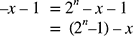
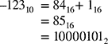
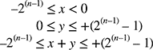
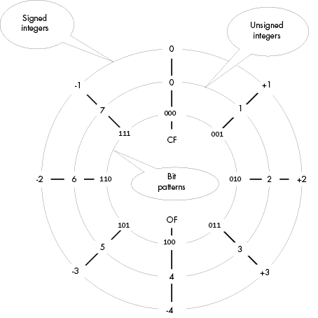

# 3 计算机算术


计算的现实是我们只有有限的位数。上一章你学到，每个数据项必须根据其数据类型适应固定的位数。本章将展示这一限制如何使即使是最基本的数学运算也变得复杂。对于有符号和无符号数字，有限的位数是我们在纸上或脑海中做数学时通常不考虑的约束。

幸运的是，CPU 的 `rflags` 寄存器中*状态标志*部分的*进位标志*（`CF`）和*溢出标志*（`OF`）允许我们检测二进制数加减是否产生超出数据类型分配位数的结果。我们将在后续章节仔细研究进位标志和溢出标志，但现在让我们看看加法和减法如何影响它们。

## 无符号整数的加减

计算机进行算术运算时使用二进制数制。操作乍看可能困难，但如果你记得手工进行十进制算术的细节，二进制算术就会容易得多。既然现在大多数人用计算器做加法，让我们复习一下手工计算所需的所有步骤。复习后，你将开发在二进制和十六进制中进行加减的算法。

### 十进制数制中的加法

让我们限制为两位十进制数。考虑两个两位数，*x* = 67 和 *y* = 79。在纸上手工相加如下：

| | | 1 | | | | ← 进位 |
| --- | --- | --- | --- | --- | --- | --- |
| | | 6 | 7 | | | ← *x* |
| + | | 7 | 9 | | | ← *y* |
| | | | 6 | | | ← 和 |

我们从右边开始，加个位上的两个十进制数字。7 + 9 = 16，超出 10 共 6。我们在和的个位放 6，向十位进 1。

| | 1 | 1 | | | | ← 进位 |
| --- | --- | --- | --- | --- | --- | --- |
| | | 6 | 7 | | | ← *x* |
| + | | 7 | 9 | | | ← *y* |
| | | 4 | 6 | | | ← 和 |

接着加十位上的三个十进制数字：1（来自个位的进位）+ 6 + 7。这三个数字之和超出 10 共 4，我们在和的十位放 4，然后记录最终进位为 1。因为我们只用两位，没有百位。

以下算法展示了加两个十进制整数 *x* 和 *y* 的过程。在此算法中，*x*[*i*] 和 *y*[*i*] 分别是 *x* 和 *y* 的第 *i* 位数字，从右向左编号：

```
Let carry = 0
Repeat for each i = 0,...,(n - 1)  // 从个位开始
    sumi = (xi + yi) % 10           // 余数
    carry = (xi + yi) / 10          // 整数除法
```

此算法有效是因为我们书写数字时使用位置表示法——左边一位计数是右边的 10 倍。从当前位置向左一位的进位总是 0 或 1。


我们在 `/` 和 `%` 运算中使用 10，因为十进制数字系统中恰好有 10 个数字：0、1、2、……、9。由于我们在 `N` 位数字系统中工作，因此将结果限制为 `N` 位。最终的进位要么是 0 要么是 1，它与 `N` 位和一起构成结果。

### 十进制数字系统中的减法

让我们转向减法运算。正如你从十进制减法中记得的那样，有时你必须从被减数（被减去的数）的下一个高位借位。我们将使用前面用过的相同数字（67 和 79）来进行减法。我们将分步骤讲解，以便你能看到这个过程。“草稿”工作将位于两个数字上方的借位行中。

|   |   | 5 | 17 | ← 借位 |
|---|---|---|---|---|
|   |   | 6 | 7 | ← `x` |
| − |   | 7 | 9 | ← `y` |
|   |   |   | 8 | ← 差 |

首先，我们需要从十位上的 6 借 1 加到个位上的 7；然后我们可以用 17 减 9 得到 8。

| 1 | 15 |   | ← 借位 |
|---|---|---|---|
|   | 5  |   |             |
|   | 6  | 7 | ← `x`       |
| − | 7  | 9 | ← `y`       |
|   | 8  | 8 | ← 差 |

接下来，我们需要从两位之外借位，我们通过在“进位”位置放置一个 1 来标记这一点，使十位变成 15，从中减去 7。

这在下面的算法中显示，其中 `x` 是被减数，`y` 是被减去的数（减数）。如果在该算法结束时 `borrow` 为 `1`，则表明你不得不从两个值的 `N` 位之外借位，因此 `N` 位结果是不正确的。虽然它被称为进位标志，但其目的是显示运算何时给出无法适应数据类型位数的结果。因此，进位标志显示了减法运算完成时 `borrow`（来自数据类型大小之外）的值。

```
Let borrow = 0 
Repeat for i = 0,···,(N − 1) 
  1 If yi ≤ xi 
        Let differencei = xi − yi 
    Else 
      2 Let j = i + 1 
      3 While (xj = 0) and (j < N) 
            Add 1 to j 
      4 If j = N 
          5 Let borrow = 1 
            Subtract 1 from j 
            Add 10 to xj 
      6 While j > i 
            Subtract 1 from xj 
            Subtract 1 from j 
            Add 10 to xj 
                7 Let differencei = xi – yi
```

这个算法最初看起来并没有那么复杂（但我花了很长时间才弄明白！）。如果我们要减去的数字与被减数字相同或更大，我们就完成了该数位的运算。否则，我们需要从左边的下一个数位借位 2。如果我们试图借位的下一个数字是 0，那么我们需要继续向左移动，直到找到非零数字，或者直到到达数字的最左端 3。如果我们确实到达了为该数字分配的位数 4，我们通过将 `borrow` 设置为 `1` 来指示这一点 5。

在从左侧位置借位后，我们回到正在处理的位置 6 并执行减法 7。当你在纸上做减法时，你会在脑海中自动完成所有这些步骤，但在二进制和十六进制系统中，这可能不会那么直观。（我作弊了，用十进制写中间借位。）

如果你觉得有困难，别担心。你不需要彻底理解这个算法就能理解本书的内容。但我认为钻研它可以帮助你学习如何为其他计算问题开发算法。将日常程序转化为编程语言使用的逻辑语句通常是一项艰巨的任务。

### 二进制中无符号整数的加减法

在本节中，你将学习如何对无符号二进制整数执行加法和减法运算，但在继续之前，请仔细查看表 3-1，特别是二进制位模式。你可能一开始记不住这个表，但当你使用二进制和十六进制数字系统一段时间后，就会很自然地认为 10、`a` 或 `1010` 是相同的数字，只是在不同的数字系统中而已。

**表 3-1：十六进制数字对应的位模式和无符号十进制值**

| 一个十六进制数字 | 四个二进制数字（位） | 无符号十进制 |
|---|---|---|
| `0` | `0000` | 0 |
| `1` | `0001` | 1 |
| `2` | `0010` | 2 |
| `3` | `0011` | 3 |
| `4` | `0100` | 4 |
| `5` | `0101` | 5 |
| `6` | `0110` | 6 |
| `7` | `0111` | 7 |
| `8` | `1000` | 8 |
| `9` | `1001` | 9 |
| `a` | `1010` | 10 |
| `b` | `1011` | 11 |
| `c` | `1100` | 12 |
| `d` | `1101` | 13 |
| `e` | `1110` | 14 |
| `f` | `1111` | 15 |

现在你已经熟悉了表 3-1，让我们讨论无符号整数。在讨论时，不要忘记，就数值而言，无论我们认为整数是十进制、十六进制还是二进制，它们在数学上都是等价的。然而，我们可能会想知道，计算机用二进制执行算术运算得到的结果，是否与我们用十进制算术进行相同计算得到的结果相同。让我们仔细看看一些具体的运算。

#### 二进制数字系统中的加法

在下面的示例中，我们使用四位值。首先，考虑将两个无符号整数 2 和 4 相加：

| `0` | `000` | ← | 进位 |   |   |
|---|---|---|---|---|---|
|   | `0010`[2] | = | `2`[16] | = | 2[10] |
| + | `0100`[2] | = | `4`[16] | = | 4[10] |
|   | `0110`[2] | = | `6`[16] | = | 6[10] |

十进制 2 在二进制中表示为 `0010`，十进制 4 表示为 `0100`。进位标志，或 `CF`，等于 `0`，因为加法运算的结果也是四位长。我们将相同相对位置的数字相加（此处同时显示二进制和十六进制，尽管进位仅以二进制显示），就像我们在十进制中所做的那样。

接下来，考虑两个较大的整数，保持我们的四位存储空间。我们将把两个无符号整数 4 和 14 相加：

| `1` | `100` | ← | 进位 |   |   |
|---|---|---|---|---|---|
|   | `0100`[2] | = | `4`[16] | = | 4[10] |
| + | `1110`[2] | = | `e`[16] | = | 14[10] |
|   | `0010`[2] | = | `2`[16] | ≠ | 18[10] |

在这种情况下，进位标志等于 `1`，因为运算结果超过了我们为存储整数分配的四位，所以我们的结果是不正确的。如果我们在结果中包含进位标志，我们将得到一个五位值，结果将是 `10010`[2] = 18[10]，这是正确的。我们必须在软件中处理进位标志。

#### 二进制数字系统中的减法

现在，让我们用 4 减 14，即用 `0110` 减 `0100`：

| `1` | `110` | ← | 借位 |   |   |
|---|---|---|---|---|---|
|   | `0100`[2] | = | 4[10] |   |   |
| − | `1110`[2] | = | 14[10] |   |   |
|   | `0110`[2] | = | 6[10] | ≠ | −10[10] |

CPU 通过将进位标志设置为 `1` 来指示我们不得不从四位之外借位，这意味着该减法中的四位结果是不正确的。


这些四位算术示例可以推广到计算机执行的任意大小算术运算。在两个数相加后，进位标志（`CF`）将始终被设置为 `0`（如果没有最终进位）或 `1`（如果有最终进位）。减法将把进位标志设置为 `0`（如果不需要从“外部”借位）或 `1`（如果需要借位）。CPU 每次进行加法或减法时，都会将 `rflags` 寄存器中的 `CF` 标志设置为适当的值 `0` 或 `1`。当没有进位时，CPU 会主动将 `CF` 设置为 `0`，而不考虑其之前保存的值。

只要结果适合用于计算的数据类型所分配的位数，结果就是正确的。CPU 通过将进位标志设置为 `0` 来指示正确性。当结果不正确时，要么是因为加法需要另一位，要么是因为减法需要从高位借位，错误通过将进位标志设置为 `1` 来记录。

## 有符号整数的加法和减法

在表示非零有符号十进制整数时，有两种可能性：正数或负数。只有两个选项，我们只需要用一位来表示符号。我们可以简单地使用最高位（假设 `0` 表示 +，`1` 表示 −）作为*符号-幅度码*来表示有符号数，但这会遇到一些问题。例如，考虑 +2 和 −2 相加：

|  | `0010`₂ | = | +2₁₀ |
|---|---|---|---|
| + | `1010`₂ | = | −2₁₀ |
|  | `1100`₂ | ≠ | 0₁₀ |

结果 `1100`₂ 在我们的编码中等于 −4₁₀，这在算术上是不正确的。当使用符号-幅度码时，我们用于无符号数的简单加法将无法正确用于有符号数。

某些计算机架构在使用有符号十进制整数时确实使用一位作为符号。它们有一条特殊的*有符号加法*指令来处理此类情况。（趣闻：这样的计算机既有 +0 也有 −0！）但大多数计算机采用不同的有符号数编码，允许使用简单的加法指令。

### 补码

在数学中，一个量的*补数*是使其变为“整体”所必须添加的量。将此概念应用于数字时，“整体”的定义取决于你正在使用的基数（或底数）以及你允许用来表示数字的位数。如果 *x* 是基数 *r* 下的 *n* 位数字，其*基数补码* ¬*x* 定义为使 *x* + ¬*x* = *radix*^*n*，其中 *radix*^*n* 是 1 后面跟着 *n* 个 0。例如，如果我们使用两位十进制数字，那么 37 的*基数补码*是 63，因为 37 + 63 = 10² = 100。另一种说法是，将一个数加上其基数补码的结果是在 *n* 位之外有进位的 0。

另一个有用的概念是*减基数补码*，定义为使 *x* + *diminished_radix_complement* = *radix*^*n* – 1。例如，37 的减基数补码是 62，因为 37 + 62 = 10² – 1 = 99。如果你将一个数加上其减基数补码，结果是基数中最大的 *n* 位数字——在这个两位十进制的例子中是两个 9。

为了了解基数补码如何用于表示负数，假设你有一个磁带盒播放器。许多磁带播放器有一个四位计数器来表示磁带位置。你可以插入磁带盒并按下复位按钮将计数器设置为 0。当你向前和向后移动磁带时，计数器记录移动量。这些计数器以任意单位提供磁带位置的“编码”表示。现在，假设我们可以插入磁带盒，以某种方式将其移至中心，并按下复位按钮。向正方向移动磁带（向前）将导致计数器递增。向负方向移动磁带（向后）将导致计数器递减。特别是，如果我们从 0 开始移动到 +1，磁带计数器上的“代码”将显示 0001。另一方面，如果我们从 0 开始移动到 −1，磁带计数器上的“代码”将显示 9999。

我们可以用磁带系统来执行前面的算术运算，(+2) + (−2)：

1. 将磁带向前移动到 (+2)；计数器显示 0002。
2. 通过在计数器上向后移动两步来加上 (−2)；计数器显示 0000，根据我们的代码这是 0。

接下来，我们从 (−2) 开始执行相同的算术运算，然后加上 (+2)：

1. 将磁带向后移动到 (−2)；计数器显示 9998。
2. 通过在计数器上向前移动两步来加上 (+2)；计数器显示 0000，但有进位（9998 + 2 = 0000，进位 = 1）。

如果忽略进位，答案是正确的。9998 是 0002 的 10 补码（基数是 10）。使用基数补码表示法添加两个有符号整数时，进位无关紧要。添加两个有符号数可能会产生无法放入分配用于存储结果的位数中的结果，就像无符号数一样。但我们的磁带示例刚刚表明，进位标志可能不会显示结果无法放入。我们将在下一节讨论这个问题。

计算机在二进制数系统中工作，基数是 2。所以让我们看看用于表示有符号整数的*补码*表示法。它使用与磁带计数器表示有符号十进制整数的位模式相同的一般模式。表 3-2 显示了四位值的十六进制、二进制和有符号十进制（补码表示法）之间的对应关系。在二进制中，将“磁带”从 0 向后（负方向）移动一位将从 `0000` 变为 `1111`。

**表 3-2：四位补码表示法**

| 一个十六进制数字 | 四个二进制数字（位） | 有符号十进制 |
|---|---|---|
| `8` | `1000` | −8 |
| `9` | `1001` | −7 |
| `a` | `1010` | −6 |
| `b` | `1011` | −5 |
| `c` | `1100` | −4 |
| `d` | `1101` | −3 |
| `e` | `1110` | −2 |
| `f` | `1111` | −1 |
| `0` | `0000` | 0 |
| `1` | `0001` | +1 |
| `2` | `0010` | +2 |
| `3` | `0011` | +3 |
| `4` | `0100` | +4 |
| `5` | `0101` | +5 |
| `6` | `0110` | +6 |
| `7` | `0111` | +7 |

以下是关于此表的一些重要观察：

* 每个正数的高位是 `0`，每个负数的高位是 `1`。
* 虽然改变符号（取反）比简单地改变高位更复杂，但通常称高位为*符号位*。
* 该表示法允许的负数比正数多一个。
* 可以用此表示法（四位）表示的整数 *x* 的范围是：
  –8₁₀ ≤ x ≤ +7₁₀
  或
  –2^((4–1)) ≤ x ≤ +(2^((4–1)) – 1)

最后一个观察可以推广到 *n* 位：

–2^((*n*–1)) ≤ x ≤ +(2^((*n*–1)) – 1)

使用补码表示法时，任何 *n* 位整数 *x* 的负数定义为：

*x* + (–*x*) = 2^*n*

注意，2^(*n*) 的二进制写法是 `1` 后面跟着 *n* 个零。换句话说，在 *n* 位补码表示法中，一个数加上其负数会产生 *n* 个零和一个等于 1 的进位。

### 计算补码

现在我们将推导一种使用补码表示法计算一个数的负数的方法。解定义方程求 −*x*，得到：

–*x* = 2^*n* – *x*

这对数学家来说可能看起来很奇怪，但请记住，此方程中的 *x* 限制为 *n* 位，而 2^(*n*) 有 *n* + 1 位（1 后面跟着 *n* 个 0）。

例如，如果我们想用八位二进制（使用补码表示法）计算 −123，我们执行以下算术：

```
  1 00000000  (2⁸)
- 0 01111011  (123)
---------------
  0 10000101  (-123)
```

或用十六进制：

```
  100  (2⁸)
-  7B  (123)
-------
   85  (-123)
```


## 二进制有符号整数的加减法

这种减法运算容易出错，所以让我们对计算 `−x` 的方程做一点代数变换。两边同时减去 1 并稍作重排：



得到如下公式：

`–x = ((2^n–1) – x) + 1`

如果这看起来比我们的第一个方程更复杂，别担心。让我们考虑量 `(2^n − 1)`。既然 `2^n` 在二进制中写作 `1` 后面跟着 `n` 个 `0`，那么 `(2^n − 1)` 就写作 `n` 个 1。例如，当 `n = 8` 时：

`2⁸ – 1 = 11111111[2]`

因此，我们可以这样说：

`(2^n – 1) – x = 11...1[2] – x`

其中 `11...1[2]` 表示 `n` 个 1。

虽然这可能不明显，但当你考虑用八位二进制计算 −123 的前一个例子时，你会看到这个减法有多简单。令 `x = 123`，得到如下表格：

| 运算符 | 值 | 注释 |
| --- | --- | --- |
|  | `11111111` | ← `(2^n – 1)` |
| − | `01111011` | ← `x` |
| = | `10000100` | ← 反码 |

或用十六进制表示如下：

| 运算符 | 值 | 注释 |
| --- | --- | --- |
|  | `ff` | ← `(2^n – 1)` |
| − | `7b` | ← `x` |
| = | `84` | ← 反码 |

既然这里的所有量都有 `n` 位，这个计算很简单——只需翻转所有位，得到减基数补码，在二进制数系统中也称为*反码*。结果中 `1` 变为 `0`，`0` 变为 `1`。

计算负数所剩下的就是给结果加 1。最后，我们得到如下公式：



用于表示值的位数在编写程序时由计算机体系结构和编程语言决定。这就是为什么如果结果太大，你不能像在纸上那样直接添加更多数字（位）。对于无符号整数，解决这个问题的方法是进位标志 `CF`，它指示两个无符号整数的和何时超过了为其分配的位数。在本节中，你将看到两个有符号数相加也可能产生超出分配位数所能表示的值的范围的结果，但进位标志不用于指示错误。

CPU 通过标志寄存器 `rflags` 中的*溢出标志* `OF` 来记录有符号数的和何时对其位数来说太大。溢出标志的值由一个乍看可能不直观的操作给出：倒数第二次进位和最后一次进位的*异或* (`XOR`)。例如，假设我们要加两个八位数 `15[16]` 和 `6f[16]`：

```
| Ultimate carry →  |  | 0 | 1 | ← Penultimate carry |
| --- | --- | --- | --- | --- |
|  |  | 0001 | 0101 | ← x |
|  | + | 0110 | 1111 | ← y |
|  |  | 1000 | 0100 | ← Sum |
```

在这个例子中，进位是 `0`，倒数第二次进位是 `1`。`OF` 标志等于最终进位和倒数第二次进位的异或，`OF = CF ⊻ (penultimate carry)`，其中 `⊻` 是异或运算符。在前面的例子中，`OF = 0 ⊻ 1 = 1`。

逐种情况来看，我们将了解为什么 `OF` 标志指示补码表示中两个有符号整数相加的有效性。在接下来的三节中，我们将讨论三种可能的情况：两个数符号相反、均为正数或均为负数。

### 符号相反的两个数

设 `x` 为负数，`y` 为正数。则我们可以用二进制表示 `x` 和 `y` 如下：

`x = 1…, y = 0…`

即，一个数的高位（符号位）是 `1`，另一个数的高位（符号位）是 `0`，无论其他位是什么。

`x + y` 总是保持在补码表示的范围内：



现在，如果我们把 `x` 和 `y` 相加，有两种可能的进位结果：

*   如果倒数第二次进位是 `0`：

    | `Carry →` | `0` | `0` | ← `Penultimate carry` |
    | --- | --- | --- | --- |
    |  |  | `1…` | ← `x` |
    |  | + | `0…` | ← `y` |
    |  |  | `1…` | ← Sum |

    这种加法产生 `OF = 0 ⊻ 0 = 0`。

*   如果倒数第二次进位是 `1`：

    | `Carry →` | `1` | `1` | ← `Penultimate carry` |
    | --- | --- | --- | --- |
    |  |  | `1…` | ← `x` |
    |  | + | `0…` | ← `y` |
    |  |  | `0…` | ← Sum |

    这种加法产生 `OF = 1 ⊻ 1 = 0`。

符号相反的两个整数相加总是使溢出标志为 `0`，所以和总是在分配范围内。

### 两个正数

既然两者都是正数，我们可以用二进制表示 `x` 和 `y` 如下：

`x = 0…, y = 0…`

这里两个数的高位（符号位）都是 `0`，无论其他位是什么。现在，如果我们把 `x` 和 `y` 相加，有两种可能的进位结果：

*   如果倒数第二次进位是 `0`：

    | `Carry →` | `0` | `0` | ← `Penultimate carry` |
    | --- | --- | --- | --- |
    |  |  | `0…` | ← `x` |
    |  | + | `0…` | ← `y` |
    |  |  | `0…` | ← Sum |

    我们将得到 `OF = 0 ⊻ 0 = 0`。和的高位是 `0`，所以它是正数，和在范围内。

*   如果倒数第二次进位是 `1`：

    | `Carry →` | `0` | `1` | ← `Penultimate carry` |
    | --- | --- | --- | --- |
    |  |  | `0…` | ← `x` |
    |  | + | `0…` | ← `y` |
    |  |  | `1…` | ← Sum |

    那时我们将得到 `OF = 0 ⊻ 1 = 1`。和的高位是 `1`，所以它是负数。两个正数相加不可能得到负和，所以和一定超出了分配范围。

### 两个负数

既然两者都是负数，我们可以用二进制表示 `x` 和 `y` 如下：

`x = 1…, y = 1…`

因为这些数是负数，两个数的高位（符号位）都是 `1`，无论其他位是什么。现在，如果我们把 `x` 和 `y` 相加，有两种可能的进位结果：

*   如果倒数第二次进位是 `0`：

    | `Carry →` | `1` | `0` | ← `Penultimate carry` |
    | --- | --- | --- | --- |
    |  |  | `1…` | ← `x` |
    |  | + | `1…` | ← `y` |
    |  |  | `0…` | ← Sum |

    这给出 `OF = 1 ⊻ 0 = 1`。这个和的高位是 `0`，所以它是正数。但两个负数相加不可能得到正和，所以和超出了分配范围。

*   如果倒数第二次进位是 `1`：

    | `Carry →` | `1` | `1` | ← `Penultimate carry` |
    | --- | --- | --- | --- |
    |  |  | `1…` | ← `x` |
    |  | + | `1…` | ← `y` |
    |  |  | `1…` | ← Sum |

    这种加法产生 `OF = 1 ⊻ 1 = 0`。和的高位是 `1`，所以它是负数，和在范围内。

这里我们不深入讨论减法。同样的规则适用于减法，我邀请你自行探索！

让我们把刚才学到的知识，以及第 43 页“二进制无符号整数的加减法”中的内容结合起来，陈述一些关于加减两个 `n` 位数的规则：

*   当程序将结果视为无符号数时，进位标志 `CF` 为 `0` 当且仅当结果在 `n` 位范围内；`OF` 无关紧要。

*   当程序将结果视为有符号数时，溢出标志 `OF` 为 `0` 当且仅当结果在 `n` 位范围内；`CF` 无关紧要。

## 整数编码的循环性质

无符号整数和有符号整数使用的表示法本质上都是循环的——即，对于给定的位数，每个编码都会“绕回”。你可以在图 3-1 所示的三位数“解码环”中直观地看到这一点。

要使用这个解码环来加减两个整数，请按以下步骤操作：

1.  选择与你使用的整数类型（有符号或无符号）对应的环。
2.  移动到该环上对应第一个整数的位置。
3.  沿着环移动，移动的“辐条”数等于第二个整数。顺时针移动表示加法，逆时针移动表示减法。




**图 3-1：** 三位有符号和无符号整数的“解码环”

如果你不为无符号整数跨越顶部，也不为有符号整数跨越底部，则结果是正确的。

## 你学到的内容

1. **二进制算术** 计算机在二进制数制中执行加法和减法。两个数相加可能产生比这两个数中每一个都宽一位的结果。一个数减去另一个数可能需要从超出这两个数宽度一位的位置借位。

2. **表示有符号/无符号** 位模式可以被视为表示有符号或无符号整数。补码表示法常用于表示有符号整数。

3. **进位标志** CPU 包含一个一位的进位标志，指示加法或减法的结果是否超出了无符号整数允许的位数。

4. **溢出标志** CPU 包含一个一位的溢出标志，指示加法或减法的结果是否超出了使用补码表示法的有符号整数允许的位数。

在下一章中，你将学习布尔代数。虽然它乍看之下可能有点奇怪，但一旦我们开始深入，你会发现它实际上比初等代数更容易。因为其中一点，所有东西的求值结果要么是 `0`，要么是 `1`！
