# 4 布尔代数


*布尔代数* 是由英国数学家乔治·布尔在 19 世纪开发的，他当时正在研究如何利用数学严谨性来解决逻辑问题。他形式化了一个用于操作逻辑值的数学系统，在该系统中，变量唯一可能的值是 *真* 和 *假*，通常分别指定为 `1` 和 `0`。

布尔代数中的基本运算是 *合取*（AND）、*析取*（OR）和 *否定*（NOT）。这使它区别于初等代数，后者包含无限的实数集合，并使用加、减、乘、除算术运算。（乘方是重复乘法的简化符号。）

随着数学家和逻辑学家以日益复杂和抽象的方式扩展布尔代数领域，工程师们正在学习利用电路中的开关控制电流来执行逻辑运算。这两个领域并行发展，直到 20 世纪 30 年代中期，一名名为克劳德·香农的研究生证明了电气开关可用于实现全范围的布尔代数表达式。（当用于描述开关电路时，布尔代数有时被称为 *开关代数*。）有了香农的发现，一个充满可能性的世界被打开了，布尔代数成为了计算机的数学基础。

本章从基本布尔运算符的描述开始。然后你将了解它们的逻辑规则，这些规则构成了布尔代数的基础。接下来，我将解释如何将布尔变量和运算符组合成代数表达式以形成布尔逻辑函数。最后，我将讨论简化布尔函数的技术。在后续章节中，你将了解如何使用电子通/断开关来实现逻辑功能，这些功能可以连接在一起形成逻辑电路，以执行计算机的主要功能——算术和逻辑运算以及存储。

## 基本布尔运算符

有几种符号用于表示每个布尔运算符，我将在每个运算符的描述中包含这些符号。在本书中，我将介绍逻辑学家使用的符号。布尔运算符作用于一个值或一对值，称为 *操作数*。

我将使用 *真值表* 来显示每个运算的结果。真值表显示操作数所有可能组合的结果。例如，考虑两个位 `x` 和 `y` 的加法。有四种可能的值组合。加法将给出一个和和一个可能的进位。表 4-1 展示了如何用真值表表示这一点。

**表 4-1：显示两位相加的真值表**

| `x` | `y` | 进位 | 和 |
| --- | --- | --- | --- |
| `0` | `0` | `0` | `0` |
| `0` | `1` | `0` | `1` |
| `1` | `0` | `0` | `1` |
| `1` | `1` | `1` | `0` |

我还将提供实现布尔运算符的 *门* 的电子电路表示，门是实现布尔运算符的电子器件。你将在第 5 章到第 8 章中了解更多关于这些器件的信息，在那里你还会看到物理器件的实际行为与真值表中显示的理想数学行为略有不同。

与初等代数一样，你可以组合这些基本运算符来定义次级运算符。当我们在本章接近尾声时定义 XOR 运算符时，你将看到一个例子。

### AND

**AND** 是一个 *二元运算符*，意味着它作用于两个操作数。当且仅当 *两个* 操作数都是 `1` 时，AND 的结果才是 `1`；否则结果为 `0`。在逻辑中，该运算称为 *合取*。我将使用 `∧` 来表示 AND 运算。使用 `⋅` 符号或直接用 AND 也很常见。图 4-1 显示了作用于操作数 `x` 和 `y` 的 AND 门电路符号和定义输出的真值表。

| `x` | `y` | `x ∧ y` |
| --- | --- | --- |
| `0` | `0` | `0` |
| `0` | `1` | `0` |
| `1` | `0` | `0` |
| `1` | `1` | `1` |

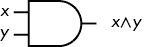

**图 4-1：** 作用于两个变量 `x` 和 `y` 的 AND 门

正如你从真值表中看到的，AND 运算符具有类似于初等代数中乘法的性质，这就是为什么有些人用 `⋅` 符号来表示它。

### OR

**OR** 也是一个二元运算符。如果至少有一个操作数是 `1`，OR 的结果就是 `1`；否则结果为 `0`。在逻辑中，该运算称为 *析取*。我将使用 `∨` 来表示 OR 运算。使用 `+` 符号或直接用 OR 也很常见。图 4-2 显示了作用于操作数 `x` 和 `y` 的 OR 门电路符号和定义输出的真值表。

| `x` | `y` | `x ∨ y` |
| --- | --- | --- |
| `0` | `0` | `0` |
| `0` | `1` | `1` |
| `1` | `0` | `1` |
| `1` | `1` | `1` |

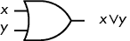

**图 4-2：** 作用于两个变量 `x` 和 `y` 的 OR 门

真值表显示 OR 运算符遵循的规则与初等代数中的加法有些相似，这就是为什么有些人用 `+` 符号来表示它。

### NOT

**NOT** 是一个 *一元运算符*，仅作用于一个操作数。如果操作数是 `0`，NOT 的结果是 `1`；如果操作数是 `1`，结果是 `0`。NOT 运算的其他名称是 *补* 和 *取反*。我将使用 `¬` 来表示 NOT 运算。使用 `'` 符号、变量上方的上划线或直接用 NOT 也很常见。图 4-3 显示了作用于操作数 `x` 的 NOT 门电路符号和定义输出的真值表。

| `x` | `¬x` |
| --- | --- |
| `0` | `1` |
| `1` | `0` |

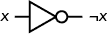

**图 4-3：** 作用于一个变量 `x` 的 NOT 门

正如你将看到的，NOT 具有一些初等代数中算术取反的性质，但也存在一些显著差异。


这绝非偶然，AND 具有乘法性质，而 OR 具有加法性质。当 George Boole 开发他的代数时，他希望找到一种方法将数学严谨性应用于逻辑，并利用加法和乘法来操作逻辑语句。Boole 基于将 AND 用于乘法、将 OR 用于加法，制定了其代数规则。在下一节中，你将看到如何将这些运算符与 NOT 结合使用，以表示逻辑语句。

## 布尔表达式

正如你可以使用初等代数运算符将变量组合成表达式（如 `x + y`），你也可以使用布尔运算符将变量组合成表达式。

不过，两者有显著差异。布尔表达式由值（`0` 和 `1`）和字面量构成。在布尔代数中，**字面量** 是指在表达式中使用的变量单个实例或其补码。在表达式

`x ∧ y ∨ ¬x ∧ z ∨ ¬x ∧ ¬y ∧ ¬z`

中，有三个变量（`x`、`y` 和 `z`）和七个字面量。在布尔表达式中，你可以同时看到一个变量的补码形式和非补码形式，因为每种形式都是一个单独的字面量。

我们可以使用 `∧` 或 `∨` 运算符来组合字面量。与初等代数类似，布尔代数表达式由**项** 组成，项是由运算符作用的一组字面量，如 `x ∨ y` 或 `a ∧ b`。同样像初等代数一样，**运算优先级**（或**运算顺序**）指定了在求值表达式时这些运算符如何应用。表 4-2 列出了布尔运算符的优先级规则。与初等代数一样，括号内的表达式最先求值，遵循优先级规则。

### 表 4-2：布尔代数运算符优先级规则

| 运算 | 符号 | 优先级 |
|------|------|--------|
| NOT  | `¬x` | 最高   |
| AND  | `x ∧ y` | 中等   |
| OR   | `x ∨ y` | 最低   |

现在你已经了解了三个基本布尔运算符的工作原理，我们将探讨它们在代数表达式中遵循的一些规则。正如你稍后在本章中将看到的，我们可以利用这些规则简化布尔表达式，进而简化我们在硬件中实现这些表达式的方式。

了解如何简化布尔表达式，对硬件设计者和软件编写者都是一项重要工具。计算机只是布尔逻辑的物理表现。即使你只对编程感兴趣，你编写的每一条编程语句，最终都是由完全由布尔代数体系描述的硬件执行的。我们的编程语言倾向于通过抽象隐藏大部分细节，但它们仍然使用布尔表达式来实现编程逻辑。

## 布尔代数规则

当将布尔代数中的 AND 和 OR 与初等代数中的乘法和加法进行比较时，你会发现一些布尔代数规则似曾相识，但也有一些显著不同。让我们先看相同的规则，再看不同的规则。

### 与初等代数相同的布尔代数规则

#### AND 和 OR 具有结合性

如果一个表达式中出现两个或多个相同的运算符，应用运算符的顺序不改变表达式的值，则称该运算符具有**结合性**。数学上表示为：

`x ∧ (y ∧ z) = (x ∧ y) ∧ z`

`x ∨ (y ∨ z) = (x ∨ y) ∨ z`

为了证明 AND 和 OR 的结合规则，让我们使用穷举真值表，如表 4-3 和表 4-4 所示。表 4-3 列出了三个变量 `x`、`y` 和 `z` 的所有可能取值，以及中间项 `y ∧ z` 和 `x ∧ y` 的计算结果。在最后两列中，我们可以计算等式两边两个表达式的值，从而证明这两个等式成立。

### 表 4-3：AND 运算的结合性

| `x` | `y` | `z` | `y ∧ z` | `x ∧ y` | `x ∧ (y ∧ z)` | `(x ∧ y) ∧ z` |
|-----|-----|-----|---------|---------|---------------|---------------|
| `0` | `0` | `0` | `0`     | `0`     | `0`           | `0`           |
| `0` | `0` | `1` | `0`     | `0`     | `0`           | `0`           |
| `0` | `1` | `0` | `0`     | `0`     | `0`           | `0`           |
| `0` | `1` | `1` | `1`     | `0`     | `0`           | `0`           |
| `1` | `0` | `0` | `0`     | `0`     | `0`           | `0`           |
| `1` | `0` | `1` | `0`     | `0`     | `0`           | `0`           |
| `1` | `1` | `0` | `0`     | `1`     | `0`           | `0`           |
| `1` | `1` | `1` | `1`     | `1`     | `1`           | `1`           |

表 4-4 列出了三个变量 `x`、`y` 和 `z` 的所有可能取值，以及中间项 `y ∨ z` 和 `x ∨ y` 的计算结果。在最后两列中，我们可以计算等式两边两个表达式的值，从而证明这两个等式成立。

### 表 4-4：OR 运算的结合性

| `x` | `y` | `z` | `y ∨ z` | `x ∨ y` | `x ∨ (y ∨ z)` | `(x ∨ y) ∨ z` |
|-----|-----|-----|---------|---------|---------------|---------------|
| `0` | `0` | `0` | `0`     | `0`     | `0`           | `0`           |
| `0` | `0` | `1` | `1`     | `0`     | `1`           | `1`           |
| `0` | `1` | `0` | `1`     | `1`     | `1`           | `1`           |
| `0` | `1` | `1` | `1`     | `1`     | `1`           | `1`           |
| `1` | `0` | `0` | `0`     | `1`     | `1`           | `1`           |
| `1` | `0` | `1` | `1`     | `1`     | `1`           | `1`           |
| `1` | `1` | `0` | `1`     | `1`     | `1`           | `1`           |
| `1` | `1` | `1` | `1`     | `1`     | `1`           | `1`           |

这种策略适用于本节所示的每一条规则，但我这里只演示结合规则的真值表。你将在本节末尾的“动手练习”中为其他规则制作真值表。

#### AND 和 OR 具有单位元

**单位元** 是指特定于某运算的值，将该运算用于某量与单位元，结果得到原量的值。对于 AND 和 OR，单位元分别为 `1` 和 `0`：

`x ∧ 1 = x`

`x ∨ 0 = x`

#### AND 和 OR 具有交换性

如果可以颠倒运算符的操作数顺序，则称该运算符具有**交换性**：

`x ∧ y = y ∧ x`

`x ∨ y = y ∨ x`

#### AND 分配律对 OR

应用于 OR 组合量的 AND 运算符，可以**分配** 到每个 OR 组合量上：

`x ∧ (y ∨ z) = (x ∧ y) ∨ (x ∧ z)`

与初等代数不同，加法性质的 OR **确实** 满足对乘法性质的 AND 的分配律。你将在下一节看到这一点。

#### AND 具有零元（也称湮灭元）

用运算符的**零元** 对某值进行运算，结果得到零元。AND 的零元是 `0`：

`x ∧ 0 = 0`

我们习惯了 `0` 是初等代数中乘法的零元，但加法没有零元的概念。你将在下一节了解 OR 的零元。

#### NOT 具有自反性

如果对某量应用运算符两次得到原量，则称该运算符具有**自反性**：

`¬(¬x) = x`

自反性就是双重补码的应用：`NOT(NOT true) = true`。这类似于初等代数中的双重否定。

### 与初等代数不同的布尔代数规则

虽然 AND 具有乘法性质，OR 具有加法性质，但这些逻辑运算与算术运算之间存在显著差异。差异源于布尔代数处理的逻辑表达式求值结果为真或假，而初等代数处理的是无限实数集。在本节中，你将看到一些可能让你联想到初等代数的表达式，但布尔代数规则是不同的。

#### OR 分配律对 AND


# 布尔代数性质

## OR 对 AND 的分配律

应用于 AND 运算在一起的量的 OR 运算符可以*分配*给每个 AND 运算的量：

```
x ∨ (y ∧ z) = (x ∨ y) ∧ (x ∨ z)
```

因为在初等代数中加法不对乘法分配，你可能会忽略这种操作布尔表达式的方法。

首先，让我们看看初等代数。在前一个方程中用加法表示 OR、用乘法表示 AND，我们得到：

```
x + (y ⋅ z) ≠ (x + y) ⋅ (x + z)
```

我们可以通过代入数字 `x` = 1、`y` = 2 和 `z` = 3 来验证这一点。左边得到

```
1 + (2 ⋅ 3) = 7
```

右边得到

```
(1 + 2) ⋅ (1 + 3) = 12
```

因此，在初等代数中加法*不*对乘法分配。

在布尔代数中证明 OR 对 AND 分配的最好方法是使用真值表，如表 4-5 所示。

**表 4-5：OR 对 AND 的分配律**

| `x` | `y` | `z` | `x ∨ (y ∧ z)` | `(x ∨ y) ∧ (x ∨ z)` |
| --- | --- | --- | --- | --- |
| `0` | `0` | `0` | `0` | `0` |
| `0` | `0` | `1` | `0` | `0` |
| `0` | `1` | `0` | `0` | `0` |
| `0` | `1` | `1` | `1` | `1` |
| `1` | `0` | `0` | `1` | `1` |
| `1` | `0` | `1` | `1` | `1` |
| `1` | `1` | `0` | `1` | `1` |
| `1` | `1` | `1` | `1` | `1` |

比较最右边的两列，你可以看到两个 OR 项共有的变量 `x` 可以被提取出来，因此分配律成立。

## OR 消元值

*消元值*是指这样一个值：用它对一个量进行运算，结果得到该消元值本身。初等代数中的加法没有消元值，但在布尔代数中，OR 的消元值是 `1`：

```
x ∨ 1 = 1
```

## 补值

*补值*是变量的减基数补。你在第三章中看到过，一个量与其减基数补之和等于（基数 – 1）。由于布尔代数的基数是 2，`0` 的补是 `1`，`1` 的补是 `0`。因此，布尔量的补就是该量的 NOT（非），得到：

```
x ∧ ¬x = 0
x ∨ ¬x = 1
```

补值说明了 AND 和 OR 逻辑运算与乘法和加法算术运算之间的区别之一。在初等代数中：

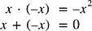

即使我们将 `x` 限制为 0 或 1，在初等代数中 `1 ⋅ (–1) = –1`，而 `1 + (–1) = 0`。

## 幂等性质

如果一个运算符是*幂等*的，将其应用于两个相同的操作数会得到该操作数本身。换句话说：

```
x ∧ x = x
x ∨ x = x
```

这与初等代数不同，在初等代数中，一个数反复乘以自身是乘方，一个数反复加上自身等同于乘法。

## 德摩根定律

在布尔代数中，AND 和 OR 运算之间的特殊关系由*德摩根定律*描述，它指出：

```
¬(x ∧ y) = ¬x ∨ ¬y
¬(x ∨ y) = ¬x ∧ ¬y
```

第一个方程指出，两个布尔量的 AND 运算结果取 NOT，等于这两个量分别取 NOT 后的 OR 运算结果。同样，第二个方程指出，两个布尔量的 OR 运算结果取 NOT，等于这两个量分别取 NOT 后的 AND 运算结果。

这种关系是*对偶原理*的一个例子，在布尔代数中，对偶原理指出：如果你将每个 `0` 替换为 `1`，每个 `1` 替换为 `0`，每个 AND 替换为 OR，每个 OR 替换为 AND，方程仍然成立。回顾刚才给出的规则，你会发现除了对合律之外，所有规则都有对偶运算。德摩根定律是对偶性最好的例子之一。请在“你来试试”环节证明德摩根定律，以便看到对偶原理的实际应用。

## 布尔函数

计算机的功能基于布尔逻辑，这意味着计算机的各种操作都由布尔函数指定。布尔函数看起来有点像初等代数中的函数，但变量可以以非补形式或补形式出现。变量和常量通过布尔运算符连接。布尔函数的求值结果为 `1` 或 `0`（真或假）。

在第 44 页的“二进制数系统中的加法”中，你已经看到，在二进制数中相加两个位 `x` 和 `y` 时，我们必须考虑进位到它们所在的位位置。导致进位为 `1` 的条件是

1. `x` = `1`，`y` = `1`，且当前位位置没有进位，或
2. `x` = `0`，`y` = `1`，且当前位位置有进位，或
3. `x` = `1`，`y` = `0`，且当前位位置有进位，或
4. `x` = `1`，`y` = `1`，且当前位位置有进位。

我们可以用这个布尔函数更简洁地表示：

```
Cout = (¬c[in] ∧ x ∧ y) ∨ (c[in] ∧ ¬x ∧ y) ∨ (c[in] ∧ x ∧ ¬y) ∨ (c[in] ∧ x ∧ y)
```

其中 `x` 是一位，`y` 是另一位，`c[in]` 是来自次低位位置的进位，`Cout` 是当前位位置加法产生的进位。我们将在本节中一直使用这个方程，但首先，让我们思考一下布尔函数和初等函数的区别。

像初等代数函数一样，布尔代数函数可以进行数学操作，但数学运算是不同的。初等代数运算是在无限的实数集上进行的，但布尔函数只在两个可能的值 `0` 或 `1` 上工作。初等代数函数的求值结果可以是任何实数，但布尔函数的求值结果只能是 `0` 或 `1`。

这种差异意味着我们必须以不同的方式思考布尔函数。例如，看这个初等代数函数：

```
F(x, y) = x ⋅ (–y)
```

你可能会这样读：“如果我把 `x` 的值乘以 `y` 的负值，我就会得到 `F(x, y)` 的值。”然而，如果你看这个布尔函数

```
F(x, y) = x ∧ (¬y)
```

只有四种可能性。如果 `x` = `1` 且 `y` = `0`，则 `F(x, y)` = `1`。对于其他三种可能性，`F(x, y)` = `0`。虽然你可以在初等代数函数中代入任意数字，但布尔代数函数会告诉你是什么变量值导致函数求值为 `1`。我认为初等代数函数是*要求*我代入变量值进行求值，而布尔代数函数*告诉*我什么变量值会导致函数求值为 `1`。

有更简单的方法来表示进位条件。这些简化使得用更少的逻辑门在硬件中实现该函数成为可能，从而降低成本和功耗。在本节和后续章节中，你将学习布尔代数的数学本质如何使函数简化变得更容易、更简洁。

### 规范和或最小项之和

布尔函数的*规范形式*明确显示了问题中的每个变量在定义函数的每一项中是否为补形式，就像我们之前用英文陈述产生进位 `1` 的条件时所做的那样。这确保了你在函数定义中考虑了所有可能的组合。我们之前看到的进位方程的真值表，如表 4-6 所示，

```
Cout = (¬c[in] ∧ x ∧ y) ∨ (c[in] ∧ ¬x ∧ y) ∨ (c[in] ∧ x ∧ ¬y) ∨ (c[in] ∧ x ∧ y)
```

应该有助于阐明这一点。

**表 4-6：导致进位为 `1` 的条件**


## 规范和或最小项之和

**表 4-6：三变量方程的最小项**

| 最小项 | c[in] | x | y | (¬c[in] ∧ x ∧ y) | (c[in] ∧ ¬x ∧ y) | (c[in] ∧ x ∧ ¬y) | (c[in] ∧ x ∧ y) | Cout |
| --- | --- | --- | --- | --- | --- | --- | --- | --- |
| m[0] | 0 | 0 | 0 | 0 | 0 | 0 | 0 | 0 |
| m[1] | 0 | 0 | 1 | 0 | 0 | 0 | 0 | 0 |
| m[2] | 0 | 1 | 0 | 0 | 0 | 0 | 0 | 0 |
| m[3] | 0 | 1 | 1 | 1 | 0 | 0 | 0 | 1 |
| m[4] | 1 | 0 | 0 | 0 | 0 | 0 | 0 | 0 |
| m[5] | 1 | 0 | 1 | 0 | 1 | 0 | 0 | 1 |
| m[6] | 1 | 1 | 0 | 0 | 0 | 1 | 0 | 1 |
| m[7] | 1 | 1 | 1 | 0 | 0 | 0 | 1 | 1 |

虽然方程中的括号不是必需的，但我添加了它们以帮助你看清方程的形式。括号显示了四个`product terms`（乘积项），即所有字面量仅通过 AND 运算操作的项。这四个乘积项随后通过 OR 运算连接在一起。由于 OR 运算类似于加法，右侧被称为`sum of products`（乘积之和）。它也被称为`disjunctive normal form`（析取范式）。

现在让我们更仔细地看看乘积项。每一项都包含该方程中的所有变量，以字面量（非反相或反相）的形式出现。一个具有 `n` 个变量的方程有 `2^(n)` 种变量值的排列组合；`minterm`（最小项）是一个恰好指定其中一种排列组合的乘积项。由于 `c[in]`、`x` 和 `y` 有四种值的组合会产生进位 `1`，因此前一个方程在可能的八个最小项中包含了四个。一个通过对所有求值为 `1` 的最小项求和（OR 运算）来定义的布尔函数被称为`canonical sum`（规范和）、`sum of minterms`（最小项之和），或处于`full disjunctive normal form`（完全析取范式）中。由最小项之和定义的函数在至少一个最小项求值为 `1` 时求值为 `1`。

对于每个最小项，变量恰好有一组值使该最小项求值为 `1`。例如，前一个方程中的最小项 `(c[in] ∧ x ∧ ¬y)` 仅当 `c[in] = 1`、`x = 1`、`y = 0` 时求值为 `1`。一个不包含问题中所有变量（无论是非反相还是反相形式）的乘积项，将总是比最小项针对更多的变量值集合求值为 `1`。例如，`(c[in] ∧ x)` 对 `c[in] = 1`、`x = 1`、`y = 0` 和 `c[in] = 1`、`x = 1`、`y = 1` 均求值为 `1`。因为它们使求值为 `1` 的情况数量最小化，所以我们称它们为`min`terms（最小项）。

逻辑设计师通常不写出函数中的所有字面量，而是使用符号 `m[i]` 来指定第 `i`^(th) 个最小项，其中 `i` 是由问题中字面量的值按顺序排列并视为二进制数所表示的整数。例如，`c[in] = 1`、`x = 1`、`y = 0` 给出 `110`，即（十进制）数字 6；因此，该最小项是 `m[6]`。表 4-6 显示了三变量方程的所有八个可能最小项，而前面所示四项方程中的最小项 `m[6] = (c[in] ∧ x ∧ ¬y)` 在 `c[in] = 1`、`x = 1`、`y = 0` 时求值为 `1`。

使用这种符号将布尔方程写成规范和，并使用 ∑ 符号表示求和，我们可以重述进位函数：

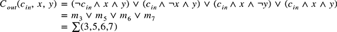

这里我们看的是一个简单的例子。对于更复杂的函数，写出所有最小项容易出错。简化的符号更易于操作，有助于避免错误。

## 规范积或最大项之积

根据可用元件和个人选择等因素，设计者可能更倾向于处理函数求值为 `0` 而非 `1` 的情况。在我们的例子中，这意味着指定进位为 `0` 的设计。为了了解其工作原理，让我们使用德摩根定律，对指定进位的方程两边同时取补：

```
¬Cout = (c[in] ∨ ¬x ∨ ¬y) ∧ (¬c[in] ∨ x ∨ ¬y) ∧ (¬c[in] ∨ ¬x ∨ y) ∧ (¬c[in] ∨ ¬x ∨ ¬y)
```

因为我们对方程两边都取了补，所以现在得到了 `¬C[out]`（进位的补）的布尔方程。因此，我们要寻找的是导致 `¬C[out]` 求值为 `0` 而非 `1` 的条件。这些条件显示在真值表 表 4-7 中。

**表 4-7：导致进位补为 `0` 的条件**

| 最大项 | c[in] | x | y | (c[in] ∨ ¬x ∨ ¬y) | (¬c[in] ∨ x ∨ ¬y) | (¬c[in] ∨ ¬x ∨ y) | (¬c[in] ∨ ¬x ∨ ¬y) | ¬Cout |
| --- | --- | --- | --- | --- | --- | --- | --- | --- |
| M[0] | 0 | 0 | 0 | 1 | 1 | 1 | 1 | 1 |
| M[1] | 0 | 0 | 1 | 1 | 1 | 1 | 1 | 1 |
| M[2] | 0 | 1 | 0 | 1 | 1 | 1 | 1 | 1 |
| M[3] | 0 | 1 | 1 | 0 | 1 | 1 | 1 | 0 |
| M[4] | 1 | 0 | 0 | 1 | 1 | 1 | 1 | 1 |
| M[5] | 1 | 0 | 1 | 1 | 0 | 1 | 1 | 0 |
| M[6] | 1 | 1 | 0 | 1 | 1 | 0 | 1 | 0 |
| M[7] | 1 | 1 | 1 | 1 | 1 | 1 | 0 | 0 |

在该方程中，由于布尔运算符的优先级规则，括号是必需的。括号显示了四个`sum terms`（和项），即所有字面量仅通过 OR 运算操作的项。这四个和项随后通过 AND 运算连接在一起。由于 AND 运算类似于乘法，右侧被称为`product of sums`（和之积）。它也被称为`conjunctive normal form`（合取范式）。

每个和项都包含该方程中的所有变量，以字面量（非反相或反相）的形式出现。最小项是指定变量可能值的 `2^(n)` 种排列中的单一排列的`product`（乘积）项，而`maxterm`（最大项）则是指定这些排列中恰好一种的`sum`（和）项。一个通过对所有求值为 `0` 的最大项相乘（AND 运算）来定义的布尔函数被称为`canonical product`（规范积）、`product of maxterms`（最大项之积），或处于`full conjunctive normal form`（完全合取范式）中。

每个最大项精确标识了变量的一组值，这些值在 OR 运算后使函数求值为 `0`。例如，前一个方程中的最大项 `(¬c[in] ∨ ¬x ∨ y)` 仅当 `c[in] = 1`、`x = 1`、`y = 0` 时求值为 `0`。但一个不包含问题中所有变量（无论是非反相还是反相形式）的和项，将总是针对多于一组的值求值为 `0`。例如，和项 `(¬c[in] ∨ ¬x)` 在本例中针对三个变量的两组值求值为 `0`：`c[in] = 1`、`x = 1`、`y = 0` 和 `c[in] = 1`、`x = 1`、`y = 1`。因为它们使求值为 `0` 的情况数量最小化，从而使求值为 `1` 的情况数量`maximize`（最大化），所以我们称它们为`max`terms（最大项）。

逻辑设计师通常不写出函数中的所有字面量，而是使用符号 `M[i]` 来指定第 `i`^(th) 个最大项，其中 `i` 是通过连接问题中字面量的值而形成的二进制数的整数值。例如，将 `c[in] = 1`、`x = 1`、`y = 0` 串联起来得到 `110`，即最大项 `M[6]`。真值表 表 4-7 显示了导致进位 = `0` 的最大项。注意最大项 `M[6] = (¬c[in] ∨ ¬x ∨ y)` 在 `c[in] = 1`、`x = 1`、`y = 0` 时求值为 `0`。


使用这种表示法将布尔方程写为规范和，并使用 ∏ 符号表示乘法，我们可以重述进位补函数如下：

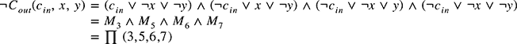

如果你回顾一下表 4-7，你会发现这些是导致进位补为 `0` 从而进位为 `1` 的条件。这表明使用最小项或最大项是等价的。你使用哪一种取决于诸如你拥有哪些可用的硬件组件来实现该功能以及个人偏好等因素。

## 规范布尔形式的比较

表 4-8 展示了三变量问题的所有最小项和最大项。如果你比较对应的最小项和最大项，可以看到最小项和最大项的对偶性：可以通过对每个变量取补并交换 OR 和 AND，利用德摩根定律从一个推导出另一个。

表 4-8：三变量问题的规范项

| 最小项 | 表达式 | x | y | z | 最大项 | 表达式 |
|---------|------------|---|---|---|---------|------------|
| `m[0]` | `¬x ∧ ¬y ∧ ¬z` | `0` | `0` | `0` | `M[0]` | `x ∨ y ∨ z` |
| `m[1]` | `¬x ∧ ¬y ∧ z` | `0` | `0` | `1` | `M[1]` | `x ∨ y ∨ ¬z` |
| `m[2]` | `¬x ∧ y ∧ ¬z` | `0` | `1` | `0` | `M[2]` | `x ∨ ¬y ∨ z` |
| `m[3]` | `¬x ∧ y ∧ z` | `0` | `1` | `1` | `M[3]` | `x ∨ ¬y ∨ ¬z` |
| `m[4]` | `x ∧ ¬y ∧ ¬z` | `1` | `0` | `0` | `M[4]` | `¬x ∨ y ∨ z` |
| `m[5]` | `x ∧ ¬y ∧ z` | `1` | `0` | `1` | `M[5]` | `¬x ∨ y ∨ ¬z` |
| `m[6]` | `x ∧ y ∧ ¬z` | `1` | `1` | `0` | `M[6]` | `¬x ∨ ¬y ∨ z` |
| `m[7]` | `x ∧ y ∧ z` | `1` | `1` | `1` | `M[7]` | `¬x ∨ ¬y ∨ ¬z` |

规范形式能给出函数完整且唯一的陈述，因为它们考虑了变量值的所有可能组合。然而，通常存在更简单的解决方案。本章剩余部分将介绍简化布尔函数的方法。

## 布尔表达式最小化

在硬件中实现布尔函数时，每个 ∧ 运算符变为一个与门，每个 ∨ 运算符变为一个或门，每个 ¬ 运算符变为一个非门。一般来说，硬件的复杂度与所使用的与门和或门的数量有关（非门很简单，通常不会显著增加复杂度）。更简单的硬件使用更少的组件，从而节省成本和空间，并降低功耗。成本、空间和功耗的节省对于手持和可穿戴设备尤为重要。在本节中，你将学习如何操作布尔表达式以减少与门和或门的数量，从而简化其硬件实现。

### 最小表达式

简化函数时，从规范形式之一开始，以确保你考虑了所有可能的情况。要将问题转换为规范形式，请创建一个真值表，列出问题中变量的所有可能组合。从真值表中，可以很容易地列出定义该函数的最小项或最大项。

拥有了规范陈述后，下一步是寻找一个功能等价的*最小表达式*，即一个与规范表达式功能相同，但文字和布尔运算符数量最少的表达式。为了最小化表达式，我们应用布尔代数规则来减少项数和每项中的文字数量，同时不改变表达式的逻辑含义。

根据你使用最小项还是最大项，最小表达式有两种类型：

**最小乘积和**

1. 从问题的最小项描述开始时，最小表达式称为*最小乘积和*，它是一种乘积和表达式，其中所有其他数学上等价的乘积和表达式至少具有相同数量的乘积项，而具有相同数量乘积项的表达式至少具有相同数量的文字。

作为最小乘积和的一个例子，考虑以下方程：

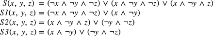

`S` 处于规范形式，因为每个乘积项都显式地显示了所有三个变量的贡献。其他三个函数是 `S` 的简化形式。虽然这三个函数具有相同数量的乘积项，但 `S3` 是 `S` 的最小乘积和，因为其乘积项中的文字比 `S1` 和 `S2` 少。

**最小因子和**

1. 从问题的最大项描述开始时，最小表达式称为*最小因子和*，它是一种因子和表达式，其中所有其他数学上等价的因子和表达式至少具有相同数量的因子项，而具有相同数量因子项的表达式至少具有相同数量的文字。

作为最小因子和的一个例子，考虑以下方程：

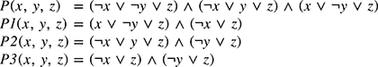

`P` 处于规范形式，其他三个函数是 `P` 的简化形式。虽然这三个函数与 `P` 具有相同数量的因子项，但 `P3` 是 `P` 的最小因子和，因为其乘积项中的文字比 `P1` 和 `P2` 少。

一个问题可能有不止一个最小解。良好的硬件设计通常涉及找到几个最小解，然后在可用硬件的背景下评估每一个。这不仅仅意味着使用更少的门。例如，正如你在讨论实际硬件实现时将学到的，添加位置得当的非门实际上可以降低硬件复杂度。

在接下来的两节中，你将看到寻找最小表达式的两种方法。

### 使用代数操作进行最小化

为了说明降低布尔函数复杂度的重要性，让我们回到进位函数：

```
Cout = (¬c[in] ∧ x ∧ y) ∨ (c[in] ∧ ¬x ∧ y) ∨ (c[in] ∧ x ∧ ¬y) ∨ (c[in] ∧ x ∧ y)
```

等式右侧的表达式是最小项的和。图 4-4 展示了实现该函数的电路。它需要四个与门和一个或门。与门输入端的小圆圈表示该输入处有一个非门。

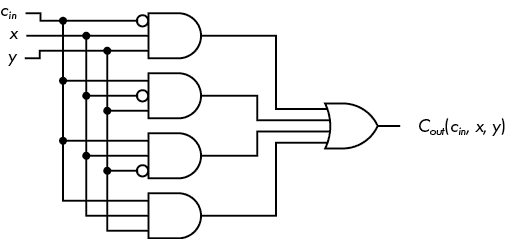

图 4-4：生成两数相加进位值的函数的硬件实现

现在让我们尝试简化图 4-4 中实现的布尔表达式，看看能否减少硬件需求。请注意，解决方案的路径可能不止一条，也可能有不止一个正确解。这里只介绍一种方法。

首先，我们将做一些看似奇怪的事情。我们将使用幂等律复制第四项两次：

```
Cout = (¬c[in] ∧ x ∧ y) ∨ (c[in] ∧ ¬x ∧ y) ∨ (c[in] ∧ x ∧ ¬y) ∨ (c[in] ∧ x ∧ y) ∨ (c[in] ∧ x ∧ y) ∨ (c[in] ∧ x ∧ y)
```

接下来，稍微重新排列乘积项，将前三个原始项分别与 (c[in] ∧ x ∧ y) 进行或运算：

```
Cout = ((¬c[in] ∧ x ∧ y) ∨ (c[in] ∧ x ∧ y)) ∨ ((c[in] ∧ x ∧ ¬y) ∨ (c[in] ∧ x ∧ y)) ∨ ((c[in] ∧ ¬x ∧ y) ∨ (c[in] ∧ x ∧ y))
```

现在我们可以使用与对或的分配律提取或运算结果为 `1` 的项：

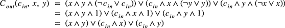

图 4-5 展示了该函数的电路。我们不仅消除了一一个与门，而且所有与门和或门的输入数都减少了一个。

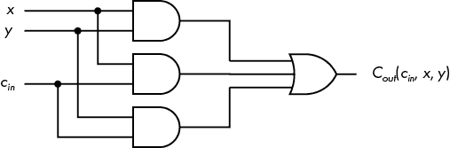

图 4-5：两数相加生成进位的简化硬件实现


# 布尔代数简化与卡诺图

## 使用布尔代数进行电路简化

对比图 4-5 和图 4-4 中的电路，布尔代数帮助你简化了硬件实现。你可以从用英语陈述导致进位为 `1` 的条件中看到这种简化：该方程的原始标准形式指出，进位 `Cout` 将在以下四种情况中的任意一种中为 `1`：

1.  若 `c[in]` = `0`，`x` = `1`，且 `y` = `1`
2.  若 `c[in]` = `1`，`x` = `0`，且 `y` = `1`
3.  若 `c[in]` = `1`，`x` = `1`，且 `y` = `0`
4.  若 `c[in]` = `1`，`x` = `1`，且 `y` = `1`

最小化表达可以陈述得更简单：当 `c[in]`、`x` 和 `y` 中**至少有两个**为 `1` 时，进位为 `1`。

我们通过从最小项之和开始，得出了图 4-5 中的解；换句话说，我们使用的是产生进位为 `1` 的 `c[in]`、`x` 和 `y` 的值。正如你在 69 页的“标准乘积或最大项乘积”中所见，由于进位必须是 `1` 或 `0`，从产生进位补码为 `0` 的 `c[in]`、`x` 和 `y` 的值开始，并将方程写为最大项乘积的形式，同样是有效的：

```
¬Cout = (c[in] ∨ ¬x ∨ ¬y) ∧ (¬c[in] ∨ x ∨ ¬y) ∧ (¬c[in] ∨ ¬x ∨ y) ∧ (¬c[in] ∨ ¬x ∨ ¬y)
```

为了简化这个方程，我们将采用与最小项之和相同的方法，首先复制最后一项两次：

```
¬Cout = (c[in] ∨ ¬x ∨ ¬y) ∧ (¬c[in] ∨ x ∨ ¬y) ∧ (¬c[in] ∨ ¬x ∨ y) ∧ (¬c[in] ∨ ¬x ∨ ¬y) ∧ (¬c[in] ∨ ¬x ∨ ¬y) ∧ (¬c[in] ∨ ¬x ∨ ¬y)
```

添加一些括号有助于阐明简化过程：

```
¬Cout = ((c[in] ∨ ¬x ∨ ¬y) ∧ (¬c[in] ∨ ¬x ∨ ¬y)) ∧ ((¬c[in] ∨ x ∨ ¬y) ∧ (¬c[in] ∨ ¬x ∨ ¬y)) ∧ ((¬c[in] ∨ ¬x ∨ y) ∧ (¬c[in] ∨ ¬x ∨ ¬y))
```

接下来，使用或对与的分配律。因为这比较棘手，我将讲解简化该方程中第一组乘积项的步骤——其他两组的步骤与此类似。或对与的分配律具有以下通用形式：

```
(X ∨ Y) ∧ (X ∨ Z) = X ∨ (Y ∧ Z)
```

观察我们第一组中的和项，你可以看到它们都共享一个 `(¬x ∨ ¬y)`。因此，我们将这些代入通用形式中：

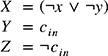

进行代入并使用与的补码规则，我们得到

```
(c[in] ∨ ¬x ∨ ¬y) ∧ (¬c[in] ∨ ¬x ∨ ¬y) = (¬x ∨ ¬y) ∨ (c[in] ∧ ¬c[in])
 = (¬x ∨ ¬y)
```

对另外两组应用相同的操作，我们得到

```
¬Cout = (¬x ∨ ¬y) ∧ (¬c[in] ∨ ¬x) ∧ (¬c[in] ∨ ¬y)
```

图 4-6 展示了该函数的电路实现。该电路产生进位的补码。我们需要对输出 `¬Cout` 取补，才能得到进位的值。

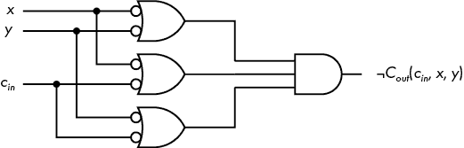

图 4-6：两数相加时产生进位补码的简化硬件实现

对比图 4-6 与图 4-5，你可以直观地看到德摩根定律：或门变成了输入端取反的与门。

图 4-5 中的电路对你来说可能看起来更简单，因为图 4-6 中的电路要求在或门的六个输入端加上非门。但正如你在下一章将看到的，由于构建逻辑门所用器件固有的电子特性，情况可能并非如此。这里要理解的重要一点是，解决问题的方法不止一种。硬件工程师的工作之一就是根据成本、元件可用性等因素决定哪种方案最好。

### 使用卡诺图进行最小化

用于最小化布尔函数的代数操作并不总是显而易见的。你可能会发现使用逻辑陈述的图形表示更容易处理。

处理布尔函数常用的图形工具是卡诺图，也称为 K 图。1953 年，贝尔实验室的电信工程师莫里斯·卡诺发明了卡诺图，它提供了一种直观的方法来寻找代数上可发现的相同简化。它们既可以用于最小项的乘积之和，也可以用于最大项的和之积。为了说明其工作原理，我们将从最小项开始。

#### 使用卡诺图简化乘积之和

卡诺图是一个矩形网格，每个最小项对应一个单元格。对于 `n` 个变量，有 2`n` 个单元格。图 4-7 是一个卡诺图，显示了两个变量 `x` 和 `y` 的所有四种可能的最小项。垂直轴用于绘制 `x`，水平轴用于绘制 `y`。每行的 `x` 值由紧邻该行左侧的数字（`0` 或 `1`）表示，每列的 `y` 值出现在列顶部。

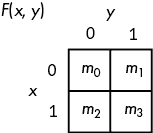

图 4-7：两变量最小项在卡诺图上的映射

为了说明如何使用卡诺图，让我们看一个两个变量的任意函数：

```
F(x, y) = (x ∧ ¬y) ∨ (¬x ∧ y) ∨ (x ∧ y)
```

首先在方程中出现的每个最小项对应的单元格中放置一个 `1`，如图 4-8 所示。

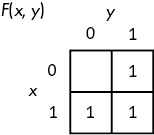

图 4-8：任意函数 `F(x, y)` 的卡诺图

通过在每个求值为 `1` 的最小项对应的单元格中放置 `1`，我们可以直观地看到方程何时求值为 `1`。右侧的两个单元格对应最小项 `m[1]` 和 `m[3]`，即 `(¬x ∧ y)` 和 `(x ∧ y)`。由于这些项通过或运算连接，如果这两个最小项中任意一个求值为 `1`，`F(x, y)` 就求值为 `1`。利用分配律和补码规则，我们可以看到

` 都求值为 `1`，接下来你将通过简化这个卡诺图看到这一点。

这两个最小项 `(¬x ∧ y)` 和 `(x ∧ y)` 的唯一区别在于 `x` 变为 `¬x`。卡诺图的排列使得共享一条边的两个单元格之间只有一个变量发生变化，这一要求称为邻接规则。

要使用卡诺图进行简化，你需要在乘积之和卡诺图中将两个包含 `1` 的相邻单元格分组。然后消除它们之间不同的变量，并将两个乘积项合并。重复此过程即可简化方程。每次分组都会消除最终乘积之和中的一个乘积项。这可以扩展到两个以上变量的方程，但分组在一起的单元格数量必须是 2 的倍数，且只能分组相邻单元格。邻接性从左到右、从上到下环绕。几页后你将看到一个相关示例。

要了解这一切如何运作，请考虑图 4-9 中卡诺图的分组。

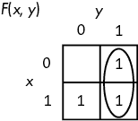

图 4-9：`F(x, y)` 中的两个最小项分组

该分组是我们之前进行的代数操作的图形表示。你可以看到，无论 `x` 的值如何，`F(x, y)` 在 `y` = `1` 时总是求值为 `1`。因此，该分组通过消除 `x` 将两个最小项合并为一个乘积项。

从最后的分组中，我们知道我们最终简化的函数将包含一个 `y` 项。让我们进行另一次分组以找到下一项。首先，我们将从代数上简化方程。回到 `F(x, y)` 的原始方程，我们可以利用幂等律复制其中一个最小项：

```
F(x, y) = (x ∧ ¬y) ∨ (¬x ∧ y) ∨ (x ∧ y) ∨ (x ∧ y)
```


现在我们将对第一个乘积项和刚刚添加的项进行一些代数运算：

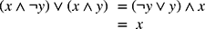

我们可以直接在卡诺图上进行此操作，而不使用代数运算，如图 4-10 所示。该图表明，单独的组可以包含同一个单元（最小项）。

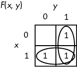

图 4-10：卡诺图分组显示 ` (x ∧ ¬y) ∨ (¬x ∧ y) ∨ (x ∧ y) = (x ∨ y) `

底行的组代表乘积项 `x`，最右列的组代表 `y`，从而得到以下最小化表达式：

`F(x, y) = x ∨ y`

请注意，同时包含在两个分组中的单元 `(x ∧ y)` 是我们之前在代数解中使用幂等律复制的项。你可以将一个单元包含在多个组中视为添加了该单元的副本，就像我们之前在代数运算中使用幂等律一样，然后将其与组中的其他单元合并，从而将其消除。

当函数中只有两个变量时，邻接规则会自动满足。但当我们添加另一个变量时，我们需要考虑如何排列卡诺图的单元，以便利用邻接规则来简化布尔表达式。

## 卡诺图单元顺序

二进制码和 BCD 码的一个问题在于，两个相邻值之间的差异通常涉及不止一位的变化。1943 年，Frank Gray 引入了一种编码——格雷码，其中相邻值仅相差一位。发明格雷码是因为当时的开关技术更容易出错。如果一位出错，用一组位表示的值在格雷码中仅相差 1。这在今天很少成为问题，但这一特性向我们展示了如何排列卡诺图中的单元。

构建格雷码非常简单。从一位开始：

| **十进制** | **格雷码** |
| --- | --- |
| 0 | `0` |
| 1 | `1` |

要增加一位，首先写出现有模式的镜像：

| **格雷码** |
| --- |
| `0` |
| `1` |
| `1` |
| `0` |

然后在每个原始位模式的开头添加 `0`，在每个镜像模式集的开头添加 `1`，即可得到两位的格雷码，如表 4-9 所示。

表 4-9：两位格雷码

| **十进制** | **格雷码** |
| --- | --- |
| 0 | `00` |
| 1 | `01` |
| 2 | `11` |
| 3 | `10` |

这就是格雷码有时被称为反射二进制码（RBC）的原因。表 4-10 显示了四位的格雷码。

表 4-10：四位格雷码

| **十进制** | **格雷码** | **二进制** |
| --- | --- | --- |
| 0 | `0000` | `0000` |
| 1 | `0001` | `0001` |
| 2 | `0011` | `0010` |
| 3 | `0010` | `0011` |
| 4 | `0110` | `0100` |
| 5 | `0111` | `0101` |
| 6 | `0101` | `0110` |
| 7 | `0100` | `0111` |
| 8 | `1100` | `1000` |
| 9 | `1101` | `1001` |
| 10 | `1111` | `1010` |
| 11 | `1110` | `1011` |
| 12 | `1010` | `1100` |
| 13 | `1011` | `1101` |
| 14 | `1001` | `1110` |
| 15 | `1000` | `1111` |

让我们比较表 4-10 中十进制值 7 和 8 的二进制码与格雷码。7 和 8 的二进制码分别是 `0111` 和 `1000`；当十进制值仅增加 1 时，所有四位都会发生变化。但比较 7 和 8 的格雷码 `0100` 和 `1100`，只有 1 位发生变化，从而满足了卡诺图的邻接规则。

请注意，当位模式环绕时，相邻值之间仅改变一位的模式依然成立。从最高值（四位为 15）到最低值（0）仅改变一位。

## 三变量卡诺图

为了了解邻接特性的重要性，让我们考虑一个更复杂的函数。我们将使用卡诺图来简化进位函数，它有三个变量。增加另一个变量意味着我们需要将单元数量加倍以容纳最小项。为了保持二维图，我们将新变量添加到地图一侧的现有变量上。我们总共需要八个单元 (2³)，所以我们将绘制四列两行的图。我们将 `z` 添加到 `y` 轴，并在水平轴上绘制 `y` 和 `z`，垂直轴上绘制 `x`，如图 4-11 所示。

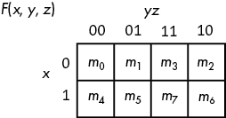

图 4-11：三变量最小项在卡诺图上的映射

三变量卡诺图顶部的位模式顺序是 `00`、`01`、`11`、`10`，这是表 4-9 中的格雷码顺序，而不是 `00`、`01`、`10`、`11`。当环绕卡诺图的边缘时，邻接规则也成立——即从 `m[2]` 到 `m[0]` 或从 `m[6]` 到 `m[4]`——这意味着组可以环绕地图的边缘。（其他轴标记方案也可行，正如你在本节末尾的“动手试一试”中将看到的那样。）

你在本章前面看到过，进位可以表示为四个最小项的和：

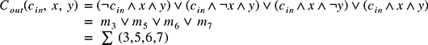

图 4-12 显示了卡诺图上的这四个最小项。

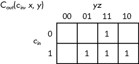

图 4-12：进位函数的卡诺图

我们寻找可以组合在一起的相邻单元，以从乘积项中消除一个变量。如前所述，组可以重叠，从而得到图 4-13 中所示的三个组。

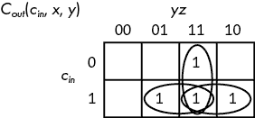

图 4-13：进位函数 = `1` 的最小乘积和

使用图 4-13 中卡诺图的三个组，我们得到了与通过代数运算获得的相同方程：

`Cout = (x ∧ y) ∨ (c[in] ∧ x) ∨ (c[in] ∧ y)`

## 使用卡诺图简化最大项和

使用显示进位补为 `0` 的函数同样有效。我们使用最大项来做这件事：

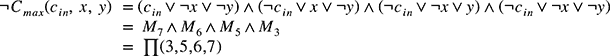

图 4-14 显示了三变量卡诺图上最大项的排列。

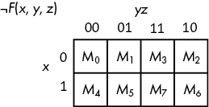

图 4-14：三变量最大项在卡诺图上的映射

当使用解的最大项陈述时，你需要标记值为 `0` 的单元。最小化过程与使用最小项时相同，只是你要将值为 `0` 的单元分组。

图 4-15 显示了 `¬Cout`（进位补）的最小化。

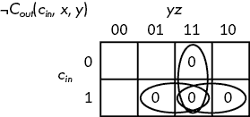

图 4-15：非进位函数 = `0` 的最小最大项积

图 4-15 中的卡诺图得出了我们用代数方法为进位补 = `0` 得到的相同最大项积：

`¬Cout = (¬x ∨ ¬y) ∧ (¬c[in] ∨ ¬x) ∧ (¬c[in] ∨ ¬y)`

如果你比较图 4-13 和图 4-15，可以看到德摩根定律的图形视图。在进行此比较时，请记住图 4-13 显示的是相加的乘积项，而图 4-15 显示的是相乘的和项，且结果取补。因此，我们交换 `0` 和 `1` 并交换 AND 和 OR，即可从一个卡诺图转换到另一个。


为了进一步强调最小项和最大项的对偶性，请比较图 4-16 中的 (a) 和 (b)。

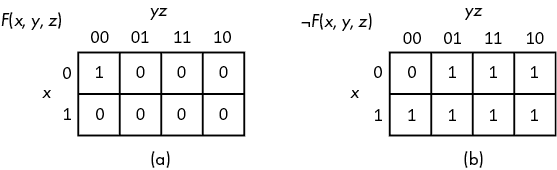

图 4-16：(a) 一个最小项和 (b) 一个最大项的比较

图 4-16(a) 显示了以下函数：

`F(x, y, z) = ¬x ∧ ¬y ∧ ¬z`

虽然这不是必需的，通常也不这么做，但我们在表示未包含在此函数中的最小项的每个单元格中放置了一个 `0`。

同样，在图 4-16(b)中，我们为最大项放置了一个 `0`，并在表示未包含在函数中的最大项的每个单元格中放置了一个 `1`：

`¬F(x, y, z) = x ∨ y ∨ z`

这种比较以图形方式展示了最小项如何指定卡诺图中 `1` 的最小数量，而最大项指定 `1` 的最大数量。

### 卡诺图上的更大分组

到目前为止，我们在卡诺图上只将两个单元格分在一组。让我们看一个更大分组的例子。考虑一个函数，当三位数为偶数时输出 `1`。表 4-11 显示了真值表。它用 `1` 表示数字是偶数，用 `0` 表示奇数。

表 4-11：八位数的偶数值

| 最小项 | `x` | `y` | `z` | 数值 | `Even(x, y, z)` |
| --- | --- | --- | --- | --- | --- |
| `m[0]` | `0` | `0` | `0` | `0` | `1` |
| `m[1]` | `0` | `0` | `1` | `1` | `0` |
| `m[2]` | `0` | `1` | `0` | `2` | `1` |
| `m[3]` | `0` | `1` | `1` | `3` | `0` |
| `m[4]` | `1` | `0` | `0` | `4` | `1` |
| `m[5]` | `1` | `0` | `1` | `5` | `0` |
| `m[6]` | `1` | `1` | `0` | `6` | `1` |
| `m[7]` | `1` | `1` | `1` | `7` | `0` |

该函数的规范乘积和为

`Even(x, y, z) = ∑[]^()(0,2,4,6)`

图 4-17 在卡诺图上显示了这些最小项，这四个项被分在一组。你可以将这四个全部分在一组，因为它们都有相邻的边。

从图 4-17 的卡诺图中，我们可以写出三位数为偶数时的方程：

`Even(x, y, z) = ¬z`

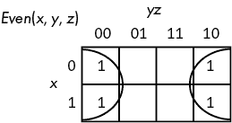

图 4-17：显示三位数偶数值的卡诺图

卡诺图表明 `x` 和 `y` 的值是什么不重要，重要的是 `z` = `0`。

### 向卡诺图添加更多变量

每次向卡诺图添加另一个变量时，都需要将单元格数量加倍。卡诺图起作用的唯一要求是根据邻接规则排列最小项或最大项。图 4-18 显示了一个四变量最小项卡诺图。`y` 和 `z` 变量在水平轴上，`w` 和 `x` 在垂直轴上。

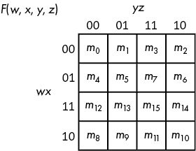

图 4-18：四变量最小项在卡诺图上的映射

到目前为止，我们假设每个最小项（或最大项）都在我们的函数中得到了考虑。但设计不是在真空中进行的。我们可能了解整体设计的其他组件，从而知道某些变量值的组合永远不会发生。接下来，我们将看到如何在函数简化过程中考虑这些知识。卡诺图提供了一种特别清晰的方式来直观展示这种情况。

### “不在乎”单元格

有时，你拥有关于变量可能取值的信息。如果你知道哪些值的组合永远不会发生，那么代表那些组合的最小项（或最大项）就无关紧要。例如，你可能想要一个函数来指示两个可能事件中的一个是否发生了，但你知道这两个事件不能同时发生。让我们将事件命名为 `x` 和 `y`，并让 `0` 表示事件未发生，`1` 表示事件已发生。表 4-12 显示了我们的函数 `F(x, y)` 的真值表。

表 4-12：`x` 或 `y` 发生但不同时发生的真值表

| `x` | `y` | `F(x, y)` |
| --- | --- | --- |
| `0` | `0` | `0` |
| `0` | `1` | `1` |
| `1` | `0` | `1` |
| `1` | `1` | `X` |

我们可以通过在该行放置一个 `X` 来表明两个事件不能同时发生。我们可以绘制一个卡诺图，其中用 `X` 标记系统中不存在的最小项，如图 4-19 所示。`X` 代表一个*不在乎*单元格——我们不在乎这个单元格是否与其他单元格分在一组。

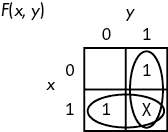

图 4-19：`F(x, y)` 的卡诺图，显示一个“不在乎”单元格

由于代表最小项 `x ∧ y` 的单元格是一个“不在乎”单元格，我们可以将其包含在最小化分组中，也可以不包含，从而得到所示的两种分组。图 4-19 中的卡诺图引导我们得出解决方案：

`F(x, y) = x ∨ y`

这是一个简单的 OR 门。你可能不需要使用卡诺图就能猜到这个解决方案。当你在第 7 章末尾学习两个数字逻辑电路的设计时，你会看到“不在乎”单元格更有趣的用法。

## 组合基本布尔运算符

正如本章前面提到的，我们可以组合基本布尔运算符来实现更复杂的布尔运算符。现在你已经知道如何处理布尔函数，我们将使用三个基本运算符 `AND`、`OR` 和 `NOT` 来设计一种更常见的运算符，*异或*，通常称为 `XOR`。它太常用了，以至于拥有自己的电路符号。

### XOR

`XOR` 是一个二元运算符。如果两个操作数中有且仅有一个是 `1`，则结果为 `1`；否则结果为 `0`。我们将使用 ⊻ 来表示 `XOR` 运算。使用 ⊕ 符号也很常见。图 4-20 显示了输入为 `x` 和 `y` 的 `XOR` 门操作。

| `x` | `y` | `x ⊻ y` |
| --- | --- | --- |
| `0` | `0` | `0` |
| `0` | `1` | `1` |
| `1` | `0` | `1` |
| `1` | `1` | `0` |

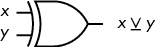

图 4-20：作用于两个变量 `x` 和 `y` 的 `XOR` 门

该运算的最小项实现为

`x ⊻ y = (x ∧ ¬y) ∨ (¬x ∧ y)`

`XOR` 运算符可以用两个 `AND` 门、两个 `NOT` 门和一个 `OR` 门来实现，如图 4-21 所示。

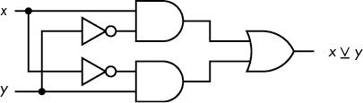

图 4-21：由 `AND`、`OR` 和 `NOT` 门组成的 `XOR` 门

当然，我们可以设计更多的布尔运算符。但在接下来的几章中，我们将继续看看这些运算符如何在硬件中实现。这一切都是通过简单的开/关开关完成的。

## 你学到了什么

1.  **布尔运算符** 基本布尔运算符是 `AND`、`OR` 和 `NOT`。
2.  **布尔代数规则** 布尔代数提供了一种处理逻辑规则的数学方法。`AND` 类似于乘法，`OR` 类似于初等代数中的加法。
3.  **简化布尔代数表达式** 布尔函数指定计算机的功能。简化这些函数可带来更简单的硬件实现。
4.  **卡诺图** 它们提供了一种简化布尔表达式的图形方法。
5.  **格雷码** 它展示了如何排序卡诺图中的单元格。
6.  **组合基本布尔运算符** `XOR` 可以由 `AND`、`OR` 和 `NOT` 创建。


