# 逻辑门


在上一章中，你学习了布尔代数表达式以及如何使用逻辑门来实现它们。在本章中，你将学习如何利用晶体管（我们在本书中一直在讨论的用于实现开/关开关的固态电子器件）在硬件中实现逻辑门。

为了帮助你理解晶体管的工作原理，我们将从电子学的简单介绍开始。随后，你将看到晶体管如何成对连接以实现更快的切换速度并降低功耗。我们将以一些关于使用晶体管构建逻辑门的实际考量来结束本章。

## 电子学速成课

你不必是电气工程师也能理解逻辑门的工作原理，但了解一些基本概念会有所帮助。本节简要概述了电子电路的基本概念。我们将从两个定义开始。

电流是指电荷的移动。电荷以库仑为单位进行测量。每秒流动一库仑的电荷被定义为一安培，通常简称为安。只有当电源的一侧到另一侧存在一条完全连通的路径时，电流才会在电路中流动。

电压是指电路中两点之间单位电荷的电能差异，也称为电位差。当一安培电流流过导体（电流流动的介质）并消耗一瓦特功率时，该导体上两点之间的电能差异被定义为一伏特。

计算机由以下电子元件构成：

- 提供电能的**电源**
- 影响电流流动和电压电平，但其特性不能被其他电子元件改变的**无源元件**
- 在一个或多个其他电子元件的控制下，在电源、无源元件和其他有源元件的各种组合之间切换的**有源元件**
- 将其他元件连接在一起的**导体**

让我们看看这些电子元件中的每一个是如何工作的。

### 电源与电池

在几乎所有国家，电能都以**交流电（AC）**的形式提供。对于交流电，电压幅值随时间变化的图呈正弦波形状。计算机电路使用**直流电（DC）**，与交流电不同，直流电不随时间变化。电源用于将交流电转换为直流电，如图 5-1 所示。


图 5-1：交/直流电源

电池也提供直流电能。在绘制电路图时，我们将使用图 5-2 所示的电池符号来表示直流电源。图 5-2 中的电源提供 5 伏直流电。


图 5-2：5 伏直流电源的电路符号

贯穿全书，你已经看到计算机中的一切操作都基于 `1` 和 `0` 的系统。但这些 `1` 和 `0` 是如何在物理上表示的呢？计算机电路通过区分两个不同的电压电平来提供逻辑 `0` 和 `1`。例如，逻辑 `0` 可用 0 伏直流电表示，逻辑 `1` 用 5 伏直流电表示。反之亦可：5 伏表示逻辑 `0`，0 伏表示逻辑 `1`。唯一的要求是硬件设计保持一致。幸运的是，程序员无需担心实际使用的电压——那最好留给计算机硬件工程师。

由于计算机电路不断在两个电压电平之间切换，当电压突然从一个电平切换到另一个电平时，计算机硬件工程师需要考虑电路元件的时域特性。我们将在下一节中探讨这些特性。

### 无源元件

所有电路都具有电阻、电容和电感。这些电磁特性分布在任何电子电路中：

1.  **电阻** 阻碍电流流动，从而消耗能量。电能转化为热能。

2.  **电容** 在电场中储存能量。电容两端的电压不能瞬间改变。

3.  **电感** 在磁场中储存能量。流过电感的电流不能瞬间改变。

能量以电场形式储存在电容中，或以磁场形式储存在电感中，这都需要时间，因此这两个特性会阻碍电压和电流的变化。这两个特性连同电阻统称为**阻抗**。对变化的阻抗会减慢计算机中发生的切换速度，而电阻会消耗电能。我们将在本节剩余部分探讨这些特性的一般时序特征，但将功耗的讨论留给更高阶的书籍。

为了体会这些特性各自的效果，我们将考虑用于将这些特性放置在电路特定位置的离散电子器件：电阻器、电容器和电感器。它们属于称为**无源元件**的更广泛的电子元件类别，这些元件无法通过电子方式控制。它们只是消耗或储存能量。

图 5-3 展示了我们将要讨论的无源电子器件的电路符号。每个器件将在下文中描述。


图 5-3：无源器件的电路符号

#### 开关

开关可以处于两个位置之一——断开或闭合。在断开位置，两端之间没有连接。当闭合时，两端之间的连接完整，从而导通电流。图 5-3 (d) 中的符号通常表示手动激活的开关。在“晶体管”（第 100 页）中，你将了解到计算机使用晶体管作为开/关开关，它们由电子方式控制，从而实现构成计算机基础的开/关逻辑。

#### 电阻器

电阻器用于限制电路特定位置的电流大小。通过限制流入电容器或电感器的电流，电阻器会影响这些器件建立储能所需的时间。电阻值通常与电容值或电感值配合选择，以提供特定的时序特性。电阻器也用于将流过器件的电流限制在非破坏性水平。

在限制电流流动时，电阻器将电能不可逆地转化为热能。与电容器或电感器不同，电阻器不储存能量，后两者可以在稍后将储存的能量返回电路。

单个电阻器的电压与电流关系由欧姆定律给出：

```
V(t) = I(t) × R
```

其中 `V(t)` 是时间 `t` 时电阻器两端的电压差，`I(t)` 是时间 `t` 时流过电阻器的电流，`R` 是电阻器的阻值。电阻值以欧姆为单位指定。


# 串联与并联电阻

## 串联电阻（图 5-4）

图 5-4 所示电路包含两个电阻，通过开关连接到提供 5 伏特电压的电源。希腊字母 `Ω` 表示欧姆，`kΩ` 表示 10³ 欧姆。由于电流只能在闭合回路中流动，合上开关前没有电流流过。

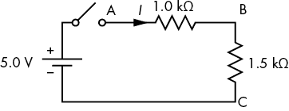

**图 5-4：两个电阻与电源、开关串联**

在图 5-4 中，两个电阻位于同一路径上，因此合上开关后，相同的电流 `I` 流经每个电阻。位于同一电流路径上的电阻称为*串联*。要确定从电池流出的电流大小，需计算电流路径上的总电阻。

电流路径上的总电阻是两个电阻之和：

```
R = 1.0 kΩ + 1.5 kΩ = 2.5 kΩ
```

因此，5 伏特电压施加在总计 2.5 kΩ 的电阻上。求解 `I`（省略 `t`，因为电源电压不随时间变化）：

```
I = V / R = 5.0 volts / 2.5 kΩ = 2.0 ma
```

其中 `ma` 表示毫安。

现在可通过电阻值与电流相乘，计算图 5-4 电路中 A、B 两点间的电压差：

```
V_AB = 1.0 kΩ × 2.0 ma = 2.0 volts
```

同理，B、C 两点间的电压差为：

```
V_BC = 1.5 kΩ × 2.0 ma = 3.0 volts
```

因此，电阻串联可作为*分压器*，将 5 伏特分配到两个电阻上——1.0 kΩ 电阻承受 2.0 伏特，1.5 kΩ 电阻承受 3.0 伏特。

## 并联电阻（图 5-5）

图 5-5 展示相同的两个电阻*并联*。

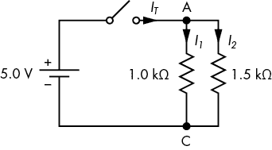

**图 5-5：两个电阻并联**

在图 5-5 中，合上开关时电源的全电压 5 伏特施加在 A、C 两点间。因此每个电阻两端均承受 5 伏特，可用欧姆定律计算流过各电阻的电流：

```
I_1 = 5.0 volts / 1.0 kΩ = 5.0 ma
```

以及

```
I_2 = 5.0 volts / 1.5 kΩ = 3.3 ma
```

合上开关时电源提供的总电流 `I_T = I_1 + I_2` 在 A 点分流供给两个电阻，必须等于流过电阻的两个电流之和：

```
I_T = I_1 + I_2
    = 5.0 ma + 3.3 ma
    = 8.3 ma
```

## 电容器

*电容器*以*电场*形式储存能量，实质是静止的电荷。电容器最初允许电流流入，但不提供持续的电流通路，而是储存电荷形成电场，导致电流随时间衰减。

由于电场建立需要时间，电容器常用于平滑电压的快速变化。当流入电容器的电流突然增加时，电容器倾向于吸收电荷；当电流突然减小时，储存的电荷释放。

电容器两端电压随时间变化的规律为：

```
V(t) = (1/C) ∫₀ᵗ I(t) dt
```

其中 `V(t)` 是时刻 `t` 电阻两端的电压差，`I(t)` 是时刻 `t` 流过的电流，`C` 是电容值（单位*法拉*），法拉的符号为 `F`。

图 5-6 展示一个 1.0 μF（微法）电容器通过 1.0 kΩ 电阻充电。

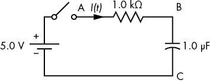

**图 5-6：电容器与电阻串联。`V_AB` 为电阻两端电压，`V_BC` 为电容器两端电压。**

正如本章后续所示，该电路粗略模拟了一个晶体管输出连接到另一个晶体管输入的情况。第一个晶体管输出具有电阻，第二个晶体管输入具有电容。第二个晶体管的开关行为取决于等效电容器两端电压 `V_BC(t)` 达到阈值。

考察电容器电压充电至阈值所需时间。假设合上开关瞬间电容器两端电压 `V_BC` 为 0 伏特，电流流经电阻进入电容器。电阻两端电压与电容器两端电压之和必须等于电源电压：

```
5.0 = I(t)R + V_BC(t)
```

开关刚合上时 `V_BC` 为 0 伏特，电源全电压 5 伏特出现在电阻两端，因此电路初始电流为：

```
I_initial = 5.0 volts / 1.0 kΩ = 5.0 ma
```


## 电容充电

电流最初涌入电容，导致电容两端的电压向电源电压积累。前面的积分方程表明，随着电容两端电压接近其最终值，这种积累呈指数级减少。随着电容两端电压 `V_BC(t)` 升高，电阻两端的电压 `V_AB(t)` 必然下降。当电容两端电压最终等于电源电压时，电阻两端电压为 0 伏，电路中的电流变为零。电流指数级减小的速率由电阻值与电容值的乘积 `RC` 给出，称为时间常数。

对于本例中的 `R` 和 `C` 值，我们得到

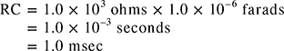

```
RC = 1.0 × 10³ ohms × 1.0 × 10^–6 farads
   = 1.0 × 10^–3 seconds
   = 1.0 msec
```

假设 图 5-6 中的电容在开关闭合时两端电压为 0 伏，则电容两端随时间建立的电压由下式给出

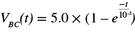

```
V_BC(t) = 5.0 × (1 - e^{-t/1.0})
```

你可以在 图 5-7 中直观地看到这一点。左侧 y 轴显示电容两端的电压，而右侧电压显示电阻两端的电压。注意刻度方向相反。

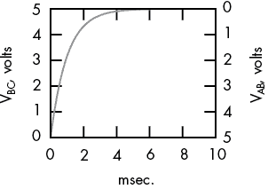

图 5-7：图 5-6 电路中电容随时间充电的过程

在时间 `t = 1.0` 毫秒（一个时间常数）时，电容两端的电压为

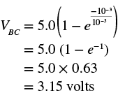

```
V_BC = 5.0 × (1 - e^{-1})
     = 5.0 × 0.63
     = 3.15 volts
```

这超过了计算机中典型晶体管的阈值电压。同样，你将在本章后面了解更多相关内容。

经过六个时间常数后，电容两端的电压已达到

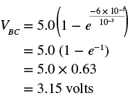

```
V_BC = 5.0 × (1 - e^{-6})
     = 5.0 × 0.997
     = 4.99 volts
```

此时，电阻两端的电压基本上为 0 伏，电流非常小。

## 电感器

`inductor`（电感器）以 `magnetic field`（磁场）的形式存储能量，磁场由运动的电荷产生。电感器最初会阻止电荷流动，需要时间来建立磁场。通过为电荷流动（电流）提供连续路径，电感器产生磁场。

在计算机中，电感器主要用于电源以及连接电源与 CPU 的电路。如果你能接触到计算机内部，可能会在主板靠近 CPU 的地方看到一个小型的（直径约 1 厘米）环形器件，上面缠绕着导线。这就是一个用于平滑供给 CPU 电源的电感器。

虽然电感器或电容器都可用于平滑电源，但电感器是通过抵抗电流变化来实现，而电容器是通过抵抗电压变化来实现。选择使用哪一个，甚至两者都用，进行平滑处理，会将我们引入更为复杂的电子学讨论中。

时间 `t` 时电感器两端电压 `V(t)` 与流过它的电流 `I(t)` 之间的关系由以下方程给出

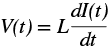

```
V(t) = L * dI(t)/dt
```

其中 `L` 是电感器的值，单位为亨利；亨利的符号是 H。

图 5-8 显示了一个 1.0 μH 电感器与一个 1.0 kΩ 电阻串联。

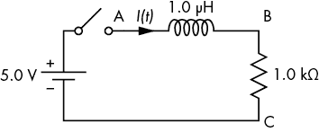

图 5-8：电感器与电阻串联


## 电感电路行为

当开关断开时，电路中没有电流流过。合上开关后，电感最初会阻碍电流流动，需要时间在电感中建立磁场。在合上开关之前，没有电流流过电阻，因此其两端电压 `V_BC` 为 0 伏特。电源的全部电压 5 伏特出现在电感两端，即 `V_AB`。随着电流开始流过电感，电阻两端的电压 `V_BC(t)` 逐渐增大。这导致电感两端的电压呈指数级下降。当电感两端电压最终达到 0 伏特时，电阻两端电压为 5 伏特，电路中的电流为 5.0 毫安。

指数电压下降的速率由时间常数 `L/R` 给出。使用 图 5-8 中 `R` 和 `L` 的值，我们得到

```
L/R = 1.0×10^-6 H / 1.0×10³ Ω = 1.0×10^-9 s = 1.0 ns
```

合上开关后，电感两端随时间产生的电压由下式给出

```
V_AB(t) = 5.0 × e^{-t × 10^-9}
```

如 图 5-9 所示。左侧 Y 轴显示电阻两端的电压，右侧显示电感两端的电压。注意刻度方向相反。

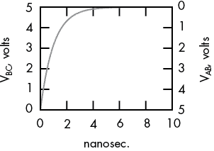

图 5-9：电感在 图 5-8 电路中随时间建立磁场

在时间 `t` = 1.0 纳秒（一个时间常数）时，电感两端的电压为

```
V_AB = 5.0 (1 - e^{-1}) = 5.0 × 0.63 = 3.15 volts
```

约 6 纳秒后（六个时间常数），电感两端的电压基本等于 0 伏特。此时，电源的全部电压落在电阻上，稳定电流 5.0 毫安流过电路。

图 5-8 中的电路展示了电感如何用于 CPU 电源。电路中的电源模拟计算机电源，电阻模拟消耗电源电能的 CPU。电源产生的电压包含*噪声*，它由叠加在直流电平上的微小高频波动组成。如 图 5-9 所示，供给 CPU 的电压 `V_BC(t)` 在短时间内变化很小。串联在电源和 CPU 之间的电感可平滑供电电压。

## 功耗

硬件设计的重要部分是*功耗*，尤其是在电池供电设备中。在我们讨论的三个电磁特性中，电阻是主要的功耗来源。

*能量*是引起变化的能力，而功率衡量的是利用能量引起变化的速度。能量的基本单位是*焦耳*。功率的基本单位是*瓦特*，定义为每秒消耗 1 焦耳。例如，我有一个可存储 240 `WH` 的备用电池。这意味着它能存储足够的能量，提供 240 瓦持续 1 小时，或 120 瓦持续 2 小时。它可存储 240 `WH` × 360 秒/小时 = 864,000 焦耳。`volt` 和 `ampere` 的单位定义使得 1 `watt` = 1 `volt` × 1 `ampere`。由此得出功率公式，

```
P = V × I
```

其中 `P` 是消耗的功率，`V` 是元件两端的电压，`I` 是流过元件的电流。

经过短暂的充电时间后，电容阻止电流流动，因此电容消耗的功率降为零。它只是以电场形式存储能量。经过短暂的磁场建立时间后，电感两端的电压降为零，因此电感消耗的功率也降为零。电感以磁场形式存储能量。

然而，电阻不存储能量。只要电阻两端存在电压差，电流就会流过它。电阻 `R` 消耗的功率由下式给出

```
P = V × I
  = I × R × I
  = I² × R
```

这部分功率在电阻中转化为热量。由于功耗随电流平方增加，常见的硬件设计目标是减小电流。

本节对计算机工程师设计中包含的无源元件进行了理想化讨论。在现实世界中，每个元件都包含硬件设计工程师需要考虑的三种特性——电阻、电容和电感——的成分。这些次级效应微妙且常在设计中造成麻烦。

本章其余部分将讨论*有源元件*，即用电子方式控制、用于实现作为计算机基础的开关的元件。你将看到，有源元件包含电阻和电容，它们会影响所用电路的设计。

## 晶体管


我们已经将计算机描述为一组双态开关的集合。在前几章中，我们讨论了如何通过这些开关的设置 `0` 或 `1` 来表示数据。然后我们继续探讨如何使用逻辑门将 `0` 和 `1` 组合以实现逻辑函数。在本节中，我们将了解如何使用晶体管来实现构成计算机的双态开关。

`transistor` 是一种其电阻可被电子控制的器件，因此使其成为 `active component`。能够被电子控制是用晶体管制成的开关与你在本章前面看到的简单通/断开关的区别所在，后者是机械控制的。在描述晶体管如何用作开关之前，让我们先看看如何使用机械通/断开关来实现逻辑门。我们将以 `NOT` 门为例。

图 5-10 显示了两个按钮开关串联连接在 5 伏和 0 伏之间。顶部开关常闭。当其按钮被按下（从左侧）时，两个小圆圈之间的连接断开，从而在该处断开电路。底部开关常开。当其按钮被按下时，两个小圆圈之间建立连接，从而在该处接通电路。

现在我们让 5 伏代表 `1`，0 伏代表 `0`。该 `NOT` 门的输入 `x` 同时按下两个按钮。我们将按以下方式控制 `x`：当 `x = 1` 时，我们按下两个按钮；当 `x = 0` 时，我们不按下按钮。当按钮未被按下时，`x = 0`，5 伏连接到输出 `¬x`，代表 `1`。当按钮被按下时，`x = 1`，5 伏断开，代表 `0` 的 0 伏连接到输出。因此，输入 `1` 得到输出 `0`，输入 `0` 得到输出 `1`——一个 `NOT` 门。

早期计算设备确实使用机械开关来实现其逻辑，但按今天的标准来看，结果非常缓慢。现代计算机使用 `transistor`，它们是由半导体材料制成的电子器件，可以在电子控制下快速在导通和非导通状态之间切换。


图 5-10：由两个按钮开关组成的非门

正如机械控制按钮示例一样，我们使用两种不同的电压来表示 `1` 和 `0`。例如，我们可能使用高电压（如 +5 伏）表示 `1`，低电压（如 0 伏）表示 `0`。但晶体管可以被电子方式开启或关闭，这使它们比原始计算机中使用的机械开关快得多。晶体管占用的空间小得多，消耗的电功率也少得多。

在以下章节中，我们将介绍现代计算机中常用的两种晶体管。

### MOSFET 开关

当今计算机逻辑电路中最常用的开关晶体管是 `metal-oxide-semiconductor field-effect transistor` (`MOSFET`)。有几种使用不同电压电平和极性的 `MOSFET` 类型。我将描述最常见类型 `enhancement-mode MOSFET` 的行为，将其他变体的细节留给更高级的相关书籍。这里的简要讨论应该有助于你理解它们的工作原理。

`MOSFET` 的基本材料通常是硅，它是一种 `semiconductor`，意味着它导电，但导电性不强。通过添加杂质（称为 `doping`）可以提高其导电性。根据杂质类型，电导率可以是电子流，也可以是电子缺失流（称为 `holes`）。由于电子带负电荷，导电子的类型称为 `N-type`，导空穴的类型称为 `P-type`。`MOSFET` 的主要导电路径是 `channel`，它连接在 `MOSFET` 的 `source` 和 `drain` 端子之间。`gate` 由相反类型的半导体制成。`gate` 控制通过 `channel` 的导电性。

图 5-11 (a) 和 (b) 分别显示了两种基本类型的 `MOSFET`：N-channel 和 P-channel。我展示了每个 `MOSFET` 通过一个电阻连接到 5 伏电源。


图 5-11：两种基本类型的 MOSFET

这些是简化电路，以便我们讨论 `MOSFET` 如何工作。每个 `MOSFET` 有三个连接点，或 `terminals`。`gate` 用作输入端子。施加到 `gate` 的电压（相对于施加到 `source` 的电压）控制通过 `MOSFET` 的电流流动。`drain` 用作输出。N-channel `MOSFET` 的 `source` 连接到电源的较低电压，P-channel 的 `source` 连接到较高电压。

在学习布尔代数中的补运算后，你可能不会惊讶于两种类型的 `MOSFET` 具有互补行为。在以下章节中，你将看到如何将它们以互补对的方式连接，这比仅使用一种类型能制造出更快、更高效的开关。

首先，我们将从 N-channel `MOSFET` 开始，看看每种如何作为单个开关器件工作。

#### N 沟道 MOSFET

在 图 5-11 (a) 中，N-channel `MOSFET` 的 `drain` 通过电阻 R 连接到电源的 5 伏侧，`source` 连接到 0 伏侧。

当施加到 `gate` 的电压相对于 `source` 为正时，N-channel `MOSFET` 的 `drain` 和 `source` 之间的电阻降低。当该电压达到阈值（通常在 1 伏左右）时，电阻变得非常低，从而在 `drain` 和 `source` 之间提供良好的导电路径。由此产生的电路等效于 图 5-12 (a)。

在这个电路 图 5-12 (a) 中，电流通过电阻 R 从电源的 5 伏连接流向 0 伏连接。`drain` 处的电压将是 0 伏。这种电流流动的一个问题是电阻消耗功率，仅将其转化为热量。稍后我们将看到为什么不想增加电阻量来限制电流流动以减少功耗。


图 5-12：N 沟道 MOSFET 开关等效电路：(a) 开关闭合，(b) 开关断开

如果施加到 `gate` 的电压切换为接近施加到 `source` 的电压（本例中为 0 伏），`MOSFET` 关闭，产生 图 5-12 (b) 所示的等效电路。`drain` 通常连接到另一个 `MOSFET` 的 `gate`，后者仅在从一种状态切换到另一种状态时短暂汲取电流。在此短暂的状态切换后，`drain` 连接到另一个 `MOSFET` 的 `gate` 不再汲取电流。由于没有电流流过电阻 R，因此其两端没有电压差。因此，`drain` 处的电压将为 5 伏，电阻被称为 `pull-up device`，因为当 `MOSFET` 关闭时，电路通过电阻完成，电阻的作用是将 `drain` 上的电压拉升到电源的较高电压。

#### P 沟道 MOSFET


## P 沟道 MOSFET 开关

现在，让我们看看 P 沟道 MOSFET，如图 5-11(b)所示。这里漏极通过一个电阻连接到较低电压（`0 V`），源极连接到较高电压的电源（`5 V`）。当施加到栅极的电压切换为与施加到源极的电压几乎相同时，MOSFET 关闭。在这种情况下，电阻`R`充当*下拉器件*，将漏极上的电压拉低到`0 volts`。图 5-13(a)显示了等效电路。

当施加到栅极的电压相对于源极为负时，P 沟道 MOSFET 漏极和源极之间的电阻会降低。当该电压达到阈值（通常在`–1 volt`范围内）时，电阻变得非常低，从而在漏极和源极之间提供一条良好的导电路径。图 5-13(b)显示了当栅极相对于源极为`–5 volts`时产生的等效电路。

这两种 MOSFET 类型都存在一些问题。查看图 5-12(a)和 5-13(b)中的等效电路，你可以看到各自处于导通状态的 MOSFET 表现得像一个闭合开关，从而导致电流流过上拉或下拉电阻。当 MOSFET 处于导通状态时，流过电阻的电流会消耗功率，这些功率只是简单地转化为热量。

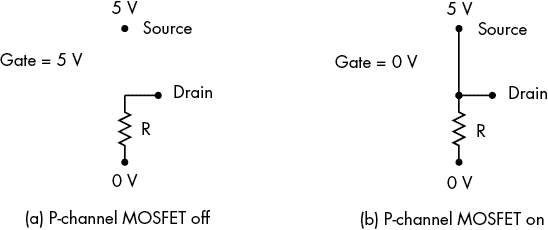

图 5-13：P 沟道 MOSFET 开关等效电路：(a)开关闭合，(b)开关断开

除了 MOSFET 处于导通状态时上拉和下拉电阻消耗功率外，这种硬件设计还有另一个问题。虽然 MOSFET 的栅极为了保持导通或关断状态基本不消耗电流，但改变 MOSFET 状态需要向栅极输入一小阵电流。该电流由连接到栅极的器件提供，很可能来自另一个 MOSFET 的漏极。我们将不在本书中深入探讨细节，但该其他 MOSFET 漏极能提供的电流量主要受其上拉或下拉电阻限制。这种情况本质上与图 5-6 和 5-7 中的情况相同，你在那里看到电容充电所需的时间随电阻值增大而变长。

所以，这里存在权衡：电阻越大，电流越小，从而减少 MOSFET 处于导通状态时的功耗。但较大的电阻也会减少漏极处可用的电流量，从而增加切换连接到漏极的 MOSFET 所需的时间。我们面临一个两难境地：较小的上拉和下拉电阻会增加功耗，但较大的电阻会降低计算机速度。

### CMOS 开关

我们可以利用*互补金属氧化物半导体*（*CMOS*）技术来解决这一两难问题。为了了解其工作原理，让我们去掉上拉和下拉电阻，将一个 P 沟道和一个 N 沟道的漏极连接在一起。P 沟道将取代 N 沟道电路中的上拉电阻，而 N 沟道将取代 P 沟道电路中的下拉电阻。我们还将把两个栅极连接在一起，得到图 5-14 所示的电路。

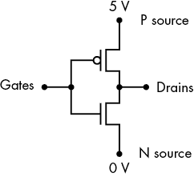

图 5-14：CMOS 反相器（非门）电路

图 5-15(a)显示了栅极处于较高电源电压`5 volts`时的等效电路。上拉 MOSFET（P 沟道）关断，下拉 MOSFET（N 沟道）导通，因此漏极被拉低到较低电源电压`0 volts`。在图 5-15(b)中，栅极处于较低电源电压`0 volts`，这使得 P 沟道 MOSFET 导通而 N 沟道 MOSFET 关断。P 沟道 MOSFET 将漏极拉高到较高电源电压`5 volts`。

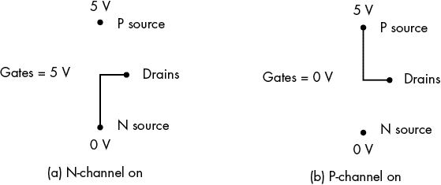

图 5-15：CMOS 反相器等效电路：(a)上拉断开且下拉闭合，(b)上拉闭合且下拉断开

我们可以在表 5-1 中总结这种行为。

表 5-1：单个 CMOS 的真值表

| 栅极 | 漏极 |
| --- | --- |
| `0 V` | `5 V` |
| `5 V` | `0 V` |

如果我们将栅极连接用作输入，漏极连接用作输出，并让`5 volts`为逻辑`1`，`0 volts`为逻辑`0`，那么 CMOS 就实现了一个非门。

使用 CMOS 电路的两个主要优点是

*   它们消耗极少的功率。由于 N 沟道和 P 沟道 MOSFET 之间的开关速度差异，只有少量电流在切换期间流动。电流越小意味着发热越少，这通常是芯片设计中的限制因素。
*   电路响应快得多。MOSFET 在其输出端提供电流的速度比电阻快，从而更快地为下一个 MOSFET 的栅极充电。这使我们能够构建更快的计算机。

图 5-16 显示了一个由三个 CMOS 实现的与门。

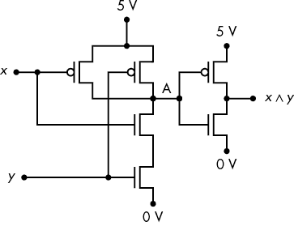

图 5-16：由三个 CMOS 晶体管构成的与门

真值表表 5-2 显示了前两个 CMOS 的中间输出，即图 5-16 中的点`A`。

表 5-2：图 5-16 的与门真值表

| `x` | `y` | `A` | `x ∧ y` |
| --- | --- | --- | --- |
| `0` | `0` | `1` | `0` |
| `0` | `1` | `1` | `0` |
| `1` | `0` | `1` | `0` |
| `1` | `1` | `0` | `1` |

从真值表中我们可以看到，点`A`处的信号是`` `¬(x ∧ y)` ``。从点`A`到输出的电路是一个非门。点`A`处的结果称为*与非*（NAND）操作。它比与操作少需要两个晶体管。我们将在下一节探讨这一结果的含义。

## 与非（NAND）门和或非（NOR）门

正如我们在上一节所见，晶体管的固有设计意味着大多数电路会反转信号。也就是说，对于大多数电路，输入端的高电压会在输出端产生低电压，反之亦然。因此，与门通常需要在输出端加一个非门才能实现真正的与操作。

你还了解到，产生 NOT(AND)所需的晶体管比普通 AND 门少。这种组合非常常见，因此得名*与非门*（NAND gate）。当然，我们也有与或门对应的等效电路，称为*或非门*（NOR gate）。

1.  **与非（NAND）** 一种二元运算符，当且仅当*两个*操作数均为`1`时结果为`0`，否则结果为`1`。我们将用`` `¬(x ∧ x)` ``来表示与非操作。图 5-17 显示了与非门的硬件符号及其针对输入`x`和`y`的操作真值表。

| `x` | `y` | `¬(x ∧ y)` |
| --- | --- | --- |
| `0` | `0` | `1` |
| `0` | `1` | `1` |
| `1` | `0` | `1` |
| `1` | `1` | `0` |


图 5-17：作用于两个变量`x`和`y`的与非门

1.  **或非（NOR）** 一种二元运算符，如果两个操作数中至少有一个为`1`则结果为`0`，否则结果为`1`。我们将用`` `¬(x ∨ y)` ``来表示或非操作。图 5-18 显示了或非门的硬件符号及其针对输入`x`和`y`的操作真值表。

| `x` | `y` | `¬(x ∨ y)` |
| --- | --- | --- |
| `0` | `0` | `1` |
| `0` | `1` | `0` |
| `1` | `0` | `0` |
| `1` | `1` | `0` |


| `1` | `1` | `0` |
| --- | --- | --- |

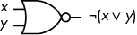

图 5-18：作用于两个变量 `x` 和 `y` 的 NOR 门

请注意 图 5-18 中 `NAND` 门和 `NOR` 门输出端的小圆圈。这表示 `NOT`，就像 `NOT` 门一样（图 4-3）。

虽然在上一章中，当门的输入取反时我们显式地画出了 `NOT` 门，但通常只需在输入端使用这些小圆圈来表示取反即可。例如，图 5-19 展示了一个两个输入均取反的 `OR` 门。

| `x` | `y` | `(¬x ∨ ¬y)` | `¬(x ∧ y)` |
| --- | --- | --- | --- |
| `0` | `0` | `1` | `1` |
| `0` | `1` | `1` | `1` |
| `1` | `0` | `1` | `1` |
| `1` | `1` | `0` | `0` |

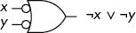

图 5-19：绘制 `NAND` 门的另一种方式

如真值表所示，这是实现 `NAND` 门的另一种方法。正如你在第 4 章所学，`德摩根定律` 证实了这一点：

$$
\neg(x \land y) = (\neg x \lor \neg y)
$$

## NAND 门作为通用门

关于 `NAND` 门的一个有趣特性是，它们可以用来构建 `AND`、`OR` 和 `NOT` 门。这意味着 `NAND` 门可用于实现任何布尔函数。从这个意义上说，你可以把 `NAND` 门看作是*通用门*。回顾 `德摩根定律`，你大概不会惊讶于 `NOR` 门也可以用作通用门。但 `CMOS` 晶体管的物理特性决定了 `NAND` 门更快且占用空间更小，因此它们几乎总是首选方案。

让我们看看如何用 `NAND` 门构建 `AND`、`OR` 和 `NOT` 门。要用 `NAND` 门构建 `NOT` 门，只需将信号同时连接到 `NAND` 门的两个输入端，如 图 5-20 所示。

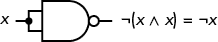

图 5-20：由 `NAND` 门构建的 `NOT` 门

要构建 `AND` 门，我们可以观察到 图 5-21 中的第一个 `NAND` 门产生 `¬(x ∧ y)`，并将其连接到一个 `NOT` 门以产生 `(x ∧ y)`。

我们可以用 `德摩根定律` 来推导 `OR` 门。请看下面的推导：

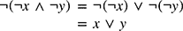

$$
\neg(\neg x \land \neg y) = \neg(\neg x) \lor \neg(\neg y) = x \lor y
$$

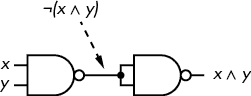

图 5-21：由两个 `NAND` 门构建的 `AND` 门

因此，要实现 `OR`，我们需要三个 `NAND` 门，如 图 5-22 所示。位于 `x` 和 `y` 输入端的两个 `NAND` 门连接为 `NOT` 门以产生 `¬x` 和 `¬y`，这使得第三个 `NAND` 门的输出为 `¬((¬x) ∨ (¬y))`。

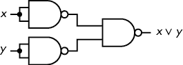

图 5-22：由三个 `NAND` 门构建的 `OR` 门

看起来我们用 `NAND` 门构建电路增加了复杂性，但请考虑这个函数：

$$
F(w, x, y, z) = (w \land x) \lor (y \land z)
$$

如果不了解逻辑门的构造，用 图 5-23 所示的电路来实现这个函数是合理的。

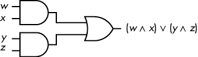

图 5-23：使用两个 `AND` 门和一个 `OR` 门的 `F(w, x, y, z)`

自反性质表明 `$\neg(\neg x) = x$`，所以我们可以在每条路径上添加两个 `NOT` 门，如 图 5-24 所示。

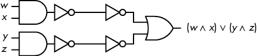

图 5-24：使用两个 `AND` 门、一个 `OR` 门和四个 `NOT` 门的 `F(w, x, y, z)`

将作用于 `w`、`x`、`y` 和 `z` 输入的两个 `AND` 门/`NOT` 门组合与 图 5-17 进行比较，我们会发现每个组合就是一个 `NAND` 门。它们将在最左边两个 `NOT` 门的输出端产生 `¬(w ∧ x)` 和 `¬(y ∧ z)`。

从 图 5-19 中 `德摩根定律` 的应用我们可以看到 `$\neg a \lor \neg b = \neg(a \land b)$`。换句话说，我们可以用单个 `NAND` 门替换最右边的两个 `NOT` 门和 `OR` 门的组合。

$$
\neg(\neg(w \land x) \land \neg(y \land z)) = (w \land x) \lor (y \land z)
$$

图 5-25 中的最终电路使用了三个 `NAND` 门。

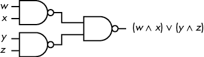

图 5-25：仅使用三个 `NAND` 门的 `F(w, x, y, z)`

仅从查看图 5-23 和图 5-25 的逻辑电路图来看，似乎这次电路转换没有带来任何收益。但我们在上一节看到，一个 `NAND` 门（图 5-16 中的 A 点）比一个 `AND` 门少需要两个晶体管。因此，`NAND` 门实现功耗更低且速度更快。虽然这里没有展示，但 `OR` 门也是同样的情况。

从 `AND`/`OR`/`NOT` 门设计转换为仅使用 `NAND` 门的设计非常直接：

1.  将函数表示为最小乘积和。
2.  将乘积项（`AND` 项）和最终求和项（`OR`）转换为 `NAND`。
3.  为任何只包含单个文字的乘积项添加一个 `NAND` 门。

这里关于 `NAND` 门所说的一切都适用于 `NOR` 门。你只需应用 `德摩根定律` 来求出所有项的补码。但如前所述，`NAND` 门通常比 `NOR` 门更快且占用空间更小，所以它们几乎总是首选方案。

就像软件一样，硬件设计是一个迭代过程。大多数问题没有唯一的解决方案，你通常需要开发多个设计并在可用硬件的背景下分析每一个。正如前面的例子所示，两个在纸面上看起来相同的解决方案在硬件层面可能截然不同。

## 你学到了什么

1.  **基本电子概念** 电阻、电容和电感影响电子电路中的电压和电流流动。
2.  **晶体管** 可用作电子控制开关的半导体器件。
3.  **MOSFET** 金属-氧化物-半导体场效应晶体管是计算机中实现逻辑门最常用的开关器件。它们分为 `N-channel`（N 沟道）和 `P-channel`（P 沟道）两种类型。
4.  **CMOS** `N-channel`（N 沟道）和 `P-channel`（P 沟道）`MOSFETs` 以互补配置配对，以提高开关速度并降低功耗。
5.  **NAND 门和 NOR 门** 由于晶体管固有的电子特性，它们比 `AND` 门和 `OR` 门需要更少的晶体管。

在下一章中，你将看到简单逻辑门如何在电路中连接，以实现构建计算机所需的复杂操作。
