# 6 组合逻辑电路


在上一章中，你学习了计算机的基本组件——逻辑门。计算机由逻辑门的组合构成，称为*逻辑电路*，用于处理数字信息。在本章和接下来的两章中，我们将探讨如何构建构成 CPU、内存和其他设备的一些逻辑电路。我们不会完整地描述这些单元中的任何一个；相反，我们将只看其中的一小部分，并讨论它们背后的概念。目标是提供这些逻辑电路基础思想的入门概述。

## 逻辑电路的两大类别

逻辑电路分为两类：

1.  组合逻辑 *组合逻辑电路*的输出仅取决于任何特定时刻给定的输入，而不取决于任何之前的输入。
2.  时序逻辑 *时序逻辑电路*的输出同时取决于之前的输入和当前的输入。

为了阐明这两种类型，让我们以电视遥控器为例。你可以通过在遥控器上输入数字来选择特定频道。频道选择仅取决于你输入的数字，而忽略你之前观看的频道。因此，输入和输出之间的关系是组合的。

遥控器还有一个用于上下切换频道的输入。该输入取决于先前选定的频道以及之前上/下按钮按下的序列。频道上/下按钮演示了时序输入/输出关系。

我们将在下一章探讨时序逻辑电路。在本章中，我们将通过几个组合逻辑电路的例子来了解它们的工作原理。

## 加法器

我们将从 CPU 中执行的最基本操作之一开始：添加两位。我们最终的目标是添加两个 `n` 位数字。

回顾第 2 章，二进制数中的位是从右（最低有效位）到左（最高有效位）编号的，从 0 开始。我们将首先展示如何添加第 `i` 位位置的两个位，并完成讨论，展示如何添加两个四位数字，同时考虑来自每个位位置的进位。

### 半加器

加法可以用几种电路来完成。我们将从*半加器*开始，它只是简单地将一个数字（用二进制表示）当前位位置的两个位相加。这由真值表 表 6-1 显示。在该表中，`x[i]` 是数字 `x` 的第 `i` 位。`y[i]` 列中的值代表数字 `y` 的第 `i` 位。`Sum[i]` 是数字 `Sum` 的第 `i` 位，而 `Carry[i+1]` 是将位 `x[i]` 和 `y[i]` 相加产生的进位。

表 6-1：添加两位，半加器

| x[i] | y[i] | Carry[i+1] | Sum[i] |
|------|------|------------|--------|
| 0    | 0    | 0          | 0      |
| 0    | 1    | 0          | 1      |
| 1    | 0    | 0          | 1      |
| 1    | 1    | 1          | 0      |

和是两个输入的异或（XOR），进位是两个输入的与（AND）。图 6-1 显示了半加器的逻辑电路。

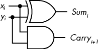

图 6-1：半加器电路

但这里有一个缺陷：半加器只能处理两个输入位。它可用于将两个数字中相同位位置的两个位相加，但它不考虑来自下一低位位置的可能进位。为了容纳进位，我们必须添加第三个输入。

### 全加器

与半加器不同，*全加器*电路有三个单比特输入：`Carry[i]`、`x[i]` 和 `y[i]`。`Carry[i]` 是将前一个位位置（右边的位）的两个位相加时产生的进位。例如，如果我们要添加位位置 5 的两个位，全加器的输入就是位置 5 的两个位加上位位置 4 的两个位相加产生的进位。表 6-2 显示了结果。

表 6-2：添加两位，全加器

| Carry[i] | x[i] | y[i] | Carry[i+1] | Sum[i] |
|----------|------|------|------------|--------|
| 0        | 0    | 0    | 0          | 0      |
| 0        | 0    | 1    | 0          | 1      |
| 0        | 1    | 0    | 0          | 1      |
| 0        | 1    | 1    | 1          | 0      |
| 1        | 0    | 0    | 0          | 1      |
| 1        | 0    | 1    | 1          | 0      |
| 1        | 1    | 0    | 1          | 0      |
| 1        | 1    | 1    | 1          | 1      |

为了设计全加器电路，我们从指定 `Sum[i]` 何时为 `1` 的函数开始，将其表示为来自 表 6-2 的乘积项之和。

```
Sumi = (¬Carry[i] ∧ ¬x[i] ∧ y[i]) ∨ (¬Carry[i] ∧ x[i] ∧ ¬y[i]) ∨ (Carry[i] ∧ ¬x[i] ∧ ¬ y[i]) ∨ (Carry[i] ∧ x[i] ∧ y[i])
```

这个方程中没有明显的简化，所以让我们看看 `Sum[i]` 的卡诺图（图 6-2）。

![图 6-2：三个位 `Carry[i]`、`x[i]` 和 `y[i]` 的和的卡诺图](image_fi/500099c06/f06002.png)

图 6-2：三个位 `Carry[i]`、`x[i]` 和 `y[i]` 的和的卡诺图

在 图 6-2 中没有明显的分组，所以我们只能用前一个方程中的四个乘积项来计算 `Sum[i]`。

我们在第 4 章看到 `Carry[i+1]` 可以用这个方程表示：

```
Carryi+1 = (x[i] ∧ y[i]) ∨ (Carry[i] ∧ x[i]) ∨ (Carry[i] ∧ y[i])
```

这两个函数一起给出了 图 6-3 中的全加器电路。

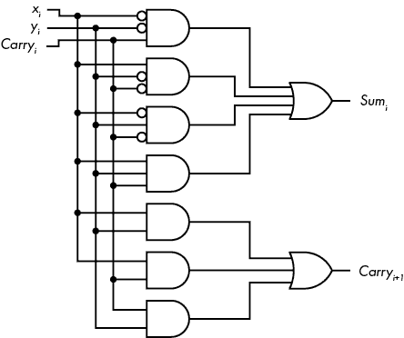

图 6-3：全加器电路

正如你所见，全加器使用了九个逻辑门。在下一节中，我们将看看能否找到一个更简单的电路。

### 由两个半加器构成的全加器

为了看看能否找到一个更简单的解决方案来添加两个位和来自下一低位位置的进位，让我们回到 `Sum[i]` 的方程。使用分配律，我们可以重新排列：

```
Sumi = ¬Carry[i] ∧ ((¬x[i] ∧ y[i]) ∨ (x[i] ∧ ¬y[i])) ∨ Carry[i] ∧ ((¬x[i] ∧ ¬y[i]) ∨ (x[i] ∧ y[i]))
```

在第 4 章中，你学到第一个乘积项括号中的量是 `x[i]` 和 `y[i]` 的异或（XOR）：

```
(¬x[i] ∧ y[i]) ∨ (x[i] ∧ ¬y[i]) = x[i] ⊻ y[i]
```

因此，我们得到：

```
Sumi = ¬Carry[i] ∧ (x[i] ⊻ y[i]) ∨ Carry[i] ∧ ((¬x[i] ∧ ¬y[i]) ∨ (x[i] ∧ y[i]))
```

现在让我们操作第二个乘积项括号中的量。回想一下，在布尔代数中 x ∧ ¬x = 0，所以我们可以写出以下内容：

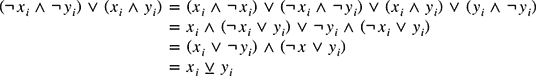


```
(¬x_i ∧ ¬y_i) ∨ (x_i ∧ y_i) = (x_i ∧ ¬x_i) ∨ (¬x_i ∧ ¬y_i) ∨ (x_i ∧ y_i) ∨ (y_i ∧ ¬y_i) = x_i ∧ (¬x_i ∨ y_i) ∨ ¬y_i ∧ (¬x_i ∨ y_i) = (x_i ∨ ¬y_i) ∧ (¬x_i ∨ y_i) = x_i ⊻ y_i
```

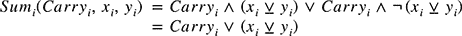

```
Sum_i(Carry_i, x_i, y_i) = Carry_i ∧ (x_i ⊻ y_i) ∨ Carry_i ∧ ¬(x_i ⊻ y_i) = Carry_i ∨ (x_i ⊻ y_i)
```

我们将做一些工作来为 `Carry[i+1]` 开发一个布尔函数，这可能看起来有点**违反直觉**。让我们从添加三位时进位的卡诺图开始，即第 4 章的图 4-13，但移除其中两个分组，如图 6-4 中的虚线所示。

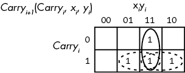

这将给我们以下方程：

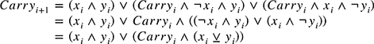


## 由半加器构建全加器

```
Carry_{i+1} = (x_i ∧ y_i) ∨ (Carry_i ∧ ¬x_i ∧ y_i) ∨ (Carry_i ∧ x_i ∧ ¬y_i)
            = (x_i ∧ y_i) ∨ Carry_i ∧ ((¬x_i ∧ y_i) ∨ (x_i ∧ ¬y_i))
            = (x_i ∧ y_i) ∨ (Carry_i ∧ (x_i ⊻ y_i))
```

请注意，该方程中的两项，`x_i ∧ y_i` 和 `x_i ⊻ y_i`，已由半加器生成（参见图 6-1）。因此，利用第二个半加器和一个或门，我们可以实现一个全加器，如图 6-5 所示。

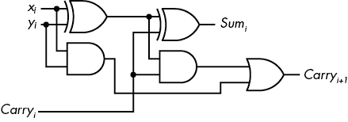

现在你可以明白*半加器*和*全加器*这两个术语的由来了。

简单的电路并不总是更好。事实上，仅从逻辑电路图来看，我们无法判断图 6-3 和图 6-5 这两个全加器电路哪个更好。良好的工程设计取决于许多因素，例如每个逻辑门的实现方式、逻辑门的成本及其可获得性等。此处给出这两种设计是为了表明不同的方法可以得出不同但功能等效的设计。

### 行波进位加法和减法电路

现在我们知道如何将给定位位置上的两个位相加，再加上来自次低位位置的进位。但程序处理的大多数值都有许多位，因此我们需要一种方法将两个 *n* 位数中每个位位置上对应的位相加。这可以通过一个 *n* 位加法器来完成，它可以用 *n* 个全加器实现。图 6-6 展示了一个四位加法器。

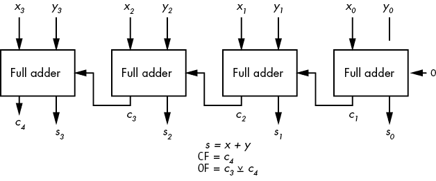

加法从最右侧的全加器开始，它接收两个最低位 `x[0]` 和 `y[0]`。由于这是最低位，没有进位，所以 `c[0] = 0`。位和为 `s[0]`，该次加法产生的进位 `c[1]` 连接到左侧下一个全加器的进位输入端，在那里与 `x[1]` 和 `y[1]` 相加。

因此，第 *i* 个全加器将两个操作数的第 *i* 位相加，再加上来自第 (*i – 1*) 个全加器的进位（即 `0` 或 `1`）。每个全加器处理待加数值总宽度中的一位（通常称为*切片*）。每个位位置的进位被加到下一个高位位置的位上。加法过程从最低位流向最高位，呈现一种行波效应，因此这种加法方法称为*行波进位加法*。

请注意，在图 6-6 中，我们有 `CF` 和 `OF`，即*进位标志*和*溢出标志*。你在第三章学习了进位和溢出。每当 CPU 执行算术运算（本例中为加法）时，它会在 `rflags` 寄存器中记录是否发生了进位和溢出。你将在第九章了解该寄存器。

现在让我们看看如何利用类似的思路实现减法。回顾一下，在补码表示中，一个数取反是通过求其补码、翻转所有位并加 1 来完成的。因此，我们可以通过以下方式计算 *x* 减 *y*：

```
x – y = x + (two's complement of y)
      = x + ((y's bits flipped) + 1)
```

如果我们将每个 `y[i]` 取反，并将初始进位设为 `1` 而不是 `0`，就可以用图 6-5 中的加法器执行减法。每个 `y[i]` 可以通过与 `1` 进行异或运算来取反。这得出了图 6-7 中的四位电路，当 `func = 0` 时它将两个四位数相加，当 `func = 1` 时将它们相减。

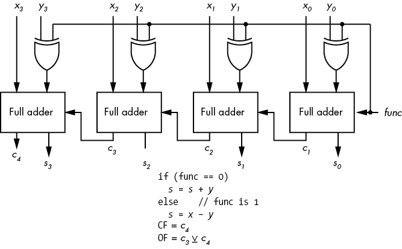


当然，由于求和是从右向左计算的，因此存在时间延迟。通过更复杂的电路设计预先计算 `CF` 进位和 `OF` 的值，可以显著减少计算时间，但本书不深入探讨此类细节。让我们转向下一种电路类型。

## 解码器

计算机中的许多场合都需要根据一个数字从多个连接中选择一个。例如，正如几章后你将看到的，CPU 拥有少量组织在 `registers`（寄存器）中的内存，用于计算。x86-64 架构有十六个 64 位寄存器。如果一条指令使用其中一个寄存器，指令中的四位必须用于选择这十六个寄存器中的哪一个。

这种选择可以用 `decoder`（解码器）来完成。解码器的输入是寄存器的四位编号，输出是十六个可能的连接之一，连接到指定的寄存器。

解码器有 `n` 个二进制输入，最多可产生 2^n 个二进制输出。最常见的解码器类型，有时称为 `line decoder`（行解码器），对于每种输入位模式，仅选择一条输出线设置为 `1`。解码器包含一个 Enable（使能）输入也很常见。表 6-3 中带使能输入的 3 × 8（3 个输入，8 个输出）解码器的真值表展示了其工作原理。当 Enable = `0` 时，所有输出线均为 `0`。当 Enable = `1` 时，输入端的三位数 `x` = `x`[2]`x`[1]`x`[0] 选择哪条输出线设置为 `1`。因此，该解码器可用于通过三位数选择八个寄存器之一。（此处未使用 x86-64 架构中的十六个寄存器，以保持表格大小合理。）

**表 6-3：带使能的 3 × 8 解码器**

| Enable | x[2] | x[1] | x[0] | y[7] | y[6] | y[5] | y[4] | y[3] | y[2] | y[1] | y[0] |
| --- | --- | --- | --- | --- | --- | --- | --- | --- | --- | --- | --- |
| `0` | `0` | `0` | `0` | `0` | `0` | `0` | `0` | `0` | `0` | `0` | `0` |
| `0` | `0` | `0` | `1` | `0` | `0` | `0` | `0` | `0` | `0` | `0` | `0` |
| `0` | `0` | `1` | `0` | `0` | `0` | `0` | `0` | `0` | `0` | `0` | `0` |
| `0` | `0` | `1` | `1` | `0` | `0` | `0` | `0` | `0` | `0` | `0` | `0` |
| `0` | `1` | `0` | `0` | `0` | `0` | `0` | `0` | `0` | `0` | `0` | `0` |
| `0` | `1` | `0` | `1` | `0` | `0` | `0` | `0` | `0` | `0` | `0` | `0` |
| `0` | `1` | `1` | `0` | `0` | `0` | `0` | `0` | `0` | `0` | `0` | `0` |
| `0` | `1` | `1` | `1` | `0` | `0` | `0` | `0` | `0` | `0` | `0` | `0` |
| `1` | `0` | `0` | `0` | `0` | `0` | `0` | `0` | `0` | `0` | `0` | `1` |
| `1` | `0` | `0` | `1` | `0` | `0` | `0` | `0` | `0` | `0` | `1` | `0` |
| `1` | `0` | `1` | `0` | `0` | `0` | `0` | `0` | `1` | `0` | `0` | `0` |
| `1` | `0` | `1` | `1` | `0` | `0` | `0` | `1` | `0` | `0` | `0` | `0` |
| `1` | `1` | `0` | `0` | `0` | `0` | `0` | `1` | `0` | `0` | `0` | `0` |
| `1` | `1` | `0` | `1` | `0` | `0` | `1` | `0` | `0` | `0` | `0` | `0` |
| `1` | `1` | `1` | `0` | `0` | `1` | `0` | `0` | `0` | `0` | `0` | `0` |
| `1` | `1` | `1` | `1` | `1` | `0` | `0` | `0` | `0` | `0` | `0` | `0` |

表 6-3 中规定的 3 × 8 行解码器可以用四输入与门实现，如 图 6-8 所示。

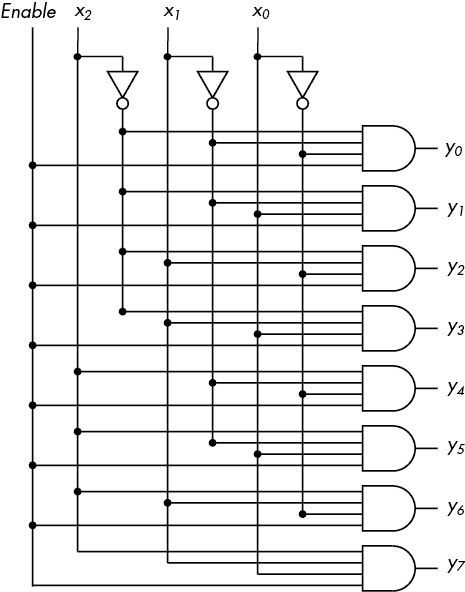

图 6-8：带使能的 3 × 8 解码器电路

解码器的通用性乍看之下可能被低估。每一种可能的输入都可以视为一个最小项（关于最小项的复习，请参见第 4 章）。表 6-3 中的行解码器显示，仅当一个最小项评估为 `1` 且 Enable 为 `1` 时，才有一个输出为 `1`。因此，解码器可以被视为“最小项发生器”。从本书前面我们知道，任何逻辑表达式都可以表示为最小项的或（OR），因此可以通过对解码器的输出进行或运算来实现任何逻辑表达式。

例如，如果你回顾全加器的卡诺图（图 6-2 和图 6-4），你可能会看到 `Sum` 和 `Carry` 可以表示为最小项的或，

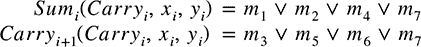

`Sum_i(Carry_i, x_i, y_i) = m1 ∨ m2 ∨ m4 ∨ m7`  
`Carry_i+1(Carry_i, x_i, y_i) = m3 ∨ m5 ∨ m6 ∨ m7`

其中，`x`、`y` 和 `Carry` 上的下标 `i` 指的是位片，`m` 上的下标是最小项表示法的一部分。我们可以用一个 3 × 8 解码器和两个四输入或门来实现全加器的每个位片，如 图 6-9 所示。

图 6-8 中的解码器电路需要八个与门和三个非门。图 6-9 中的全加器增加了两个或门，总共需要十三个逻辑门。将其与 图 6-5 中的全加器设计相比，后者仅需五个逻辑门（两个异或、两个与、一个或），似乎使用解码器构建全加器增加了电路的复杂性。但请记住，设计通常基于其他因素，例如元件的可获得性、成本等。


图 6-9：用 3 × 8 解码器实现的全加器的一个位片。`n` 位加法器需要 `n` 个这样的电路。

## 多路选择器


# 多路选择器和三态缓冲器

在上一节中，你学习了如何使用一个 *n* 位数来选择 2^(*n*) 条输出线中的哪一条应被设置为 `1`。相反的情况也会发生，即我们需要选择哪个输入应该被传递下去。例如，在执行加法等算术运算时，数字可能来自 CPU 内部的不同位置。（你将在接下来的几章中了解更多相关内容。）运算本身将由一个算术单元执行，CPU 需要从所有可能的位置中选择运算的输入。

能够进行这种选择的设备称为 *多路选择器* (*MUX*)。它可以通过使用 *n* 条选择线在 2^(*n*) 条输入线之间进行切换。图 6-11 展示了一个四路多路选择器的电路。

输出由下式给出：

```
Output = (¬s[0] ∧ ¬s[1] ∧ w) ∨ (¬s[0] ∧ s[1] ∧ x) ∨ (s[0] ∧ ¬s[1] ∧ y) ∨ (s[0] ∧ s[1] ∧ z)
```

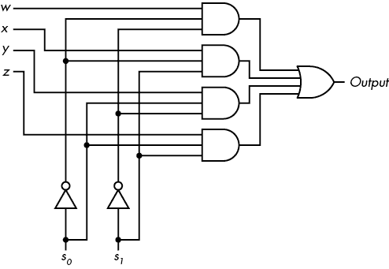

**图 6-11：四路多路选择器**

当使用与门和或门时，实现多路选择器所需的晶体管数量会随着输入数量的增加而变大。多路选择器的每个输入都需要一个三输入与门，而或门的输入数量等于多路选择器的输入数量。与门被用来将多路选择器的仅一个输入传送给或门。接下来我们将看到一种器件，它可以通过简单地将输入信号与输出断开，来实现与门和或门组合的相同功能。

## 三态缓冲器

称为 *三态缓冲器* 的逻辑器件有三种可能的输出：`0`、`1` 和"无连接"。"无连接"输出实际上是一种高阻抗连接，也称为 *高阻* 或 *开路*。"无连接"输出允许我们将许多三态缓冲器的输出在物理上连接在一起，但只选择一个将其输入传递给公共输出线。

三态缓冲器既有数据输入也有使能端，其行为如 表 6-5 所示。

**表 6-5：三态缓冲器真值表**

| **使能** | **输入** | **输出** |
| --- | --- | --- |
| `0` | `0` | 高阻 |
| `0` | `1` | 高阻 |
| `1` | `0` | `0` |
| `1` | `1` | `1` |

图 6-12 展示了三态缓冲器的电路符号。

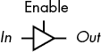

**图 6-12：三态缓冲器**

当 `Enable = 1` 时，输出（等于输入）连接到三态缓冲器后面的任何电路元件。但当 `Enable = 0` 时，输出基本上是断开的。这不同于 `0`；断开意味着它对所连接的电路元件没有影响。

为了说明三态缓冲器如何使用，请回顾第 124 页 "多路选择器" 一节中的四路多路选择器。它需要四个与门、两个非门和一个四输入或门。如果我们尝试扩大规模，对于大的 *n*，*n* 输入或门将带来一些技术上的电子问题。通过使用 *n* 个三态缓冲器，可以避免使用 *n* 输入或门，如 图 6-13 所示的四路多路选择器。

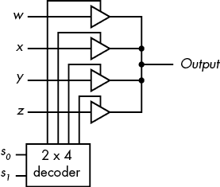

**图 6-13：由解码器和三态缓冲器构建的四路多路选择器**

图 6-13 中的多路选择器使用了一个 2 × 4 解码器和四个三态缓冲器。2 × 4 解码器选择哪个三态缓冲器将输入 `w`、`x`、`y` 或 `z` 中的一个连接到输出。

图 6-14 展示了用于多路选择器的电路符号，表 6-6 展示了它的行为。

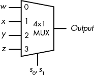

**图 6-14：四路多路选择器的电路符号**

**表 6-6：四路多路选择器真值表**

| **s[1]** | **s[0]** | **输出** |
| --- | --- | --- |
| `0` | `0` | `w` |
| `0` | `1` | `x` |
| `1` | `0` | `y` |
| `1` | `1` | `z` |

作为一个示例，说明我们可能在哪里使用 图 6-14 中的四路多路选择器，请考虑一台有四个寄存器和一个加法器的计算机。我们将寄存器命名为 `w`、`x`、`y` 和 `z`。如果我们将每个寄存器中对应位位置的位连接到一个多路选择器，那么我们就可以使用两位选择器 `s[0]s[1]` 来选择哪个寄存器将为加法器提供输入。例如，位置 5 的每一位，`w[5]`、`x[5]`、`y[5]` 和 `z[5]`，将被连接到多路选择器 5 的输入之一。如果 `s[0]s[1] = 10`，加法器的输入将是 `y[5]`。

# 可编程逻辑器件

到目前为止，我们一直在讨论使用单个逻辑门的硬件设计。如果设计发生变化，逻辑门配置也会随之改变。这几乎总意味着承载并连接逻辑门的电路板将需要重新设计。设计变更通常还意味着要订购不同种类的逻辑门，这可能既昂贵又耗时。通过使用 *可编程逻辑器件* (*PLD*) 来实现所需的逻辑功能，可以减少这些问题。

PLD 包含许多与门和或门，它们可以被编程以实现布尔函数。输入及其补码连接到与门。与门组合在一起被称为 *与平面* 或 *与阵列*。与门的输出连接到或门，或门组合在一起被称为 *或平面* 或 *或阵列*。根据类型，可以对一个或两个平面进行编程以实现组合逻辑。使用 PLD 时，设计变更仅意味着改变器件的编程方式，而不需要购买不同的器件，这意味着电路板不需要重新设计。

PLD 有几种类型。大多数可以由用户编程。有些在制造时预编程，有些甚至可以由用户擦除并重新编程。编程技术范围从指定制造掩膜（用于预编程器件）到廉价的电子编程系统。

PLD 有三大类别。

## 可编程逻辑阵列

在 *可编程逻辑阵列* (*PLA*) 中，与平面和或平面都是可编程的。PLA 用于实现逻辑功能。图 6-15 给出了一个具有两个输入变量和两个可能的输出函数的 PLA 的大致概念。

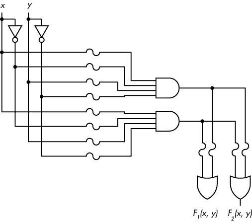

**图 6-15：可编程逻辑阵列的简化电路**

每个输入变量，无论是其非补形式还是补形式，都通过熔丝作为输入连接到与门。*熔丝* 是一根用于保护电路的细导体。如果流过它的电流足够大，导体就会熔化，从而断开电路并停止电流流动。PLD 可以通过断开（或 *熔断*）适当的熔丝来编程，从而移除通往逻辑门的输入。有些器件使用 *反熔丝* 代替熔丝。这些通常是断开的，编程它们的过程是建立连接而不是移除连接。可重新编程的器件具有可以熔断然后重新制造的熔丝。

在 图 6-15 中，电路图中的 *S* 形线代表熔丝。熔丝可以被熔断或保留，以便将每个与门编程为输出输入 `x`、`¬x`、`y` 和 `¬y` 的乘积。由于每个输入及其补码都被输入到每个与门，因此任何与门都可以被编程为输出一个最小项。


## 可编程逻辑阵列

与门平面产生的乘积项均通过熔丝连接到或门的输入端。因此，取决于保留了哪些或门熔丝，每个或门的输出都是乘积之和。可能会有额外的逻辑电路用于在不同输出之间进行选择。我们已经看到，任何布尔函数都可以表示为乘积之和，因此，通过烧断熔丝，该逻辑器件可以被编程以实现任意布尔函数。

典型的 PLA 比 图 6-15 所示的要大，而后者绘制起来已经很复杂了。为了简化绘图，通常使用类似 图 6-16 的图来指定设计。


图 6-16：可编程逻辑阵列示意图。圆点表示连接。

该图理解起来可能有点棘手。在图 6-15 中，每个与门有多个输入——每个变量一个，每个变量的补码一个。在图 6-16 中，我们用一条通向每个与门输入的水平线来表示多根导线（变量及其补码）。因此，图 6-16 中的每个与门有八个输入，尽管我们只画了一条线。

垂直线和水平线交叉处的圆点表示熔丝保持完好、从而形成连接的位置。例如，最顶端水平线上的三个圆点表明有三个输入保持连接到该与门。最顶端与门的输出如下：

`¬w ∧ y ∧ z`

再次参考图 6-15，我们看到每个与门的输出都（通过熔丝）连接到每个或门。因此，或门也有多个输入——每个与门一个——通向或门输入的垂直线代表多根导线。图 6-16 中的 PLA 已被编程以提供以下三个函数：


```
F1(w, x, y, z) = (¬w ∧ y ∧ z) ∨ (w ∧ x ∧ ¬z)
F2(w, x, y, z) = ¬w ∧ ¬x ∧ ¬y ∧ ¬z
F3(w, x, y, z) = (¬w ∧ y ∧ z) ∨ (w ∧ x ∧ ¬z)
```

由于与门平面可以产生所有可能的最小项，而或门平面可以提供这些最小项的任意和，因此 PLA 可用于实现任意可能的逻辑函数。如果我们想改变该函数，只需编程另一个 PLA 并替换旧的即可。

### 只读存储器

虽然 PLD 没有记忆功能（意味着当前状态不受输入先前状态的影响），但它们可用于制造*非易失性*存储器——即断电后内容保持完好的存储器。*只读存储器* (*ROM*) 用于存储可代表数据或程序指令的位模式。程序只能读取存储在 ROM 中的数据或程序，但不能通过写入新数据或程序指令来改变 ROM 的内容。ROM 通常用于具有固定功能集的设备中，如手表、汽车发动机控制单元和家用电器。事实上，我们的生活被由存储在 ROM 中的程序控制的设备所包围。

ROM 可以作为一种可编程逻辑器件来实现，其中只有或门平面可编程。与门平面保持固定连线以提供所有最小项。我们可以将 ROM 的输入视为地址。然后对或门平面进行编程，以提供每个地址处的位模式。例如，图 6-17 中所示的 ROM 有两个输入 `a[1]` 和 `a[0]`，它们提供一个两位地址。


图 6-17：四字节 ROM

图 6-17 中的“×”连接代表永久连接，表明与门平面是固定的。该 ROM 中的每个与门在每个地址处产生一个最小项。或门平面最多可产生 `2^n` 个八位字节，其中 `n` 是输入与门平面的地址位宽（以位为单位）。连接到或门的连线（圆点）代表存储在相应地址处的位模式。表 6-7 显示了一个 ROM，其或门平面已被编程以存储四个字符 A、B、C 和 D（采用 ASCII 码）。

**表 6-7：存储四个 ASCII 字符的 ROM**

| **最小项** | **地址** | **内容** | **ASCII 字符** |
| --- | --- | --- | --- |
| `¬a[1]¬a[0]` | `00` | `01000001` | A |
| `¬a[1]a[0]` | `01` | `01000010` | B |
| `a[1]¬a[0]` | `10` | `01000011` | C |
| `a[1]a[0]` | `11` | `01000100` | D |

虽然本例中仅存储了数据，但计算机指令也是位模式，因此我们同样可以轻松地在 ROM 中存储整个程序。与可编程逻辑阵列一样，如果需要更改程序，只需编程另一个 ROM 并替换旧的即可。

ROM 有几种类型。虽然 ROM 的位模式在制造过程中就已设定，但*可编程只读存储器* (*PROM*) 器件是由使用者编程的。还有*可擦除可编程只读存储器* (*EPROM*) 器件，可用紫外线擦除后重新编程。

### 可编程阵列逻辑


## 可编程阵列逻辑 (PAL) 器件

在 `programmable array logic` (`PAL`) 器件中，每个 OR 门永久连接到一组 AND 门。只有 AND 门平面可编程。图 6-18 中所示的 PAL 有四个输入。它提供两个输出，每个输出最多可为四个乘积之和。OR 门平面中的“×”连接表明：顶部四个 AND 门经 OR 运算产生 `F1(w, x, y, z)`，底部四个经 OR 运算产生 `F2(w, x, y, z)`。该图中的 AND 门平面已编程以产生这两个函数：

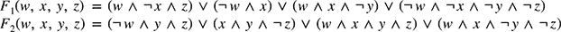

```
F1(w, x, y, z) = (w ∧ ¬x ∧ z) ∨ (¬w ∧ x) ∨ (w ∧ x ∧ ¬y) ∨ (¬w ∧ ¬x ∧ ¬y ∧ ¬z)
F2(w, x, y, z) = (¬w ∧ y ∧ z) ∨ (x ∧ y ∧ ¬z) ∨ (w ∧ x ∧ y ∧ z) ∨ (w ∧ x ∧ ¬y ∧ ¬z)
```

## PLD 类型比较

在本文介绍的三种 PLD 中，`PLA` 最灵活，因为我们可以同时编程 OR 平面和 AND 平面，但它也是三种器件中最昂贵的。`ROM` 灵活性较低。它可被编程以产生任意最小项组合，这些最小项再经 OR 运算组合。我们知道任何函数都可实现为最小项的 OR，因此用 ROM 可产生任意函数。然而，ROM 不允许我们最小化函数，因为所有乘积项必须是最小项。

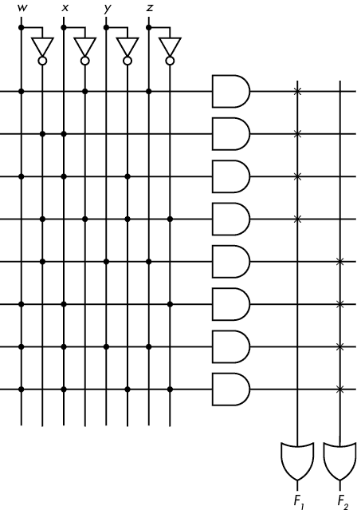

图 6-18：双功能可编程阵列逻辑

`PAL` 最不灵活，因为在 AND 平面编程的所有乘积项将被 OR 在一起。所以，我们不能通过编程 OR 平面来选择函数中的最小项。然而，PAL 允许我们进行一些布尔函数最小化。如果所需函数可在 PAL 中实现，它比 ROM 或 PLA 更便宜。

## 学习总结

1. `Combinational logic circuits` 这些电路仅依赖于任意时刻的输入。它们没有对输入先前效果的记忆。示例包括加法器、解码器、多路复用器和可编程逻辑器件。

2. `Half adder` 该电路有两个一位输入。它产生两个一位输出：输入之和及该和的进位。

3. `Full adder` 该电路有三个一位输入。它产生两个一位输出：输入之和及该和的进位。

4. `Ripple-carry adder` 使用 `n` 个全加器来加 `n` 位数字。每个全加器的进位输出是下一高位全加器的三个输入之一。

5. `Decoder` 一种基于 2^(`n`) 个输入选择 `n` 个输出之一的器件。

6. `Multiplexer (MUX)` 一种基于 `n` 位选择信号从 2^(`n`) 个输入中选择一个的器件。

7. `Programmable logic array (PLA)` 一种用于生成最小项的 OR 组合以在硬件中实现布尔函数的器件。

8. `Read-only memory (ROM)` 提供非易失性存储器，输入为数据或指令的地址。

9. `Programmable array logic (PAL)` 一种用于在硬件中实现布尔函数的器件。它比 PLA 或 ROM 灵活性低，但更便宜。

在下一章中，你将学习 `sequential logic circuits`，它们利用反馈来维护其活动的记忆。
