# 第 7 章：时序逻辑电路


在上一章中，你学习了 `combinational logic circuits`，即仅依赖于当前输入的电路。另一种思考方式是：组合逻辑电路是瞬时的（除去电子器件稳定所需时间）：其输出仅取决于观察输出时刻的输入。而 `Sequential logic circuits` 则依赖于当前和过去的输入。它们有时间历史，可用电路的当前状态来概括。

形式上，`system state` 是系统的一种描述，使得在时间 `t[0]` 知道状态以及从时间 `t[0]` 到 `t[1]` 的输入，就能唯一确定时间 `t[1]` 的状态以及从 `t[0]` 到 `t[1]` 的输出。换句话说，系统状态提供了影响系统的一切的摘要。在任意给定时间 `t` 知道系统的状态，就能告诉你从那时起指定系统行为所需的一切。它是如何进入该状态的无关紧要。

系统状态的概念体现在 `finite state machine` 中，这是一种计算数学模型，可存在于有限数量的状态中的任意一个。有限状态机的外部输入导致其从一个状态转移到另一个状态或同一状态，同时可能产生输出。顺序逻辑电路用于实现有限状态机。如果顺序逻辑电路的设计使其输出仅依赖于其所处的状态，则称为 `Moore state machine`。如果输出还依赖于导致状态转移的输入，则称为 `Mealy state machine`。

在本章中，我们将探讨如何在逻辑电路中使用 `feedback` 使门电路随时间保持特定状态，从而实现存储器。我们将使用 `state diagrams` 来展示输入如何导致顺序逻辑电路在状态间转移以及相应的输出。你还将学习如何用时钟同步顺序逻辑电路以提供可靠结果。

## 锁存器


我们将要研究的第一个顺序逻辑电路是 `latch`（锁存器），它是一种一位存储设备，根据其输入可以处于两种状态之一。锁存器可以通过连接两个或多个逻辑门来构建，使一个门的输出反馈到另一个门的输入；只要通电，这就会使两个门的输出保持在同一状态。锁存器的状态不依赖于时间。（术语 `latch` 也用于表现得像此处描述的一位设备那样的多位存储设备。）

### 使用或非门的 SR 锁存器

最基本的锁存器是 `Set-Reset`（`SR`，置位-复位）。它有两个输入（`S` 和 `R`）和两种状态，称为 `Set`（置位）和 `Reset`（复位）。该状态用作主要输出 `Q`。通常也会提供补输出 `¬Q`。当输出 `Q = 1` 且 `¬Q = 0` 时，称 `SR` 锁存器处于 `Set` 状态。当 `Q = 0` 且 `¬Q = 1` 时，它处于 `Reset` 状态。

图 7-1 展示了使用 `NOR` 门实现 `SR` 锁存器的简单实现。每个 `NOR` 门的输出都馈入另一个门的输入。随着我们在本章中描述电路的行为，你将看到这种 `feedback`（反馈）是使锁存器保持在一种状态的原因。

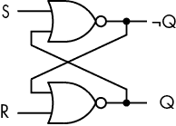

`SR` 锁存器有四种可能的输入组合。让我们在此逐一分析：

#### `S = 0`, `R = 0`：保持当前状态

如果锁存器处于 `Set` 状态（`Q = 1` 且 `¬Q = 0`），输入 `S = 0` 和 `R = 0` 将导致上方 `NOR` 门的输出 `¬Q` 产生 `¬(0 ∨ 1) = 0`，而下方 `NOR` 门的输出 `Q` 产生 `¬(0 ∨ 0) = 1`。反之，如果锁存器处于 `Reset` 状态（`Q = 0` 且 `¬Q = 1`），则上方 `NOR` 门的输出产生 `¬(0 ∨ 0) = 1`，下方 `NOR` 门的输出产生 `¬(1 ∨ 0) = 0`。因此，两个 `NOR` 门之间的交叉反馈维持了锁存器的当前状态。

#### `S = 1`, `R = 0`：置位（`Q = 1`）

如果锁存器处于 `Reset` 状态，这些输入会导致上方 `NOR` 门的输出为 `¬(1 ∨ 0) = 0`，从而将 `¬Q` 变为 `0`。这被反馈到下方 `NOR` 门的输入，产生 `¬(0 ∨ 0) = 1`。从下方 `NOR` 门输出反馈到上方 `NOR` 门输入的信号，使上方 `NOR` 门的输出保持在 `¬(1 ∨ 1) = 0`。锁存器随即进入 `Set` 状态（`Q = 1` 且 `¬Q = 0`）。

如果锁存器处于 `Set` 状态，上方 `NOR` 门产生 `¬(1 ∨ 1) = 0`，下方 `NOR` 门的输出为 `¬(0 ∨ 0) = 1`。锁存器因此保持在 `Set` 状态。

#### `S = 0`, `R = 1`：复位（`Q = 0`）

如果锁存器处于 `Set` 状态，下方 `NOR` 门产生 `¬(0 ∨ 1) = 0`，从而将 `Q` 变为 `0`。这被反馈到上方 `NOR` 门的输入，产生 `¬(0 ∨ 0) = 1`。从上方 `NOR` 门输出反馈到下方 `NOR` 门输入的信号，使下方 `NOR` 门的输出保持在 `¬(1 ∨ 1) = 0`。锁存器随即进入 `Reset` 状态（`Q = 0` 且 `¬Q = 1`）。

如果锁存器已经处于 `Reset` 状态，下方 `NOR` 门产生 `¬(1 ∨ 1) = 0`，上方 `NOR` 门的输出为 `¬(0 ∨ 0) = 1`，因此锁存器保持在 `Reset` 状态。

#### `S = 1`, `R = 1`：不允许

如果 `Q = 0` 且 `¬Q = 1`，上方 `NOR` 门产生 `¬(1 ∨ 0) = 0`。这被反馈到下方 `NOR` 门的输入，产生 `¬(0 ∨ 1) = 0`。这将导致 `Q = ¬Q`，这与布尔代数定律不一致。

如果 `Q = 1` 且 `¬Q = 0`，下方 `NOR` 门产生 `¬(0 ∨ 1) = 0`。这被反馈到上方 `NOR` 门的输入，产生 `¬(1 ∨ 0) = 0`。这将导致 `Q = ¬Q`，这也是不一致的。

电路设计必须防止这种输入组合。

为了简化问题，我们可以用可视化方式表示这种逻辑。图 7-2 引入了一种图形化方式来展示 `NOR` 门 `SR` 锁存器的行为：`state diagram`（状态图）。在该 `state diagram` 中，当前状态显示在圆圈中，对应的主要输出显示在状态下方。带箭头的线显示状态之间可能的转换，并标注导致向下一状态转换的输入。

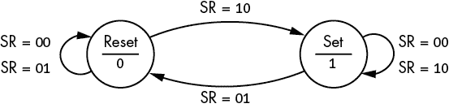

图 7-2 中的两个圆圈显示了 `SR` 锁存器的两种可能状态——`Set` 或 `Reset`。线上的标签显示导致每种状态转换的输入组合 `SR`。例如，当锁存器处于 `Reset` 状态时，有两种可能的输入 `SR = 00` 和 `SR = 01` 使其保持在该状态。输入 `SR = 10` 导致其转换到 `Set` 状态。由于输出仅依赖于状态，而不依赖于输入，锁存器是一种 `Moore state machine`（摩尔状态机）。

熟悉图论的人会认出 `state diagram` 是一个有向图：状态是顶点，导致转换的输入是边。虽然它们超出了本书的范围，但图论工具在设计过程中可能很有用。

正如在图论中一样，我们也可以用 `state transition table`（状态转移表）以表格形式展示相同的行为，如 表 7-1 所示。此处 `S` 和 `R` 是输入，`Q` 是当前状态下的输出，`Q[next]` 显示由相应输入导致的结果状态下的输出。最后两行中的 `X` 表示不可能的条件。

**表 7-1：或非门 SR 锁存器**

| **S** | **R** | **Q** | **Q[next]** |
|-------|-------|-------|-------------|
| `0`   | `0`   | `0`   | `0`         |
| `0`   | `0`   | `1`   | `1`         |
| `0`   | `1`   | `0`   | `0`         |
| `0`   | `1`   | `1`   | `0`         |
| `1`   | `0`   | `0`   | `1`         |
| `1`   | `0`   | `1`   | `1`         |
| `1`   | `1`   | `0`   | `X`         |
| `1`   | `1`   | `1`   | `X`         |

`NOR gate SR latch`（或非门 SR 锁存器）的两个输入通常保持在 `0`，这维持当前状态，给出输出 `Q`。暂时仅将 `R` 变为 `1` 会导致状态变为 `Reset`，从而将输出变为 `Q = 0`，如 `state transition table` 的 `Q[next]` 列所示。而暂时仅将 `S` 变为 `1` 会导致状态变为 `Set`，给出输出 `Q = 1`。

如前所述，输入组合 `S = R = 1` 是不允许的，因为那会导致 `SR` 锁存器进入不一致状态。我们在 `state transition table` 中通过在被禁止的行的 `Q[next]` 列放置 `X` 来表示这一点。

### 使用与非门的 SR 锁存器

它们的构造物理特性倾向于使 `NAND` 门比 `NOR` 门更快。回顾 `NAND` 和 `NOR` 具有互补特性，你大概不会惊讶于可以用 `NAND` 门构建 `SR` 锁存器。由于 `NAND` 门是 `NOR` 门的逻辑补，我们将使用 `¬S` 和 `¬R` 作为输入，如 图 7-3 所示。为了强调这两种设计 `NAND` 和 `NOR` 的逻辑对偶性，我绘制了输出 `Q` 在顶部、`¬Q` 在底部的电路图。

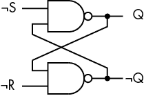

与 `NOR gate SR latch` 一样，当输出为 `Q = 1` 和 `¬Q = 0` 时，称 `NAND gate SR latch` 处于 `Set` 状态；当 `Q = 0` 和 `¬Q = 1` 时，处于 `Reset` 状态。有四种可能的输入组合：

#### `¬S = 1`, `¬R = 1`：保持当前状态

如果锁存器处于 `Set` 状态（`Q = 1` 且 `¬Q = 0`），上方 `NAND` 门产生 `¬(1 ∧ 0) = 1`，下方 `NAND` 门产生 `¬(1 ∧ 1) = 0`。如果 `Q = 0` 且 `¬Q = 1`，锁存器处于 `Reset` 状态，上方 `NAND` 门产生 `¬(1 ∧ 1) = 0`，下方 `NAND` 门产生 `¬(0 ∧ 1) = 1`。因此，两个 `NAND` 门之间的交叉反馈维持了锁存器的状态。

#### `¬S = 0`, `¬R = 1`：置位（`Q = 1`）


# NAND 门 SR 锁存器

## 行为分析

如果锁存器处于复位状态，上方的 NAND 门输出 `¬(0 ∧ 1) = 1`，从而将 `Q` 变为 `1`。这被反馈到下方 NAND 门的输入端，产生 `¬(1 ∧ 1) = 0`。从下方 NAND 门输出端反馈到上方 NAND 门输入端的信号，使上方 NAND 门的输出保持在 `¬(0 ∧ 0) = 1`。锁存器已进入置位状态（`Q = 1` 且 `¬Q = 0`）。

如果锁存器已经处于置位状态，则上方 NAND 门输出 `¬(0 ∧ 0) = 1`，下方 NAND 门的输出为 `¬(1 ∧ 1) = 0`。锁存器因此保持在置位状态。

**`¬S = 1`, `¬R = 0`：复位（`Q = 0`）**

如果锁存器处于置位状态，下方 NAND 门输出 `¬(1 ∧ 0) = 1`。这被反馈到上方 NAND 门的输入端，使 `Q = ¬(1 ∧ 1) = 0`。从上方 NAND 门输出端反馈到下方 NAND 门输入端的信号，使下方 NAND 门的输出保持在 `¬(0 ∧ 0) = 1`，因此锁存器进入复位状态（`Q = 0` 且 `¬Q = 1`）。

如果锁存器已经处于复位状态，下方 NAND 门输出 `¬(0 ∧ 0) = 1`，上方 NAND 门的输出为 `¬(1 ∧ 1) = 0`。锁存器保持在复位状态。

**`¬S = 0`, `¬R = 0`：不允许**

如果锁存器处于复位状态，上方 NAND 门输出 `¬(0 ∧ 1) = 1`。这被反馈到下方 NAND 门的输入端，产生 `¬(1 ∧ 0) = 1`。这将导致 `Q = ¬Q`，这是不一致的。

如果锁存器处于置位状态，下方 NAND 门输出 `¬(1 ∧ 0) = 1`。这被反馈到上方 NAND 门的输入端，产生 `¬(0 ∧ 1) = 1`。这也将导致 `Q = ¬Q`，这也是不一致的。

电路设计必须防止这种输入组合。

## 状态图（图 7-4）

图 7-4 使用状态图展示了 NAND 门 SR 锁存器的行为。

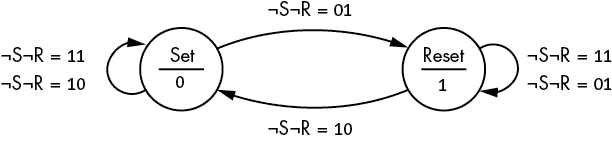

图 7-4：NAND 门 SR 锁存器

将其与 图 7-2 中的 NOR 门 SR 锁存器进行比较，可以看出它们描述的是相同的行为。例如，向 NOR 门 SR 锁存器输入 `SR = 10` 会使其进入置位状态，而向 NAND 门 SR 锁存器输入 `¬S¬R = 01` 也会使其进入置位状态。我发现在分析电路时必须仔细思考这一点。在只有两种选择的情况下，差一位错误会导致与预期相反的行为。

## 状态转移表（表 7-2）

表 7-2 是 NAND 门 SR 锁存器的状态转移表。同时在两个输入端施加 `0` 会导致一个问题——即两个 NAND 门的输出都会变为 `1`。换句话说，`Q = ¬Q = 1`，这在逻辑上是不可能的。电路设计必须防止这种输入组合。两行中的 X 表示不可能的条件。

表 7-2：NAND 门 SR 锁存器

| **¬S** | **¬R** | **Q** | **Q[next]** |
| --- | --- | --- | --- |
| `1` | `1` | `0` | `0` |
| `1` | `1` | `1` | `1` |
| `1` | `0` | `0` | `0` |
| `1` | `0` | `1` | `0` |
| `0` | `1` | `0` | `1` |
| `0` | `1` | `1` | `1` |
| `0` | `0` | `0` | X |
| `0` | `0` | `1` | X |

由两个 NAND 门实现的 SR 锁存器可以看作是 NOR 门 SR 锁存器的补集。通过将 `¬S` 和 `¬R` 都保持在 `1` 来维持状态。瞬时将 `¬S` 变为 `0` 会使状态置位，输出 `Q = 1`，而 `¬R = 0` 会使其复位，输出 `Q = 0`。

到目前为止，我们一直在研究单个锁存器。这里的问题是，锁存器的状态及其输出会在输入改变时随之改变。在计算机中，它会与许多其他器件互连，每个器件都随新输入改变状态。每个器件改变状态及其输出传播到下一个器件都需要时间，而精确的时序取决于器件细微的制造差异。结果可能是不可靠的。我们需要一种同步活动的手段，给操作带来秩序。我们将从向 SR 锁存器添加一个使能输入开始，这将允许我们更精确地控制何时允许输入影响状态。

## 带使能的 SR 锁存器

我们可以通过添加两个 NAND 门来提供使能输入，从而更好地控制 SR 锁存器。将这两个 NAND 门的输出连接到 `¬S¬R` 锁存器的输入端，就得到了一个*门控 SR 锁存器*，如 图 7-5 所示。

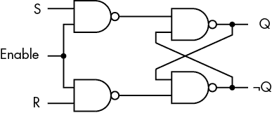

图 7-5：门控 SR 锁存器

在该电路中，只要 `Enable = 0`，两个控制 NAND 门的输出都保持在 `1`。这向电路中 `¬S¬R` 锁存器部分的输入端发送 `¬S = 1` 和 `¬R = 1`，导致状态保持不变。通过将额外的使能输入与 `S` 和 `R` 输入线进行与运算，我们可以控制状态何时改变为下一个值。

## 状态行为表（表 7-3）

表 7-3 显示了带使能控制的 SR 锁存器的状态行为。

表 7-3：门控 SR 锁存器

| **Enable** | **S** | **R** | **Q** | **Q[next]** |
| --- | --- | --- | --- | --- |
| `0` | – | – | `0` | `0` |
| `0` | – | – | `1` | `1` |
| `1` | `0` | `0` | `0` | `0` |
| `1` | `0` | `0` | `1` | `1` |
| `1` | `0` | `1` | `0` | `0` |
| `1` | `0` | `1` | `1` | `0` |
| `1` | `1` | `0` | `0` | `1` |
| `1` | `1` | `0` | `1` | `1` |
| `1` | `1` | `1` | `0` | X |
| `1` | `1` | `1` | `1` | X |

在此表中，– 表示该输入无关紧要，X 表示禁止的结果。如前所述，设计必须防止产生禁止结果的输入组合。锁存器的状态仅在 `Enable = 1` 且 `S` 和 `R` 取相反值时才会改变。在下一节中，我们将利用这一观察来简化门控 SR 锁存器，创建一个接受单个数据输入 `D` 的锁存器，并控制该输入何时影响锁存器的状态。

## D 锁存器

D 锁存器允许我们存储一位的值。我们从真值表 表 7-4 开始，它包含 表 7-3 中 `Enable = 1` 且 `R = ¬S` 的那些行。我们正在寻找一种有两个输入的设计——一个用于使能，另一个用于 `D`（数据的缩写）。我们希望当使能线变为 `1` 时，`D = 1` 置位状态，输出 `Q = 1`，而 `D = 0` 复位状态，输出 `Q = 0`。这种设计称为*D 锁存器*。

## D 锁存器真值表（表 7-4）

表 7-4：带使能的 D 锁存器

| **Enable** | **S** | **R** | **D** | **Q** | **Q[next]** |
| --- | --- | --- | --- | --- | --- |
| `0` | – | – | – | `0` | `0` |
| `0` | – | – | – | `1` | `1` |
| `1` | `0` | `1` | `0` | `0` | `0` |
| `1` | `0` | `1` | `0` | `1` | `0` |
| `1` | `1` | `0` | `1` | `0` | `1` |
| `1` | `1` | `0` | `1` | `1` | `1` |

我们可以通过添加一个 `D` 输入和一个非门，从门控 SR 锁存器构建一个门控 D 锁存器，如 图 7-6 所示。

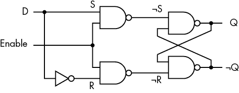

图 7-6：由 SR 锁存器构建的门控 D 锁存器

单个数据输入 `D` 被送到 SR 锁存器的 `S` 端；数据值的补码被送到 `R` 端。


现在我们有了一个电路，可以使用 `D input` 存储一位数据，并使用 `Enable input` 与其他操作同步。然而，`D latch` 存在一些问题。主要是当它与其他电路元件连接时，可靠性方面存在问题。在施加 `D input` 并启用电路后，所有电子元件达到新电压水平需要一段短暂时间，称为 `settling time`。即使过了 `settling time`，只要 `D latch` 处于启用状态，其状态仍可能受输入影响。因此，其输出可能会变化，导致难以与其他设备可靠同步。

不过，当锁存器需要长时间保持一种状态时，这种方案效果很好。一般来说，锁存器适用于我们想要选择一种状态并保持一段时间的操作，而这段时间超出了计算机的控制。一个例子是 `I/O port`，其时序取决于连接到 `I/O port` 的设备的行为。例如，运行中的程序无法知道用户何时会按下键盘上的键。当按键被按下时，程序可能尚未准备好接收该字符，因此该字符的二进制代码应被锁存在 `input port`。一旦字符被存储，`latch` 将被禁用，直到程序从 `latch` 读取字符代码。

但 CPU 和主存内的大多数计算操作必须在时间上协调。你即将看到时序逻辑电路如何由 `clock` 控制。将许多电路连接到同一个 `clock` 可以使我们同步它们的操作。

让我们考虑如何同步电路中的 `D latch`。我们向这个 `D latch` 提供输入并启用它。即使过了短暂的 `settling time`，如果输入发生变化，其输出也会改变，导致在启用期间输出不可靠。如果我们的 `D latch` 的输出连接到另一个设备的输入，那么在我们的 `D latch` 启用期间，第二个设备的输入是不可靠的。由于连接的物理特性，我们的 `D latch` 的输出到达第二个设备的输入存在 `propagation delay`。在我们的 `D latch` 的输入可靠且我们预留了 `propagation delay` 之前，第二个设备应保持禁用。一旦我们的 `D latch` 稳定，它就被禁用。在预留了 `propagation delay` 后，连接到我们的 `D latch` 的设备可以被启用。

当连接到我们的 `D latch` 的设备等待来自我们的 `D latch` 的可靠输入时，它被禁用，其输出（来自上一个 `clock cycle`）是可靠的。因此，如果它连接到另一个设备的输入，第三个设备可以被启用。这导致了一种方案：每隔一个设备被启用，而交替的设备被禁用。在等待一段等于所有连接在一起的设备中最长 `settling time` 和 `propagation delay` 之和的时间后，被禁用的设备被启用，被启用的设备被禁用。数字 `1` 和 `0` 通过这种交替的启用/禁用循环在此设备电路中传播。

正如你可能想象的，协调这种在启用和禁用之间的来回切换可能很困难。我们将在下一节给出解决这个问题的方案。

## Flip-Flops

虽然 `latch` 可以由 `clock signal` 控制，但当 `clock signal` 启用 `latch` 期间，其输出会受到输入任何变化的影响。`flip-flop` 电路是一种一位存储设备，设计为在 `clock signal` 的一部分期间接受输入，然后在 `clock signal` 的另一部分期间将输出锁定为单一值。这提供了将许多 `flip-flops` 连接在电路中并用一个 `clock` 同步它们操作所需的可靠性。我们将从 `clocks` 的讨论开始本节，然后看几个 `flip-flop` 的例子。

### Clocks

时序逻辑电路有时间历史，总结在其状态中。我们用 `clock` 记录时间，`clock` 是一种提供电子 `clock signal` 的设备，通常是一个在 `0` 和 `1` 电平之间交替的方波，如 Figure 7-7 所示。此信号用作需要同步的设备的启用/禁用输入。

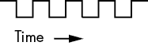

Figure 7-7: Typical clock signal to synchronize sequential logic circuits

在每个电平上花费的时间通常相等。为实现可靠行为，大多数电路设计为 `clock signal` 的转换触发电路元件开始其各自的操作。可以使用正向（`0 to 1`）或负向（`1 to 0`）转换。`clock frequency` 必须足够慢，使所有电路元件有时间在下一个同方向的 `clock transition` 发生前完成操作。

让我们看几个可由 `clock` 控制的 `flip-flop` 电路示例。

### D Flip-Flop

我们首先将 `clock signal` 连接到 Figure 7-6 中带门 `D latch` 的 `Enable input`。在这里，只要 `Enable = 1`，输入就影响输出。问题在于，如果输入在 `Enable = 1` 时发生变化，输出也会变化，导致设计不可靠。

将一个 `D latch` 的输出连接到另一个 `D latch` 的输入，采用 `primary`/`secondary` 配置，是将输出与输入变化隔离的一种方法。电路的 `primary` 部分处理输入并存储状态，然后将其输出传递给 `secondary` 部分以产生最终输出。这创建了一个 `D flip-flop`，如 Figure 7-8 所示。Primary `D latch` 的非反相输出馈送到 `S input`，其反相输出馈送到 Secondary `SR latch` 的 `R input`，有效地使 Secondary 成为一个 `D latch`，而不需要在 `R input` 处使用 `NOT gate`。

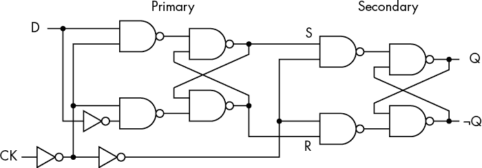

Figure 7-8: D flip-flop, positive-edge triggering

在 Figure 7-8 的 `D flip-flop` 中，我们要存储的位 `0` 或 `1` 被馈送到 Primary `D latch` 的 `D input`。`clock signal` 被馈送到 `CK input`。

让我们从 `CK = 0` 开始逐步了解该电路如何工作。`CK` 信号通过 `NOT gate`，将其从 `0` 反相为 `1`，从而启用 Primary `D latch`，将其置于 `write mode`。该锁存器将复位或置位，分别对应 `D input` 为 `0` 或 `1`。

当 `CK input` 保持在 `0` 电平时，第二个 `NOT gate` 再次反相 `CK` 信号，从而向 Secondary `D latch` 提供原始信号，即值为 `0` 的启用信号。这反过来禁用它并将其置于 `read mode`。Primary `D latch` 输入的任何变化将影响其输出，但不会影响 Secondary `D latch`。因此，该 `D flip-flop` 的总体输出 `Q`，在 secondary 部分处于 `read mode` 的整个半个时钟周期内将是可靠信号。

当 `CK input` 转换到 `1` 电平时，Primary `D latch` 的控制信号变为 `0`，禁用它并将其置于 `read mode`。同时，Secondary `D latch` 的启用输入变为 `1`，将其置于 `write mode`。Primary `D latch` 的输出现在可靠，在整个半个时钟周期内为 Secondary `D latch` 提供可靠输入。经过短暂的 `settling time`（实际上可忽略不计）后，Secondary `D latch` 的输出提供可靠输出。因此，`flip-flop` 在接受输入和提供输出之间提供了半个 `clock cycle` 的时间分离。由于输出在 `0 to 1` 转换时可用，这称为 `positive-edge triggering`。


如果移除图 7-8 中连接到 `CK` 信号的第一个 `NOT` 门，将会创建一个具有`负边沿触发`功能的 `D 触发器`。

有时，在时钟信号开始之前，`触发器`必须被设置为一个已知值——例如，当计算机首次启动时。这些已知值独立于时钟过程输入；因此，它们被称为`异步输入`。图 7-9 展示了一个增加了异步预置输入的 `D 触发器`。

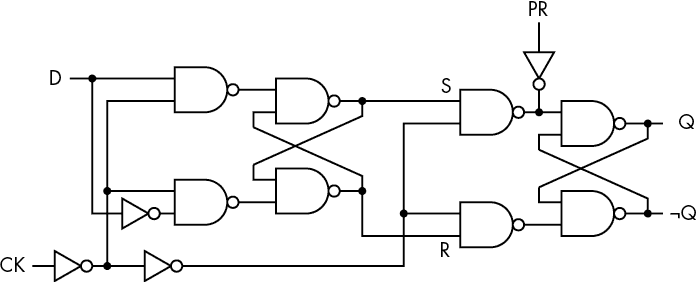

当 `PR` 输入端施加 `1` 时，无论其他输入（甚至包括 `CLK`）是什么，`Q` 变为 `1`，`¬Q` 变为 `0`。拥有一个将状态（和输出）设置为 `0` 的异步清零输入也很常见。

实现边沿触发 `D 触发器` 有更高效的电路，但这一讨论表明，它们可以由普通逻辑门构建。它们经济高效，因此广泛用于`超大规模集成`（`VLSI`）电路中——这种电路在单个半导体微芯片上包含数十亿个晶体管门。电路设计师使用图 7-10 所示的符号，而不是为每个 `D 触发器`绘制实现细节。

该图标出了各种输入和输出。硬件设计师通常用 `Q` 代替 `¬Q`。通常将触发器标记为 `Qn`，其中 `n` = 1, 2, ...，用于在整体电路中识别该触发器。图 7-10(b) 中时钟输入端的小圆圈表示该 `D 触发器` 由负向时钟跳变触发。

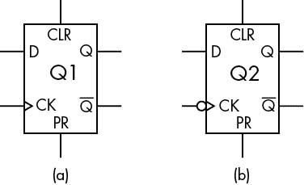

### T 触发器

你可能熟悉那种每次激活就在两种状态间`切换`的开关。电脑上的大写锁定键就是个好例子。如果字母键处于小写模式，按下大写锁定键会切换到大写模式。再按一次，就回到小写模式。与置位/复位`触发器`不同，`翻转`只需单个输入即可反转（或取补）当前状态。

我们可以使用一种仅对其状态取补的`触发器`来实现可切换的开关，称为 `T 触发器`。要从 `D 触发器`构建 `T 触发器`，我们需要将输出反馈回去，并将其与 `D 触发器` 的输入相结合。接下来，我们将确定具体如何结合。

在着手设计 `T 触发器` 之前，让我们先进行一些布尔代数运算，以了解我们的设计可能采取的方向。首先，看看图 7-11 中的 `T 触发器` 状态图，以及表 7-5 中的状态转移表。

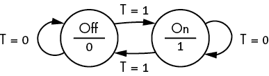

**表 7-5：T 触发器状态转移表**

| **T** | **Q** | **Q[next]** |
|-------|-------|-------------|
| `0`   | `0`   | `0`         |
| `0`   | `1`   | `1`         |
| `1`   | `0`   | `1`         |
| `1`   | `1`   | `0`         |

参考 `D 触发器` 的表 7-4，让我们为 `T 触发器` 的状态转移表增加一列，得到表 7-6，该表显示了会导致与 `T` 相同状态转移的 `D` 值。

**表 7-6：具有与 T 触发器相同效果的 D 值**

| **T** | **Q** | **Q[next]** | **D** |
|-------|-------|-------------|-------|
| `0`   | `0`   | `0`         | `0`   |
| `0`   | `1`   | `1`         | `1`   |
| `1`   | `0`   | `1`         | `1`   |
| `1`   | `1`   | `0`         | `0`   |

从表 7-6 可以很容易地写出 `D` 的方程：

```
D = (¬T ∧ Q) ∨ (T ∧ ¬Q) = T ⊻ Q
```

因此，我们只需添加一个 `XOR` 门，即可得到图 7-12 所示的 `T 触发器` 设计。

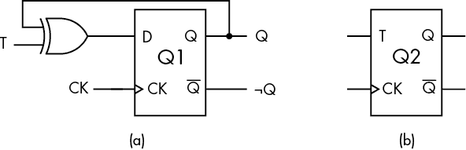

你已经了解了如何使用 `D 触发器` 将一位存储在其 `1`（置位）或 `0`（复位）状态中，保持状态不变，或者通过添加一个逻辑门来`翻转`该位。在下一节中，你将看到如何修改 `SR 触发器`，以便在单个器件中实现所有四种动作——置位、复位、保持、翻转。

### JK 触发器

实现所有四种可能的动作——置位、复位、保持、翻转——需要两个输入 `J` 和 `K`，从而得到 `JK 触发器`。与 `T 触发器` 一样，我们将看看状态图和转移表能否给我们一些设计思路。图 7-13 显示了 `JK 触发器` 的状态图，表 7-7 显示了其状态转移表。表 7-7 最左列显示了 `JK 触发器` 对每个 `JK` 值执行的四种功能中的哪一种。

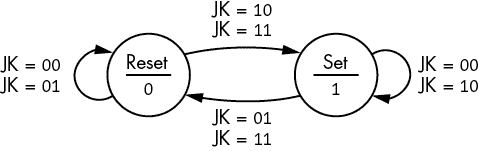

**表 7-7：JK 触发器状态转移表**

| **功能** | **J** | **K** | **Q** | **Q[next]** |
|--------------|-------|-------|-------|-------------|
| 保持         | `0`   | `0`   | `0`   | `0`         |
| 保持         | `0`   | `0`   | `1`   | `1`         |
| 复位         | `0`   | `1`   | `0`   | `0`         |
| 复位         | `0`   | `1`   | `1`   | `0`         |
| 置位         | `1`   | `0`   | `0`   | `1`         |
| 置位         | `1`   | `0`   | `1`   | `1`         |
| 翻转         | `1`   | `1`   | `0`   | `1`         |
| 翻转         | `1`   | `1`   | `1`   | `0`         |

`JK 触发器` 状态转移表的前六行与 `SR 锁存器` 状态转移表（表 7-3）启用部分的前六行相同。我们在讨论 `SR 锁存器` 时看到，条件 `S` = `R` = `1` 是不允许的。也许我们可以添加一些逻辑电路，以便在 `JK 触发器` 中利用 `J` = `K` = `1` 条件来实现`翻转`功能。我们将从 `SR 触发器` 电路开始，并向每个输入 `NAND` 门添加另一个信号，如图 7-14 所示。点 `¬S` 和 `¬R` 被标记出来，以显示输入到初级 `¬S¬R 锁存器` 的那部分相同的输入，如图 7-3 所示。

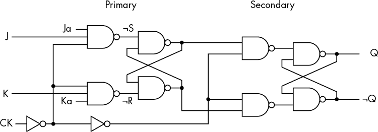


图 7-14 中的主 SR 锁存器在 `CK = 0` 时处于写入模式。我们希望当 `J = K = 1` 时，它能翻转输出 `Q`。给定这些条件，表 7-8 显示了 `¬S` 和 `¬R` 如何依赖于 `Ja` 和 `Ka`，这取决于 `Q` 的两个可能值。我们在 表 7-2 中已经看到这些 `¬S` 和 `¬R` 的值如何影响 `Q`，这里将它们复制到了 表 7-8 中。

**表 7-8：为 SR 触发器添加翻转功能的额外输入**

| **Ja** | **Ka** | **¬S** | **¬R** | **Q** | **Q[next]** |
| --- | --- | --- | --- | --- | --- |
| `0` | `0` | `1` | `1` | `0` | `0` |
| `0` | `1` | `1` | `0` | `0` | `0` |
| `1` | `0` | `0` | `1` | `0` | `1` |
| `1` | `1` | `0` | `0` | `0` | X |
| `0` | `0` | `1` | `1` | `1` | `1` |
| `0` | `1` | `1` | `0` | `1` | `0` |
| `1` | `0` | `0` | `1` | `1` | `1` |
| `1` | `1` | `0` | `0` | `1` | X |

表 7-8 的第 3 行和第 6 行显示，`JaKa = 10` 将状态 `Q` 从 `0` 翻转到 `1`，而 `JaKa = 01` 将状态从 `1` 翻转到 `0`。这引出了 图 7-15 中的设计，其中 `Ja = ¬Q` 且 `Ka = Q`。

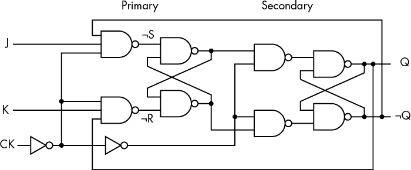

**图 7-15：JK 触发器**

我们应该检查该电路中的反馈连接是否保持了 JK 触发器其他功能的行为。表 7-9 显示了 图 7-15 中 JK 触发器的状态转换表，并添加了 `¬S`、`¬R` 和 `¬Q`。关于 `¬S`、`¬R` 和 `Q[next]` 之间的关系，请参阅 表 7-2。

**表 7-9：图 7-15 电路的 JK 触发器状态表**

| | **J** | **K** | **Q** | **¬Q** | **¬S** | **¬R** | **Q[next]** |
| --- | --- | --- | --- | --- | --- | --- | --- |
| 保持 | `0` | `0` | `0` | `1` | `1` | `1` | `0` |
| 保持 | `0` | `0` | `1` | `0` | `1` | `1` | `1` |
| 复位 | `0` | `1` | `0` | `1` | `1` | `1` | `0` |
| 复位 | `0` | `1` | `1` | `0` | `1` | `0` | `0` |
| 置位 | `1` | `0` | `0` | `1` | `0` | `1` | `1` |
| 置位 | `1` | `0` | `1` | `0` | `1` | `1` | `1` |
| 翻转 | `1` | `1` | `0` | `1` | `0` | `1` | `1` |
| 翻转 | `1` | `1` | `1` | `0` | `1` | `0` | `0` |

在这个 JK 触发器的输入端使用三输入与非门确实增加了电路的复杂性。增加的复杂性大致相当于给 D 触发器添加一个异或门以获得 T 触发器（参见 图 7-12）。虽然如果不需要翻转功能，SR 触发器比 JK 触发器稍微简单一些，但只采用一种设计在制造成本上具有优势。JK 触发器通过提供所有四种功能，也使设计更具灵活性，从而节省成本。

## 设计时序逻辑电路

现在我们将探讨一套更通用的设计时序逻辑电路的步骤。任何领域的设计通常都是迭代的，这一点你无疑从编程经验中已经学到了。

你从一个设计开始，分析它，然后改进设计使其更快、成本更低，等等。积累一些经验后，设计过程通常需要的迭代次数会减少。以下步骤是构建首个可行设计的好方法：

1.  根据问题的文字描述，创建状态转换表和状态图，展示电路必须执行的功能。这些构成了你将要设计的电路的基本技术规格。
2.  为状态选择二进制编码，并创建状态表和/或状态图的二进制编码版本。对于 *N* 个状态，编码将需要 *log*₂*N* 位。任何编码都可行，但某些编码可能会导致电路中的组合逻辑更简单。
3.  选择一种触发器类型。这种选择通常取决于你手头有的元件。
4.  在状态表中添加列，显示每个触发器所需的输入，以引起每个所需的转换。
5.  简化每个触发器的输入。卡诺图或代数方法是简化过程的好工具。
6.  绘制电路图。

简化步骤可能会让你重新考虑触发器类型的选择。这三个步骤——选择触发器、确定输入、简化——可能需要重复几次才能得到一个好的设计。以下两个例子说明了这个过程。

### 设计计数器

此时我不要求你完成所有工作，而是我将讲解两个例子。如果你有数字电路模拟器或所需的硬件，我建议你利用这些资源跟着操作。这就像是一个指导性的“动手实践”。

在这个例子中，我们要设计一个带有 `Enable` 输入的计数器。当 `Enable = 1` 时，它按序列 0、1、2、3、0、1……递增，每个时钟周期递增一次。`Enable = 0` 导致计数器保持在当前状态。输出是两位二进制的序列号。

#### 步骤 1：创建状态转换表和状态图

在每个时钟周期，如果 `Enable = 1`，计数器加 1。如果 `Enable = 0`，它保持在当前状态。图 7-16 显示了四个状态——0、1、2、3——以及每个状态对应的两位输出。

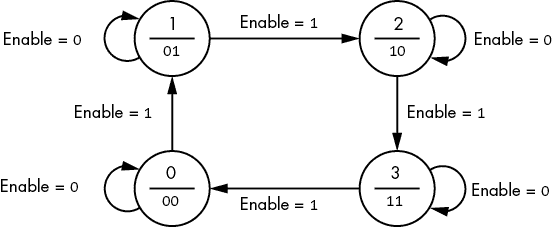

**图 7-16：循环遍历 0、1、2、3、0……的计数器状态图**

表 7-10 显示了状态转换表。

**表 7-10：循环遍历 0、1、2、3、0……的计数器状态转换表**

| | **Enable = 0** | **Enable = 1** |
| --- | --- | --- |
| **当前 *n*** | **下一个 *n*** | **下一个 *n*** |
| 0 | 0 | 1 |
| 1 | 1 | 2 |
| 2 | 2 | 3 |
| 3 | 3 | 0 |

当 `Enable = 0` 时，计数器本质上是关闭的；当 `Enable = 1` 时，计数器自动加 1，达到上限 3 时绕回到 0。

#### 步骤 2：创建状态表和/或状态图的二进制编码版本

有四个状态，我们需要两位。我们令 *n* 为状态，用两位二进制数 `n[1]n[0]` 表示。计数器的行为如状态转换表 表 7-11 所示。

**表 7-11：两位计数器的状态转换表**

| **Enable** | **当前 *n*[1]** | **当前 *n*[0]** | **下一个 *n*[1]** | **下一个 *n*[0]** |
| --- | --- | --- | --- | --- |
| `0` | `0` | `0` | `0` | `0` |
| `0` | `0` | `1` | `0` | `1` |
| `0` | `1` | `0` | `1` | `0` |
| `0` | `1` | `1` | `1` | `1` |
| `1` | `0` | `0` | `0` | `1` |
| `1` | `0` | `1` | `1` | `0` |
| `1` | `1` | `0` | `1` | `1` |
| `1` | `1` | `1` | `0` | `0` |

#### 步骤 3：选择触发器

JK 触发器是一个好的起点，因为它们提供所有功能。完成设计后，我们可能会发现更简单的触发器也能工作。然后我们可以回到这一步，重新执行剩余步骤。经验丰富的设计师可能对问题有见解，建议从另一种触发器类型开始。通常，潜在的成本或功耗节省不足以证明更换另一种触发器类型是合理的。

#### 步骤 4：在状态转换表中添加列以显示所需输入


## 使用 JK 触发器的两位计数器

我们需要两个触发器，每个位一个。状态转换表中新增的列显示了每个 JK 触发器所需的输入——`Enable`、`n[1]`、`n[0]`——以引起正确的状态转换。根据本章前面对 JK 触发器的描述，我们知道 JK = `00` 保持当前状态，JK = `01` 将其复位（变为 `0`），JK = `10` 将其置位（变为 `1`），而 JK = `11` 则翻转状态。当输入可以是 `0` 或 `1` 时，即“不关心”条件下，我们使用 `X`。表 7-12 显示了所需的 JK 输入。

**表 7-12：使用 JK 触发器实现的两位计数器**

| 使能 | 当前 `n[1]` | 当前 `n[0]` | 下一 `n[1]` | 下一 `n[0]` | `J[1]` | `K[1]` | `J[0]` | `K[0]` |
|--------|----------------|----------------|-------------|-------------|--------|--------|--------|--------|
| `0`    | `0`            | `0`            | `0`         | `0`         | `0`    | `X`    | `0`    | `X`    |
| `0`    | `0`            | `1`            | `0`         | `1`         | `0`    | `X`    | `X`    | `0`    |
| `0`    | `1`            | `0`            | `1`         | `0`         | `X`    | `0`    | `0`    | `X`    |
| `0`    | `1`            | `1`            | `1`         | `1`         | `X`    | `0`    | `X`    | `0`    |
| `1`    | `0`            | `0`            | `0`         | `1`         | `0`    | `X`    | `1`    | `X`    |
| `1`    | `0`            | `1`            | `1`         | `0`         | `1`    | `X`    | `X`    | `1`    |
| `1`    | `1`            | `0`            | `1`         | `1`         | `X`    | `0`    | `1`    | `X`    |
| `1`    | `1`            | `1`            | `0`         | `0`         | `X`    | `1`    | `X`    | `1`    |

表中两个 JK 触发器都有相当多的“不关心”条目。这表明我们可以进行大量的化简。这也表明卡诺图将是一个好的方法，因为其图形化展示往往使人们更容易直观地理解“不关心”条目的影响。

### 步骤 5：化简所需输入

我们将使用卡诺图来寻找更简单的解决方案，用 `E` 表示 Enable（使能），如图 7-17 所示。

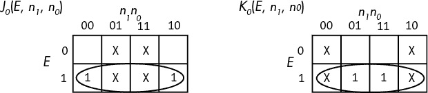
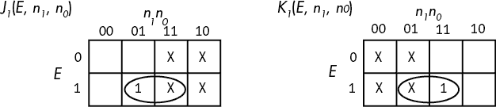

**图 7-17：使用 JK 触发器实现的两位计数器的卡诺图**

我们可以轻松地从卡诺图写出方程来解决这个问题，如下所示：

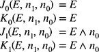

```
J₀(E, n₁, n₀) = E
K₀(E, n₁, n₀) = E
J₁(E, n₁, n₀) = E ∧ n₀
K₁(E, n₁, n₀) = E ∧ n₀
```

J = K = `1` 会导致 JK 触发器在状态间翻转。这些方程表明，低位 JK 触发器在每个时钟周期翻转。当它被使能时，其输出 `n[0]` 在每个时钟周期在 `0` 和 `1` 之间变化。该输出与高位 JK 触发器的使能输入进行与运算，导致高位触发器每两个时钟周期在 `0` 和 `1` 之间翻转一次。（你将在下一步的图 7-19 中看到这一时序。）

### 步骤 6：绘制电路

图 7-18 显示了实现该计数器的电路。参考表 7-8，我们可以看到在这个设计中，两个 JK 触发器都被用作翻转器。

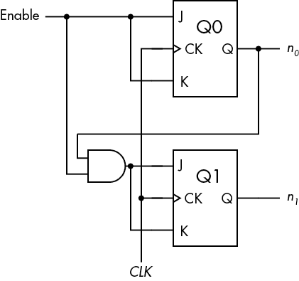

**图 7-18：使用两个 JK 触发器实现的两位计数器**

图 7-19 显示了二进制计数器在计数序列 3、0、1、2、3（`11`、`00`、`01`、`10`、`11`）时的时序。

`Q[i].JK` 是第 `i` 个 JK 触发器的输入，`n[i]` 是其输出。（回想一下，在该设计中 J = K。）当第 `i` 个输入 `Q[i].JK` 施加到其 JK 触发器时，请记住触发器的输出直到时钟周期的后半段才会改变。通过将图中对应输出 `n[i]` 的波形进行比较，可以看到这一点。

时钟转换后，每个输出值实际改变前的短暂延迟，代表了电子器件完全稳定到新值所需的时间。

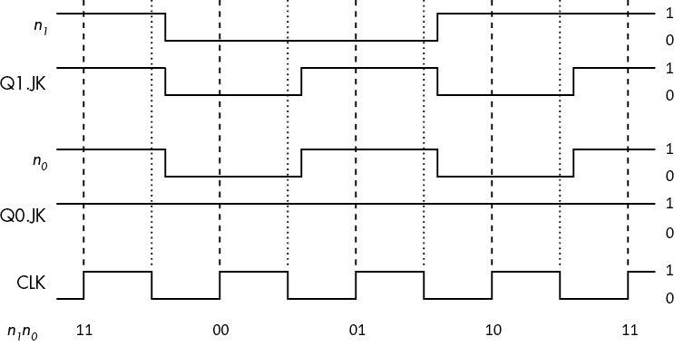

**图 7-19：使用 JK 触发器实现的两位计数器的时序**

## 设计分支预测器

让我们在这里做另一个指导性的“动手试一试”。这个例子比前一个稍微复杂一些。

除了非常廉价的微控制器外，大多数现代 CPU 都分阶段执行指令。每个阶段由专门用于执行该阶段操作的硬件组成。指令以流水线的方式通过每个阶段。例如，如果你要创建一条制造木椅的装配线，可以分三个阶段：锯木头制作椅子零件、组装零件、给椅子刷漆。每个阶段所需的硬件分别是锯子、锤子和螺丝刀、以及刷子。

CPU 中专用硬件的这种排列称为*流水线*（*pipeline*）。第一阶段的硬件设计用于从内存取指令，正如你将在第 9 章看到的那样。指令从内存取出后，进入流水线的下一阶段进行译码。同时，流水线的第一阶段从内存取取下一条指令。结果是 CPU 同时处理多条指令。这提供了一定的并行性，从而提高了执行速度。


几乎所有程序都包含*条件分支点*——即下一条待取指令可能位于两个不同内存位置之一的地方。遗憾的是，在决策指令移入流水线的几个阶段之前，无法知道该取两条指令中的哪一条。为了维持执行速度，一旦条件分支指令离开取指阶段，如果 CPU 能预测从何处取下一条指令，将大有裨益。随后 CPU 便会取走预测的指令。如果预测错误，CPU 只需通过冲刷流水线并取另一条指令（该指令进入流水线开头）来忽略它在预测指令上所做的工作。

在本例中，我们将设计一个电路来预测条件分支是否会被采取。预测器持续预测相同的结果，分支将被采取或不被采取，直到它连续犯两次错。

## 步骤 1：创建状态表和状态图

我们用 `Yes` 表示分支被采取，用 `No` 表示不被采取。图 7-20 中的状态图展示了四种可能的状态。

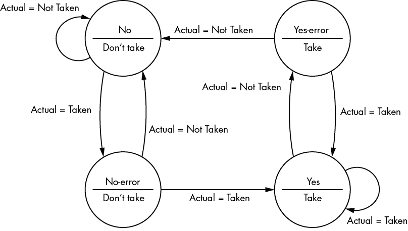

图 7-20：分支预测器

让我们从 `No` 状态开始。在此状态下，该指令最近至少连续两次执行时分支均未被采取。输出预测这次也将不被采取。电路的输入是指令执行完成时分支实际是否被采取。

标记为 `Actual = Not Taken` 的弧线回路到 `No` 状态，输出预测下一次分支将不被采取。如果分支被采取，`Actual = Taken` 弧线显示电路进入 `No-error` 状态，表示预测出现了一次错误。但因为必须连续两次出错才会改变预测，电路输出仍预测 `Don't take`。

从 `No-error` 状态，如果分支未被采取（预测正确），电路返回 `No` 状态。然而，如果分支被采取，电路连续两次预测错误，于是电路转移到 `Yes` 状态，输出变为 `Take`。

我将该状态图的其余追踪过程留作练习供你完成。一旦你确信其工作原理无误，请参阅表 7-13，其中提供了我们电路的技术规格。

表 7-13：分支预测器状态表

| 当前状态 | 预测（不采取） | 下一状态（不采取） | 预测（采取） | 下一状态（采取） | 预测（采取） |
| --- | --- | --- | --- | --- | --- |
| `No` | `Don't take` | `No` | `Don't take` | `No-error` | `Don't take` |
| `No-error` | `Don't take` | `No` | `Don't take` | `Yes` | `Take` |
| `Yes-error` | `Take` | `No` | `Don't take` | `Yes` | `Take` |
| `Yes` | `Take` | `Yes-error` | `Take` | `Yes` | `Take` |

当条件分支的结果在流水线中确定（采取或不采取）时，表 7-13 显示了下一状态及相应的预测。该预测将用于确定两个可能地址中的哪一个——下一条指令的地址或分支目标地址——将被存储，以便下次在程序中遇到该指令时使用。

## 步骤 2：表示状态

针对该问题，我们将为状态选择一种二进制编码 `s[1]s[0]`，如表 7-14 所示。

表 7-14：分支预测器的状态

| 状态 | `s[1]` | `s[0]` | 预测 |
| --- | --- | --- | --- |
| `No` | `0` | `0` | `Don't take` |
| `No-error` | `0` | `1` | `Don't take` |
| `Yes-error` | `1` | `0` | `Take` |
| `Yes` | `1` | `1` | `Take` |

预测为一位，即 `s[1]`，预测为 `Don't take` 时为 `0`，预测为 `Take` 时为 `1`。

令输入 `Actual` 在分支不被采取时为 `0`，被采取时为 `1`，并使用表 7-14 的状态表示法，我们得到状态转移表表 7-15。

表 7-15：分支预测器状态转移表

| `Actual` | `Current s[1]` | `Current s[0]` | `Next s[1]` | `Next s[0]` |
| --- | --- | --- | --- | --- |
| `0` | `0` | `0` | `0` | `0` |
| `0` | `0` | `1` | `0` | `0` |
| `0` | `1` | `0` | `0` | `0` |
| `0` | `1` | `1` | `1` | `0` |
| `1` | `0` | `0` | `0` | `1` |
| `1` | `0` | `1` | `1` | `1` |
| `1` | `1` | `0` | `1` | `1` |
| `1` | `1` | `1` | `1` | `1` |

当条件分支指令在流水线中到达可确定分支是否应被采取的位置时，该信息作为输入 `Actual` 送入预测器电路，电路将状态从 `Current` 转换为 `Next`，以供下次在程序中遇到该指令时使用。

## 步骤 3：选择触发器

基于与计数器示例相同的理由，我们此处将使用 JK 触发器。

## 步骤 4：在状态表中增加列以显示所需输入

表 7-16 显示了实现表 7-15 中状态转移所需的 JK 触发器输入。

表 7-16：分支预测器的 JK 触发器输入

| `Actual` | `s[1]` | `s[0]` | `s[1]` | `s[0]` | `J[1]` | `K[1]` | `J[0]` | `K[0]` |
| --- | --- | --- | --- | --- | --- | --- | --- | --- |
| `0` | `0` | `0` | `0` | `0` | `0` | `X` | `0` | `X` |
| `0` | `0` | `1` | `0` | `0` | `0` | `X` | `X` | `1` |
| `0` | `1` | `0` | `0` | `0` | `X` | `1` | `0` | `X` |
| `0` | `1` | `1` | `1` | `0` | `X` | `0` | `X` | `1` |
| `1` | `0` | `0` | `0` | `1` | `0` | `X` | `1` | `X` |
| `1` | `0` | `1` | `1` | `1` | `1` | `X` | `X` | `0` |
| `1` | `1` | `0` | `1` | `1` | `X` | `0` | `1` | `X` |
| `1` | `1` | `1` | `1` | `1` | `X` | `0` | `X` | `0` |

## 步骤 5：化简所需输入

我们将使用卡诺图，图 7-21，寻找最简解。输入为分支是否被采取：`Actual` = `0` 表示未被采取；`Actual` = `1` 表示被采取。

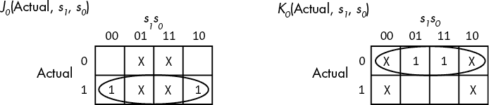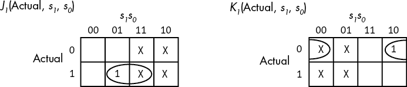

图 7-21：分支预测器的卡诺图

我们可以直接从这些卡诺图写出方程：

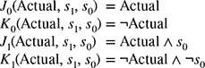


## 步骤 6：绘制电路

以下方程定义了两个 JK 触发器的 J 和 K 输入（其中 `s₁` 和 `s₀` 为状态位）：

```
J₀(Actual, s₁, s₀) = Actual
K₀(Actual, s₁, s₀) = ¬Actual
J₁(Actual, s₁, s₀) = Actual ∧ s₀
K₁(Actual, s₁, s₀) = ¬Actual ∧ ¬s₀
```

因此，该电路需要两个 JK 触发器、两个与门和一个非门。

在该电路中，若上一次未发生分支，则输入 `Actual = 0`；若发生了分支，则 `Actual = 1`。我们需要在 JK 触发器的输入端添加两个与门和一个非门，如图 7-22 所示。

此例展示了最简单的分支预测方法。也存在更复杂的方法。关于分支预测的有效性，研究仍在进行中。虽然它能加速某些算法，但分支预测所需的额外硬件会消耗更多电能，这在电池供电设备中令人担忧。

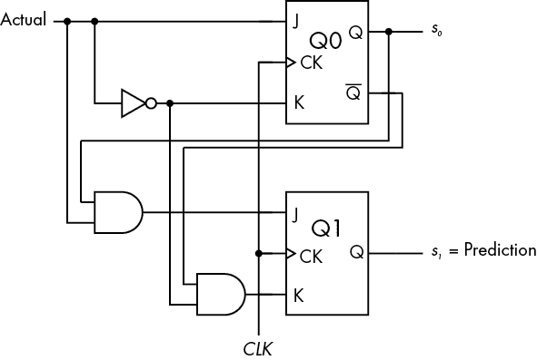

**图 7-22：** 使用 JK 触发器的分支预测电路

## 你学到的内容

1.  **SR 锁存器** — SR 锁存器的状态取决于其输入，即置位或复位。它可以包含一个使能输入。
2.  **D 触发器** — D 触发器存储一位数据。通过将两个锁存器以主从配置连接，输出与输入隔离，使触发器能与时钟信号同步。D 触发器的输出每个时钟周期只能改变一次。
3.  **T 触发器** — 当 T 触发器被使能时，其状态会在每个时钟周期在 0 和 1 之间翻转。
4.  **JK 触发器** — JK 触发器被称为*通用触发器*，因为它提供四种基本功能——保持当前状态、置位、复位、翻转。

你还看到了两个使用 JK 触发器设计时序逻辑电路的例子。在下一章，你将了解计算机系统中使用的各种存储器结构。
