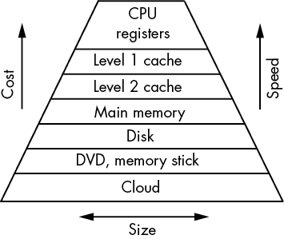
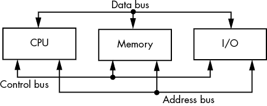
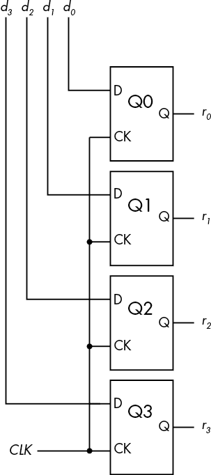
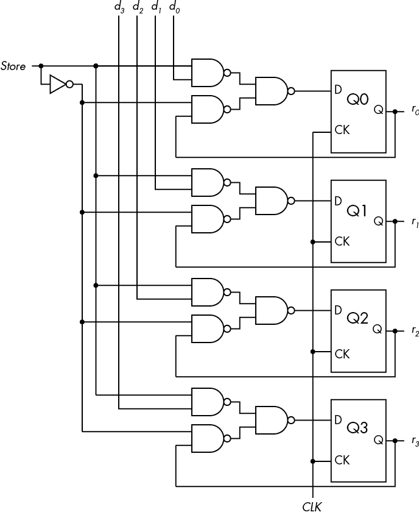
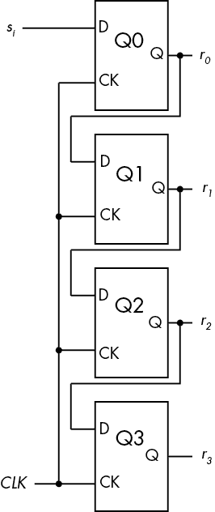
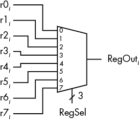
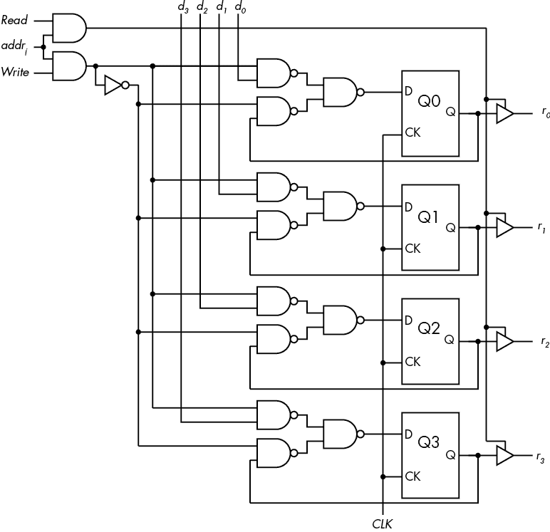
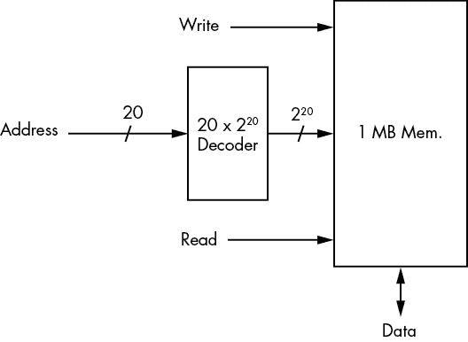
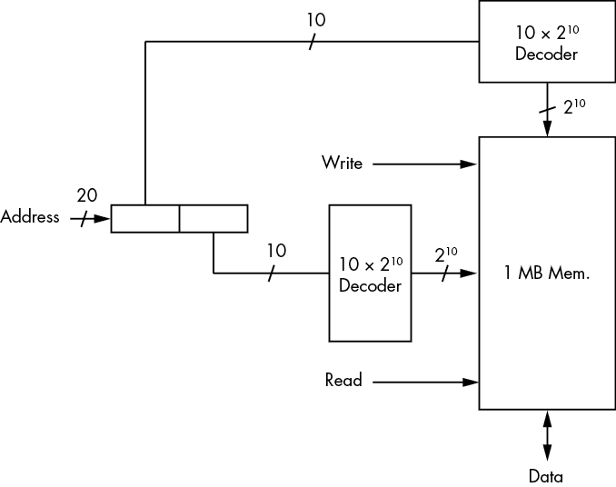
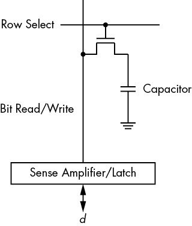

# 第 8 章：存储器


在前三章中，我们了解了一些用于实现逻辑功能的硬件。现在我们将探讨如何利用这些功能来实现构成计算机的子系统，首先从存储器开始。

每位计算机用户都想要大容量存储器和快速计算。然而，更快的存储器成本更高，因此存在一些权衡。本章将首先讨论如何利用不同类型的存储器在速度和成本之间提供合理的折中方案。然后我们将讨论几种在硬件中实现存储器的不同方法。

## 存储器层级结构

一般来说，存储器离 CPU 越近，速度越快、价格越高。最慢的存储器是云端。它也是最便宜的。我的电子邮件账户在云端提供 15 GB 存储空间，且无需花费金钱（如果忽略看到几条广告的“成本”）。但其速度受限于我的网络连接。在另一极端，CPU 内部的存储器以与 CPU 相同的速度运行，但价格相对昂贵。在 `x86-64` 架构中，CPU 中可供程序员使用的存储器只有约 1 KB。

图 8-1 展示了这一大致层级。随着离 CPU 越近（图的顶部），存储器速度越快、成本越高，因此容量越小。



**图 8-1：** 计算机存储器层级结构

图 8-1 中的顶层三层通常集成在现代计算机的 CPU 芯片中。在到达主存之前，可能还有一到两级缓存。主存和磁盘通常与 CPU 在同一机箱内，其中可能包含多个磁盘。

离 CPU 更远的下一层代表离线数据存储设备。DVD 和内存棒只是两个例子。你可能还有一个外置 USB 磁盘、磁带驱动器等。这些设备通常需要你采取一些物理操作，如将 DVD 放入驱动器或将内存棒插入 USB 端口，计算机才能访问它们。

该层级的最后一层是云存储。虽然我们大多数人设置计算机自动登录，但它并不总是可用。

在本章中，我们将从云层之上的两层——离线存储和磁盘——开始，逐步深入到 CPU 寄存器。然后我们将描述用于构建寄存器的硬件，并逐步回溯到主存。我们将把最外层三层的实现讨论留给其他书籍。

### 大容量存储

*大容量存储* 用于以机器可读格式保存程序和大量数据。这包括硬盘、固态硬盘、内存棒、光盘等。其内容是*非易失性*的，即断电后内容保留。与 CPU 相比，它们也很慢。访问其内容需要显式编程。

在图 8-2 中，输入/输出（`I/O`）模块包含与大容量存储设备接口的专用电路。



**图 8-2：** 计算机子系统。CPU、存储器和 `I/O` 子系统通过三条总线相互通信。（重复图 1-1）


# 内存层级

## 易失性内存

例如，我的计算机拥有实现 `Serial Advanced Technology Attachment (SATA)` 接口协议的电路。我有一张 `SSD` 卡插在其中一个 `SATA` 端口上。操作系统包含软件（一个 `device driver`），应用程序调用它以通过 `SATA` 端口访问我 `SSD` 卡上的数据和应用程序。我们将在第 20 章讨论 `I/O` 编程，但设备驱动程序的具体细节超出了本书的范围。

在本章的其余部分，我们将探讨 `volatile` 内存，它在断电时会丢失内容。

### 主存

接下来是 `main memory`。这就是你在购买计算机时规格表中看到的 `RAM`。如图 8-2 所示，主存通过数据、地址和控制总线与 `CPU` 通信。我们将在第 9 章讨论这些总线如何工作。主存在硬件层面上与 `CPU` 同步。因此，程序员只需指定地址以及是从内存读取项目还是在那里存储新值，即可访问内存中的项目。

通常，整个程序和数据集不会完全加载到主存中。只有当前正在处理的部分由操作系统从大容量存储加载到主存中。现代计算机中的大多数大容量存储设备只能以预定大小的 `blocks` 进行访问。例如，我 Ubuntu 安装中的磁盘块大小是 `4KB`。当所需的指令或数据项被加载到主存时，计算机会将包含该所需项的整个指令或数据块加载到内存中。程序中附近的部分（指令或数据）很可能很快就会被需要。既然它们已经在主存中，操作系统就不需要再次访问大容量存储设备，从而加快程序执行速度。

主存最常见的组织方式是将程序指令和数据都存储在主存中。这被称为 `von Neumann architecture`，由约翰·冯·诺依曼描述（“EDVAC 报告的第一份草稿”，宾夕法尼亚大学摩尔电子工程学院，1945 年），尽管当时其他计算机科学先驱也在研究相同的概念。

冯·诺依曼架构的一个缺点是，如果一条指令要求从内存读取数据或向内存写入数据，程序序列中的下一条指令就无法通过同一总线从内存读取，直到当前指令完成数据传输——这被称为 `von Neumann bottleneck`。这种冲突会减慢程序执行速度，从而催生了另一种存储程序架构，即 `Harvard architecture`，在这种架构中，程序和数据存储在不同的内存中，每个内存都有自己的总线连接到 `CPU`。这使得 `CPU` 能够同时访问程序指令和数据。这种专门化降低了内存使用的灵活性，通常会增加所需的总内存量。它还需要额外的内存访问硬件。额外的内存和访问硬件增加了成本。

冯·诺依曼架构的另一个缺点是，程序可以被编写为将自身视为数据，从而实现自我修改程序，这通常是个坏主意。GNU/Linux 像大多数现代通用操作系统一样，禁止应用程序修改自身。

### 高速缓存

我使用的大多数程序在主存中占用几十或几百兆字节。但大部分执行时间被循环占用，循环重复执行同几条指令，访问同几个变量，仅占用几十或几百字节。大多数现代计算机在主存和 `CPU` 之间包含非常快的 `cache memory`，为程序当前正在处理的指令和变量提供了一个快得多的位置。

高速缓存按级别组织，`Level 1` 离 `CPU` 最近，且最小。我使用的计算机有三级缓存：`64KB` 的 `Level 1`、`256KB` 的 `Level 2` 和 `8MB` 的 `Level 3`。当程序需要访问指令或数据项时，硬件首先检查它是否位于 `Level 1` 缓存中。如果不在，则检查 `Level 2` 缓存。如果在 `Level 2` 缓存中，硬件会将包含所需指令或数据的内存块复制到 `Level 1` 缓存，然后再复制到 `CPU` 中，它会一直保留在那里，直到程序再次需要它，或者 `Level 1` 缓存需要重用该位置来存放来自 `Level 2` 缓存的其他指令或数据。一次复制到缓存的内存量称为 `line`，比从大容量存储设备复制的量要少得多。

如果所需的指令或数据不在 `Level 2` 缓存中，硬件会检查 `Level 3` 缓存。如果找到了所需内容，它会将包含所需指令或数据的行复制到 `Level 2`，然后是 `Level 1`，再从那里复制到 `CPU`。如果数据不在 `Level 3` 中，硬件会检查主存。这样，硬件会在 `Level 3` 缓存中复制一份当前正在处理的程序部分，在 `Level 2` 缓存中复制一份更小的正在处理的部分，在 `Level 1` 缓存中复制一份更小的部分。`Level 1` 缓存通常采用 `Harvard architecture`，从而为指令和数据提供通往 `CPU` 的独立路径。我电脑上的 `Level 1` 缓存采用哈佛架构，`32KB` 用于指令，`32KB` 用于数据。我的 `Level 1` 指令缓存行大小为 `32 bytes`，而其他所有缓存的行大小均为 `64 bytes`。

当数据写入主存时，它从 `Level 1` 缓存开始，然后是下一级缓存，最后进入主存。有许多缓存使用方案，可能会变得相当复杂。我将把关于缓存的进一步讨论留给更高级的教材，例如：<https://en.wikibooks.org/wiki/Microprocessor_Design/Cache/>。

访问 `Level 1` 缓存的时间接近 `CPU` 的速度。`Level 2` 大约慢 10 倍，`Level 3` 大约慢 100 倍，主存大约慢 1000 倍。这些值是近似的，在不同实现中差异很大。现代处理器将缓存内存集成在与 `CPU` 相同的芯片上，有些拥有三级以上的缓存。

计算机性能通常受限于 `CPU` 将指令和数据读入 `CPU` 所需的时间，而不是 `CPU` 自身的速度。将指令和数据放在 `Level 1` 缓存中可以减少这段时间。当然，如果它们不在 `Level 1` 缓存中，硬件需要从 `Level 2`、`Level 3` 或主存将其他指令或数据复制到 `Level 3`，然后是 `Level 2`，最后是 `Level 1`，访问时间将比直接从主存获取指令或数据更长。缓存的有效性取决于 `locality of reference`，即程序在短时间内倾向于引用附近内存地址的倾向。这是优秀程序员将程序（尤其是重复部分）分解为小单元的原因之一。一个小的程序单元更有可能适应缓存中的几行，从而在后续重复中可用。

### 寄存器


# CPU 寄存器与内存层级

最快的内存位于 CPU 内部：即 `registers`（寄存器）。寄存器通常提供约 1KB 的存储空间，其访问速度与 CPU 相同。它们主要用于数值计算、逻辑运算、临时数据存储以及类似的短期操作——这有点像我们手算时使用草稿纸。许多寄存器可由程序员直接访问，而另一些则是隐藏的。某些寄存器用于充当 CPU 与 I/O 设备之间接口的硬件中。CPU 中寄存器的组织方式非常特定于特定的 CPU 架构，这是在汇编语言层面编程计算机最重要的方面之一。您将在下一章了解程序员在 x86-64 架构中使用的主要寄存器。

但首先，让我们看看如何使用前几章讨论的逻辑器件在硬件中实现内存。我们将从 CPU 寄存器开始，即 图 8-1 中的顶层，逐步向外延伸至主存。在梳理这一层级的过程中，您将了解为何更快的内存成本更高，这也是以这种分层方式组织内存的原因。本书不涵盖大容量存储系统的实现。

## 在硬件中实现内存

现在我们处于 图 8-1 中层级的顶端，让我们看看如何实现 CPU 寄存器中的内存。然后我们将从 CPU 向外逐步推进，您将看到将这些设计应用于更大内存系统（如缓存和主存）时的一些局限性。我们将以这些大型系统中内存的设计作为本节的结尾。

### 四位寄存器

让我们从一个简单的 `four-bit register`（四位寄存器）设计开始，这种寄存器可能见于用于价格敏感型消费产品（如咖啡机、遥控器等）的廉价 CPU 中。图 8-3 展示了使用一个 D 触发器实现每一位的四位寄存器设计。每当时钟发生正向跳变时，寄存器的状态（内容）`r = r[3]r[2]r[1]r[0]` 就会被设置为输入 `d = d[3]d[2]d[1]d[0]`。



**图 8-3：每位使用一个 D 触发器的四位寄存器**

该电路的问题在于，任何 `d[i]` 的变化都会在下一个时钟周期改变对应存储位 `r[i]` 的状态，因此寄存器的内容实际上仅在一个时钟周期内有效。对位模式进行单周期缓冲对于某些应用已足够，但我们也需要能够存储值直到其被显式更改的寄存器，这可能要等到数十亿个时钟周期之后。

让我们添加一个 `Store`（存储）信号和来自每一位输出 `r[i]` 的反馈。我们希望当 `Store = 0` 时每个 `r[i]` 保持不变，当 `Store = 1` 时跟随输入 `d[i]`，如 表 8-1 所示。

**表 8-1：带存储信号的 D 触发器单比特存储**

| Store | d[i] | r[i] | D |
|-------|------|------|---|
| 0     | 0    | 0    | 0 |
| 0     | 0    | 1    | 1 |
| 0     | 1    | 0    | 0 |
| 0     | 1    | 1    | 1 |
| 1     | 0    | 0    | 0 |
| 1     | 0    | 1    | 0 |
| 1     | 1    | 0    | 1 |
| 1     | 1    | 1    | 1 |

表 8-1 给出了 D 的布尔方程：

```
D(Store, d[i], r[i]) = ¬(¬(¬Store ∧ r[i]) ∧ ¬(Store ∧ d[i]))
```

该方程可以通过每个 D 触发器输入端的三个与非门来实现，如 图 8-4 所示。



**图 8-4：带存储信号的四位寄存器**

该设计还有一个重要特性，源于 D 触发器的主/从属性。从属部分的状态直到时钟周期的后半段才会改变。因此，连接到该寄存器输出的电路可以在时钟周期的前半段读取当前状态，而主部分正在准备可能将状态改变为新内容。

我们现在有了一种方法来存储例如加法器电路的结果。寄存器的输出可用作执行数据算术或逻辑运算的另一个电路的输入。

寄存器也可以设计为对存储在其中的数据执行简单操作。接下来我们将研究一种能将串行数据转换为并行格式的寄存器设计。

### 移位寄存器

我们可以将 `shift register`（移位寄存器）用作 `serial-in parallel-out`（`SIPO`，串行输入并行输出）设备。移位寄存器使用一系列 D 触发器，类似于 图 8-4 中的简单存储寄存器，但每个触发器的输出连接到序列中下一个触发器的输入，如 图 8-5 所示。



**图 8-5：四位串行转并行移位寄存器**

在 图 8-5 的移位寄存器中，一串比特流在 `s[i]` 处输入。在每个时钟周期，`Q0` 的输出被施加到 `Q1` 的输入，从而将 `r[0]` 的前一个值复制到新的 `r[1]`。`Q0` 的状态变为新 `s[i]` 的值，从而将其复制为新的 `r[0]` 值。比特串行流继续在移位寄存器的四位中传递。在任何时候，串行流中的最后四位都可在四个输出 `r[3]`、`r[2]`、`r[1]`、`r[0]` 处并行获得，其中 `r[3]` 是时间上最早的。

同一电路也可用于在串行比特流中提供四个时钟周期的时间延迟。只需将 `r[3]` 用作串行输出即可。

### 寄存器文件

CPU 中用于相似操作的寄存器被组合在一起形成 `register file`（寄存器文件）。例如，正如您将在下一章看到的，x86-64 架构包含十六个 64 位通用寄存器，用于整数计算、地址临时存储等。我们需要一种机制来寻址寄存器文件中的每个寄存器。

考虑一个由八个四位寄存器 `r0`–`r7` 组成的寄存器文件，它们使用八个 图 8-4 所示的四位寄存器电路副本实现。要读取这八个寄存器中某一个的四位数据（例如寄存器 `r5` 中的 `r5[3]`、`r5[2]`、`r5[1]` 和 `r5[0]`），我们需要用三位来指定这八个寄存器中的一个。您在第 7 章学到过，多路选择器可以从多个输入中选择一个。我们可以将一个 `3 × 8 multiplexer`（3×8 多路选择器）连接到八个寄存器中每个对应的位上，如 图 8-6 所示。多路选择器的输入 `r0i`–`r7i` 是八个寄存器 `r0`–`r7` 中各自的第 `i` 位。穿过 `RegSel` 线且旁边标有 3 的斜线是表示此处有三条线的符号。



**图 8-6：用于选择寄存器文件输出的八路多路选择器。这仅显示第 i 位的输出；n 位寄存器需要 n 个多路选择器。**

四位寄存器需要四个这样的多路选择器输出电路。相同的 `RegSel` 会同时施加到所有四个多路选择器上，以输出同一寄存器的所有四位。更大的寄存器当然需要相应更多的多路选择器。

### 读写内存


你在图 8-3 中看到了如何构建一个四位寄存器，用于存储来自 D 触发器的值。我们现在需要能够选择何时读取存储在寄存器中的值，以及在不读取时断开输出。三态缓冲器允许我们做到这一点，如图 8-7 所示。该电路仅用于一个四位寄存器。计算机中的每个寄存器都需要一个这样的电路。`addr[j]` 线来自解码器，用于选择其中一个寄存器。



图 8-7：四位读写寄存器

`Write` = `1` 会导致四位数据 `d[3]d[2]d[1]d[0]` 被存储在 D 触发器 Q3、Q2、Q1 和 Q0 中。当 `Read` = `0` 时，四位输出 `r[3]r[2]r[1]r[0]` 与 D 触发器断开连接。设置 `Read` = `1` 则连接输出。

我们将继续沿着图 8-1 中的存储层次结构向下，到达高速缓存存储器，它通常由触发器构成，类似于寄存器文件。

### 静态随机存取存储器

我们一直在讨论的使用触发器的存储器称为*静态随机存取存储器*（*SRAM*）。之所以称为*静态*，是因为只要保持供电，它就能维持其值。正如我们在第 2 章所见，之所以称为*随机*，是因为访问该存储器中任意（随机）字节所需的时间相同。SRAM 通常用于高速缓存存储器，其容量可达数兆字节。

让我们看看在大容量存储器中寻址单个字节的方法。在 1MB 存储器中选择一个字节需要 20 位地址。这需要一个 20 × 2²⁰ 地址解码器，如图 8-8 所示。



图 8-8：使用一个 20 × 2²⁰ 地址解码器对 1MB 存储器进行寻址

回想一下，*n* × 2^(*n*) 解码器需要 2^(*n*) 个与门。因此，一个 20 × 2²⁰ 解码器需要 1,048,576 个与门。我们可以通过将存储器组织成 1,024 行和 1,024 列的网格来简化电路，如图 8-9 所示。然后我们可以通过选择一行和一列来选择一个字节，每个使用一个 10 × 2¹⁰ 解码器。



图 8-9：使用两个 10 × 2¹⁰ 地址解码器对 1MB 存储器进行寻址

虽然需要两个解码器，但每个解码器只需要 2^(*n*/2) 个与门，两个解码器总共需要 2 × 2^(*n*/2) = 2^((*n*/2)+1) = 2,048 个与门。当然，访问存储器中的单个字节稍微复杂一些，将 20 位地址分成两个 10 位部分也增加了一些复杂性，但这个例子应该能让你了解工程师如何简化设计。

继续沿着存储层次结构向下，我们到达了主存储器，这是计算机内部最大的存储单元。

### 动态随机存取存储器

SRAM 中的每一位实现大约需要六个晶体管。*动态随机存取存储器*（*DRAM*）用于主存储器，成本较低。

DRAM 中的一位通常通过将电容充电到两个电压之一来实现。该电路只需要一个晶体管来给电容充电，如图 8-10 所示。这些电路排列成一个矩形阵列。



图 8-10：一位 DRAM

当行选择线设置为 `1` 时，该行中的所有晶体管导通，从而将相应的电容连接到检测放大器/锁存器。存储在电容中的值（高电压或低电压）被放大并存储在锁存器中。在那里，它可供读取。由于此操作倾向于使电容放电，因此必须根据锁存器中存储的值对电容进行刷新。单独提供了电路来执行刷新。

当要在 DRAM 中存储数据时，新的位值 `0` 或 `1` 首先存储在锁存器中。然后将行选择设置为 `1`，检测放大器/锁存器电路将对应于逻辑 `0` 或 `1` 的电压施加到电容上。电容被适当地充电或放电。

这些操作比简单地切换触发器花费更多时间，因此 DRAM 明显比 SRAM 慢。此外，电容会随时间失去电荷，因此每行电容必须大约每 60 毫秒读取并刷新一次。这需要额外的电路，并进一步降低存储器访问速度。

现在我们清楚地了解了现代计算机中存储器的分层安排如何在保持硬件成本在合理水平的同时实现快速程序执行。虽然 DRAM 比 CPU 慢得多，但其每位的低成本使其成为主存储器的良好选择。随着我们在存储层次结构中向更接近 CPU 的方向移动，速度快得多的 SRAM 被用于高速缓存。由于高速缓存与主存储器相比小得多，SRAM 较高的每位成本是可以容忍的。而且由于 CPU 执行的程序所需的指令和数据通常在高速缓存中，我们在程序执行中看到了 SRAM 更高速度的优势。

## 你学到了什么

1.  **存储层次结构** 计算机存储的组织方式是：更少量的、更快的、成本更高的存储器位于更靠近 CPU 的位置。随着程序执行，较少量的程序指令和数据被复制到连续更快的存储层级中。之所以有效，是因为程序所需的下一个存储位置极有可能位于靠近当前位置的地址处。

2.  **寄存器** 位于 CPU 中的几千字节存储器，访问速度与 CPU 相同。用触发器实现。

3.  **高速缓存** 位于 CPU 外部（但通常在同一芯片上）的数千到数百万字节存储器。高速缓存存储器比 CPU 慢，但与其同步。它通常组织成多级，速度更快、容量更小的级别更靠近 CPU。通常用 SRAM 实现。

4.  **主存储器** 与 CPU 分离的数亿到数十亿字节存储器。它比 CPU 慢得多，但与其同步。通常用 DRAM 实现。

5.  **静态随机存取存储器 (SRAM)** 使用触发器存储位。SRAM 速度快，但昂贵。

6.  **动态随机存取存储器 (DRAM)** 使用电容存储位。DRAM 速度慢，但成本低得多。

在下一章中，你将从程序员的角度了解 x86-64 CPU 的组织结构。
