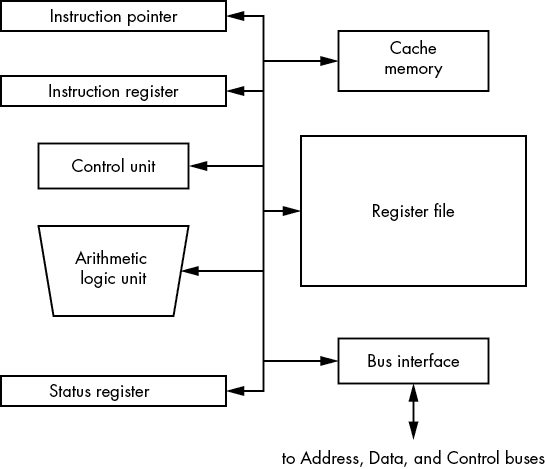
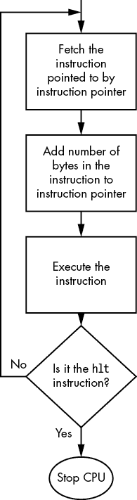
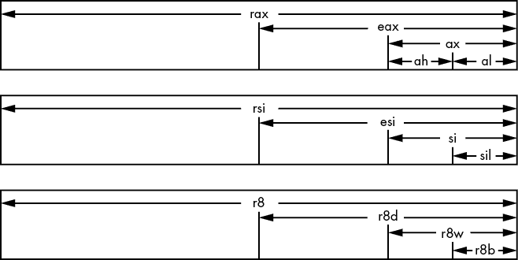
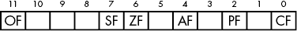

# 9 中央处理器


既然你已经了解了构建中央处理器 (CPU) 所用的电子元件，现在是时候了解 x86-64 CPU 的一些细节了。这两大 CPU 厂商是 Intel 和 AMD。x86-64 CPU 可以在 32 位或 64 位模式下运行。32 位模式称为*兼容模式*，允许你运行为 32 位或 16 位环境编译的程序。

在本书中，我们将专注于 64 位模式，Intel 手册中称为 `IA-32e`，AMD 手册中称为*长模式*。我将其称为*64 位模式*。我会指出兼容模式的一些主要区别，我将其称为*32 位模式*。你不能在同一个程序中混合使用这两种模式，但大多数 64 位操作系统允许你运行 32 位程序或 64 位程序。

我们将从典型 CPU 的概览开始本章。接下来，我们将查看 x86-64 CPU 中的寄存器以及程序员如何访问它们。本章最后将给出一个使用 `gdb` 调试器查看寄存器内容的示例。

## CPU 概览


正如您可能已经知道的，CPU 是计算机的核心。它遵循您在程序中指定的执行路径，并执行所有算术和逻辑操作。它还会在程序需要时从内存中获取指令和数据。

我们将首先了解典型 CPU 的主要子系统。随后将介绍 CPU 在执行程序时如何从内存中获取指令。

### CPU 子系统

图 9-1 展示了典型 CPU 主要子系统的总体框图。子系统通过内部总线连接，内部总线包括控制通信的硬件路径和软件协议。请记住，这是一个高度简化的图示。实际 CPU 复杂得多，但本章讨论的一般概念适用于其中大多数。



*图 9-1：CPU 的主要子系统*

让我们简要了解一下 图 9-1 中的各个子系统。此处提供的描述是通用的，适用于大多数 CPU。在简要介绍之后，我们将探讨程序员最感兴趣的子系统，以及它们在 x86-64 架构中的用法。

1. **指令指针** 该寄存器始终包含下一条待执行指令的内存地址。

2. **高速缓存** 虽然有人可能会争辩说这不属于 CPU 的一部分，但大多数现代 CPU 都在 CPU 芯片上包含了非常快的高速缓存。正如您稍后在本章中将看到的，CPU 在执行程序时会从内存中获取每条指令。CPU 执行指令的速度比通过总线接口从主存获取指令的速度快得多。与主存的接口使得一次性获取多条指令并将它们存储在高速缓存中变得更加高效，CPU 可以快速访问高速缓存中的指令。

3. **指令寄存器** 该寄存器包含当前正在执行的指令。其位模式决定了控制单元让 CPU 执行什么操作。一旦该操作完成，指令寄存器中的位模式将变为下一条指令的模式，CPU 将执行由这个新位模式指定的操作。

4. **寄存器文件** 寄存器文件是一组以相似方式使用的寄存器。大多数 CPU 有多个寄存器文件。例如，x86-64 CPU 有一个用于整数运算的寄存器文件和另一个用于浮点运算的寄存器文件。编译器和汇编器为每个寄存器都命名了。几乎所有的算术和逻辑操作以及数据移动操作都涉及寄存器文件中的至少一个寄存器。

5. **控制单元** 指令寄存器中的位在控制单元中被解码。为执行指令指定的操作，控制单元生成控制 CPU 中其他子系统的信号。它通常实现为有限状态机，包含解码器、多路选择器和其他逻辑组件。

6. **算术逻辑单元 (ALU)** ALU 用于执行您在程序中指定的算术和逻辑操作。当 CPU 需要执行自己的算术运算时（例如，将两个值相加以计算内存地址），也会用到 ALU。

7. **状态寄存器** ALU 执行的每项操作都会产生各种条件，这些条件必须被记录下来以供程序可能的使用。例如，加法可能产生进位。在 ALU 完成任何可能产生进位的操作后，状态寄存器中的一位将被设置为 `0`（无进位）或 `1`（有进位）。

8. **总线接口** 这是 CPU 与其他计算机子系统（即 图 1-1 中的内存和输入/输出 (I/O)，见第 1 章）通信的方式。它包含将地址放在总线上、在数据总线上读写数据、在控制总线上读写信号的电路。许多 CPU 上的总线接口与外部总线控制单元相连，后者再与内存和不同类型的 I/O 总线（例如 USB、SATA 或 PCI-E）相连。

### 指令执行周期

在本节中，我们将更详细地介绍 CPU 如何执行存储在主存中的程序。它通过总线接口，利用您在第 1 章学到的三条总线（地址、数据和控制）从主存获取指令来实现这一点。

*指令指针* 寄存器 `rip` 中的地址始终指向（即包含）程序中下一条待执行指令的内存地址。CPU 通过从指令指针中的内存地址获取指令，逐步执行程序。当获取一条指令时，CPU 开始对其进行解码。根据指令的不同，第一个字节或两个字节会告诉 CPU 该指令的字节数。然后 CPU 将 `rip` 寄存器增加这个数字，导致 `rip` 包含程序中下一条指令的地址。因此，`rip` 标记了程序中的当前位置。

有些指令会改变 `rip` 中的地址，从而导致从程序的一个位置跳转到另一个位置。在这种情况下，下一条指令的地址直到导致跳转的指令实际执行时才能知道。

x86-64 架构还支持 `rip`*\-相对寻址*，这允许程序访问距离 `rip` 中当前地址固定偏移量的内存位置。这使我们能够创建可加载到内存任意位置执行的程序，从而提高安全性。您将在第 11 章了解更多相关内容，届时我们将深入探讨函数的汇编语言细节。

当 CPU 从内存获取指令时，它将该指令加载到 *指令寄存器* 中。指令寄存器中的位模式导致 CPU 执行指令中指定的操作。一旦该操作完成，另一条指令会自动加载到指令寄存器中，CPU 将执行由这个下一个位模式指定的操作。

大多数现代 CPU 使用 *指令队列*。多条指令在队列中等待，随时准备执行。独立的电子电路在常规控制单元执行指令的同时保持指令队列满载。但这只是一个让控制单元运行更快的实现细节。控制单元执行程序的本质可以用单指令寄存器模型来表示，这也是我将在此描述的内容。

从内存获取每条指令（从而执行程序）的步骤如下：

1. 一系列指令存储在内存中。

2. 第一条指令所在的内存地址被复制到指令指针中。

3. CPU 通过地址总线将指令指针中的地址发送给内存。

4. CPU 在控制总线上发送“读”信号。

5. 内存通过在数据总线上发送该内存位置处位状态的副本来响应，CPU 随后将其复制到指令寄存器中。

6. 指令指针自动增加，以包含内存中下一条指令的地址。

7. CPU 执行指令寄存器中的指令。

8. 返回步骤 3。

步骤 3、4 和 5 称为 *指令获取*。注意步骤 [3](http://bob.cs.sonoma.edu/IntroCompOrg-x64/bookch6.html)–[8](http://bob.cs.sonoma.edu/IntroCompOrg-x64/bookch6.html) 构成一个循环，即 *指令执行周期*。它在 图 9-2 中以图形方式显示。



*图 9-2：指令执行周期*


程序中的大多数指令在寄存器文件中至少使用一个寄存器。程序通常将数据从内存加载到寄存器中，对数据进行操作，并将结果存储在内存中。寄存器还用于保存存储在内存中的项目的地址，因此充当指向数据或其他地址的指针。

本章的其余部分主要介绍 x86-64 架构中的通用寄存器。你将学习如何在 `gdb` 调试器中查看它们的内容。然后在下一章中，你将学习如何在汇编语言中开始使用它们。

## x86-64 寄存器

CPU 中的一部分内存被组织成寄存器。机器指令通过地址访问 CPU 寄存器，就像访问主内存一样。当然，寄存器寻址空间独立于主内存寻址空间。寄存器地址被放置在内部 CPU 总线上，而不是总线接口的地址部分上，因为寄存器位于 CPU 内部。从程序员的角度来看，区别在于汇编器为寄存器预定义了名称，而程序员为内存地址创建符号名称。因此，在你编写的每个汇编语言程序中，都会发生以下情况：

*   CPU 寄存器通过使用汇编器中预定义的名称来访问。
*   内存通过程序员为内存位置提供名称并在用户程序中使用该名称来访问。

表 9-1 列出了 x86-64 架构寄存器，并根据它们在程序中的一般用途对它们进行分组。在每个大类中，表格中的列显示寄存器的数量、每个寄存器的大小以及每个寄存器在程序中的用途。

**表 9-1：x86-64 寄存器**

| 类别 | 数量 | 大小 | 用途 |
| --- | --- | --- | --- |
| **基本编程寄存器** | | | |
| | 16 | 64-bit | `General-purpose` |
| | 1 | 64-bit | `Flags` |
| | 1 | 64-bit | `Instruction pointer` |
| | 6 | 16-bit | `Segment` |
| **浮点寄存器** | | | |
| | 8 | 80-bit | `Floating-point data` |
| | 1 | 16-bit | `Control` |
| | 1 | 16-bit | `Status` |
| | 1 | 16-bit | `Tag` |
| | 1 | 11-bit | `Opcode` |
| | 1 | 64-bit | `FPU instruction pointer` |
| | 1 | 64-bit | `FPU data pointer` |
| **MMX 寄存器** | | | |
| | 8 | 64-bit | `MMX` |
| **XMM 寄存器** | | | |
| | 16 | 128-bit | `XMM` |
| | 1 | 32-bit | `MXCR` |
| **模型特定寄存器 (MSRs)** | 随实现而异。仅由操作系统使用。 | | |

我已经描述过指令指针寄存器。本书介绍的大多数编程概念仅使用通用寄存器。这些寄存器用于*整数数据类型*，例如 `int` 和 `char` 整数值（有符号和无符号）、字符表示、布尔值和地址。在本节的其余部分，我们将查看通用寄存器和标志寄存器。我们将在本书接近尾声时讨论浮点寄存器。MMX 和 XMM 寄存器用于更高级的编程技术，本书不予介绍。

### 通用寄存器

如前所述，通用寄存器处理整数数据类型和内存地址。每个寄存器中的每一位都从右向左编号，从 0 开始。因此，最右边的位是 0 号，左边下一位是 1 号，依此类推。由于每个通用寄存器有 64 位，最左边的位是 63 号。

计算机中的每条指令都将一组位视为一个单元。在早期，该单元称为*字*。每种 CPU 架构都有*字长*。在现代 CPU 架构中，不同指令操作不同数量的位，但术语从 Intel 8086 指令集架构的早期延续至今，一直到当前的 64 位指令集架构 x86-64。因此，16 位称为*字*，32 位称为*双字*，64 位称为*四字*。

你可以在程序中通过使用以下分组来访问每个通用寄存器中的位：

1.  **四字** 所有 64 位（63–0）
2.  **双字** 低 32 位（31–0）
3.  **字** 低 16 位（15–0）
4.  **字节** 低 8 位（7–0），以及四个寄存器中的位（15–8）

汇编器为寄存器中的每组位使用不同的名称。表 9-2 列出了位组的汇编器名称。表中的每一行代表一个寄存器，每一列代表该寄存器中该位组的名称。

**表 9-2：通用 CPU 寄存器部分的汇编语言名称**

| **位 63–0** | **位 31–0** | **位 15–0** | **位 15–8** | **位 7–0** |
| --- | --- | --- | --- | --- |
| `rax` | `eax` | `ax` | `ah` | `al` |
| `rbx` | `ebx` | `bx` | `bh` | `bl` |
| `rcx` | `ecx` | `cx` | `ch` | `cl` |
| `rdx` | `edx` | `dx` | `dh` | `dl` |
| `rsi` | `esi` | `si` | | `sil` |
| `rdi` | `edi` | `di` | | `dil` |
| `rbp` | `ebp` | `bp` | | `bpl` |
| `rsp` | `esp` | `sp` | | `spl` |
| `r8` | `r8d` | `r8w` | | `r8b` |
| `r9` | `r9d` | `r9w` | | `r9b` |
| `r10` | `r10d` | `r10w` | | `r10b` |
| `r11` | `r11d` | `r11w` | | `r11b` |
| `r12` | `r12d` | `r12w` | | `r12b` |
| `r13` | `r13d` | `r13w` | | `r13b` |
| `r14` | `r14d` | `r14w` | | `r14b` |
| `r15` | `r15d` | `r15w` | | `r15b` |

在 64 位模式下，写入寄存器的 8 位或 16 位部分不会影响寄存器中的其他 56 位或 48 位。然而，写入低 32 位时，高 32 位会被设置为 0。（我不知道 CPU 设计师为何选择这种行为，这在我看来似乎很奇怪。）在 32 位模式下运行的程序只能使用 表 9-2 中横线以上的寄存器。64 位模式可以使用所有寄存器。`ah`、`bh`、`ch` 和 `dh` 寄存器（位 15–8）不能在同一指令中与横线以下的任何寄存器一起使用。例如，你不能用一条指令将 `ah` 寄存器中的 8 位值复制到 `sil` 寄存器，但可以复制到 `dl` 寄存器。

大多数 CPU 架构将其寄存器命名为 `r0`、`r1` 等。当 Intel 推出 8086/8088 指令集架构时，它使用了 表 9-2 中位 15–0、15–8 和 7–0 列中横线以上的名称。这四个 16 位寄存器 `ax`、`bx`、`cx` 和 `dx` 比其他四个更通用，用于 CPU 中的大多数计算。程序员可以访问整个寄存器或每个寄存器的一半。低位字节命名为 `al`、`bl`、`cl` 和 `dl`，高位字节命名为 `ah`、`bh`、`ch` 和 `dh`。

为了向后兼容，在 32 位模式下保留了对这些 8 位和 16 位寄存器的访问，但在 64 位模式下受到限制。随着 x86-64 架构向 64 位的过渡，增加了对 `rsi`、`rdi`、`rsp` 和 `rbp` 寄存器的 8 位低位部分的访问，但不能在同一指令中与 `ah`、`bh`、`ch` 或 `dh` 寄存器的 8 位部分一起使用。

每个寄存器名称中 32 位部分的 `e` 前缀源于 x86 架构的历史。1986 年推出的 80386 将寄存器大小从 16 位增加到 32 位。没有新增寄存器；旧寄存器只是被“扩展”了。除了将寄存器大小增加到 64 位外，x86-64 架构的引入还增加了八个寄存器，命名为 `r8`–`r15`。设计者没有更改前八个寄存器的名称，我想他们决定在历史名称上使用 `r` 前缀。


当在寄存器中使用少于 64 位时，通常不良的做法是编写假设剩余部分处于任何特定状态的代码。这种代码难以阅读，并在程序维护阶段导致错误。

图 9-3 显示了通用寄存器各部分命名的示意图。此处显示的三个寄存器代表了所有通用寄存器的命名模式。



图 9-3：通用寄存器命名

尽管它们被称为通用寄存器，但某些指令会以特殊方式使用其中的几个。我们将主要把所有通用寄存器视为高级语言中的变量。重要的例外是 `rsp` 和 `rbp` 寄存器，它们保存着对于正在执行的程序正常运行至关重要的内存地址。

### 特殊指针寄存器

让我们看看程序中重要的两个通用寄存器。`rsp` 寄存器用作栈指针，`rbp` 寄存器用作帧指针。它们用于跟踪作为*调用栈*使用的内存区域中项目的位置。当程序运行时，调用栈用于临时存储和在函数之间传递信息。有几条机器指令会隐式使用 `rsp` 寄存器。

`rsp` 和 `rbp` 寄存器的使用必须遵循非常严格的协议，我将在后续章节中详细描述。编写汇编语言时，你需要仔细遵循该协议。

### 通用寄存器的其他限制

有几条指令仅适用于特定的通用寄存器。例如，无符号乘法和除法指令使用 `rax` 和 `rdx` 寄存器。此外，每个操作系统和编程环境都有一套使用通用寄存器的规则。在我们的编程环境中（64 位 GNU/Linux 下的 C 语言），函数的第一个参数通过 `rdi` 寄存器传递，但在 64 位 Windows 下使用 C 语言时，第一个参数通过 `rcx` 寄存器传递。

你将在第 11 章了解这些限制和约定（针对 GNU/Linux，而非 Windows）。

### 状态寄存器

CPU 中的另一个专用寄存器是*状态寄存器*，你在图 9-1 中见过它。它被命名为 `rflags`。我们将关注该寄存器中用作*状态标志*的几个位，它们指示许多指令的某些副作用。

大多数算术和逻辑运算都会影响状态标志。例如，进位标志 `CF` 和溢出标志 `OF` 位于 `rflags` 寄存器中。图 9-4 显示了受影响的位。高位 32 位（63–32）保留作他用，此处不显示。我们也不显示位 31–12，它们用于系统标志。



图 9-4：`rflags` 寄存器的状态标志部分

表 9-3 显示了状态标志。

表 9-3：`rflags` 寄存器中的状态标志

| 名称 | 功能 | 将标志置 1 的条件 |
|------|------|-------------------|
| OF | 溢出标志 | 有符号整数（补码）算术运算溢出 |
| SF | 符号标志 | 结果最高有效位的副本 |
| ZF | 零标志 | 结果为 0 |
| AF | 辅助进位标志 | 二进制编码十进制算术运算中的进位或借位 |
| PF | 奇偶标志 | 结果最低有效字节包含偶数个 1 位 |
| CF | 进位标志 | 结果最高有效位之外的进位或借位 |

有用于测试状态标志状态的机器指令。例如，有一条指令会在 `ZF` 状态标志为 `1` 时分支到程序中的另一位置。

## C/C++ 整型数据类型与寄存器大小

计算机程序中的每一条数据都有一个*数据类型*，它指定了以下内容：该数据类型的可能值、用于表示这些值的位模式、可对数据执行的操作，以及数据在程序中的语义用法。

某些编程语言（如 C、C++ 和 Java）要求程序员显式声明程序中使用的值的数据类型。其他语言（如 Python、BASIC 和 JavaScript）可以根据值的使用方式确定数据类型。CPU 制造商指定特定于 CPU 架构的机器级数据类型，通常包括该设计特有的专用数据类型。

C 和 C++ 语言规范提供了每种数据类型的变量可存储的值的范围。例如，`int` 必须能够存储范围 –32,767 到 +32,767 内的值；因此，它必须至少为 16 位大小。`unsigned int` 必须至少为 0 到 65,535，所以它也必须至少为 16 位。编译器设计者可以超出语言规范中指定的最小值。

表 9-4 给出了在 x86-64 架构下，你可以从我们的编译器 `gcc` 和 `g++` 期望的 C/C++ 数据类型的寄存器大小，但你应小心，不要指望这些大小始终相同。`*any` 表示指向任意数据类型的指针（内存地址）。

表 9-4：x86-64 架构中某些 C/C++ 数据类型的大小

| 数据类型 | 32 位模式下的大小 | 64 位模式下的大小 |
|----------|-------------------|-------------------|
| char | 字节 | 字节 |
| int | 双字 | 双字 |
| long | 双字 | 四字 |
| long long | 四字 | 四字 |
| float | 双字 | 双字 |
| double | 四字 | 四字 |
| *any | 双字 | 四字 |

一个值通常可以用多种数据类型表示。例如，大多数人会认为 123 代表整数一百二十三，但该值可以在计算机中作为 `int` 存储，也可以作为 `char[]`（字符数组，数组的每个元素保存一个字符的代码点）存储。

正如你在表 9-4 中所见，在我们的 C/C++ 环境中，`int` 存储在双字中，因此 123 将以位模式 `0x0000007b` 存储。作为 C 风格文本字符串，我们也需要四字节内存，但位模式将是 `0x31`、`0x32`、`0x33` 和 `0x00`——即字符 `1`、`2`、`3` 和 `NUL`。（回想一下，C 风格字符串以 `NUL` 字符结尾。）

通过查看寄存器中发生的情况，你可以了解很多关于 CPU 如何工作的知识。在下一节中，你将学习如何使用 `gdb` 调试器查看寄存器。

## 使用 gdb 查看 CPU 寄存器

我们将使用清单 9-1 中的程序来展示如何使用 `gdb` 查看 CPU 寄存器的内容。

```c
/* inches2feet.c
 * 将英寸转换为英尺和英寸。
 */

#include <stdio.h>
#define inchesPerFoot 12

int main(void)
{
1   register int feet;
  register int inchesRem;
2   int inches;
  int *ptr;

  ptr = &inches;

  printf("Enter inches: ");
3   scanf("%i", ptr);
  
  feet = inches / inchesPerFoot;
  inchesRem = inches % inchesPerFoot;
  printf("%i\" = %i' %i\"\n", inches, feet, inchesRem);

  return 0;
}
```

清单 9-1：演示使用 `gdb` 查看 CPU 寄存器的简单程序


我使用了 `register` 存储类修饰符 1，请求编译器为 `feet` 和 `inchesRem` 变量使用 CPU 寄存器。`register` 修饰符仅具有建议性。C 语言标准不要求编译器必须满足该请求。但请注意，我并没有请求编译器为 `inches` 变量 2 使用 CPU 寄存器。`inches` 变量必须放在内存中，因为 `scanf` 需要一个指向 `inches` 3 位置的指针，以存储从键盘读取的值。

你已经在本书前面看过一些 `gdb` 命令了（复习请参阅第 2 章）。当你在正在运行的程序中命中断点时，以下是一些你可能会发现有用的额外命令，用于在你的控制下逐步执行程序并查看有关程序的信息：

1. `n` (next) 执行当前源代码语句；如果是函数调用，则执行整个函数。
2. `s` (step) 执行当前源代码语句；如果是函数调用，则单步进入该函数，到达被调用函数的第一条指令。
3. `si` (step instruction) 执行当前机器指令；如果是函数调用，则单步进入该函数。
4. `i r` (info registers) 显示寄存器的内容，但不包括浮点和向量寄存器。

以下是我如何使用 `gdb` 来控制程序执行并观察寄存器内容。请注意，如果你在自己的机器上复现此示例，你可能会看到不同的地址，稍后在“动手实践”环节你将被要求这样做。

```
1 $ gcc -g -O0 -Wall -masm=intel -o inches2feet inches2feet.c
2 $ gdb ./inches2feet 
GNU gdb (Ubuntu 9.2-0ubuntu1~20.04) 9.2
  --snip--
Reading symbols from ./inches2feet...done.
3 (gdb) l
1       /* inches2feet.c
2       * Converts inches to feet and inches.
3       */
4      
5      #include <stdio.h>
6      #define inchesPerFoot 12
7      
8      int main(void)
9      {
10       register int feet;
(gdb) ENTER
11       register int inchesRem;
12       int inches;
13       int *ptr;
14     
15       ptr = &inches;
16     
17       printf("Enter inches: ");
18       scanf("%i", ptr);
19       
20       feet = inches / inchesPerFoot;
(gdb) ENTER
21       inchesRem = inches % inchesPerFoot;
22       printf("%i\" = %i' %i\"\n", inches, feet, inchesRem);
23     
24       return 0;
25     }
```

我们首先编译程序 1，用 `gdb` 2 加载它，然后列出源代码，以便查看在哪里设置断点。使用回车键 3（某些键盘上为 return 键）会重复上一条命令。调试器启动时会打印关于自身的信息，为了节省空间，我已将其从显示中删去。

我们想通过在程序的关键点设置断点，来跟踪程序处理数据的过程：

```
(gdb) b 17
Breakpoint 1 at 0x11af: file inches2feet.c, line 17.
(gdb) b 20
Breakpoint 2 at 0x11d8: file inches2feet.c, line 20.
```

我们在程序即将提示用户输入数据的地方（第 17 行）设置了第一个断点，在程序开始计算的语句处（第 20 行）设置了第二个断点。

当我们运行程序时，它会在遇到的第一个断点处中断：

```
(gdb) r
Starting program: /home/progs/chapter_09/inches2feet/inches2feet  

Breakpoint 1, main () at inches2feet.c:17
17       printf("Enter inches: ");
```

程序停在第 17 行源代码处，控制权返回给 `gdb`。我们可以使用 `i r` 命令查看寄存器的内容。（请务必在 `i` 和 `r` 之间输入一个空格。）

```
(gdb) i r
rax            0x7fffffffdeac      140737488346796
rbx            0x555555555260      93824992236128
rcx            0x555555555260      93824992236128
rdx            0x7fffffffdfd8      140737488347096
rsi            0x7fffffffdfc8      140737488347080
rdi            0x1                 1
rbp            0x7fffffffded0      0x7fffffffded0
rsp            0x7fffffffdea0      0x7fffffffdea0
r8             0x0                 0
r9             0x7ffff7fe0d50      140737354009936
r10            0x7                 7
r11            0x2                 2
r12            0x5555555550a0      93824992235680
r13            0x7fffffffdfc0      140737488347072
r14            0x0                 0
r15            0x0                 0
rip            0x5555555551af      0x5555555551af <main+38>
eflags         0x246 [ PF ZF IF ]
cs             0x33  51
ss             0x2b  43
ds             0x0   0
es             0x0   0
fs             0x0   0
gs             0x0   0
```

此显示告诉我们用户输入数据前寄存器的内容（你会看到不同的数字）。我们可能想知道编译器是否满足了我们为 `feet` 和 `inchesRem` 变量使用寄存器的请求。如果满足了，它使用了哪些寄存器？

我们想知道这些信息，以便在程序使用这些寄存器前后查看它们的内容，从而判断程序是否在其中存储了正确的值。我们可以通过让 `gdb` 打印这两个变量的地址来回答这个问题：

```
(gdb) print &feet
Address requested for identifier "feet" which is in register $r12
(gdb) print &inchesRem
Address requested for identifier "inchesRem" which is in register $rbx
```

当我们请求变量地址时，`gdb` 会给出与程序员提供的标识符关联的内存地址。但在这个程序中，我们请求编译器使用寄存器，`gdb` 告诉我们编译器为每个变量选择了哪个寄存器。

我们没有请求编译器为 `inches` 和 `ptr` 变量使用寄存器，所以 `gdb` 应该会告诉我们它们在内存中的位置：

```
(gdb) print &inches
$1 = (int *) 0x7fffffffdeac
(gdb) print &ptr
$2 = (int **) 0x7fffffffdeb0
```

现在我们知道 `r12` 用于 `feet`，`rbx` 用于 `inchesRem`，我们可以查看这两个寄存器中当前存储的内容，并继续运行程序：

```
1 (gdb) i r rbx r12
rbx            0x555555555260      93824992236128
r12            0x5555555550a0      93824992235680
2 (gdb) c
Continuing.
Enter inches: 123 3
```

我们可以指定想要查看的那两个寄存器 1，而不必显示所有寄存器。继续程序执行 2，程序提示用户输入英寸数，我输入了 `123` 3。随后它在遇到的下一个断点处中断并返回 `gdb`：

```
Breakpoint 2, main () at inches2feet.c:20
20       feet = inches / inchesPerFoot;
```

在开始计算之前，让我们确保用户的输入存储在正确的位置：

```
(gdb) print inches
$3 = 123
```

程序即将计算英尺数，然后计算剩余的英寸数。所以我将使用 `n` 执行两条语句：

```
(gdb) n
21       inchesRem = inches % inchesPerFoot;
(gdb) ENTER 
22       printf("%i\" = %i' %i\"\n", inches, feet, inchesRem);
```

程序现在准备打印计算结果。我将检查以确保所有计算都正确执行，并且结果位于适当的变量中，我们已经确定它们在 `rbx` 和 `r12` 中：

```
(gdb) i r rbx r12
rbx            0x3   3
r12            0xa   10
```

还有其他方法查看存储在 `feet` 和 `inchesRem` 中的内容：

```
(gdb) print $rbx
$4 = 3
(gdb) print $r12
$5 = 10
(gdb) print feet
$6 = 10
(gdb) print inchesRem
$7 = 3
```

使用 `gdb` 的 `print` 命令时，一次只能打印一个变量，即使寄存器被用来存储该变量。`i r` 命令不需要寄存器名前的 `$` 前缀，但 `print` 命令需要。

在完成程序执行之前，我将最后再看一遍所有寄存器：


```
(gdb) i r
rax            0x78  120
rbx            0x3   3
rcx            0xa                 10
rdx            0x7b                123
rsi            0x0                 0
rdi            0x7fffffffd960      140737488345440
rbp            0x7fffffffded0      0x7fffffffded0
rsp            0x7fffffffdea0      0x7fffffffdea0
r8             0xa                 10
r9             0x0                 0
r10            0x7ffff7f5bac0      140737353464512
r11            0x0                 0
r12            0xa                 10
r13            0x7fffffffdfc0      140737488347072
r14            0x0                 0
r15            0x0                 0
rip            0x55555555521e      0x55555555521e <main+149> 
eflags         0x206 [ PF IF ]
cs             0x33  51
ss             0x2b  43
ds             0x0   0
es             0x0   0
fs             0x0   0
gs             0x0   0
```

这个显示没有什么特别之处，但当你积累了一些查看此类显示的经验后，你会学会有时能发现哪里不对劲。既然我已经确信程序正确执行了所有计算，我将使用 `cont` 继续运行到程序结束，然后用 `q` 退出：

```
(gdb) c
Continuing.
123" = 10' 3"
[Inferior 1 (process 3874) exited normally]
(gdb) q
$  
```

程序继续执行，打印结果并将控制权返回给 `gdb`。当然，最后一步是退出 `gdb`。

## 你学到了什么

1. **通用寄存器** x86-64 中的十六个 64 位寄存器为 CPU 中的计算提供了少量内存。

2. **状态寄存器** 该寄存器包含标志位，指示算术/逻辑运算是否产生进位、溢出或结果为零。

3. **指令指针** 该指针始终保存下一条待执行指令的地址。

4. **指令寄存器** 该寄存器保存当前正在执行的指令。

5. **算术逻辑单元** 执行算术和逻辑运算。

6. **控制单元** 控制 CPU 中的活动。

7. **总线接口** 负责将 CPU 与主存储器和 I/O 设备连接。

8. **高速缓存存储器** 高速缓存存储器比主存储器快。它保存 CPU 当前正在处理的程序部分，包括指令和数据。

9. **指令执行周期** 详细描述 CPU 如何逐条执行指令列表。

10. **C/C++ 数据类型大小** 数据大小与寄存器大小密切相关。

11. **调试器** 除了帮你查找 bug，`gdb` 对学习概念也很有用。

在下一章中，你将开始用汇编语言为计算机编程。
