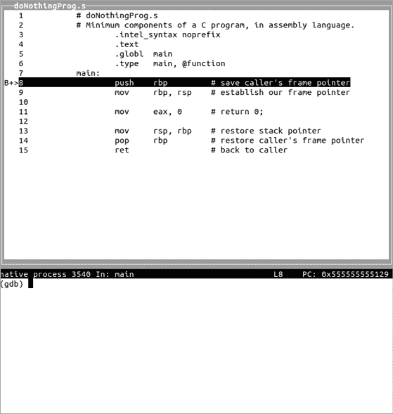
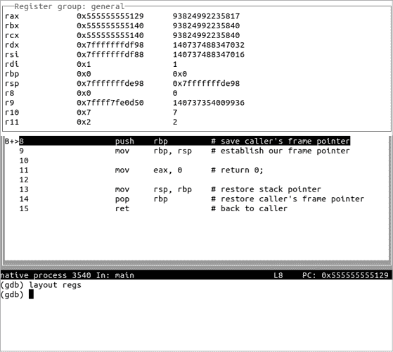
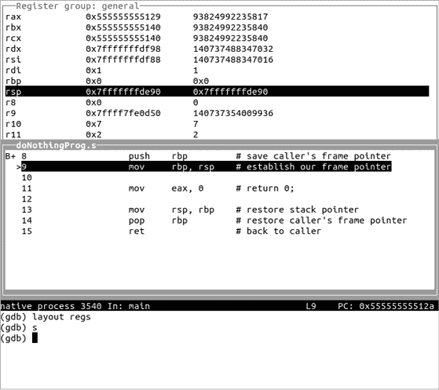
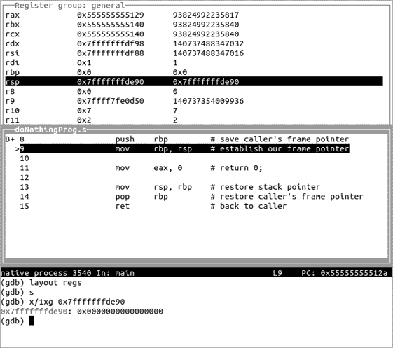
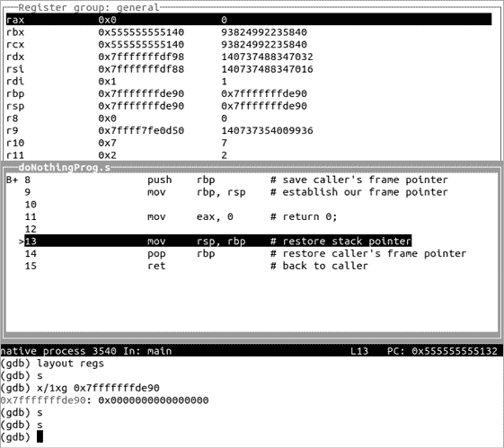
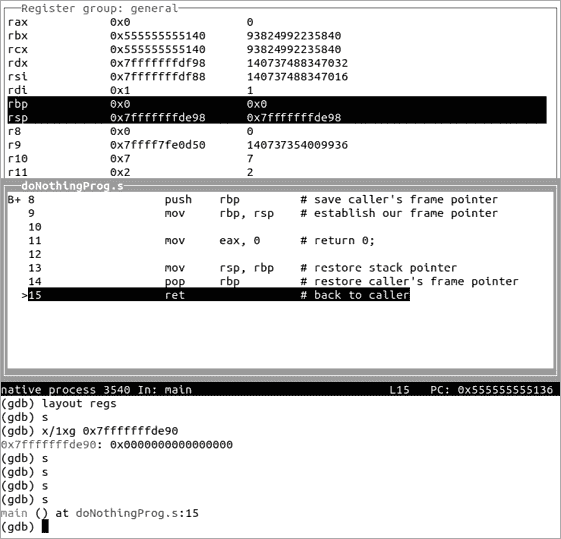
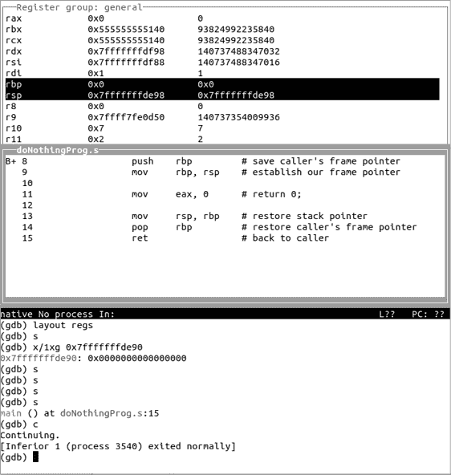

# 汇编语言编程


在前几章中，你看到了计算机如何使用 1 和 0 来表示操作和数据，即*机器语言*。现在我们将转到机器级编程，但我们将使用*汇编语言*而不是机器语言。汇编语言为每条机器语言指令使用一个简短的*助记符*。我们将使用*汇编器*程序将汇编语言翻译成控制计算机的机器语言指令。

用汇编语言创建程序类似于用 C、C++、Java 或 FORTRAN 等高级编译语言创建程序。我们将以 C 作为编程模型，探索几乎所有高级编程语言共有的主要编程结构和数据结构。我们使用的编译器 `gcc` 允许我们查看它生成的汇编语言。从那里，我将向你展示如何直接用汇编语言实现这些编程结构和数据结构。

我们将通过查看编译器从 C 源代码创建可执行程序所采取的步骤来开始本章。接下来，我们将查看哪些步骤适用于汇编语言编程，并创建我们自己的直接在汇编语言中运行的程序，该程序将在 C 运行时环境中运行。你还将了解一个有助于学习汇编语言的 `gdb` 模式。

阅读本章时，你还应查阅大多数 GNU/Linux 安装中可用的 `man` 和 `info` 文档资源，以了解此处讨论的程序。（你可能需要按照第 1 章所述在计算机上安装 `info` 文档。）

## 编译用 C 编写的程序

我们将使用 GNU 编译器 `gcc`，它通过执行几个不同的步骤从一个或多个源文件创建*可执行程序*。每个步骤都会产生一个中间文件，作为下一步的输入。这里对每个步骤的描述假设只有一个 C 源文件 `filename.c`。

### 预处理

预处理是第一步。此步骤通过调用程序 `cpp` 来解析编译器指令，如 `#include`（文件包含）、`#define`（宏定义）和 `#if`（条件编译）。编译过程可以在预处理阶段结束时通过 `-E` 选项停止，该选项将生成的 C 源代码写入标准输出。

标准输出通常是终端窗口。你可以使用 `>` 运算符将输出重定向到文件，如下所示：

```
$ gcc -Wall -O0 -masm=intel -E filename.c > filename.i
```

`.i` 文件扩展名表示不需要预处理的文件。

### 编译

接下来，编译器将预处理产生的源代码翻译成汇编语言。编译过程可以在编译阶段结束时通过 `-S` 选项（大写 S）停止，该选项将汇编语言源代码写入 `filename.s`。

### 汇编

编译器生成实现 C 源代码的汇编语言后，汇编器程序 `as` 将汇编语言翻译成机器代码。该过程可以在汇编阶段结束时通过 `-c` 选项停止，该选项将机器代码写入*目标文件*，名为 `filename.o`。有人称此汇编器为 `gas`，即 *GNU assembler*。

### 链接

`ld` 程序确定程序执行时每个函数和数据项在内存中的位置。然后，它用该项的内存地址替换程序员在引用这些项时使用的符号名称。链接的结果写入*可执行文件*。可执行文件的默认名称是 `a.out`，但你可以使用 `-o` 选项指定其他名称。

如果被调用的函数在外部库中，这会在调用函数的地方标注，并且外部函数的地址在程序执行期间确定。编译器指示 `ld` 程序将设置 C 运行时环境的计算机代码添加到可执行文件中。这包括为你的程序打开通往标准输出（屏幕）和标准输入（键盘）的路径等操作。

正如你可能知道的，如果你不使用任何 `gcc` 选项在其中一个步骤结束时停止过程（`-E`、`-S`、`-c`），编译器将执行所有四个步骤并自动删除中间文件，只留下可执行程序作为最终结果。你可以使用 `-save-temps` 选项指示 `gcc` 保留所有中间文件。


# 从 C 语言到汇编语言

能够在中途停止 `gcc` 的互补功能是，我们可以提供已经有效地完成了早期步骤的文件，`gcc` 会将这些文件合并到剩余的步骤中。例如，如果我们用汇编语言编写文件，`gcc` 将跳过预处理和编译步骤，直接执行汇编和链接步骤。如果我们只提供目标文件（`*.o`），`gcc` 将直接进入链接步骤。这的一个隐含好处是，我们可以编写调用 C 标准库函数（这些函数已经是目标文件格式）的汇编语言程序，`gcc` 会自动将我们的汇编语言与那些库函数链接起来。

命名文件时，请小心使用 GNU 编程环境中指定的文件名扩展名。编译器在每一步的默认操作取决于该步骤适用的文件名扩展名。要查看这些命名约定，请在命令行中输入 `info gcc`，选择 `Invoking GCC`，然后选择 `Overall Options`。如果你不使用指定的文件名扩展名，编译器可能不会做你想要的事情，甚至会覆盖所需的文件。

## 用 C 语言编写的程序

用 C 语言编写的程序被组织成函数。每个函数都有一个在程序中唯一的名称。C 运行时环境建立后，会调用 `main` 函数，因此我们的程序从 `main` 开始。

既然我们可以轻松查看编译器生成的汇编语言，那是一个很好的起点。我们将首先查看 `gcc` 为 清单 10-1 中的最小 C 程序生成的汇编语言。该程序除了向操作系统返回 0 之外什么也不做。程序可以向操作系统返回各种数字错误代码；0 表示程序未检测到任何错误。

```c
/* doNothingProg.c
 * Minimum components of a C program.
 */

int main(void)
{
  return 0;	
}
```

清单 10-1：最小 C 程序

尽管这个程序几乎什么也没完成，但仅仅为了返回 0 仍需要执行一些指令。为了看看发生了什么，我们首先使用以下 GNU/Linux 命令将该程序从 C 语言翻译成汇编语言：

```bash
$ gcc -O0 -Wall -masm=intel -S doNothingProg.c
```

在展示该命令的结果之前，我将解释我使用的选项。`-O0` 选项（大写字母 O 和数字 0）告诉编译器不要使用任何优化。本书的目标是展示机器级别发生的事情。要求编译器优化代码可能会掩盖一些重要细节。

你已经了解到 `-Wall` 选项要求编译器就代码中可疑的结构向你发出警告。在这个简单的程序中不太可能出现，但这是一个值得养成的好习惯。

`-masm=intel` 选项指示编译器使用 Intel 语法而不是默认的 AT&T 语法生成汇编语言。我将在本章后面解释为什么我们使用 Intel 语法。

`-S` 选项指示编译器在编译阶段后停止，并将编译产生的汇编语言写入一个与 C 源代码文件同名但扩展名为 `.s` 而非 `.c` 的文件中。前面的编译器命令生成 清单 10-2 中所示的汇编语言，并保存在文件 `doNothingProg.s` 中。

```asm
        .file   "doNothingProg.c"
        .intel_syntax noprefix
        .text
        .globl  main
        .type   main, @function
main:
.LFB0:
      1 .cfi_startproc
        endbr64
        push    rbp
        .cfi_def_cfa_offset 16
        .cfi_offset 6, -16
        mov     rbp, rsp
        .cfi_def_cfa_register 6
        mov     eax, 0
        pop     rbp
        .cfi_def_cfa 7, 8
        ret
        .cfi_endproc
.LFE0:
        .size   main, .-main
        .ident  "GCC: (Ubuntu 9.3.0-17ubuntu1~20.04) 9.3.0"
        .section        .note.GNU-stack,"",@progbits
        .section        .note.gnu.property,"a"
        .align 8
        .long    1f - 0f
        .long    4f - 1f
        .long    5
0:
        .string  "GNU"
1:
        .align 8
        .long    0xc0000002
        .long    3f - 2f
2:
        .long    0x3
3:
        .align 8
4:
```

清单 10-2：最小 C 程序，编译器生成的汇编语言

你可能在 清单 10-2 中注意到的第一件事是，许多标识符都以 `.` 字符开头。除了后面跟着 `:` 的之外，所有这些都是*汇编器指令*，也称为*伪操作*。它们是给汇编程序本身的指令，而不是计算机指令。本书的内容不需要用到所有这些指令。后面跟着 `:` 的标识符是内存位置上的标签，我们将在几页后讨论它们。

### 我们不会用到的汇编器指令

清单 10-2 中以 `.cfi` 开头的汇编器指令告诉汇编器生成可用于调试和某些错误情况的信息。以 `.LF` 开头的标识符标记出生成此信息时代码中的位置。对此的讨论超出了本书的范围，但它们在清单中的出现可能会令人困惑。因此，我们将使用 `-fno-asynchronous-unwind-tables` 选项告诉编译器不要在汇编语言文件中包含它们：

```bash
$ gcc -O0 -Wall -masm=intel -S -fno-asynchronous-unwind-tables doNothingProg.c
```

这将生成 清单 10-3 中所示的文件 `doNothingProg.s`。

```asm
        .file   "doNothingProg.c"
        .intel_syntax noprefix
        .text
        .globl  main
        .type   main, @function
main:
      1 endbr64
        push    rbp
        mov     rbp, rsp
        mov     eax, 0
        pop     rbp
        ret
        .size   main, .-main
        .ident  "GCC: (Ubuntu 9.3.0-17ubuntu1~20.04) 9.3.0"
        .section        .note.GNU-stack,"",@progbits
      2 .section        .note.gnu.property,"a"
        .align 8
        .long    1f - 0f
        .long    4f - 1f
        .long    5
0:
        .string  "GNU"
1:
        .align 8
        .long    0xc0000002
        .long    3f - 2f
2:
        .long    0x3
3:
        .align 8
4:
```

清单 10-3：最小 C 程序，编译器生成的汇编语言，不含 `.cfi` 指令

即使没有 `.cfi` 指令，汇编语言仍然包含一条指令和几个我们暂时不会用到的指令。Intel 开发了一种技术，称为*控制流执行技术*（*CET*），用于更好地防御劫持程序流程的计算机程序安全攻击类型。该技术预计从 2020 年下半年开始包含在 Intel CPU 中。AMD 表示他们将在稍后的日期在其 CPU 中包含等效技术。

该技术包括一条新指令 `endbr64`，它被用作函数中的第一条指令，以检查程序流程是否到达那里。如果 CPU 不包含 CET，该指令无效。

编译器还需要包含一些供链接器使用 CET 的信息。该信息被放置在汇编器将创建的文件的一个特殊节中，用 `.section .note.gnu.property,"a"` 汇编器指令表示，位于实际程序代码之后。


# 用汇编语言创建程序

本书使用的 `gcc` 版本默认包含 CET 功能，以适应新的 CPU。CET 的使用细节超出了本书的范围。如果你感兴趣，可以在 <https://www.intel.com/content/www/us/en/developer/articles/technical/technical-look-control-flow-enforcement-technology.html> 阅读相关内容。本书编写的程序不打算用于生产环境，所以我们不必担心程序中的安全问题。我们将使用 `-fcf-protection=none` 选项告诉编译器不要包含 CET，在直接编写汇编语言时也不会用到它。

为了让讨论集中在计算机工作原理的基础上，我们将使用以下命令让编译器生成汇编语言：

```
$ gcc -O0 -Wall -masm=intel -S -fno-asynchronous-unwind-tables \
> -fcf-protection=none doNothingProg1.c
```

该命令生成的汇编语言文件如清单 10-4 所示。

```
     1 .file   "doNothingProg.c"
     2 .intel_syntax noprefix
     3 .text
     4 .globl  main
     5 .type   main, @function
main:
        push    rbp
        mov     rbp, rsp
        mov     eax, 0
        pop     rbp
        ret
     6 .size   main, .-main
     7 .ident  "GCC: (Ubuntu 9.3.0-17ubuntu1~20.04) 9.3.0"
     8 .section  .note.GNU-stack,"",@progbits
```

**清单 10-4：** 最小 C 程序，编译器生成的汇编语言，不含 `.cfi` 指令和 CET 代码

现在我们去掉了高级特性，我将讨论清单 10-4 中剩下的汇编器指令，这些指令在我们编写自己的汇编语言时不会用到。`.file` 指令（第 1 行）被 `gcc` 用来指定生成该汇编语言的 C 源文件名称。直接编写汇编语言时，不使用此指令。`.size` 指令（第 6 行）计算汇编该文件生成的机器代码大小（以字节为单位），并将该函数名 `main` 赋给此值。这在内存受限的系统中可能是有用的信息，但与我们的程序无关。

老实说，我不知道使用 `.ident` 和 `.section` 指令（第 7-8 行）的原因。从它们的参数来看，我猜它们是用来在用户报告 bug 时向 `gcc` 开发者提供信息的。是的，编译器也会有 bug！但我们不会在汇编语言中使用这些指令。

## 我们将使用的汇编器指令

现在我们来看看编写汇编语言时所需的指令。清单 10-4 中的 `.text` 汇编器指令（第 3 行）告诉汇编器将后续内容放在文本段中。什么是*文本段*？

在 GNU/Linux 中，汇编器生成的目标文件采用*可执行与可链接格式*（*ELF*）。ELF 标准规定了多种段类型，每种类型指定了存储的信息类型。我们使用汇编器指令告诉汇编器将代码放在哪个段中。

当程序从磁盘加载时，GNU/Linux 操作系统也会将内存划分为特定用途的*段*。链接器将属于每个段的所有节收集在一起，并输出一个按段组织的可执行 ELF 文件，以便操作系统更轻松地将程序加载到内存中。四种主要的段类型如下：

1.  **文本段**（也称为代码段）*文本段*存储程序指令和常量数据。操作系统阻止程序修改存储在文本段中的任何内容，使其成为只读的。

2.  **数据段** 全局变量和静态局部变量存储在*数据段*中。全局变量可被程序中的任何函数访问。静态局部变量只能被定义它的函数访问，但其值在函数调用之间保持不变。程序可以读取和写入数据段中的变量。这些变量在程序运行期间一直保留。

3.  **栈** 自动局部变量和链接函数的信息存储在*调用栈*上。自动局部变量在函数被调用时创建，在函数返回调用者时销毁。栈上的内存可被程序读写。它随着程序执行动态分配和释放。

4.  **堆** *堆*是程序运行时可用的内存池。C 程序调用 `malloc` 函数（C++ 调用 `new`）从堆获取一块内存。程序可对其进行读写。它用于存储数据，并通过在程序中调用 `free`（C++ 中为 `delete`）显式释放。

这是对 ELF 节和段的简化概述。你可以通过阅读 ELF 的 `man` 手册页，以及阅读诸如“ELF-64 目标文件格式”（可在 <https://uclibc.org/docs/elf-64-gen.pdf> 下载）和 John R. Levine 的《连接器与加载器》（Morgan Kaufmann，1999 年出版）等资料来了解更多细节。`readelf` 程序对于了解 ELF 文件也很有帮助。

现在回看清单 10-4。`.globl` 指令（第 4 行）有一个参数，即标识符 `main`。`.globl` 指令使该名称全局可见，以便在其他文件中定义的函数可以引用此名称。设置 C 运行时环境的代码被编写为调用名为 `main` 的函数，因此该名称必须具有全局作用域。所有 C/C++ 程序都从 `main` 函数开始。在本书中，我们也将用 `main` 函数开始汇编语言程序，并在 C 运行时环境中执行它们。

你可以编写不依赖 C 运行时环境的独立汇编语言程序，在这种情况下，你可以为程序中的第一个函数创建自己的名称。你需要使用 `-c` 选项在汇编步骤结束时停止编译过程。然后单独使用 `ld` 命令链接目标（`*.o`）文件，而不是作为 `gcc` 的一部分。我将在第 20 章详细介绍这一点。

汇编器指令 `.type`（第 5 行）有两个参数：`main` 和 `@function`。这会导致标识符 `main` 作为函数名记录在目标文件中。

这三个指令都不会被翻译成实际的机器指令，也不会在最终程序中占用任何内存。相反，它们用于描述后续语句的特性。

你可能注意到了，我还没有描述 `.intel_syntax noprefix` 指令（第 2 行）的用途。它指定了我们将使用的汇编语言语法。你大概能猜到我们将使用 Intel 语法，但在解释汇编语言指令后，这会更容易理解。我们将使用清单 10-1 中的同一个函数，但直接用汇编语言编写来演示这一点。

## 用汇编语言创建程序

清单 10-5 是由程序员用汇编语言编写的，而非编译器生成。自然地，程序员添加了注释以提高可读性。

```
1 # doNothingProg.s
# Minimum components of a C program, in assembly language.
        .intel_syntax noprefix
        .text
        .globl  main
        .type   main, @function
2 main:
        3 push    rbp         # save caller's frame pointer
        4 mov     rbp, rsp    # establish our frame pointer
5
        6 mov     eax, 0      # return 0 to caller

          mov     rsp, rbp    # restore stack pointer
          pop     rbp         # restore caller's frame pointer
          ret                 # back to caller
```


**清单 10-5：用汇编语言编写的最小 C 风格程序**

## 汇编语言概述

在清单 10-5 中首先要注意到的是，汇编语言是按行组织的。每行只有一条汇编语句，且没有语句跨越多行。这与许多高级语言的自由格式形成对比，在这些语言中行结构无关紧要。事实上，优秀的程序员利用跨多行编写语句和缩进的能力来强调代码结构。优秀的汇编语言程序员使用空行来帮助分隔算法的各个部分，并且几乎给每一行都加上注释。

接下来，请注意前两行以 `#` 字符开头。该行其余部分用英语编写，易于阅读。`#` 字符之后的所有内容都是注释。就像高级语言一样，注释仅供人类阅读，对程序没有任何影响。顶部的注释后面是我们之前讨论过的汇编器指令。

空行旨在提高可读性。当然，这是在你学会如何阅读汇编语言之后。

剩余的行大致组织成列。此时它们对你可能没有太大意义，因为它们是用汇编语言编写的，但如果你仔细观察，每一行汇编语言都组织成四个可能的字段：

```
label:   operation   operand(s)   # comment
```

并非所有行都在所有字段中都有条目。汇编器要求至少一个空格或制表符来分隔字段。编写汇编语言时，如果你使用 `Tab` 键从一个字段移动到下一个字段，使列对齐，你的程序将更易于阅读。

让我们详细看看每个字段：

1. **标号** 允许我们给程序中的任意行赋予一个符号名称。每一行对应程序中的一个内存位置，因此程序的其他部分可以通过名称引用该内存位置。
2. 标号由一个标识符后紧跟 `:` 字符组成。作为程序员，你必须编造这些标识符。我们很快将查看创建标识符的规则。只有我们需要引用的行才会被标记。
3. **操作** 包含*指令操作码*（*opcode*）或*汇编器指令*（*pseudo op*）。汇编器将操作码及其操作数翻译成机器指令，当程序执行时，这些指令被复制到内存中。
4. **操作数** 指定操作中使用的参数。参数可以是显式值、寄存器名称或程序员创建的标识符。操作数的数量可以是零、一、二或三个，取决于操作。
5. **注释** 一行中 `#` 字符之后的所有内容都会被汇编器忽略，从而为程序员提供了一种编写人类可读注释的方法。由于汇编语言不如高级语言易读，优秀的程序员几乎会在每一行都放置注释。

这里谈谈程序注释。初学者经常注释编程语句*做什么*，而不是它相对于解决问题的*目的*。例如，C 语言中如下注释：

```
counter = 1;  /* let x = 1 */
```

并不是很有用。但如下注释：

```
counter = 1;  /* need to start at 1 */
```

可能非常有帮助。你的注释应该描述*你*在做什么，而不是计算机在做什么。

创建标识符的规则类似于 C/C++。每个标识符由一串字母数字字符组成，并可能包含其他可打印字符，如 `.`、`_` 和 `$`。第一个字符不能是数字。标识符可以是任意长度，所有字符都有意义。虽然关键字标识符（操作符、操作数、指令）的字母大小写不敏感，但标号的大小写敏感。例如，`myLabel` 和 `MyLabel` 是不同的。编译器生成的标号以 `.` 字符开头，许多系统相关的名称以 `_` 字符开头。最好避免用 `.` 或 `_` 字符开头你自己的标号，以免无意中创建出一个已被系统使用的标号。

将标号单独放在一行上是常见做法，在这种情况下，它适用于下一条占用内存的汇编语句的地址。这允许你创建更长、更有意义的标号，同时保持代码的列组织。

整数可以用作标号，但它们有特殊含义。它们被用作局部标号，这在高级汇编语言编程技术中有时很有用。本书中我们不会使用它们。

## 第一条汇编语言指令

与其列出所有 x86-64 指令（根据计算方式不同，有 2000 多条），我将一次介绍几条，且仅介绍说明当前编程概念所需的指令。我还将仅给出我介绍的指令的常用变体。

有关指令及其所有变体的详细说明，你需要一份 *Intel® 64 and IA-32 Architectures Software Developer's Manual*（Intel® 64 和 IA-32 架构软件开发者手册），第二卷，可在 `https://software.intel.com/en-us/articles/intel-sdm/` 下载，或 *AMD64 Architecture Programmer's Manual*（AMD64 架构程序员手册），第三卷：*General-Purpose and System Instructions*（通用和系统指令），可在 `https://developer.amd.com/resources/developer-guides-manuals/` 下载。这些是两大 x86-64 CPU 制造商提供的指令集参考手册。它们可能有点难读，但在本书中我对指令的描述与手册中的描述之间来回对照，应该能帮助你学会如何阅读这些手册。

汇编语言提供了一组助记符，它们直接对应机器语言指令。*助记符* 是一组简短的、类英语的字符，暗示指令的动作。例如，`mov` 用于表示将值从一个地方复制（移动）到另一个地方的指令；机器指令 `0x4889e5` 将 `rsp` 寄存器中的整个 64 位值复制到 `rbp` 寄存器。即使你以前从未见过汇编语言，清单 10-5 中这条指令的助记符表示可能比机器代码更容易理解。

在我们使用汇编器（Intel 语法）时，汇编语言指令的一般格式是

```
operation destination, source1, source2
```

其中 `destination` 是存储 `operation` 结果的位置，`source1` 和 `source2` 是 `operation` 输入所在的位置。可以有零到两个源操作数，某些指令不要求你指定目的操作数。目的操作数可以是寄存器或内存。源值可以在寄存器中、内存中，或为*立即数据*。立即数据作为指令的机器代码实现的一部分存储，因此是程序中的常量值。在第 12 章中，当我们查看指令如何在机器代码的 `1` 和 `0` 中编码时，你将看到这是如何工作的。

在描述指令时，我使用 `reg`、`reg1` 或 `reg2` 来表示第 9 章表 9-2 中通用寄存器名称之一。我使用 `mem` 表示内存位置的标号，用 `imm` 表示字面数据值。在大多数情况下，操作数指定的值必须大小相同。有用于显式转换大小的指令。


让我们从最常用的汇编语言指令 `mov` 开始。事实上，在清单 10-5 中，有一半的指令都是 `mov`。

## `mov`——传送

1.  将一个值从源操作数复制到目的操作数。
2.  `mov reg1, reg2` 将 `reg2` 中的值移动到 `reg1`。
3.  `mov reg, mem` 将 `mem` 中的值移动到 `reg`。
4.  `mov mem, reg` 将 `reg` 中的值移动到 `mem`。
5.  `mov reg, imm` 将 `imm` 移动到 `reg`。
6.  `mov mem, imm` 将 `imm` 移动到 `mem`。

`mov` 指令**不影响** `rflags` 寄存器中的状态标志。

移动值的大小（位数）在源操作数和目的操作数之间必须相同。当汇编程序将汇编语言指令翻译成机器码时，它可以从寄存器名称推断出大小。例如，清单 10-5 中的第 6 条指令 `mov eax, 0` 将导致 32 位整数 0 被存储在 `eax` 寄存器中，该寄存器是 `rax` 寄存器的 32 位部分。回想一下（第 9 章），当目的操作数是寄存器的 32 位部分时，该寄存器的高位 32 位会被设置为 0。如果我使用了 `mov al, 0`，那么 0 的 8 位表示形式将只存储在 `rax` 寄存器的 `al` 部分中，而该寄存器中的其他位将不受影响。对于 8 位和 16 位操作，你应该假设任何寄存器中未被指令显式修改的部分包含未知值。

你可能已经注意到，将立即数移动到内存的变体 `mov mem, imm` 不使用寄存器。在这种情况下，你必须通过放在 `mem` 操作数之前的大小指示符来告诉汇编程序数据大小。

### 表 10-1：数据大小指示符

| 指示符 | 数据类型 | 位数 |
| --- | --- | --- |
| `byte ptr` | 字节 | 8 |
| `word ptr` | 字 | 16 |
| `dword ptr` | 双字 | 32 |
| `qword ptr` | 四字 | 64 |

大小指示符包含 `ptr`，因为它指定内存地址指向多少字节。对于立即数数据，该地址在 `rip` 寄存器中。例如，

```asm
mov     byte ptr x[ebp], 123
mov     qword ptr y[ebp], 123
```

将把 123 存储在一字节变量 `x` 中，并将 123 存储在四字节变量 `y` 中。（这种指定内存位置的语法将在下一章解释。）

请注意，你**不能**直接将数据从一个内存位置移动到另一个内存位置。你必须先将数据从内存移动到寄存器，然后再从该寄存器移动到另一个内存位置。

清单 10-5 中使用的其他三条指令是 `push`、`pop` 和 `ret`。这三条指令使用调用栈。我们将在下一章详细讨论调用栈。目前，你可以把它想象成内存中的一个地方，你可以在那里将数据项一个接一个地堆叠起来，然后按相反的顺序移除它们。（想象一下把晚餐盘子一个个堆在架子上，然后按需一个个取下来。）`rsp` 寄存器始终包含调用栈顶部项目的地址；因此，它被称为*栈指针*。

## `push`——压栈

1.  将一个 64 位源值移动到调用栈的顶部。
2.  `push reg` 将 `reg` 中的 64 位值放在调用栈上，改变 `rsp` 寄存器，使其拥有栈上这个新项目的内存地址。
3.  `push mem` 将 `mem` 中的 64 位值放在调用栈上，改变 `rsp` 寄存器，使其拥有栈上这个新项目的内存地址。

`push` 指令**不影响** `rflags` 寄存器中的状态标志。

## `pop`——出栈

1.  将一个 64 位值从调用栈顶部移动到目的操作数。
2.  `pop reg` 将栈顶的 64 位值复制到 `reg`，改变 `rsp` 寄存器，使其拥有栈上下一个项目的内存地址。
3.  `pop mem` 将栈顶的 64 位值复制到 `mem`，改变 `rsp` 寄存器，使其拥有栈上下一个项目的内存地址。

`pop` 指令**不影响** `rflags` 寄存器中的状态标志。

## `ret`——从函数返回

1.  从函数调用返回。
2.  `ret` 没有操作数。它将栈顶的 64 位值弹出到指令指针 `rip` 中，从而将程序控制权转移到该内存地址。

`ret` 指令**不影响** `rflags` 寄存器中的状态标志。

现在你已经了解了 清单 10-5 中每条指令的工作原理，让我们看看它们在这个程序中在做什么。当我们浏览这段代码时，请记住这个程序对用户来说什么也不做。这里的代码为你编写的任何 C 风格函数形成了一种基础设施。随着你继续阅读本书，你会看到各种变体，但你应该花时间熟悉这个程序的基本结构。

## 函数中的最小处理

除了函数执行的数据处理外，它还需要执行一些处理，以便它可以被调用并返回到调用函数。例如，函数需要跟踪调用它的地址，以便在函数完成时能返回到正确的位置。由于寄存器数量有限，函数需要一个内存位置来存储返回地址。完成后，函数返回到调用处，不再需要返回地址，因此可以释放存储返回地址的内存。

正如你将在下一章学到的，调用栈是函数临时存储信息的绝佳场所。每个函数使用调用栈的一部分进行存储，这被称为*栈帧*。函数需要一个对其栈帧的引用，该地址存储在 `rbp` 寄存器中，通常称为*帧指针*。

让我们演练 清单 10-5 中程序中实际发生的处理。我将在此重复该清单，以省去你翻页的麻烦（清单 10-6）。

```asm
# doNothingProg.s
# C 程序的最小组件，用汇编语言编写。
        .intel_syntax noprefix
        .text
        .globl  main
        .type   main, @function
main:
      1 push    rbp         # 保存调用者的帧指针
      2 mov     rbp, rsp    # 建立我们的帧指针

      3 mov     eax, 0      # 向调用者返回 0

      4 mov     rsp, rbp    # 恢复栈指针
      5 pop     rbp         # 恢复调用者的帧指针
      6 ret                 # 返回调用者
```

清单 10-6：为方便起见重复的代码

函数必须做的第一件事是保存调用函数的帧指针，以便调用函数可以使用 `rbp` 作为其自己的帧指针，然后在返回前恢复调用函数的帧指针。它通过将该值压入调用栈 1 来实现这一点。现在我们已经保存了调用函数的帧指针，我们可以将 `rbp` 寄存器用作当前函数的帧指针。帧指针被设置为栈指针的当前位置 2。

在这一点上这可能听起来很困惑。别担心，我们将在下一章详细介绍这个机制。目前，请确保你用汇编语言编写的每个函数都以这两条指令开始，且顺序固定。它们共同构成了*函数序言*的开头，为函数将要执行的实际计算工作准备调用栈和寄存器。


# C 函数、汇编和 GDB

## 函数返回值和尾声

C 函数可以向调用函数返回值。这是 `main` 函数，如果函数无错误运行，操作系统期望它返回 32 位整数 0。`rax` 寄存器用于返回最多 64 位的值，所以我们在返回前将 0 存入 `eax` 寄存器 3。

函数序言为此函数准备了调用栈和寄存器，我们需要遵循严格的协议来准备调用栈和寄存器以返回给调用函数。这是通过 `function epilogue`（函数尾声）完成的。函数尾声本质上是函数序言的镜像。第一件事是确保栈指针恢复到序言开始时的位置 4。虽然我们可以看到在这个简单函数中栈指针没有改变，但在大多数函数中它都会改变，所以你应该养成恢复它的习惯。恢复栈指针对于下一步能否工作至关重要。

现在我们已经从 `rbp` 寄存器恢复了栈指针，我们需要恢复 `rbp` 寄存器中调用函数的值。该值在序言中被压入栈中，所以我们将其从栈顶弹出并存回 `rbp` 寄存器 5。最后，我们可以返回给调用函数 6。由于这是 `main` 函数，这将返回给操作系统。

`gdb` 最有价值的用途之一是作为学习工具。它有一种模式，对于学习每条汇编语言指令的作用特别有帮助。我将在下一节中向你展示如何做到这一点，使用 清单 10-5 中的程序。这也将帮助你更熟悉 `gdb` 的使用，这是调试程序时的一项重要技能。

## 使用 GDB 学习汇编语言

这里是一个运行 清单 10-5 中程序的好地方，这样你可以跟上讨论。可以使用以下命令进行汇编、链接和执行：

```
$ as -–gstabs -o doNothingProg.o doNothingProg.s
$ gcc -o doNothingProg doNothingProg.o
$ ./doNothingProg
```

`--gstabs` 选项（注意这里有两个破折号）告诉汇编器在目标文件中包含调试信息。`gcc` 程序识别出唯一的输入文件已经是目标文件，因此它直接进入链接阶段。不需要告诉 `gcc` 包含调试信息，因为汇编器已经将其包含在目标文件中了。

顾名思义，运行这个程序你不会在屏幕上看到任何东西。我们稍后在本章中使用 `gdb` 逐步执行这个程序时会用到它。然后你会看到这个程序实际上确实做了一些事情。

`gdb` 调试器有一种模式，可用于查看每条汇编语言指令在单步执行时的效果。`text user interface`（`TUI`，文本用户界面）模式将终端窗口分割为顶部的显示区域和底部的常规命令区域。显示区域可以进一步分割为两个显示区域。

每个显示区域可以显示源代码（`src`）、寄存器（`regs`）或 `disassembled`（反汇编）机器代码（`asm`）。反汇编是将机器代码（1 和 0）翻译成相应汇编语言的过程。反汇编过程不知道程序员定义的名称，所以你将只看到由汇编和链接过程生成的数值。当我们在第 12 章查看指令细节时，`asm` 显示可能会更有用。

关于使用 TUI 模式的文档在 `gdb` 的 `info` 中。我将在这里简单介绍如何将 TUI 模式与 清单 10-5 中的程序 `doNothingProg.s` 一起使用。我将单步执行大多数指令。轮到你的时候，你将有机会单步执行每一条指令。

```
$ gdb ./doNothingProg
--snip--
Reading symbols from ./doNothingProg...
1 (gdb) set disassembly-flavor intel
2 (gdb) b main
Breakpoint 1 at 0x1129: file doNothingProg.s, line 8.
(gdb) r
Starting program: /home/bob/progs/chap11/doNothingProg_asm/doNothingProg 

Breakpoint 1, main () at doNothingProg.s:8
8	        push    rbp        	# save caller's frame pointer
3 (gdb) tui enable
```

我们以通常的方式在 `gdb` 下启动程序。`gdb` 在 GNU/Linux 下用于反汇编的默认汇编语言语法是 AT&T，所以我们需要将其设置为 Intel 1。本章末尾将解释这个语法问题。如果你使用 `asm` 显示，这很重要。

然后我们在程序开头设置一个断点 2。我们在 C 代码中使用源代码行号来设置断点。但每条 C 语句通常会翻译成多条汇编语言指令，所以我们无法确定 `gdb` 会在特定指令处中断。`label`（标签）语法给了我们一种方法，确保如果指令有标签，`gdb` 会在特定指令处中断。

当我们运行程序时，它会在 `main` 标签处中断，该标签位于函数的第一条指令上。接下来，我们启用 TUI 模式 3，它显示源代码，如 图 10-1 所示。



图 10-1：`gdb` 处于带有 `src` 显示的 TUI 模式

终端窗口的底部显示常规的 (`gdb`) 提示符，这是你输入 `gdb` 命令和检查内存内容的地方。顶部显示该函数的源代码，即将执行的行以反向视频显示以突出显示。左侧还有一个指示，显示此行有一个断点（`B+`），并且指令指针 `rip` 当前指向此行，`>`。显示还显示 `rip` 寄存器中的当前地址，在源代码显示部分的右下边距使用名称 `PC`。（`Program counter` 是 `instruction pointer` 的另一个名称。）

`layout regs` 命令分割终端窗口的显示区域并显示寄存器，如 图 10-2 所示。我们即将执行 `main` 函数中的第一条指令。



图 10-2：`gdb` 处于带有源代码和寄存器窗口的 TUI 模式

`s` 命令执行当前指令并移至下一条指令，下一条指令会高亮显示，如 图 10-3 所示。



图 10-3：执行一条指令会导致发生变化的寄存器被高亮显示。

执行第一条指令 `push rbp` 导致 `gdb` 在 图 10-3 所示的寄存器显示窗口中高亮显示 `rsp` 寄存器及其内容。这条指令将 `rbp` 寄存器的内容压入调用栈，并相应地改变了栈指针 `rsp`。将一个 64 位寄存器压入调用栈将栈指针从 `0x7fffffffde98`（图 10-2）改为 `0x7fffffffde90`；即它将栈指针减少了压入栈的字节数（`8`）。你将在下一章了解更多关于调用栈及其用法的内容。


# GDB TUI 模式与内存检查

在图 10-3 中，你也可以看到程序中的当前位置已移动到下一条指令。该指令现已高亮显示；指令指针字符 `>` 已移动到此指令；且 `rip` 寄存器中的地址（右下角的 `PC`）已从 `0x555555555129` 变为 `0x55555555512a`。`rip` 的这一变化表明，刚刚执行的指令 `push rbp` 在内存中仅占用一个字节。你将在第 12 章了解更多相关内容。

TUI 增强功能不提供内存的数据或地址视图，仅提供反汇编视图。我们需要在命令区查看存储在内存中的数据和地址。例如，如果我们想查看 `push rbp` 指令在内存中存储了什么，我们需要使用 `x` 命令来查看栈指针 `rsp` 所指向的内存。图 10-4 显示了 `rsp` 中内存地址处的巨大（64 位）十六进制内容。



**图 10-4：** 在 TUI 模式下检查内存是在命令区完成的。

再执行两条指令可知，`mov rax, 0` 指令将 0 存入 `rax` 寄存器，如图 10-5 所示。对比图 10-4 和图 10-5，你还可以看到 `mov rbp, rsp` 指令的效果。



**图 10-5：** `mov eax, 0` 指令的效果

再单步执行一次便到达 `ret` 指令，如图 10-6 所示，准备返回调用函数。



**图 10-6：** 准备返回调用函数

将图 10-6 与图 10-2 进行比较，可知帧指针 `rbp` 已恢复为调用函数的值。我们还可以看到栈指针 `rsp` 已移回我们的函数刚开始时所在的同一位置。如果在返回调用函数之前帧指针和栈指针均未恢复，你的程序几乎肯定会崩溃。因此，我经常在 `ret` 指令处设置一个断点，以便检查我的函数是否正确恢复了这两个寄存器，如图 10-7 高亮显示的那样。



**图 10-7：** 程序已完成。

剩下的就是退出 `gdb` 了。

在下一章，我们将更详细地深入 `main` 函数内部。我将详细描述如何使用调用栈。这将包括如何在函数中创建局部变量。但首先，我将简要总结 AT&T 汇编语言语法。如果你在 Linux 或 Unix 环境中查看任何汇编语言，很可能会看到正在使用的 AT&T 语法。

## AT&T 语法

本书中汇编语言使用的是 Intel 语法，但对于可能偏好 AT&T 语法的读者，我将在此简要介绍。AT&T 语法是大多数 Linux 发行版中的默认语法。

清单 10-7 重复了清单 10-5 中的程序，但使用 AT&T 语法编写。

```
# doNothingProg_att.s
# C 程序的最小组件，用汇编语言编写。
        .text
        .globl  main
        .type   main, @function
main:
      1 pushq 2 %rbp        # 保存调用者的帧指针
        movq  3 %rsp, %rbp  # 建立我们的帧指针

        movq  4 $0, %rax    # 返回 0；

        movq    %rbp, %rsp  # 恢复栈指针
        popq    %rbp        # 恢复调用者的帧指针
        ret                 # 返回调用者
```

**清单 10-7：** 使用 AT&T 语法编写的最小 C 程序汇编语言版本

你可能注意到的第一个区别是，一个指定操作数大小的字符作为后缀被添加到了大多数指令助记符后面 1。表 10-2 列出了这些大小字母。（是的，在操作数之一为寄存器的情况下这是冗余的，但这是语法的一部分。）你可能看到的下一个区别是每个寄存器都以前缀 `%` 字符开头 2。

最显著的区别是操作数的顺序被颠倒了 3。目的操作数不再放在第一位，而是最后一位。如果你在 Intel 和 AT&T 两种语法之间切换，很容易搞错操作数的顺序，尤其是使用两个寄存器的指令。在 AT&T 语法中，你还需要在立即数值前加上 `$` 字符 4。

**表 10-2：** AT&T 语法的数据大小后缀

| **后缀字母** | **数据类型** | **位数** |
| --- | --- | --- |
| `b` | 字节 | 8 |
| `w` | 字 | 16 |
| `l` | 双字 | 32 |
| `q` | 四字 | 64 |

如前言所述，我选择在本书中使用 Intel 语法，以与 Intel 和 AMD 手册保持一致。据我所知，GNU 汇编器 `as` 是唯一默认使用 AT&T 语法的汇编器。所有其他汇编器都使用 Intel 语法，而 `as` 将其作为一个选项提供。

## 你所学到的内容

1.  **编辑器** — 用于用选定的编程语言编写程序源代码的程序。
2.  **预处理器** — 编译的第一阶段。它将其他文件引入源代码，定义宏等，为实际编译做准备。
3.  **编译** — 将选定的编程语言翻译成汇编语言。
4.  **汇编** — 将汇编语言翻译成机器语言。
5.  **链接** — 将单独的目标代码模块和库链接在一起，生成最终的可执行程序。
6.  **汇编器指令** — 在汇编过程中指导汇编程序。
7.  `mov` **指令** — 在内存与 CPU 之间以及 CPU 内部移动值。
8.  `push` **指令** — 将值压入调用栈。
9.  `pop` **指令** — 从调用栈中弹出值。
10. `ret` **指令** — 将程序流程返回给调用函数。
11. `gdb` **TUI 模式** — 在你单步执行程序时实时显示寄存器的变化。它是一个极好的学习工具。
12. **序言** — 为被调用函数设置调用栈。
13. **尾声** — 为调用函数恢复调用栈。

在下一章，你将学习如何向函数传递参数的细节，调用栈如何工作，以及如何在函数中创建局部变量。
