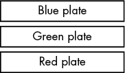
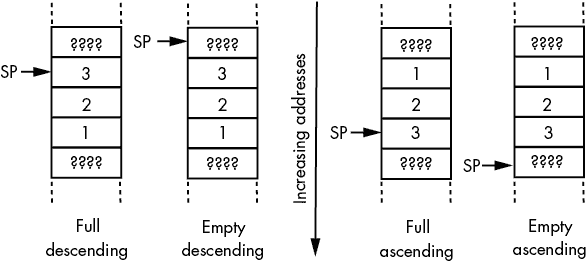
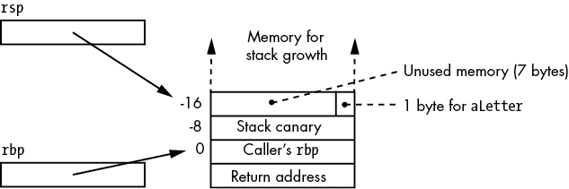

# 第 11 章：深入 main 函数


正如你所知，每个 C 程序都从执行一个名为 `main` 的函数开始，该函数由 C 运行时环境中的启动函数调用。`main` 函数将调用其他函数（*子函数*）来完成大部分处理。即使是一个简单的“Hello, World!”程序，也需要调用另一个函数将消息写在屏幕上。

大多数子函数需要从调用函数传递参数作为数据，并且它们经常将结果传回调用函数。函数的参数可以是数据或内存地址。当函数被调用时，它执行其操作，然后返回调用函数。调用函数需要将返回地址发送给被调用函数。在 x86-64 架构中，返回地址通过调用栈传递。

增加一点复杂性，大多数函数需要自己的局部变量来存储数据和地址。寄存器可用于变量，但它们是全局的，我们会很快用完可用的寄存器。栈为在内存中分配局部变量空间提供了良好的场所。


在本章中，我们将分解这个过程。我们将通过讨论如何在 `main` 函数中向屏幕写入字符和从键盘读取字符来实现这一点。从本章开始，我们通常将绕过 C 标准库函数 `printf` 和 `scanf`，转而使用系统调用函数 `write` 向屏幕输出，使用 `read` 从键盘输入。

我们将首先讨论 `write` 和 `read` 函数。然后我们将研究如何通过 CPU 寄存器向函数传递参数。接下来我们将研究当需要向函数传递地址时，CPU 如何确定该地址。然后我们将研究称为 `call stack`（调用栈）的数据结构如何用于在函数内创建局部变量。

## `write` 和 `read` 系统调用函数

在第 2 章中，我们使用了 C 标准库中的 `printf` 和 `scanf` 来向屏幕写入和从键盘读取。如图 2-1 所示（在第 2 章中），`printf` 将数据从其内存存储格式转换为字符格式，并调用 `write` 系统调用函数在屏幕上显示字符。当从键盘读取字符时，`scanf` 调用 `read` 系统调用函数并将字符转换为内存存储格式。

Linux 将屏幕和键盘视为文件。当程序首次启动时，操作系统会打开三个文件——`standard in`（标准输入）、`standard out`（标准输出）和 `standard error`（标准错误）——并为每个文件分配一个称为 `file descriptor`（文件描述符）的整数。程序通过使用 `file descriptor` 与每个文件进行交互。调用 `read` 和 `write` 的 C 语言接口在 `Portable Operating System Interface`（可移植操作系统接口，`POSIX`）标准中规定。调用这两个函数的通用格式为

```c
int write(int fd, char *buf, int n);
int read(int fd, char *buf, int n);
```

其中 `fd` 是文件描述符，`buf` 是字符存储区的地址，`n` 是要读取或写入的字符数。你可以在 `write` 和 `read` 的 `man` 手册页中查看更多详细信息：

```
man 2 write
man 2 read
```

表 11-1 显示了我们将使用的文件描述符及其通常关联的设备。

**表 11-1：`write` 和 `read` 系统调用函数的文件描述符**

| 名称 | 编号 | 用途 |
|------|--------|-----|
| `STDIN_FILENO` | 0 | 从键盘读取字符 |
| `STDOUT_FILENO` | 1 | 向屏幕写入字符 |
| `STDERR_FILENO` | 2 | 向屏幕写入错误消息 |

这些名称定义在系统头文件 `unistd.h` 中，在我的 Ubuntu 系统上位于 `/usr/include/unistd.h`。（你的系统上的位置可能不同。）

让我们看看如何向 `write` 函数传递适当的参数以在屏幕上写入文本。

## 在寄存器中传递参数

在我们的环境中，最多可以通过寄存器从一个函数向另一个函数传递六个参数。我们将在第 14 章中研究如何传递超过六个参数，并在此指出 Windows C 环境只允许通过寄存器传递四个参数。

让我们从一个非常简单的程序开始。我们将使用 `write` 系统调用函数在屏幕上写入 "Hello, World!"（清单 11-1）。

```c
/* helloWorld.c
 * Hello World program using the write() system call.
 */

#include <unistd.h>

int main(void)
{

  write(STDOUT_FILENO, "Hello, World!\n", 14);

  return 0;
}
```

**清单 11-1：使用 `write` 系统调用函数的 "Hello, World!" 程序**

此函数向 `write` 传递三个参数。原则上，C 编译器——或者你在编写汇编语言时——可以使用 16 个通用寄存器中的任意一个（`rsp` 除外）将参数从一个函数传递给另一个函数。（不能使用 `rsp` 的原因稍后会解释。）只需将参数存储在寄存器中并调用所需的函数即可。当然，编译器或编写汇编语言的人需要知道当进入被调用函数时，每个参数确切位于哪个寄存器中。

避免错误的最佳方法是制定一套标准规则并遵循它们。如果有不止一个人为程序编写代码，这一点尤为重要。其他人已经意识到制定此类标准的重要性，并在 `System V Application Binary Interface AMD64 Architecture Processor Supplement (with LP64 and ILP32 Programming Models) Version 1.0`（System V 应用程序二进制接口 AMD64 架构处理器补充（包含 LP64 和 ILP32 编程模型）版本 1.0）中给出了一套用于传递参数的良好标准。我在 [`github.com/hjl-tools/x86-psABI/wiki/x86-64-psABI-1.0.pdf`](https://github.com/hjl-tools/x86-psABI/wiki/x86-64-psABI-1.0.pdf) 找到了 2018 年 1 月 28 日版本的 PDF 格式。（最新版本以 LaTeX 源码形式维护在 [`gitlab.com/x86-psABIs/x86-64-ABI`](https://gitlab.com/x86-psABIs/x86-64-ABI)`*/*`，但你需要 `pdflatex` 来构建 PDF 版本。）我们使用的编译器 `gcc` 遵循 System V 标准中的规则，我们编写的汇编语言也将遵循相同的规则。

**表 11-2：通用寄存器用法**

| 寄存器 | 特殊用途 | 保存？ |
|----------|---------------|-------|
| `rax` | 从函数返回第一个值 | 否 |
| `rbx` | 通用 | 是 |
| `rcx` | 向函数传递第四个参数 | 否 |
| `rdx` | 向函数传递第三个参数；从函数返回第二个值 | 否 |
| `rsp` | 栈指针 | 是 |
| `rbp` | 可选帧指针 | 是 |
| `rdi` | 向函数传递第一个参数 | 否 |
| `rsi` | 向函数传递第二个参数 | 否 |
| `r8` | 向函数传递第五个参数 | 否 |
| `r9` | 向函数传递第六个参数 | 否 |
| `r10` | 传递函数的静态链指针 | 否 |
| `r11` | 无 | 否 |
| `r12` | 无 | 是 |
| `r13` | 无 | 是 |
| `r14` | 无 | 是 |
| `r15` | 无 | 是 |

“保存？”列显示被调用函数是否需要为调用函数保留该寄存器中的值。你将在接下来的几节中学习如何做到这一点。

前六个参数分别在寄存器 `rdi`、`rsi`、`rdx`、`rcx`、`r8` 和 `r9` 中传递，对应 C 函数中从左到右的顺序。清单 11-2 显示了 `gcc` 为 清单 11-1 中的 C 函数生成的汇编语言。这演示了如何向 `write` 函数传递所需的三个参数。

```nasm
        .file   "helloWorld.c"
        .intel_syntax noprefix
        .text
      1 .section  .rodata
2 .LC0:
        .string "Hello, World!\n"
        .text
        .globl  main
        .type   main, @function
main:
        push    rbp
        mov     rbp, rsp
        mov     edx, 314         ## number of chars
        lea     rsi, 4.LC0[rip]  ## address of string
        mov     edi, 51          ## STDOUT_FILENO
        call  6 write@PLT
        mov     eax, 0
        pop     rbp
        ret
        .size   main, .-main
        .ident  " GCC: (Ubuntu 9.3.0-17ubuntu1~20.04) 9.3.0"
        .section  .note.GNU-stack,"",@progbits
```

**清单 11-2：`gcc` 为 清单 11-1 中的程序生成的汇编语言**

在汇编语言编程中，通常从参数列表中的最后一个参数开始将参数存储在寄存器中，依次向前直到第一个参数。在清单 11-2 中，`write` 的第三个参数（字符数 3）首先存储在第三个参数的寄存器 `edx` 中。第二个参数是字符串 4 中第一个字符的地址，存入 `rsi`。第一个参数（要写入的设备 5）在调用 `write` 6 之前存入 `edi`。


# 位置无关代码

本程序还引入了两条新指令 `lea` 和 `call`，以及与这些指令相关的、看起来有些奇怪的语法。`lea` 指令将 `.LC0` 的内存地址加载到 `rsi` 寄存器中，`call` 指令将程序控制权转移到 `write` 函数的地址。在详细描述这些指令之前，我们需要了解程序的各个组件在内存中的位置。

链接器的工作是决定每个程序组件应位于内存的何处，然后填充程序代码中引用该组件的地址。链接器可以决定每个组件在内存中的位置，并将这些地址包含在可执行文件中，但允许操作系统决定将每个组件加载到何处会更安全。让我们看看 `gcc` 生成的汇编语言是如何允许程序被加载到内存中任何位置的。

为了让程序在操作系统负责决定加载位置的情况下正确运行，链接器需要创建一个*位置无关可执行文件*。要实现这一点，程序中的每个函数都必须由*位置无关代码*组成，即无论加载到内存的何处都能正确工作的代码。`gcc` 编译器的默认设置通常是生成位置无关代码，链接阶段则生成位置无关可执行文件。

链接我们为程序编写的源代码文件中的函数和全局数据项是直接了当的。链接器知道每个函数和全局数据项占用多少字节，因此它可以计算出每个组件相对于程序开头的起始位置。由此，链接器可以计算出从引用组件的位置到被引用组件的相对位置的字节数，得到一个*偏移值*。链接器将这个偏移值插入到引用该组件的代码位置。

你已经了解了执行周期，以及指令指针在程序执行过程中如何遍历程序。结果是，在程序的任何给定时刻，当前地址都在指令指针 `rip` 中，无论程序被加载到内存的何处。在程序执行期间，当 CPU 遇到一条引用另一个组件的指令时，它将偏移值加到指令指针中的地址上，从而得到被引用组件的*有效地址*。有效地址同时被 `lea` 和 `call` 指令使用。

**`lea`——加载有效地址**

1.  计算有效地址并将其加载到寄存器中。
2.  `lea reg, mem` 将 `mem` 的有效地址加载到 `reg` 中。
3.  `lea` 指令不影响 `rflags` 寄存器中的状态标志。

**`call`——调用过程**

1.  在栈上保存链接信息并跳转到一个过程。
2.  `call function_name` 将下一条指令的地址压入调用栈，然后将控制权转移给 `function_name`。
3.  `call` 指令不影响 `rflags` 寄存器中的状态标志。

在 清单 11-2 中，文本字符串的内存位置标记为 `.LC0` 2。指定我们需要相对于指令指针的地址的语法是 `.LC0[rip]` 4。你可以把它理解为“相对于 `rip` 的 `.LC0`”。在链接阶段，链接器计算 `lea` 指令与 `.LC0` 标签之间的内存距离，并将该值用作偏移量。更准确地说，链接器使用紧随 `lea` 指令之后的那条指令的内存距离。回想一下，在程序执行期间，当 CPU 取指令时，它会将 `rip` 寄存器中的地址增量更新为下一条指令的地址。因此，`lea rsi, .LC0[rip]` 指令的作用是将链接器计算出的偏移量加到 `rip` 寄存器中的地址上（该地址现已更新为下一条指令的地址），并将该地址加载到 `rsi` 寄存器中。

标签 `.LC0` 位于 `.rodata` 节 1 中，通常由操作系统加载到 `.text` 段。存储在 `.text` 段中的大部分是 CPU 指令，因此操作系统将其视为只读内存区域。`.rodata` 节包含常量数据，也是只读的。

你将在下一节学习压栈操作，但你可以看到 清单 11-2 中的 `call` 指令在被调用函数名 `write` 后面附加了 `@PLT` 6。`PLT` 代表*过程链接表*。`write` 函数位于 C 共享库中，而不在我们编写的源代码文件中。链接器不知道它相对于我们的 `main` 函数会位于何处，因此它在可执行文件中包含了一个过程链接表和一个*全局偏移表 (GOT)*。

当我们的程序第一次调用 `write` 函数时，操作系统中的*动态加载器*将该函数加载到内存中（如果尚未被其他程序加载），将函数地址放入全局偏移表，并相应地调整过程链接表。如果我们的程序再次调用 `write` 函数，过程链接表将使用全局偏移表中的值直接调用它。语法 `write@PLT` 表示调用 `write` 函数，其地址可在过程链接表中找到。当我们调用链接我们程序时包含的函数时，不需要使用过程链接表，因为链接器可以计算出被调用函数的相对地址。

# 调用栈

*调用栈*，或简称为*栈*，广泛用于调用函数与被调用函数之间的接口、在函数内创建局部变量以及在函数内保存项目。在描述如何完成这些操作之前，我们需要了解什么是栈以及它们是如何使用的。

## 通用栈

*栈*是在内存中创建的一种数据结构，用于存储数据项，包含一个指向栈“顶部”的指针。非正式地讲，你可以把栈想象得非常像架子上的一叠餐盘。我们只需要能够访问栈顶的项目。（是的，如果你从栈中间抽出一个盘子，很可能会打碎东西。）栈上有两个基本操作：

1.  `push data_item` 将 `data_item` 放在栈顶，并移动栈指针指向这个最新的项目。
2.  `pop location` 将栈顶的数据项移动到 `location`，并移动栈指针指向栈中剩下的下一个项目。

栈是一种*后进先出* (*LIFO*) 数据结构。最后压入栈的东西最先弹出。

为了说明栈的概念，让我们继续用餐盘的例子。假设我们有三个不同颜色的餐盘，一个红色的在餐桌上，一个绿色的在厨房台面上，一个蓝色的在床头柜上。现在我们按以下方式将它们堆在架子上：

1.  压入红盘。
2.  压入绿盘。
3.  压入蓝盘。

此时，我们的盘子栈如 图 11-1 所示。



**图 11-1: 栈中的三个餐盘**

1.  现在执行操作：弹出到厨房台面。

我们将在厨房台面上得到一个蓝盘子（回想一下蓝盘子原本在床头柜上），我们的餐盘栈将剩下如 图 11-2 所示。


## 栈的规范与实现

图 11-2：一只餐盘已从栈中弹出。

如果你猜到很容易把栈搞得一团糟，那你猜对了。栈必须遵循严格的规范来使用。在任何函数内部：

*   在弹出任何内容之前，总是先将一个项目压入栈中。
*   绝不要弹出比你压入的更多的内容。
*   总是将栈中的所有内容弹出。

如果你不需要弹出的项目，可以简单地调整栈指针。这等同于丢弃弹出的项目。（我们的餐盘类比在这里就不适用了。）

维护这种规范的一个好方法是联想代数表达式中括号的用法。压栈类似于左括号，弹栈类似于右括号。括号对可以嵌套，但它们必须匹配。试图向栈中压入过多项目称为 `stack overflow`（栈溢出）。试图在栈底之下弹出项目称为 `stack underflow`（栈下溢）。

我们这里只研究了栈的基本操作。在栈的实现中通常会添加其他操作。例如，`peek` 操作允许你查看栈顶的项目而不将其移除。正如你在后续章节将看到的，不在栈顶的项目通常可以直接访问，而无需压栈和弹栈，但这是以一种非常受控的方式进行的。

栈的实现是通过将主存中一块连续的区域专门用于栈来完成的。栈在内存中可以向任一方向增长，即向更高地址或更低地址。`ascending stack`（升序栈）向更高地址增长，而 `descending stack`（降序栈）向更低地址增长。栈指针可以指向栈顶的项目，称为 `full stack`（满栈），也可以指向下一个项目将被压入的内存位置，称为 `empty stack`（空栈）。图 11-3 展示了这四种可能的栈实现，其中整数 1、2 和 3 按此顺序被压入栈中。请务必注意，在该图中内存地址是*向下增加*的，这也是我们在 `gdb` 调试器中通常查看它们的方式。



图 11-3：实现栈的四种方式

x86-64 指令将栈作为 `full-descending stack`（满降序栈）使用。要理解这一选择，可以思考一下你可能如何在内存中组织事物。回想一下，控制单元会在程序执行时自动增加程序计数器。程序的大小差异巨大，因此将程序指令存储在低内存地址可以为程序大小提供最大的灵活性。

栈是一种动态结构。你无法预先知道任何给定程序在执行时需要多少栈空间。无法知道该为栈分配多少空间。你希望分配尽可能多的空间，同时防止它与程序指令发生碰撞。解决方案是从最高地址开始栈，并让它向较低地址增长。

这是一个高度简化的理由，解释了为什么栈的实现会在内存中向“下”增长。内存中各种程序元素的组织比这里给出的简单描述要复杂得多。但这可能有助于你理解，对于看似相当奇怪的实现，其实有一些充分的理由。

重要的是我们需要相应地编写汇编语言。接下来我们将详细了解栈在函数序言和尾声中是如何使用的，以及如何通过寄存器向另一个函数传递参数，方法是直接用汇编语言编写我们自己的“Hello, World!”程序。

### 函数序言与尾声内部

我的“Hello, World!”程序汇编语言版本 清单 11-3 紧随编译器从 清单 11-2 的 C 版本生成的汇编语言，但我添加了注释，并为字符串常量使用了更有意义的标签。这应该能让你更容易理解程序如何使用栈并向 `write()` 函数传递参数。

```assembly
# helloWorld.s
# 使用 write() 系统调用的 Hello World 程序

        .intel_syntax noprefix
# 有用的常量
      1 .equ    STDOUT, 1
        
# 常量数据
      2 .section  .rodata
message:
        .string "Hello, World!\n"
        .equ   3 msgLength, .-message-1

# 代码
        .text
        .globl  main
        .type   main, @function
main:
        push    rbp             # 保存调用者的帧指针
        mov     rbp, rsp        # 我们的帧指针

        mov     edx, MsgLength  # 消息长度       
        lea     rsi, message[rip]  # 消息地址
        mov     edi, STDOUT     # 屏幕
        call    write@plt       # 写入消息

        mov     eax, 0          # 返回 0

        pop     rbp             # 恢复调用者帧指针
        ret                     # 返回调用者
```

清单 11-3：用汇编语言编写的“Hello, World!”程序

在讨论序言之前，请注意我在 清单 11-3 1 中使用了另一个汇编指令 `.equ`。其格式为

```
.equ symbol, expression
```

请注意，我们不需要为 `.rodata` 节 2 指定 `.text` 段。汇编器和链接器会生成一个 `.rodata` 节，由操作系统决定将其加载到何处。

`expression` 必须求值为一个整数，汇编器将 `symbol` 设置为该值。然后你可以在代码中使用该符号，使其更易读，汇编器会填入表达式的值。表达式通常只是一个整数。在该程序中，我将符号 `STDOUT` 等同于整数 1。

表达式中的 `.` 字符表示*此处*的内存位置。因此，当汇编器处理表达式 3 时，它会计算当前的内存位置，即 C 风格文本字符串的末尾；减去字符串的起始位置，即程序员标记为 `message` 的位置，再减去 1 以去除终止的 `NUL` 字符。最终结果是 `MsgLength` 等同于文本字符串中可打印字符的数量。

你在第十章已经了解到调用者的帧指针是如何保存在调用栈上，以及如何为该函数建立新的帧指针。但现在你对调用栈的工作原理了解更多了，让我们用 `gdb` 来逐步演练该函数的序言。

第一件事是在函数开头设置一个断点：

```gdb
(gdb) b main
Breakpoint 1 at 0x1139: file helloWorld.s, line 18.
```

你可以使用标签 `main` 或行号。我们在第二章中看到了如何使用 `li` 命令查看行号。使用行号可能会导致 `gdb` 执行序言并在之后中断。（我在不同版本的 `gdb` 中见过不同的行为。）

设置断点后，运行程序，它会在第一条指令处中断，我们可以检查 `rbp` 和 `rsp` 寄存器的内容：

```gdb
(gdb) r
Starting program: /home/bob/progs/chap11/helloWorld_asm/helloWorld 

Breakpoint 1, main () at helloWorld.s:18
18             push    rbp                 # save caller's frame pointer
(gdb) i r rbp rsp
rbp            0x0                 0x0
rsp            0x7fffffffde88      0x7fffffffde88
```


# 使用 GDB 检查栈帧

`i r` 命令给出栈指针 `rsp` 的当前位置。即将执行的指令会将 `rbp` 寄存器中的八个字节压入调用栈。为了查看内存中的效果，我们将检查栈的当前内容。由于调用栈是满递减的，我们将从栈指针的当前地址减去 8 以用于显示，这样我们就可以在该指令修改内存之前查看它将要修改的内存区域：

```
(gdb) x/2xg 0x7fffffffde80
0x7fffffffde80: 0x0000555555555160      0x00007ffff7de70b3
```

栈指针当前指向值 `0x00007ffff7de70b3`，这是调用函数（在 C 运行时环境中，因为这是 `main` 函数）中的 `call` 指令压入栈的返回地址。`rbp` 寄存器包含 `0x0000000000000000`。该值即将被压入位于 `0x7fffffffde80` 的栈中，该位置当前包含 `0x0000555555555160`。

接下来，我们执行函数序言中的两条指令，这将带我们到序言之后的第一条指令：

```
(gdb) si
19             mov     rbp, rsp            # our frame pointer
(gdb) si
21             mov     edx, MsgLength      # message length
```

我们将检查 `rsp` 和 `rbp` 寄存器中的值：

```
(gdb) i r rbp rsp
rbp            0x7fffffffde80      0x7fffffffde80
rsp            0x7fffffffde80      0x7fffffffde80
```

我们可以看到栈指针已减少 8，帧指针已设置为栈顶。让我们通过检查之前检查过的相同内存区域来看看栈是如何变化的：

```
(gdb) x/2xg 0x7fffffffde80
0x7fffffffde80: 0x0000000000000000      0x00007ffff7de70b3
```

我们看到 `rbp` 寄存器中的值 `0x0000000000000000` 已被妥善保存在调用栈的顶部。接下来，我们将在 `call write@PLT` 指令处设置一个断点，以便确保寄存器已正确设置用于 `write`：

```
(gdb) b 24
Breakpoint 2 at 0x55555555514e: file helloWorld.s, line 24.
(gdb) c
Continuing.

Breakpoint 2, main () at helloWorld.s:24
24             call    write@plt           # write message
(gdb) i r rdx rsi rdi
rdx            0xe                 14
rsi            0x555555556004      93824992239620
rdi            0x1                 1
```

`rdx` 寄存器包含要写入屏幕的字符数，`rsi` 寄存器包含第一个字符的地址。回想一下，C 风格的文本字符串以 `NUL` 字符结尾，所以我们将检查该地址处的 15 个字符：

```
(gdb) x/15c 0x555555556004
0x555555556004: 72 'H'  101 'e' 108 'l' 108 'l' 111 'o' 44 ','  32 ' '  87 'W'
0x55555555600c: 111 'o' 114 'r' 108 'l' 100 'd' 33 '!'  10 '\n' 0 '\000'
```

接下来，我们将在 `ret` 指令处设置一个断点，以确保栈指针和帧指针已恢复为调用者的值：

```
(gdb) b 29
Breakpoint 3 at 0x555555555159: file helloWorld.s, line 29.
(gdb) c
Continuing.
Hello, World!

Breakpoint 3, main () at helloWorld.s:29
29             ret                         # back to caller
(gdb) i r rbp rsp rip
rbp            0x0                 0x0
rsp            0x7fffffffde88      0x7fffffffde88
rip            0x555555555159      0x555555555159 <main+32>
```

我在该显示中包含了 `rip` 寄存器，以展示 `ret` 指令的效果。执行 `ret` 指令显示它将栈顶的值弹出到 `rip` 寄存器中，从而返回到 C 运行时环境：

```
(gdb) si
__libc_start_main (main=0x555555555139 <main>, argc=1, argv=0x7fffffffdf78,
    init=<optimized out>, fini=<optimized out>, rtld_fini=<optimized out>,
    stack_end=0x7fffffffdf68) at ../csu/libc-start.c:342
342     ../csu/libc-start.c: No such file or directory.
(gdb) i r rbp rsp rip
rbp            0x0                 0x0
rsp            0x7fffffffde90      0x7fffffffde90
rip            0x7ffff7de70b3      0x7ffff7de70b3 <__libc_start_main+243>
```

回顾所示的栈显示，我们可以看到调用我们 `main` 函数的 C 运行时环境中的函数压入栈的地址已被弹回 `rip` 寄存器。

规定函数间交互的协议需要被非常精确地遵循，否则程序通常会崩溃。

在下一节中，我们将探讨如何在栈上创建局部变量。你将看到帧指针的重要性。

# 函数中的局部变量

在 C 函数中定义的变量只能在其定义处的函数中使用，这使它们成为*局部变量*。它们在函数被调用时创建，在函数返回调用函数时销毁，因此它们也被称为*自动变量*。

你在第 9 章学到 CPU 寄存器可以用作变量，但如果我们用 CPU 寄存器保存所有变量，即使在一个小程序中也会很快用完寄存器，所以我们需要在内存中为变量分配空间。

我们之前也看到，函数需要为调用函数保留某些寄存器的内容（表 11-2 中的“保存？”列）。如果我们想在函数中使用这样的寄存器，我们需要将其内容保存在内存中，并在返回调用函数前恢复它。

接下来我们将探讨如何将调用栈用于这两个目的：创建和移除自动变量，以及保存和恢复寄存器内容。

## 栈上的变量

从前面所示的调用栈描述来看，你可能会猜到它是保存寄存器内容的好地方——只需在将寄存器用于其他用途前将其压入栈，然后在返回调用函数前将内容弹回寄存器即可。

在调用栈上创建变量则更复杂。如果我们将栈的用法限制为压栈和弹栈，跟踪每个变量在栈上的位置将很快变得混乱，甚至不可能。

然而，有一种简单的方法可以使用栈来存放变量。作为函数序言的一部分，我们将通过移动栈指针在栈上为变量分配足够的内存，从而增加函数栈帧的大小。我们可以使用相同的寻址技术来访问栈帧中的变量，该技术曾用于在 清单 11-3 中访问消息地址，不同之处在于我们将使用帧指针 `rbp` 作为地址基址。我们需要小心不要改变 `rbp`，以便将其用作栈帧中的参考点，让栈指针可以根据需要自由地压栈和弹栈。

为了说明如何使用栈帧存放自动局部变量，我们将从 清单 11-4 中的 C 程序开始，该程序从键盘读取一个字符并在屏幕上回显它。

```c
/* echoChar.c
 * Echoes a character entered by the user.
 */

#include <unistd.h>

int main(void)
{
  char aLetter;

  write(STDOUT_FILENO, "Enter one character: ", 21); /* prompt user   */
  read(STDIN_FILENO, &aLetter, 1);                   /* one character */
  write(STDOUT_FILENO, "You entered: ", 13);         /* message       */
  write(STDOUT_FILENO, &aLetter, 1);

  return 0;
}
```

**清单 11-4：** 回显用户输入的单个字符的程序

清单 11-5 展示了我们的编译器处理此事的方式，即 `gcc` 为 清单 11-4 中的 C 程序生成的汇编语言。


# `echoChar` 程序的汇编语言（清单 11-5）

## 汇编代码

```assembly
.file   "echoChar.c"
.intel_syntax noprefix
.text
.section .rodata
.LC0:
        .string "Enter one character: "
.LC1:
        .string "You entered: "
.text
.globl  main
.type   main, @function
main:
        push    rbp
        mov     rbp, rsp
        sub     rsp, 16                    # 1
        mov     rax, QWORD PTR fs:40       # 2
        mov     QWORD PTR -8[rbp], rax     # 3
        xor     eax, eax
        mov     edx, 21                    # 提示消息
        lea     rsi, .LC0[rip]
        mov     edi, 1
        call    write@PLT
        lea     rax, -9[rbp]               # 4 &aLetter
        mov     edx, 1
        mov     rsi, rax
        mov     edi, 0
        call    read@PLT
        mov     edx, 13                    # 响应消息
        lea     rsi, .LC1[rip]
        mov     edi, 1
        call    write@PLT
        lea     rax, -9[rbp]
        mov     edx, 1
        mov     rsi, rax
        mov     edi, 1
        call    write@PLT
        mov     eax, 0
        mov     rcx, QWORD PTR -8[rbp]     # 5
        xor     rcx, QWORD PTR fs:40
        je      .L3
        call    __stack_chk_fail@PLT
.L3:
        leave
        ret
.size   main, .-main
.ident  "GCC: (Ubuntu 9.3.0-17ubuntu1~20.04) 9.3.0"
.section .note.GNU-stack,"",@progbits
```

清单 11-5：编译器为 清单 11-4 中的 `echoChar` 程序生成的汇编语言

## 栈分配与对齐

该 C 程序定义了一个局部 `char` 变量 `aLetter`，它仅需要 1 字节。然而，编译器通过简单地移动栈指针（1）在调用栈上分配了 16 字节。x86-64 架构包含一组十六个 128 位寄存器，它们被某些浮点和向量指令使用（第 18 章介绍）。栈指针需要在 16 字节地址边界上对齐以供这些指令使用，因此大多数协议标准规定栈指针必须在 16 字节边界上对齐。这比仅在需要时对齐栈指针更不容易出错。

移动栈指针的指令引入了减法指令 `sub`。趁此机会，我们也将描述加法和取反指令 `add` 和 `neg`。

## 指令参考

### `sub` — 减法

1. 从目标值中减去源值，结果留在目标操作数中。
2. `sub reg1, reg2` 从 `reg1` 的值中减去 `reg2` 的值，结果留在 `reg1` 中。
3. `sub reg, mem` 从 `reg` 的值中减去 `mem` 的值，结果留在 `reg` 中。
4. `sub mem, reg` 从 `mem` 的值中减去 `reg` 的值，结果留在 `mem` 中。
5. `sub reg, imm` 从 `reg` 的值中减去 `imm`，结果留在 `reg` 中。
6. `sub mem, imm` 从 `mem` 的值中减去 `imm`，结果留在 `mem` 中。

`sub` 指令根据结果在 `rflags` 寄存器中设置 `OF`、`SF`、`ZF`、`AF`、`PF` 和 `CF` 状态标志。

### `add` — 加法

1. 将源值加到目标值上，结果留在目标操作数中。
2. `add reg1, reg2` 将 `reg2` 的值加到 `reg1` 的值上，结果留在 `reg1` 中。
3. `add reg, mem` 将 `mem` 的值加到 `reg` 的值上，结果留在 `reg` 中。
4. `add mem, reg` 将 `reg` 的值加到 `mem` 的值上，结果留在 `mem` 中。
5. `add reg, imm` 将 `imm` 加到 `reg` 的值上，结果留在 `reg` 中。
6. `add mem, imm` 将 `imm` 加到 `mem` 的值上，结果留在 `mem` 中。

`add` 指令根据结果在 `rflags` 寄存器中设置 `OF`、`SF`、`ZF`、`AF`、`PF` 和 `CF` 状态标志。

### `neg` — 取反（求补）

1. 对一个值执行二补数取反操作。
2. `neg reg` 对 `reg` 中的值取反。
3. `neg mem` 对 `mem` 中的值取反。

`neg` 指令根据结果在 `rflags` 寄存器中设置 `OF`、`SF`、`ZF`、`AF`、`PF` 和 `CF` 状态标志。

乘法和除法指令更为复杂，将在第 16 章中介绍。

## 使用 `lea` 读取输入

我们需要将局部 `char` 变量的地址传递给 `read` 函数，以便它能将用户输入的字符存储在那里。我们可以使用 `lea`（加载有效地址）指令（4）来实现这一点。正如你所见，编译器选择了在栈上分配的 16 字节内部偏移 9 字节处的那个字节。图 11-4 显示了该变量的位置。



图 11-4：清单 11-5 中程序的栈帧

图 11-4 的栈帧中的项目之一是*栈金丝雀*（stack canary），用于帮助检测栈损坏。

## 栈损坏

函数尾声在 `rbp` 寄存器中恢复调用者的帧指针，并将栈指针恢复为指向返回地址。然而，如果栈上这两个值中的任何一个被更改了，程序将无法正常运行。栈金丝雀可以帮助检测这些值是否被更改过。

程序启动时，操作系统将一个 64 位随机数存储在标记为 `fs:40` 的特殊内存位置中，只有操作系统可以更改它。我们从内存中读取该值（2）并将其存储在栈帧中紧邻调用者 `rbp` 值之后的位置（3）。然后，在执行函数尾声之前，我们检查栈金丝雀的值是否被更改（5）。

执行此检查的代码引入了两条新指令。

### `xor` — 异或

1. 对源值和目标值执行按位异或操作，结果留在目标操作数中。
2. `xor reg1, reg2` 对 `reg1` 和 `reg2` 中的值执行按位异或，它们可以是相同或不同的寄存器。结果留在 `reg1` 中。
3. `xor reg, mem` 对 `reg` 和 `mem` 中的值执行按位异或，结果留在 `reg` 中。
4. `xor mem, reg` 对 `mem` 和 `reg` 中的值执行按位异或，结果留在 `mem` 中。
5. `xor reg, imm` 对 `reg` 中的值和 `imm` 执行按位异或，结果留在 `reg` 中。
6. `xor mem, imm` 对内存中的值和常量 `imm` 执行按位异或，结果留在内存中。

`xor` 指令根据结果在 `rflags` 寄存器中设置 `SF`、`ZF` 和 `PF` 状态标志。`OF` 和 `CF` 状态标志被清零为 `0`，`AF` 状态标志的值未定义。

### `je` — 相等则跳转

1. 如果零标志为真（通常表示两值相等），则跳转。
2. `je label` 如果 `ZF` 为 `1`（真），则跳转到内存位置 *label*。

`je` 指令是几条条件跳转指令之一，当我们在第 13 章讨论程序流程结构时将详细解释。条件跳转指令测试 `rflags` 寄存器中的状态标志并相应地转移程序流程。`je` 指令测试零状态标志，如果该标志为真，则跳转到函数中的 `label` 处。


# 栈保护与汇编编程

## 栈金丝雀检查

在清单 11-5 中，检查栈是否损坏的代码首先检索保存在栈上的值，即栈金丝雀，然后将其与程序启动时生成的原始值（位于内存位置 `fs:40`）执行按位异或运算。如果这两个值相同，异或运算结果为 `0`，这会将零状态标志 `ZF` 设置为 `1`（真），导致 `je .L3` 指令将程序流程转移到 `leave` 指令，从而跳过对 `__stack_chk_fail@PLT` 函数的调用。如果异或运算不产生 `0`，则跳转不会发生，程序将调用 `__stack_chk_fail@PLT` 函数，该函数将报告栈损坏错误并终止程序。

## `leave` 指令

你在该程序中看到了另一条新指令 `leave`。

**`leave`—离开函数**

1.  删除栈帧。
2.  `leave` 恢复调用者的帧指针，并将栈指针置于返回地址处。

`leave` 指令执行与以下两条指令相同的操作：

```
mov     rsp, rbp
pop     rbp
```

参考图 11-4，你可以看到这将栈指针移动到存储调用者 `rbp` 的位置，然后将其弹回 `rbp` 寄存器，使栈指针保留在返回地址处。

## 汇编器数据项大小符号

`gcc` 在清单 11-5 中生成的汇编语言包含一些额外的符号，即 `QWORD PTR`。在大多数情况下，汇编器可以从指令的上下文中推断出操作数的大小——字节、字、双字或四字。如果操作数之一是寄存器，则寄存器名称决定了操作数的大小。但如果一个操作数是内存地址而另一个是字面常量，则操作数大小无法确定。例如，在清单 11-5 中，如果第 3 处的指令如下所示，

```
mov     -8[rbp], 123
```

整数 123 可以存储在从一字节及以上的任何大小中。在这种情况下，你需要使用第 10 章表 10-1 中的符号（此处复制为表 11-3）告诉汇编器数据项的大小。

**表 11-3：汇编器数据项大小符号**

| 修饰符 | 数据类型 | 位数 |
| --- | --- | --- |
| `byte ptr` | 字节 | 8 |
| `word ptr` | 字 | 16 |
| `dword ptr` | 双字 | 32 |
| `qword ptr` | 四字 | 64 |

因此，指令

```
mov     byte ptr -8[rbp], 123
```

会将 123 作为 8 位值存储，而指令

```
mov     qword ptr -8[rbp], 123
```

会将 123 作为 64 位值存储。我不知道编译器编写者为何选择在清单 11-5 中使用这种符号，因为汇编器可以从所用寄存器的名称 `rax` 推断出数据项大小，但这种冗余并无害处。

## 汇编语言示例：echoChar 程序（清单 11-6）

让我们把这些内容结合起来，直接用汇编语言编写 `echoChar` 程序。我们将为标签使用更有意义的名称，让汇编器计算文本字符串的长度，并为代码添加注释，如清单 11-6 所示。

```
# echoChar.s
# 提示用户输入一个字符，然后回显响应
.intel_syntax noprefix
# 有用的常量
.equ    STDIN,0
.equ    STDOUT,1
# 栈帧
.equ    aLetter,-1
.equ    localSize,-16

# 常量数据
.section  .rodata
prompt:
.string "Enter one character: "
.equ    promptSz,.-prompt-1
msg:
.string "You entered: "
.equ    msgSz,.-msg-1
.text
# 代码 
.globl  main
.type   main, @function
main:
push    rbp           # 保存调用者的帧指针
mov     rbp, rsp      # 建立我们的帧指针
add     rsp, localSize # 为局部变量分配空间

mov     rax, fs:40    # 获取栈金丝雀
mov     -8[rbp], rax  # 并保存它

mov     edx, promptSz # 提示符大小
lea     rsi, prompt[rip] # 提示符文本字符串的地址
mov     edi, STDOUT   # 标准输出
call    write@plt     # 调用 write 函数

mov     edx, 1        # 1 个字符
lea     rsi, 1aLetter[rbp] # 存储字符的位置
mov     edi, STDOUT   # 标准输出
call    write@plt     # 调用 write 函数

mov     edx, 1        # 1 个字符
lea     rsi, aLetter[rbp] # 存储字符的位置
mov     edi, STDIN    # 标准输入
call    read@plt      # 调用 read 函数

mov     edx, msgSz    # 消息大小
lea     rsi, msg[rip] # 消息文本字符串的地址
mov     edi, STDOUT   # 标准输出
call    write@plt     # 调用 write 函数

mov     edx, 1        # 1 个字符
lea     rsi, aLetter[rbp] # 存储字符的位置
mov     edi, STDOUT   # 标准输出
call    write@plt     # 调用 write 函数

mov     eax, 0        # 返回 0

mov     rcx, -8[rbp]  # 检索保存的金丝雀值
xor     rcx, fs:40    # 并检查它
je      goodCanary
call    __stack_chk_fail@PLT    # 金丝雀值错误
goodCanary:
mov     rsp, rbp      # 删除局部变量
pop     rbp           # 恢复调用者的帧指针
ret                   # 返回调用函数
```

**清单 11-6：直接用汇编语言编写的回显单个字符的程序**

阅读清单 11-6 中的代码时，我认为你会发现，为栈帧中变量的偏移量命名会使代码更易读。我还显式地撤销栈帧，而不是使用 `leave` 指令，以强调正在发生的事情。

在后续章节中，你将学习如何为更大、更复杂的变量使用栈帧。你还将学习如何使用栈来传递超出寄存器可传递的六个参数的参数。

## 不使用 C 运行时环境

本书的主要目的是展示在使用高级语言编写代码时，在指令集级别发生了什么，因此我们将在本书的其余部分继续使用 C（以及后来的 C++）运行时环境和 POSIX `write` 和 `read` 系统调用函数。

当然，也可以编写不使用 C 运行时环境的独立程序。你将在第 20 章看到如何做到这一点。

## 你学到的内容

1.  `write` 和 `read` **函数** — 绕过 C 标准库的系统调用函数。
2.  向子函数传递参数 — 最多六个参数通过寄存器传递。
3.  位置无关可执行文件 — 操作系统可以将程序加载到内存的任何位置，它都能正确执行。
4.  调用栈 — 用于存储程序数据和地址的内存区域，根据需要增长和收缩。
5.  函数序言 — 为从调用函数到被调用函数的转换设置调用栈。
6.  函数尾声 — 函数序言的补充，将调用栈恢复到调用函数时的状态。
7.  自动变量 — 每次调用函数时新建。它们可以轻松地在调用栈上创建。
8.  栈金丝雀 — 一个随机数被放置在当前函数栈区域的开头，可显示调用栈上的重要信息何时被更改。

在下一章中，我们将暂时放下编写程序，转而观察汇编程序执行的向机器码的翻译过程。
