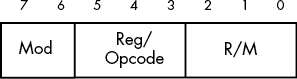
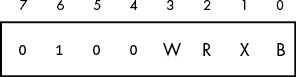
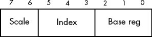
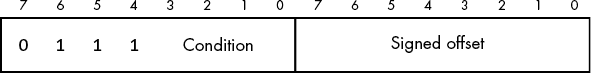

# 第 12 章：指令细节


# 查看机器码

在第 2 章和第 3 章中，你学习了位模式如何用于表示数据；在第 4 章至第 8 章中，你学习了位如何在硬件中实现并用于执行计算。在本章中，我们将了解指令如何编码为执行计算并指定其操作数据位置的位模式的一些细节。

本章的主要目标是提供一个总体视角，说明计算机指令如何知晓其操作数据的位置。每条指令的机器码细节并非人们需要背诵的内容。你需要查阅手册以获取详情。在某些情况下，这些细节帮助我调试了程序。

了解指令如何编码的另一个原因是，该信息包含在手册对每条指令的描述中。掌握一些指令编码知识有助于你阅读手册。

我们将考察大多数程序中最常见的两种操作：数据移动和分支。我们将查看 CPU 如何定位指令的操作数、操作什么数据或地址，以及 CPU 如何在执行分支指令时知晓分支目标位置。

我们可以通过生成*汇编清单*来查看机器码（即构成程序的 0 和 1），它显示了与每条指令对应的机器码。我们可以通过向汇编器传递 `-al` 选项来生成汇编清单。这会将清单写入标准输出，默认为屏幕。我们可以使用重定向操作符捕获它。例如，我使用了以下命令：

```
$ as –gstabs -al -o addressing.o addressing.s > addressing.lst
```

来生成清单 12-1 所示的文件。

```
GAS LISTING register.s                    page 1


   1                 # register.s
   2                 # Some instructions to illustrate machine code.
   3                         .intel_syntax noprefix
   4                         .text
   5                         .globl  main
   6                         .type   main, @function
   7                 main:
   8 0000 155                push    rbp         # save caller's frame pointer
   9 0001 4889E5              mov     rbp, rsp    # establish our frame pointer
  10                         
  11 0004 289C8              mov     eax, ecx    # 32 bits, low reg codes
  12 0006 389F7              mov     edi, esi    # highest reg codes
  13 0008 46689C8            mov     ax, cx      # 16 bits
  14 000b 588C8              mov     al, cl      # 8 bits
  15 000d 64489C7            mov     edi, r8d    # 32 bits, 64-bit register
  16 0010 74889C8            mov     rax, rcx    # 64 bits
  17              
  18 0013 B8000000            mov     eax, 0      # return 0 to os
  18      00
  19 0018 4889EC              mov     rsp, rbp    # restore stack pointer
  20 001b 85D                pop     rbp         # restore caller's frame pointer
  21 001c 9C3                ret                 # back to caller
```

清单 12-1：一些示例指令的机器码

该程序不执行任何实际功能。它只是一组用于说明指令如何在机器语言中编码的指令集合。我包含了序言和尾声，以便你可以汇编并链接该程序，并在 `gdb` 下运行它，如果你想查看每条指令的作用（当你轮到动手实践时会被要求这样做）。

汇编清单中的第一列是十进制行号。下一列显示每条指令相对于函数开头的地址（十六进制）。第三列显示机器码（同样为十六进制）。该清单的其余部分是汇编语言源代码。由于清单文件包含行号，我们在讨论指令如何编码为机器码时将引用它们。

## 指令字节

操作及其操作数都需要编码为二进制。编码所需的字节数决定了计算机指令集中可能的操作/操作数组合数量。在 `x86-64` 架构中，字节数是可变的，而其他一些架构对每条指令使用相同的字节数。本书将只考虑 `x86-64` 指令。

每个操作数的位置都需要在指令的机器码中指定。操作数可能位于寄存器、内存或 I/O 端口中。编程 I/O 端口更为复杂，我们将在第 19 章讨论。指定操作数位置的方式称为*寻址模式*。我们将查看几种寻址模式及其在指令中的编码方式。

为了给 `x86-64` 指令的编码提供一些背景，图 12-1 展示了指令中字节的总体布局。我们稍后将查看每个字节的含义。


图 12-1：x86-64 机器指令的总体排列

每条指令至少需要一个字节来指定操作，通常称为*操作码*。操作码可以有一个、两个或三个字节。

在最简单的寻址模式中，操作数位于寄存器中。某些指令操作码在操作码字节中留有足够的额外位来包含寄存器代码，但大多数需要额外的一个字节用于此目的。当操作数位于内存中时，寻址更为复杂。这些更复杂的寻址模式需要指令中包含额外的字节，如图 12-1 中的虚线所示。

在讨论内存中的操作数之前，让我们先看看它们位于寄存器中的情况。我们将使用清单 12-1 中的指令来展示 CPU 如何知晓使用哪个寄存器。

### 操作码字节

清单 12-1 第 21 行的 `ret` 指令没有显式操作数，但有两个隐式操作数——`rsp` 和 `rip` 寄存器。因为它总是只影响这两个寄存器，所以该指令无需指定它们，仅用一个操作码字节 `9` 即可编码。

第 8 行和第 20 行的 `push` 和 `pop` 指令指定寄存器 `rbp` 作为其操作数。`push` 的操作码是 `01010rrr`，`pop` 的是 `01011rrr`，其中三位 `rrr` 用于编码寄存器。该单字节中仅有三位可用于编码寄存器，这将我们限制在八个寄存器 `rax` 到 `rdi` 中。压入或弹出的字节数由操作系统在程序首次加载到内存时如何设置调用栈决定。我们在 64 位环境下工作，因此这些指令操作 64 位值。如果将这些指令与 `r8` 到 `r15` 寄存器之一一起使用，汇编器会添加一个包含第四位的前缀字节，我将在 250 页的“REX 前缀字节”中解释这一点。

接下来，我们看第 11 行的指令，它将 `ecx` 中的 32 位值移动到 `eax`。操作码是 `0x89`。`mov` 指令可以在寄存器之间移动数据、从内存移动到寄存器、从寄存器移动到内存。排列组合太多，无法在单个字节中编码，因此汇编器向指令添加了一个 ModR/M 字节。

### ModR/M 字节

*ModR/M* 字节用于扩展操作符和操作数的可能组合。图 12-2 显示了 ModR/M 字节的格式。



图 12-2：ModR/M 字节


# ModR/M 字节与寄存器编码

两个 Mod 位指定四种可能的寻址模式之一。Reg/Opcode 位指定一个寄存器或操作码的附加位。R/M 位指定一个寄存器，该寄存器由指令以不同方式使用，具体取决于 Mod 位中指定的寻址模式。

本书不会列出 ModR/M 字节的所有可能情况，因为手册中已有这些信息。我们将通过几条指令来了解它们的编码方式，这应该能帮助你弄清如何阅读手册。

表 12-1 和表 12-2 给出了指令中任意部分所用寄存器的代码。表 12-1 显示了用于指定前八个寄存器 `rax`–`rdi` 的 8 位、16 位和 32 位部分的代码。

## 表 12-1：8 位、16 位和 32 位寄存器代码

| **8 位寄存器** | **16 位寄存器** | **32 位寄存器** | **代码** |
|---|---|---|---|
| `al` | `ax` | `eax` | `000` |
| `cl` | `cx` | `ecx` | `001` |
| `dl` | `dx` | `edx` | `010` |
| `bl` | `bx` | `ebx` | `011` |
| `ah` | `sp` | `esp` | `100` |
| `ch` | `bp` | `ebp` | `101` |
| `dh` | `si` | `esi` | `110` |
| `bh` | `di` | `edi` | `111` |

你可能会想，CPU 如何区分具有相同代码的寄存器的三种尺寸。默认操作数大小为 32 位。如果你使用 16 位寄存器，汇编器会在操作码前插入 `0x66` 前缀字节，这会覆盖默认值，导致该指令使用 16 位操作数。8 位和 32 位操作的区别在于使用不同的操作码。

表 12-2 显示了完整 64 位寄存器集的寄存器代码。正如你在下一节将看到的，大多数 64 位操作是通过在操作码前添加 REX 前缀字节来完成的。

## 表 12-2：64 位寄存器代码

| **寄存器** | **代码** | | **寄存器** | **代码** |
|---|---|---|---|---|
| `rax` | `0000` | | `r8` | `1000` |
| `rcx` | `0001` | | `r9` | `1001` |
| `rdx` | `0010` | | `r10` | `1010` |
| `rbx` | `0011` | | `r11` | `1011` |
| `rsp` | `0100` | | `r12` | `1100` |
| `rbp` | `0101` | | `r13` | `1101` |
| `rsi` | `0110` | | `r14` | `1110` |
| `rdi` | `0111` | | `r15` | `1111` |

你可能注意到的关于 表 12-2 中寄存器代码的第一件事是它们是四位，但 ModR/M 字节仅允许三位用于代码。如果指令仅使用前八个寄存器 `eax` 到 `edi` 的 32 位部分，则高位为 `0` 且不需要。剩余的三位适合放入 ModR/M 字节中。稍后你将看到，当指令使用 `r8`–`r15` 寄存器的任何部分或 16 个寄存器 `rax`–`r15` 中任意一个的完整 64 位时，第四位位于何处。

清单 12-1 第 12 行的指令是另一个仅使用 32 位寄存器的示例。它与第 11 行的指令具有相同的操作码 `0x89`，但它们操作不同的通用寄存器。寄存器在 ModR/M 字节中指定：`11 001 000` 表示从 `ecx` 移动到 `eax`，`11 110 111` 表示从 `esi` 移动到 `edi`。我在位模式中插入了空格，以便你能看到每个字节中对应 图 12-2 的三个字段。Mod 字段 `11` 指定用于移动的寄存器到寄存器模式。查阅 表 12-1，我们可以看到第 12 行 Reg/Opcode 字段中的三位 `110` 指定源寄存器 `esi`，而 R/M 字段中的三位 `111` 指定目标寄存器 `edi`。

第 13 行的指令仅将 16 位从 `cx` 移动到 `ax`。它不使用不同的操作码，而是用前缀字节 `0x66` 来表示这种与 32 位移动的差异。在第 14 行，我们仅将 8 位从 `cl` 移动到 `al`，这使用了不同的操作码 `0x88`。

第 15 行显示了一个 32 位移动，但这次我们使用的是从 32 位 CPU 设计升级到 64 位时新增的寄存器之一 `r8d`。现在我们需要四位来指定 `r8` 寄存器，这要求汇编器用 REX 前缀修改指令。

# REX 前缀字节

大多数涉及 64 位操作数或 `r8` 到 `r15` 寄存器之一的指令都需要 *REX 前缀* 字节。图 12-3 显示了 REX 前缀的格式。



**图 12-3：REX 前缀格式**

REX 前缀字节以高位四位 `0100` 开头。对于 64 位操作数，W 位设为 `1`；对于任何其他大小，设为 `0`。如果指令使用了任何 64 位寄存器 `r8` 到 `r15`，则每个寄存器的高位（见 表 12-2）存储在 R、X 或 B 位中，具体取决于寄存器在指令中的用法。（其余三位存储在 ModR/M 字节中，如前所述。）

通过比较第 11 行和第 16 行的指令，我们可以看到 W 位的用法。它们都将数据从 `rcx` 寄存器移动到 `rax` 寄存器，但第 11 行的指令移动 32 位，而第 16 行的指令移动 64 位。两条指令的唯一区别是 64 位指令增加了 REX 前缀字节 `01001000`（W = `1`）。

第 15 行的指令仅移动 32 位，但源寄存器是为从 32 位 CPU 升级到 64 位而新增的寄存器之一。因此，汇编器添加了 REX 前缀 `01000100`。W 位为 `0`，表示 32 位移动，但 R 位为 `1`。执行此指令时，CPU 将这个 `1` 用作 ModR/M 字节 `11 000 111` 中源寄存器字段的高位，得到 `1000`，即 `r8`（见 表 12-2）。由于 W = `0`，该指令仅移动 32 位。

到目前为止，我们只考虑了用于将值从一个 CPU 寄存器移动到另一个寄存器的指令寻址模式。当然，首先需要有一种方法将值移入寄存器。接下来我们将研究一种可用于将常量值移入寄存器或内存的寻址模式。

# 立即寻址模式

最多 64 位的单个数据项可以作为指令的一部分存储。指令使用 *立即寻址* 模式访问它（*立即* 是因为数据项位于指令操作部分之后的紧邻地址）。数据值可以移入寄存器或内存位置。这里我们只看移入寄存器的情况。清单 12-2 提供了一些使用立即寻址模式在寄存器中存储常量的示例。


# GAS 清单：immediate.s

```gas
GAS LISTING immediate.s                   page 1


   1                 # immediate.s
   2                 # Some instructions to illustrate machine code.
   3                         .intel_syntax noprefix
   4                         .text
   5                         .globl  main
   6                         .type   main, @function
   7                 main:
   8 0000 55                 push    rbp         # save caller's frame pointer
   9 0001 4889E5             mov     rbp, rsp    # establish our frame pointer
  10                         
  11 0004 1B0AB             mov     al, 0xab    # 8-bit immediate
  12 0006 266B8CDAB         mov     ax, 0xabcd  # 16-bit immediate
  13 000a 3B812EFCD         mov     eax, 0xabcdef12  # 32-bit immediate
  13      AB
  14 000f 448B812EF         mov     rax, 0xabcdef12  # to 64-bit reg
  14      CDAB0000 
  14      0000
  15 0019 548B88967         mov     rax, 0xabcdef0123456789  # 64-bit immed.
  15      452301EF 
  15      CDAB
  16                
  17 0023 6B8000000         mov     eax, 0      # return 0 to os
  17      00
  18 0028 4889EC             mov     rsp, rbp    # restore stack pointer
  19 002b 5D                 pop     rbp         # and frame pointer
  20 002c C3                 ret                 # back to caller
```

**清单 12-2**：立即数数据示例

将立即数数据移入寄存器的两个操作码分别是 ``11010``rrr`` 和 ``11011``rrr``，其中 ``rrr`` 是寄存器编号（见 表 12-1）。数据本身紧跟在操作码之后存储，从而成为指令的一部分。清单 12-2 第 11 行的指令展示了将值 `0xab` 移入 `al` 寄存器的示例。操作码 `0xb0` 包含了 `eax` 寄存器的编码 `000`。紧跟在操作码之后的字节是数据 `0xab`，它存储在指令的末尾，如 图 12-1 所示。

第 13 行显示了移动 32 位值的指令。它使用操作码 ``10111``rrr``，其中 ``rrr`` = `000`，与第 11 行的 8 位指令相同。注意常数值 `0xabcdef12` 是以小端格式存储的。阅读汇编语言清单时，重要的是要记住指令本身是按字节存储的，但任何常数数据都是以小端格式存储的。

接下来，让我们看看第 12 行的指令。它使用与第 13 行 32 位指令相同的操作码，但 `0x66` 前缀字节告诉 CPU 使用另一种操作数大小（16 位），而不是默认的 32 位大小。

继续看第 14 行，我们可以看到汇编器插入了一个 REX 前缀 `01001000`，其中 W = `1`，以指示这是一个 64 位移动。汇编语言中写的常数值 `0xabcdef12` 只有 32 位，但汇编器填充了前导零，使其成为完整的 64 位，作为机器码的一部分存储。第 15 行的汇编语言指令指定了一个完整的 64 位常数，这在机器码中可以看到。

现在你能够阅读第 17 行指令 `mov eax, 0` 的机器码了，我们从编写汇编语言一开始就用它来设置 `main` 的返回值。注意汇编器将常数 0 编码为 32 位。将这条指令 `0xb800000000` 与第 13 行的指令 `0xb812efcdab` 进行比较。它们都将一个 32 位常数（紧跟在操作码 `0xb8` 之后存储）移入 `eax` 寄存器。

我们现在可以继续学习指示 CPU 访问存储在内存其他位置的值的寻址模式。

## 内存寻址模式

几乎任何有用的程序都需要使用内存来存储数据。在本节中，我们将查看用于确定内存地址的寻址模式的机器码。我们将只查看从内存读取的指令，但相同的寻址模式也适用于写入内存（你将在“动手试一试”环节中尝试）。

x86-64 架构只允许两个操作数中的一个（源或目标）是内存位置。最简单的情况是直接从内存移动数据或移动数据到内存。

### 直接内存寻址

在汇编语言中，我们可以给内存位置加标签，然后直接将该标签作为 `mov` 指令的操作数使用。例如，如果我的程序包含一个标记为 `x` 的内存位置，以下指令会将位于位置 `x` 的 32 位存储在 `rax` 寄存器中：

```assembly
mov     eax, x
```

汇编器将其翻译成机器码，我用空格分隔了指令的不同部分：

```
8B 04 25 00000000
```

`0x8b` 操作码告诉 CPU 将一个 32 位值从内存移入寄存器。随后是 ModR/M 字节 `00 000 100`。Reg/Opcode 位是 `000`，指定 `eax` 寄存器。Mod 位是 `00`，R/M 位是 `100`，这是一种特殊情况，告诉 CPU 查看 SIB 字节（见 图 12-1）以获取更多细节。SIB 字节的格式稍后将会描述，但 SIB 字节中的 `0x25` 值不遵循常规格式。这是另一种特殊情况，告诉 CPU 数据的地址是紧跟在该指令之后的 32 位值，即 `0x00000000`。

这个 `0x00000000` 只是汇编器放置的一个占位符。汇编器还会在目标文件中记下这个占位符的位置以及它所引用的内存位置的名称。链接器的工作是找到这个标签，确定其地址，并将该地址插入到最终可执行文件中的占位符位置。在 64 位模式下，当 CPU 执行该指令时，它会用前导零将这个 32 位地址扩展为 64 位。

由于链接器在此填入地址，这条指令不是位置无关代码。要使其位置无关，我们需要使用相对于指令指针的 `x`：

```assembly
mov     eax, x[rip]
```

我们将在全书中使用位置无关代码，因此所有的内存读写都将使用*寄存器间接*寻址模式，使用 `rip` 或另一个寄存器作为我们的参考地址。

### 带偏移量的寄存器间接寻址

当 CPU 执行基于寄存器引用内存的指令时，它首先计算*有效地址*。你已经在 `lea` 指令中见过这一点，它只是将有效地址加载到寄存器中。`mov` 指令更进一步，将存储在有效地址处的数据移入寄存器。如果内存地址是目标操作数，则 `mov` 指令将寄存器中的数据存储在有效地址处。

最简单的间接寻址模式就是使用寄存器中的地址。例如，在 清单 12-3 第 13 行的指令中，有效地址是 `rbp` 寄存器中的地址。这条指令将该内存位置的四个字节移入 `eax` 寄存器。


# GAS 清单：memory.s

```asm
# memory.s
# 一些用于说明机器码的指令。
.intel_syntax noprefix
.text
.globl  main
.type   main, @function
main:
push    rbp         # 保存调用者的帧指针
mov     rbp, rsp    # 建立我们的帧指针
sub     rsp, 48     # 局部变量

mov     rcx, 5      # 用于索引
mov     eax, 2[rbp]          # 间接寻址
mov     eax, 4-48[rbp]       # 间接寻址 + 偏移量  
mov     eax, -48[rbp+5rcx]   # 间接寻址 + 偏移量和索引 
mov     eax, -48[rbp+64*rcx] # 以及缩放索引 

mov     eax, 0      # 向操作系统返回 0
mov     rsp, rbp    # 恢复栈指针
pop     rbp         # 以及帧指针
ret                 # 返回调用者
```

**清单 12-3：寄存器间接内存寻址**

下一条指令（第 14 行）通过将偏移量 `-48` 加到 `rbp` 寄存器中的地址上来计算有效地址。CPU 在内部完成此计算，并不会改变 `rbp` 的内容。例如，如果 `rbp` 包含 `0x00007fffffffdf60`，则有效地址将是 `0x00007fffffffdf60` + `0xffffffffffffffd0` = `0x00007fffffffdf30`。该指令会将 `0x00007fffffffdf30` 处的四个字节移动到 `eax` 中。

让我们比较一下第 13 行和第 14 行指令的机器码：

```
000f 8B4500
0012 8B45D0
```

它们都使用操作码 `0x8b`，它告诉 CPU 计算一个有效地址，并将该地址处的 32 位数据移动到 `eax` 寄存器。它们都使用相同的 ModR/M 字节 `01 000 101`（十六进制为 `45`）。Mod 字段中的 `01` 告诉 CPU 通过将一个 8 位偏移量加到基址寄存器的值上来计算有效地址。偏移量采用补码形式，可以是负数。CPU 会将这 8 位扩展为 64 位，通过将 8 位值的最高位复制到 64 位值的高 56 位中来保持符号（称为*符号扩展*），然后再将其加到基址寄存器的值上。偏移量字节存储在指令的偏移量字段中，位于任何立即数数据之前，如图 12-1 所示。

CPU 设计者没有为无偏移量的 `mov`（第 13 行）创建单独的操作码，而是选择简单地将偏移量设为 `0`。此操作的基址寄存器编码在 R/M 字段中——这些指令中为 `101`。在 x86-64 架构中默认地址大小为 64 位，因此 CPU 使用整个 `rbp` 寄存器，此处不需要 REX 前缀字节。

如果这看起来开始变得复杂，请不要慌张。正如您在第 11 章所见，您将使用 `.equ` 汇编器指令为这些偏移量提供有意义的名称。然后该指令看起来会像这样：

```
mov     eax, numberOfItems[rbp]
```

汇编器会为您替换 `numberOfItems` 的值，CPU 会执行算术运算。

## 带索引的寄存器间接寻址

在第 15 行，我们加入了*索引寄存器* `rcx`。有效地址是 `rcx` 和 `rbp` 中的值之和再加上 `-48`。这种寻址模式对于逐字节遍历数组很有用。请注意，索引寄存器和基址寄存器必须大小相同，即使您用于索引的寄存器中的值适合放入寄存器的较小部分。因此，在第 15 行，我们在 `rcx` 中存储了一个 64 位值以确保高位为 0，尽管该值适合 8 位。计算有效地址时，CPU 会将索引寄存器的完整 64 位加到基址寄存器上。

该指令的 ModR/M 字节为 `01 000 100`。Mod 字段中的 `01` 表示 8 位偏移量，Reg/Opcode 字段中的 `000` 指定目标寄存器为 `eax`。R/M 字段中的 `100` 是栈指针寄存器的编号，它永远不会用于此类操作。因此 CPU 设计者选择使用此编码来指示需要另一个特殊字节——SIB 字节——来编码该指令的其余部分。

## SIB 字节

图 12-4 显示了 SIB 字节的格式。



**图 12-4：SIB 字节的格式**

SIB 字节包含比例因子、索引寄存器和基址寄存器的字段。比例因子可以是 1、2、4 或 8。

第 15 行指令中的 SIB 字节为 `00 001 101`，表示比例因子为 1，`rcx` 为索引寄存器，`rbp` 为基址寄存器。如前所述，CPU 假设使用 64 位寻址，因此三位足以编码前八个寄存器（`rax` 到 `rdi`）。如果我们要使用 `r8` 到 `r15` 中的任意一个，汇编器就需要用 REX 前缀字节为该指令加前缀，以便用四位来编码这些寄存器。

通常，数组中数据项的大小超过一个字节。第 16 行的指令显示索引寄存器中的值可以被缩放。在该示例代码中，将索引值加 1 会使有效地址加 4。SIB 字节为 `10 001 101`，显示相同的基址和索引寄存器，但比例因子为 4。

到目前为止，我们一直在查看数据移动。移动数据可能是程序中最常见的操作。下一个最常见的操作可能是从程序的一个位置跳转到另一个位置。

## 跳转指令

几乎每个程序在其执行流程中都有多个分支。几乎所有的跳转都是有条件的，基于状态标志寄存器中的某些设置。在本节中，我们将研究跳转指令是如何编码的，以便在跳转发生时程序流程转到正确的位置。

有大约 30 条条件跳转指令，可以执行*短跳转*或*近跳转*。短跳转限于可用 8 位有符号整数表示的距离（-128 到 +127 字节），而近跳转使用 16 位或 32 位有符号整数。大多数程序的编写使得短跳转已足够。

*长跳转*（超出 -2,147,483,648 到 +2,147,483,647 字节范围）需要使用 `jmp`（无条件跳转）指令。我们可以通过条件跳转跳过无条件跳转来实现这一点。这基本上是一个双重否定结构。例如，要基于相等条件进行长跳转，可以像这样使用 `jne` 指令：

```
jne     skip    # 如果相等则跳过跳转
jmp     FarAway # 不不相等，即相等，所以跳转
skip:   next instruction
```

我们这里只看短条件跳转，其指令格式如图 12-5 所示。



**图 12-5：短条件跳转指令的格式**

图 12-5 中的四个条件位指示 CPU 检查状态寄存器中状态标志的各种组合。汇编器使用条件的助记符，暗示您想要执行的操作。条件跳转指令应紧跟在导致您想要检查的条件的操作之后，因为中间的指令可能会改变状态标志的条件。

清单 12-4 是一个基于 `xor` 指令结果的两条短条件跳转指令的示例。


## 清单 12-4：短跳转指令的机器码

```asm
GAS LISTING jumps.s                        page 1


   1                 # jumps.s
   2                 # Some instructions to illustrate machine code.
   3                         .intel_syntax noprefix
   4                         .text
   5                         .globl  main
   6                         .type   main, @function
   7                 main:
   8 0000 55                 push    rbp         # save caller's frame pointer
   9 0001 4889E5             mov     rbp, rsp    # establish our frame pointer
  10                
  11 0004 4831D8             xor     rax, rbx    # sets status flags
  12 0007 17506             jne   2forward     # test ZF
  13                 back:
  14 0009 4D89C8             mov     r8, r9      # stuff to jump over
  15 000c 4889CB             mov     rbx, rcx
  16                 forward:
  17 000f 4831D8             xor     rax, rbx    # sets status flags
  18 0012 374F5             je      back        # test ZF
  19                 
  20 0014 B8000000           mov     eax, 0      # return 0 to os
  20      00
  21 0019 4889EC             mov     rsp, rbp    # restore stack pointer
  22 001c 5D                 pop     rbp         # and frame pointer
  23 001d C3                 ret                 # back to caller
```

第 12 行的指令应读作：“如果 `rax` 和 `rbx` 中的值不相等，则跳转到 `forward`。” `jne` 指令检查状态寄存器中的 `ZF`。仅当 `rax` 和 `rbx` 中的两个值相等时，`xor` 指令的结果才为 0，这会产生 `ZF` = `1`（真）。当 `ZF` = `0`（假）时，`jne` 指令执行跳转。

汇编器还为同一条机器指令提供了 `jnz` 助记符。查看图 12-5，你可以看到短跳转只能测试 16 种（四位）可能的条件，但却有 30 多条这样的汇编语言指令。每条条件跳转指令通常不止有一个汇编器助记符。你应该使用最能清晰表达算法意图的助记符。当我们在第 13 章探讨控制程序流程时，将讨论条件跳转指令。

回到第 12 行，偏移量字节包含 `0x06`。执行这条指令时，指令指针已经递增，指向相对于该函数开头的下一条指令地址 `0x0009`。如果 `ZF` = `0`，这条指令只需将偏移量加到指令指针的当前值上，得到相对于该函数开头的 `0x000f`。如果 `ZF` = `1`，程序执行继续进行相对于该函数开头地址为 `0x0009` 的指令。

接下来，我们来看第 18 行的 `je` 指令。当 `ZF` = `1`（真）时，它执行跳转（将偏移值加到指令指针上）。注意偏移量的值 `0xf5` 是一个负数。CPU 在将偏移量加到指令指针中的 64 位地址之前，先将其符号扩展到 64 位。结果是从指令指针中减去 `0x0b`，得到相对于该函数开头的 `0x0014` – `0x000b` = `0x0009`。

这一讨论应该能让你大致了解这些条件跳转指令的工作原理。当我们在第 13 章讨论一些程序流程结构时，你将看到关于它们的更多内容，包括常用指令的列表。但在继续深入编程之前，我们将快速了解一下汇编器和链接器程序是如何工作的。

## 汇编器和链接器

现在你已经对机器码的样子有了一些了解，让我们看看汇编器程序是如何将汇编语言翻译成机器码的。链接函数的通用算法与此类似，所以我们也将对此进行探讨。这里的介绍只是一个概览，忽略了大多数细节。我的意图只是让你大致了解汇编器如何将源代码翻译成机器语言，以及链接器如何连接组成整个程序的不同模块。

### 汇编器

汇编器需要将汇编语言翻译成机器码。由于两者之间存在一一对应关系，最简单的方法是逐行遍历汇编语言源代码，翻译每一行。这通常行得通，除了像清单 12-4 第 12 行那样的情况。这条指令 `jne forward` 引用了一个汇编器尚未遇到的标号。汇编器无法知道从这条指令到 `forward` 标号的偏移量是多少。正如你在图 12-5 中所见，偏移量是指令的一部分。

解决这个问题的一个方法是使用*两遍汇编器*。汇编器在第一遍扫描时创建一个*局部符号表*，将每个符号与一个数值关联起来。用 `.equ` 伪指令定义的符号直接录入表中。对于代码中带标号的位置，汇编器需要确定每个标号相对于正在汇编的模块开头的位置，然后将该值和标号录入表中。文件中的每个 `.text` 和 `.data` 段都会创建一个单独的局部符号表。算法 12-1 概述了创建局部符号表的过程。

**算法 12-1：两遍汇编器的第一遍**

```
Let LocationCounter = 0
do
    Read a line of source code
    if (.equ directive)
        LocalSymbolTable.Symbol = symbol
        LocalSymbolTable.Value = expression value
    else if (line has a label)
        LocalSymbolTable.Symbol = label
        LocalSymbolTable.Value = LocationCounter
    Determine NumberOfBytes required by line when assembled
    LocationCounter = LocationCounter + NumberOfBytes
while(more lines of source code)
```

创建局部符号表后，汇编器对源代码文件进行第二遍扫描。它使用内置的*操作码表*来确定机器码，当指令中使用符号时，它在局部符号表中查找该符号的值。如果在局部符号表中找不到该符号，它会在指令中为数字预留空间，并将该符号及其位置记录在目标文件中。算法 12-2 展示了这一过程。

**算法 12-2：两遍汇编器的第二遍**

```
Let LocationCounter = 0
do
    Read a line of source code
    Find machine code from opcode table
    if (symbol is used in instruction)
        if (symbol found in LocalSymbolTable)
            get value of symbol
        else
            Let value = 0
            Write symbol and LocationCounter to object file
        Add symbol value to instruction
    Write assembled instruction to object file
    Determine NumberOfBytes used by the assembled instruction
    LocationCounter = LocationCounter + NumberOfBytes
while(more lines of source code)
```

算法 12-1 和算法 12-2 高度简化。它们忽略了许多细节，旨在向你展示汇编器工作原理的大致思路。作为替代，我们可以创建一个*单遍汇编器*。它需要维护一个每个前向引用位置的列表，然后当找到标号时，使用该表回溯并填入适当的值。

以上是汇编过程的简要概述。Andrew S. Tanenbaum 和 Todd Austin 合著的《结构化计算机组织》（第六版，Pearson，2012 年）第 7 章有一节提供了关于汇编过程的更多细节。Leland Beck 的《系统软件：系统编程导论》（第三版，Pearson，1997 年）第 2 章对汇编器程序的设计进行了详尽的讨论。


大多数函数将包含对在其他文件中定义的 `.text` 段的引用，汇编器无法解析这些引用。如果使用 `.data` 段，情况也是一样。链接器的工作就是解析这些引用。

### 链接器

链接器的工作方式与汇编器非常相似，只不过基本单位是一块机器码，而不是一行汇编语言。一个典型的程序由许多目标文件组成，每个目标文件通常包含多个 `.text` 段，也可能包含 `.data` 段，所有这些都必须链接在一起。与汇编器一样，可以使用两遍扫描来解析前向引用。

由汇编器创建的目标文件包含文件中每个段的大小，以及所有全局符号的列表及其在段中的使用位置。在第一遍扫描中，链接器读取每个目标文件并创建一个*全局符号表*，其中包含每个全局符号相对于程序开头的相对位置。在第二遍扫描中，链接器创建一个可执行文件，其中包含来自目标文件的所有机器码，并将全局符号表中的相对位置值填入引用这些符号的位置。

此过程将解析所有对程序中定义的符号的引用，但会将对外部定义的引用保留为未解析状态（例如，在库中定义的函数或变量名称）。链接器将这些对外部名称的引用录入全局偏移表。如果外部引用是一个函数调用，链接器还会将此信息连同引用发生的机器码位置一起录入过程链接表（你在第十一章首次见到这两个表）。

当程序运行时，操作系统也会为程序加载全局偏移表和过程链接表。在执行过程中，如果程序访问外部变量，操作系统会加载定义该变量的库模块，并将其相对地址录入全局偏移表。当程序调用过程链接表中的某个函数时，如果该函数尚未加载，操作系统会加载它，将其地址插入程序的全局偏移表，并相应地调整过程链接表中的对应条目。

我想强调的是，这只是汇编器和链接器工作原理的粗略概述。我省略了细节，仅给出了涉及内容的大致概貌。如果你想了解更多关于链接器的信息，我推荐 John R. Levine 所著的 *Linkers & Loaders*（1999）。

## 你学到了什么

1.  **汇编清单** 显示每条指令的机器码。
2.  **指令长度非统一** x86-64 指令最短可以是一个字节，但根据指令不同可以有更多字节。
3.  **指令前缀字节** 你经常会在 64 位指令中看到 `REX` 前缀字节。
4.  **ModR/M 字节** 用于指定寄存器或寻址模式。
5.  **SIB 字节** 用于指定用于在内存中索引数组的寄存器。
6.  **立即寻址模式** 常量数据可以作为指令的一部分存储。
7.  **带偏移量的寄存器间接寻址模式** 内存位置指定为相对于基址寄存器中地址的固定偏移量。
8.  **带索引的寄存器间接寻址模式** 除了使用相对于基址寄存器的偏移量外，还可以使用第二个寄存器作为索引来定位内存中的特定位置。
9.  **条件跳转** 一组跳转指令可用于测试状态码，并根据状态码的状态跳转到程序中的另一位置。
10. **汇编器** 将汇编语言翻译成机器码并创建全局符号表的程序。
11. **链接器** 该程序解析程序中段之间的交叉引用，并创建由操作系统使用的过程链接表。

在下一章中，我们将回到编程，并研究两种最常见的程序流程构造：重复和双向分支。
