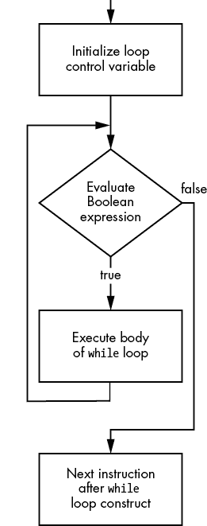
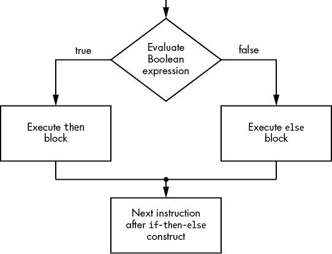

# 13 控制流程构造


在用 C 语言或汇编语言编写程序时，我们指定每条语句或指令的执行顺序。这个顺序称为*控制流*。通过指定控制流来编程称为*命令式编程*。这与*声明式编程*形成对比，后者由我们陈述计算的逻辑，而另一个程序则计算出执行它的控制流。

如果你一直按照第二章的建议使用 `make` 来构建程序，makefile 中的语句就是声明式编程的一个例子。你指定结果的逻辑，`make` 程序会计算出产生结果的控制流。

有三种基本的控制流程构造：顺序、迭代和选择。你在迄今为止的程序中已经看到了顺序：每条指令或子功能都是按照编写的顺序执行的。在本章中，我们将研究如何将控制流从编写的顺序改变为迭代同一块编写的指令，或在几块编写的指令之间进行选择。我们将研究这些控制流程构造中的每一个是如何在汇编语言级别实现的。（我们将在第十四章详细研究更高级的控制流动作——调用函数。）

迭代和选择都依赖于基于真/假条件使用条件跳转来改变控制流。既然它们将在本章其余部分中使用，我们将首先看看可用的跳转，包括条件和无条件跳转。

## 跳转

*跳转指令*将控制流从一个内存位置转移到另一个内存位置。在实现迭代和选择流程构造时，我们将需要使用条件跳转，有时也会使用无条件跳转。

### 无条件跳转

正如你在第九章所学，当从内存中取出一条指令时，CPU 会自动增加指令指针，使其指向内存中的下一条指令。无条件跳转指令会改变指令指针，导致 CPU 在其他位置继续程序执行。

#### `jmp`—跳转

1.  无条件将程序控制流转移到一个内存位置。
2.  `jmp label` 将控制流转移到 `label`。
3.  `jmp reg` 将控制流转移到 `reg` 中的地址。

    `label` 可以位于 -2,147,483,648 到 +2,147,483,647 字节范围内的任何内存位置。CPU 将 `jmp` 指令与 `label` 之间的偏移量符号扩展为 64 位，并将这个有符号数加到指令指针 `rip` 上。`reg` 形式只是将 `reg` 中的 64 位复制到 `rip` 寄存器。

汇编器在计算 `jmp` 指令标签形式的偏移量时，会考虑到程序执行期间 `rip` 寄存器中的值将指向 `jmp` 之后的下一条指令。这个偏移量只是简单地加到 `rip` 上以实现控制转移。

`jmp` 指令通常与条件跳转指令一起使用，以跳过代码块或返回到代码块的开头并再次执行它。

### 条件跳转

条件跳转指令分为两组。第一组通过评估 `rflags` 寄存器中某些状态标志的逻辑组合来工作。如果逻辑表达式评估为真，该指令会改变指令指针 `rip` 中的值。否则，指令指针不变，控制流继续执行条件跳转指令后面的紧邻指令。

这组条件跳转指令的一般形式如下：

#### `jcc`—满足条件则跳转


# 条件跳转指令

## `jcc` — 当条件 `cc` 满足时转移控制流

1.  如果条件 `cc` 满足，将控制流转移到内存位置。

2.  `jcc label` 在 `cc` 为真时将控制流转移到 `label`。

    `jcc` 指令读取 `rflags` 寄存器中的状态标志。条件跳转指令均不改变状态标志。从 `jcc` 指令（CPU 取指后）到 `label` 的距离必须在 –2,147,483,648 到 +2,147,483,647 字节范围内。

第二组条件跳转指令与 `jcc` 组行为相同，但基于 `rcx` 寄存器的内容而非 `rflags` 寄存器：

### `jcxz` — 当 `cx` 为零时跳转

1.  如果 `cx` 寄存器的内容为 0，将控制流转移到内存位置。

2.  `jcxz label` 在 `cx` 寄存器内容为 0 时将控制流转移到 `label`。

### `jecxz` — 当 `ecx` 为零时跳转

1.  如果 `ecx` 寄存器的内容为 0，将控制流转移到内存位置。

2.  `jecxz label` 在 `ecx` 寄存器内容为 0 时将控制流转移到 `label`。

### `jrcxz` — 当 `rcx` 为零时跳转

1.  如果 `rcx` 寄存器的内容为 0，将控制流转移到内存位置。

2.  `jrcxz label` 在 `rcx` 寄存器内容为 0 时将控制流转移到 `label`。

    `jcxz`、`jecxz` 和 `jrcxz` 指令仅分别评估 `rcx` 寄存器中的相应位，**而非状态标志**。如果这些位为 0，则跳转到 `label`，该标签必须在指令后（CPU 取指后）相对于指令指针当前值的 –128 到 +127 字节范围内。

`jcc` 指令中 `cc` 部分共有 16 种条件组合。某些条件有多个汇编语言助记符，共衍生出 30 条不同的 `jcc` 指令。它们连同各自测试的状态标志列于 表 13-1。

**表 13-1：条件跳转**

| **cc** | **条件** | **状态标志** | | **cc** | **条件** | **状态标志** |
| --- | --- | --- | --- | --- | --- | --- |
| `jz` | 零 | `ZF` | | `je` | 相等 | `ZF` |
| `jnz` | 非零 | `¬ZF` | | `jne` | 不相等 | `¬ZF` |
| `ja` | 高于 | `¬CF ∧ ¬ZF` | | `jg` | 大于 | `¬SF ∧ ¬ZF` |
| `jae` | 高于或等于 | `¬CF` | | `jge` | 大于或等于 | `SF = OF` |
| `jna` | 不高于 | `CF ∨ ZF` | | `jng` | 不大于 | `ZF ∧ SF ≠ OF` |
| `jnae` | 不高于或等于 | `CF` | | `jnge` | 不大于或等于 | `SF ≠ OF` |
| `jb` | 低于 | `CF` | | `jl` | 小于 | `SF ≠ OF` |
| `jbe` | 低于或等于 | `CF ∨ ZF` | | `jle` | 小于或等于 | `ZF ∧ SF ≠ OF` |
| `jnb` | 不低于 | `¬CF` | | `jnl` | 不小于 | `SF = OF` |
| `jnbe` | 不低于或等于 | `¬CF ∧ ¬ZF` | | `jnle` | 不小于或等于 | `¬SF ∧ ¬ZF` |
| `jc` | 进位 | `CF` | | `jo` | 溢出 | `OF` |
| `jnc` | 无进位 | `¬CF` | | `jno` | 无溢出 | `¬OF` |
| `jp` | 奇偶 | `PF` | | `js` | 符号 | `SF` |
| `jnp` | 无奇偶 | `¬PF` | | `jns` | 无符号 | `¬SF` |
| `jpe` | 奇偶为偶 | `PF` | | `jpo` | 奇偶为奇 | `¬PF` |

我按可能的使用顺序排列了 表 13-1 中的代码。左侧代码大致适用于无符号值，右侧适用于有符号值。请特别注意“高于”与“大于”、“低于”与“小于”的区别。**高于**和**低于**指无符号值，**大于**和**小于**指有符号值。例如，就位模式而言，`0xffffffff` 高于 `0x00000001`。但若这些位模式代表有符号整数，则 `0xffffffff` = –1 而 `0x00000001` = +1，因此 `0xffffffff` 小于 `0x00000001`。

必须在想要作为跳转依据的指令**之后立即**使用条件跳转指令。中间插入的指令可能会改变状态标志的状态，从而给程序引入 bug。

在继续介绍使用条件跳转的流程构造前，分享一个小技巧。使用 `jg` 或 `jl` 等关系条件跳转时，我总记不住测试顺序——是源操作数比较目标操作数，还是目标比较源。所以测试程序时，我几乎总是用 `gdb` 在条件跳转指令处设断点。程序中断时我检查数值，再用 `s` 单步命令查看跳转走向。

# 迭代

许多算法使用**迭代**，也称**循环**，即重复执行一块指令，直到**循环控制变量**的值满足**终止条件**。实现受控重复有两种方式：**循环**和**递归**。循环构造中，循环控制变量的值必须在指令块内改变。递归则用不同的控制变量值反复调用指令块。递归通过单独的函数实现，第 15 章讨论子函数时会讲到。本章关注函数内的循环构造。

## `while` 循环

`while` 循环是循环的基本形式。C 语言中的形式如下：

```
initialize loop control variable
while (expression)
{
  body
  change loop control variable
}
next_statement
```

进入 `while` 循环前，需初始化循环控制变量。循环开始时，在布尔上下文中求值 `expression`。若求值为假（C 中为 `0`），控制流继续执行 `next_statement`。若求值为真（C 中为非零），执行循环体，改变循环控制变量，控制流回到顶部重新求值 `expression`。图 13-1 直观展示了控制流。

第 11 章使用 `write` 系统调用在屏幕输出文本消息（清单 11-1）。该程序显式告诉 `write` 函数文本字符串的字符数。本章将展示如何用循环避免计算字符数。我们用 `write` 函数逐字符输出到屏幕，循环直到遇到 C 风格字符串的终止符 `NUL` 字符。



**图 13-1：`while` 循环的控制流**

我们从 C 语言的 `while` 循环开始，如 清单 13-1 所示。

```c
/* helloWorld.c
 * Hello World program using the write() system call
 * one character at a time.
 */
#include <unistd.h>
#define NUL '\0'

int main(void)
{
    char *stringPtr = "Hello, World!\n";

    while (*stringPtr != NUL)
    {
        write(STDOUT_FILENO, stringPtr, 1);
        stringPtr++;
    }

    return 0;
}
```

**清单 13-1：逐字符将文本字符串写入终端窗口**

我们用 `#define` 指令给 `NUL` 字符起符号名 ①。`stringPtr` 变量定义为指向 `char` 类型的指针 ②。查看汇编语言时可见，编译器将文本字符串 ③ 存储在只读内存区，并将该字符串首字符地址存入 `stringPtr` 指针变量。


# 汇编语言中的 While 循环实现

`while` 语句首先检查指针变量 `stringPtr` 是否指向 `NUL` 字符。如果不是 `NUL` 字符，程序流程进入 `while` 循环体，并将 `stringPtr` 指向的字符写到屏幕上。然后指针变量加 1，指向文本字符串中的下一个字符。程序流程返回循环顶部，检查这个下一个字符是否为 `NUL` 字符。当字符指针 `stringPtr` 指向 `NUL` 字符时，循环终止。通过首先测试此条件，如果 `stringPtr` 指向空字符串，我们甚至不会进入 `while` 循环体，因为没有什么可做的。

编译器为此程序生成了 Listing 13-2 中所示的汇编语言。

## 编译器生成的汇编代码（Listing 13-2）

```
.file   "helloWorld.c"
.intel_syntax noprefix
.text
.section        .rodata
.LC0:
        .string "Hello, World!\n"
.text
.globl  main
.type   main, @function
main:
        push    rbp
        mov     rbp, rsp
        sub     rsp, 16
        lea     rax, .LC0[rip]          ## 文本字符串的地址
        mov     QWORD PTR -8[rbp], rax
      1 jmp     .L2                     ## 跳转到底部
2 .L3:
        mov     rax, QWORD PTR -8[rbp]  ## 当前字符的地址
        mov     edx, 1                  ## 一个字符
        mov     rsi, rax                ## 传递地址
        mov     edi, 1                  ## STDOUT_FILENO
        call    write@PLT
        add     QWORD PTR -8[rbp], 1    ## 指针加 1
.L2:
        mov     rax, QWORD PTR -8[rbp]  ## 当前字符的地址
        movzx   eax, BYTE PTR [rax]     ## 加载字符
      3 test    al, al                  ## NUL 字符？
        jne     .L3                     ## 否，继续循环
        mov     eax, 0                  ## 是，全部完成
        leave
        ret
.size   main, .-main
.ident  "GCC: (Ubuntu 9.3.0-17ubuntu1~20.04) 9.3.0"
.section        .note.GNU-stack,"",@progbits
```

Listing 13-2：Listing 13-1 中 C 程序的汇编语言

虽然这段汇编语言似乎是在循环末尾测试终止条件，但它遵循 Figure 13-1 中所示的逻辑流程。它跳转到 `.L2` 并在跳转到 `.L3` 开始执行 `while` 循环体之前测试终止条件。

这段代码引入了两条新指令：

## `movzx` 指令

`movzx`—零扩展传送

将源值从内存或寄存器复制（传送）到更宽的寄存器中，并在目标寄存器中对该值进行零扩展。

`movzx reg, reg` 从寄存器传送到寄存器。

`movzx reg, mem` 从内存位置传送到寄存器。

8 位源值可扩展至 16、32 或 64 位，16 位值可扩展至 32 或 64 位。目标寄存器中的额外高位均为 `0`。如果扩展至 32 位，目标寄存器的高 32 位部分也全为 `0`。回顾一下（第 9 章），将 32 位值 `mov` 到寄存器中会将该寄存器的高 32 位清零，从而将 32 位零扩展至 64 位。`movzx` 指令不影响 `rflags` 寄存器中的状态标志。

## `test` 指令

`test`—测试位

对源操作数和目标操作数执行按位 AND 运算，不改变任何操作数，并据此设置状态标志。

`test reg, reg` 在两个寄存器之间测试。

`test mem, reg` 在寄存器和内存位置之间测试。

`test reg, imm` 在显式数字和寄存器之间测试。

`test mem, imm` 在显式数字和内存位置之间测试。

`test` 指令根据源操作数和目标操作数 AND 运算的结果，设置 `rflags` 寄存器中的状态标志。两个操作数均不改变。

## 手写汇编代码（Listing 13-3）

在我的该程序汇编语言版本 Listing 13-3 中，我组织代码使得条件测试位于 `while` 循环的顶部。

```
# helloWorld.s
# 使用 write() 系统调用的 Hello World 程序
# 每次一个字符。

.intel_syntax noprefix
# 有用的常量
.equ    STDOUT,1
# 栈帧
.equ    aString,-8
.equ    localSize,-16
# 只读数据
.section  .rodata
theString:
        .string "Hello, World!\n"
# 代码
.text
.globl  main
.type   main, @function
main:
        push    rbp                 # 保存帧指针
        mov     rbp, rsp            # 设置新帧指针
        add     rsp, localSize      # 为局部变量分配空间

        lea     rax, theString[rip]
        mov     aString[rbp], rax   # *aString = "Hello World.\n";
whileLoop:
        mov     rsi, aString[rbp]   # 字符串中的当前字符
      1 cmp     byte ptr [rsi], 0   # 空字符？
      2 je      allDone             # 是，全部完成

        mov     edx, 1              # 一个字符
        mov     edi, STDOUT         # 输出到标准输出
        call    write@plt
        
      3 inc     qword ptr aString[rbp]  # aString++;
      4 jmp     whileLoop           # 回到顶部
allDone:
        mov     eax, 0              # 返回 0;
        mov     rsp, rbp            # 恢复栈指针
        pop     rbp                 # 和调用者的帧指针
        ret
```

Listing 13-3：用汇编语言每次向屏幕写入一个字符

我还使用了另外两条新指令 `cmp` 和 `inc`，下面将详细介绍。

## `cmp` 指令

`cmp`—比较

比较第一个操作数与第二个操作数，不改变任何操作数，并据此设置状态标志。

`cmp reg, reg` 比较第一个寄存器中的值与第二个寄存器中的值。

`cmp mem, reg` 比较内存中的值与寄存器中的值。

`cmp reg, imm` 比较寄存器中的值与显式数字。

`cmp mem, imm` 比较内存中的值与显式数字。

`cmp` 指令根据用第二个操作数减去第一个操作数的结果，设置 `rflags` 寄存器中的状态标志。两个操作数均不改变。

## `inc` 指令

`inc`—增量

给变量加 1。

`inc reg` 给寄存器中的值加 1。

`inc mem` 给内存中的值加 1。

`inc` 指令根据结果设置 `rflags` 寄存器中的状态标志。

乍看之下，我的汇编语言解决方案似乎不如编译器生成的代码（Listing 13-2）高效，因为除了条件 `je` 指令外，每次循环迭代还要执行 `jmp` 指令。大多数现代 CPU 使用一种称为*分支预测*的技术，即它们假设条件跳转总会朝一个方向进行。我们将不在本书中深入探讨细节，但该技术在跳转不发生时极大地加快了条件跳转指令的执行速度。

当使用*哨兵值*（标记数据序列结束的唯一值）作为终止条件时，`while` 循环效果很好。例如，Listing 13-1 中的 `while` 循环适用于任意长度的文本字符串。循环持续每次向屏幕写入一个字符，直到遇到哨兵值——一个 `NUL` 字符。C 语言还有另一种循环结构 `for` 循环，许多程序员认为它在某些算法中更自然。

## for 循环

尽管它们的 C 语法不同，但这两种循环结构 `while` 和 `for` 在语义上是等价的。语法上的区别在于 `for` 循环允许你将所有三个控制要素——循环控制变量初始化、检查和更改——分组在括号内。`for` 循环的一般形式如下：


# 循环构造

## for 循环

### for 循环语法

```
for (initialize loop control variable; expression; change loop control variable)
{
  body
}
next_statement
```

但将所有控制元素放在括号内并非必须。事实上，我们也可以按如下方式编写 `for` 循环：

```
initialize loop control variable
for (; expression;)
{
  body
  change loop control variable
}
next_statement
```

`for` 循环语法要求括号内必须包含两个分号。

我们可以使用 `for` 循环重写 清单 13-1 中的程序，如 清单 13-4 所示。

```c
/* helloWorld-for.c
 * Hello World program using the write() system call
 * one character at a time.
 */
#include <unistd.h>
#define NUL '\x00'

int main(void)
{
  char *stringPtr;

  for (stringPtr = "Hello, World!\n"; *stringPtr != NUL; stringPtr++)
  {
    write(STDOUT_FILENO, stringPtr, 1);
  }

  return 0;
}
```

清单 13-4：使用 `for` 循环在终端窗口中逐字符写入文本字符串

你可能会想知道两种循环构造哪个更好。这就是你的汇编语言知识派上用场的地方。当我用 `gcc` 为 清单 13-4 生成汇编语言时，得到的汇编代码与 清单 13-1 中 `while` 循环版本的相同。由于 `for` 循环的汇编语言已在 清单 13-2 中展示，此处不再重复。

`for` 循环常用于*计数控制循环*，即在循环开始前已知迭代次数。稍后我们在查看选择构造时将看到此用法的示例。

通过对比 `for` 循环与 `while` 循环，我们得出的结论是：应使用最适合你正在解决的问题的高级语言循环构造。是的，这通常是一个主观选择。

C 语言中的第三种循环构造提供了不同的行为。`while` 循环和 `for` 循环构造都会在循环控制变量的初始值满足终止条件时跳过循环体。而 `do-while` 循环将始终至少执行一次循环体。

## do-while 循环

在某些情况下，算法将至少执行一次循环体。在这些情况下，`do-while` *循环*可能更自然。其一般形式如下：

```
initialize loop control variable
do
{
  body
  change loop control variable
} while (expression)
next_statement
```

在 `do-while` 循环构造中，表达式的值在执行完循环体后计算。循环持续进行，直到该计算结果为布尔假。我们可以使用 `do-while` 循环重写“Hello, World!”程序，如 清单 13-5 所示。

```c
/* helloWorld-do.c
 * Hello World program using the write() system call
 * one character at a time.
 */
#include <unistd.h>
#define NUL '\x00'

int main(void)
{
  char *stringPtr = "Hello, World!\n";

  do
  {
    write(STDOUT_FILENO, stringPtr, 1);
    stringPtr++;
  }
  while (*stringPtr != NUL);

  return 0;
}
```

清单 13-5：使用 `do-while` 循环在屏幕上逐字符输出

`gcc` 生成的汇编语言 清单 13-6 展示了 `do-while` 与 `while` 和 `for` 构造的区别。

```asm
        .file   "helloWorld-do.c"
        .intel_syntax noprefix
        .text
        .section  .rodata
.LC0:
        .string "Hello, World!\n"
        .text
        .globl  main
        .type   main, @function
main:
        push    rbp
        mov     rbp, rsp
        sub     rsp, 16
        mov     QWORD PTR -8[rbp], 0
        lea     rax, .LC0[rip]          ## address of text string
        mov     QWORD PTR -8[rbp], rax
1 .L2:
        mov     rax, QWORD PTR -8[rbp]  ## address of current character
        mov     edx, 1                  ## one character
        mov     rsi, rax                ## pass address
        mov     edi, 1                  ## STDOUT_FILENO
        call    write@PLT
        add     QWORD PTR -8[rbp], 1    ## increment pointer
        mov     rax, QWORD PTR -8[rbp]  ## address of current characte
        movzx   eax, BYTE PTR [rax]     ## load character
      2 test    al, al                  ## NUL character?
        jne     .L2                     ## no, continue looping
        mov     eax, 0
        leave
        ret
        .size   main, .-main
        .ident  "GCC: (Ubuntu 9.3.0-17ubuntu1~20.04) 9.3.0"
        .section  .note.GNU-stack,"",@progbits
```

清单 13-6：清单 13-5 中 `do-while` 循环的汇编语言

将 清单 13-6 中的汇编语言与 清单 13-2 中的（`while` 和 `for` 循环）比较，唯一的区别是 `do-while` 在第一次执行循环 1 之前不会跳转下去执行循环控制检查 2。`do-while` 似乎更高效，但从汇编语言来看，唯一的节省只是第一次执行循环时的一次跳转。

接下来，我们将探讨如何选择是否执行一块代码。

## 选择

另一种常见的流程构造是选择，即确定是否执行一块代码。我们将从最简单的情况开始——基于布尔条件语句决定是否执行单个代码块。然后我们将探讨使用布尔条件语句在两个代码块中选择一个。本章最后将讨论基于整数值在多个代码块中选择的方法。

### if 条件语句

C 语言中 `if` *条件语句*的一般形式如下：

```
if (expression)
{
  block
}
next_statement
```

`expression` 在布尔上下文中求值。如果其求值为假（C 语言中为 `0`），控制流继续执行 `next_statement`。如果 `expression` 求值为真（C 语言中为非零），则执行代码块，随后控制流继续执行 `next_statement`。

清单 13-7 展示了一个 `if` 语句示例，模拟抛硬币 10 次并显示正面朝上的情况。

```c
/* coinFlips1.c
 * Flips a coin, heads.
 */

#include <stdio.h>
#include <stdlib.h>

int main()
{
  register int randomNumber;
  register int i;

1 for (i = 0; i < 10; i++)
  {
    randomNumber = 2 random();
    if 3 (randomNumber < RAND_MAX/2)
    {
    4 puts("heads");
    }
  }

  return 0;
}
```

清单 13-7：模拟抛硬币，显示正面朝上的情况

该程序使用计数控制的 `for` 循环模拟抛硬币 10 次 1。模拟过程涉及调用 C 标准库中的 `random()` 函数 2。如果随机数处于 `random()` 函数所有可能值的下半部分 3，我们称之为正面。我们使用 C 标准库中的 `puts()` 函数，它在屏幕上打印简单文本字符串并追加换行符 4。编译器生成的汇编语言如 清单 13-8 所示。


# 简单 `if` 语句的汇编语言

`if` 语句通过简单的条件跳转 1 来实现。如果条件为真（在本例中为大于），程序流程将跳过由 `if` 语句控制的代码块 2。

我们经常需要在两个不同的代码块之间进行选择，接下来我们将讨论这一点。

## if-then-else 条件语句

C 语言中 `if-then-else` *条件语句* 的一般形式如下（C 语言不使用 `then` 关键字）：

```
if (expression)
{
  then-block
}
else
{
  else-block
}
next_statement
```

`expression` 在布尔上下文中求值。如果 `expression` 求值为真（在 C 语言中为非零），则执行 `then-block`，控制流跳转到 `next_statement`。如果求值为假（在 C 语言中为 `0`），控制流跳转到 `else-block`，然后继续执行 `next_statement`。图 13-2 展示了 `if-then-else` 条件语句的控制流程。



**图 13-2：** `if-then-else` 条件语句的控制流程

清单 13-7 中抛硬币程序的一个问题是用户不知道硬币总共被抛了多少次。我们可以通过使用 `if-then-else` 条件语句来打印一条消息，指明硬币何时朝上为反面，从而改进该程序，如 清单 13-9 所示。

### 清单 13-9：抛硬币，正面或反面

```
/* coinFlips2.c
 * Flips a coin, heads or tails.
 */

#include <stdio.h>
#include <stdlib.h>

int main()
{
  register int randomNumber;
  register int i;

  for (i = 0; i < 10; i++)
  {
    randomNumber = random();
    if (randomNumber < RAND_MAX/2)
    {
      puts("heads");
    }
    else
    {
      puts("tails");
    }
  }

  return 0;
}
```

清单 13-10 展示了编译器生成的汇编语言。

### 清单 13-10：实现 `if-else` 结构的汇编语言

```
        .file   "coinFlips2.c"
        .intel_syntax noprefix
        .text
        .section        .rodata
.LC0:
        .string "heads"
.LC1:
        .string "tails"
        .text
        .globl  main
        .type   main, @function
main:
        push    rbp
        mov     rbp, rsp
        push    r12
        push    rbx
        mov     ebx, 0
        jmp     .L2
.L5:
        call    random@PLT        ## get random number
        mov     r12d, eax         ## save random number
        cmp     r12d, 1073741822  ## less than half max?
        jg      .L3               ## no, else block
        lea     rdi, .LC0[rip]    ## yes, then block
        lea     rdi, .LC0[rip]
        call    puts@PLT
      1 jmp     .L4
 .L3:
        lea     rdi, .LC1[rip]    ## else block
        call    puts@PLT
 2 .L4:
        add     ebx, 1
.L2:
        cmp     ebx, 9
        jle     .L5
        mov     eax, 0
        pop     rbx
        pop     r12
        pop     rbp
        ret
        .size   main, .-main
        .ident  "GCC: (Ubuntu 9.3.0-17ubuntu1~20.04) 9.3.0"
        .section        .note.GNU-stack,"",@progbits
```

编写汇编语言时，需要在 `then-block` 末尾 1 处放置一个无条件跳转，以跳过 `else-block` 2。

我的抛硬币程序汇编语言设计略有不同，如 清单 13-11 所示。

### 清单 13-11：抛硬币程序的汇编语言设计

```
# coinFlips2.s
# flips a coin, heads/tails
        .intel_syntax noprefix

# Useful constants
        .equ    MIDDLE, 1073741823  # half of RAND_MAX
        .equ    STACK_ALIGN, 8

# Constant data
        .section .rodata
headsMsg:
        .string "heads"
tailsMsg:
        .string "tails"

# The code
        .text
        .globl  main
        .type   main, @function
main:
        push    rbp                 # save frame pointer
        mov     rbp, rsp            # set new frame pointer
      1 push    r12                 # save, use for i
      2 sub     rsp, STACK_ALIGN
        
        mov     r12, 0              # i = 0;
for:
        cmp     r12, 10             # any more?
        jae     done                # no, all done
        
        call    random@plt          # get a random number
        cmp     eax, MIDDLE         # which half?
        jg      tails
        lea     rdi, headsMsg[rip]  # it was heads
        call    puts@plt
        jmp     next                # jump over else block
tails:
        lea     rdi, tailsMsg[rip]  # it was tails
        call    puts@plt
next:   inc     r12                 # i++;
        jmp     for
done:
      3 add     rsp, STACK_ALIGN    # realign stack ptr
      4 pop     r12                 # restore for caller
        mov     rsp, rbp            # restore stack pointer
        pop     rbp                 # and caller frame pointer
        ret
```

我的设计与编译器生成的代码之间的主要区别在于，我仅使用 `r12` 寄存器存放变量 `i`，而编译器同时使用了 `rbx` 和 `r12`。在决定函数中使用哪些寄存器存放变量时，检查第 11 章中的 表 11-1 的规则非常重要。该表规定函数必须为调用函数保留 `r12` 中的值。一个好的做法是在建立栈帧后 1 将其压入栈中，然后在拆除栈帧前 4 将其弹出。你大概能明白此处约定规则的重要性。不仅我们的函数返回调用函数时必须保持 `r12` 中的值不变，而且我们也可以假设我们的函数所调用的函数也会保留我们在 `r12` 中的值。因此，可以安全地假设该值在函数调用过程中保持不变。

在将寄存器保存到栈上时，容易违反的一条栈处理规则是：在函数调用之间保持栈指针位于 16 字节地址边界上。寄存器宽 8 字节，因此我在将 `r12` 压入栈中保存后，通过从栈指针减去 8 来遵守此规则 2。重要的是要记住，在将 `r12` 的值从栈中弹出 3 之前，要加回相同的值，从而为调用函数恢复寄存器的值。

我不会在此深入细节，但如果你需要从多个代码块中选择一个执行，可以使用 `if-else` 语句构成 *阶梯结构*。一般形式如下：

```
if (expression1)
{
  block1
}
else if (expression2)
{
  block2
}
⋮
else (expression_n)
{
  block_n
}
next_statement
```

`if-then-else` 选择基于控制表达式的布尔求值，但正如你在下一节将看到的，有些算法的选择基于离散值，该值用于从多种情况中选择一种。

## switch 条件语句


# Switch 条件语句

## 一般形式

C 提供了一种 `switch` `conditional`，其中控制流根据表达式的值跳转到代码块列表中的某个位置。`switch` 的一般形式如下：

```
switch (selector)
{
  case selector_1:
    block_1
  case selector_2:
    block_2
  ⋮
  case selector_n:
    block_n
  default:
    default_block
}
```

## 控制流行为

`selector` 变量的求值结果必须是整数值。如果该值等于 `case` 指定的整数值之一——`selector_1`、`selector_2`、… 或 `selector_n`——控制流将跳转到代码块列表中的该位置，并执行 case 列表中所有剩余的代码块。因为我们通常只想执行一个代码块，所以通常在每个块的末尾使用 `break` 语句，这会导致控制流退出 `switch` 语句。如果 `selector` 的值与任何 `case` 值都不匹配，控制流将退出 `switch` 语句，或者如果存在可选的 `default` case，则跳转到该处。

## 列表 13-12：简单的 Switch 示例

列表 13-12 给出了一个使用 `switch` 的简单示例，用于显示 `for` 循环的索引是 1、2、3 还是大于 3。

```c
/* switch.c
 * Three-way selection.
 */

#include <stdio.h>

int main(void)
{
  register int selector;
  register int i;

  for (i = 1; i <= 10; i++)
  {
    selector = i;
    switch (selector)
    {
      case 1:
        puts("i = 1");
        break;
      case 2:
        puts("i = 2");
        break;
      case 3:
        puts("i = 3");
        break;
      default:
        puts("i > 3");
    }
  }

  return 0;
}
```

列表 13-12：从三种情况中选择一种

编译器将此 `switch` 语句实现为汇编语言中的一系列 `if-else` 语句。我让你自己运行编译器来查看它。正如你可能猜到的，它由类似这样的代码序列组成：

```
        cmp     r12d, 2
        je      .L4
        ⋮
.L4:
        lea     rdi, .LC1[rip]
        call    puts@PLT
        jmp     .L7
```

其中 `.L7` 是 `switch` 结构末尾的一个标签。

## 列表 13-13：跳转表实现

相反，我将向你展示实现 `switch` 的另一种方法，即使用*跳转表*，如列表 13-13 所示。

```asm
# switch.s
# Three-way switch using jump table
        .intel_syntax noprefix
# Useful constants
        .equ    LIMIT, 10
# Constant data
        .section  .rodata
oneMsg:
        .string "i = 1"
twoMsg:
        .string "i = 2"
threeMsg:
        .string "i = 3"
overMsg:
        .string "i > 3"
# Jump table
        .align  8
jumpTable:
        .quad 1 one         # addresses where messages are
        .quad   two         # printed
        .quad   three
        .quad   over
        .quad   over
        .quad   over
        .quad   over
        .quad   over
        .quad   over        # need an entry for
        .quad   over        # each possibility
# Program code
        .text
        .globl  main
        .type   main, @function
main:
        push    rbp         # save frame pointer
        mov     rbp, rsp    # set new frame pointer
        push    rbx
        push    r12         # save, use for i

        mov     r12, 1      # i = 1;
for:
        cmp     r12, LIMIT  # at limit?
        je      done        # yes, all done
# List of cases
      2 lea     rax, jumpTable[rip]
        mov     rbx, r12    # current location in loop
      3 sub     rbx, 1      # count from 0
      4 shl     rbx, 3      # multiply by 8
        add     rax, rbx    # location in jumpTable
      5 mov     rax, [rax]  # get address from jumpTable
        jmp     rax         # jump there
one:
        lea     rdi, oneMsg[rip]
        call    puts@plt    # display message
        jmp     endSwitch
two:
        lea     rdi, twoMsg[rip]
        call    puts@PLT
        jmp     endSwitch
three:
        lea     rdi, threeMsg[rip]
        call    puts@plt
        jmp     endSwitch
over:
        lea     rdi, overMsg[rip]
        call    puts@plt
endSwitch:
        inc     r12         # i++;
        jmp     for         # loop back
done:
        mov     eax, 0      # return 0;
        pop     r12         # restore regs
        pop     rbx
        mov     rsp, rbp    # restore stack pointer
        pop     rbp         # and caller frame pointer
        ret
```

列表 13-13：跳转表

## 跳转表解释

跳转表中的每个条目都是针对选择器变量 1 对应值所要执行的代码块的地址。`.quad` 指令分配 8 字节，这是存放地址的适当空间。

在程序代码中，我们需要计算要使用跳转表中的哪个地址。我首先加载表的起始地址 2。我复制索引变量，以便在不破坏索引的情况下执行一些算术运算。首先，我减去 1，因为表中的第一个地址距离开头为 0 字节 3。我们将在第 16 章详细讨论移位指令，但 `shl rbx, 3` 指令 4 将 `rbx` 寄存器中的值向左移动三位，从而将其乘以 8，即我们跳转表中每个地址的字节数。

`rbx` 寄存器现在包含所选代码块地址相对于表开头的相对位置。将 `rax` 加到 `rbx` 上，得到我们想要的地址在表中存储的位置。`mov rax, [rax]` 指令 5 看起来可能有点奇怪，但它只是用表中存储的地址替换 `rax` 中的地址。现在我只需要跳转到 `rax` 寄存器中的地址。

你需要小心确保跳转表中有针对表中每次可能读取的条目。当 CPU 执行 `mov rax, [rax]` 指令时，它将获取位于 `rax` 中地址处的 8 字节。`jmp rax` 指令将跳转到这个新值所在的位置。当你进行“动手实践”时，你将有机会探索这一点。

很难说跳转表是否比 `if-else` 阶梯更高效。效率取决于几个因素，如缓存使用和内部 CPU 设计。这在使用相同指令集的不同 CPU 实现中可能会有所不同。但现在你知道了实现 `switch` 结构的两种方法。

## 你学到的内容

1.  **无条件跳转** 改变指令指针以改变控制流。
2.  **条件跳转** 对 `rflags` 寄存器中状态标志的布尔组合求值，如果组合求值为真，则改变控制流。
3.  **`while` 循环** 检查布尔条件，然后迭代一块代码，直到条件变为假。
4.  **`for` 循环** 检查布尔条件，然后迭代一块代码，直到条件变为假。
5.  **`do-while` 循环** 执行一次代码块，然后迭代它，直到布尔条件变为假。
6.  **`if` 条件语句** 检查布尔条件，如果条件为真，则执行一块代码。
7.  **`if-else` 条件语句** 检查布尔条件，然后根据条件是真还是假执行两个代码块中的一个。
8.  **`switch` 条件语句** 对表达式求值，然后根据表达式的整数值跳转到代码块列表中的某个位置。

现在你了解了控制流结构，我们将继续讨论如何编写自己的子函数。你将学习如何传递参数以及如何在子函数中访问这些参数。
