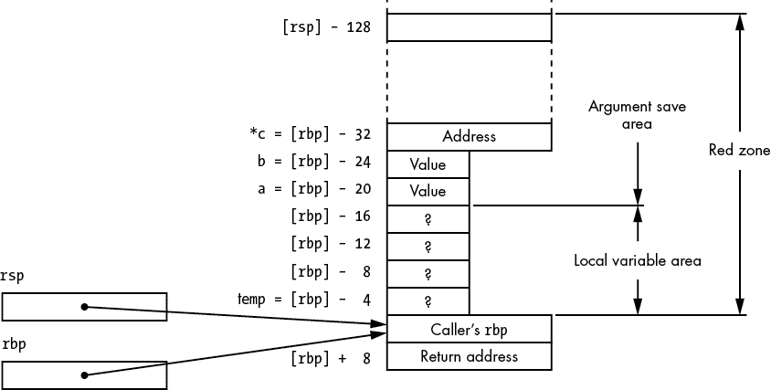
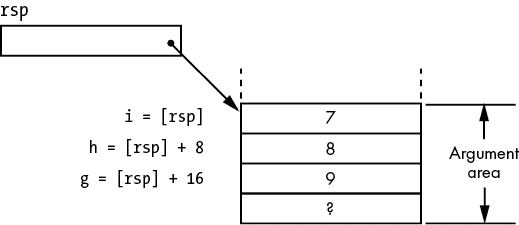
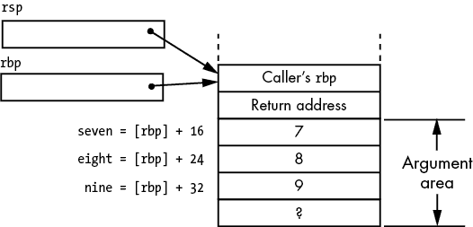
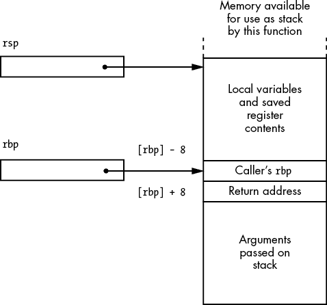
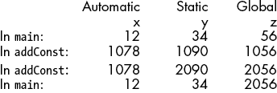

# 14. 子函数内部


良好的工程实践通常包括将问题分解为功能上截然不同的子问题。在软件中，这种方法导致程序包含许多函数，每个函数解决一个子问题。这种“分而治之”的方法有明显的优势：

1.  解决一个小子问题更容易。
2.  子问题的先前解决方案通常可重用。
3.  多个人可以同时处理整体问题的不同部分。


# 函数数据接口与变量作用域

将一个问题分解为多个部分求解时，协调这些部分以协同工作、提供正确的整体解决方案至关重要。在软件中，这转化为确保调用函数与被调函数之间的数据接口正常工作。为保证接口正确运行，必须以显式方式对其进行规范。

我们将首先讨论如何将数据项放置在全局位置，使程序中所有函数都能直接访问它们。然后探讨将数据项作为参数传递给函数的限制方式，这能让我们更好地控制函数处理的数据。

在前几章中，你学习了如何通过寄存器向函数传递参数。本章将介绍如何将这些参数存储在内存中，以便在被调函数内部复用寄存器。你还将学习如何向函数传递超过第 11 章 表 11-2 规定的六个寄存器所能承载的参数数量。

我们还将更详细地探讨函数内部变量的创建。讨论范围包括：仅在程序流程处于函数内时存在的变量，以及在程序整个运行期间驻留内存但仅在其定义函数内可访问的变量。

在深入探讨函数内部机制之前，先了解一下 C 语言中变量名使用的相关规则。

## C 语言中变量名的作用域

本书并非 C 语言教程，因此不会涵盖所有规则，仅介绍足以帮助我们理解程序组织结构的内容。**作用域** 指代码中变量名**可见**的区域，即可以使用该名称的地方。C 语言中有四种作用域：**文件作用域**、**函数作用域**、**块作用域** 和 **函数原型作用域**。

在 C 语言中，变量的**声明** 将其名称和数据类型引入当前作用域。变量的**定义** 是一种声明，同时也为变量分配内存。变量在程序中只能定义一次，但正如我们在“全局变量”节将看到的，它可能在多个作用域中被声明。

定义在函数定义内部（包括参数列表）的变量具有函数作用域，称为**局部变量**。其作用域从定义点延伸至函数结束。

C 语言中的**块** 是由一对匹配的花括号 `{`…`}` 包围的一组 C 语句。定义在块内的变量，其作用域从定义点延伸至该块结束，包括任何嵌套块。

函数原型仅是函数的声明，而非定义。函数原型中定义的变量，其作用域仅限于该原型内部。这一限制允许我们在不同的函数原型中使用相同的名称。例如，C 标准库包含计算正弦和余弦的函数，其原型如下：

```
double sin(double x);
double cos(double x);
```

我们可以在同一个函数中使用这两个函数原型，而无需为参数使用不同的名称。

在简要概述向函数传递参数的原因后，我们将探讨文件作用域。

## 传递参数概述

阅读本节时，请仔细区分**被调函数的数据输入/输出** 与**用户的数据输入/输出**。用户输入通常来自键盘、触摸屏等输入设备，用户输出通常发送到屏幕、扬声器等输出设备。

为说明二者差异，请参考第 2 章 清单 2-1 中的 C 语句：

```
scanf("%x", &anInt);
```

`scanf` 函数从 `main` 函数接收一个数据输入：格式化文本字符串 `"%x"` 的地址。`scanf` 从键盘读取用户输入数据，并将一个无符号整数输出到 `main` 函数中的 `anInt` 变量。本章讨论的是程序内部函数间的输入与输出，而非程序用户的输入输出。

函数可以通过以下四种方式与程序其他部分的数据交互：

1.  **全局** 数据可被程序中任何函数直接访问。
2.  **输入** 数据来自程序的另一部分并被函数使用，但原始副本不被修改。
3.  **输出** 函数向程序的另一部分提供新数据。
4.  **更新** 函数修改程序另一部分持有的数据项。新值基于调用函数前的值。

如果被调函数也知道数据项的位置，即可执行上述所有四种交互，但这会暴露数据的原始副本，允许其被修改，即使它本意仅作为被调函数的输入。

我们可以通过将输出放在全局已知位置（如寄存器或全局已知地址）来从函数输出数据。也可以将存储输出位置的地址传递给被调函数。更新操作要求被调函数知道被更新数据的地址。

我们将从全局变量的创建及其在子函数中的访问方式开始讨论。

## 全局变量

**全局变量** 是定义在所有函数之外、具有**文件作用域** 的变量。它们可从定义点访问至文件结束。通过 `extern` 修饰符声明，全局变量也可被其他文件访问。这仅将变量名和数据类型引入声明所在作用域，而不分配内存。

清单 14-1 展示了如何定义全局变量。

```
/* sumIntsGlobal.c
 * Adds two integers using global variables
 */

#include <stdio.h>
#include "addTwoGlobal.h"

/* Define global variables. */
int x = 0, y = 0, z;

int main(void)
{
  printf("Enter an integer: ");
  scanf("%i", &x);
  printf("Enter an integer: ");
  scanf("%i", &y);
  addTwo();
  printf("%i + %i = %i\n", x, y, z);

  return 0;
}
```

清单 14-1：定义三个全局变量的 `main` 函数

该程序定义了变量 `x` 和 `y`，均初始化为 `0`，并定义了用于存储结果的 `z`。注意我们仅初始化了前两个变量，第三个未初始化；这只是为了在后续汇编语言中展示两种不同的全局变量定义方式。

将定义放在函数体外部使这些变量成为全局变量。此 `main` 函数调用 `addTwo()` 函数，后者将 `x` 和 `y` 相加并将和存入 `z`。清单 14-2 展示了编译器为该 `main` 函数生成的汇编语言。


## Listing 14-2: 编译器生成的汇编代码

```asm
.file   "sumIntsGlobal.c"
.intel_syntax noprefix
.text
.globl  x
.bss            ## bss section
.align 4
.type   x, @object
.size   x, 4    ## 4 bytes
x:
.zero   4       ## initialize to 0
.globl   y
.align 4
.type   y, @object
.size   y, 4
y:
.zero   4       ## initialize to 0
.comm   z,4,4
.section .rodata
.LC0:
.string "Enter an integer: "
.LC1:
.string "%i"
.LC2:
.string "%i + %i = %i\n"
.text
.globl  main
.type   main, @function
main:
push    rbp
mov     rbp, rsp
lea     rdi, .LC0[rip]
mov     eax, 0
call    printf@PLT
lea     rsi, x[rip]     ## globals are relative to rip
lea     rdi, .LC1[rip]  ## format string
mov     eax, 0
call    __isoc99_scanf@PLT
lea     rdi, .LC0[rip]
mov     eax, 0
call    printf@PLT
lea     rsi, y[rip]
lea     rdi, .LC1[rip]
mov     eax, 0
call    __isoc99_scanf@PLT
call    addTwo@PLT
mov     ecx, DWORD PTR z[rip] ## load globals
mov     edx, DWORD PTR y[rip]
mov     eax, DWORD PTR x[rip]
mov     esi, eax
lea     rdi, .LC2[rip]
mov     eax, 0
call    printf@PLT
mov     eax, 0
pop     rbp
ret
.size   main, .-main
.ident  "GCC: (Ubuntu 9.3.0-17ubuntu1~20.04) 9.3.0"
.section .note.GNU-stack,"",@progbits
```

我不知道编译器添加第一个 `.text` 指令 `1` 的原因，但它不是必需的。其效果立即被 `.bss` 指令 `2` 覆盖。`.bss` 指令指定一个数据段，该段未由程序源代码初始化，但当程序被加载到内存执行时会被初始化为 `0`。该程序使用 `.align` 指令 `3` 将其 `bss` 段的起始位置对齐到 4 的倍数。然后程序使用 `.type` 和 `.size` 指令 `4` 定义标号 `x` 为一个 4 字节大小的对象。这里的 `.zero` 指令表示跳过 4 字节并确保程序加载时它们被设为 `0` `5`。这在 `bss` 段中可能是多余的。变量 `y` 以相同方式定义。

由于变量 `z` 未初始化，它使用 `.comm` 指令 `6` 定义。`.comm` 的第一个参数是变量名 `z`。第二个参数是在数据段中为该变量分配的字节数，第三个参数指定变量起始地址的对齐方式。本例中，为 `z` 分配 4 字节，其首字节地址为 4 的倍数。

编译器为 `main` 函数生成了位置无关代码，通过指令指针相对寻址访问全局变量 `7`。这之所以可行，是因为加载器在运行位置无关可执行文件时，会将数据段和 `bss` 段放置在代码段相邻的位置。

接下来，让我们看看子函数如何在该程序中访问全局变量。列表 14-3 展示了该函数的头文件。

## Listing 14-3: `addTwo` 函数的头文件（使用全局变量版本）

```c
/* addTwoGlobal.h
 * Adds two integers and determines overflow.
 */

#ifndef ADDTWOGLOBAL_H
#define ADDTWOGLOBAL_H
void addTwo(void);
#endif
```

该头文件包含 `addTwo` 函数的*函数原型声明*，用于声明该函数。它给出函数名，并告知编译器参数的数据类型和返回值类型。本例中，无参数，也无返回值。

每个你将在文件中调用的函数都需要一个原型声明，但每个函数只能有一个原型声明。当你使用 `#include` 包含此文件时，C 编译器指令 `#ifndef ADDTWOGLOBAL_H` 会导致编译器预处理器在本次编译中 `ADDTWOGLOBAL_H` 已被定义时跳至 `#endif`。否则，预处理器会执行 `#define ADDTWOGLOBAL_H` 语句进行定义。在头文件中使用 `#include` 包含其他头文件很常见，`#ifndef` 技术可防止原型声明重复。使用头文件名的大写形式作为 `#define` 的唯一标识符。

列表 14-4 给出了定义 `addTwo` 函数的 C 代码。

## Listing 14-4: 使用全局变量的 `addTwo` 子函数

```c
/* addTwoGlobal.c
 * Adds two integers and determines overflow.
 */

#include "addTwoGlobal.h"

/* Declare global variables defined elsewhere. */
extern int x, y, z;

void addTwo(void)
{
  z = x + y;
}
```

函数的头文件应在定义函数的文件中通过 `#include` `1` 包含，以确保头文件中的函数原型与定义匹配。全局变量仅在一处定义，但在使用它们的任何其他文件中都需要声明 `2`。

列表 14-5 展示了编译器生成的汇编语言。

## Listing 14-5: 编译器为 列表 14-4 中子函数生成的汇编代码

```asm
.file   "addTwoGlobal.c"
.intel_syntax noprefix
.text
.globl  addTwo
.type   addTwo, @function
addTwo:
push    rbp
mov     rbp, rsp
mov     edx, DWORD PTR x[rip] ## names are global
mov     eax, DWORD PTR y[rip] ## relative to rip
add     eax, edx
mov     DWORD PTR z[rip], eax
nop
pop     rbp
ret
.size   addTwo, .-addTwo
.ident  "GCC: (Ubuntu 9.3.0-17ubuntu1~20.04) 9.3.0"
.section  .note.GNU-stack,"",@progbits
```

正如在 `main` 函数中一样，全局变量通过指令指针相对寻址访问 `1`。

虽然全局变量在小程序中简单易用，但在大型程序中管理它们很快会变得难以驾驭。你需要精确跟踪程序中每个函数对这些变量的操作。如果在函数内部定义变量，并仅将所需内容传递给每个子函数，管理会容易得多。下一节我们将探讨如何对传入和传出子函数的内容保持良好控制。

## 显式传递参数

当我们限制每个函数仅使用其所需的变量时，将函数内部工作与其他函数隔离会容易得多，这一原则称为*信息隐藏*。作为程序员，你只需处理子函数完成其特定任务所需的变量和常量。当然，大多数子函数需要与其调用函数中的某些变量交互，作为输入、输出或更新。本节将探讨显式传递给函数的参数如何被该函数用于接收输入、产生输出或更新变量。

当一个值仅作为被调用函数的输入时，我们可以将该值的副本传递给被调用函数；这称为*值传递*。值传递可防止被调用函数意外修改调用函数中的值。


从被调用函数接收输出稍微复杂一些。一种方法是使用`return value`（返回值），在我们的环境中，它被放置在`eax`寄存器中。使用`eax`寄存器假设返回值是一个`int`；对于返回较大值有其他规则，本书不作深入探讨。你已经在本书的大多数示例程序中看到了这种技术的应用。`main`函数几乎总是向调用它的操作系统中的函数返回 0。

被调用函数从调用函数接收输出的其他技术要求调用函数将存储输出位置的地址传递给被调用函数。这可以在高级语言中实现为`pass by pointer`（传指针）或`pass by reference`（传引用）。区别在于，使用`pass by pointer`时，程序可以更改指针以指向另一个对象，而在`pass by reference`中，指针不能被程序更改。`C`和`C++`都支持`pass by pointer`，但只有`C++`支持`pass by reference`。在`assembly language`（汇编语言）层面，这些是相同的——存储输出位置的地址被传递给被调用函数。区别由高级语言强制执行。

### 在 C 中传递参数

我们将编写与清单 14-1、14-3 和 14-4 中相同的程序，但这次我们将在`main`函数中将变量定义为局部变量，并将它们作为参数传递给`subfunction`，如清单 14-6 所示。

```c
/* sumInts.c
 * Adds two integers using local variables
 */

#include <stdio.h>
#include "addTwo.h"

int main(void)
{
1 int x = 0, y = 0, z;
  
  printf("Enter an integer: ");
  scanf("%i", &x);
  printf("Enter an integer: ");
  scanf("%i", &y);
  addTwo(x, y, 2&z);
  printf("%i + %i = %i\n", x, y, z);

  return 0;
}
```

清单 14-6：求两个整数之和，局部变量

在函数体内部定义变量 1 使它们仅对该函数可见。`x`和`y`变量的值是`addTwo`函数的输入，所以我们传递这些变量的副本。`addTwo`函数将把其结果存储在我们作为第三个参数传递的地址`&z` 2 处。

清单 14-7 展示了`addTwo`函数的头文件。

```c
/* addTwo.h
 * Adds two integers and outputs sum.
 */

#ifndef ADDTWO_H
#define ADDTWO_H
void addTwo(int a, int b, int *c);
#endif
```

清单 14-7：`addTwo`函数的头文件

清单 14-8 展示了该函数的定义。

```c
/* addTwo.c
 * Adds two integers and outputs sum.
 */

#include "addTwo.h"

void addTwo(int a, int b, int *c)
{
  int temp;
  
  temp = a + b;
  *c = temp;
}
```

清单 14-8：`addTwo`函数

该函数的第三个参数`c`是一个指向`int`的指针。我们需要解引用变量`*c`，以将计算结果存储在`c`中传递的地址处。

### 汇编语言中发生了什么

清单 14-9 展示了编译器为`sumInts`中的`main`函数生成的汇编语言。

```asm
        .file   "sumInts.c"
        .intel_syntax noprefix
        .text
        .section        .rodata
.LC0:
        .string "Enter an integer: "
.LC1:
        .string "%i"
.LC2:
        .string "%i + %i = %i\n"
        .text
        .globl  main
        .type   main, @function
main:
        push    rbp
        mov     rbp, rsp
        sub     rsp, 32
        mov     rax, QWORD PTR fs:40
        mov     QWORD PTR -8[rbp], rax
        xor     eax, eax
        mov     DWORD PTR -20[rbp], 0   ## x = 0;
        mov     DWORD PTR -16[rbp], 0   ## y = 0;
        lea     rdi, .LC0[rip]
        mov     eax, 0
        call    printf@PLT
        lea     rax, -20[rbp]           ## address of x
        mov     rsi, rax
        lea     rdi, .LC1[rip]
        mov     eax, 0
        call    __isoc99_scanf@PLT
        lea     rdi, .LC0[rip]
        mov     eax, 0
        call    printf@PLT
        lea     rax, -16[rbp]           ## address of y
        mov     rsi, rax
        lea     rdi, .LC1[rip]
        mov     eax, 0
        call    __isoc99_scanf@PLT
        mov     ecx, DWORD PTR -16[rbp] ## load y
        mov     eax, DWORD PTR -20[rbp] ## load x
        lea   1 rdx, -12[rbp]           ## address of z
        mov     esi, ecx                ## y
        mov     edi, eax                ## x
        call    addTwo@PLT
        mov     ecx, DWORD PTR -12[rbp] ## z
        mov     edx, DWORD PTR -16[rbp] ## y
        mov     eax, DWORD PTR -20[rbp] ## x
        mov     esi, eax
        lea     rdi, .LC2[rip]
        mov     eax, 0
        call    printf@PLT
        mov     eax, 0
        mov     rsi, QWORD PTR -8[rbp]
        xor     rsi, QWORD PTR fs:40
        je      .L3
        call    __stack_chk_fail@PLT
.L3:
        leave
        ret
        .size   main, .-main
        .ident  "GCC: (Ubuntu 9.3.0-17ubuntu1~20.04) 9.3.0"
        .section        .note.GNU-stack,"",@progbits
```

清单 14-9：编译器为`sumInts`中的`main`函数生成的汇编语言

根据第 11 章的表 11-2，我们了解到第三个参数通过寄存器`rdx`传递。我们可以看到，当编译器将该地址加载到`rdx` 1 中时，它在`rbp`偏移-12 处分配了空间。

接下来，我们将查看`addTwo`函数的编译器生成的汇编语言，如清单 14-10 所示。

```asm
        .file   "addTwo.c"
        .intel_syntax noprefix
        .text
        .globl  addTwo
        .type   addTwo, @function
addTwo:
        push    rbp
        mov     rbp, rsp
      1 mov     DWORD PTR -20[rbp], edi   ## store a
        mov     DWORD PTR -24[rbp], esi   ## store b
        mov     QWORD PTR -32[rbp], rdx   ## address of c
        mov     edx, DWORD PTR -20[rbp]
        mov     eax, DWORD PTR -24[rbp]
        add     eax, edx                  ## a + b
        mov     DWORD PTR -4[rbp], eax    ## sum = a + b;
      2 mov     rax, QWORD PTR -32[rbp]   ## address of c
        mov     edx, DWORD PTR -4[rbp]    ## load sum
      3 mov     DWORD PTR [rax], edx      ## *c = sum;
      4 nop
        pop     rbp
        ret
        .size   addTwo, .-addTwo
        .ident  "GCC: (Ubuntu 9.3.0-17ubuntu1~20.04) 9.3.0"
        .section        .note.GNU-stack,"",@progbits
```

清单 14-10：编译器为`addTwo`函数生成的汇编语言

你可能注意到的关于这个函数的第一件事是，它没有在栈上为局部变量分配空间，但它正在使用栈上的一个区域来存放`sum`局部变量。此外，它将三个输入参数存储在通常放置局部变量的栈区域中 1。`System V Application Binary Interface`（System V 应用程序二进制接口）定义了栈指针之外的 128 字节——即地址低于`rsp`寄存器中地址的 128 字节——为`red zone`（红区）。操作系统不允许使用此区域，因此函数可以用它来临时存储在调用另一个函数时不需要保存的值。特别是`leaf functions`（叶子函数），即不调用其他函数的函数，可以在不移动栈指针的情况下在此区域存储局部变量。

图 14-1 给出了`addTwo`栈帧的图示视图。



图 14-1：C 版本 `addTwo` 函数的栈帧


## 栈帧寻址

栈帧中每个项目的地址显示在左侧。例如，局部变量 `temp` 存储在 `rbp` 中的地址减去 4 的位置。虽然 System V 应用程序二进制接口中的规则仅规定栈指针必须位于 16 字节地址边界，但编译器已遵循该规则将局部变量区与参数保存区分开。请注意，红区是相对于栈指针 `rsp` 定义的，而变量和保存的参数是相对于帧指针 `rbp` 访问的。

使用输入数据执行计算后，函数从栈区域 2 中存储的位置加载存放结果的地址。然后它将结果存储在该地址 3 处。

编译器在存储结果的指令 4 之后插入了另一条指令 `nop`。

#### `nop` — 空操作

1.  不执行任何操作，但占用一个字节。

    `nop` 指令用于微调硬件实现细节以提高效率。它对程序逻辑没有影响。

    `nop` 指令不影响 `rflags` 寄存器中的状态标志。

大多数函数接受的参数少于我们可以通过寄存器传递的六个，但有时你想传递更多参数。在下一节中，你将看到栈是如何来救场的。

## 处理超过六个参数的情况

当调用函数需要向另一个函数传递超过六个参数时，超出前六个寄存器参数的额外参数将通过调用栈传递。它们在调用前以 8 字节块的形式压入栈中。因为返回地址会在调用子函数时压入参数之后，所以参数是直接从栈中读取的，而不是弹出它们。

### 将参数压入栈中

压入顺序是从 C 参数列表的右到左。由于这些参数在调用栈上，它们位于被调用函数的栈帧内，因此被调用函数可以访问它们。

我们将使用 清单 14-11 中的 `main` 函数来展示其工作原理。

```c
/* sum9Ints.c
 * 对整数 1 - 9 求和。
 */
#include <stdio.h>
#include "addNine.h"

int main(void)
{
  int total;
  int a = 1;
  int b = 2;
  int c = 3;
  int d = 4;
  int e = 5;
  int f = 6;
  int g = 7;
  int h = 8;
  int i = 9;
   
  total = addNine(a, b, c, d, e, f, g, h, i);
  printf("The sum is %i\n", total);
  return 0;
}
```

清单 14-11：向子函数传递超过六个参数

前六个参数——`a`、`b`、`c`、`d`、`e` 和 `f` 的值将分别通过寄存器 `edi`、`esi`、`edx`、`ecx`、`r8d` 和 `r9d` 传递。剩余的三个参数将被压入栈中。清单 14-12 展示了变量的处理过程。

```asm
        .file   "sum9Ints.c"
        .intel_syntax noprefix
        .text
        .section        .rodata
.LC0:
        .string "The sum is %i\n"
        .text
        .globl  main
        .type   main, @function
main:
        push    rbp
        mov     rbp, rsp
        sub     rsp, 48
        mov     DWORD PTR -40[rbp], 1   ## a = 1
        mov     DWORD PTR -36[rbp], 2   ## b = 2
        mov     DWORD PTR -32[rbp], 3   ## c = 3
        mov     DWORD PTR -28[rbp], 4   ## d = 4
        mov     DWORD PTR -24[rbp], 5   ## e = 5
        mov     DWORD PTR -20[rbp], 6   ## f = 6
        mov     DWORD PTR -16[rbp], 7   ## g = 7
        mov     DWORD PTR -12[rbp], 8   ## h = 8
        mov     DWORD PTR -8[rbp], 9    ## i = 9
        mov     r9d, DWORD PTR -20[rbp] ## load f
        mov     r8d, DWORD PTR -24[rbp] ## load e
        mov     ecx, DWORD PTR -28[rbp] ## load d
        mov     edx, DWORD PTR -32[rbp] ## load c
        mov     esi, DWORD PTR -36[rbp] ## load b
      1 mov     eax, DWORD PTR -40[rbp] ## load a
      2 sub     rsp, 8                  ## for stack alignment
        mov     edi, DWORD PTR -8[rbp]
      3 push    rdi                     ## push i
        mov     edi, DWORD PTR -12[rbp]
        push    rdi                     ## push h
        mov     edi, DWORD PTR -16[rbp]
        push    rdi                     ## push g
      4 mov     edi, eax
        call    addNine@PLT
      5 add     rsp, 32                 ## remove 3 ints and alignment
        mov     DWORD PTR -4[rbp], eax
        mov     eax, DWORD PTR -4[rbp]
        mov     esi, eax
        lea     rdi, .LC0[rip]
        mov     eax, 0
        call    printf@PLT
        mov     eax, 0
        leave
        ret
        .size   main, .-main
        .ident  "GCC: (Ubuntu 9.3.0-17ubuntu1~20.04) 9.3.0"
        .section        .note.GNU-stack,"",@progbits
```

清单 14-12：为调用 `addNine` 将三个参数压入栈中

第一个参数 `a` 存储在 `-40[rbp]` 处，在调用子函数前必须放入 `edi`。该算法暂时将 `a` 的值存储在 `eax` 中 1，使用 `rdi` 将 `i`、`h` 和 `g` 的三个值压入栈中 3，然后将第一个参数 `a` 的值放入 `edi` 4，这是 `addNine` 所需的第一个参数。我不知道为什么编译器不直接将 `a` 的值放入 `edi`，然后用 `rax` 进行压栈操作，这会使这条 `mov` 指令变得多余。

你可能会注意到，当值通过寄存器传递时，仅使用寄存器的 32 位部分，但当通过栈传递时，使用了完整的 64 位。在我们的 C 环境中 `int` 的大小是 32 位。但栈是 64 位宽的，所以 `push` 或 `pop` 移动的是 64 位值。回想一下，将 32 位值移入寄存器会将寄存器的高 32 位清零；因此，原始的 32 位在该函数的 64 位 `push` 操作中得以保留。

回想一下，我们使用栈的协议是在调用函数前确保栈指针位于 16 字节地址边界。将压入三个 8 字节值，所以算法在压入三个值前从栈指针减去 8 2。从子函数调用返回后，通过调整栈指针 5 有效地从栈中移除所有 32 字节。图 14-2 显示了紧邻调用 `addNine` 前栈的参数区域。



图 14-2：`main` 函数压入栈的参数

### `addNine` 函数

接下来，让我们把注意力转向 `addNine` 函数。清单 14-13 显示了头文件。

```c
/* addNine.h
 * 返回九个整数的和。
 */
#ifndef ADDNINE_H
#define ADDNINE_H
int addNine(int one, int two, int three, int four, int five,
           int six, int seven, int eight, int nine);
#endif
```

清单 14-13：`addNine` 函数的头文件

清单 14-14 显示了定义该函数的 C 源代码。

```c
/* addNine.c
 * 对九个整数求和并返回总和。
 */
 
#include <stdio.h>
#include "addNine.h"

int addNine(int one, int two, int three, int four, int five,
           int six, int seven, int eight, int nine)
{
  int sum;

  sum = one + two + three + four + five + six
          + seven + eight + nine;
  return sum;
}
```

清单 14-14：C 语言中的 `addNine` 函数

编译器为 `addNine` 函数生成了 清单 14-15 中所示的汇编语言。


# 清单 14-15：`addNine` 函数的编译器生成汇编语言

```
.file   "addNine.c"
.intel_syntax noprefix
.text
.globl  addNine
.type   addNine, @function
addNine:
        push    rbp
      1 mov     rbp, rsp
      2 mov     DWORD PTR -20[rbp], edi   ## store a locally
        mov     DWORD PTR -24[rbp], esi   ## store b locally
        mov     DWORD PTR -28[rbp], edx   ## store c locally
        mov     DWORD PTR -32[rbp], ecx   ## store d locally
        mov     DWORD PTR -36[rbp], r8d   ## store e locally
        mov     DWORD PTR -40[rbp], r9d   ## store f locally
        mov     edx, DWORD PTR -20[rbp]   ## sum = a
        mov     eax, DWORD PTR -24[rbp]
        add     edx, eax                  ## sum += b
        mov     eax, DWORD PTR -28[rbp]
        add     edx, eax                  ## sum += c
        mov     eax, DWORD PTR -32[rbp]
        add     edx, eax                  ## sum += d
        mov     eax, DWORD PTR -36[rbp]
        add     edx, eax                  ## sum += e
        mov     eax, DWORD PTR -40[rbp]
        add     edx, eax                  ## sum += f
      3 mov     eax, DWORD PTR 16[rbp]    ## from arg list
        add     edx, eax                  ## sum += g
        mov     eax, DWORD PTR 24[rbp]
        add     edx, eax                  ## sum += h
        mov     eax, DWORD PTR 32[rbp]
        add     eax, edx                  ## sum += i
        mov     DWORD PTR -4[rbp], eax
        mov     eax, DWORD PTR -4[rbp]
        pop     rbp
        ret
        .size   addNine, .-addNine
        .ident  "GCC: (Ubuntu 9.3.0-17ubuntu1~20.04) 9.3.0"
        .section        .note.GNU-stack,"",@progbits
```

在 `addNine` 函数的序言建立其帧指针 1 后，其栈帧处于 图 14-3 所示的状态。



**图 14-3：`addNine` 函数的栈帧**

`addNine` 函数将寄存器中传递的参数存储在栈的红区 2 中。然后它开始计算总和。当处理通过栈传递的参数时，它会根据需要 3 将每个参数加载到 `eax` 寄存器中。每个栈参数相对于 `rbp` 寄存器的偏移量是从 图 14-3 的图示中获得的。

你已经看到，子函数直接访问栈上的参数，而不是将它们弹出。调用函数可以直接将它们放在栈上，而不是压入它们。在下一节中，我将展示如何在直接用汇编语言编写 `sumNine` 程序时实现这一点。

## 直接在栈上存储参数

`push` 操作有些低效。它执行两个操作：从 `rsp` 寄存器减去 8，并在更新后的 `rsp` 寄存器地址处存储一个值。当在栈上放置多个值时，从栈指针减去足够的空间以容纳所有值，然后直接将每个值存储在栈上，效率会稍高一些。我们将在直接用汇编语言编写 `sumNine` 程序时使用此技术。

清单 14-16 展示了我们汇编语言版本 `sumNine` 程序的 `main` 函数。

# 清单 14-16：直接用汇编语言编写的 `sumNine` 程序的 `main` 函数

```
# sum9Ints.s
# Sums the integers 1 - 9.
.intel_syntax noprefix

# Stack frame
#   passing arguments on stack (rsp)
#     need 3x8 = 24 -> 32 bytes
      1 .equ    seventh,0
        .equ    eighth,8
        .equ    ninth,16
        .equ    argSize,-32
#   local vars (rbp)
#     need 10x4 = 40 -> 48 bytes for alignment
        .equ    i,-4
        .equ    h,-8
        .equ    g,-12
        .equ    f,-16
        .equ    e,-20
        .equ    d,-24
        .equ    c,-28
        .equ    b,-32
        .equ    a,-36
        .equ    total,-40
        .equ    localSize,-48
# Read only data
.section  .rodata
format:
        .string "The sum is %i\n"
# Code
.text
.globl  main
.type   main, @function
main:
        push    rbp                 # save frame pointer
        mov     rbp, rsp            # set new frame pointer
        add     rsp, localSize      # for local var.

        mov     dword ptr a[rbp], 1 # initialize values
        mov     dword ptr b[rbp], 2 #     etc...
        mov     dword ptr c[rbp], 3
        mov     dword ptr d[rbp], 4
        mov     dword ptr e[rbp], 5
        mov     dword ptr f[rbp], 6
        mov     dword ptr g[rbp], 7
        mov     dword ptr h[rbp], 8
        mov     dword ptr i[rbp], 9

      2 add     rsp, argSize        # space for arguments
        mov     eax, i[rbp]         # load i
      3 mov     ninth[rsp], rax     #   9th argument
        mov     eax, h[rbp]         # load h
        mov     eighth[rsp], rax    #   8th argument
        mov     eax, g[rbp]         # load g
        mov     seventh[rsp], rax   #   7th argument
        mov     r9d, f[rbp]         # f is 6th
        mov     r8d, e[rbp]         # e is 5th
        mov     ecx, d[rbp]         # d is 4th
        mov     edx, c[rbp]         # c is 3rd
        mov     esi, b[rbp]         # b is 2nd
        mov     edi, a[rbp]         # a is 1st
        call    addNine
      4 sub     rsp, argSize        # remove arguments
        mov     total[rbp], eax     # total = sumNine(...)

        mov     esi, total[rbp]     # show result
        lea     rdi, format[rip]
        mov     eax, 0
        call    printf@plt

        mov     eax, 0              # return 0;
        mov     rsp, rbp            # restore stack pointer
        pop     rbp                 # and caller frame pointer
        ret
```

我们将通过使用 图 14-2 中的栈图来确定 `seventh`、`eighth` 和 `ninth` 参数的标识符值 1 来开始设计。为我们在栈上为参数所需的空间量创建一个标识符也很方便，确保它是 16 的倍数。

我们通过首先从 `rsp` 2 减去适当的数量，在栈上为超出我们将通过寄存器传递的六个参数之外的三个参数分配空间，来开始对 `addNine` 的调用。为每个参数创建了标识符后，直接将这三个参数中的每一个存储在我们刚刚分配的区域中 3 就变得很简单。然后，当 `addNine` 子函数返回到我们的函数时，我们需要通过加上开始调用序列时从 `rsp` 减去的相同数量 4，有效地从栈顶删除参数区域。

接下来，让我们看看 `addNine` 函数 清单 14-17 是如何访问通过栈传递的参数的。


# 清单 14-17：汇编语言中的 `addNine` 函数

```assembly
# addNine.s
# 对九个整数参数求并返回总和。
        .intel_syntax noprefix
# 调用序列：
#       edi <- one, 32 位整数
#       esi <- two
#       ecx <- three
#       edx <- four
#       r8d <- five
#       r9d <- six
#       push seven
#       push eight
#       push nine
#       返回 sum
# 栈帧
#    栈帧中的参数
      1 .equ    seven,16
        .equ    eight,24
        .equ    nine,32
#    局部变量
        .equ    total,-4
        .equ    localSize,-16

# 代码
        .text
        .globl  addNine
        .type   addNine, @function
addNine:
        push    rbp             # 保存帧指针
        mov     rbp, rsp        # 设置新帧指针
        add     rsp, localSize  # 为局部变量分配空间

        add     edi, esi        # 将 two 加到 one
        add     edi, ecx        # 加 three
        add     edi, edx        # 加 four
        add     edi, r8d        # 加 five
        add     edi, r9d        # 加 six
      2 add     edi, seven[rbp] # 加 seven
        add     edi, eight[rbp] # 加 eight
        add     edi, nine[rbp]  # 加 nine
        mov     total[rbp], edi # 保存 total

        mov     eax, total[rbp] # 返回 total;
        mov     rsp, rbp        # 恢复栈指针
        pop     rbp             # 恢复调用者帧指针
        ret
```

参数 `seven`、`eight` 和 `nine` 的偏移量是使用 图 14-3 中的图表定义的 1。使用这些标识符，对传递给 `addNine` 函数的值进行求和就变得非常简单 2。

## 栈帧使用总结

调用函数时，必须严格遵循寄存器使用和参数传递规则。任何偏差都可能导致难以调试的错误。规则如下。

### 在调用函数中

1.  假设 `rax`、`rcx`、`rdx`、`rsi`、`rdi` 和 `r8`–`r11` 寄存器中的值将被被调用函数改变。

2.  前六个参数按从左到右的顺序分别在 `rdi`、`rsi`、`rdx`、`rcx`、`r8` 和 `r9` 寄存器中传递。

3.  第六个之后的参数存储在栈上，就好像它们是按从右到左的顺序压入栈中的一样。

4.  使用 `call` 指令调用你想要调用的函数。

### 进入被调用函数时

1.  通过将 `rbp` 压入栈中来保存调用者的帧指针。

2.  通过将 `rsp` 复制到 `rbp`，在当前栈顶建立被调用函数的帧指针。

3.  通过从 `rsp` 中减去所需字节数，在栈上为所有局部变量加上任何所需的寄存器保存空间分配空间；该值必须是 16 的倍数。

4.  如果被调用函数改变了 `rbx`、`rbp`、`rsp` 或 `r12`–`r15` 寄存器中的任何值，必须将它们保存在寄存器保存区中，并在返回调用函数前恢复。

5.  如果该函数调用另一个函数，将通过寄存器传递的参数保存在栈上。

### 在被调用函数内部

1.  `rsp` 寄存器指向该函数可访问的当前栈底。遵循通常的栈规则；不要使用栈指针来访问参数或局部变量。

2.  传递给函数并在栈上保存的寄存器参数通过相对于帧指针 `rbp` 的负偏移量来访问。

3.  通过栈传递给函数的参数通过相对于帧指针 `rbp` 的正偏移量来访问。局部变量通过相对于帧指针 `rbp` 的负偏移量来访问。

### 离开被调用函数时

1.  将返回值（如果有）放入 `eax`。

2.  从栈帧中的寄存器保存区恢复 `rbx`、`rbp`、`rsp` 和 `r12`–`r15` 寄存器中的值。

3.  通过将 `rbp` 复制到 `rsp` 来删除局部变量空间和寄存器保存区。

4.  通过从栈保存区弹出 `rbp` 来恢复调用者的帧指针。

5.  使用 `ret` 返回调用函数。

图 14-4 展示了栈帧的样子。



**图 14-4：栈帧的整体模式**

如所述，栈帧可能不包含所有这些部分。如果传递给函数的参数不超过六个，则该图中的下方框不存在。某些函数可能没有任何局部变量或保存的寄存器内容。在某些情况下，函数甚至不需要保存调用者的 `rbp`。该图中始终存在的唯一框是返回地址。

在下一节中，我们将探讨如何创建一个在其定义子函数的调用之间保持其值的局部变量。

## 静态局部变量

我们在第 11 章中了解到（另见 图 14-1 和 图 14-4），自动局部变量在函数的序言中创建，在函数的尾声中删除。这意味着存储在自动局部变量中的值在对子函数的后续调用中将丢失。我们可能希望在函数调用之间保持变量的值，同时仍提供局部变量的信息隐藏优势。例如，我们可能有一个从其他几个函数调用的函数，并希望维护一个它被调用次数的计数。我们可以使用全局变量，但全局变量不提供局部变量的信息隐藏特性。

程序中的局部变量在内存中有两种可能的*生命周期*。自动局部变量在其定义函数的序言期间在内存中创建，并在该函数的尾声期间删除。*静态局部变量*像自动局部变量一样具有局部作用域，但像全局变量一样，它在整个程序的生命周期内一直驻留在内存中。

当我们讨论 清单 14-18、清单 14-20 和 清单 14-21 中的程序时，我们将看到静态局部变量在内存中的创建位置，这些程序说明了自动局部变量、静态局部变量和全局变量在可见性和持久性方面的差异。

# 清单 14-18：比较自动局部、静态局部和全局变量的程序

```c
/* varLife.c
 * 比较自动、静态和全局变量的作用域和生命周期。
 */

#include <stdio.h>
#include "addConst.h"
#define INITx 12
#define INITy 34
#define INITz 56

1 int z = INITz;

int main(void)
{
2 int x = INITx;
  int y = INITy;

  printf("           automatic   static   global\n");
  printf("                   x        y        z\n");
  printf("In main:%12i %8i %8i\n", x, y, z);
3 addConst();
  addConst();
  printf("In main: %12i %8i %8i\n", x, y, z);
  return 0;
}
```

该程序的 `main` 函数首先初始化一个全局变量 1，然后初始化两个局部变量 2。接着它调用一个函数，向三个变量中的每一个添加一个常量值 3。正如你将看到的，即使 `addConst` 中的变量与 `main` 中的变量同名，只有全局变量是同一个物理对象。因此，该程序有五个变量：`main` 中的 `x` 和 `y`，`addConst` 中的 `x` 和 `y`，以及 `z`，它可被 `main` 和 `addConst` 共同访问。

编译器为此程序中的全局变量 `z` 生成的汇编语言与它为 清单 14-2 中的全局变量生成的略有不同。让我们看看 `main` 的编译器生成汇编语言；见 清单 14-19。


# 变量存储的汇编分析

## 清单 14-19：`main` 函数的编译器生成汇编代码

```
.file   "varLife.c"
.intel_syntax noprefix
.text
.globl  z
.data
.align 4
.type   z, @object
.size   z, 4
z:
.long   56                      ## int z = INITz;
.section        .rodata
.align 8
.LC0:
.string "           automatic   static   global"
.align 8
.LC1:
.string "                   x        y        z"
.LC2:
.string "In main:%12i %8i %8i\n"
.text
.globl  main
.type   main, @function
main:
push    rbp
mov     rbp, rsp
sub     rsp, 16
mov     DWORD PTR -8[rbp], 12   ## int x = INITx;
mov     DWORD PTR -4[rbp], 34   ## int y = INITy;
lea     rdi, .LC0[rip]
call    puts@PLT
lea     rdi, .LC1[rip]
call    puts@PLT
mov     ecx, DWORD PTR z[rip]
mov     edx, DWORD PTR -4[rbp]
mov     eax, DWORD PTR -8[rbp]
mov     esi, eax
lea     rdi, .LC2[rip]
mov     eax, 0
call    printf@PLT
call    addConst@PLT
call    addConst@PLT
mov     ecx, DWORD PTR z[rip]
mov     edx, DWORD PTR -4[rbp]
mov     eax, DWORD PTR -8[rbp]
mov     esi, eax
lea     rdi, .LC2[rip]
mov     eax, 0
call    printf@PLT
mov     eax, 0
leave
ret
.size   main, .-main
.ident  "GCC: (Ubuntu 9.3.0-17ubuntu1~20.04) 9.3.0"
.section        .note.GNU-stack,"",@progbits
```

清单 14-19 中的大部分汇编语言对你来说可能很熟悉，但全局变量 `z` 的实现方式不同于我们在清单 14-2 的程序中看到的 `x` 和 `y` 全局变量的方式，后者都被放置在数据段并初始化为 `0`。

在清单 14-19 中，我们看到该程序中的全局变量 `z` 被放置在 `.data` 节 1 中，因此程序执行时它也会被放置在数据段中。但该程序中全局变量的非零值必须存储在可执行程序文件中。编译器使用了 `.long` 汇编指令来指定此值 2。在程序中对应初始化为 `0` 的内存使用 `.bss` 的一个优势是，它不需要在程序文件中占用空间，而存储非零值则需要该空间。

## 清单 14-20：`addConst` 函数的头文件

```
/* addConst.h
 * 向自动、静态、全局变量添加常量。
 */

#ifndef ADDCONST_H
#define ADDCONST_H
void addConst(void);
#endif
```

## 清单 14-21：向三个变量添加常量值的函数

```
/* addConst.c
 * 向自动、静态、全局变量添加常量。
 */

#include <stdio.h>
#include "addConst.h"
#define INITx 78
#define INITY 90
#define ADDITION 1000
extern int z;          /* global */

void addConst(void)
{
    int x = INITx;         /* 每次调用 */
    static int y = INITY;  /* 仅首次调用 */
   
    x += ADDITION;    /* 向每个变量添加 */
    y += ADDITION;
    z += ADDITION;

    printf("In addConst: %8i %8i %8i\n", x, y, z);
}
```

我们将在 `addConst` 中使用不同的常量，以便在运行程序时能清晰地看到这五个变量在作用域和持久性方面的差异 1。

`addConst` 中的 `x` 变量被定义为自动局部变量 3。每次调用此函数时，它都会被创建并赋予初始值 `INITx`。这个 `x` 变量不同于 `main` 函数中同样名为 `x` 的变量，因为每个变量都在其各自的函数内定义，使它们成为局部变量。更改此 `x` 的值不会影响 `main` 中的 `x` 变量。

`addConst` 中的 `y` 变量被定义为 `static` 4。静态局部变量在定义时可以被赋予初始值，正如我在这里所做的。如果未给定值，它将由操作系统初始化为数值零。局部静态变量在其定义所在的函数首次被调用时具有此初始值。如果该变量在函数中被更改，新值将持久保留，供下次调用函数时使用，从而有效地跳过了初始化。与 `x` 一样，`y` 变量也是局部的，因此它不同于 `main` 函数中同样名为 `y` 的变量。更改此 `y` 的值不会影响 `main` 中的 `y` 变量。

`z` 变量是在 `main` 函数外部定义的。但因为它是在另一个文件中定义的，所以我们需要在该文件中将其声明为 `extern` 以便访问它 2. 正如你在第 14 章所学，在此函数中更改它会改变该程序中唯一的副本，因此 `main` 也将看到 `addConst` 中对 `z` 的更改。

## 清单 14-22：编译器为 `addConst` 函数生成的汇编语言

```
.file   "addConst.c"
.intel_syntax noprefix
.text
.section        .rodata
.LC0:
.string "In addConst:%8i %8i %8i\n"
.text
.globl  addConst
.type   addConst, @function
addConst:
push    rbp
mov     rbp, rsp
sub     rsp, 16
mov     DWORD PTR -4[rbp], 78      ## int x = INITx;
add     DWORD PTR -4[rbp], 1000      ## x += ADDITION;
mov     eax, DWORD PTR y.2319[rip] ## load y
add     eax, 1000                    ## y += ADDITION;
mov     DWORD PTR y.2319[rip], eax   ## store new y
mov     eax, DWORD PTR z[rip]      ## load z
add     eax, 1000                    ## z += ADDITION;
mov     DWORD PTR z[rip], eax        ## store new z
mov     ecx, DWORD PTR z[rip]
mov     edx, DWORD PTR y.2319[rip]
mov     eax, DWORD PTR -4[rbp]
mov     esi, eax
lea     rdi, .LC0[rip]
mov     eax, 0
call    printf@PLT
nop
leave
ret
.size   addConst, .-addConst
.data
.align 4
.type   y.2319, @object
.size   y.2319, 4
y.2319:
.long   90                    ## static int y = INITY;
.ident  "GCC: (Ubuntu 9.3.0-17ubuntu1~20.04) 9.3.0"
.section        .note.GNU-stack,"",@progbits
```

## `addConst` 中变量存储的汇编分析

从清单 14-22 中的汇编语言可以看出，自动局部变量是在栈帧中分配的。编译器使用相对于帧指针 `rbp` 的偏移量来访问它们 1。正如我们在本章前面所见，全局变量通过相对于 `rip` 的全局名称来访问 3。

静态局部变量也通过相对于 `rip` 的名称来访问，但该名称未被指定为 `.global`。此外，编译器在名称后添加一个数字，并用 `.` 字符分隔 2。这种对我们给变量起的名称进行的修饰称为 **名称修饰** (*name mangling*)。编译器需要进行名称修饰，以便将此静态局部变量与在同一文件中定义的另一个函数中可能同名的静态局部变量区分开。

正如你可能已经猜到的，静态局部变量不能存在于栈帧中。就像在 `main` 函数中定义的全局变量 `z` 一样（见清单 14-2），静态局部变量 `y` 被分配在 `.data` 节中，并使用 `.long` 汇编指令进行初始化 4。它带有修饰后的名称标签，以便只能由其函数访问 5。


# 图 14-5：C 语言变量三大类的作用域与生命周期

图 14-5 展示了该程序的一次运行。



该程序显示 `main` 中的 `x` 和 `y` 变量与 `addConst` 中的 `x` 和 `y` 变量是不同的。我们还可以看到，`addConst` 中的 `x` 每次函数被调用时都会重新初始化。但 `addConst` 中的 `y` 变量仅在第一次调用函数时获得其初始值，且对该变量加 1,000 的操作会在两次函数调用之间持续保留。我们还可以看到，`main` 和 `addConst` 都在使用同一个（全局）`z`。

我对 `varLife` 程序的汇编语言解决方案，清单 14-23 和 14-24，与编译器生成的代码相似，但我使用了更有意义的标签和名称，使代码更易于人类阅读。

## 清单 14-23：`varLife` 程序中 `main` 函数的汇编语言版本

```
# varLife.s
# 比较自动、静态和全局变量的作用域与生命周期。
        .intel_syntax noprefix

# 栈帧
        .equ    x,-8
        .equ    y,-4
        .equ    localSize,-16
# 有用的常量
        .equ    INITx,12
        .equ    INITy,34
        .equ    INITz,56
        .section    .rodata
        .align  8
tableHead1:
        .string "           automatic   static   global"
tableHead2:
        .string "                   x        y        z"
format:
        .string "In main:%12i %8i %8i\n"
# 定义全局变量
        .data
        .align  4
        .globl  z
        .type   z, @object
z:
      1 .int    INITz   # 初始化全局变量
# 代码
        .text
        .globl  main
        .type   main, @function
main:
        push    rbp                     # 保存帧指针
        mov     rbp, rsp                # 设置新帧指针
        add     rsp, localSize          # 为局部变量预留空间

        mov   2 dword ptr x[rbp], INITx # 初始化局部变量
        mov     dword ptr y[rbp], INITy

        lea     rdi, tableHead1[rip]    # 打印表头
        call    puts@plt
        lea     rdi, tableHead2[rip]
        call    puts@plt
        mov   3 ecx, z[rip]             # 打印变量
        mov     edx, y[rbp]
        mov     esi, x[rbp]
        lea     rdi, format[rip]
        mov     eax, 0
        call    printf@plt

        call    addConst                # 对变量进行加法
        call    addConst

        mov     ecx, z[rip]             # 打印变量
        mov     edx, y[rbp]
        mov     esi, x[rbp]
        lea     rdi, format[rip]
        mov     eax, 0
        call    printf@plt

        mov     eax, 0                  # return 0;
        mov     rsp, rbp                # 恢复栈指针
        pop     rbp                     # 并恢复调用者帧指针
        ret
```

`.int` 指令与编译器使用的 `.long` 相同。在我们的环境中，两者都以小端序发射 32 位整数。我倾向于使用 `.int` 指令而非 `.long` 来指定 `int` 值 1，但这只是个人风格。

由于此函数中的 `x` 和 `y` 是自动局部变量，它们位于栈帧中并相对于帧指针 2 访问，而 `z` 是全局变量，因此相对于指令指针 3 访问。

## 清单 14-24：`varLife` 程序中 `addConst` 函数的汇编语言版本

当我们用汇编语言编写 `addConst` 函数时，我们将使用一个更有意义的标识符来修饰静态局部变量的名称，如 清单 14-24 所示。

```
# addConst.s
# 向自动、静态、全局变量添加常量。
        .intel_syntax noprefix

# 栈帧
        .equ  1 x,-4
        .equ    localSize,-16
# 有用的常量
        .equ    ADDITION,1000
        .equ    INITx,78
        .equ    INITy,90
# 常量数据
        .section  .rodata
        .align  8
format:
        .string "In addConst:%8i %8i %8i\n"
# 定义静态变量
        .data
        .align  4
        .type 2 y_addConst, @object
y_addConst:
      3 .int    INITy

# 代码
        .text
        .globl  addConst
        .type   addConst, @function
addConst:
        push    rbp                     # 保存帧指针
        mov     rbp, rsp                # 设置新帧指针
        add     rsp, localSize          # 为局部变量预留空间
        mov     dword ptr x[rbp], INITx # 初始化

        add     dword ptr x[rbp], ADDITION # 对变量加法
        add   4 dword ptr y_addConst[rip], ADDITION
        add     dword ptr z[rip], ADDITION

        mov     ecx, z[rip]             # 打印变量
        mov     edx, y_addConst[rip]
        mov     esi, x[rbp]
        lea     rdi, format[rip]
        mov     eax, 0                  # 无浮点数
        call    printf@plt

        mov     eax, 0                  # return 0;
        mov     rsp, rbp                # 恢复栈指针
        pop     rbp                     # 并恢复调用者帧指针
        ret
```

请仔细注意，这里的自动局部变量 `x` 是在 `addConst` 的栈帧中创建的 1，因此它不同于在 `main` 的栈帧中创建的 `x`。我选择通过将函数名追加到变量名后面来修饰静态局部变量 `y`，从而确保该变量拥有唯一的名称 2。由于 `y` 是静态的，它被放置在 `.data` 节 3 中，并相对于指令指针 4 访问。

## 表 14-1：程序某些组件的内存特征

表 14-1 总结了程序中一些最常见组件的内存特征。

| 在程序中的角色 | 内存段 | 访问权限 | 生命周期 |
| --- | --- | --- | --- |
| 自动局部变量 | 栈 | 读和写 | 函数 |
| 常量 | 文本段 | 只读 | 程序 |
| 指令 | 文本段 | 只读 | 程序 |
| 静态局部变量 | 数据段 | 读和写 | 程序 |
| 全局变量 | 数据段 | 读和写 | 程序 |

表 14-1 中的内存段是指由操作系统创建的段。常量被放置在文本段中，因为操作系统禁止程序向文本段写入。变量需要位于可读可写的段中。

## 表 14-2：一些常见的汇编器内存指令

表 14-2 总结了一些用于控制程序组件在内存中位置的更常见的汇编器指令。

| 指令 | 内存段 | 效果 |
| --- | --- | --- |
| `.text` | 文本段 | 后跟指令 |
| `.rodata` | 文本段 | 后跟常量数据 |
| `.string "string"`, … | 文本段 | 字符数组，每个以 `NUL` 结尾 |
| `.ascii "string"`, … | 文本段 | 字符数组 |
| `.asciz "string"`, … | 文本段 | 字符数组，每个以 `NUL` 结尾 |
| `.data` | 数据段 | 后跟变量数据 |
| `.bss` | 数据段 | 后跟数据内存初始化为零 |
| `.comm label, size` | 数据段 | 分配 `size` 字节的未初始化数据内存 |
| `.byte expression`, … | 数据段 | 初始化内存，每个表达式占一字节 |
| `.int expression`, … | 数据段 | 初始化内存，每个表达式占一个 `int` |
| `.long expression`, … | 数据段 | 初始化内存，每个表达式占一个 `int` |

`.string`、`.ascii` 和 `.asciz` 指令可以分配多个文本字符串，每个字符串用逗号分隔。`.string` 和 `.asciz` 指令在文本字符串末尾添加一个 `NUL` 字符，而 `.ascii` 不添加。


## 汇编指令摘要

由 `.comm` 指令分配的内存的第一个字节命名为 `label`，它在程序中具有全局作用域。当程序首次加载时，操作系统将与 `label` 关联的 `size` 字节内存清零。

`.int` 和 `.long` 指令执行相同的操作——在我们的环境中分配 32 位，并设置为 `expression` 的值，该值必须是整数值。`.byte` 指令也必须求值为整数值。这些指令可以分配多个 `expression`，每个用逗号分隔。

这只是这些指令的摘要。您需要查阅 `as` 的 `info` 页面以阅读详细信息。

## 您已学到的内容

1. **全局变量** — 可从程序中的任何函数访问，并在程序的整个生命周期内持续存在。
2. **自动局部变量** — 仅可从定义它们的函数内部访问，且仅在其函数执行期间存在。
3. **静态局部变量** — 仅可从定义它们的函数内部访问，并在其函数的调用之间持续存在。
4. **传递参数** — 前六个通过寄存器传递。任何额外的参数通过栈传递。
5. **按值传递** — 传递值的副本。
6. **按指针传递** — 传递变量的地址。地址可以被改变。
7. **按引用传递** — 传递变量的地址。地址不能被改变。
8. **栈帧** — 栈帧的创建始于调用函数，完成于被调用函数。
9. **帧指针** — 由调用函数放入栈帧的项目使用相对于帧指针的正偏移量访问。由被调用函数放入栈帧的项目使用负偏移量访问。

现在您已经知道如何编写函数，我们将在下一章中探讨子函数的几种专门用法。
