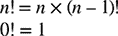
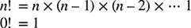

# 15 子函数的特殊用法


## 递归

许多计算机解决方案涉及重复性操作。我们在第 14 章中看到了如何使用迭代——`while`、`for` 和 `do-while` 循环——来执行重复性操作。虽然迭代可用于解决任何重复性问题，但某些解决方案使用*递归*描述得更简洁。*递归算法*是一种通过调用自身来计算问题的更简单情况，并利用该结果计算手头更复杂情况的算法。递归调用持续进行，直到更简单的情况达到*基本情况*。此时，递归算法将基本情况的值返回给下一个更复杂的情况，在那里该值用于计算。这种返回/计算过程持续进行，沿途执行越来越复杂的计算，直到我们回到原始情况。

让我们看一个例子。在数学中，我们用 `!` 表示正整数的阶乘运算，它可以递归定义：



<p class="MathEquation"><span class="MText">n</span><span class="MText">!</span><span class="Malign"/><span class="mathalign">= </span><span class="mathalign">n</span><span class="mathvariant"> × </span><span class="Md"><span class="MDelimiter">(</span><span class="MEquation"><span class="MText">n</span><span class="mathvariant"> – 1</span></span><span class="MDelimiter">)</span></span><span class="mathalign">!</span><br/><span class="mathvariant">0!</span><span class="Malign"/><span class="mathvariant"> = 1</span></p>

第一个方程表明，*n*! 通过计算其更简单的情况 (*n* – 1)! 来定义。该计算重复执行，直到达到 *n* = 0 的基本情况。然后我们逐步返回，沿途计算每个 *n*!。

为了比较，阶乘运算的迭代定义如下：



<p class="MathEquation"><span class="MText">n</span><span class="MText">!  = </span><span class="MText">n</span><span class="mathvariant"> × </span><span class="Md"><span class="MDelimiter">(</span><span class="MEquation"><span class="MText">n</span><span class="mathvariant"> – 1</span></span><span class="MDelimiter">)</span></span><span class="mathvariant"> × </span><span class="Md"><span class="MDelimiter">(</span><span class="MEquation"><span class="MText">n</span><span class="mathvariant"> – 2</span></span><span class="MDelimiter">)</span></span><span class="mathvariant"> × ⋯ 1</span><br/><span class="mathvariant">0!  = 1</span></p>

虽然定义阶乘运算的两种形式涉及相同数量的计算，但递归形式更简洁，对某些人来说可能更直观。

清单 15-1、15-2 和 15-3 展示了一个使用函数 `factorial` 计算 3! 的程序。当我们使用 `gdb` 检查以下函数的行为时，您将看到使用一个小的固定值的原因：

```c
/* threeFactorial.c
 */
#include <stdio.h>
#include "factorial.h"

int main(void)
{
  unsigned int x = 3;
  unsigned int y;
  
  y = factorial(x);
  printf("%u! = %u\n", x, y);
  return 0;
}
```

**清单 15-1：** 计算 3! 的程序

数学阶乘函数针对非负整数定义，因此我们使用 `unsigned int`。

`factorial` 函数的头文件没有什么特别之处，如 清单 15-2 所示。

```c
/* factorial.h
 */
 
#ifndef FACTORIAL_H
#define FACTORIAL_H
unsigned int factorial(unsigned int n);
#endif
```

**清单 15-2：** `factorial` 函数的头文件

清单 15-3 显示 `factorial` 函数调用自身以执行更简单的计算 (*n* – 1)，从而轻松计算 *n*!。

```c
/* factorial.c
 */
#include "factorial.h"

unsigned int factorial(unsigned int n)
{
  unsigned int current = 1; /* assume base case */
  if (n != 0)
  {
    current = n * factorial(n - 1);
  }
  return current;
}
```

**清单 15-3：** 计算 n! 的函数

`factorial` 函数首先检查 *n* = 0 的基本情况 1。如果处于基本情况，当前结果为 1。如果不在基本情况，`factorial` 函数调用 `factorial` 函数计算 (*n* – 1)! 并将其乘以 *n* 以得到 *n*! 2。

`main` 函数的汇编语言没有什么特别之处，但让我们看看编译器为 `factorial` 函数生成的汇编语言；参见 清单 15-4。

```asm
        .file   "factorial.c"
        .intel_syntax noprefix
        .text
        .globl  factorial
        .type   factorial, @function
factorial:
        push    rbp
        mov     rbp, rsp
        sub     rsp, 32
      1 mov     DWORD PTR -20[rbp], edi ## store n
        mov     DWORD PTR -4[rbp], 1    ## current = 1;
        cmp     DWORD PTR -20[rbp], 0   ## base case?
        je      .L2                     ## yes, current good
        mov     eax, DWORD PTR -20[rbp] ## no, compute n - 1
        sub     eax, 1
      2 mov     edi, eax
        call    factorial               ## compute (n - 1)! 
        mov     edx, DWORD PTR -20[rbp] ## load n
      3 imul    eax, edx                ## n * (n - 1)!
        mov     DWORD PTR -4[rbp], eax  ## store in current
.L2
        mov     eax, DWORD PTR -4[rbp]  ## load current
        leave
        ret
        .size   factorial, .-factorial
        .ident  "GCC: (Ubuntu 9.3.0-17ubuntu1~20.04) 9.3.0"
        .section        .note.GNU-stack,"",@progbits
```


# 编译器生成的 `factorial` 函数汇编语言

## 清单 15-4：`factorial` 函数的编译器生成汇编代码

`factorial` 函数使用的算法是一个简单的 `if`-`then` 结构，这是我们在第 13 章学习的内容。递归函数的重要部分在于：我们需要将传递给它的参数保存在寄存器中，以便寄存器可以被重用来在递归调用中传递参数。

例如，`factorial` 函数接受一个参数 `n`，它通过 `rdi` 寄存器传递。（只使用寄存器的 `edi` 部分，因为在我们的环境中 `int` 是 32 位的。）根据第 11 章的 表 11-2，我们不需要在函数中保存 `rdi` 的内容，但我们需要使用 `rdi` 进行带有新值 `(n - 1)` 的递归调用。当递归调用返回时，我们需要 `n` 的原始值。编译器在栈帧中分配了空间用于保存 `n`。

我们还没有讨论 `imul` 指令。顾名思义，这里的指令将 `eax` 中的整数与 `edx` 中的整数相乘，将乘积留在 `eax` 中。乘法指令的细节有些复杂，我们将在第 16 章讨论它们。

我们可以通过直接用汇编语言编写 `factorial` 函数来简化它，如 清单 15-5 所示。

## 清单 15-5：`factorial` 函数的汇编语言版本

```assembly
# factorial.s
# Computes n! recursively.        
# Calling sequence:
#       edi <- n
#       call    readLn
# returns n!
        .intel_syntax noprefix
# Stack frame
        .equ    n,-4
        .equ    localSize,-16

        .text
        .globl  factorial
        .type   factorial, @function
factorial:
        push    rbp                 # save frame pointer
        mov     rbp, rsp            # set new frame pointer
        add     rsp, localSize      # for local var.

      1 mov     n[rbp], edi         # save n
      2 mov     eax, 1              # assume at base case
        cmp     dword ptr n[rbp], 0 # at base case?
      3 je      done                # yes, done
        mov     edi, n[rbp]         # no,
      4 sub     edi, 1              # compute (n - 1)!
        call    factorial
      5 mul     dword ptr n[rbp]    # n! = n * (n - 1)!
done:
        mov     rsp, rbp            # restore stack pointer
        pop     rbp                 # and caller frame pointer
        ret
```

在我们的 `factorial` 汇编语言版本中的一个简化是使用 `eax` 作为存储当前结果的局部变量。我们首先假设处于基本情况。如果这是真的，结果就在 `eax` 中，这正是返回值应该在的位置。如果不是，则递归调用 `factorial`，传递 `(n – 1)` 作为参数。由于在从递归调用返回后，输入参数对于 `n * (n – 1)!` 计算仍然需要，我们需要将输入参数保存在栈上。

编译器使用的是有符号乘法指令 `imul`，但由于该函数中的所有数字都是无符号的，我选择使用无符号乘法指令 `mul`。`mul` 指令假设被乘数已经在 `eax` 中，从 `factorial` 的递归调用返回时确实如此。乘法操作后，`mul` 指令用乘积替换 `eax` 中的被乘数，这正是返回所需的位置。同样，`mul` 和 `imul` 指令的使用细节将在第 16 章解释。

递归算法可以简单优雅，但它们大量使用栈。我将 清单 15-5 中的 `factorial` 汇编语言版本（以及 清单 15-2 中的 C 头文件）与 清单 15-1 中的 `main` 函数一起使用，并在 `gdb` 下运行程序，以便我们可以查看栈的使用情况。

```text
(gdb) li factorial
11     
12             .text
13             .globl  factorial
14             .type   factorial, @function
15     factorial:
16             push    rbp                   # save frame pointer
17             mov     rbp, rsp              # set new frame pointer
18             add     rsp, localSize        # for local var.
19     
20             mov     n[rbp], edi           # save n
(gdb) 
21             mov     eax, 1                # assume at base case
22             cmp     dword ptr n[rbp], 0   # at base case?
23             je      done                  # yes, done
24             mov     edi, n[rbp]           # no,
25             sub     edi, 1                # compute (n - 1)!
26           1 call    factorial
27             imul    eax, n[rbp]           # n! = n * (n - 1)!
28     done:
29           2 mov     rsp, rbp        # restore stack pointer
30             pop     rbp             # and caller frame pointer
(gdb) b 26
Breakpoint 1 at 0x118c: file factorial.s, line 26.
(gdb) b 29
Breakpoint 2 at 0x1195: file factorial.s, line 29.
(gdb) r
Starting program: /home/bob/chap15/factorial_asm/threeFactorial 

Breakpoint 2, factorial () at factorial.s:26
26             call    factorial
```

我设置了两个断点，一个在对 `factorial` 的递归调用处，另一个在函数返回处。当程序中断回 `gdb` 时，让我们查看第一次对 `factorial` 的递归调用的输入值和栈帧。

```text
(gdb) i r rax rdi rbp rsp
rax            0x1                 1
rdi          1 0x2                 2
rbp            0x7fffffffde40      0x7fffffffde40
rsp            0x7fffffffde30      0x7fffffffde30
(gdb) x/4xg 0x7fffffffde30
0x7fffffffde30: 0x00007ffff7fb1fc8   20x00000003555551b0
0x7fffffffde40: 0x00007fffffffde60   30x0000555555555156
```

我们看到第一次对 `factorial` 的递归调用传递 `2` 作为参数，这在该程序中是 `(n – 1)`。`factorial` 的栈帧是 32 字节，这里以 8 字节组显示。当 `factorial` 从 `main` 被调用时，压入栈的第一个值是返回 `main` 的返回地址。

请记住，我们环境中的内存存储是小端序，所以在读取存储在栈帧中 `n` 的值时需要小心。清单 15-5 中的代码显示变量 `n` 存储在 `rbp` 向下 4 字节处，即在我这里的程序运行中内存位置 `0x7fffffffde3c`。由于我们的环境是小端序且我们显示 8 字节值，包含内存位置 `0x7fffffffde3c` 的 8 字节将以 `0x7fffffffde38` 处的字节在最右侧位置、`0x7fffffffde3f` 处的字节在最左侧位置显示。因此变量 `n` 是该 8 字节显示中从右数第五个字节，即 `0x03`。

由于 `factorial` 的输入是 3（见 清单 15-1），在到达基本情况之前该函数还将递归调用两次：

```text
(gdb) c
Continuing.

Breakpoint 1, factorial () at factorial.s:26
26             call    factorial
(gdb) c
Continuing.

Breakpoint 1, factorial () at factorial.s:26
26             call    factorial
(gdb) i r rax rdi rbp rsp
rax            0x1                 1
rdi          1 0x0                 0
rbp            0x7fffffffde00      0x7fffffffde00
rsp            0x7fffffffddf0      0x7fffffffddf0
(gdb) x/12xg 0x7fffffffddf0
0x7fffffffddf0: 0x0000000000000000     0x0000000100000000
0x7fffffffde00: 0x00007fffffffde20   20x000055555555519a
0x7fffffffde10: 0x00000000000000c2     0x00000002ffffde47
0x7fffffffde20: 0x00007fffffffde40   30x000055555555519a
0x7fffffffde30: 0x00007ffff7fb1fc8     0x00000003555551b0
0x7fffffffde40: 0x00007fffffffde60   40x0000555555555156
```


# GDB 调试会话：递归阶乘

现在我们到了 `factorial` 的递归调用传入基本情况值 `0` 1 的地步。我们可以看到 `factorial` 创建了三个栈帧，一个叠在另一个上面。最近的两个栈帧显示返回地址指向同一位置 23，该位置位于 `factorial` 中。最旧的栈帧显示返回地址指向 `main` 4。

继续执行四次会展开栈帧，带我们回到 `main` 调用 `factorial` 时创建的第一个栈帧。

```
(gdb) c
Continuing.

Breakpoint 2, done () at factorial.s:29
29             mov     rsp, rbp            # restore stack pointer
(gdb) c
Continuing.

Breakpoint 2, done () at factorial.s:29
29             mov     rsp, rbp            # restore stack pointer
(gdb) c
Continuing.

Breakpoint 2, done () at factorial.s:29
29             mov     rsp, rbp            # restore stack pointer 
(gdb) c
Continuing.

Breakpoint 2, done () at factorial.s:29
29             mov     rsp, rbp            # restore stack pointer
(gdb) i r rax rdi rbp rsp
rax            0x6               16
rdi          2 0x0                 0
rbp            0x7fffffffde40      0x7fffffffde40
rsp            0x7fffffffde30      0x7fffffffde30
(gdb) x/4xg 0x7fffffffde30
0x7fffffffde30: 0x00007ffff7fb1fc8   0x00000003555551b0
0x7fffffffde40: 0x00007fffffffde60   0x0000555555555156
(gdb) c
Continuing.
3! = 6
[Inferior 1 (process 2373) exited normally]
```

现在我们回到了 `factorial` 的第一次调用，即将返回 `main` 的那次调用，该调用的参数是基本情况 `0` 2，它正在返回结果 `6` 1。

正如你所见，递归函数调用会使用大量栈空间。而且因为它们在每次重复中都会调用一个函数，所以可能很耗时。每个递归解决方案都有一个等效的迭代解决方案，后者通常在时间和栈使用方面更高效。例如，计算整数阶乘的迭代算法很简单。但虽然在这个简单的例子中看不出来，许多问题（例如某些排序算法）更自然地适合递归解决方案。在这类问题中，代码的简洁性往往值得付出递归的代价。

现在我们知道了如何在函数中存储数据项以及如何在汇编语言中在函数之间来回移动数据，我们将探讨如何使用汇编语言访问我们正在使用的高级语言中可能无法访问的硬件特性。

# 在汇编语言中访问 CPU 特性

在第 14 章中，创建一个完整的子函数仅仅为了将两个整数相加（参见 清单 14-8）可能显得有点愚蠢，因为这可以用一条指令完成。但正如我们在第 3 章中看到的，即使是简单的加法也会产生进位或溢出，这由 CPU 中 `rflags` 寄存器中的标志位指示。

C 和 C++ 都没有提供检查 `rflags` 寄存器中溢出标志或进位标志的方法。在本节中，我们将探讨两种方法来告知我们的 C 函数加法是否产生了溢出：我们可以编写一个可从 C 代码调用的单独汇编语言函数，或者在 C 代码中嵌入汇编语言。

## 用汇编语言编写的单独函数

我们将从用 C 语言重写 `sumInts` 程序开始，使其在加法产生溢出时警告用户。我们将在子函数 `addTwo` 中检查溢出，并通过返回机制将结果传回 `main` 函数。

清单 15-6 展示了我们修改后的 `main` 函数，它检查返回值以判断溢出。

```c
/* sumInts.c
 * Adds two integers using local variables
 * Checks for overflow
 */

#include <stdio.h>
#include "addTwo.h"

int main(void)
{
  int x = 0, y = 0, z;
  int overflow;
  
  printf("Enter an integer: ");
  scanf("%i", &x);
  printf("Enter an integer: ");
  scanf("%i", &y);
  overflow = addTwo(x, y, &z);
  printf("%i + %i = %i\n", x, y, z);
  if (overflow)
  {
    printf("    *** Overflow occurred ***\n");
  }  

  return 0;
}
```

**清单 15-6：** 用于求两个整数之和并检查溢出的程序

我们将重写 `addTwo` 函数，使其在无溢出时返回 `0`，有溢出时返回 `1`，我们将该值赋给变量 `overflow` 1。在 C 语言中，零在逻辑上为假，而非零为真 2。

清单 15-7 展示了我们新 `addTwo` 函数的头文件。

```c
/* addTwo.h
 * Adds two integers and determines overflow.
 */

#ifndef ADDTWO_H
#define ADDTWO_H
int addTwo(int a, int b, int *c);
#endif
```

**清单 15-7：** 检查溢出的 `addTwo` 函数的头文件

函数声明的唯一变化是返回 `int` 而不是 `void`。我们需要在 `addTwo` 函数的定义中添加溢出检查，如 清单 15-8 所示。

```c
/* addTwo.c
 * Adds two integers and determines overflow.
 */

#include "addTwo.h"

int addTwo(int a, int b, int *c)
{
  int temp;
  int overflow = 0;   /* assume no overflow */
  
  temp = a + b;
  if (((a > 0) && (b > 0) && (temp < 0)) ||
        ((a < 0) && (b < 0) && (temp > 0)))
  {
    overflow = 1;
  }
  *c = temp;
  return overflow;
}
```

**清单 15-8：** 将两个整数相加并检查溢出

我们在第 3 章学到，如果将两个同号整数相加得到的结果符号相反，则发生溢出，因此我们使用此逻辑作为溢出检查 1。清单 15-9 展示了编译器从此 C 源代码生成的汇编语言。

```asm
        .file   "addTwo.c"
        .intel_syntax noprefix
        .text
        .globl  addTwo
        .type   addTwo, @function
addTwo:
        push    rbp
        mov     rbp, rsp
        mov     DWORD PTR -20[rbp], edi   ## store a
        mov     DWORD PTR -24[rbp], esi   ## store b
        mov     QWORD PTR -32[rbp], rdx   ## address of c
      1 mov     DWORD PTR -8[rbp], 0      ## overflow = 0;
        mov     edx, DWORD PTR -20[rbp]
        mov     eax, DWORD PTR -24[rbp]
        add     eax, edx                  ## a + b
        mov     DWORD PTR -4[rbp], eax    ## temp = a + b;
      2 cmp     DWORD PTR -20[rbp], 0     ## a <= 0?
        jle     .L2                       ## yes
        cmp     DWORD PTR -24[rbp], 0     ## b <= 0?
        jle     .L2                       ## yes
        cmp     DWORD PTR -4[rbp], 0      ## temp < 0?
        js      .L3                       ## yes, overflow
.L2:
        cmp     DWORD PTR -20[rbp], 0     ## a == 0?
      3 jns     .L4                       ## yes, no overflow
        cmp     DWORD PTR -24[rbp], 0     ## b == 0?
        jns     .L4                       ## yes, no overflow
        cmp     DWORD PTR -4[rbp], 0      ## temp == 0?
        jle     .L4                       ## yes, no overflow
.L3:
      4 mov     DWORD PTR -8[rbp], 1
.L4:
        mov     rax, QWORD PTR -32[rbp]   ## address of c
        mov     edx, DWORD PTR -4[rbp]    ## temp
        mov     DWORD PTR [rax], edx      ## *c = temp;
        mov     eax, DWORD PTR -8[rbp]    ## return overflow;
        pop     rbp
        ret
        .size   addTwo, .-addTwo
        .ident  "GCC: (Ubuntu 9.3.0-17ubuntu1~20.04) 9.3.0"
        .section        .note.GNU-stack,"",@progbits
```

**清单 15-9：** 编译器为 清单 15-8 中的 `addTwo` 生成的汇编语言

该算法首先假设不会发生溢出 1。在将两个整数相加后，它检查 `a ≤ 0` 2。如果是，则通过将 `a` 与 `0` 比较并检查 `rflags` 寄存器中的符号标志来查看 `a` 是否为负数 3。如果为 `0`，则没有溢出，因此算法跳过会将溢出变量改为 `1` 的指令 4。


## C 语言中确定溢出的算法

C 语言中确定溢出的算法（清单 15-8）有些复杂，所以我们将利用这样一个事实：CPU 在加法运算期间会做出该判断，并相应地设置 `rflags` 寄存器中的状态标志。我们可以通过直接用汇编语言编写 `addTwo` 来使用 `rflags` 寄存器中的结果，如清单 15-10 所示。

```
# addTwo.s
# 将两个整数相加并返回 OF
# 调用序列：
#       edi <- x, 32 位整数
#       esi <- y, 32 位整数
#       rdx <- &z, 存放和的位置
#       返回 OF 的值
        .intel_syntax noprefix
# 栈帧
        .equ    temp,-4
        .equ    overflow,-8
        .equ    localSize,-16
# 代码
        .text
        .globl  addTwo
        .type   addTwo, @function
addTwo:
        push    rbp         # 保存帧指针
        mov     rbp, rsp    # 设置新帧指针
        add     rsp, localSize  # 为局部变量预留空间

        add     edi, esi    # x + y
      1 seto    al          # OF 为真或假
        movzx   eax, al     # 转换为 int 以便返回
        mov     [rdx] , edi # *c = sum
        
        mov     rsp, rbp    # 恢复栈指针
        pop     rbp         # 以及调用者帧指针
        ret
```

清单 15-10：`addTwo` 的汇编语言版本，返回 `OF` 标志的值

我们在清单 15-10 中使用了另一条指令，`seto` 1。`setcc` 指令用于根据条件码判断各种条件何时为真或假：

### `setcc`——根据条件设置字节

1. 根据条件 `cc` 将 8 位寄存器设置为 0 或 1。

2. `setcc reg` 在 `cc` 为真时将 1 存入 8 位 `reg`，为假时存入 0。

`setcc` 指令使用的 `cc` 代码与 `jcc` 组中的相同，如第 13 章表 13-1 所示。`reg` 是一个 8 位寄存器，但在 64 位模式下不能使用 `ah`、`bh`、`ch` 和 `dh`。C 语言将 1 视为真，0 视为假。

我们的 `addTwo` 汇编语言版本的另一个不同之处在于，我们不会将红区用于局部变量。这属于个人编程风格问题，但我倾向于创建一个完整的栈帧，这样如果我修改函数，就不必担心栈的使用问题。我也没有保存输入参数。用于传递参数的寄存器中的值无需为调用函数保留（参见第 11 章表 11-2）。

如果我们使用 `main` 函数的 C 语言版本（清单 15-6）来调用我们的 `addTwo` 汇编语言版本，我们仍然需要 `#include` C 语言头文件（清单 15-7），以告知编译器如何调用 `addTwo`。

将我们的汇编语言解决方案（清单 15-10）与编译器生成的代码（清单 15-9）进行比较，可以看出我们使用的指令大约减少了一半。

该程序 `main` 函数的汇编语言版本如清单 15-11 所示，它与编译器从 C 版本生成的代码相似，但我们对栈帧偏移量使用符号名称以及使用标签，使其更易于阅读。

```
# sumInts.s
# 使用局部变量将两个整数相加
# 检查溢出
        .intel_syntax noprefix
        
# 栈帧
        .equ    x,-24
        .equ    y,-20
        .equ    z,-16
        .equ    overflow,-12
        .equ    canary,-8
        .equ    localSize,-32
# 只读数据
        .section  .rodata
askMsg:
        .string "Enter an integer: "
readFormat:
        .string "%i"
resultFormat:
        .string "%i + %i = %i\n"
overMsg:
        .string "    *** Overflow occurred ***\n"
# 代码
        .text
        .globl  main
        .type   main, @function
main:
        push    rbp                 # 保存帧指针
        mov     rbp, rsp            # 设置新帧指针
        add     rsp, localSize      # 为局部变量预留空间
        mov     rax, fs:40          # 获取栈金丝雀值
        mov     canary[rbp], rax    # 并保存它
        
        mov     dword ptr x[rbp], 0 # x = 0
        mov     dword ptr y[rbp], 0 # y = 0

        lea     rdi, askMsg[rip]    # 请求输入整数
        mov     eax, 0
        call    printf@plt
        lea     rsi, x[rbp]         # 存放 x 的位置
        lea     rdi, readFormat[rip]
        mov     eax, 0
        call    __isoc99_scanf@plt
        
        lea     rdi, askMsg[rip]    # 请求输入整数
        mov     eax, 0
        call    printf@plt
        lea     rsi, y[rbp]         # 存放 y 的位置
        lea     rdi, readFormat[rip]
        mov     eax, 0
        call    __isoc99_scanf@plt
        
        lea     rdx, z[rbp]         # 存放和的位置
        mov     esi, x[rbp]         # 加载 x
        mov     edi, y[rbp]         # 加载 y
        call    addTwo
        mov     overflow[rbp], eax  # 保存溢出标志
        mov     ecx, z[rbp]         # 加载 z
        mov     edx, y[rbp]         # 加载 y
        mov     esi, x[rbp]         # 加载 x
        lea     rdi, resultFormat[rip]
        mov     eax, 0              # 无浮点数
        call    printf@plt
        
        cmp     dword ptr overflow[rbp], 0 # 发生溢出？
        je      noOverflow
        lea     rdi, overMsg[rip]   # 是，打印消息
        mov     eax, 0
        call    printf@plt
noOverflow:
        mov     eax, 0              # 返回 0

        mov     rcx, canary[rbp]    # 取回保存的金丝雀值
        xor     rcx, fs:40          # 并检查它
        je      goodCanary
        call    __stack_chk_fail@plt  # 金丝雀值错误
goodCanary:
        mov     rsp, rbp            # 恢复栈指针
        pop     rbp                 # 以及调用者帧指针
        ret
```

清单 15-11：`sumIntegers` 程序 `main` 函数的汇编语言版本

这个例子展示了用汇编语言编写子凾数的原因之一——我们能够访问 CPU 的一项特性，即 `rflags` 寄存器中的 `OF`，这在我们正在使用的高级语言 C 中是无法访问的。而且我们需要在执行完被检查的操作（本例中为加法）后立即检查溢出。

这个例子还说明了返回值的一种常见用法。输入和输出通常通过参数列表传递，而关于计算的补充信息则通过返回值传递。

话虽如此，调用一个函数仅仅为了将两个数字相加是低效的。在下一节中，我们将介绍 C 语言的一个常见扩展，它允许我们将汇编语言直接插入 C 代码中。

### 内联汇编语言

像许多 C 编译器一样，`gcc` 包含一个标准 C 语言的扩展，允许我们在 C 代码中嵌入汇编语言，即*内联汇编*。这样做可能比较复杂。这里我们只看一个简单的情况。您可以在 `https://gcc.gnu.org/onlinedocs/gcc/Using-Assembly-Language-with-C.html` 阅读详细信息，或者使用 `info gcc` shell 命令并选择 **C Extensions**▶**Using Assembly Language with C**▶**Extended Asm**。

在 C 中嵌入汇编语言的一般形式如下：

```
asm asm-qualifiers (assembly language statements
                  : output operands
                  : input operands
                  : clobbers);
```

`asm-qualifiers` 用于帮助编译器优化 C 代码，这超出了本书的范围。我们不要求编译器优化 C 代码，因此不会使用 `asm-qualifiers`。


`output operands`（输出操作数）是可能被`assembly language statements`（汇编语言语句）修改的 C 变量，因此充当`assembly language statements`的输出。`input operands`（输入操作数）是被`assembly language statements`使用但不被修改的 C 变量，因此充当`assembly language statements`的输入。`clobbers`（被破坏的寄存器）是被`assembly language statements`显式修改的寄存器，从而告知编译器这些寄存器可能发生的变化。

在清单 15-12 中，我们使用内联汇编语言来检查加法中的溢出。

```c
/* sumInts.c
 * Adds two integers
 */

#include <stdio.h>

int main(void)
{
  int x = 0, y = 0, z, overflow;
  
  printf("Enter an integer: ");
  scanf("%i", &x);
  printf("Enter an integer: ");
  scanf("%i", &y);

  asm("mov edi, 1%22\n"
      "3add edi, %3\n"
      "seto al\n"
      "movzx eax, al\n"
      "mov %1, eax\n"
      "mov %0, edi"
      : 4"=rm" (z), "=rm" (overflow)
      : 5"rm" (x), "rm" (y)
      : "rax", "rdx", 6"cc");

  printf("%i + %i = %i\n", x, y, z);
  if (overflow)
    printf("*** Overflow occurred ***\n");

  return 0;
}
```

清单 15-12：使用内联汇编语言检查加法时的溢出

关于此处代码首先要注意的一点是，将 `add` 指令放在汇编语言 3 中非常重要，以便我们可以在指令执行后立即检查溢出。如果我们在 C 语言中进行加法，然后仅在汇编语言中检查溢出，编译器可能会在我们的汇编语言之前插入一条可能改变溢出标志的指令。

我们需要指定每个 C 变量的约束条件。`"=rm" (z)` 4 表示我们的汇编语言将给 C 变量 `z` 赋值（`=`），并且编译器可以为 `z` 使用寄存器（`r`）或内存（`m`）。如果变量的值在汇编语言中被更新，我们会使用 `"+rm"`。我们的内联汇编代码仅读取 C 变量 `x` 和 `y` 中的值，因此它们的约束条件是 `"rm"` 5。

我们通过使用语法 `%n` 1 在汇编语言中指定 C 变量，其中 `n` 是在 `outputs:inputs` 列表中的相对位置，从 0 开始。在我们的程序中，`z` 位于位置 0，`overflow` 位于 1，`x` 位于 2，`y` 位于 3。因此指令 `mov edi, %2` 将 C 变量 `y` 中的值加载到 `edi` 寄存器中。

请记住，汇编语言源代码是面向行的，因此在每条汇编语言语句的末尾放置一个换行符 2 非常重要。最后一条汇编语言语句的末尾不需要换行符。

使用内联汇编语言时需要小心。编译器可能会为我们的 C 代码生成与我们的汇编语言不兼容的汇编语言。一个好主意是生成整个函数的汇编语言（使用编译器选项 `-S`）并仔细阅读，以确保函数执行的是你预期的操作。

## 你学到的内容

1.  `Recursion`（递归）允许以简单优雅的方式解决某些问题，但会占用大量栈空间。

2.  `Accessing hardware features.`（访问硬件特性。）大多数编程语言不允许直接访问计算机中的所有硬件特性。汇编语言子函数或内联汇编语言可能是最佳解决方案。

3.  `Inline assembly`（内联汇编）允许我们在 C 代码中嵌入汇编语言。
