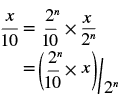

# 第 16 章：使用位逻辑、乘法和除法指令进行计算


现在我们已经了解了程序组织，让我们把注意力转向计算。我们将首先看看逻辑运算符，它们可以通过一种称为 `masking`（掩码）的技术来改变值中的单个位。然后我们将继续学习移位操作，它提供了一种乘以或除以 2 的幂的方法。在本章的最后两节中，我们将介绍任意整数的算术乘法和除法。

## 位掩码

通常最好将数据项视为位模式，而不是数值实体。例如，如果你回顾第 2 章中的表 2-5，你会发现 ASCII 码中大写和小写字母字符的唯一区别在于第 5 位。小写为 `1`，大写为 `0`。例如，`m` 的 ASCII 码是 `0x6d`，而 `M` 是 `0x4d`。如果你想编写一个函数，将一串字母字符的大小写从小写改为大写，你可以将其视为 32 的数值差异。你需要确定字符的当前大小写，然后决定是否通过减去 32 来改变它。

但有一种更快的方法。我们可以使用逻辑位运算和 `mask`（掩码）或 `bitmask`（位掩码）来改变位模式。掩码是一种特定的位模式，可用于将变量中的指定位设为 `1` 或 `0`，或将其反转。例如，为了确保字母字符是大写，我们需要确保其第 5 位为 `0`，从而得到掩码 `11011111` = `0xdf`。然后，以 `m` 为例，`0x6d` ∧ `0xdf` = `0x4d`，即 `M`。如果字符已经是大写，则 `0x4d` ∧ `0xdf` = `0x4d`，保持大写。此解决方案避免了转换前检查大小写。

我们可以对其他操作使用类似的逻辑。如果你想将某位设为 `1`，则在掩码的相应位位置放置 `1` 并使用按位 OR 运算。要在某位位置产生 `0`，请在该位置放置 `0`，在掩码的所有其他位位置放置 `1`，然后使用按位 AND 运算。你可以通过在要反转的每个位位置放置 `1`，在所有其他位置放置 `0`，并使用按位 XOR 运算来反转位。

### C 语言中的位掩码

正如你之前所见，ASCII 码中的大写和小写字母字符由第 5 位区分，大写为 `0`，小写为 `1`。清单 16-1、16-2 和 16-3 中的程序展示了如何使用掩码将文本字符串中的所有小写字母字符转换为大写。

```c
/* upperCase.c
 * Converts alphabetic characters to uppercase
 */

#include <stdio.h>
#include "toUpper.h"
#include "writeStr.h"
#include "readLn.h"
1 #define MAX 50

int main()
{
2 char myString[MAX];
   
  writeStr("Enter up to 50 alphabetic characters: ");
3 readLn(myString, MAX);

4 toUpper(myString, myString);
  writeStr("All upper: ");
  writeStr(myString);
  writeStr("\n");
   
  return 0;
}
```

清单 16-1：将小写字母字符转换为大写的程序

此程序中的 `main` 函数分配了一个 `char` 数组 2 来保存用户输入。我们使用 `#define` 给数组长度一个符号名称 1，这使我们可以在一个地方轻松更改长度，并确保正确的值被传递给 `readLn` 函数 3。

在 C 语言中传递数组名会传递数组开头的地址，所以我们*不*使用 `&`（取地址）运算符 4。你将在第 17 章详细了解数组的实现。此 `main` 函数中没有其他新内容，所以我们继续看子函数 `toUpper`。

由于我们将同一个数组作为源数组和目标数组传递给 `toUpper`，它将用新值替换数组中存储的字符。

```c
/* toUpper.h
 * Converts alphabetic letters in a C string to uppercase.
 */
 
#ifndef TOUPPER_H
#define TOUPPER_H
int toUpper(char *srcPtr, char *destPtr);
#endif
```


## 清单 16-2：`toUpper` 函数的头文件

```c
/* toUpper.c
 * Converts alphabetic letters in a C string to uppercase.
 */

#include "toUpper.h"
#define UPMASK 0xdf
#define NUL '\0'

int toUpper(char *srcPtr, char *destPtr)
{
    int count = 0;
    while (*srcPtr != NUL)
    {
        *destPtr = *srcPtr & UPMASK;
        srcPtr++;
        destPtr++;
        count++;
    }
    *destPtr = *srcPtr;

    return count;
}
```

## 清单 16-3：`toUpper` 函数

为了确保第 5 位是 `0`，我们使用一个在第 5 位位置为 `0`、其他位置为 `1` 的掩码。只要不是 `NUL` 字符，我们就对该字符执行按位 AND 运算，这会屏蔽掉第 5 位，并让所有其他位在结果中保持不变。别忘了包含来自输入文本字符串的 `NUL` 字符！忘记这样做是一个常见的编程错误，在测试期间通常不会显现，因为内存中输出存储位置后面的字节碰巧就是 `0x00`（即 `NUL` 字符）。然后，如果你更改输入文本字符串的长度，内存中的下一个字节可能就不是 `0x00` 了。该错误可能会以一种看似随机的方式出现。

虽然此函数返回处理的字符数量，但我们的 `main` 函数并未使用该值。调用函数不需要使用返回值。我通常会在这样的函数中包含计数算法，以便在需要时进行调试。

## 清单 16-4：`toUpper` 函数的编译器生成汇编语言

```asm
        .file   "toUpper.c"
        .intel_syntax noprefix
        .text
        .globl  toUpper
        .type   toUpper, @function
toUpper:
        push    rbp
        mov     rbp, rsp
        mov     QWORD PTR -24[rbp], rdi ## save srcPtr
        mov     QWORD PTR -32[rbp], rsi ## save destPtr
        mov     DWORD PTR -4[rbp], 0    ## count = 0;
        jmp     .L2
.L3:
      1 mov     rax, QWORD PTR -24[rbp] ## load srcPtr
      2 movzx   eax, BYTE PTR [rax]     ## and char there
      3 and     eax, -33                ## and with 0xdf
        mov     edx, eax
        mov     rax, QWORD PTR -32[rbp] ## load destPtr
        mov     BYTE PTR [rax], dl      ## store new char
        add     QWORD PTR -24[rbp], 1   ## srcPtr++;
        add     QWORD PTR -32[rbp], 1   ## destPtr++;
        add     DWORD PTR -4[rbp], 1    ## count++;
.L2:
      4 mov     rax, QWORD PTR -24[rbp] ## load srcPtr
      5 movzx   eax, BYTE PTR [rax]     ## and char there
      6 test    al, al                  ## NUL char?
        jne     .L3                     ## no, loop back
        mov     rax, QWORD PTR -24[rbp] ## yes, load srcPtr
        movzx   edx, BYTE PTR [rax]     ## and char there
        mov     rax, QWORD PTR -32[rbp] ## load destPtr
        mov     BYTE PTR [rax], dl      ## store NUL
        mov     eax, DWORD PTR -4[rbp]  ## return count;
        pop     rbp
        ret
        .size   toUpper, .-toUpper
        .ident  "GCC: (Ubuntu 9.3.0-17ubuntu1~20.04) 9.3.0 "
        .section        .note.GNU-stack,"",@progbits
```

在进入 `while` 循环之前，`toUpper` 将源文本字符串的地址加载到 `rax` 中。`movzx` 指令用存储在该地址处的字节（`BYTE PTR`）覆盖 `rax` 中的地址，并将寄存器的高 56 位清零。`and` 指令使用立即数 `-33` = `0xdf`，这是将第 5 位置为 `0` 的掩码，从而确保字符为大写。对于输入文本字符串中每个不是 `NUL` 字符的字符，此代码序列都会在 `while` 循环中重复执行。

如前所述，将字符视为位模式而非数值，既适用于将小写字母转换为大写字母，也适用于让大写字母保持不变。

清单 16-4 引入了另一条逻辑指令 `and`。我们已经在第 11 章看到了 `xor` 指令。让我们再来看看两条逻辑指令：`and` 和 `or`。

### 逻辑指令

*逻辑指令*按位工作。也就是说，它们对两个操作数在对应位位置上的各个单独位进行操作。最常见的两条逻辑指令是 AND 和 OR。

#### `and` — 逻辑与

1. 对两个值执行按位 AND 运算。
2. `and reg1, reg2` 对寄存器 `reg1` 和 `reg2` 中的值执行按位 AND 运算，这两个寄存器可以是同一个，也可以是不同的。结果保留在 `reg1` 中。
3. `and reg, mem` 对寄存器中的值和内存中的值执行按位 AND 运算，结果保留在寄存器中。
4. `and mem, reg` 对内存中的值和寄存器中的值执行按位 AND 运算，结果保留在内存中。
5. `and reg, imm` 对寄存器中的值和常量 `imm` 执行按位 AND 运算，结果保留在寄存器中。
6. `and mem, imm` 对内存中的值和常量 `imm` 执行按位 AND 运算，结果保留在内存中。

`and` 指令对源值和目标值执行按位 AND 运算，结果保留在目标操作数中。`rflags` 寄存器中的 `SF`、`ZF` 和 `PF` 标志位根据结果设置，`OF` 和 `CF` 标志位被设置为 `0`，`AF` 标志位未定义。

#### `or` — 逻辑或

1. 对两个值执行按位包含或运算。
2. `or reg1, reg2` 对寄存器 `reg1` 和 `reg2` 中的值执行按位包含或运算，这两个寄存器可以是同一个，也可以是不同的。结果保留在 `reg1` 中。
3. `or reg, mem` 对寄存器中的值和内存中的值执行按位包含或运算，结果保留在寄存器中。
4. `or mem, reg` 对内存中的值和寄存器中的值执行按位包含或运算，结果保留在内存中。
5. `or reg, imm` 对寄存器中的值和常量 `imm` 执行按位包含或运算，结果保留在寄存器中。
6. `or mem, imm` 对内存中的值和常量 `imm` 执行按位包含或运算，结果保留在内存中。

`or` 指令对源值和目标值执行按位包含或运算，结果保留在目标操作数中。`rflags` 寄存器中的 `SF`、`ZF` 和 `PF` 标志位根据结果设置，`OF` 和 `CF` 标志位被设置为 `0`，`AF` 标志位未定义。

### 汇编语言中的位掩码

我们将在汇编语言版本中使用相同的掩码算法，但我们将使用标识符，以便更容易地看出正在发生什么。清单 16-5 展示了用汇编语言编写的 `main` 函数。


# 汇编语言示例

## 列表 16-5：`main` 函数 (`upperCase.s`)

```assembly
# upperCase.s
# 将用户输入的字母文本字符串转为全大写
        .intel_syntax noprefix
# 栈帧
        .equ    myString,-64
        .equ    canary,-8
        .equ    localSize,-64
# 有用的常量
        .equ    upperMask,0xdf
        .equ    MAX,50                # 字符缓冲区限制
        .equ    NUL,0
# 常量数据
        .section  .rodata
        .align  8
prompt:
        .string "Enter up to 50 alphabetic characters: "
message:
        .string "All upper: "
newLine:
        .string "\n"
# 代码
        .text
        .globl  main
        .type   main, @function
main:
        push    rbp                   # 保存帧指针
        mov     rbp, rsp              # 设置新帧指针
        add     rsp, localSize        # 为局部变量预留空间
        mov     rax, qword ptr fs:40  # 获取 canary
        mov     qword ptr canary[rbp], rax

        lea     rdi, prompt[rip]      # 提示用户
        call    writeStr
        
        mov     esi, MAX              # 限制用户输入长度
        lea     rdi, myString[rbp]    # 存放输入的位置
        call    readLn

        lea     rsi, myString[rbp]    # 目标字符串
        lea     rdi, myString[rbp]    # 源字符串
        call    toUpper
        
        lea     rdi, message[rip]     # 提示用户
        call    writeStr

        lea     rdi, myString[rbp]    # 结果
        call    writeStr
        lea     rdi, newLine[rip]     # 格式化换行
        call    writeStr

        mov     eax, 0                # 返回 0;
        mov     rcx, canary[rbp]      # 取回保存的 canary
        xor     rcx, fs:40            # 并检查它
        je      goodCanary
        call    __stack_chk_fail@PLT  # canary 损坏
goodCanary:
        mov     rsp, rbp              # 恢复栈指针
        pop     rbp                   # 恢复调用者帧指针
        ret
```

列表 16-5：将小写字母字符转换为大写的 `main` 函数的汇编语言版本。

我们为 50 个字符预留了足够的内存空间。为 `canary` 值再预留 8 字节共计 58 字节，但我们需要保持栈指针为 16 的倍数，因此为局部变量分配了 64 字节。我们将 `char` 数组的地址同时作为源和目标传递给 `toUpper` 函数，因此它会用新值替换数组中的原始值。

## 列表 16-6：`toUpper` 函数 (`toUpper.s`)

```assembly
# toUpper.s
# 将 C 字符串中的字母字符转换为大写。
# 调用约定：
#   rdi <- 指向源字符串的指针
#   rsi <- 指向目标字符串的指针
#   返回处理的字符数。
        .intel_syntax noprefix

# 栈帧
        .equ    count,-4
        .equ    localSize,-16
# 有用的常量
        .equ    upperMask,0xdf
        .equ    NUL,0
# 代码
        .text
        .globl  toUpper
        .type   toUpper, @function
toUpper:
        push    rbp                   # 保存帧指针
        mov     rbp, rsp              # 设置新帧指针
        add     rsp, localSize        # 为局部变量预留空间
        
        mov     dword ptr count[rbp], 0
whileLoop:
        mov     al, byte ptr [rdi]    # 从源读取字符
        and     al, upperMask         # 不，确保它是大写
        mov     byte ptr [rsi], al    # 字符写入目标
        cmp     al, NUL               # 是否为结束符？
        je      allDone               # 是，全部完成
        inc     rdi                   # 增加
        inc     rsi                   #      指针
        inc     dword ptr count[rbp]  #      和计数器
        jmp     whileLoop             # 继续循环
allDone:
        mov     byte ptr [rsi], al    # 以 NUL 结尾
        mov     eax, dword ptr count[rbp] # 返回计数

        mov     rsp, rbp              # 恢复栈指针
        pop     rbp                   # 恢复调用者帧指针
        ret
```

列表 16-6：用汇编语言编写的 `toUpper` 函数。

编译器使用栈上的红区存放局部变量，但我更倾向于创建显式的栈帧。我们不必将传递给该函数的源地址和目标地址保存在栈的局部变量区域，而是可以直接使用传递地址时所用的寄存器。

编译器使用 `movzx` 指令将 `rax` 寄存器中未用于处理每个字符的部分清零。我更倾向于使用 `rax` 寄存器的字节部分 `al` 来处理字符，因为这是正确的大小。请注意，这会保留 `rax` 中的高 56 位原样，但如果我们在算法处理字符时始终只使用 `al`，这将无关紧要。在我看来，使用 `cmp` 指令而不是 `test` 来检查终止字符 `NUL` 似乎更自然。而且，如前所述，别忘了包含 `NUL` 字符。

# 位移操作

有时能够将变量中的所有位向左或向右移动很有用。如果变量是整数，将所有位向左移动一位相当于将整数乘以二，向右移动一位相当于除以二。使用左/右移位来实现乘以/除以 2 的幂次非常高效。

## C 语言中的位移操作

我们将通过一个程序来讨论移位操作，该程序从键盘读取以十六进制输入的整数并将其存储为 `long int`。程序最多读取八个字符：`'0'`…`'f'`。每个字符采用 8 位 ASCII 码，代表一个 4 位整数（0-15）。我们的程序从一个值为 0 的 64 位整数开始。从最高位的十六进制字符（即用户输入的第一个字符）开始，程序将 8 位 ASCII 码转换为对应的 4 位整数。我们将 64 位整数的累积值向左移动四位，为下一个 4 位整数腾出空间，然后将新的 4 位整数值加到累积值上。

列表 16-7、16-8 和 16-9 展示了该程序。

## 列表 16-7：`convertHex.c`

```c
/* convertHex.c
 * 从用户获取十六进制数并将其存储为 long int。
 */
#include <stdio.h>
#include "writeStr.h"
#include "readLn.h"
#include "hexToInt.h"

#define MAX 20

int main()
{
  char theString[MAX];
  long int theInt;
   
  writeStr("Enter up to 16 hex characters: ");
  readLn(theString, MAX);

  hexToInt(theString, &theInt);
  printf("%lx = %li\n", theInt, theInt);
  return 0;
}
```

列表 16-7：将十六进制转换为 `long int` 的程序。

程序分配一个 `char` 数组用于存储用户输入的字符串，以及一个 `long int` 用于存放转换后的值。`long int` 数据类型的大小取决于运行环境的操作系统和硬件。在我们的环境中，它是 64 位。读取用户输入字符串后，`main` 函数调用 `hexToInt` 进行实际转换，传递输入文本字符串的地址和存放结果变量的地址。

`printf` 函数将 `theInt` 转换回字符格式以在屏幕上显示。`%lx` 格式代码指示 `printf` 以十六进制显示整个 `long int`（在我们的环境中为 64 位）。`%li` 格式代码以十进制显示 `long int`。

## 列表 16-8：`hexToInt.h`

```c
/* hexToInt.h
 * 将十六进制字符字符串转换为 long int。
 * 返回转换的字符数。
 */
 
#ifndef HEXTOINT_H
#define HEXTOINT_H
int hexToInt(char *stringPtr, long int *intPtr);
#endif
```

列表 16-8：`hexToInt` 函数的头文件。


# hexToInt 函数及汇编实现

头文件声明了 `hexToInt` 函数，该函数接受两个指针。`char` 指针为输入，`long int` 指针为主要输出的位置。`hexToInt` 函数还将转换的字符数作为 `int` 返回，作为次要输出。

## C 语言实现（清单 16-9）

```
 /* hexToInt.c
  * 将十六进制字符串转换为整数。
  * 返回字符数量。
  */
 
 #include "hexToInt.h"
 #define GAP 0x07
 #define INTPART 0x0f /* 对小写字母同样有效 */
 #define NUL '\0'
 
 int hexToInt(char *stringPtr, long int *intPtr)
 {
   *intPtr = 0;
   char current;
   int count = 0;
 
   current = *stringPtr;
   while (current != NUL)
   {
     if (current > '9')
     {
     1 current -= GAP;
     }
   2 current = current & INTPART;
   3 *intPtr = *intPtr  4;
   4 *intPtr |= current;
     stringPtr++;
     count++;
     current = *stringPtr;
   }
   return count;
 }
```

清单 16-9：将十六进制字符串转换为 `long int`

## 转换过程解释

首先，我们需要将十六进制字符转换为 4 位整数。数字字符的 ASCII 码范围是 `0x30` 到 `0x39`，大写字母字符的范围是 `0x41` 到 `0x46`。从字母字符中减去这个 `0x07` 间隙 1，会得到输入字符的位模式 `0x30`、`0x31`、…、`0x39`、`0x3a`、…、`0x3f`。当然，用户可能会输入小写字母，在这种情况下减去 `0x07` 会得到 `0x30`、`0x31`、…、`0x39`、`0x5a`、…、`0x5f`。每个十六进制字符代表四位，如果我们在减去 `0x07` 后查看低位四位，无论用户输入大写还是小写字母，它们都是相同的。我们可以通过使用 C 语言按位与运算符 `&` 和位模式 `0x0f` 屏蔽掉高位四位 2，将其转换为 4 位整数。

接下来，我们将累积值中的所有位向左移动四位，为十六进制字符代表的接下来四位腾出空间 3。左移在最低有效的四个位位置留下了 `0`，因此我们可以使用按位或运算 `|` 4 将 `current` 中的四位复制到这些位置。

## 编译器生成的汇编代码（清单 16-10）

现在让我们看看编译器为 `hexToInt` 函数生成的汇编语言，如清单 16-10 所示。

```
        .file   "hexToInt.c"
        .intel_syntax noprefix
        .text
        .globl  hexToInt
        .type   hexToInt, @function
hexToInt:
        push    rbp
        mov     rbp, rsp
        mov     QWORD PTR -24[rbp], rdi ## 保存 stringPtr
        mov     QWORD PTR -32[rbp], rsi ## 保存 intPtr
        mov     rax, QWORD PTR -32[rbp]
        mov     QWORD PTR [rax], 0      ## *intPtr = 0;
        mov     DWORD PTR -4[rbp], 0    ## count = 0;
        mov     rax, QWORD PTR -24[rbp] ## 加载 stringPtr
        movzx   eax, BYTE PTR [rax]     ## current = *stringPtr
        mov     BYTE PTR -5[rbp], al
        jmp     .L2
.L4:
        cmp     BYTE PTR -5[rbp], 57    ## current <= '9'?
        jle     .L3                     ## 是，跳过
        movzx   eax, BYTE PTR -5[rbp]   ## 否，加载 current
        sub     eax, 7                  ## 减去间隙
        mov     BYTE PTR -5[rbp], al    ## 存储 current
.L3:
      1 and     BYTE PTR -5[rbp], 15    ## current & 0x0f
        mov     rax, QWORD PTR -32[rbp] ## 加载 intPtr
        mov     rax, QWORD PTR [rax]    ## 加载 *intPtr
      2 sal     rax, 4                  ## 为 4 位腾出空间
        mov     rdx, rax
        mov     rax, QWORD PTR -32[rbp]
        mov     QWORD PTR [rax], rdx    ## 存储移位后的值
        mov     rax, QWORD PTR -32[rbp]
        mov     rdx, QWORD PTR [rax]    ## 加载移位后的值
      3 movsx   rax, BYTE PTR -5[rbp]   ## 加载新的 4 位
      4 or      rdx, rax                ## 添加它们
        mov     rax, QWORD PTR -32[rbp]
        mov     QWORD PTR [rax], rdx    ## 存储更新后的值
        add     QWORD PTR -24[rbp], 1   ## stringPtr++;
        add     DWORD PTR -4[rbp], 1    ## count++;
        mov     rax, QWORD PTR -24[rbp]
        movzx   eax, BYTE PTR [rax]     ## 加载下一个字符
        mov     BYTE PTR -5[rbp], al    ## 并存储它
.L2:
        cmp     BYTE PTR -5[rbp], 0     ## NUL 字符?
        jne     .L4                     ## 否，继续循环
        mov     eax, DWORD PTR -4[rbp]  ## 是，返回 count
        pop     rbp
        ret
        .size   hexToInt, .-hexToInt
        .size   hexToInt, .-hexToInt
        .ident  "GCC: (Ubuntu 9.3.0-17ubuntu1~20.04) 9.3.0"
        .section        .note.GNU-stack,"",@progbits
```

清单 16-10：`hexToInt` 函数的编译器生成汇编语言

## 汇编代码分析

在必要时减去数字和字母字符之间的间隙后，通过掩码操作将字符转换为 4 位整数，结果留在栈帧中的 `current` 变量里 1。然后将累积值向左移动四个位位置，为新的 4 位整数值腾出空间 2。

这四位通过 `or` 指令 4 插入到累积值空出的位置中，但像大多数算术和逻辑操作一样，它只能在相同大小的值上执行。累积值是 64 位的 `long int`，因此在将 4 位整数插入 64 位累积值之前，必须将其*类型转换*为 64 位 `long int`。如果 C 编译器能从 C 语句中推断出所需的类型转换，它会自动完成。确实，编译器使用了 `movsx` 指令将 `-5[rbp]` 处的 8 位值扩展为 `rax` 中的 64 位值 3。`movsx` 指令进行符号扩展，但由于掩码操作使 8 位值的高四位全为 0，符号扩展将第 7 位的 `0` 复制到了 `rax` 的高 56 位中。

## `movsx`——带符号扩展的移动

1.  将 8 位或 16 位的值从内存或寄存器复制（移动）到更大宽度的寄存器，并将符号位复制到目标寄存器的高位中。

2.  `movsx reg1, reg2` 将 `reg2` 中的值移动到 `reg1`。

3.  `movsx reg, mem` 从内存位置移动到寄存器。

    `movsx` 指令扩展值占用的位数。扩展可以是从 8 位到 16、32 或 64 位，或从 16 位到 32 或 64 位。`movsx` 指令不影响 `rflags` 寄存器中的状态标志。

## `movsxd`——双字带符号扩展移动

1.  将 32 位值从内存或 64 位寄存器复制（移动）到目标寄存器，并将符号位复制到目标寄存器的高位中。

2.  `movsxd reg1, reg2` 将 `reg2` 中的值移动到 `reg1`。

3.  `movsxd reg, mem` 从内存位置移动到寄存器。

    `movsxd` 指令将值占用的位数从 32 位扩展到 64 位。`movsxd` 指令不影响 `rflags` 寄存器中的状态标志。

## 移位指令

接下来，我们将介绍最常用的移位指令。

*移位指令*将目标位置中的所有位向右或向左移动。要移动的位数在移位前加载到 `cl` 寄存器中，或作为立即数在移位指令中表示。当移动 32 位值时，CPU 仅使用移位操作数的低 5 位；当移动 64 位值时，仅使用低 6 位。

### `sal`——算术左移

1.  将位逻辑左移。

2.  `sal reg, cl` 将 `reg` 中的位左移 `cl` 中指定的位数。

3.  `sal mem, cl` 将 `mem` 位置的位左移 `cl` 中指定的位数。

4.  `sal reg, imm` 将 `reg` 中的位左移 `imm` 指定的位数。

5.  `sal mem, imm` 将 `mem` 中的位左移 `imm` 指定的位数。


# 移位指令

左移空出的右侧位用 `0` 填充。移出目标操作数左侧（最高有效位）的最后一位存储在 `rflags` 寄存器的 `CF` 中。当移位操作数为 `1` 时，`OF` 被设置为 `CF` 与移入目标操作数结果最高位的那一位的异或值；对于更大的移位量，`OF` 的状态未定义。

## `sar`—算术右移

1. 将位算术右移。
2. `sar reg, cl` 将 `reg` 中的位右移 `cl` 中指定的位数。
3. `sar mem, cl` 将 `mem` 位置处的位右移 `cl` 中指定的位数。
4. `sar reg, imm` 将 `reg` 中的位右移 `imm` 指定的位数。
5. `sar mem, imm` 将 `mem` 中的位右移 `imm` 指定的位数。

右移空出的左侧位用最高位的副本填充，从而保持值的符号不变。移出目标操作数右侧（最低有效位）的最后一位存储在 `CF` 标志中。

## `shr`—逻辑右移

1. 将位逻辑右移。
2. `shr reg, cl` 将 `reg` 中的位右移 `cl` 中指定的位数。
3. `shr mem, cl` 将 `mem` 位置处的位右移 `cl` 中指定的位数。
4. `shr reg, imm` 将 `reg` 中的位右移 `imm` 指定的位数。
5. `shr mem, imm` 将 `mem` 中的位右移 `imm` 指定的位数。

右移空出的左侧位用 `0` 填充。移出目标操作数右侧（最低有效位）的最后一位存储在 `CF` 标志中。

手册中还定义了逻辑左移 `shl`，但这只是 `sal` 指令的另一个名称。

# 汇编语言中的十六进制到整数转换

接下来，我们将采用与之前 C 语言大小写转换程序类似的方法，编写十六进制到整数转换的汇编语言程序。我们将仅使用寄存器的 8 位部分来转换每个字符。

## 汇编语言中的位移操作

清单 16-11 展示了用汇编语言编写的十六进制到整数转换程序的 `main` 函数。

```
# convertHex.s
        .intel_syntax noprefix
# 栈帧
        .equ    myString,-48
        .equ    myInt, -16
        .equ    canary,-8
        .equ    localSize,-48
# 有用的常量
        .equ    MAX,20                # 字符缓冲区限制
# 常量数据
        .section	.rodata
        .align  8
prompt:
        .string "Enter up to 16 hex characters: "
format:
        .string "%lx = %li\n"
# 代码
        .text
        .globl	main
        .type	  main, @function
main:
        push    rbp                   # 保存帧指针
        mov     rbp, rsp              # 设置新帧指针
        add     rsp, localSize        # 为局部变量分配空间
        mov     rax, qword ptr fs:40  # 获取 canary
        mov     qword ptr canary[rbp], rax

        lea     rdi, prompt[rip]      # 提示用户
        call    writeStr
        
        mov     esi, MAX              # 获取用户输入
        lea     rdi, myString[rbp]
        call    readLn

        lea     rsi, myInt[rbp]       # 用于结果
        lea     rdi, myString[rbp]    # 转换为整数
        call    hexToInt

        mov     rdx, myInt[rbp]       # 转换后的值
        mov     rsi, myInt[rbp]
        lea     rdi, format[rip]      # printf 格式字符串
        mov     eax, 0
        call    printf
        
        mov     eax, 0                # return 0;
        mov     rcx, canary[rbp]      # 取回保存的 canary
        xor     rcx, fs:40            # 并检查它
        je      goodCanary
        call    __stack_chk_fail@PLT  # canary 错误
goodCanary:
        mov     rsp, rbp              # 恢复栈指针
        pop     rbp                   # 和调用者帧指针
        ret
```

清单 16-11：用汇编语言将十六进制转换为 `long int` 的程序的 `main` 函数

这里的 `main` 函数没有新内容，但我们使用了更有意义的标签并添加了注释以使其更易读。如前所述，我们不会对 `char` 变量进行类型转换，而是如清单 16-12 所示，在汇编语言版本的 `hexToInt` 中使用寄存器的 8 位部分。

```
# hexToInt.s
# 将 C 字符串中的十六进制字符转换为整数。
# 调用序列：
#   rdi <- 源字符串指针
#   rsi <- long int 结果指针
#   返回转换的字符数
        .intel_syntax noprefix

# 栈帧
        .equ    count,-4
        .equ    localSize,-16
# 有用的常量
        .equ    GAP,0x07
        .equ    NUMMASK,0x0f            # 对小写字母也适用
        .equ    NUL,0
        .equ    NINE,0x39               # '9' 的 ASCII 码
# 代码
        .text
        .globl  hexToInt
        .type   hexToInt, @function
hexToInt:
        push    rbp                     # 保存帧指针
        mov     rbp, rsp                # 设置新帧指针
        add     rsp, localSize          # 为局部变量分配空间

      1 mov     dword ptr count[rbp], 0 # count = 0
      2 mov     qword ptr [rsi], 0      # 初始化为 0
      3 mov     al, byte ptr [rdi]      # 取一个字符
whileLoop:
        cmp     al, NUL                 # 字符串结束？
        je      allDone                 # 是，全部完成
        cmp     al, NINE                # 否，是字母？
        jbe     numeral                 # 否，无需其他操作
        sub     al, GAP                 # 是，数字到字母的间隔
numeral:
      4 and     al, NUMMASK             # 转换为 4 位整数
        sal     qword ptr [rsi], 4      # 腾出空间
      5 or      byte ptr [rsi], al      # 插入 4 位
        inc     dword ptr count[rbp]    # count++
        inc     rdi                     # 增加字符串指针
        mov     al, byte ptr [rdi]      # 下一个字符
        jmp     whileLoop               # 继续循环
allDone:
        mov     eax, dword ptr count[rbp] # 返回 count

        mov     rsp, rbp                # 恢复栈指针
        pop     rbp                     # 和调用者帧指针
        ret
```

清单 16-12：`hexToInt` 函数的汇编语言版本

此函数中我们使用了三种不同大小的变量。`count` 变量显示转换的字符数，是 32 位 `int` 1。虽然我们的 `main` 函数不使用此值，但当你轮到练习时将有机会使用它。我们的转换结果是 64 位 `long int` 2。这两个变量都在内存中，因此每次使用时都需要指定其大小（分别为 `dword ptr` 和 `qword ptr`）。

我们要转换的字符适合单个字节，所以我们使用 `rax` 寄存器的 `al` 部分 3。执行此操作时，`rax` 寄存器的高 56 位可以保存任何位模式，但我们对 `al` 的操作都不会涉及这些高位。我们使用的位掩码会将 `al` 寄存器的高 4 位设置为 `0` 4，因此 `or` 指令将仅将 `al` 寄存器的低 4 位插入结果的低 4 位部分 5。

移位适合用于乘以或除以 2 的幂，但我们也需要能够乘以或除以任意数字。我们将在接下来的两节中研究任意整数的乘法和除法，将小数和浮点值推迟到第 19 章。

# 乘法

当然，我们需要能够乘以任意整数，而不仅仅是 2 的幂。这可以用循环完成，但大多数通用 CPU 都包含乘法指令。

## C 语言中的乘法


# 将十进制文本字符串转换为整数

让我们修改清单 16-7、16-8 和 16-9 中的 C 程序，以将数字文本字符串转换为十进制整数。当从十六进制文本字符串转换时，我们将累积值向左移动四位，从而将其乘以 16。我们将对转换十进制文本字符串使用相同的算法，但改为乘以 10 而不是 16。清单 16-13、16-14 和 16-15 展示了该 C 程序。

## 清单 16-13：主程序 (`convertDec.c`)

```c
/* convertDec.c
 * 从键盘读取十进制数并显示其
 * 在十六进制中的存储方式。
 */

#include <stdio.h>
#include "writeStr.h"
#include "readLn.h"
#include "decToUInt.h"
#define MAX 20
int main()
{
  char theString[MAX];
  unsigned int theInt;
   
  writeStr("Enter an unsigned integer: ");
  readLn(theString, MAX);

  decToUInt(theString, &theInt);
  printf("\"%s\" is stored as 0x%x\n", theString, theInt);
   
  return 0;
}
```

此十进制转换程序的 `main` 函数与上一节中十六进制转换程序的函数几乎相同。主要区别在于我们显示用户输入的原始文本字符串，并展示生成的 `unsigned int` 如何以十六进制存储（参见清单中的标注 1）。

## 清单 16-14：头文件 (`decToUInt.h`)

执行转换的函数 `decToUInt` 接受一个指向文本字符串的指针和一个指向用于主要输出的变量的指针，并返回转换的字符数。

```c
/* decToUInt.h
 * 将十进制字符字符串转换为无符号整数。
 * 返回字符数。
 */
 
#ifndef DECTOUINT_H
#define DECTOUINT_H
int decToUInt(char *stringPtr, unsigned int *intPtr);
#endif
```

## 清单 16-15：实现 (`decToUInt.c`)

```c
/* decToUInt.c
 * 将十进制字符字符串转换为无符号整数。
 * 返回字符数。
 */

#include <stdio.h>
#include "decToUInt.h"
#define INTMASK 0xf

int decToUInt(char *stringPtr, unsigned int *intPtr)
{
  int radix = 10;
  char current;
  int count = 0;
  
  *intPtr = 0;
  current = *stringPtr;
  while (current != '\0')
  {
    current = current & INTMASK;        // 1
    *intPtr = *intPtr * radix;          // 2
    *intPtr += current;                 // 3
    stringPtr++;
    count++;
    current = *stringPtr;
  }
  return count;
}
```

该算法与十六进制转换算法的第一个区别在于，我们不需要检查字母字符，因为数字字符的 ASCII 码从 0 到 9 是连续的。由于数字的 ASCII 码的低四位与其所代表的整数值相同，我们只需屏蔽掉高四位（标注 1）。

正如我们所见，在处理十六进制时，我们可以通过移位累积结果轻松为新值腾出空间，但这仅在新值的最大值是 2 的幂时有效。在处理十进制时，我们需要将累积结果乘以 10（标注 2），然后加上新值（标注 3）。

## 清单 16-16：编译器生成的汇编代码 (`decToUInt.s`)

编译器为 `decToUInt` 函数生成的汇编语言：

```asm
        .file   "decToUInt.c"
        .intel_syntax noprefix
        .text
        .globl  decToUInt
        .type   decToUInt, @function
decToUInt:
        push    rbp
        mov     rbp, rsp
        mov     QWORD PTR -24[rbp], rdi     ## save stringPtr
        mov     QWORD PTR -32[rbp], rsi     ## save intPtr
        mov     DWORD PTR -4[rbp], 10       ## radix = 10;
        mov     DWORD PTR -8[rbp], 0        ## count = 0;
        mov     rax, QWORD PTR -32[rbp]
        mov     DWORD PTR [rax], 0          ## *intPtr = 0;
        mov     rax, QWORD PTR -24[rbp]
        movzx   eax, BYTE PTR [rax]
        mov     BYTE PTR -9[rbp], al        ## load character
        jmp     .L2                         ## go to bottom
.L3:
        and     BYTE PTR -9[rbp], 15        ## convert to int
        mov     rax, QWORD PTR -32[rbp]
        mov     edx, DWORD PTR [rax]        ## load current value
        mov     eax, DWORD PTR -4[rbp]      ## load radix
        imul    edx, eax                    ## 1: times 10
        mov     rax, QWORD PTR -32[rbp]
        mov     DWORD PTR [rax], edx        ## store 10 times current
        mov     rax, QWORD PTR -32[rbp]
        mov     edx, DWORD PTR [rax]        ## load 10 times current
        movsx   eax, BYTE PTR -9[rbp]       ## 2: byte to 32 bits
        add     edx, eax                    ## 3: add in latest value
        mov     rax, QWORD PTR -32[rbp]
        mov     DWORD PTR [rax], edx        ## *intPtr += current;
        add     QWORD PTR -24[rbp], 1       ## stringPtr++;
        add     DWORD PTR -8[rbp], 1        ## count++;
        mov     rax, QWORD PTR -24[rbp]
        movzx   eax, BYTE PTR [rax]
        mov     BYTE PTR -9[rbp], al        ## load next character
.L2:
        cmp     BYTE PTR -9[rbp], 0         ## NUL?
        jne     .L3                         ## no, keep going
        mov     eax, DWORD PTR -8[rbp]      ## yes, return count;
        pop     rbp
        ret
        .size   decToUInt, .-decToUInt
        .ident  "GCC: (Ubuntu 9.3.0-17ubuntu1~20.04) 9.3.0"
        .section        .note.GNU-stack,"",@progbits
```

`decToUInt` 函数的汇编语言与清单 16-12 中所示的 `hexToInt` 函数的汇编语言相似。主要区别在于累积结果乘以我们要转换到的基数（十进制为 10），使用 `imul` 指令（标注 1），并且在将新值加到累积结果之前（标注 3），将其类型转换为 32 位 `int`（标注 2）。

x86-64 指令集既包含无符号乘法指令 `mul`，也包含有符号乘法指令 `imul`。编译器使用有符号乘法指令将数字文本字符串转换为 `unsigned int`，这似乎有点奇怪。在查看这两条指令的细节后，我们将了解原因。

### 乘法指令

#### `imul`——有符号乘法

有符号乘法指令可以有一个、两个或三个操作数：

1.  执行有符号乘法。

2.  `imul reg` 将 `al`、`ax`、`eax` 或 `rax` 中的整数与 `reg` 中的整数相乘，结果分别留在 `ax`、`dx:ax`、`edx:eax` 或 `rdx:rax` 中。

3.  `imul mem` 将 `al`、`ax`、`eax` 或 `rax` 中的整数与 `mem` 中的整数相乘，结果分别留在 `ax`、`dx:ax`、`edx:eax` 或 `rdx:rax` 中。

4.  `imul reg1, reg2` 将 `reg1` 中的整数与 `reg2` 中的整数相乘，结果留在 `reg1` 中。`reg1` 和 `reg2` 可以是同一个寄存器。

5.  `imul reg, mem` 将 `reg` 中的整数与 `mem` 中的整数相乘，结果留在 `reg` 中。

6.  `imul reg1, reg2, imm` 将 `reg2` 中的整数与立即数 `imm` 相乘，结果留在目标寄存器 `reg1` 中。`reg1` 和 `reg2` 可以是同一个寄存器。

7.  `imul reg, mem, imm` 将 `mem` 中的整数与立即数 `imm` 相乘，结果留在 `reg` 中。

    寄存器或内存中整数的宽度必须相同。在第一种形式中，结果的宽度将是被乘数宽度的两倍，并且高位部分将进行符号扩展。在第二种和第三种形式中，*n* 位目标操作数乘以 *n* 位源操作数，低 *n* 位留在目标操作数中。在最后两种形式中，–128 ≤ `imm` ≤ +127，在乘法前将符号扩展为与源操作数和目标寄存器相同的宽度，低 *n* 位留在目标寄存器中。


除前两种形式外，如果结果的宽度不超过被相乘的两个整数的宽度，则 `rflags` 寄存器中的 `CF` 和 `OF` 均设置为 `0`。如果结果的宽度超过被相乘的两个整数的宽度，则高位部分丢失，且 `rflags` 寄存器中的 `CF` 和 `OF` 均设置为 `1`。

## `mul`—无符号乘法

1. 执行无符号乘法。

2. `mul reg` 将 `al`、`ax`、`eax` 或 `rax` 中的整数与 `reg` 中的整数相乘，结果分别留在 `ax`、`dx:ax`、`edx:eax` 或 `rdx:rax` 中。

3. `mul mem` 将 `al`、`ax`、`eax` 或 `rax` 中的整数与 `mem` 中的整数相乘，结果分别留在 `ax`、`dx:ax`、`edx:eax` 或 `rdx:rax` 中。

寄存器或内存中整数的宽度必须相同。结果的宽度将是被相乘整数宽度的两倍，且高位部分不会进行符号扩展。

当相乘两个 `n` 位整数时，乘积最多可达 `2n` 位宽。虽然此处不提供正式证明，但通过考虑最大的 3 位数 `111`，你大概能信服。加 `1` 得到 `1000`。由 `1000` × `1000` = `1000000`，可得出 `111` × `111` ≤ `111111`。更精确地说，`111` × `111` = `110001`。

`mul` 指令和 `imul` 指令的单操作数形式允许在相乘两个 `n` 位整数时，乘积具有完整的 `2n` 位宽度。当将 `al` 中的 8 位整数与一个 8 位整数相乘时，16 位结果留在 `ax` 中。对于相乘两个 16 位整数，符号 `dx:ax` 表示 32 位结果的高 16 位存储在 `dx` 寄存器中，低 16 位存储在 `ax` 寄存器中。同理，`edx:eax` 表示 64 位结果的高 32 位在 `edx` 中，低 32 位在 `eax` 中；`rdx:rax` 表示 128 位结果的高 64 位在 `rdx` 中，低 64 位在 `rax` 中。使用 `edx:eax` 存放 64 位结果的 32 位乘法，也会将 `rdx` 和 `rax` 寄存器的高 32 位清零，这与大多数算术指令一样，因此这些寄存器部分中原本可能存在的数据会丢失。

重要的是要记住，`mul` 指令和 `imul` 指令的单操作数形式所使用的 `rax` 和 `rdx` 寄存器部分（8 位乘法仅用 `rax`）永远不会作为操作数出现在指令中。我们可以在表 16-1 中总结 `mul` 和 `imul` 单操作数形式的寄存器用法。

表 16-1：`mul` 和单操作数 `imul` 的寄存器用法

| 寄存器或内存大小 | 被乘数低位 | 被乘数高位 | 乘积低位 |
|------------------|------------|------------|----------|
| 8 位             | `al`       | `ah`       | `al`     |
| 16 位            | `ax`       | `dx`       | `ax`     |
| 32 位            | `eax`      | `edx`      | `eax`    |
| 64 位            | `rax`      | `rdx`      | `rax`    |

补码表示法意味着固定的位数，但 `mul` 指令和 `imul` 指令的单操作数形式会扩展结果的位数。当我们允许更宽的结果时，需要区分是否进行符号扩展。例如，如果程序中 `1111` 旨在表示 15，将其转换为 8 位应为 `00001111`。另一方面，如果它旨在表示 –1，则 8 位表示应为 `11111111`。`mul` 指令在不进行符号扩展的情况下将结果宽度加倍，而将结果宽度加倍的 `imul` 单操作数形式会将符号位扩展到高位位置。

在许多情况下，我们知道乘积将始终适合被乘数和乘数相同的 `n` 位宽度内。在这些情况下，`imul` 的其他四种形式提供了更大的灵活性。但如果我们犯了错，导致乘积超过了允许的 `n` 位，则高位丢失。该 `n` 位乘积当然是不正确的，CPU 通过将 `rflags` 寄存器中的 `OF` 和 `CF` 均设置为 `1` 来标记这一错误。

在 `imul` 指令的双操作数形式中，如果结果不超过被相乘的两个值的大小，则无论它表示有符号整数（补码表示）还是无符号整数，结果都是正确的。对于 `imul` 的三操作数形式，8 位立即数在乘法之前会被符号扩展到与其他两个操作数相同的宽度，因此如果结果不超过被相乘的另一个整数的宽度，则结果无论作为有符号还是无符号整数都是正确的。

回到在清单 16-16 1 中转换为无符号整数时使用 `imul` 指令的情况，只要结果保持在 32 位以内，乘法结果对有符号和无符号整数都是正确的。如前所述，超过 32 位的结果将是错误，且编译器不会检查这种可能性。使结果成为无符号整数的是程序中使用该整数的方式。在该程序中，`main` 函数（清单 16-13）将其视为无符号整数。

接下来，我们将探讨在汇编语言中使用乘法。

### 汇编语言中的乘法

我们用于将十进制文本字符串转换为 `int` 的 `main` 函数的汇编语言版本，如清单 16-17 所示，与 C 版本相似。

```asm
# convertDec.s
        .intel_syntax noprefix
# Stack frame
        .equ    myString,-48
        .equ    myInt, -12
        .equ    canary,-8
        .equ    localSize,-48
# Useful constants
        .equ    MAX,11                # character buffer limit
# Constant data
        .section  .rodata
        .align  8
prompt:
        .string "Enter an unsigned integer: "
format:
        .string "\"%s\" is stored as 0x%x\n"
# Code
        .text
        .globl	main
        .type	  main, @function
main:
        push    rbp                   # save frame pointer
        mov     rbp, rsp              # set new frame pointer
        add     rsp, localSize        # for local var.
        mov     rax, qword ptr fs:40  # get canary
        mov     qword ptr canary[rbp], rax

        lea     rdi, prompt[rip]      # prompt user
        call    writeStr
        
        mov     esi, MAX              # get user input
        lea     rdi, myString[rbp]
      1 call    readLn

        lea     rsi, myInt[rbp]       # for result
        lea     rdi, myString[rbp]    # convert to int
      2 call    decToUInt

        mov     edx, myInt[rbp]       # converted value
        lea     rsi, myString[rbp]    # echo user input
        lea     rdi, format[rip]      # printf format string
        mov     eax, 0
        call	  printf
        
        mov     eax, 0                # return 0;
        mov     rcx, canary[rbp]      # retrieve saved canary
        xor     rcx, fs:40            # and check it
        je      goodCanary
        call    __stack_chk_fail@PLT  # bad canary
goodCanary:
        mov     rsp, rbp              # restore stack pointer
        pop     rbp                   # and caller frame pointer
        ret
```

清单 16-17：将十进制数从文本字符串转换为 `int` 的 `main` 函数汇编语言版本

读取用户输入的文本字符串 1 后，`main` 函数调用 `decToUInt` 函数 2，该函数将文本字符串转换为字符串所表示的 `unsigned int`，如清单 16-18 所示。


# `decToUInt.s`：将十进制字符串转换为无符号 32 位整数

## 汇编代码

```assembly
# decToUInt.s
# Converts decimal character string to unsigned 32-bit int.
# Calling sequence:
#   rdi <- pointer to source string
#   rsi <- pointer to int result
#   returns 0
        .intel_syntax noprefix

# Useful constants
        .equ    DECIMAL,10
        .equ    NUMMASK,0x0f
        .equ    NUL,0

# Code
        .text
        .globl  decToUInt
        .type   decToUInt, @function
decToUInt:
        push    rbp                   # save frame pointer
        mov     rbp, rsp              # set new frame pointer

        mov     dword ptr [rsi], 0    # result = 0
        mov     al, byte ptr [rdi]    # get a char
whileLoop:
        cmp     al, NUL               # end of string?
        je      allDone               # yes, all done
        and     eax, NUMMASK          # no, 4-bit -> 32-bit int
        mov     ecx, dword ptr [rsi]  # current result
        imul    ecx, ecx, DECIMAL     # next base position
        add     ecx, eax              # add the new value
        mov     dword ptr [rsi], ecx  # update result
        inc     rdi                   # increment string ptr
        mov     al, byte ptr [rdi]    # next char
        jmp     whileLoop             # and continue
allDone:
        mov     dword ptr [rsi], ecx  # output result
        mov     eax, 0                # return 0

        mov     rsp, rbp              # restore stack pointer
        pop     rbp                   # and caller frame pointer
        ret
```

Listing 16-18: `decToUInt` 函数的汇编语言版本

我们不创建局部变量来保存转换后的 `int`，而是使用调用函数中的内存位置，通过传入的地址 `1` 访问它。我们将字符读入 `al` 寄存器。通过屏蔽 `eax` 寄存器中除低 4 位以外的所有位 `2`，将 `al` 中字符的 4 位整数类型转换为 32 位 `int`，以便将其加到结果 `5` 中。

`imul` 指令的目标操作数必须是寄存器，因此我们需要将结果加载到寄存器中进行乘法运算 `3`。对同一寄存器用作源操作数和目标操作数，会将寄存器中的值与立即值相乘 `4`。将 `ecx` 寄存器中的新值加入后，我们将新值存回结果位置 `6`。

接下来，我们将讨论乘法的逆运算——除法。

## 除法

当两个 *n* 位数相乘时，我们关心结果可能达到 2*n* 位宽。而在除法中，商通常比被除数窄。但除法因余数的存在而变得复杂，余数需要存放在某处。当我们描述除法指令时，你会看到它们从 2*n* 位宽的被除数和 *n* 位宽的除数开始，并限制为 *n* 位商和 *n* 位余数。

我们将从一个 C 函数开始，该函数将 `int` 转换为表示它的数字文本字符串，这是前面 `decToUInt` 函数的逆运算。

### C 语言中的除法

我们的 `main` 函数将从用户读取一个无符号整数，加上 123，并显示总和。我们的子函数 `intToUDec` 将使用除法算法将 32 位 `int` 转换为表示它的文本字符串，以便 `main` 函数显示总和。Listings 16-19、16-20 和 16-21 展示了该程序。

#### `add123.c`：读取无符号整数，加 123，显示结果

```c
/* add123.c
 * Reads an unsigned int from user, adds 123,
 * and displays the result.
 */

#include "writeStr.h"
#include "readLn.h"
#include "decToUInt.h"
#include "intToUDec.h"
#define MAX 11
int main()
{
  char theString[MAX];
  unsigned int theInt;
   
  writeStr("Enter an unsigned integer: ");
  readLn(theString, MAX);

  decToUInt(theString, &theInt);  // 1
  theInt += 123;
  intToUDec(theString, theInt);
   
  writeStr("The result is: ");
  writeStr(theString);
  writeStr("\n");
   
  return 0;
}
```

Listing 16-19: 将 123 加到无符号整数上的程序

该程序的 `main` 函数非常简单。我们将使用前面的 `decToUInt` 函数（C 版本见 Listing 16-15，汇编版本见 Listing 16-18）将用户输入转换为 `int` `1`。

#### `intToUDec.h`：`intToUDec` 函数的头文件

```c
/* intToUDec.h
 * Converts an int to corresponding unsigned text
 * string representation.
 */

#ifndef INTTOUDEC_H
#define INTTOUDEC_H
void intToUDec(char *decString, unsigned int theInt);
#endif
```

Listing 16-20: `intToUDec` 函数的头文件

`intToUDec` 函数的头文件显示，输出 `decString` 通过指针传递，输入 `theInt` 通过值传递。Listing 16-21 展示了 `intToUDec` 的实现。

#### `intToUDec.c`：将 32 位 `unsigned int` 转换为对应的文本字符串

```c
/* intToUDec.c
 * Converts an int to corresponding unsigned text
 * string representation.
 */

#include "intToUDec.h"
#define ASCII 0x30
#define MAX 12
#define NUL '\0'

void intToUDec(char *decString, unsigned int theInt)
{
  int base = 10;
  char reverseArray[MAX];
  char digit;
  char *ptr = reverseArray;
   
  *ptr = NUL;  // 1: start with termination char
  ptr++;
  do
  {
    digit = theInt % base;        // 2
    digit = ASCII | digit;        // 3
    *ptr = digit;
    theInt = theInt / base;       // 4
    ptr++;
  } while (theInt > 0);
  do           // 5: reverse the string
  {
    ptr--;
    *decString = *ptr;
    decString++;
  } while (*ptr != NUL);          // 6
}
```

Listing 16-21: 将 32 位 `unsigned int` 转换为用于显示的对应文本字符串的函数

我们用来查找表示 `unsigned int` 的字符的算法涉及将 `unsigned int` 反复整除以数字基数（本函数中为 10）。`%` 运算符计算除法的余数，这将是低位数字的值 `2`。我们通过 OR 操作 `3` 将这个单个数字转换为其 ASCII 字符，并将其追加到我们正在创建的字符串中。现在我们已经转换了低位数字，`/` 运算符将执行整数除法，实际上从 `theInt` 中移除低位数字 `4`。

由于该算法从右向左工作，字符以逆序存储。我们需要为调用函数反转文本字符串的顺序 `5`。首先存储 `NUL` 字符 `1` 提供了一种方法，用于知道整个字符串何时已完全按逆序复制 `6`。

接下来，我们将查看编译器生成的汇编语言；见 Listing 16-22。


# 清单 16-22：`intToUDec` 函数的编译器生成汇编语言

```asm
.file   "intToUDec.c"
.intel_syntax noprefix
.text
.globl  intToUDec
.type   intToUDec, @function
intToUDec:
        push    rbp
        mov     rbp, rsp
        sub     rsp, 64
        mov     QWORD PTR -56[rbp], rdi
        mov     DWORD PTR -60[rbp], esi
        mov     rax, QWORD PTR fs:40
        mov     QWORD PTR -8[rbp], rax
        xor     eax, eax
        mov     DWORD PTR -36[rbp], 10  ## base = 10;
        lea     rax, -20[rbp]           ## 存储字符串的位置
        mov     QWORD PTR -32[rbp], rax
        mov     rax, QWORD PTR -32[rbp]
        mov     BYTE PTR [rax], 0
        add     QWORD PTR -32[rbp], 1
.L2:
        mov     ecx, DWORD PTR -36[rbp] ## 加载基数
        mov     eax, DWORD PTR -60[rbp] ## 加载整数
      1 mov     edx, 0                  ## 清除高位
        div     ecx
      2 mov     eax, edx                ## 余数
      3 mov     BYTE PTR -37[rbp], al   ## 存储字符部分
      4 or      BYTE PTR -37[rbp], 48   ## 转换为字符
        mov     rax, QWORD PTR -32[rbp] ## 字符串指针
        movzx   edx, BYTE PTR -37[rbp]  ## 加载字符
        mov     BYTE PTR [rax], dl      ## 存储字符
        mov     esi, DWORD PTR -36[rbp] ## 加载基数
        mov     eax, DWORD PTR -60[rbp] ## 加载整数
      5 mov     edx, 0                  ## 清除高位
        div     esi
        mov     DWORD PTR -60[rbp], eax ## 存储商
        add     QWORD PTR -32[rbp], 1   ## ptr++;
        cmp     DWORD PTR -60[rbp], 0   ## 商 > 0?
        jne     .L2                     ## 是，继续
.L3:
        sub     QWORD PTR -32[rbp], 1   ## 否，反转字符串
        mov     rax, QWORD PTR -32[rbp]
        movzx   edx, BYTE PTR [rax]
        mov     rax, QWORD PTR -56[rbp]
        mov     BYTE PTR [rax], dl
        add     QWORD PTR -56[rbp], 1
        mov     rax, QWORD PTR -32[rbp]
        movzx   eax, BYTE PTR [rax]
        test    al, al
        jne     .L3
        nop
        mov     rax, QWORD PTR -8[rbp]
        xor     rax, QWORD PTR fs:40
        je      .L4
        call    __stack_chk_fail@PLT
.L4:
        leave
        ret
        .size   intToUDec, .-intToUDec
        .ident  "GCC: (Ubuntu 9.3.0-17ubuntu1~20.04) 9.3.0"
        .section        .note.GNU-stack,"",@progbits
```

正如您将在即将到来的 `div` 指令的更详细描述中看到的，我们可以将一个 2*n* 位的数除以一个 *n* 位的数。在我们的环境中，`int` 是 32 位。`div` 指令假设我们正在将一个 64 位的 `long int` 除以一个 32 位的 `int`。在除法之前，`long int` 的高 32 位必须放在 `edx` 中，低 32 位放在 `eax` 中。在许多情况下，被除数在低 32 位内，但我们需要小心地通过在 `edx` 中存储 0 来填满 `edx:eax` 的完整 64 位 1。

设置好 `edx:eax` 后，`div` 指令将把该 64 位整数除以 `div` 的单个操作数中的 32 位整数，本例中为 `ecx`。除法将把余数留在 `edx` 寄存器中 2。通过仅存储 `rax` 寄存器的 `al` 部分，余数在存储到局部 `char` 变量 3 时被类型转换，然后转换为 ASCII 字符 4。我们仍然需要将正在转换的整数除以 10，以有效地移除低位十进制数字。在执行此除法之前，我们需要记得将 `edx` 清零 5。

# 除法指令

x86-64 架构提供了两条整数除法指令，有符号和无符号：

## `idiv`—有符号除法

1. 执行有符号除法。
2. `idiv` `reg` 将 `ax`、`dx:ax`、`edx:eax` 或 `rdx:rax` 中的整数除以 `reg` 中的整数，商分别留在 `al`、`ax`、`eax` 或 `rax` 中，余数分别留在 `ah`、`dx`、`edx` 或 `rdx` 中。
3. `idiv` `mem` 将 `ax`、`dx:ax`、`edx:eax` 或 `rdx:rax` 中的整数除以 `mem` 中的整数，商分别留在 `al`、`ax`、`eax` 或 `rax` 中，余数分别留在 `ah`、`dx`、`edx` 或 `rdx` 中。

除法产生一个有符号整数商，向零截断，以及一个余数。余数的符号与被除数的符号相同。执行 `idiv` 指令后，`rflags` 寄存器中的 `OF`、`SF`、`ZF`、`AF`、`PF` 和 `CF` 标志的状态均未定义（可以是 `0` 或 `1`）。如果商无法放入相应的寄存器（`al`、`ax`、`eax` 或 `rax`），该指令会导致系统错误。

## `div`—无符号除法

1. 执行无符号除法。
2. `div` `reg` 将 `ax`、`dx:ax`、`edx:eax` 或 `rdx:rax` 中的整数除以 `reg` 中的整数，商分别留在 `al`、`ax`、`eax` 或 `rax` 中，余数分别留在 `ah`、`dx`、`edx` 或 `rdx` 中。
3. `div` `mem` 将 `ax`、`dx:ax`、`edx:eax` 或 `rdx:rax` 中的整数除以 `mem` 中的整数，商分别留在 `al`、`ax`、`eax` 或 `rax` 中，余数分别留在 `ah`、`dx`、`edx` 或 `rdx` 中。

除法产生一个无符号整数商，向零截断，以及一个余数。执行 `div` 指令后，`rflags` 寄存器中的 `OF`、`SF`、`ZF`、`AF`、`PF` 和 `CF` 标志的状态均未定义（可以是 `0` 或 `1`）。如果商无法放入相应的寄存器（`al`、`ax`、`eax` 或 `rax`），该指令会导致系统错误。

如果除数为 0 或商太大而无法放入目标寄存器，`idiv` 和 `div` 指令会导致一种称为*异常*的系统错误。我们将在第 21 章中讨论异常。目前，异常由操作系统处理，通常会以一个略显晦涩的错误消息终止应用程序。

重要的是要记住，除法指令使用的 `rax` 和 `rdx` 寄存器的部分（8 位除法仅用 `rax`）永远不会作为指令中的操作数出现。我们可以在表 16-2 中总结 `div` 或 `idiv` 指令的寄存器用法。

# 表 16-2：`div` 和 `idiv` 指令的寄存器用法

| **除数** | **被除数** | **结果** |
| --- | --- | --- |
| **寄存器或内存大小** | **高位** | **低位** | **余数** | **商** |
| 8 位 | `ah` | `al` | `ah` | `al` |
| 16 位 | `dx` | `ax` | `dx` | `ax` |
| 32 位 | `edx` | `eax` | `edx` | `eax` |
| 64 位 | `rdx` | `rax` | `rdx` | `rax` |

由于表 16-2 中的寄存器名称不会作为指令操作数的一部分出现，一个常见的编程错误是在执行除法指令之前忘记将被除数的高位部分设置为正确的值。对于 `div` 指令，这通常意味着将 `ah`、`dx`、`edx` 或 `rdx` 设置为 `0`。

对于 `idiv` 指令，您需要小心在执行指令之前保留被除数的符号。例如，如果您使用 32 位整数且被除数为 –10（= `0xfffffff6`），则需要将 `edx` 设置为 `0xffffffff` 以在 64 位中创建 –10。x86-64 指令集包含四条不接受任何操作数但将符号扩展到除法中使用的寄存器的指令，如表 16-3 所示。当您的程序中被除数和除数大小相同时（这很常见），您应该在 `idiv` 指令之前立即使用表 16-3 中对应的指令。

# 表 16-3：用于有符号除法的整数符号扩展指令

| **指令** | **源** | **目标，高位** | **目标，低位** |
| --- | --- | --- | --- |
| `cbw` | `al` | `ah` | `al` |
| `cwd` | `ax` | `dx` | `ax` |
| `cdq` | `eax` | `edx` | `eax` |
| `cqo` | `rax` | `rdx` | `rax` |


# 除法运算符：C/C++ 与 Python 的对比

C 和 C++ 中的 `/` 和 `%` 除法运算符遵循与 x86-64 `div` 和 `idiv` 指令相同的整数规则：商向零截断。并非所有编程语言都如此，这在使用有符号整数除法时可能会造成困惑。

例如，在 Python 中，`/` 运算符计算浮点结果。要获得商的整数部分，我们需要使用*向下取整除法*运算符 `//`，这会使 Python 对浮点结果应用*向下取整*操作。实数 `x` 的向下取整是小于或等于 `x` 的最大整数。因此当商为负数时，Python 中的值比 C 和 C++ 中的值小 1。Python 中的 `%` 运算符基于商的向下取整除法给出余数值。

对于有符号除法，如果被除数和除数符号相同，商的符号为正；如果符号相反，商的符号为负，这与乘法类似。但余数的符号取决于商如何截断——像 C 语言那样向零截断，还是像 Python 那样向下一个较小的有符号整数截断。在所有情况下，当用 `a` 除以 `b` 时，

```
r = a - b × q
```

其中 `r` 是余数，`q` 是商。采用向零截断时，余数的符号与被除数的符号相同；但采用向下取整截断时，余数的符号与除数的符号相同。从这个方程证明有点棘手，但如果你代入我为 C 和 Python 得到的 表 16-4 中的值，你大概会信服，其中 `a` 是被除数，`b` 是除数，`q` 是商，`r` 是余数。

## 表 16-4：`a` 除以 `b`，C 语言与 Python 3 的对比

| `a` | `b` | **C** | | **Python 3** | |
| --- | --- | --- | --- | --- | --- |
| | | `q` | `r` | `q` | `r` |
| 27 | 4 | 6 | 3 | 6 | 3 |
| 27 | –4 | –6 | 3 | –7 | –1 |
| –27 | 4 | –6 | –3 | –7 | 1 |
| –27 | –4 | 6 | –3 | 6 | –3 |

正如你从这段讨论中看到的，有符号除法可能产生意外的结果。我尽量设计算法以避免有符号除法，并在计算结果后调整符号。

在 C 语言中，`/` 和 `%` 是两个独立的运算符，编译器为每个 C 运算生成了一条 `div` 指令，如 清单 16-22 所示。由于 `div` 指令同时执行这两种操作，我们的 `intToUDec` 汇编语言版本将利用这一事实。

### 汇编语言中的除法

我们没有查看 清单 16-19 中所示的 `add123` 程序 C 版本的编译器生成的汇编语言。它与 清单 16-23 中的汇编语言版本相似。

```
# add123.s
# Adds 123 to an int.
        .intel_syntax noprefix
# Stack frame
        .equ    myString,-32
        .equ    myInt, -12
        .equ    canary,-8
        .equ    localSize,-32
# Useful constants
      1 .equ    MAX,11                # character buffer limit
# Constant data
        .section  .rodata
        .align  8
prompt:
        .string "Enter an unsigned integer: "
message:
        .string "The result is: "
endl:
        .string "\n"
# Code
        .text
        .globl	main
        .type	  main, @function
main:
        push    rbp                   # save frame pointer
        mov     rbp, rsp              # set new frame pointer
        add     rsp, localSize        # for local var.
        mov     rax, qword ptr fs:40  # get canary
        mov     qword ptr canary[rbp], rax

        lea     rdi, prompt[rip]      # prompt user
        call    writeStr
        
        mov     esi, MAX              # get user input
        lea     rdi, myString[rbp]
        call    readLn

        lea     rsi, myInt[rbp]       # for result
        lea     rdi, myString[rbp]    # convert to int
      2 call    decToUInt

        mov     eax, dword ptr myInt[rbp]
      3 add     eax, 123
        mov     dword ptr myInt[rbp], eax

      4 mov     esi, myInt[rbp]       # the number
      5 lea     rdi, myString[rbp]    # place for string
        call    intToUDec
        
        lea     rdi, message[rip]     # message for user
        call    writeStr
        
        lea     rdi, myString[rbp]    # number in text
        call    writeStr
        
        lea     rdi, endl[rip]
        call    writeStr

        mov     eax, 0                # return 0;
        mov     rcx, canary[rbp]      # retrieve saved canary
        xor     rcx, fs:40            # and check it
        je      goodCanary
        call    __stack_chk_fail@PLT  # bad canary
goodCanary:
        mov     rsp, rbp              # restore stack pointer
        pop     rbp                   # and caller frame pointer
        ret
```

**清单 16-23：** 将 123 加到无符号整数的程序中 `main` 函数的汇编语言版本

我们程序的 `main` 函数现在对你来说可能已经很熟悉了。由于无符号整数最大可达 4,294,967,295，我们将允许最多 11 个字符作为用户输入 1，这包括终止的 `NUL` 字符。在给它加上 123 之前，我们需要将输入的整数从文本字符串转换为 `unsigned int` 2。

加法本身是一条指令 3。总和通过值 4 传递给 `intToUDec` 函数，输入字符串的地址通过指针 5 传递。

我们将在 `intToUDec` 的汇编语言版本中使用相同的算法，如 清单 16-24 所示，但我们的实现与编译器的版本有很大不同。


## 清单 16-24：`intToUDec` 函数的汇编语言版本

```assembly
# intToUDec.s
# 创建表示无符号 32 位整数的字符串。
# 调用序列：
#   rdi <- 指向结果字符串的指针
#   esi <- 无符号整数
        .intel_syntax noprefix

# 栈帧
        .equ    reverseArray,-32
        .equ    canary,-8
        .equ    localSize,-32
# 有用的常量
        .equ    DECIMAL,10
        .equ    ASCII,0x30
        .equ    NUL,0

# 代码
        .text
        .globl  intToUDec
        .type   intToUDec, @function
intToUDec:
        push    rbp                     # 保存帧指针
        mov     rbp, rsp                # 设置新帧指针
        add     rsp, localSize          # 为局部变量分配空间
        mov     rax, qword ptr fs:40    # 获取金丝雀值
        mov     qword ptr canary[rbp], rax

        lea     rcx, reverseArray[rbp]  # 指针
        mov     byte ptr [rcx], NUL     # 字符串终止符
        inc     rcx                     # 已存储一个字符
        
        mov     eax, esi                # 待表示的整数
        mov     r8d, DECIMAL            # 所用的基数
convertLoop:
      1 mov     edx, 0                  # 用于余数
        div     r8d                     # 商和余数
      2 or      dl, ASCII               # 转换为字符
      3 mov     byte ptr [rcx], dl      # 追加到字符串
        inc     rcx                     # 下一个字符位置
        cmp     eax, 0                  # 全部完成？
        ja      convertLoop             # 否，继续
reverseLoop:        
        dec     rcx                     # 是，反转字符串
        mov     dl, byte ptr [rcx]      # 一次一个字符
        mov     byte ptr [rdi], dl
        inc     rdi                     # 指向目标字符串
        cmp     dl, NUL                 # 是 NUL 吗？
        jne     reverseLoop             # 否，继续
        
        mov     eax, 0                  # 返回 0;
        mov     rcx, canary[rbp]        # 取回保存的金丝雀值
        xor     rcx, fs:40              # 并检查它
        je      goodCanary
        call    __stack_chk_fail@PLT    # 金丝雀值错误
goodCanary:
        mov     rsp, rbp                # 恢复栈指针
        pop     rbp                     # 和调用者的帧指针
        ret
```

### 说明

我们汇编语言版本的主要区别在于，我们利用了 `div` 指令将商留在 `eax` 中、余数留在 `edx` 中这一已知事实 2。由于转换基数为 10，我们知道余数将始终在 0–9 范围内。因此，余数可以很容易地转换为其对应的数字 ASCII 码 2。将新转换的字符追加到我们正在创建的文本字符串后 3，`edx` 寄存器会在下一次执行 `div` 指令前被清零 1。

除法比乘法耗时更长。人们发明了不使用除法即可确定低位十进制数字的算法。当除以常数时，一种技术是利用移位比除法快得多这一事实。例如，在我们的 `intToUDec` 函数中，我们要除以 10。当把一个数 *x* 除以 10 时，考虑以下方程：

<p class="MathGraphic"></p>



<p class="MathEquation"><span class="MText">x</span><span class="mathvariant">10</span><span class="MText"> </span><span class="Malign"/><span class="mathalign">= </span><span class="MEquation"><span class="mathvariant">2</span></span><sup class="MathSuperscript">n</sup><span class="mathvariant">10</span><span class="mathvariant"> × </span><span class="mathalign">x</span><span class="MEquation"><span class="mathvariant">2</span></span><sup class="MathSuperscript">n</sup><br/><span class="Malign"/><span class="mathalign">= </span><span class="Md"><span class="MDelimiter">(</span><span class="MEquation"><span class="MEquation"><span class="mathvariant">2</span></span><sup class="MathSuperscript">n</sup><span class="mathvariant">10</span><span class="mathvariant"> × </span><span class="MText">x</span></span><span class="MDelimiter">)</span></span><span class="MEquation"><span class="mathvariant">2</span></span><sup class="MathSuperscript">n</sup></p>

现在，如果我们计算常数 2^(*n*)/10，就可以用这个新常数乘以 *x*，然后通过将乘法结果右移 *n* 位来进行除法。详细内容超出了本书范围，但你可以通过查看编译器为 清单 16-21 中的 `intToUDec` 函数生成的汇编语言（使用 `-O1` 优化选项）来了解其工作原理。

## 你学到了什么

1.  **位掩码** 我们可以使用位逻辑指令直接更改变量中的位模式。
2.  **位移动** 变量中的位可以左移或右移，相当于乘以或除以 2 的倍数。
3.  **乘法** 有符号乘法指令有多种形式，比只有一种形式的无符号乘法指令更灵活。
4.  **除法** 有符号和无符号除法指令都会产生商和余数。有符号整数除法稍微复杂一些。
5.  **在二进制存储与字符显示之间转换数字** 当数字以二进制系统存储时，算术运算更容易，但键盘输入和屏幕显示使用相应的字符格式。

我们已经介绍了组织程序流程和对数据项执行算术或逻辑运算的方法。组织数据是设计计算算法的另一个重要部分。在下一章中，我们将介绍组织数据的两种最基本方式：数组和记录。
