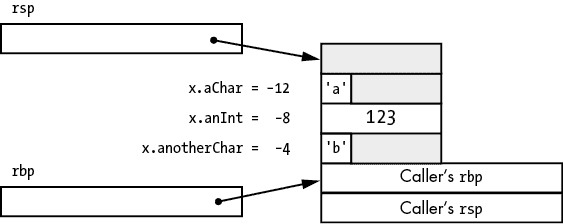

# 第 17 章：数据结构


编程的一个重要部分是确定如何组织数据。在本章中，我们将介绍组织数据的两种最基本方式：数组，可用于仅分组相同数据类型的数据项；记录，可用于分组不同数据类型的数据项。

正如你将看到的，这些数据组织方式决定了我们如何访问其中的各个数据项。两者都需要两个寻址项来定位一个数据项。由于数组中的数据项类型相同，我们可以通过数组名称加上该项的索引号来访问单个数据项。访问记录中的单个数据项则需要记录名称和记录中该数据项的名称。

## 数组

*数组* 是由相同数据类型的数据元素按顺序排列组成的集合。我们可以通过数组名称配合一个 *索引* 值来访问数组中的单个元素，该索引值指定了该元素相对于数组开头的编号。在前几章中，我们使用过 `char` 数组来存储作为文本字符串的 ASCII 字符。数组中的每个元素类型相同，都是 `char`，占用一个字节。在我们的应用中，我们是按顺序访问每个字符的，所以我们从指向第一个 `char` 的指针开始，只需将其加 1 即可访问后续的每个 `char`。我们不需要索引来定位文本字符串数组中的每个 `char`。

在本章中，我们将介绍 `int` 数组，其数组中的每个数据元素占用四字节。如果我们从指向第一个元素的指针开始，则需要将其加 4 才能访问后续的每个元素。但使用数组索引号来访问每个单独元素要容易得多。你将看到索引号如何转换为地址偏移量，以相对于数组开头访问数组元素。你还将看到 C 语言传递数组给其他函数的方式与其他数据项不同。

### C 语言中的数组


## C 语言中的数组

### 清单 17-1：用整数填充数组并显示内容

```c
/* fill2XIndex.c
 * Allocates an int array, stores 2 X element number
 * in each element and prints array contents.
 */
#include <stdio.h>
#include "twiceIndex.h"
#include "displayArray.h"
#define N 10

int main(void)
{
1 int intArray[N];

  twiceIndex(2intArray, N);
  displayArray(intArray, N);
  return 0;
}
```

如前所述，我们通过指定每个元素的数据类型（`int`）、数组名称（`intArray`）以及数组中的元素数量（`N`）来定义数组 1。此 `main` 函数调用 `twiceIndex` 函数，该函数将数组中的每个元素设置为其索引的两倍。例如，它将整数 8 存储在数组元素 4 中。然后它调用 `displayArray`，该函数在终端窗口中打印整个数组的内容。

你可能注意到的关于传递给函数的参数的第一件事是，数组似乎是按值传递的，因为我们在参数列表中只给出了它的名称 2。但由于 `twiceIndex` 在数组中存储值，它需要知道数组在内存中的位置。

通常，程序员按值将输入值传递给函数。但如果输入包含大量数据项，将它们全部复制到寄存器和栈上将非常低效，在这种情况下按指针传递更合理。数组几乎总是包含许多数据项，因此 C 语言的设计者决定始终按指针传递它们。当你将数组名称作为参数传递给函数调用时，C 会传递数组第一个元素的地址。

我们可以通过查看此 `main` 函数的编译器生成的汇编语言来明确地看到这一点，如清单 17-2 所示。

### 清单 17-2：显示数组按指针传递的编译器生成的汇编语言

```asm
        .file   "fill2XIndex.c"
        .intel_syntax noprefix
        .text
        .globl  main
        .type   main, @function
main:
        push    rbp
        mov     rbp, rsp
        sub     rsp, 48         ## memory for array
        mov     rax, QWORD PTR fs:40
        mov     QWORD PTR -8[rbp], rax
        xor     eax, eax
      1 lea     rax, -48[rbp]   ## load address of array
        mov     esi, 10         ## number of elements
        mov     rdi, rax        ## pass address
        call    twiceIndex@PLT
      2 lea     rax, -48[rbp]   ## load address of array
        mov     esi, 10
        mov     rdi, rax        ## pass address
        call    displayArray@PLT
        mov     eax, 0
        mov     rdx, QWORD PTR -8[rbp]
        xor     rdx, QWORD PTR fs:40
        je      .L3
        call    __stack_chk_fail@PLT
.L3:
        leave
        ret
        .size   main, .-main
        .ident  "GCC: (Ubuntu 9.3.0-17ubuntu1~20.04) 9.3.0"
        .section        .note.GNU-stack,"",@progbits
```

在汇编语言中，我们可以看到数组的地址首先传递给 `twiceIndex` 函数 1，然后传递给 `displayArray` 函数 2。数组元素是 `displayArray` 函数的输入，因此它不需要知道数组的地址，但传递地址比传递每个数组元素的副本要高效得多。

接下来，我们将查看在数组中存储值和显示数组内容的子函数，如清单 17-3、17-4、17-6 和 17-7 所示。

### 清单 17-3：`twiceIndex` 函数的头文件

```c
/* twiceIndex.h
 * Stores 2 X element number in each element.
 */

#ifndef TWICEINDEX_H
#define TWICEINDEX_H
void twiceIndex(int theArray[], int nElements);
#endif
```

`int theArray[]` 语法等同于 `int *theArray`，即指向 `int` 的指针。使用任一语法，C 都会将数组第一个元素的*地址*传递给函数。我们需要单独传递数组中的元素数量。

### 清单 17-4：在数组的每个元素中存储索引编号两倍的函数

```c
/* twiceIndex.c
 * Stores 2 X element number in each array element.
 */
#include "twiceIndex.h"

void twiceIndex(int theArray[], int nElements)
{
  int i;
   
  for (i = 0; i < nElements; i++)
  {
    theArray[i] = 2 * i;
  }
}
```

`twiceIndex` 函数使用 `for` 循环处理数组，将索引值的两倍存储在数组的每个元素中。让我们看看编译器为该函数生成的汇编语言；见清单 17-5。

### 清单 17-5：`twiceIndex` 函数的编译器生成的汇编语言

```asm
        .file   "twiceIndex.c"
        .intel_syntax noprefix
        .text
        .globl  twiceIndex
        .type   twiceIndex, @function
twiceIndex:
        push    rbp
        mov     rbp, rsp
        mov     QWORD PTR -24[rbp], rdi ## save array address
        mov     DWORD PTR -28[rbp], esi ## and num of elements
        mov     DWORD PTR -4[rbp], 0    ## i = 0
        jmp     .L2
.L3:
        mov     eax, DWORD PTR -4[rbp]
      1 cdqe                            ## to 64 bits
        lea     rdx, 20[0+rax*4]       ## element offset
      3 mov     rax, QWORD PTR -24[rbp] ## array address
        add     rax, rdx                ## element address
        mov     edx, DWORD PTR -4[rbp]  ## current i
        add     edx, edx                ## 2 times i
        mov     DWORD PTR [rax], edx    ## store 2 times i
        add     DWORD PTR -4[rbp], 1    ## i++
.L2:
        mov     eax, DWORD PTR -4[rbp]
        cmp     eax, DWORD PTR -28[rbp]
        jl      .L3
        nop
        pop     rbp
        ret
        .size   twiceIndex, .-twiceIndex
        .ident  "GCC: (Ubuntu 9.3.0-17ubuntu1~20.04) 9.3.0"
        .section        .note.GNU-stack,"",@progbits
```

编译器用于访问数组元素的算法如下：计算元素相对于数组开头的偏移量，然后将该偏移量加到开头的地址上。这是一个 `int` 数组，因此每个元素占四字节。编译器使用带索引的寄存器间接寻址模式（第 12 章所述）来计算 `int` 元素的地址偏移量 2。

这种寻址模式要求所有寄存器大小相同。由于我们在环境中使用 64 位寻址，`eax` 中的 32 位索引值必须扩展为 64 位，才能用于计算地址偏移量。编译器选择使用 `cdqe` 指令 1 来执行此操作，因为索引变量 `i` 被声明为 `int`，默认是有符号的。

`cdqe` 指令将 `eax` 寄存器中值的大小从 32 位加倍到 `rax` 寄存器中的完整 64 位。它将 `eax` 中的符号位复制到 `rax` 的高 32 位中，从而在扩展值中保留符号。有三条类似的指令，每条都作用于 `rax` 寄存器的不同部分：

### 指令集：`cbw`、`cwde`、`cdqe`

1.  使用符号扩展将源操作数的大小加倍。
2.  `cbw` 将 `al` 寄存器中的第 7 位复制到第 15-8 位，将大小从 `al` 加倍到 `ax` 并保留符号。第 63-16 位不受影响。
3.  `cwde` 将 `ax` 寄存器中的第 15 位复制到第 31-16 位，将大小从 `ax` 加倍到 `eax` 并保留符号。第 63-32 位清零。
4.  `cdqe` 将 `eax` 寄存器中的第 31 位复制到第 63-32 位，将大小从 `eax` 加倍到 `rax` 并保留符号。

    这些指令仅作用于 `rax` 寄存器，不影响 `rflags` 寄存器。


## 汇编语言中的数组

一旦我们计算出数组元素的 64 位偏移量，就可以获取数组开头的地址，并将该偏移量加到其上，从而得到数组元素的地址。编译器使用的算法通过将索引值与自身相加来使其加倍。然后将其存储在计算出的数组元素地址处。

数组填充数据后，将使用 `displayArray` 函数显示其内容，如清单 17-6 和 17-7 所示。

```c
/* displayArray.h
 * Prints array contents.
 */
#ifndef DISPLAYARRAY_H
#define DISPLAYARRAY_H
void displayArray(int theArray[], int nElements);
#endif
```

清单 17-6：`displayArray` 函数的头文件

```c
/* displayArray.c
 * Prints array contents.
 */
#include "displayArray.h"
#include "writeStr.h"
#include "putInt.h"
void displayArray(int theArray[], int nElements)
{
  int i;
 
  for (i = 0; i < nElements; i++)
  {
    writeStr("intArray[");
    putInt(i);
    writeStr("] = ");
    putInt(theArray[i]);
    writeStr("\n");
  }
}
```

清单 17-7：显示 `int` 数组内容的函数

`displayArray` 函数也使用 `for` 循环来处理数组的每个元素。我们将跳过 `displayArray` 函数的编译器生成的汇编语言，因为它使用与 `twiceIndex` 相同的算法访问各个数组元素（清单 17-5）。

当我们直接用汇编语言编写此程序时，会采取略有不同的方法。

### 汇编语言中的数组

现在我们将编写自己的汇编语言函数，用值填充数组。我们的方法将类似于编译器的方法，但我们将使用一些更直观的指令。清单 17-8 显示了我们的 `main` 函数。它类似于编译器生成的代码（清单 17-2），不同之处在于我为常量使用了有意义的名称。

```asm
# fill2XIndex.s
# Allocates an int array, stores 2 X element number
# in each element and prints array contents.
        .intel_syntax noprefix
# Stack frame
        .equ    intArray,-48
        .equ    canary,-8
        .equ    localSize,-48
# Constant
        .equ    N,10
# Code
        .text
        .globl	main
        .type	  main, @function
main:
        push    rbp                   # save frame pointer
        mov     rbp, rsp              # set new frame pointer
        add     rsp, localSize        # for local var.
        mov     rax, qword ptr fs:40  # get canary
        mov     qword ptr canary[rbp], rax

        mov     esi, N                # number of elements
        lea     rdi, intArray[rbp]    # our array
        call    twiceIndex

        mov     esi, N                # number of elements
        lea     rdi, intArray[rbp]    # our array
        call    displayArray
        
        mov     eax, 0                # return 0;
        mov     rcx, canary[rbp]      # retrieve saved canary
        xor     rcx, fs:40            # and check it
        je      goodCanary
        call    __stack_chk_fail@PLT  # bad canary
goodCanary:
        mov     rsp, rbp              # restore stack pointer
        pop     rbp                   # and caller frame pointer
        ret
```

清单 17-8：在汇编语言中填充数组并显示其内容

这里的 `main` 函数只是将数组的地址和数组中的元素数量传递给两个函数 `twiceIndex` 和 `displayArray` 来处理数组。

我们的 `twiceIndex` 汇编语言版本，如清单 17-9 所示，使用的指令似乎比编译器使用的指令更直观一些。

```asm
# twiceIndex.s
# Stores 2 X element number in each array element.
# Calling sequence:
#   rdi <- pointer to array
#   esi <- number of elements
        .intel_syntax noprefix

# Code
        .text
        .globl  twiceIndex
        .type   twiceIndex, @function
twiceIndex:
        push    rbp               # save frame pointer
        mov     rbp, rsp          # set new frame pointer

        mov   1 ecx, 0            # index = 0
storeLoop:
        mov     eax, ecx          # current index
      2 shl     eax, 1            # times 2
      3 mov     [rdi+rcx*4], eax  # store result
        inc     ecx               # increment index
        cmp     ecx, esi          # end of array?
        jl      storeLoop         # no, loop back
        
        mov     rsp, rbp          # restore stack pointer
        pop     rbp               # and caller frame pointer
        ret
```

清单 17-9：在每个数组元素中存储两倍索引值的汇编语言函数

我们正在为索引变量 `1` 使用一个寄存器。回想一下，当我们处于 64 位模式时，将 32 位值存储在寄存器中会将寄存器的整个高位 32 位清零，因此当将其用作地址偏移量 `3` 时，我们不需要将索引值扩展为 64 位。我们还使用 `shl` 将索引乘以 2 `2`，而不是将其与自身相加。

我们的 `displayArray` 汇编语言版本，如清单 17-10 所示，使用与 `twiceIndex` 相同的方法来访问数组元素。

```asm
# displayArray.s
# Prints array contents.
# Calling sequence:
#   rdi <- pointer to array
#   esi <- number of elements
        .intel_syntax noprefix

# Stack frame
        .equ    nElements,-8
        .equ    localSize,-16
# Constant data
        .section  .rodata
        .align  8
format1:
        .string "intArray["
format2:
        .string "] = "
endl:
        .string "\n"
# Code
        .text
        .globl  displayArray
        .type   displayArray, @function
displayArray:
        push    rbp                 # save frame pointer
        mov     rbp, rsp            # set new frame pointer
        add     rsp, localSize      # local variables
        push    rbx                 # save, use for i
        push    r12                 # save, use for array pointer

        mov     r12, rdi            # pointer to array
        mov     nElements[rbp], esi # number of elements
        
        mov     ebx, 0              # index = 0
printLoop:
        lea     rdi, format1[rip]   # start of formatting
        call    writeStr
        mov     edi, ebx            # index
        call  1 putInt
        lea     rdi, format2[rip]   # more formatting
        call    writeStr
        mov     edi, [r12+rbx*4]    # array element
        call    putInt              # print on screen
        lea     rdi, endl[rip]      # next line
        call    writeStr

        inc     ebx                 # increment index
        cmp     ebx, nElements[rbp] # end of array?
        jl      printLoop           # no, loop back
        
        pop     r12                 # restore registers
        pop     rbx
        mov     rsp, rbp            # yes, restore stack pointer
        pop     rbp                 # and caller frame pointer
        ret
```

清单 17-10：在汇编语言中显示 `int` 数组的元素

我们没有使用 `printf` 来显示数组内容，而是使用了在第 16 章最后的“动手实践”中开发的 `putInt` 函数。

在下一节中，我们将探讨如何将不同数据类型的项组合在一起。

## 记录

一个 *记录*（或 *结构*）允许程序员将多个可能具有不同数据类型的数据项组合在一起，形成一个新的程序员定义的数据类型。记录中的每个单独数据项称为 *字段* 或 *元素*。字段通常称为 *成员*，尤其是在面向对象编程中。我们将在下一章讨论 C++ 对象。

由于记录中的字段可以具有不同的大小，访问它们比访问数组中的数据项稍微复杂一些。我们将首先看看如何做到这一点，然后看看如何将记录传递给其他函数。

### C 语言中的记录


# C 和汇编语言中的记录

让我们首先看一个程序，它定义了一个记录，在每个记录的字段中存储数据，然后显示这些值，如清单 17-11 所示。

```c
/* recordField.c
 * 分配一个记录并为每个字段赋值。
 */

#include <stdio.h>

int main(void)
{
    struct
    {
        char aChar;
        int anInt;
        char anotherChar;
    } x;

    x.aChar = 'a';
    x.anInt = 123;
    x.anotherChar = 'b';

    printf("x: %c, %i, %c\n",
           x.aChar, x.anInt, x.anotherChar);
    return 0;
}
```

**清单 17-11：** 在 C 中使用 `struct` 变量的单个记录

我们使用 `struct` 关键字在 C 中声明记录。我们通过使用常规的 C 语法来定义记录的字段：数据类型后跟字段名。我们可以通过在声明后跟上记录的名称来定义一个记录。我们通过使用点运算符来访问记录的各个字段。

我们可以通过查看清单 17-12 中该函数的编译器生成的汇编语言，来了解记录是如何存储在内存中的。

```asm
        .file   "recordField.c"
        .intel_syntax noprefix
        .text
        .section        .rodata
.LC0:
        .string "x: %c, %i, %c\n"
        .text
        .globl  main
        .type   main, @function
main:
        push    rbp
        mov     rbp, rsp
        sub     rsp, 16                 ## 记录的内存
        mov     BYTE PTR 1-12[rbp], 97  ## x.aChar = 'a';
        mov     DWORD PTR -8[rbp], 123  ## x.anInt = 123;
        mov     BYTE PTR -4[rbp], 98    ## x.anotherChar = 'b';
        movzx   eax, BYTE PTR -4[rbp]   ## 加载 x.anotherChar
        movsx   ecx, al                 ## 扩展到 32 位
        mov     edx, DWORD PTR -8[rbp]  ## 加载 x.anInt
        movzx   eax, BYTE PTR -12[rbp]  ## 加载 x.aChar
        movsx   eax, al                 ## 扩展到 32 位
        mov     esi, eax
        lea     rdi, .LC0[rip]
        mov     eax, 0
        call    printf@PLT
        mov     eax, 0
        leave
        ret
        .size   main, .-main
        .ident  "GCC: (Ubuntu 9.3.0-17ubuntu1~20.04) 9.3.0"
        .section        .note.GNU-stack,"",@progbits
```

**清单 17-12：** 在内存中访问 C `struct` 变量的字段

与其他局部变量一样，记录分配在函数的栈帧中，因此其字段是相对于栈帧指针 `rbp` 来访问的。编译器计算从 `rbp` 中的地址到记录中每个字段的偏移量。

我们在图 17-1 中展示了记录在内存中的布局，该图显示了给三个字段赋值后的记录。



**图 17-1：** 栈帧显示作为 C `struct` 实现的一个记录

在我们的环境中，`int` 占用四个字节，并且必须在四字节内存地址上对齐。虽然该记录中的两个 `char` 字段各只占用一个字节，但 `int` 字段的对齐要求导致了六个“浪费”的字节，如图 17-1 所示。栈帧中还有四个额外的字节，用于创建正确的栈指针对齐，正如第 11 章“栈上的变量”中所述。

## 汇编语言中的记录

我们将在访问记录字段的汇编语言版本中使用一种不同的技术，而不是从 `rbp` 计算偏移量，如清单 17-13 所示。

```asm
# recordField.s
# 分配一个记录并为每个字段赋值。
        .intel_syntax noprefix
# 栈帧
        .equ    x,-12
        .equ    localSize,-16
# 记录偏移量
        .equ    aChar,0
        .equ    anInt,4
        .equ    anotherChar,8
        .equ    recordSize,12
# 常量数据
        .section  .rodata
        .align  8
message:
        .string "x: %c, %i, %c\n"
# 代码
        .text
        .globl	main
        .type	  main, @function
main:
        push    rbp                 # 保存帧指针
        mov     rbp, rsp            # 设置新帧指针
        add     rsp, localSize      # 为局部变量

        lea     rax, x[rbp]         # 填充记录
        mov     byte ptr aChar[rax], 'a'
        mov     dword ptr anInt[rax], 123
        mov     byte ptr anotherChar[rax], 'c'
        
        lea     rax, x[rbp]         # 打印记录
        movzx   ecx, byte ptr anotherChar[rax]
        mov     edx, dword ptr anInt[rax]
        movzx   esi, byte ptr aChar[rax]
        lea     rdi, message[rip]
        mov     eax, 0
        call    printf@plt

        mov     eax, 0              # return 0;
        mov     rsp, rbp            # 恢复栈指针
        pop     rbp                 # 和调用者的帧指针
        ret
```

**清单 17-13：** 在汇编语言中访问记录字段。

在我们的汇编语言版本中，我们首先将字段名与它们相对于记录开头的偏移量等同起来。图 17-1 中的图表有助于得出这些数字。然后我们可以加载记录开头的地址，并使用它们的名称直接访问字段。

将记录传递给另一个函数会引发额外的问题。正如你所见，我们需要指定所传递数据的类型，但一个记录可以有许多字段，每个字段可以有不同的数据类型。在下一节中，我们将看到 C 是如何解决这个问题的。

## 在 C 中将记录传递给其他函数

每次定义记录的另一个实例时都定义字段是很繁琐的。C 允许我们使用*结构标记*（或简称为*标记*）来定义我们自己的 `struct` 类型，它作为字段定义的同义词。这不仅对于定义具有相同字段组成的多个记录很有用，而且对于将记录传递给其他函数也是必需的。

例如，我们在清单 17-11 中定义了 `struct` 变量 `x`：

```c
struct
{
    char aChar;
    int anInt;
    char anotherChar;
} x;
```

相反，如果我们为 `struct` 中的字段创建一个标记，如下所示，

```c
struct aTag
{
    char aChar;
    int anInt;
    char anotherChar;
};
```

那么我们就创建了一个新的程序员定义的数据类型，`struct aTag`。然后我们可以用常规方式定义我们新数据类型的变量：

```c
struct aTag x;
```

我们将首先在一个单独的头文件中声明我们新的 `struct` 数据类型，如清单 17-14 所示，以便它可以包含在每个使用它的文件中。

```c
/* aRecord.h
 * 记录的声明。
 */

#ifndef ARECORD_H
#define ARECORD_H
struct aTag
{
    char aChar;
    int anInt;
    char anotherChar;
};
#endif
```

**清单 17-14：** C 中程序员定义的记录数据类型的声明

C 中记录的标记是一个程序员定义的标识符，放置在记录声明中的 `struct` 关键字之后。然后我们可以使用 `aTag` 来表示清单 17-14 中声明的记录字段。清单 17-15 展示了如何使用标记在程序中定义两个记录。

```c
/* records.c
 * 分配两个记录，为每个记录中的每个字段赋值
 * 并显示内容。
 */

#include "aRecord.h"
#include "loadRecord.h"
#include "displayRecord.h"

int main(void)
{
    struct aTag x;
    struct aTag y;

    loadRecord(&x, 'a', 123, 'b');
    loadRecord(&y, '1', 456, '2');
  
    displayRecord(x);
    displayRecord(y);
  
    return 0;
}
```

**清单 17-15：** 将数据加载到两个记录中然后显示内容的程序


在定义记录变量时，我们需要在 C 语言关键字 `struct` 后面跟上我们为所定义的 `struct` 类型指定的标记 1。由于 `loadRecord` 函数将在记录中存储数据值，因此我们需要传递记录的地址 2。我们可以使用按值传递的方式将记录的副本传递给 `displayRecord` 3，因为它不会更改数据值。但随着我们深入细节，你会发现程序员通常对记录使用按指针传递，以避免复制大量数据。

`x` 和 `y` 都是 清单 17-15 中的局部变量，因此它们将在栈上创建，如 清单 17-16 所示。

```
        .file   "records.c"
        .intel_syntax noprefix
        .text
        .globl  main
        .type   main, @function
main:
        push    rbp
        mov     rbp, rsp
        sub     rsp, 32           ## memory for 2 records
        mov     rax, QWORD PTR fs:40
        mov     QWORD PTR -8[rbp], rax
        xor     eax, eax
      1 lea     rax, -32[rbp]     ## address of x record
        mov     ecx, 98           ## data to store in it
        mov     edx, 123
        mov     esi, 97
        mov     rdi, rax
        call    loadRecord@PLT
        lea     rax, -20[rbp]     ## address of y record
        mov     ecx, 50           ## data to store in it
        mov     edx, 456
        mov     esi, 49
        mov     rdi, rax
        call    loadRecord@PLT
      2 mov     rdx, QWORD PTR -32[rbp] ## 8 bytes of x
        mov     eax, DWORD PTR -24[rbp] ## 4 more bytes of x
        mov     rdi, rdx
        mov     esi, eax
        call    displayRecord@PLT
        mov     rdx, QWORD PTR -20[rbp] ## 8 bytes of y
        mov     eax, DWORD PTR -12[rbp] ## 4 more bytes of y
        mov     rdi, rdx
        mov     esi, eax
        call    displayRecord@PLT
        mov     eax, 0
        mov     rcx, QWORD PTR -8[rbp]
        xor     rcx, QWORD PTR fs:40
        je      .L3
        call    __stack_chk_fail@PLT
.L3:
        leave
        ret
        .size   main, .-main
        .ident  "GCC: (Ubuntu 9.3.0-17ubuntu1~20.04) 9.3.0"
        .section        .note.GNU-stack,"",@progbits
```

清单 17-16：存储值到两个记录的程序的编译器生成汇编语言

正如我们所指定的，编译器将每个记录的地址传递给 `loadRecord` 函数 1。然而，记录是按值传递给 `displayRecord` 函数的，因此编译器将记录中所有 12 字节（包括未使用的字节）的副本传递给该函数 2。

清单 17-17 和 17-18 显示了 `loadRecord` 函数的头文件和定义。

```
/* loadRecord.h
 * Loads record with data.
 */

#ifndef LOADRECORD_H
#define LOADRECORD_H
1 #include "aRecord.h"
int loadRecord(struct aTag *aStruct, char x, int y, char z);
#endif
```

清单 17-17：`loadRecord` 函数的头文件

清单 17-17 中的参数列表展示了如何使用标记向函数传递参数。`struct aTag` 语法表示该参数的数据类型是用标记 `aTag` 声明的 C 语言 `struct`。我们需要在使用之前 `#include` 声明该标记的文件 1。

`loadStruct` 函数（如 清单 17-18 所示）引入了一种处理记录指针的有用 C 语言语法。

```
/* loadRecord.c
 * Loads record with data.
 */

#include "loadRecord.h"

int loadRecord(struct aTag *aRecord, char x, int y, char z)
{
1 (*aRecord).aChar = x;
2 aRecord->anInt = y;     /* equivalent syntax */
  aRecord->anotherChar = z;

  return 0;
}
```

清单 17-18：`loadRecord` 函数

传递给此函数的参数是一个指向记录的指针。我们需要在访问它所指向记录中的各个字段之前解引用此指针。由于点运算符 (`.`) 的优先级高于解引用运算符 (`*`) ，因此我们需要使用括号先进行解引用，再进行字段访问 1。

这一对操作——解引用然后选择字段——非常常见，但语法却很繁琐，因此 C 语言设计者创造了一种替代语法 `->` 2。这执行与另一种语法完全相同的操作，但更加简洁。

```
        .file   "loadRecord.c"
        .intel_syntax noprefix
        .text
        .globl  loadRecord
        .type   loadRecord, @function
loadRecord:
        push    rbp
        mov     rbp, rsp
      1 mov     QWORD PTR -8[rbp], rdi  ## save address of record
        mov     DWORD PTR -16[rbp], edx ## save y
        mov     eax, ecx
        mov     edx, esi
        mov     BYTE PTR -12[rbp], dl   ## save x
        mov     BYTE PTR -20[rbp], al   ## save z
      2 mov     rax, QWORD PTR -8[rbp]  ## load address of record
        movzx   edx, BYTE PTR -12[rbp]  ## load x
        mov     BYTE PTR [rax], dl      ## store x
        mov     rax, QWORD PTR -8[rbp]  ## load address of record
        mov     edx, DWORD PTR -16[rbp] ## load y
        mov     DWORD PTR 4[rax], edx   ## store y
        mov     rax, QWORD PTR -8[rbp]  ## load address of record
        movzx   edx, BYTE PTR -20[rbp]  ## load z
        mov     BYTE PTR 8[rax], dl     ## store z
        mov     eax, 0
        pop     rbp
        ret
        .size   loadRecord, .-loadRecord
        .ident  "GCC: (Ubuntu 9.3.0-17ubuntu1~20.04) 9.3.0"
        .section        .note.GNU-stack,"",@progbits
```

清单 17-19：`loadRecord` 函数的编译器生成汇编语言

对于 `loadRecord` 函数，编译器使用了一种在记录字段中存储数据的算法，这基本上与它在 `main` 函数中用于在 清单 17-11 中存储数据的算法相同。它首先将记录的地址保存在栈上的红区中 1。然后在存储每个字段的数据之前检索此地址 2，使用的是从 `aRecord.h` 文件 清单 17-14 中记录声明得出的地址偏移量。图 17-1 显示了这些地址偏移量。

`displayRecord` 函数有所不同，因为记录是按值传递的，如清单 17-20 和 17-21 所示。

```
/* displayRecord.h
 * Display contents of a record.
 */

#ifndef DISPLAYRECORD_H
#define DISPLAYRECORD_H
#include "aRecord.h"
void displayRecord(struct aTag aRecord);
#endif
```

清单 17-20：`displayRecord` 函数的头文件

```
/* displayRecord.c
 * Display contents of a struct.
 */

#include <stdio.h>
#include "displayRecord.h"

void displayRecord(struct aTag aRecord)
{
  printf("%c, %i, %c\n", aRecord.aChar,
         aRecord.anInt, aRecord.anotherChar);
}
```

清单 17-21：显示记录的函数

在记录中显示字段内容的算法很简单。我们只需将每个字段中的值传递给 `printf` 函数。但当我们查看编译器生成的汇编语言时，如 清单 17-22 所示，我们会发现该算法需要在 `displayRecord` 函数的栈帧中重建记录。


## 在汇编语言中将记录传递给其他函数

```
.file   "displayRecord.c"
.intel_syntax noprefix
.text
.section        .rodata
.LC0:
        .string "%c, %i, %c\n"
.text
.globl  displayRecord
.type   displayRecord, @function
displayRecord:
        push    rbp
        mov     rbp, rsp
        sub     rsp, 16         ## memory for a record
        mov     rdx, rdi
        mov     eax, esi
        mov     QWORD PTR -16[rbp], rdx ## 8 bytes of record
        mov     DWORD PTR -8[rbp], eax  ## another 4 bytes
        movzx   eax, BYTE PTR -8[rbp]   ## load anotherChar
        movsx   ecx, al                 ## extend to 32 bits
        mov     edx, DWORD PTR -12[rbp] ## load anInt
        movzx   eax, BYTE PTR -16[rbp]  ## load aChar
        movsx   eax, al                 ## extend to 32 bits
        mov     esi, eax
        lea     rdi, .LC0[rip]
        mov     eax, 0
        call    printf@PLT
        nop
        leave
        ret
.size   displayRecord, .-displayRecord
.ident  "GCC: (Ubuntu 9.3.0-17ubuntu1~20.04) 9.3.0"
.section        .note.GNU-stack,"",@progbits
```

**清单 17-22**：`displayRecord` 函数的编译器生成汇编语言

对于 `displayRecord` 函数，编译器选择创建一个栈帧。然后它将组成记录的 12 字节从传递它们的寄存器复制到栈帧中。一旦记录在局部栈帧中重建完成，各个字段中的数据就会被传递给 `printf` 函数以在屏幕上显示。

我们在 `loadRecord` 函数中访问记录字段的方法将与编译器的方法类似。我们将在寄存器中使用记录的地址（按指针传递），并使用字段地址偏移量来访问它。

但我们将按指针而不是按值将记录传递给 `displayRecord` 函数。虽然在 C 语言中也可以这样做，但我们的汇编语言版本将清楚地展示这样做的优势。

我们将从清单 17-23 中的 `main` 函数开始。

```
# records.s
# Allocates two records, assigns a value to each field
# in each record, and displays the contents.
.intel_syntax noprefix
# Stack frame
.equ    x,-32
.equ    y, -20
.equ    canary,-8
.equ    localSize,-32
# Constant data
.section  .rodata
.align  8
endl:
        .string "\n"
# Code
.text
.globl	main
.type	  main, @function
main:
        push    rbp                   # save frame pointer
        mov     rbp, rsp              # set new frame pointer
        add     rsp, localSize        # for local var.
        mov     rax, qword ptr fs:40  # get canary
        mov     qword ptr canary[rbp], rax

        mov     ecx, 'b'              # data to store in record
        mov     edx, 123
        mov     esi, 'a'
        lea     rdi, x[rbp]           # x record
        call    loadRecord
        
        mov     ecx, '2'              # data to store in record
        mov     edx, 456
        mov     esi, '1'
        lea     rdi, y[rbp]           # y record
        call    loadRecord

        lea     rdi, x[rbp]           # display x record
        call    displayRecord

        lea     rdi, y[rbp]           # display y record
        call    displayRecord
        
        mov     eax, 0                # return 0;
        mov     rcx, canary[rbp]      # retrieve saved canary
        xor     rcx, fs:40            # and check it
        je      goodCanary
        call    __stack_chk_fail@PLT  # bad canary
goodCanary:
        mov     rsp, rbp              # restore stack pointer
        pop     rbp                   # and caller frame pointer
        ret
```

**清单 17-23**：在两个记录中存储数据并显示其内容的汇编语言程序

我们的 `main` 函数汇编语言版本类似于我们 C 语言版本（清单 17-16）的编译器生成汇编语言，不同之处在于我们是按指针而不是按值将记录传递给 `displayRecord` 函数。

接下来，我们将记录中字段偏移量的等值定义放在一个单独的文件中，如清单 17-24 所示，以确保我们在所有访问字段的文件中使用相同的等值定义。

```
# aRecord
# Declaration of a record.
# This record takes 12 bytes.
.equ    aChar,0
.equ    anInt,4
.equ    anotherChar,8
```

**清单 17-24**：记录字段偏移量

我们对字段使用的偏移量与 C 语言版本相同，如图 17-1 所示。由于 `main` 函数不直接访问记录字段，因此我们不需要在该文件中使用偏移量。但我们在为每个记录在栈上分配空间时，确实需要知道记录使用的总字节数。

C 语言标准为 `struct` 中字段的内存对齐指定了一些规则，但这些规则允许不同的编译器对字段偏移量使用不同的值。为了帮助我们将汇编语言函数与 C 函数连接，标准在 `stddef.h` 头文件中指定了一个宏 `offsetof`，它将显示我们的编译器在 C 代码中为偏移量选择的值。例如，这段代码：

```
#include <stddef.h>
#include "aRecord.h"
--snip--
offsetof(struct aTag, anInt);
```

将返回 `anInt` 相对于 `struct` 开始处的偏移量值。`offsetof` 的手册页包含一个更完整的使用示例。我同时使用了 `offsetof` 宏和编译器生成的汇编语言（清单 17-19）来确定偏移量的值。

用于在记录中存储数据的汇编语言函数（清单 17-25）类似于编译器从 C 语言版本（清单 17-19）生成的代码。

```
# loadRecord.s
# Loads record with data.
# Calling sequence:
#   rdi <- pointer to record
#   esi <- 1st char
#   edx <- int
#   ecx <- 2nd char
.intel_syntax noprefix
# Record field offsets
.include  "aRecord"
# Code
.text
.globl  loadRecord
.type   loadRecord, @function
loadRecord:
        push    rbp                   # save frame pointer
        mov     rbp, rsp              # set new frame pointer

        mov     aChar[rdi], esi       # 1st char field
        mov     anInt[rdi], edx       # int field
        mov     anotherChar[rdi], ecx # 2nd char field

        mov     rsp, rbp              # restore stack pointer
        pop     rbp                   # and caller frame pointer
        ret
```

**清单 17-25**：`loadRecord` 函数的汇编语言版本

我们使用 `.include` 汇编指令将记录字段名称及其各自的偏移量引入此函数。`.include` 汇编指令的工作方式类似于 C 语言的 `#include` 指令——它在汇编代码之前将指定文件的文本复制到此源文件中。

由于此函数不调用任何其他函数，我们知道传递给 `rdi` 中此函数的记录地址不会改变。我们可以简单地使用字段名称并以 `rdi` 作为基址寄存器来访问每个字段。

如清单 17-26 所示，按指针将记录传递给 `displayRecord` 函数可以简化该函数。


# 清单 17-26：`displayRecord` 函数的汇编语言版本

```
# displayRecord.s
# 显示记录的内容。
# 调用序列：
#   rdi <- 指向记录的指针
        .intel_syntax noprefix
# 记录字段偏移量
        .include  "aRecord"
# 栈帧
        .equ    recordPtr,-16
        .equ    localSize,-16
# 有用的常量
        .equ    STDOUT,1
# 常量数据
        .section  .rodata
        .align  8
endl:
        .string "\n"
# 代码
        .text
        .globl  displayRecord
        .type   displayRecord, @function
displayRecord:
        push    rbp                   # 保存帧指针
        mov     rbp, rsp              # 设置新的帧指针
        add     rsp, localSize        # 为局部变量预留空间
       
      1 mov     recordPtr[rbp], rdi   # 保存记录地址

        mov     edx, 1                # 写入一个字符
        mov     rax, recordPtr[rbp]   # 记录的地址
        lea     rsi, aChar[rax]       # 字符位于此处
        mov     edi, STDOUT           # 输出到屏幕
      2 call    write@plt
        lea     rdi, endl[rip]        # 新行
        call    writeStr
        
        mov     rax, recordPtr[rbp]   # 记录的地址
        mov     edi, anInt[rax]       # 获取整数
        call    putInt                # 写入屏幕
        lea     rdi, endl[rip]
        call    writeStr
        
        mov     edx, 1                # 第二个字符
        mov     rax, recordPtr[rbp]   # 记录的地址
        lea     rsi, anotherChar[rax]
        mov     edi, STDOUT
        call    write@plt
        lea     rdi, endl[rip]
        call    writeStr

        mov     rsp, rbp              # 恢复栈指针
        pop     rbp                   # 以及调用者的帧指针
        ret
```

该函数调用其他函数，这些函数可能会改变 `rdi` 的内容，因此我们需要将记录的地址保存在栈帧 1 中，以便稍后在函数中访问各个记录字段。由于 `char` 字段只存放单个字符，我们使用 `write` 函数来显示这些字段的内容 2。

## 你学到了什么

1. **数组** — 相同数据类型的数据项集合，在内存中连续存储。
2. **处理数组** — CPU 具有一种寻址模式，可使用索引值访问数组元素。
3. **传递数组** — 在 C 中，数组是通过指针而非值传递的。
4. **记录** — 数据项的集合，可能包含不同数据类型，在内存中一起存储，可能因地址对齐而有填充。
5. **访问记录字段** — 可使用带偏移量的地址寻址模式来访问记录字段。
6. **传递记录** — 通过指针传递记录通常更高效，即使它是输入参数。

在下一章中，我们将讨论 C++ 如何利用记录来实现面向对象编程范式。
