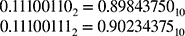
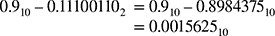
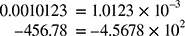
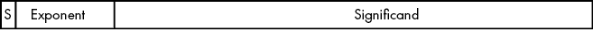
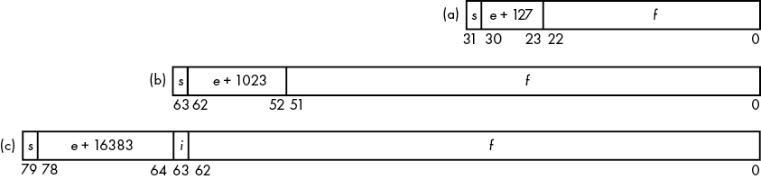
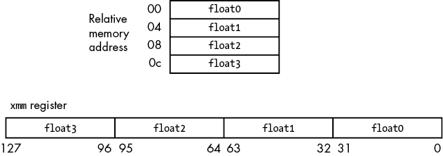

# 第 19 章：小数值


在程序中，我们一直只使用整数值——整数和字符。在本章中，我们将探讨计算机如何表示小数值。我们将介绍两种表示小数值的方式：*定点数* 和 *浮点数*。

我们将首先看看定点数，这将展示小数值如何用二进制表示。正如你将看到的，用于数值整数部分的位数限制了我们能表示的数值范围。为小数部分使用一些位只是允许我们将该范围划分为更小的部分。

这种范围限制将引导我们讨论浮点数，它允许更大的范围，但也引入了其他限制。我们将讨论浮点表示的格式和属性，然后讨论最常见的浮点二进制标准 IEEE 754。我们将以简要探讨浮点数在 x86-64 架构中如何处理来结束本章。

## 二进制中的小数值

让我们从小数值的数学原理开始看起。回顾第 2 章，十进制整数 *N* 可用二进制表示如下：

$$
N = d_{n-1} \times 2^{n-1} + d_{n-2} \times 2^{n-2} + \dots + d_1 \times 2¹ + d_0 \times 2⁰
$$

其中每个 $d_i \in \{0, 1\}$。

我们可以扩展它以包含小数部分 *F*：

$$
N.F = d_{n-1} \times 2^{n-1} + d_{n-2} \times 2^{n-2} + \dots + d_0 \times 2⁰ + d_{-1} \times 2^{-1} + d_{-2} \times 2^{-2} + \cdots
$$

$$
= d_{n-1}d_{n-2}\dots d_0.d_{-1}d_{-2}\dots
$$

其中每个 $d_i \in \{0, 1\}$。请仔细注意等式右侧 $d_0$ 和 $d_{-1}$ 之间的 *二进制点*。二进制点右侧的所有项都是 2 的负幂，因此这部分数值之和为一个小数值。就像左侧的十进制点一样，二进制点将数值的小数部分与整数部分分开。这里有个例子：

$$
1.6875_{10} = 1.0_{10} + 0.5_{10} + 0.125_{10} + 0.0625_{10}
$$

$$
= 1 \times 2⁰ + 1 \times 2^{-1} + 0 \times 2^{-2} + 1 \times 2^{-3} + 1 \times 2^{-4}
$$

$$
= 1.1011_2
$$


# 定点数

## 小数值的二进制表示

虽然任何整数都可以表示为二的幂的和，但二进制中小数值的精确表示仅限于二的*负*幂的和。例如，考虑小数值 0.9 的 8 位表示。从



$$
0.11100110_2 = 0.89843750_{10} \\
0.11100111_2 = 0.90234375_{10}
$$

我们可以看到以下内容：

$0.11100110_2 < 0.9_{10} < 0.11100111_2$

实际上，

$0.9_{10} = 0.111001100_2$

其中 `1100` 表示该位模式无限重复。

二进制小数值的舍入很简单。如果右侧的下一位是 `1`，则在舍入的位位置上加 `1`。让我们把 0.9 舍入到八位。从前面可以看出，二进制点右侧的第九位是 0，所以我们在第八位位置上不加 1。因此，我们使用

$0.9_{10} \approx 0.11100110_2$

这产生的舍入误差如下：



$$
0.9_{10} - 0.11100110_2 = 0.9_{10} - 0.8984375_{10} \\
= 0.0015625_{10}
$$

## 定点数

*定点数*本质上是一种缩放的整数表示，缩放因子由*基点*的位置指示。基点将数值的小数部分与整数部分分开。我们在十进制数中称之为*小数点*，在二进制数中称为*二进制点*。英语国家通常使用句号；其他地区通常使用逗号。

例如，$1234.5_{10}$ 表示 $12345_{10}$ 缩放 $1/10$；`10011010010.1`[2] 是 `100110100101`[2] 缩放 $1/2$ 倍。使用定点数进行计算时，我们需要注意基点的位置。

接下来，我们将研究小数部分为二的负幂的数值缩放，这种情况下小数部分可以精确表示。然后我们将研究十进制小数的缩放，以避免前面描述的舍入误差。

### 当小数部分是二的负幂之和时

我们将从一个程序开始，该程序添加两个以英寸为单位指定的测量值。英寸的小数部分通常以 2 的负幂指定：1/2、1/4、1/8 等，这些在二进制系统中可以精确表示。

我们的程序将添加两个精确到 1/16 英寸的测量值。我们需要四位来存储小数部分，剩下 28 位用于整数部分。

当添加两个数字时，我们需要对齐它们的基点。清单 19-1 展示了我们如何在从键盘读取数字时进行这种对齐。

#### 清单 19-1：读取英寸和十六分之一英寸长度的函数

```asm
# getLength.s
# Gets length in inches and 1/16s.
# Outputs 32-bit value, high 28 bits hold inches,
# low 4 bits hold fractional value in 1/16s.
# Calling sequence:
#   rdi <- pointer to length
        .intel_syntax noprefix
# Useful constant
        .equ    fractionMask, 0xf
# Stack frame
        .equ    lengthPtr,-16
      1 .equ    inches,-8
        .equ    fraction,-4
        .equ    localSize,-16
# Constant data
        .section	.rodata
        .align  8
prompt:
        .string "Enter inches and 1/16s\n"
inchesPrompt:
        .string "        Inches: "
fractionPrompt:
        .string "    Sixteenths: "
# Code
        .text
        .globl  getLength
        .type   getLength, @function
getLength:
        push    rbp                           # save frame pointer
        mov     rbp, rsp                      # set new frame pointer
        add     rsp, localSize                # for local var.
        
        mov     lengthPtr[rbp], rdi           # save pointer to output

        lea     rdi, prompt[rip]              # prompt user
        call    writeStr

        lea     rdi, inchesPrompt[rip]        # ask for inches
        call    writeStr
        lea     rdi, inches[rbp]              # get inches
        call    getUInt
        lea     rdi, fractionPrompt[rip]      # ask for 1/16's
        call    writeStr
        lea     rdi, fraction[rbp]            # get fraction
        call    getUInt
        
        mov     eax, dword ptr inches[rbp]    # retrieve inches
      3 sal     eax, 4                        # make room for fraction
        mov     ecx, dword ptr fraction[rbp]  # retrieve frac
      4 and     ecx, fractionMask             # make sure < 16
        add     eax, ecx                      # add in fraction
        mov     rcx, lengthPtr[rbp]           # load pointer to output
        mov     [rcx], eax                    # output

        mov     rsp, rbp                      # restore stack pointer
        pop     rbp                           # and caller frame pointer
        ret
```

清单 19-1：从键盘读取以英寸和十六分之一英寸为单位的数字的函数

我们为英寸数和十六分之一英寸数各分配 32 位，每个都作为整数从键盘读取 1。注意，我们使用 `getUInt` 函数来读取每个无符号 `int` 2。这是 `getInt` 函数的一个简单修改，后者读取有符号 `int`；我们在第 15 章编写了 `getInt`。

我们使用低 4 位存储小数部分，因此将整数部分左移 4 位，为添加小数部分腾出空间 3。在添加小数部分之前，我们将确保用户输入的数字不超过 4 位 4。

这种缩放为整数部分留出了 28 位。这将我们的数字范围限制为 0 到 268435455 15/16。这比 32 位整数 0 到 4294967295 的范围小 16 倍，但分辨率达到了最近的 1/16。

我们用于显示这些测量值的函数，如 清单 19-2 所示，同时显示整数部分和小数部分。


# 定点运算的汇编清单

## 清单 19-2：以英寸和十六分之一英寸显示长度

### 源代码：`displayLength.s`

```assembly
# displayLength.s
# 以英寸和 1/16 英寸显示长度。
# 调用序列：
#   edi <- 低 4 位存放十六分之一英寸的值
        .intel_syntax noprefix
# 有用的常量
        .equ  1 fractionMask, 0xf
# 栈帧
        .equ    length,-16
        .equ    localSize,-16
# 常量数据
        .section	.rodata
        .align  8
link:
        .string " "
over:
        .string "/16"
msg:
        .string "Total = "
endl:
        .string "\n"
# 代码
        .text
        .globl  displayLength
        .type   displayLength, @function
displayLength:
        push    rbp                 # 保存帧指针
        mov     rbp, rsp            # 设置新帧指针
        add     rsp, localSize      # 为局部变量分配空间
        
        mov     length[rbp], rdi    # 保存输入长度
        lea     rdi, msg[rip]       # 友好提示信息
        call    writeStr
        
        mov     edi, length[rbp]    # 原始值
      2 shr     edi, 4              # 整数部分
        call    putUInt             # 写入屏幕
        lea     rdi, link[rip]
        call    writeStr
        
        mov     edi, length[rbp]    # 原始值
      3 and     edi, fractionMask   # 小数部分
        call    putUInt             # 写入屏幕
      4 lea     rdi, over[rip]
        call    writeStr

        lea     rdi, endl[rip]
        call    writeStr

        mov     rsp, rbp            # 恢复栈指针
        pop     rbp                 # 恢复调用者帧指针
        ret
```

### 说明

我们将数字向右移动四位，以便将整数部分作为整数显示 2。使用四位掩码 1，我们屏蔽掉整数部分，并将小数部分作为另一个整数显示 3。我们添加一些文本以表明第二个整数是小数部分 4。

清单 19-3 展示了 `main` 函数。

## 清单 19-3：将两个尺子测量值相加

### 源代码：`rulerAdd.s`

```assembly
# rulerAdd.s
# 将两个尺子测量值相加，精确到 1/16 英寸。
        .intel_syntax noprefix
# 栈帧
        .equ    x,-16
        .equ    y, -12
        .equ    canary,-8
        .equ    localSize,-16
# 常量数据
        .section	.rodata
        .align  8
endl:
        .string "\n"
# 代码
        .text
        .globl	main
        .type	main, @function
main:
        push    rbp                     # 保存帧指针
        mov     rbp, rsp                # 设置新帧指针
        add     rsp, localSize          # 为局部变量分配空间
        mov     rax, qword ptr fs:40    # 获取金丝雀值
        mov     qword ptr canary[rbp], rax

        lea     rdi, x[rbp]             # x 长度
        call    getLength
        
        lea     rdi, y[rbp]             # y 长度
        call    getLength

        mov     edi, x[rbp]             # 取回 x 长度
      1 add     edi, y[rbp]             # 加上 y 长度
        call    displayLength

        mov     eax, 0                  # 返回 0;
        mov     rcx, qword ptr canary[rbp]
        xor     rcx, qword ptr fs:40
        je      goodCanary
        call    __stack_chk_fail@plt
goodCanary:
        mov     rsp, rbp                # 恢复栈指针
        pop     rbp                     # 恢复调用者帧指针
        ret
```

### 说明

清单 19-3：将两个以英寸和十六分之一英寸为单位的测量值相加的程序

如果你查看上一节中用二进制表示小数值的公式，你大概能说服自己，整数 `add` 指令适用于整个数字，包括小数部分 1。

这个示例非常适合二进制数，但我们在计算中主要使用十进制数。正如我们在本章前面看到的，大多数十进制小数无法转换为有限位数的二进制，需要四舍五入。在下一节中，我们将讨论在使用十进制小数时如何避免舍入错误。

## 当小数部分为十进制时

让我们思考一下在这里如何处理定点格式中的小数部分。当我们从键盘读取整数部分时，我们将其向左移动四个位位置，为将十六分之一的数量加到这个 `int` 中留出空间。

我们实际上创建了一个 32 位数字，其二进制点位于第 5 位和第 4 位之间（位编号为 4 和 3）。这之所以可行，是因为小数部分是 2 的负幂之和。

另一种思考之前如何处理分数的方法是，四位移位将数字乘以 16。处理十进制时我们将采用这种方法：将数字乘以 10 的倍数，使最小值变为整数。

我们将通过一个程序来探索这种方法，该程序将两个美元值相加，精确到 1/100 美元。与清单 19-1、19-2 和 19-3 中的尺子测量程序一样，我们将从从键盘读取货币值的函数 `getMoney` 开始，如 清单 19-4 所示。

## 清单 19-4：读取货币值（美元和美分）

### 源代码：`getMoney.s`

```assembly
# getMoney.s
# 获取美元和美分。
# 输出 32 位值，以美分表示货币。
# 调用序列：
#   rdi <- 指向长度的指针
        .intel_syntax noprefix
# 有用的常量
        .equ  1 dollar2cents, 100
# 栈帧
        .equ    moneyPtr,-16
        .equ    dollars,-8
        .equ    cents,-4
        .equ    localSize,-16
# 常量数据
        .section	.rodata
        .align  8
prompt:
        .string "Enter amount\n"
dollarsPrompt:
        .string "    Dollars: "
centsPrompt:
        .string "      Cents: "
# 代码
        .text
        .globl  getMoney
        .type   getMoney, @function
getMoney:
        push    rbp                     # 保存帧指针
        mov     rbp, rsp                # 设置新帧指针
        add     rsp, localSize          # 为局部变量分配空间
        
        mov     moneyPtr[rbp], rdi      # 保存输出指针

        lea     rdi, prompt[rip]        # 提示用户
        call    writeStr

        lea     rdi, dollarsPrompt[rip] # 询问美元
        call    writeStr
        lea     rdi, dollars[rbp]       # 获取美元
      2 call    getUInt
        lea     rdi, centsPrompt[rip]   # 询问美分
        call    writeStr
        lea     rdi, cents[rbp]         # 获取美分
      3 call    getUInt
        
        mov     eax, dword ptr dollars[rbp] # 取回美元
        mov     ecx, dollar2cents           # 将美元缩放为美分
      4 mul     ecx
        mov     ecx, dword ptr cents[rbp]   # 取回美分
        add     eax, ecx                    # 加上美分
        mov     rcx, moneyPtr[rbp]          # 加载输出指针
        mov     [rcx], eax                  # 输出

        mov     rsp, rbp                    # 恢复栈指针
        pop     rbp                         # 恢复调用者帧指针
        ret
```

### 说明

清单 19-4：从键盘读取美元和美分并转换为美分的函数

与尺子测量程序一样，我们将整数部分 2 和小数部分 3 作为整数读取。如解释所述，由于缩放因子是 10 的倍数，我们需要将整数部分 4 乘以缩放因子 1，而不仅仅是移位。

显示缩放数字的函数需要逆转该过程以分离整数和小数部分。我们将在 `displayMoney` 函数中执行此操作，如 清单 19-5 所示。


# 定点运算示例

## 清单 19-5：`displayMoney` 函数

```asm
# displayMoney.s
# 以美元和美分显示金额。
# 调用序列：
#   `edi` <- 以美分为单位的金额
        .intel_syntax noprefix
# 有用的常量
        .equ  1 cent2dollars, 100
# 栈帧
        .equ    money,-16
        .equ    localSize,-16
# 常量数据
        .section	.rodata
        .align 8
decimal:
        .string "."
msg:
        .string "Total = $"
zero:
        .string "0"
endl:
        .string "\n"
# 代码
        .text
        .globl  displayMoney
        .type   displayMoney, @function
displayMoney:
        push    rbp                     # 保存帧指针
        mov     rbp, rsp                # 设置新帧指针
        add     rsp, localSize          # 为局部变量分配空间
        
        mov     money[rbp], rdi         # 保存输入金额
        lea     rdi, msg[rip]           # 友好提示信息
        call    writeStr
        
        mov     edx, 0                  # 清除高位
        mov     eax, money[rbp]         # 转换金额
        mov     ecx, cent2dollars       #     为美元和美分
      2 div     ecx
      3 mov     money[rbp], edx         # 保存美分
        mov     edi, eax                # 美元
        call    putUInt                 # 写入屏幕
      4 lea     rdi, decimal[rip]
        call    writeStr
        
        cmp     dword ptr money[rbp], 10  # 两位小数？
        jae     twoDecimal                # 是
        lea     rdi, zero[rip]            # 否，十位上补 0
        call    writeStr
twoDecimal:
        mov     edi, money[rbp]           # 加载美分
        call    putUInt                   # 写入屏幕

        lea     rdi, endl[rip]
        call    writeStr

        mov     rsp, rbp                  # 恢复栈指针
        pop     rbp                       # 恢复调用者帧指针
        ret
```

**清单 19-5：** 将美分显示为美元和美分的函数

我们在读取金额值时使用了一个缩放因子，将小数点向右移动两位。现在我们需要将小数点向左移动两位以恢复小数部分。因此我们需要使用相同的缩放因子 100。

随后 `div` 指令会将整数部分留在 `eax` 中，余数（小数部分）留在 `edx` 中。我们在打印整数部分时暂时保存小数部分。与尺子测量程序类似，我们打印文本以指示小数部分。

清单 19-6 展示了将两个金额相加的 `main` 函数。

## 清单 19-6：`moneyAdd` 程序

```asm
# moneyAdd.s
# 以美元和美分将两个金额相加。
        .intel_syntax noprefix
# 栈帧
        .equ    x,-16
        .equ    y, -12
        .equ    canary,-8
        .equ    localSize,-16
# 常量数据
        .section	.rodata
        .align 8
endl:
        .string "\n"
# 代码
        .text
        .globl	main
        .type	main, @function
main:
        push    rbp                     # 保存帧指针
        mov     rbp, rsp                # 设置新帧指针
        add     rsp, localSize          # 为局部变量分配空间
        mov     rax, qword ptr fs:40    # 获取金丝雀值
        mov     qword ptr canary[rbp], rax

        lea     rdi, x[rbp]             # x 金额
        call    getMoney
        
        lea     rdi, y[rbp]             # y 金额
        call    getMoney

        mov     edi, x[rbp]             # 取回 x 金额
      1 add     edi, y[rbp]             # 加上 y 金额
        call    displayMoney

        mov     eax, 0                  # return 0;
        mov     rcx, qword ptr canary[rbp]
        xor     rcx, qword ptr fs:40
        je      goodCanary
        call    __stack_chk_fail@plt
goodCanary:
        mov     rsp, rbp                # 恢复栈指针
        pop     rbp                     # 恢复调用者帧指针
        ret
```

**清单 19-6：** 使用定点数相加金额的程序

`main` 函数中使用的金额已被缩放为整数，因此我们可以使用简单的 `add` 指令将它们相加。

虽然定点运算允许我们保留数字的全部分辨率，但数值范围受限于整数数据类型的位数，本程序中为 32 位。我们将程序中数字的范围限制在 0 到 42949672.95 之间，但将分辨率提高到了最近的 0.01。

我们有一种更方便的表示法来表示非常大和非常小的数字，接下来我们将探讨它。

# 浮点数

让我们从本节最重要的概念开始：`浮点数` 不是 `实数`。实数包含从 −∞ 到 +∞ 的所有数字的连续统。你已经知道计算机是有限的，所以当然存在可表示的最大值的限制，但问题比单纯的幅度限制更严重。

正如你将在本节中看到的，浮点数仅构成实数的一个很小子集。相邻浮点数之间存在显著的间隙。这些间隙可能产生多种类型的错误。更糟糕的是，这些错误可能发生在中间结果中，使得它们难以调试。

## 浮点表示

`浮点表示` 基于 `科学计数法`。在浮点表示中，我们有一个符号和两个数字来完全指定一个值：一个 `尾数` 和一个 `指数`。十进制浮点数写作尾数乘以 10 的指数次幂。例如，考虑这两个数字：



`0.0010123 = 1.0123 × 10^(–3)`  
`–456.78 = –4.5678 × 10²`

注意，在浮点表示中，数字被*归一化*，使得小数点左侧仅出现一位数字。10 的指数会相应调整。如果我们约定每个数字都经过归一化且我们在十进制下工作，那么每个浮点数完全由三项指定：尾数、指数和符号。在前面的两个例子中：

`10123, –3, 和 +` 代表 `+1.0123 × 10^(–3)`  
`45678, +2, 和 –` 代表 `–4.5678 × 10^(+2)`

使用浮点表示的优势在于，对于给定的位数，我们可以表示更大范围的值。

让我们看看浮点数是如何存储在计算机中的。

## IEEE 754 浮点标准

存储浮点数最常用的标准是 `IEEE 754` ([`standards.ieee.org/standard/754-2019.html`](https://standards.ieee.org/standard/754-2019.html))。图 19-1 展示了通用模式。



**图 19-1：** 存储浮点数的通用模式

这里，`S` 是数字的符号。

像所有存储格式一样，浮点格式涉及分辨率、舍入误差、大小和范围之间的权衡。`IEEE 754` 标准规定了从 4 到 16 字节的大小。C/C++ 中最常用的大小是 `float`（四字节）和 `double`（八字节）。`x86-64` 架构支持这两种大小，外加一个 10 字节的扩展版本，它类似于但不属于 `IEEE 754` 标准。

图 19-2 展示了这三种大小各自指定的位数。



**图 19-2：** (a) C `float`、(b) C `double` 和 (c) `x86-64` 扩展版本的位数


# 浮点数表示 (IEEE 754)

## 规格化形式

图 19-2 中的值表示一个以规格化形式存储的浮点数 `N`。

```
N = (–1)^s × 1.f × 2^e
```

第一位 `s` 是符号位，`0` 表示正数，`1` 表示负数。

与十进制一样，调整指数使得二进制点左侧只有一个非零数字。不过在二进制中，这个数字总是 1，从而得到尾数 `1.f`。既然它总是 1，在 IEEE 754 的四字节和八字节版本中，整数部分 (1) 不会被存储。这被称为 `hidden bit`。只存储尾数的小数部分 `f`。整数部分 `i` 包含在 x86-64 扩展的 10 字节版本中。

这些格式需要允许负指数。你的第一反应可能是使用补码。然而，IEEE 标准是 20 世纪 70 年代制定的，当时浮点运算消耗大量 CPU 时间。程序中的许多算法仅依赖于两个数的比较，当时的计算机科学家意识到，一种允许使用整数比较指令的格式将带来更快的执行时间。因此他们决定在存储前向指数加上一个量，即 `bias`（偏移量），使得最小的允许指数存储为 0。结果称为 `biased exponent`（偏移指数），随后可作为 `unsigned int`（无符号整数）存储。正如你在图 19-2 中所见，4 字节标准的偏移量为 127，8 字节为 1023，10 字节为 16383。

`hidden bit` 方案带来了一个问题——无法表示 0。为解决此问题及其他问题，IEEE 754 标准定义了几种特殊情况：

1.  `Zero value`（零值） 所有偏移指数位和尾数位均为 0，允许存在 –0 和 +0。这保留了收敛到 0 的计算的符号。
2.  `Denormalized`（非规格化） 如果待表示的值小于所有偏移指数位为 0 时所能表示的最小值，意味着 `e` 取最小可能值，则不再假定隐含位。此时偏移量减 1。
3.  `Infinity`（无穷大） 将所有偏移指数位置 1、所有尾数位置 0 表示无穷大。注意这允许符号位指定 +∞ 和 −∞，使我们仍能比较超出范围的数。
4.  `Not a number (NaN)`（非数值） 如果偏移指数位全为 1 但尾数位不全为 0，则表示错误的值。这可用于指示浮点变量尚无值。NaN 应视为程序错误。

产生无穷大的运算示例是非零值除以 0。产生 NaN 的示例是结果未定义的运算，如 0 除以 0。

接下来，我们将讨论用于处理浮点数的 x86-64 硬件。

## SSE2 浮点硬件

直到 1989 年 4 月 Intel 486DX 推出前，`x87 floating-point unit`（x87 浮点单元）位于单独的芯片上，即 `coprocessor`（协处理器）。现在它集成在 CPU 芯片上，尽管其执行架构与 CPU 中的 `integer unit`（整数单元）略有不同。它使用图 19-2(c) 中的 10 字节浮点标准。

1997 年，Intel 在其处理器中增加了 `Multimedia Extensions`（`MMX`，多媒体扩展），包含可同时对多个数据项操作的指令——`single instruction, multiple data`（`SIMD`，单指令多数据流）。对单个数据项的操作称为 `scalar operations`（标量操作）。并行对多个数据项操作称为 `vector operations`（向量操作），这对许多多媒体和科学应用很有用。本书仅讨论标量操作。

最初 MMX 仅执行整数运算，但 1998 年 AMD 向 MMX 添加了 `3DNow!` 扩展，包含浮点指令。Intel 很快于 1999 年在 Pentium III 中推出 `Streaming SIMD Extension`（`SSE`，流式 SIMD 扩展），AMD 随后加入 SSE 形成 `3DNow! Professional`。多年来演化出多个版本——SSE、SSE2、SSE3 和 SSE4。2011 年 Intel 和 AMD 增加了用于 SIMD 和浮点运算的 `Advanced Vector Extensions`（`AVX`，高级向量扩展）。

x86-64 架构至少包含 SSE2。更高版本仅在高端 CPU 芯片上可用。本书讨论 SSE2，因为它最常见，且支持更高版本的芯片仍支持 SSE2。唯一不包含至少 SSE 的 CPU 芯片是一些廉价的 32 位微控制器（例如 Intel Quark），因此本书不讨论 x87 架构。

大多数 SSE2 指令同时对多个数据项操作。SSE2 包含整数和浮点运算指令。整数指令可一次操作多达十六个 8 位、八个 16 位、四个 32 位、两个 64 位或一个 128 位整数。

向量浮点指令同时对寄存器中的所有四个 32 位或两个 64 位浮点数操作。每个数据项独立处理。这些指令适用于处理数组等算法。一条 SSE2 指令可并行操作多个数组元素，带来显著加速。此类算法常见于多媒体和科学应用。

本书仅涉及少数标量浮点指令，它们仅操作单个数据项。这些指令操作 32 位（单精度）或 64 位（双精度）值。标量指令仅操作 128 位 `xmm` 寄存器的低序部分，高序 64 或 96 位保持不变。

### xmm 寄存器

SSE 架构向 CPU 增加了八个 128 位寄存器，它们独立于我们迄今在书中使用的通用整数寄存器。SSE2 增加了 64 位模式，新增八个 128 位寄存器，名为 `xmm0`、`xmm1`、……、`xmm15`。AVX 扩展增加了更宽的寄存器：256 位 `ymm0`、`ymm1`、……、`ymm15` 和 512 位 `zmm0`、`zmm1`、……、`zmm15`。在 AVX 架构中，寄存器名 `xmm0`、`xmm1`、……、`xmm15` 分别指代 256 位 `ymm0`、`ymm1`、……、`ymm15` 和 512 位 `zmm0`、`zmm1`、……、`zmm15` 的低 128 位。

图 19-3 展示了一个 `xmm` 寄存器及其内容复制到内存或从内存复制时的排列方式。



图 19-3：单个 `xmm` 寄存器及其映射到内存的方式

SSE 还包含自己的 32 位状态和控制寄存器 `mxcsr`。表 19-1 显示了该寄存器各位的含义，以及 CPU 上电时各位的默认设置。

### mxcsr 寄存器

表 19-1：`mxcsr` 寄存器中的位

| 位 | 助记符 | 含义 | 默认值 |
|------|----------|---------|---------|
| 31:16 | | 保留 | |
| 15 | `FZ` | 清零 | `0` |
| 14:13 | `RC` | 舍入控制 | `00` |
| 12 | `PM` | 精度屏蔽 | `1` |
| 11 | `UM` | 下溢屏蔽 | `1` |
| 10 | `OM` | 上溢屏蔽 | `1` |
| 9 | `ZM` | 除零屏蔽 | `1` |
| 8 | `DM` | 非规格化操作屏蔽 | `1` |
| 7 | `IM` | 无效操作屏蔽 | `1` |
| 6 | `DAZ` | 非规格化即零 | `0` |
| 5 | `PE` | 精度标志 | `0` |
| 4 | `UE` | 下溢标志 | `0` |
| 3 | `OE` | 上溢标志 | `0` |
| 2 | `ZE` | 除零标志 | `0` |
| 1 | `DE` | 非规格化标志 | `0` |
| 0 | `IE` | 无效操作标志 | `0` |


位 0–5 由导致相应条件的 SSE 操作设置。它们可能导致异常，异常通常由操作系统处理。（您将在第 21 章了解更多关于异常的内容。）位 7–12 用于控制相应异常是否会在一个称为 *masking* 的过程中发生。`RC` 位被设置用于控制数字的舍入方式，如 表 19-2 所示。

## 表 19-2：浮点数的舍入模式

| **RC** | **舍入模式** |
| --- | --- |
| `00` | 舍入到最接近的值。如果相等，选择偶数值。默认模式。 |
| `01` | 向下舍入，趋向 −∞。 |
| `10` | 向上舍入，趋向 +∞。 |
| `11` | 截断。 |

每个条件的详细描述超出了本书的范围，但我们将通过一个示例让您了解它们是如何使用的。当浮点运算产生无法精确表示的结果时（例如，1.0 除以 3.0），就会导致精度错误。SSE 单元对结果进行舍入，并在 `mxcsr` 寄存器中设置 `PE` 位。在大多数情况下，精度错误是可以接受的，我们不希望发生异常。将 `PM` 位设置为 `1` 会屏蔽此异常，程序将继续运行，无需操作系统介入处理此错误。

正如您在 表 19-1 中所见，屏蔽精度错误是默认条件。如果您正在编写的程序中此类错误很重要，您需要取消屏蔽 `PE` 错误。C 标准库包含用于操作 `mxcsr` 寄存器的函数，您可以通过在 Linux 终端窗口中使用 `man fenv` 命令来阅读相关内容。当轮到您实践时，您将有机会在汇编语言中处理除零情况。

与 `rflags` 寄存器中由整数指令设置的状态标志不同，没有指令可用于测试 `mxcsr` 寄存器中的条件位。虽然大多数 SSE 指令不影响它，但四条比较指令 `comisd`、`comiss`、`ucomisd` 和 `ucomiss` 会设置 `rflags` 寄存器中的状态标志。本书未使用这些指令，但它们将允许我们基于浮点比较使用条件跳转指令。

让我们看看如何使用 SSE 硬件执行浮点计算。

### 使用浮点数编程

清单 19-7 中的程序将两个 `float` 相加并打印它们的和。我们将使用汇编语言，以便更容易地了解发生了什么，并在调试器中检查数字。

```asm
# addFloats.s
# Adds two floats.
        .intel_syntax noprefix
# Stack frame
      1 .equ    x,-20
        .equ    y,-16
        .equ    z,-12
        .equ    canary,-8
        .equ    localSize,-32
# Constant data
        .section	.rodata
prompt:
        .string "Enter a number: "
scanFormat:
        .string "%f"
printFormat:
        .string "%f + %f = %f\n"
# Code
        .text
        .globl	main
        .type	main, @function
main:
        push    rbp                     # save frame pointer
        mov     rbp, rsp                # set new frame pointer
        add     rsp, localSize          # for local var.
        mov     rax, qword ptr fs:40    # get canary
        mov     qword ptr canary[rbp], rax

        lea     rdi, prompt[rip]        # prompt for input
        mov     eax, 0
        call    printf@plt
        lea     rsi, x[rbp]             # read x
        lea     rdi, scanFormat[rip]
        mov     eax, 0
        call    __isoc99_scanf@plt
        
        lea     rdi, prompt[rip]        # prompt for input
        mov     eax, 0
        call    printf@plt
        lea     rsi, y[rbp]             # read y
        lea     rdi, scanFormat[rip]
        mov     eax, 0
        call    __isoc99_scanf@plt
        
      2 movss   xmm2, x[rbp]            # load x
        addss   xmm2, y[rbp]            # compute x + y
        movss   z[rbp], xmm2
      3 cvtss2sd   xmm0, x[rbp]         # convert to double
        cvtss2sd   xmm1, y[rbp]         # convert to double
        cvtss2sd   xmm2, z[rbp]         # convert to double
        lea     rdi, printFormat[rip]
        mov     eax, 3                  # 3 xmm regs.
        call    printf@plt

        mov     eax, 0                  # return 0;
        mov     rcx, qword ptr canary[rbp]
        xor     rcx, qword ptr fs:40
        je      goodCanary
        call    __stack_chk_fail@plt
goodCanary:
        mov     rsp, rbp                # restore stack pointer
        pop     rbp                     # and caller frame pointer
        ret
```

清单 19-7：使用浮点变量添加两个数字的程序

`float` 数据类型为 32 位 1。所有使用浮点数的计算都在 `xmm` 寄存器 2 中执行。传递给 `printf` 的浮点参数也在 `xmm` 寄存器中传递，但 `printf` 要求它们作为 double 类型传递 3。

我们在 清单 19-7 中看到了一些 SSE 指令，`movss` 1、`addss` 2 和 `cvtss2sd` 3：

#### `movss`—移动标量单精度浮点数

1.  将一个标量单精度 32 位浮点值从一个位置复制（移动）到另一个位置。

    `movss xmmreg1, xmmreg2` 将值从 `xmmreg2` 寄存器移动到 `xmmreg1` 寄存器。

    `movss xmmreg, mem` 将值从内存位置移动到 `xmm` 寄存器。

    `movss mem, xmmreg` 将值从 `xmmreg` 寄存器移动到内存位置。

    `movss` 指令使用指定 `xmm` 寄存器的低 32 位移动 32 位。当目标是 `xmm` 寄存器时，高 96 位不受影响，除非是从内存移动时，它们会被清零。

#### `addss`—添加标量单精度浮点数

1.  将一个标量单精度 32 位浮点值添加到另一个。

    `addss xmmreg1, xmmreg2` 将 `xmmreg2` 中的浮点值加到 `xmmreg1` 中的浮点值上，结果留在 `xmmreg1` 中。

    `addss xmmreg, mem` 将内存位置中的浮点值加到 `xmm` 寄存器中的浮点值上。

    `addss mem, xmmreg` 将 `xmm` 寄存器中的浮点值加到内存位置中的浮点值上。

    加法运算的结果可能导致 `OE`、`UE`、`IE`、`PE` 或 `DE` 异常。`addss` 指令仅影响目标 `xmm` 寄存器的低 32 位。

#### `cvtss2sd`—将标量单精度浮点数转换为标量双精度浮点数

1.  将标量单精度 32 位浮点值转换为双精度 64 位浮点值。

    `cvtss2sd xmmreg1, xmmreg2` 将 `xmmreg2` 中的单精度浮点值转换为等效的双精度浮点值，结果留在 `xmmreg1` 中。

    `cvtss2sd xmmreg, mem` 将内存位置中的单精度浮点值转换为等效的双精度浮点值，结果留在 `xmmreg` 中。

    转换结果可能导致 `IE` 或 `DE` 异常。`cvtss2sd` 指令仅影响目标 `xmm` 寄存器的低 64 位。

### 浮点算术错误

我们将在此讨论的大多数算术错误在定点算术中也存在。最常见的算术错误可能是 *rounding error*（舍入错误）。这可能由两个原因引起：要么可用于存储的位数有限，要么小数值无法在所有数制中精确表示。

这两种限制也适用于定点表示。浮点数的区别在于 CPU 硬件可以移动算术结果的尾数，相应地调整指数，导致位丢失。而在整数算术中，任何位移动在程序中都是显式的。


我们很容易把浮点数当作实数，但它们并不是。大多数浮点数都是它们所代表的实数的舍入近似值。在使用浮点运算时，我们需要意识到舍入对计算的影响。如果我们不密切关注舍入效应，可能就不会注意到潜入计算中的任何错误。

在使用整数计算时，我们需要注意结果最高有效位的错误：无符号整数的进位和有符号整数的溢出。对于浮点数，基点会被调整以保持最高有效位的完整性。浮点数中的大多数错误都是由于需要将数值压缩到分配的位数中而导致的低位舍入造成的。浮点运算中的错误更加微妙，但它们可能对程序的准确性产生重要影响。

让我们运行 清单 19-7 中的程序：

```
$ ./addFloats 
Enter a number: 123.4
Enter a number: 567.8
123.400002 + 567.799988 = 691.200012
```

这里的运算看起来不准确。在你回头去查找 清单 19-7 中的 bug 之前，让我们引入调试器，看看能否弄清发生了什么：

```
--snip--
(gdb) b 53
Breakpoint 1 at 0x11e4: file addFloats.s, line 53.
(gdb) r
Starting program: /home/bob/progs/chapter_19/addFloats_asm/addFloats 
Enter a number: 123.4
Enter a number: 567.8

Breakpoint 1, main () at addFloats.s:53
53               call    printf@plt
```

我在 `printf` 调用处设置了一个断点，然后运行程序，输入我们之前使用的相同数字。接下来，让我们查看存储在三个变量 `x`、`y` 和 `z` 中的数字：

```
(gdb) i r rbp
rbp            0x7fffffffdee0      0x7fffffffdee0
(gdb) x/3xw 0x7fffffffdecc
0x7fffffffdecc: 0x42f6cccd       0x440df333       0x442ccccd
```

变量 `x` 位于 `0x7fffffffdecc`：`0x42f6cccd`。从前面显示的 IEEE 754 格式中，我们看到指数存储为 `85`[16] = 133[10]，得到 e = 6。因此，`x` 存储为（将尾数（包括隐含位）用二进制表示，指数部分用十进制表示）`1.11101101100110011001101` × 2⁶ = `1111011.01100110011001101` = 123.40000152587890625。检查内存命令中的 `f` 格式字符以浮点格式显示内存内容：

```
(gdb) x/3fw 0x7fffffffdecc
0x7fffffffdecc: 123.400002       567.799988       691.200012
```

此时在程序中，`x`、`y` 和 `z` 已被加载到 `xmm0`、`xmm1` 和 `xmm2` 寄存器中并转换为 `double`。让我们看看这些寄存器。由于 x86-64 使用小端序，每个 `{...}` 分组中先显示低位值：

```
(gdb) i r xmm0
xmm0           {v4_float = {0x0, 0x3, 0x0, 0x0}, v2_double = {0x7b, 0x0}, v16_int8 = {0x0, 0x0, 0x0, 0xa0, 0x99, 0xd9, 0x5e, 0x40, 0x0, 0x0, 0x0, 0x0, 0x0, 0x0, 0x0, 0x0}, v8_int16 = {0x0, 0xa000, 0xd999, 0x405e, 0x0, 0x0, 0x0, 0x0}, v4_int32 = {0xa0000000, 0x405ed999, 0x0, 0x0}, v2_int64 = {0x405ed999a0000000, 0x0}, uint128 = 0x405ed999a0000000}
```

使用 `info registers` 命令时，`gdb` 会显示 `xmm` 寄存器所有可能的用途，但我们可以使用 `print` 命令告诉 `gdb` 显示哪种用途。在我们的例子中，我们使用 `xmm` 寄存器来保存两个 `double` 值：

```
(gdb) p $xmm0.v2_double
$1 = {123.40000152587891, 0}
(gdb) p $xmm1.v2_double
$2 = {567.79998779296875, 0}
(gdb) p $xmm2.v2_double
$3 = {691.20001220703125, 0}
```

`print` 命令显示的小数位数比 `x` 命令多。我们也可以让 `print` 以 64 位 `int` 形式显示值。

```
(gdb) p/x $xmm0.v2_int64
$4 = {0x405ed999a0000000, 0x0}
(gdb) p/x $xmm1.v2_int64
$5 = {0x4081be6660000000, 0x0}
(gdb) p/x $xmm2.v2_int64
$6 = {0x40859999a0000000, 0x0}
```

注意，从 `float` 到 `double` 的转换只是在尾数低位的额外 28 位中添加了 `0`。该转换并不会增加有效位的数量。

最后，我们执行程序的其余部分：

```
(gdb) cont
Continuing.
123.400002 + 567.799988 = 691.200012
[Inferior 1 (process 2547) exited normally]
(gdb)
```

由舍入数计算产生的错误可能很微妙。我们将使用 清单 19-7 中的 `addFloats` 程序来说明一些常见错误。

### 吸收

`Absorption` 是由于加（或减）两个数量级差异很大的数而导致的。较小数的值在计算中丢失了。让我们在 `gdb` 下运行 `addFloats` 程序，看看这是如何发生的。

我们将在 `printf` 调用处设置一个断点并运行程序：

```
(gdb) run
Enter a number: 16777215.0
Enter a number: 0.1

Starting program: /home/bob/progs/chapter_19/addFloats_asm/addFloats
Breakpoint 1, main () at addFloats.s:53
53              call    printf@plt
```

32 位 `float` 的尾数是 24 位（别忘了隐含位），所以我用 16777215.0 作为其中一个数字。然后我用 0.1 作为要加到它上面的小数部分。

接下来，让我们查看存储在三个变量 `x`、`y` 和 `z` 中的数字：

```
(gdb) i r rbp
rbp            0x7fffffffdee0      0x7fffffffdee0
(gdb) x/3xw 0x7fffffffdecc
0x7fffffffdecc: 0x4b7fffff       0x3dcccccd       0x4b7fffff
```

让我们看看位于 `0x7fffffffdecc` 的 `x` 中的十六进制数：`0x4b7fffff`。从前面显示的 IEEE 754 格式中，我们看到指数存储为 `96`[16] = 150[10]，得到 e = 13。因此，`x` 存储为 `1.11111111111111111111111` × 2¹³ = `111111111111111111111111.0` = 16777215.0[10]。同样，`y` 存储为 `1.10011001100110011001101` × 2^(–4) = `0.000110011001100110011001101` ≅ 0.100000001437[10]。将这两个二进制数相加得到 `111111111111111111111111.000110011001100110011001101`。CPU 中的浮点硬件会将其舍入为 24 位以适应 IEEE 754 格式，这切掉了整个小数部分。在这个例子中，小数 0.1 在这个浮点加法中被吸收了。

如果我们用 `gdb` 的浮点格式查看这些数字，吸收可能并不明显：

```
(gdb) x/3fw 0x7fffffffdecc
0x7fffffffdecc: 16777215        0.100000001      16777215
```

### 抵消

`Cancellation` 可能发生在减去两个相差很小的数时。由于浮点表示法保持了高位部分的完整性，减法将导致结果的高位部分为 0。如果其中任一数字已被舍入，其低位部分就不精确，这意味着结果将出现误差。

我们将使用 清单 19-7 中的 `addFloats` 程序通过输入负数来进行减法。这是一个使用两个接近数字的例子：

```
$ ./addFloats 
Enter a number: 1677721.5
Enter a number: -1677721.4
1677721.500000 + -1677721.375000 = 0.125000 
```

这次减法的相对误差是 (0.125 – 0.1) / 0.1 = 0.25 = 25%。我们可以看到第二个数已从 –1677721.4 舍入为 –1677721.375，这导致了算术运算中的误差。

让我们看看这些数字如何作为 `float` 处理：

`x` = `1.10011001100110011001100` × 2²⁰

`y` = `1.10011001100110011001011` × 2²⁰

`z` = `1.00000000000000000000000` × 2^(–3)

减法导致 `x` 和 `y` 的高位 20 位相互抵消，使 `z` 只剩下 3 位有效数字。`y` 中的舍入错误延续下来导致了 `z` 中的错误。

让我们使用两个不会产生舍入错误的值：

```
$ ./addFloats 
Enter a number: 1677721.5
Enter a number: -1677721.25
1677721.500000 + -1677721.250000 = 0.250000 
```


在这种情况下，这三个数字被精确存储：

`x = 1.10011001100110011001100 × 2²⁰`

`y = 1.10011001100110011001010 × 2²⁰`

`z = 1.00000000000000000000000 × 2^(–2)`

减法仍然导致 `x` 和 `y` 的高位 20 位相互抵消，使 `z` 只剩下三位有效数字，但 `z` 是正确的。

当至少一个浮点数存在舍入误差，从而导致差值出现误差时，就会发生**灾难性抵消**。如果两个数字都存储得精确无误，我们得到的是**良性抵消**。这两种类型的抵消都会导致结果有效数字的丢失。

## 结合律

浮点误差最隐蔽的影响可能莫过于那些发生在中间结果中的错误。它们可能出现在某些数据集中，却不出现在其他数据集中。中间结果中的错误甚至会导致浮点加法不满足结合律：存在 `float` 类型的 `x`、`y` 和 `z` 的某些值，使得 `(x + y) + z` 不等于 `x + (y + z)`。

让我们编写一个简单的 C 程序来测试结合律，如 清单 19-8 所示。

```c
/* threeFloats.c
 * Associativity of floats.
 */

#include <stdio.h>

int main()
{
  float x, y, z, sum1, sum2;

  printf("Enter a number: ");
  scanf("%f", &x);
  printf("Enter a number: ");
  scanf("%f", &y);
  printf("Enter a number: ");
  scanf("%f", &z);
  
  sum1 = x + y;
  sum1 += z;      /* sum1 = (x + y) + z */
  sum2 = y + z;
  sum2 += x;      /* sum2 = x + (y + z) */

  if (sum1 == sum2)
    printf("%f is the same as %f\n", sum1, sum2);
  else
    printf("%f is not the same as %f\n", sum1, sum2);

  return 0;
}
```

清单 19-8：展示浮点运算不满足结合律的程序

大多数程序员会在一条语句中完成加法，即 `sum1 = (x + y) + z`，但分阶段进行可以让我们在调试器中查看中间结果。我们先从一些简单的数字开始：

```bash
$ ./threeFloats 
Enter a number: 1.0
Enter a number: 2.0
Enter a number: 3.0
6.000000 is the same as 6.000000
```

结果看起来合理。让我们尝试一些稍微有趣一点的数字：

```bash
$ ./threeFloats 
Enter a number: 1.1
Enter a number: 1.2
Enter a number: 1.3
3.600000 is not the same as 3.600000
```

我们将使用 `gdb` 看看能否弄清这里发生了什么：

```bash
$ gdb ./threeFloats 
--snip--

(gdb) b 18
Breakpoint 1 at 0x121f: file threeFloats.c, line 18.
(gdb) r
Starting program: /home/bob/progs/chapter_19/threeFloats_C/threeFloats
Enter a number: 1.1
Enter a number: 1.2
Enter a number: 1.3

Breakpoint 1, main () at threeFloats.c:18
18	  sum1 = x + y;
(gdb) p x
$1 = 1.10000002
(gdb) p y
$2 = 1.20000005
(gdb) p z
$3 = 1.29999995
```

我们可以看到，每个数字在存储时都存在舍入误差。让我们逐条语句单步执行，观察求和是如何累积的：

```bash
(gdb) n
19	  sum1 += z;
(gdb) p sum1
$4 = 2.30000019
```

`x` 和 `y` 都有舍入误差，将它们相加在其和中引入了更多的舍入误差：

```bash
(gdb) n
20	  sum2 = y + z;
(gdb) p sum1
$5 = 3.60000014
```

接下来，我们将跟踪 `sum2` 的累积过程：

```bash
(gdb) n
21	  sum2 += x;
(gdb) p sum2
$6 = 2.5
(gdb) n
22	  if (sum1 == sum2)
(gdb) p sum2
$7 = 3.5999999
(gdb) cont
Continuing.
3.600000 is not the same as 3.600000
[Inferior 1 (process 2406) exited normally]
(gdb)
```

通过调试器查看每个数字的存储情况并观察求和的累积过程，我们可以看到 `float` 存储格式中舍入误差的影响。`%f` 格式告诉 `printf` 显示六位小数，并根据需要进行舍入。因此，我们的程序正确地告诉我们 3.60000014 ≠ 3.5999999，但 `printf` 将两个数字都舍入为 3.600000。

## 关于数值精度的评论

初学者通常将浮点数视为实数，因此认为它们比整数更精确。诚然，使用整数也有其自身的问题：即使加两个大整数也可能导致溢出。整数相乘更有可能产生溢出的结果。而且我们需要考虑到，整数除法会产生两个值（商和余数），而不是浮点除法给出的单个值。

但浮点数**不是**实数。正如你在本章中所见，浮点表示扩展了数值的范围，但也有其自身潜在的不准确性。要获得算术上准确的结果，需要对算法进行彻底分析。以下是一些需要考虑的要点：

1.  尝试缩放数据，以便使用整数运算。
2.  使用 `double` 代替 `float` 可以提高精度，甚至可能实际增加执行速度。大多数 C 和 C++ 库例程接受 `double` 作为参数，因此编译器在将 `float` 作为参数传递时会将其转换为 `double`，正如我们在 清单 19-7 中对 `printf` 的调用所见。
3.  尝试安排计算顺序，使大小相近的数字进行加减运算。
4.  避免复杂的算术语句，这可能会掩盖不正确的中间结果。
5.  选择能对算法施加压力的测试数据。如果你的程序处理小数值，请包含没有精确二进制等价形式的数据。

好消息是，随着如今 64 位计算机的普及，整数的范围是 –9,223,372,036,854,775,808 ≤ *N* ≤ +9,223,372,036,854,775,807。而且许多编程语言中都提供了库，允许我们在程序中使用任意精度运算。寻找可用库的一个好资源是 https://en.wikipedia.org/wiki/List_of_arbitrary-precision_arithmetic_software。

我们已经探讨了使用浮点数时数值错误的主要成因。如果想对该主题进行更严格的数学处理，好的切入点是 David Goldberg 的论文 "What Every Computer Scientist Should Know About Floating-Point Arithmetic," ACM Computing Surveys, Vol 23, No 1, March 1991，以及 https://en.wikipedia.org/wiki/Floating-point_arithmetic。关于减少舍入误差的编程技术示例，可以阅读关于 Kahan 求和算法的内容：https://en.wikipedia.org/wiki/Kahan_summation_algorithm。

## 你学到了什么

1.  小数值的二进制表示：二进制中的小数值等于 2 的负幂之和。
2.  二定点数：假定二进制点位于两个特定位之间。
3.  浮点数不是实数：相邻浮点数之间的间隙随指数而变化。
4.  浮点数通常不如定点数精确：舍入误差通常被浮点格式归一化所掩盖，并可通过多次计算累积。
5.  IEEE 754：计算机程序中表示浮点值的最常用标准。整数部分始终为 1。指数指定包含在整数部分中的位数，或从整数部分中排除的位数。
6.  SSE 浮点硬件：CPU 中的一组独立硬件，拥有自己的寄存器和指令集，用于处理浮点数。

到目前为止，在本书中我们讨论的程序都遵循指令逐步执行的顺序。但在某些情况下，指令无法对其操作数执行任何有意义的操作——例如，当我们除以 0 时。正如你在本章前面所见，这可能触发异常，偏离预期的程序执行顺序。我们可能还希望允许外部事件（如在键盘上敲击按键）中断正在进行的程序执行。在讨论第 20 章的输入/输出后，我们将在第 21 章探讨中断和异常。


