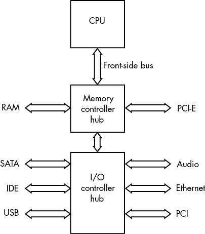
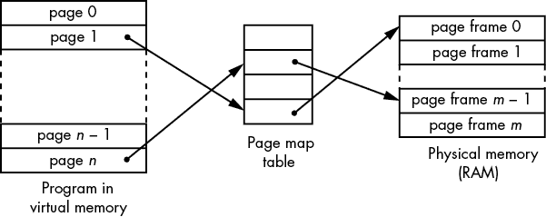
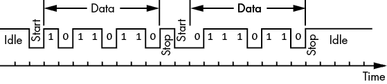

# 20 输入/输出


本章我们将探讨 `I/O` 子系统。`I/O 子系统` 是程序用来与外部世界通信的机制，即除 `CPU` 和内存以外的设备。大多数程序从一个或多个输入设备读取数据，处理数据，然后将结果写入一个或多个输出设备。

键盘和鼠标是典型的输入设备；显示屏和打印机是典型的输出设备。虽然大多数人不这么认为，但磁盘、固态硬盘、`USB` 闪存盘等设备也是 `I/O` 设备。

我们将首先查看 `I/O` 设备的一些时序特性，以及它们与内存的对比。然后我们将研究 `CPU` 与 `I/O` 设备之间的接口，了解如何利用它来处理时序问题。最后，我们将简要了解如何对 `I/O` 设备进行编程。

## 时序考量

由于 `CPU` 通过相同的总线访问内存和 `I/O`（参见图 1-1，第 1 章），似乎程序可以像访问内存一样访问 `I/O` 设备。也就是说，似乎可以使用 `mov` 指令在 `CPU` 和特定 `I/O` 设备之间传输字节数据来执行 `I/O`。这确实可行，但为了使其正确工作，必须考虑其他因素。主要问题之一在于内存与 `I/O` 之间的时序差异。在解决 `I/O` 时序问题之前，让我们先考虑内存的时序特性。

### 内存时序

内存的一个重要特性是其时序相对均匀，且不依赖于外部事件。这意味着内存时序可以由硬件处理，因此程序员无需关心内存时序。我们只需使用 `CPU` 指令在内存之间移动数据即可。

对比计算机中常用的两种内存类型，`SRAM` 的访问速度比 `DRAM` 快 5 到 10 倍，但 `SRAM` 成本更高，占用物理空间更大。正如您在第 8 章所学，`DRAM` 通常用作主内存，而 `SRAM` 用作较小的缓存内存。`SRAM` 缓存与 `DRAM` 主内存的结合能很好地确保 `CPU` 访问内存时的最小时间延迟。

值得注意的是，`CPU` 速度仍快于内存，尤其是 `DRAM`。访问内存——取指令、加载数据、存储数据——通常是拖慢程序执行的最重要因素。有一些提高缓存性能的技术，从而改善内存访问时间。但采用这些技术需要彻底了解您所用系统的 `CPU` 和内存配置，这超出了本书的范围。

### I/O 设备时序

几乎所有 `I/O` 设备都比内存慢得多。以常见的输入设备键盘为例。每分钟打 120 个字相当于每秒 10 个字符，即每个字符间隔 100 毫秒。运行在 2 GHz 的 `CPU` 在这段时间内可执行约 2 亿条指令。这还没考虑到按键间的时间间隔极不一致。许多间隔会比这长得多。

即使是固态硬盘，与内存相比也很慢。例如，典型 SSD 的数据传输速率约为 500 MBps。`DDR4` 内存（常用于主内存）的传输速率约为 20 GBps，快了约 40 倍。

除了慢得多之外，`I/O` 设备的时序变化也大得多。有人打字极快，有人极慢。磁盘上所需的数据可能刚好转到读写磁头下，也可能刚错过，需要等待磁盘几乎转一整圈才能再次移至磁头下。

在讨论如何处理 `I/O` 设备时序之前，我们先看看一些总线时序问题。

### 总线时序

尽管 图 1-1 中三大子系统的整体视图显示只有三条总线连接这些子系统，但内存与各种 `I/O` 设备之间巨大的时序差异导致了访问内存和 `I/O` 设备使用不同的总线。每种总线设计都承载地址、数据和控制信息，但它们使用不同的协议和物理连接，以更好地匹配所连接设备的速度。

大多数计算机采用分层总线结构，允许内存和其他快速子系统通过快速总线连接到 `CPU`，而较慢的子系统通过较慢的总线连接。我们可以通过观察 2005 年左右 PC 的常见布局来讨论这些概念，如 图 20-1 所示。



图 20-1：PC 中典型的总线控制

`内存控制器中心` 通常称为 `北桥`；它通过 `前端总线` 为 `CPU` 提供快速通信路径。除了提供到主内存的快速连接外，`内存控制器中心` 还连接到快速 `I/O` 总线，如 `PCI-E` 总线。`PCI-E` 总线为显卡等设备提供快速接口。`I/O 控制器中心` 通常称为 `南桥`。它连接到较慢的 `I/O` 总线，如 `SATA`、`USB` 等。

随着芯片技术多年的改进，制造商能够将更多功能集成到 `CPU` 芯片中，从而降低成本、节省空间和功耗。Intel 于 2008 年将 `内存控制器中心` 的功能集成在与 `CPU` 同一芯片上，AMD 于 2011 年跟进。制造商持续将总线控制硬件移至与 `CPU` 同一芯片上。

如今，Intel 和 AMD 都销售 `片上系统` (`SoC`) 设备，它们使用 x86-64 指令集，并在与 `CPU` 同一芯片上包含内存控制和 `I/O` 控制。当然，`SoC` 设备提供一组固定的 `I/O` 总线。基本上所有移动设备都使用 `SoC` 作为其算力核心。

## 访问 I/O 设备

`CPU` 通过 `设备控制器` 与 `I/O` 设备协作，后者是实际控制 `I/O` 设备工作的硬件。例如，键盘控制器检测按下了哪些键，并将其转换为代表该键的位模式。它还检测修饰键（如 Shift 或 Ctrl）是否被按下，并相应地设置位。

`设备控制器` 通过一组寄存器与 `CPU` 交互。一般来说，`设备控制器` 提供以下类型的 `I/O` 寄存器：

1.  `发送` 允许将数据写入输出设备
2.  `接收` 允许从输入设备读取数据
3.  `状态` 提供设备（包括控制器本身）当前状态的信息
4.  `控制` 允许程序向控制器发送命令，以更改设备和控制器的设置

`设备控制器` 接口拥有多个同类型寄存器的情况很常见，尤其是 `控制` 寄存器和 `状态` 寄存器。

向输出设备写数据非常类似于在内存中存储数据：您将数据从 `CPU` 移动到 `设备控制器` 的 `发送寄存器`。输出设备的不同之处在于时序。如前所述，内存时序由硬件处理，因此程序员在存储数据到内存时无需关心时序。然而，输出设备可能尚未准备好接收新数据——它可能正在处理之前写入的数据。这就是 `状态寄存器` 发挥作用的地方。程序需要检查 `设备控制器` 的 `状态寄存器`，以查看它是否准备好接收新数据。


从输入设备读取数据类似于将数据从内存加载到 CPU：你将数据从设备控制器的 `receive register`（接收寄存器）移动过来。同样，区别在于输入设备可能没有新数据，因此程序需要检查输入设备控制器的 `status register`（状态寄存器），以查看它是否有新数据。

大多数 I/O 设备还需要通过向 `control register`（控制寄存器）发送命令来告知做什么。例如，在等待输出设备控制器准备好接收新数据并将数据移动到 `transmit register`（发送寄存器）之后，某些设备控制器要求你指示它们将数据输出到实际设备。或者，如果你想从输入设备获取数据，某些设备控制器要求你请求它们进行输入操作。你可以将此类命令发送到 `control register`。

CPU 访问设备控制器上 I/O 寄存器有两种方式：端口映射 I/O 和内存映射 I/O。`x86-64` 架构同时支持这两种技术。

## 端口映射 I/O

`x86-64` 架构包含一组 `I/O ports`（I/O 端口），编号从 `0x0000` 到 `0xffff`。这个端口地址空间独立于内存地址空间。使用 I/O 端口进行输入和输出称为 `port-mapped I/O`（端口映射 I/O），或 `isolated I/O`（隔离 I/O）。

有用于访问 I/O 地址空间的特殊指令，即 `in` 和 `out`：

**`in`——从端口输入**

1.  从 `I/O port`（I/O 端口）读取。
2.  `in reg, imm` 从端口号为 `imm` 的 I/O 端口读取字节。`reg` 可以是 `al`、`ax` 或 `eax`。
3.  `in reg, dx` 从 `dx` 中指定的 I/O 端口号读取字节。`reg` 可以是 `al`、`ax` 或 `eax`。

    读取的字节数：`al` 为 1 字节，`ax` 为 2 字节，`eax` 为 4 字节。`in` 指令不影响 `rflags` 寄存器中的状态标志。

**`out`——输出到端口**

1.  写入 `I/O port`（I/O 端口）。
2.  `out imm, reg` 向端口号为 `imm` 的 I/O 端口写入字节。`reg` 可以是 `al`、`ax` 或 `eax`。
3.  `out dx, reg` 向 `dx` 中指定的 I/O 端口号写入字节。`reg` 可以是 `al`、`ax` 或 `eax`。

    写入的字节数：`al` 为 1 字节，`ax` 为 2 字节，`eax` 为 4 字节。`out` 指令不影响 `rflags` 寄存器中的状态标志。

当使用 `in` 和 `out` 指令时，CPU 将端口号放在地址总线上，并在控制总线上发出一个控制信号，该信号选择端口地址空间而不是程序地址空间。这使得整个程序地址空间可供程序使用。然而，`x86-64` 架构的 64 位寻址空间提供了充足的空间，让我们可以将一些地址用于 I/O 设备。

## 内存映射 I/O

如果我们首先看看 Linux 和大多数其他操作系统在执行程序时如何管理内存，理解 `memory-mapped I/O`（内存映射 I/O）会更容易。

程序在 `virtual memory`（虚拟内存）地址空间中运行，这是一种模拟大内存的技术，具有从 0 到某个最大值的连续寻址。这些是你在使用 `gdb` 时看到的地址——例如 `rip` 和 `rsp` 寄存器中的地址。虽然 `x86-64` 架构允许 64 位寻址，但当前的 CPU 硬件实现仅使用 48 位作为地址。这允许最大地址为 2⁴⁸ 字节（256 tebibytes / 256 太比字节），以便在此虚拟地址空间中执行程序。但大多数计算机只有大约 4 到 16 GB（或 GiB / 吉比字节）的 `physical memory`（物理内存），即计算机中安装的实际 RAM，程序必须位于物理内存中才能执行。

操作系统通过将每个程序划分为 `pages`（页）来管理程序在物理内存中的放置。典型的页大小为 4 KB（或 KiB /  kibibytes）。物理内存被划分为相同大小的 `page frames`（页框）。包含 CPU 当前正在执行的代码的程序页，从其存储位置（例如磁盘、DVD、USB 记忆棒）加载到物理内存的一个页框中。

操作系统维护一个 `page map table`（页映射表），它显示程序的页当前加载在物理内存的何处。图 20-2 显示了使用页映射表的虚拟内存和物理内存之间的关系。



图 20-2：虚拟内存和物理内存之间的关系

CPU 包含一个 `memory mapping unit`（内存映射单元，通常指 MMU）。当 CPU 需要访问内存中的项目时，它使用该项目的虚拟地址。内存映射单元使用虚拟地址作为索引查找 `page map table`，以定位物理内存中的页，并由此找到该项目。如果请求的页当前未加载到物理内存中，内存映射单元会生成一个 `page fault exception`（缺页异常），这会调用操作系统中的一个函数将该页加载到物理内存中，并在页映射表中记录其位置。（你将在第 21 章了解异常。）

类似于将虚拟内存映射到物理内存，虚拟内存地址可以映射到 `I/O ports`（I/O 端口），从而实现 `memory-mapped I/O`（内存映射 I/O）。一旦 I/O 端口与一个内存地址关联，访问内存的 CPU 指令就可以用来访问 I/O 端口。一个优势是你通常可以用像 `C` 这样的高级语言编写 I/O 函数。使用 `in` 和 `out` 指令要求你使用汇编语言，因为编译器通常不使用这些指令。

接下来，我们将看看如何进行 I/O 编程。

## I/O 编程

I/O 设备在处理的数据量和处理速度上差异很大。例如，键盘输入以人类打字的速度一次一个字节，而磁盘输入每秒可达数百兆字节。根据其固有特性，I/O 设备使用不同的技术与 CPU 通信，因此我们需要相应地对它们进行编程。

### 轮询 I/O

`Polling`（轮询）是进行 I/O 的最简单方法，对于少量数据通常已足够。我们首先检查 I/O 设备控制器的 `status register`（状态寄存器）以确定设备的状态。如果设备处于就绪状态，则我们可以从输入设备读取数据或向输出设备写入数据。轮询通常涉及一个循环，在循环的每次迭代中检查设备的 `status register`，直到设备处于就绪状态。这种 I/O 方式称为 `polled I/O`（轮询 I/O），或 `programmed I/O`（程序控制 I/O）。

轮询 I/O 的缺点是 CPU 可能会在等待设备变为就绪状态时被长时间占用。如果 CPU 专用于在系统上仅运行一个程序（例如控制你的微波炉），这可能是可以接受的。但在我们笔记本和台式计算机的多程序环境中，这是不可接受的。

### 中断驱动 I/O

如果我们能告诉 I/O 设备在准备好进行数据输入或输出时通知我们，然后将 CPU 用于其他工作，我们就能从 CPU 中榨取更多工作量。许多 I/O 设备包含一个 `interrupt controller`（中断控制器），当设备完成一个操作或准备好接受另一个操作时，它可以向 CPU 发送中断信号。

来自外部设备的中断会导致 CPU 调用一个 `interrupt handler`（中断处理程序），这是操作系统中处理来自中断设备的输入或输出的函数。我们将在第 21 章讨论允许 CPU 调用中断处理程序的 CPU 特性。

### 直接内存访问


# 轮询 I/O 编程算法

高速传输大量数据的 I/O 设备通常具有*直接内存访问*(*DMA*)能力。它们拥有*DMA 控制器*，可直接访问主存而无需 CPU 干预。例如，从磁盘读取时，DMA 控制器接收一个内存地址和一条从磁盘读取数据的命令。当 DMA 控制器将数据从磁盘读入其自身的缓冲存储器后，会将该数据直接写入主存。DMA 数据传输完成后，控制器向 CPU 发送中断，从而调用磁盘处理程序，通知操作系统数据现已在内存中可用。

接下来，我们将看一些轮询 I/O 可能的实现示例。

操作系统完全控制计算机上的 I/O 设备，因此不允许我们编写直接访问 I/O 设备的应用程序。我们在这里编写的程序仅用于演示概念，而非实现实际功能。事实上，运行它们会导致操作系统报错。

我们将介绍一些简单的轮询算法，展示如何为 I/O 编程*通用异步收发传输器*(*UART*)。该设备执行并串转换，逐位传输一个字节的数据。UART 输出仅需一根传输线，该线处于两个电压电平之一。发送端 UART 通过以固定速率在两个电压电平间切换来发送比特串。接收端 UART 逐位读取比特，并执行串并转换以重组发送给它的字节。两个 UART 必须设置为相同的比特率。

在空闲状态下，发送端 UART 在传输线上置高电压。当程序向 UART 输出一个字节时，发送端 UART 将传输线切换为低电压，持续时间对应约定的速率，从而发送一个*起始位*。

随后，UART 使用移位寄存器逐位移出该字节，相应地设置输出线上的电压。大多数 UART 从低位开始发送。当整个字节发送完毕后，UART 将输出线恢复到空闲状态至少一个比特时间，从而发送至少一个*停止位*。

图 20-3 展示了具有典型设置的 UART 如何发送以 ASCII 编码的两个字符 *m* 和 *n*。



图 20-3: 用于发送字符 *m* 和 *n* 的 UART 输出

接收端 UART 监视传输线，寻找起始位。当检测到起始位时，它使用移位寄存器将各个比特重组为一个字节，并作为输入提供给接收程序。

我们将使用 `16550 UART`（一种常见类型）作为编程示例。`16550 UART` 有 12 个 8 位寄存器，如表 20-1 所示。

**表 20-1: 16550 UART 的寄存器**

| **名称** | **地址** | **DLAB** | **用途** |
| --- | --- | --- | --- |
| `RBR` | `000` | `0` | 接收缓冲区——输入字节 |
| `THR` | `000` | `0` | 发送保持寄存器——输出字节 |
| `IER` | `001` | `0` | 中断允许——设置中断类型 |
| `IIR` | `010` | x | 中断标识——显示中断类型 |
| `FCR` | `010` | x | FIFO 控制——设置 FIFO 参数 |
| `LCR` | `011` | x | 线路控制——设置通信格式 |
| `MCR` | `100` | x | 调制解调器控制——设置与调制解调器的接口 |
| `LSR` | `101` | x | 线路状态——显示数据传输状态 |
| `MSR` | `110` | x | 调制解调器状态——显示调制解调器状态 |
| `SCR` | `111` | x | 暂存 |
| `DLL` | `000` | `1` | 除数锁存器，低字节 |
| `DLM` | `001` | `1` | 除数锁存器，高字节 |

表 20-1 中的地址是相对于 UART 基址的偏移量。你可能注意到有些寄存器具有相同的偏移量。地址指定了一个通向寄存器的端口。通过该端口访问的具体寄存器取决于程序对该端口执行的操作。例如，如果程序从端口 `000` 读取，它是在读取接收缓冲寄存器 (`RBR`)。但如果程序向端口 `000` 写入，它是在写入发送保持寄存器 (`THR`)。

除数锁存器访问位 (`DLAB`) 是线路控制寄存器 (`LCR`) 的第 7 位。当它被设置为 `1` 时，端口 `000` 连接到 16 位除数锁存器值的低字节，端口 `001` 连接到除数锁存器值的高字节。

`16550 UART` 可编程为中断驱动 I/O 和直接内存访问。它在发送端和接收端口都包含 16 字节的先进先出 (FIFO) 缓冲区。它也可编程以控制串行调制解调器。

早期 PC 通常将 UART 连接到 COM 端口。过去几年，COM 端口常用于将打印机、调制解调器等设备连接到计算机，但如今大多数 PC 使用 USB 端口进行串行 I/O。我台式机上的 `16550 UART` 有一组内部连接引脚，但没有外部连接端口。

我们假设 UART 安装在使用内存映射 I/O 的计算机中，以便用 C 语言展示算法。为简单起见，这里仅演示轮询 I/O，这需要以下三个函数：

1. `init_io` — 初始化 UART。这包括设置硬件参数，如速度、通信协议等。
2. `charin` — 读取 UART 接收到的一个字符。
3. `charout` — 写入一个字符以供 UART 发送。

## C 语言中的 UART 内存映射 I/O

我们将仅探索 UART 的少数功能。让我们从一个文件开始，该文件为寄存器提供符号名称以及我们在示例程序中将使用的一些数值，如清单 20-1 所示。

```
#ifndef UART_DEFS_H
#define UART_DEFS_H
/* UART_defs.h
 * Definitions for a 16550 UART.
 * WARNING: This code does not run on any known
 *          device. It is meant to sketch some
 *          general I/O concepts only.
 */
1 /* register offsets */
#define RBR 0x00    /* receive buffer register    */
#define THR 0x00    /* transmit holding register  */
#define IER 0x01    /* interrupt enable register  */
#define FCR 0x02    /* FIFO control register      */
#define LCR 0x03    /* line control register      */
#define LSR 0x05    /* line status register       */
#define DLL 0x00    /* divisor latch LSB          */
#define DLM 0x01    /* divisor latch MSB          */

/* status bits */
#define RxRDY 0x01  /* receiver ready */
#define TxRDY 0x20  /* transmitter ready */

/* commands */
#define NOFIFO        0x00    /* don't use FIFO   */
#define NOINTERRUPT   0x00    /* polling mode     */
#define MSB38400      0x00    /* 2 bytes used to  */
#define LSB38400      0x03    /* set baud 38400   */
#define NBITS         0x03    /* 8 bits           */
#define STOPBIT       0x00    /* 1 stop bit       */
#define NOPARITY      0x00
2 #define SETCOM        NBITS | STOPBIT | NOPARITY
3 #define SETBAUD       0x80 | SETCOM
#endif
```

清单 20-1: 16550 UART 的定义

寄存器端口位于相对于 UART 映射内存起始地址的固定位置。UART 可能用于另一台计算机，其中映射可能从另一个基址开始，因此我们仅在此定义偏移量。这些偏移量以及状态和控制位设置均取自 `16550` 数据手册。您可在 `https://www.ti.com/product/TL16C550D/` 下载。


## SETCOM 控制值计算

让我们看看我是如何得出 `SETCOM` 控制值 2 的。通信参数通过向线路状态寄存器写入一个字节来设置。每个数据帧中的位数可以从 5 到 8 不等。数据手册告诉我们，将位 1 和位 0 设置为 `11` 将指定 8 位。因此，我将 `NBITS` 设置为 `0x03`。将位 2 设置为 `0` 指定一个停止位，所以 `STOPBIT` = `0x00`。我们不会使用奇偶校验（即位 3），所以 `NOPARITY` = `0x00`。我将这些值进行或运算，以创建设置通信参数的字节。当然，我们其实不需要那两个 0 值，但指定它们能让我们的意图更加明确。

## 波特率和 DLAB 配置

`Baud`（波特率）是通信速度的度量，定义为每秒传输的符号数。`UART` 仅使用两个电压电平进行通信，符号上为 `0` 或 `1`，即一位。因此对于 `UART`，波特率等同于每秒传输或接收的位数。我们需要将 `DLAB` 位设置为 `1`，以使我们的 `UART` 进入允许设置波特率的模式 3。

## UART 头文件声明（清单 20-2）

接下来，我们需要一个用于声明函数的头文件，如 `#c20.xhtml#listing20-2` 所示。

```c
/* UART_functions.h
 * Initialize, read, and write functions for an abstract UART.
 * WARNING: This code does not run on any known
 *          device. It is meant to sketch some
 *          general I/O concepts only.
 */
#ifndef UART_FUNCTIONS_H
#define UART_FUNCTIONS_H
void UART_init(unsigned char* UART);       /* initialize UART  */
unsigned char UART_in(unsigned char* UART);          /* input  */
void UART_out(unsigned char* UART, unsigned char c); /* output */
#endif
```

清单 20-2：`UART` 函数声明

`#c20.xhtml#listing20-2` 中的头文件声明了用于使用我们的 `UART` 的三个基本函数。本书不会涵盖 `UART` 的更多高级功能。

## UART 函数实现（清单 20-3）

我们将这三个函数的定义放在一个文件中，如 `#c20.xhtml#listing20-3` 所示，因为它们通常会一起使用。

```c
/* UART_functions.c
 * Initialize, read, and write functions for an abstract UART.
 * WARNING: This code does not run on any known
 *          device. It is meant to sketch some
 *          general I/O concepts only.
 */

#include "UART_defs.h"
#include "UART_functions.h"

/* UART_init initializes the UART. */
1 void UART_init(unsigned char* UART)
{
  unsigned char* port = UART;

2 *(port+IER) = NOINTERRUPT;  /* no interrupts        */
  *(port+FCR) = NOFIFO;       /* no fifo              */
  *(port+LCR) = SETBAUD;      /* set frequency mode   */
  *(port+DLM) = MSB38400;     /* set to 38400 baud    */
  *(port+DLL) = LSB38400;     /*    with 2 bytes      */
  *(port+LCR) = SETCOM;       /* communications mode  */
}

/* UART_in waits until UART has a character then reads it */
unsigned char UART_in(unsigned char* UART)
{
  unsigned char* port = UART;
  unsigned char character;
  
3 while ((*(port+LSR) & RxRDY) != 0)
  {
  }
  character = *(port+RBR);
  return character;
}

/* UART_out waits until UART is ready then writes a character */
void UART_out(unsigned char* UART, unsigned char character )
{
  unsigned char* port = UART;
  unsigned char status;
  while ((*(port+LSR) & TxRDY) != 0)
  {
  }
  *(port+THR) = character;
}
```

清单 20-3：C 语言中的 `UART` 内存映射 I/O 函数定义

我们向 `#c20.xhtml#listing20-3` 中的每个函数传递一个指向 `UART` 端口的指针 1。然后我们通过该指针的偏移量访问每个 `UART` 寄存器 2。输入和输出函数都会等待，直到 `UART` 准备好执行其各自的操作 3。这些函数阐释了内存映射 I/O 的一个重要优势：它们可以用高级语言编写。

## 编译器汇编输出（清单 20-4）

通过查看编译器生成的汇编语言（如 `#c20.xhtml#listing20-4` 所示），我们可以看到用高级语言编写这些函数的一个潜在缺点。

```asm
        .file   "UART_functions.c"
        .intel_syntax noprefix
        .text
        .globl  UART_init
        .type   UART_init, @function
UART_init:
        push    rbp
        mov     rbp, rsp
        mov     QWORD PTR -24[rbp], rdi
        mov     rax, QWORD PTR -24[rbp]
        mov     QWORD PTR -8[rbp], rax
      1 mov     rax, QWORD PTR -8[rbp]  ## UART base address
        add     rax, 1                  ## IER offset
        mov     BYTE PTR [rax], 0       ## no interrupts
        mov     rax, QWORD PTR -8[rbp]
        add     rax, 2                  ## FCR offset
        mov     BYTE PTR [rax], 0       ## no FIFO
        mov     rax, QWORD PTR -8[rbp]
        add     rax, 3                  ## LCR offset
        mov     BYTE PTR [rax], -125    ## set baud mode
        mov     rax, QWORD PTR -8[rbp]
        add     rax, 1                  ## DLM offset
        mov     BYTE PTR [rax], 0       ## high byte
        mov     rax, QWORD PTR -8[rbp]  ## DLL offset = 0
        mov     BYTE PTR [rax], 3       ## low byte
        mov     rax, QWORD PTR -8[rbp]
        add     rax, 3                  ## LCR offset
        mov     BYTE PTR [rax], 3       ## communications mode
        nop
        pop     rbp
        ret
        .size   UART_init, .-UART_init
        .globl  UART_in
        .type   UART_in, @function
UART_in:
        push    rbp
        mov     rbp, rsp
        mov     QWORD PTR -24[rbp], rdi
        mov     rax, QWORD PTR -24[rbp]
        mov     QWORD PTR -8[rbp], rax
        nop
.L3:
        mov     rax, QWORD PTR -8[rbp]  ## UART base address
        add     rax, 5                  ## LSR offset
        movzx   eax, BYTE PTR [rax]
        movzx   eax, al                 ## load LSR
        and     eax, 1                  ## (*(port+LSR) & RxRDY)
      2 test    eax, eax
        jne     .L3
        mov     rax, QWORD PTR -8[rbp]
        movzx   eax, BYTE PTR [rax]     ## input character
        mov     BYTE PTR -9[rbp], al
        movzx   eax, BYTE PTR -9[rbp]   ## return character
        pop     rbp
        ret
        .size   UART_in, .-UART_in
        .globl  UART_out
        .type   UART_out, @function
UART_out:
        push    rbp
        mov     rbp, rsp
        mov     QWORD PTR -24[rbp], rdi
        mov     eax, esi
        mov     BYTE PTR -28[rbp], al
        mov     rax, QWORD PTR -24[rbp]
        mov     QWORD PTR -8[rbp], rax
        nop
.L6:
        mov     rax, QWORD PTR -8[rbp]  ## UART base address
        add     rax, 5                  ## LSR offset
        movzx   eax, BYTE PTR [rax]
        movzx   eax, al                 ## load LSR
        and     eax, 32                 ## (*(port+LSR) & TxRDY)
        test    eax, eax
        jne     .L6
        mov     rax, QWORD PTR -8[rbp]
        lea     rdx, 7[rax]
        movzx   eax, BYTE PTR -28[rbp]  ## load character
        mov     BYTE PTR [rdx], al      ## output character
        nop
        pop     rbp
        ret
        .size   UART_out, .-UART_out
        .ident  "GCC: (Ubuntu 9.3.0-17ubuntu1~20.04) 9.3.0"
        .section        .note.GNU-stack,"",@progbits
```

清单 20-4：编译器为我们的 `UART` 函数生成的汇编语言

## 代码低效性分析

我们可以看到编译器生成的代码中存在一些低效之处。初始化函数 `UART_init` 向 `UART` 的控制寄存器发送了多条命令。编译器计算每个控制寄存器的有效地址 1，然后为每条命令重复此计算。

在输入函数 `UART_in` 中也可以看到另一种低效情况。该算法使用 `and` 指令检查接收就绪位。然后编译器使用 `test` 指令来判断 `and` 指令的结果是否为 0 2。但 `test` 指令执行与操作以设置 `rflags` 寄存器中的状态标志，而这些标志已经由 `and` 指令设置过了。换句话说，在此算法中 `test` 指令是多余的。


我在本书前面曾说过，我们不关心代码效率，访问慢速 I/O 设备时节省几个 CPU 周期似乎无关紧要。但我们在此探讨的算法常用于设备处理程序中。其他 I/O 设备可能会中断当前正在执行的处理程序，导致延迟。由于无法知晓外部设备的时序，最好将在设备处理程序中花费的时间降至最低。编写设备处理程序时，我通常从 C 语言入手。然后生成相应的汇编语言代码，并检查其中的低效之处和不准确之处。

更多时候，我直接用汇编语言编写设备处理程序。现在我们来看看这些函数如何直接用汇编语言编写。

## 汇编语言中的 UART 内存映射 I/O

了解编译器为这三个 UART I/O 函数生成的代码后，我们现在可以尝试直接用汇编语言做得更好。这始于为汇编语言函数定义符号名称，如清单 20-5 所示。

```asm
# UART_defs
# 16550 UART 的定义。
# 警告：此代码不能在任何已知设备上运行。
#       仅用于勾勒一些通用 I/O 概念。

# 寄存器偏移量
        .equ    RBR,0x00    # 接收缓冲寄存器
        .equ    THR,0x00    # 发送保持寄存器
        .equ    IER,0x01    # 中断允许寄存器
        .equ    FCR,0x02    # FIFO 控制寄存器
        .equ    LCR,0x03    # 线路控制寄存器
        .equ    LSR,0x05    # 线路状态寄存器
        .equ    DLL,0x00    # 除数锁存器 LSB
        .equ    DLM,0x01    # 除数锁存器 MSB

# 状态位
        .equ    RxRDY,0x01  # 接收器就绪
        .equ    TxRDY,0x20  # 发送器就绪

# 命令
        .equ    NOFIFO,0x00       # 不使用 FIFO
        .equ    NOINTERRUPT,0x00  # 轮询模式
        .equ    MSB38400,0x00     # 使用 2 字节
        .equ    LSB38400,0x03     # 设置波特率 38400
        .equ    NBITS,0x03        # 8 位
        .equ    STOPBIT,0x00      # 1 停止位
        .equ    NOPARITY,0x00
        .equ    SETCOM,NBITS | STOPBIT | NOPARITY
        .equ    SETBAUD,0x80 | SETCOM
```

清单 20-5：UART 函数的汇编语言符号名称

清单 20-6 展示了三个 UART I/O 函数的汇编语言版本。

```asm
# UART_functions.s
# 16550 UART 的初始化、读取和写入函数。
# 警告：此代码不能在任何已知设备上运行。
#       仅用于勾勒一些通用 I/O 概念。
        .intel_syntax noprefix

        .include "UART_defs"

# 初始化 UART
# 调用约定：
#   rdi <- UART 基地址
        .text
        .globl  UART_init
        .type   UART_init, @function
UART_init:
        push    rbp                       # 保存帧指针
        mov     rbp, rsp                  # 设置新帧指针

    # 无中断，不使用 FIFO 队列
      1 mov     byte ptr IER[rdi], NOINTERRUPT
        mov     byte ptr FCR[rdi], NOFIFO
    # 设置除数锁存器访问位 = 1 以设置波特率
        mov     byte ptr LCR[rdi], SETBAUD
        mov     byte ptr DLM[rdi], MSB38400
        mov     byte ptr DLL[rdi], LSB38400
    # 除数锁存器访问位 = 0 进入通信模式
        mov     byte ptr LCR[rdi], SETCOM
        
        mov     rsp, rbp                  # 恢复栈指针
        pop     rbp                       # 恢复调用者帧指针
        ret

# 输入单个字符
# 调用约定：
#   rdi <- UART 基地址
#   在 al 寄存器中返回字符
        .globl  UART_in
        .type   UART_in, @function
UART_in:
        push    rbp                       # 保存帧指针
        mov     rbp, rsp                  # 设置新帧指针

inWaitLoop:
      2 and     byte ptr LSR[rdi], RxRDY  # 有字符可用？
        jne     inWaitLoop                # 无，等待
        movzx   eax, byte ptr RBR[rdi]    # 有，取出
        mov     rsp, rbp                  # 恢复栈指针
        pop     rbp                       # 恢复调用者帧指针
        ret
	
# 输出 sil 寄存器中的单个字符
        .globl	UART_out
        .type	UART_out, @function
UART_out:
        push    rbp                       # 保存帧指针
        mov     rbp, rsp                  # 设置新帧指针

outWaitLoop:
        and     byte ptr LSR[rdi], TxRDY  # 准备好接收字符？
        jne     outWaitLoop               # 未准备好，等待
        mov     THR[rdi], sil             # 准备好，发送
        mov     rsp, rbp                  # 恢复栈指针
        pop     rbp                       # 恢复调用者帧指针
        ret
```

清单 20-6：UART I/O 函数的汇编语言版本

函数调用时传入 UART 基地址的指针，因此我们可以使用带偏移量的寄存器间接寻址模式 1 来访问 UART 寄存器。编译器选择使用 `add` 指令为每次 UART 寄存器访问添加偏移量，效率较低。

由于此处使用内存映射 I/O，我们可以用 `and` 指令检查就绪状态，而无需将 UART 状态寄存器的内容加载到 CPU 通用寄存器中 2，这正是编译器所做的。不过，我们这里的汇编语言方案未必更高效，因为在执行 `and` 操作前，内容仍必须加载到 CPU 中（使用隐藏寄存器）。

本章开头我将 I/O 编程描述为复杂，但我呈现的代码相当直观。复杂性在于将 I/O 编程与操作系统接口对接，后者负责管理所有系统资源。例如，可能有多个程序并发运行，都使用同一个键盘。操作系统需要跟踪在任何时刻哪个程序获得键盘输入。

我在此呈现的算法只是 I/O 整体图景的一小部分，但它们应能让你初步了解所涉及的问题类型。虽然内存映射 I/O 是更常用的技术，但 x86-64 也支持端口映射 I/O，我们将在下一节探讨。

## UART 端口映射 I/O

与内存映射 I/O 不同，我们不能将 I/O 端口号视为内存地址。函数的参数是数字而非指针，如清单 20-8 所示。

```c
/* UART_functions.c
 * 16550 UART 的初始化、读取和写入函数。
 * 警告：此代码不能在任何已知设备上运行。
 *       仅用于勾勒一些通用 I/O 概念。
 */

#include <sys/io.h>
#include "UART_defs.h"
#include "UART_functions.h"

/* UART_init 初始化 UART 并启用它。 */
void UART_init(unsigned short int UART)
{
1 unsigned short int port = UART;

2 outb(NOINTERRUPT, port+IER);  /* 无中断        */
  outb(NOFIFO, port+FCR);       /* 无 FIFO              */
  outb(SETBAUD, port+LCR);      /* 设置频率模式   */
  outb(MSB38400, port+DLM);     /* 设置为 38400 波特    */
  outb(LSB38400, port+DLL);     /* 2 个寄存器用于设置        */
  outb(SETCOM, port+LCR);       /* 通信模式  */
}

/* UART_in 等待 UART 有字符然后读取它 */
unsigned char UART_in(unsigned short int UART)
{
  unsigned short int port = UART;
  unsigned char character;
  
  while ((inb(port+LSR) & RxRDY) != 0)
  {
  }
  character = inb(port+RBR);
  return character;
}

/* UART_out 等待 UART 就绪然后写入一个字符 */
void UART_out(unsigned short int UART, unsigned char character )
{
  unsigned short int port = UART;

  while ((inb(port+LSR) & TxRDY) != 0)
  {
  }
  outb(character, port+THR);
}
```

清单 20-8：C 语言中的 UART 端口映射 I/O 函数定义


Linux 编程环境提供了一个头文件 `io.h`，其中包含用于使用 I/O 端口的函数。我们的 UART 接口以字节为单位，所以我们将使用 `inb` 和 `outb`。你可以在它们的 `man` 页面上阅读这些函数：`man inb`。

端口映射 I/O 的算法与内存映射的相同。但我们不是将端口作为内存地址访问，而是使用一个数字 1。我们需要调用适当的函数在 UART 2 之间传输字节。

当我尝试使用 `-masm=intel` 选项编译 清单 20-8 中的文件时，得到了以下错误消息：

```
$ gcc -c -masm=intel -Wall -g UART_functions.c
/usr/include/x86_64-linux-gnu/sys/io.h: Assembler messages:
/usr/include/x86_64-linux-gnu/sys/io.h:47: Error: operand type mismatch for `in'
/usr/include/x86_64-linux-gnu/sys/io.h:98: Error: operand type mismatch for `out'
```

我感到困惑，于是决定通过将 `-c` 选项改为 `-S` 来查看编译器生成的汇编语言。我不会遍历整个文件，但让我们看看编译器生成的汇编语言的第一部分，如 清单 20-9 所示。

```
        .file   "UART_functions.c"
        .intel_syntax noprefix
        .text
        .type   inb, @function
1 inb:
        push    rbp
        mov     rbp, rsp
        mov     eax, edi
        mov     WORD PTR -20[rbp], ax
        movzx   eax, WORD PTR -20[rbp]
        mov     edx, eax
2 #APP
# 47 "/usr/include/x86_64-linux-gnu/sys/io.h" 1
        inb dx,al
# 0 "" 2
#NO_APP
        mov     BYTE PTR -1[rbp], al
        movzx   eax, BYTE PTR -1[rbp]
        pop     rbp
        ret
        .size   inb, .-inb
        .type   outb, @function
outb:
        push    rbp
        mov     rbp, rsp
        mov     edx, edi
        mov     eax, esi
        mov     BYTE PTR -4[rbp], dl
        mov     WORD PTR -8[rbp], ax
        movzx   eax, BYTE PTR -4[rbp]
        movzx   edx, WORD PTR -8[rbp]
#APP
# 98 "/usr/include/x86_64-linux-gnu/sys/io.h" 1
        outb al,dx
# 0 "" 2
#NO_APP
        nop
        pop     rbp
        ret
        .size   outb, .-outb
        .globl  UART_init
        .type   UART_init, @function
UART_init:
        push    rbp
        mov     rbp, rsp
        sub     rsp, 24
        mov     eax, edi
        mov     WORD PTR -20[rbp], ax
        movzx   eax, WORD PTR -20[rbp]
        mov     WORD PTR -2[rbp], ax
        movzx   eax, WORD PTR -2[rbp]
        add     eax, 1
        movzx   eax, ax
        mov     esi, eax
        mov     edi, 0
        call    outb
        movzx   eax, WORD PTR -2[rbp]
        add     eax, 2
--snip--
```

清单 20-9：清单 20-8 中函数的部分编译器生成的汇编语言

首先要注意的是，编译器包含了 `inb` 和 `outb` 函数的汇编语言 1。这些函数不是 C 标准库的一部分。它们旨在用于操作系统代码，而不是应用程序。它们特定于运行在 x86-64 计算机上的 Linux 内核。

接下来，我们看到实际的 `in` 和 `out` 指令是由宏 2 插入到代码中的。这些宏以 AT&T 语法插入这两条指令（请参见第 10 章末尾的 AT&T 语法）：

```
        inb     dx, al        ## at&t syntax
        outb    al, dx
```

正如我们在本章前面看到的，这些指令以 Intel 语法编写如下：

```
        in      al, dx        ## intel syntax
        out     dx, al
```

这里的问题是 Linux 内核使用的汇编语言是用 AT&T 语法编写的，而我们使用的是 Intel 语法。如果我们在不使用 `-masm=intel` 选项的情况下生成汇编语言，所有汇编语言都将是 AT&T 语法。如果我们使用 `io.h` 中的 C 函数进行端口映射 I/O，就不能使用 `-masm=intel` 编译器选项。

## 你学到了什么

1. 内存时序：内存访问与 CPU 的时序同步。
2. I/O 时序：I/O 设备比 CPU 慢得多，且具有广泛的特性，因此我们需要对其访问进行编程。
3. 总线时序：总线通常以层次化方式排列，以更好地匹配各种 I/O 设备之间的时序差异。
4. 端口映射 I/O：在这种技术中，I/O 端口拥有自己的地址空间。
5. 内存映射 I/O：在这种技术中，I/O 端口被分配主内存地址空间的一部分。
6. 轮询 I/O：程序在循环中等待，直到 I/O 设备准备好传输数据。
7. 中断驱动 I/O：当 I/O 设备准备好传输数据时，它会中断 CPU。
8. 直接内存访问：I/O 设备可以在不使用 CPU 的情况下向主内存传输数据。

在下一章中，你将了解允许 CPU 保持对 I/O 硬件的控制并防止应用程序在不经过操作系统的情况下访问硬件的 CPU 特性。
