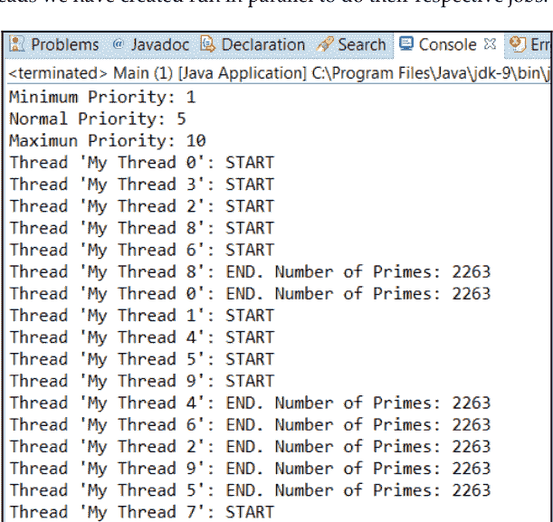
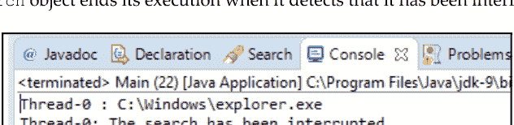
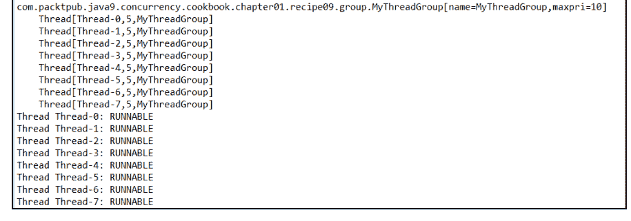

## 第1章：线程管理

## 线程管理

在本章中，我们将涵盖以下主题：

- - 创建、运行并设置线程的特性
- - 中断线程
- - 控制线程的中断
- - 让线程休眠和恢复
- - 等待线程的完成
- - 创建和运行守护线程
- - 处理线程中的不受控异常
- - 使用线程本地变量
- - 分组线程并处理线程组中的不受控异常
- - 通过工厂创建线程

## 介绍

在计算机世界中，当我们谈论并发时，我们指的是在计算机上同时运行的一系列独立且不相关的任务。这种同时性如果是真实的，则计算机具有多于一个处理器或多核处理器；如果是表面的，则计算机只有一个单核处理器。


所有现代操作系统都允许并发任务的执行。你可以在听音乐或在网页上阅读新闻的同时阅读你的电子邮件。我们可以说这就是进程级并发。但在进程内部，我们也可以有各种同时进行的任务。在进程内部运行的并发任务称为**线程**。与并发相关的另一个概念是并行。有不同的定义以及与并发概念的关系。一些作者在你在一个单核处理器上使用多个线程执行应用程序时谈论并发。这样，你可以看到程序执行的表象。他们在你在一个多核处理器上或在一台拥有多个处理器的计算机上使用多个线程执行应用程序时谈论并行，所以这种情况下是真实的。其他作者在应用程序的线程以无预定义顺序执行时谈论并发，而当所有这些线程以有序方式执行时讨论并行。

本章介绍了一些配方，将向你展示如何使用 Java 9 API 对线程执行基本操作。你将看到如何在 Java 程序中创建和运行线程，如何控制它们的执行，处理它们抛出的异常，以及如何将一些线程分组以作为一个单元进行操作。

## 创建、运行和设置线程的特性

在本配方中，我们将学习如何使用 Java API 对线程执行基本操作。与 Java 语言中的每个元素一样，线程是对象。我们在 Java 中创建线程有两种方式：

- 扩展 `Thread` 类并重写 `run()` 方法。
- 构建一个实现 `Runnable` 接口和 `run()` 方法的类，然后通过将 `Runnable` 对象作为参数传递来创建 `Thread` 类的对象——这是首选方法，它能给你更大的灵活性。

在本配方中，我们将使用第二种方法来创建线程。然后，我们将学习如何更改线程的一些属性。Thread 类保存了一些信息属性，可以帮助我们识别线程，了解其状态或控制其优先级。这些属性是：

- **ID：** 此属性为每个线程存储一个唯一标识符。
- **Name：** 此属性存储线程的名称。
- **Priority：** 此属性存储 Thread 对象的优先级。在 Java 9 中，线程的优先级可以在 1 到 10 之间，其中 1 是最低优先级，10 是最高优先级。不建议你更改线程的优先级。这只是对底层操作系统的提示，并不保证任何事情，但如果你愿意，这是一个可以使用的方法。
- **Status：** 此属性存储线程的状态。在 Java 中，线程可以处于 Thread.State 枚举中定义的六种状态之一：NEW、RUNNABLE、BLOCKED、WAITING、TIMED_WAITING 或 TERMINATED。以下是指定每种状态含义的列表：
  - NEW：线程已被创建但尚未启动
  - RUNNABLE：线程正在 JVM 中执行
  - BLOCKED：线程被阻塞并等待监视器
  - WAITING：线程正在等待另一个线程
  - TIMED_WAITING：线程正在等待另一个线程并指定等待时间
  - TERMINATED：线程已完成其执行

在本配方中，我们将实现一个示例，该示例将创建并运行 10 个线程，这些线程将计算前 20,000 个数字中的质数。

## 准备工作

本配方的示例已使用 Eclipse IDE 实现。如果你使用 Eclipse 或其他 IDE，例如 NetBeans，打开它并创建一个新的 Java 项目。

## 如何操作...

按照以下步骤实现示例：

1. 创建一个名为 Calculator 的类，实现 Runnable 接口：
2. 实现 run() 方法。此方法将执行我们正在创建的线程的指令，因此此方法将计算前 20000 个数字中的质数：
3. 然后，实现辅助 isPrime() 方法。此方法确定一个数字是否为质数：

```
public class Calculator implements Runnable {
```

```
@Override
public void run() {
    long current = 1L;
    long max = 20000L;
    long numPrimes = 0L;

    System.out.printf("Thread '%s': START\n", Thread.currentThread().getName());
    while (current <= max) {
        if (isPrime(current)) {
            numPrimes++;
        }
        current++;
    }
    System.out.printf("Thread '%s': END. Number of Primes: %d\n", Thread.currentThread().getName(), numPrimes);
}
```

```
private boolean isPrime(long number) {
    if (number <= 2) {
        return true;
    }
    for (long i = 2; i < number; i++) {
        if ((number % i) == 0) {
            return false;
        }
    }
    return true;
}
```

```
}
for (int i = 0; i < 10; i++) {
    threads[i].start();
}
```

8. 在此之后，等待线程的完成。正如我们将在本章的 Waiting for the finalization of a thread 配方中学习的那样，我们可以使用 join() 方法来等待这种情况发生。在这种情况下，我们希望在线程状态发生变化时写入有关线程的信息，因此我们不能使用此方法。我们使用这段代码：

```
boolean finish = false;
while (!finish) {
    for (int i = 0; i < 10; i++) {
        if (threads[i].getState() != status[i]) {
            writeThreadInfo(pw, threads[i], status[i]);
            status[i] = threads[i].getState();
        }
    }

    finish = true;
    for (int i = 0; i < 10; i++) {
        finish = finish && (threads[i].getState() ==
                State.TERMINATED);
    }
}
} catch (IOException e) {
    e.printStackTrace();
}
```

9. 在前面的代码块中，我们调用了 writeThreadInfo() 方法将线程状态的信息写入文件。这是该方法的代码：

```
private static void writeThreadInfo(PrintWriter pw,
        Thread thread,
        State state) {
    pw.printf("Main  : Id %d - %s\n", thread.getId(),
            thread.getName());
    pw.printf("Main  : Priority: %d\n", thread.getPriority());
    pw.printf("Main  : Old State: %s\n", state);
    pw.printf("Main  : New State: %s\n", thread.getState());
    pw.printf("Main  : *******************************\n");
}
```

10. 运行程序并查看不同线程如何并行工作。

## 工作原理...

以下屏幕截图显示了程序输出的控制台部分。我们可以看到我们创建的所有线程都并行运行以完成各自的任务：



在这张屏幕截图中，你可以看到线程是如何创建的，以及具有偶数编号的线程如何首先执行，因为它们具有最高优先级，而其他线程则稍后执行，因为它们具有最低优先级。以下屏幕截图显示了 log.txt 文件输出的一部分，我们在其中写入有关线程状态的信息：

```
6Main : Status of Thread 5 : NEW
7Main : Status of Thread 6 : NEW
8Main : Status of Thread 7 : NEW
9Main : Status of Thread 8 : NEW
10Main : Status of Thread 9 : NEW
11Main : Id 13 - My Thread 0
12Main : Priority: 10
13Main : Old State: NEW
14Main : New State: RUNNABLE
15Main : ********************************
16Main : Id 14 - My Thread 1
17Main : Priority: 1
18Main : Old State: NEW
19Main : New State: BLOCKED
20Main : ********************************
21Main : Id 15 - My Thread 2
22Main : Priority: 10
23Main : Old State: NEW
24Main : New State: RUNNABLE
25Main : ********************************
```

每个 Java 程序至少有一个执行线程。当你运行程序时，JVM 运行调用程序 main() 方法的执行线程。

当我们调用 Thread 对象的 start() 方法时，我们正在创建另一个执行线程。我们的程序将拥有与对 start() 方法调用次数一样多的执行线程。

Thread 类具有存储线程所有信息的属性。OS 调度程序使用线程的优先级来选择在每个时刻使用 CPU 的线程，并根据其情况更新每个线程的状态。

如果你没有为线程指定名称，JVM 会自动为其分配一个名称，格式为：Thread-XX，其中 XX 是一个数字。你不能修改线程的 ID 或状态。Thread 类不实现 setId() 和 setStatus() 方法，因为这些方法在代码中引入修改。


一个 Java 程序在所有线程结束时结束（更具体地说，是在所有非守护线程结束时结束）。如果初始线程（执行 `main()` 方法的线程）结束，其余线程仍会继续执行直到结束。如果其中一个线程使用 `System.exit()` 指令结束程序的执行，所有线程都将结束各自的执行。

创建 `Thread` 类的对象并不会创建新的执行线程。同样，调用实现 `Runnable` 接口的类的 `run()` 方法也不会创建新的执行线程。只有在调用 `start()` 方法时，才会创建新的执行线程。

### There's more...

正如本菜谱引言中所述，还有另一种创建新执行线程的方法。你可以实现一个扩展 `Thread` 类的类并重写该类的 `run()` 方法。然后，你可以创建该类的对象并调用 `start()` 方法以获得一个新的执行线程。

你可以使用 `Thread` 类的静态方法 `currentThread()` 来访问正在运行当前对象的线程对象。

你必须考虑到，如果你尝试设置不在 1 到 10 之间的优先级，`setPriority()` 方法可能会抛出 `IllegalArgumentException` 异常。

### See also

- 本章的 *通过工厂创建线程* 菜谱

## Interrupting a thread

一个拥有多个执行线程的 Java 程序只有在所有线程的执行结束时才会结束（更具体地说，是在所有非守护线程结束其执行时，或当其中一个线程使用 System.exit() 方法时）。有时，你可能需要结束一个线程，因为你想终止程序或当程序用户想要取消线程对象正在执行的任务时。

Java 提供了一种中断机制，用来指示线程你想要结束它。这种机制的一个特点是，线程对象必须检查自己是否已被中断，并且它们可以决定是否响应结束请求。线程对象可以忽略它并继续执行。

在本菜谱中，我们将开发一个程序，创建一个线程并在 5 秒后强制其结束，使用中断机制。

### Getting ready

本菜谱的示例使用 Eclipse IDE 实现。如果你使用 Eclipse 或其他 IDE，例如 NetBeans，打开它并创建一个新的 Java 项目。

### How to do it...

按照以下步骤实现示例：

- 1. 创建一个名为 PrimeGenerator 的类，扩展 Thread 类：
- 2. 重写 run() 方法，其中包含一个无限循环。在此循环中，从 1 开始处理连续的数字。对于每个数字，计算它是否为质数；如果是，如本例所示，将其写入控制台：

```
public class PrimeGenerator extends Thread{
```

```
@Override
public void run() {
    long number=1L;
    while (true) {
        if (isPrime(number)) {
            System.out.printf("Number %d is Prime\n",number);
        }
    }
```

- 3. 处理完一个数字后，通过调用 isInterrupted() 方法检查线程是否已被中断。如果此方法返回 true，则线程已被中断。在这种情况下，我们在控制台写入一条消息并结束线程的执行：

```
if (isInterrupted()) {
    System.out.printf("The Prime Generator has been Interrupted");
    return;
}
number++;
}
```

- 4. 实现 isPrime() 方法。你可以从本章的 Creating, running, and setting information of a thread 菜谱中获取其代码。

- 5. 现在通过实现名为 Main 的类和 main() 方法来实现示例的主类：

```
public class Main {
    public static void main(String[] args) {
```

- 6. 创建并启动 PrimeGenerator 类的对象：

```
Thread task=new PrimeGenerator();
task.start();
```

- 7. 等待 5 秒并中断 PrimeGenerator 线程：

```
try {
    Thread.sleep(5000);
} catch (InterruptedException e) {
    e.printStackTrace();
}
task.interrupt();
```

- 4. 实现 directoryProcess() 方法。此方法将获取文件夹中的文件和子文件夹并处理它们。对于每个目录，该方法将进行递归调用，将目录作为参数传递。对于每个文件，该方法将调用 fileProcess() 方法。处理完所有文件和文件夹后，该方法检查线程是否已被中断；如果是，如本例所示，它将抛出 InterruptedException 异常：

```
private void directoryProcess(File file) throws InterruptedException {
    File list[] = file.listFiles();
    if (list != null) {
        for (int i = 0; i < list.length; i++) {
            if (list[i].isDirectory()) {
                directoryProcess(list[i]);
            } else {
                fileProcess(list[i]);
            }
        }
    }
    if (Thread.interrupted()) {
        throw new InterruptedException();
    }
}
```

- 5. 实现 fileProcess() 方法。此方法将比较正在处理的文件的名称与我们正在搜索的名称。如果名称相等，我们将在控制台写入一条消息。进行此比较后，线程将检查是否已被中断；如果是，如本例所示，它将抛出 InterruptedException 异常：

```
private void fileProcess(File file) throws InterruptedException {
    if (file.getName().equals(fileName)) {
        System.out.printf("%s : %s\n",
            Thread.currentThread().getName(),
            file.getAbsolutePath());
    }
    if (Thread.interrupted()) {
        throw new InterruptedException();
    }
}
```

- 6. 现在让我们实现示例的主类。实现一个名为 Main 的类，其中包含 main() 方法：

```
public class Main {
    public static void main(String[] args) {
```

- 7. 创建并初始化 FileSearch 类的对象以及执行其任务的线程。然后开始执行线程。我使用了 Windows 操作系统的路径。如果你使用其他操作系统，例如 Linux 或 iOS，请将其更改为你操作系统上存在的路径：

```
FileSearch searcher = new FileSearch("C:\\Windows",
    "explorer.exe");
Thread thread=new Thread(searcher);
thread.start();
```

- 8. 等待 10 秒并中断线程：

```
try {
    TimeUnit.SECONDS.sleep(10);
} catch (InterruptedException e) {
    e.printStackTrace();
}
thread.interrupt();
}
```

- 9. 运行示例并查看结果。

### How it works...

以下屏幕截图显示了此示例执行的结果。你可以看到 FileSearch 对象在检测到已被中断时如何结束其执行。



### Getting ready

本菜谱的示例使用 Eclipse IDE 实现。如果你使用 Eclipse 或其他 IDE，例如 NetBeans，打开它并创建一个新的 Java 项目。

### How to do it...

按照以下步骤实现示例：

- 1. 创建一个名为 FileClock 的类并指定其实现 Runnable 接口：
- 2. 实现 run() 方法：
- 3. 编写一个包含 10 次迭代的循环。在每次迭代中，创建一个 Date 对象，将其写入控制台，并调用 TimeUnit 类的 SECONDS 属性的 sleep() 方法使线程暂停执行 1 秒钟。凭借此值，线程将休眠大约 1 秒。由于 sleep() 方法可能会抛出 InterruptedException 异常，我们必须包含捕获它的代码。包含在线程被中断时释放或关闭线程使用的资源的代码是良好的实践：
- 4. 我们已经实现了线程。现在让我们实现示例的主类。创建一个名为 Main 的类，其中包含 main() 方法：

```
public class FileClock implements Runnable {
```

```
@Override
public void run() {
```

```
for (int i = 0; i < 10; i++) {
    System.out.printf("%s\n", new Date());
    try {
        TimeUnit.SECONDS.sleep(1);
    } catch (InterruptedException e) {
        System.out.printf("The FileClock has been interrupted");
    }
}
```

```
public class Main {
    public static void main(String[] args) {
```


- 5. 创建 `FileClock` 类的对象和一个线程来执行它。然后，开始执行线程：

```
FileClock clock=new FileClock();
Thread thread=new Thread(clock);
thread.start();
```

- 6. 在主线程中调用 `TimeUnit` 类的 `SECONDS` 属性的 `sleep()` 方法等待 5 秒：

```
try {
    TimeUnit.SECONDS.sleep(5);
} catch (InterruptedException e) {
    e.printStackTrace();
};
```

- 7. 中断 `FileClock` 线程：

```
thread.interrupt();
```

- 8. 运行示例并查看结果。

## How it works...

当你运行示例时，你会看到程序每秒写入一个 `Date` 对象，并且还会看到指示 `FileClock` 线程已被中断的消息。

当你调用 `sleep()` 方法时，线程会离开 CPU 并在一段时间内停止其执行。在此期间，它不会消耗 CPU 时间，因此 CPU 可以执行其他任务。

当线程正在休眠并被中断时，该方法会立即抛出 `InterruptedException` 异常，而不会等待休眠时间结束。

## There's more...

Java 并发 API 还有另一种使线程对象离开 CPU 的方法。它是 `yield()` 方法，该方法指示 JVM 线程对象可以为其他任务让出 CPU。JVM 不保证会遵守此请求。通常，它仅用于调试目的。

## Waiting for the finalization of a thread

在某些情况下，我们必须等待线程执行的结束（`run()` 方法结束其执行）。例如，我们可能有一个程序，它将在继续执行其余部分之前开始初始化所需资源。我们可以将初始化任务作为线程运行，并在继续执行程序其余部分之前等待其完成。

为此，我们可以使用 `Thread` 类的 `join()` 方法。当我们使用线程对象调用此方法时，它会暂停调用线程的执行，直到被调用的对象完成其执行。

在本菜谱中，我们将通过一个初始化示例学习此方法的使用。

## Getting ready

本菜谱的示例已使用 Eclipse IDE 实现。如果您使用 Eclipse 或其他 IDE，例如 NetBeans，请打开它并创建一个新的 Java 项目。

## How to do it...

按照以下步骤实现示例：

- 1. 创建一个名为 `DataSourcesLoader` 的类并指定它实现 `Runnable` 接口：

```
public class DataSourcesLoader implements Runnable {
```

- 2. 实现 `run()` 方法。它写入一条消息以指示其开始执行，休眠 4 秒，并写入另一条消息以指示其结束执行：

```java
@Override
public void run() {
    System.out.printf("Beginning data sources loading: %s\n", new Date());
    try {
        TimeUnit.SECONDS.sleep(4);
    } catch (InterruptedException e) {
        e.printStackTrace();
    }
    System.out.printf("Data sources loading has finished: %s\n", new Date());
}
```

- 3. 现在，创建一个名为 `NetworkConnectionsLoader` 的类并指定它实现 `Runnable` 接口。实现 `run()` 方法。它将等于 `DataSourcesLoader` 类的 `run()` 方法，但它将休眠 6 秒。

- 4. 现在，创建一个名为 `Main` 的类，其中包含 `main()` 方法：

```
public class Main {
    public static void main(String[] args) {
```

- 5. 创建 `DataSourcesLoader` 类的对象和一个线程来运行它：

```
DataSourcesLoader dsLoader = new DataSourcesLoader();
Thread thread1 = new Thread(dsLoader,"DataSourceThread");
```

- 6. 创建 `NetworkConnectionsLoader` 类的对象和一个线程来运行它：

```
NetworkConnectionsLoader ncLoader = new NetworkConnectionsLoader();
Thread thread2 = new Thread(ncLoader,"NetworkConnectionLoader");
```

- 7. 调用两个线程对象的 `start()` 方法：

```
thread1.start();
thread2.start();
```

- 8. 使用 `join()` 方法等待两个线程的完成。此方法可能会抛出 `InterruptedException` 异常，因此我们必须包含捕获它的代码：

```
try {
    thread1.join();
    thread2.join();
} catch (InterruptedException e) {
    e.printStackTrace();
}
```

- 9. 写入一条消息以指示程序的结束：

```
System.out.printf("Main: Configuration has been loaded: %s\n", new Date());
```

- 10. 运行程序并查看结果。

## How it works...

当你运行此程序时，你将了解两个线程对象如何开始其执行。首先，`DataSourcesLoader` 线程完成其执行。然后，`NetworkConnectionsLoader` 类完成其执行。此时，`main` 线程对象继续其执行并写入最终消息。

## There's more...

Java 提供了 `join()` 方法的另外两种形式：

- `join (long milliseconds)`
- `join (long milliseconds, long nanos)`

在 `join()` 方法的第一种版本中，而不是无限期地等待被调用线程的完成，调用线程等待作为方法参数指定的毫秒数。例如，如果对象 `thread1` 有 `thread2.join(1000)`，`thread1` 会暂停其执行，直到满足以下两个条件之一：

- `thread2` 已完成其执行
- 已过去 1,000 毫秒

当这两个条件之一为 `true` 时，`join()` 方法返回。您可以检查线程的状态以了解 `join()` 方法是由于其完成执行而返回还是由于指定的时间已过去。

`join()` 方法的第二种版本与第一种类似，但它接收毫秒数和纳秒数作为参数。

## Creating and running a daemon thread

Java 有一种特殊的线程称为 **daemon** 线程。当守护线程是程序中唯一运行的线程时，JVM 在完成这些线程后结束程序。

由于这些特性，守护线程通常用作为同一程序中运行的正常（也称为 **user**）线程提供服务的提供者。它们通常具有无限循环，等待服务请求或执行线程的任务。这些线程的典型示例是 Java 垃圾收集器。

```
try {
    TimeUnit.SECONDS.sleep(1);
} catch (InterruptedException e) {
    e.printStackTrace();
}
}
```

- 5. 创建 `CleanerTask` 类并指定它扩展 `Thread` 类：

```
public class CleanerTask extends Thread {
```

- 6. 声明存储事件的队列并实现初始化此队列的类的构造函数。在构造函数中，使用 `setDaemon()` 方法将此线程标记为守护线程：

```
private Deque<Event> deque;
public CleanerTask(Deque<Event> deque) {
    this.deque = deque;
    setDaemon(true);
}
```

- 7. 实现 `run()` 方法。它具有一个无限循环，获取实际日期并调用 `clean()` 方法：

```
@Override
public void run() {
    while (true) {
        Date date = new Date();
        clean(date);
    }
}
```

- 8. 实现 `clean()` 方法。它获取最后一个事件，如果它是在 10 秒前创建的，则将其删除并检查下一个事件。如果删除了事件，它将写入事件的消息和队列的新大小，以便您可以查看其演变：

```
private void clean(Date date) {
    long difference;
    boolean delete;

    if (deque.size()==0) {
        return;
    }
    delete=false;
    do {
        Event e = deque.getLast();
        difference = date.getTime() - e.getDate().getTime();
        if (difference > 10000) {
            System.out.printf("Cleaner: %s\n",e.getEvent());
            deque.removeLast();
            delete=true;
        }
    } while (difference > 10000);
    if (delete){
        System.out.printf("Cleaner: Size of the queue: %d\n", deque.size());
    }
}
```

- 9. 现在实现主类。创建一个名为 `Main` 的类，其中包含 `main()` 方法：

```
public class Main {
    public static void main(String[] args) {
```

- 10. 使用 `Deque` 类创建存储事件的队列：

```
Deque<Event> deque=new ConcurrentLinkedDeque<Event>();
```

- 11. 创建并启动与 JVM 可用处理器一样多的 `WriterTask` 线程和一个 `CleanerTask` 方法：

```
WriterTask writer=new WriterTask(deque);
for (int i=0; i< Runtime.getRuntime().availableProcessors(); i++){
    Thread thread=new Thread(writer);
    thread.start();
}
CleanerTask cleaner=new CleanerTask(deque);
cleaner.start();
```

- 12. 运行程序并查看结果。

## How it works...

如果您分析程序一次执行的输出，您会看到队列如何开始增长，直到它达到大小为，在我们的例子中，为 40 个事件。然后，其大小将在执行结束前在 40 个事件左右波动。此大小可能取决于您机器的核心数量。我已在四核处理器上执行代码，因此我们启动了四个 `WriterTask` 任务。


程序启动时有四个 `WriterTask` 线程。每个线程写入一个事件并休眠 1 秒。在最初的 10 秒后，队列中有 40 个事件。在这 10 秒期间，`CleanerTask` 被执行而四个 `WriterTask` 线程处于休眠状态；然而，它不会删除任何事件，因为它们都是在 10 秒前生成的。在其余的执行期间，`CleanerTask` 每秒删除四个事件，而四个 `WriterTask` 线程再写入另外四个；因此，队列的大小在 40 左右波动，这是它增长到的大小。请记住，此示例的执行取决于分配给您计算机 JVM 的核心数量。通常，该数量等于您 CPU 的核心数量。

你可以调整 `WriterTask` 线程休眠的时间。如果使用更小的值，你会看到 `CleanerTask` 的 CPU 时间更少，队列的大小会增加，因为 `CleanerTask` 不会删除任何事件。

### There's more...

你只能在调用 `start()` 方法之前调用 `setDaemon()` 方法。一旦线程正在运行，你就不能通过调用 `setDaemon()` 方法来修改其守护状态。如果调用它，你将得到一个 `IllegalThreadStateException` 异常。

你可以使用 `isDaemon()` 方法来检查线程是否为守护线程（该方法返回 `true`）或非守护线程（该方法返回 `false`）。

## Processing uncontrolled exceptions in a thread

在每种编程语言中都很重要的一个方面是帮助你管理应用程序中错误情况的机制。Java 编程语言与几乎所有现代编程语言一样，实现了基于异常的机制来管理错误情况。这些异常由 Java 类在检测到错误情况时抛出。你也可以使用这些异常或实现自己的异常来管理在你的类中产生的错误。

首先，它会查找线程对象的未捕获异常处理器，正如我们在本配方中所学的。如果此处理器不存在，JVM 会查找 `ThreadGroup` 的未捕获异常处理器，如 *Grouping threads and processing uncontrolled exceptions in a group of threads* 配方中所述。如果此方法不存在，JVM 会查找默认的未捕获异常处理器，正如我们在本配方中所学的。

如果没有任何处理器存在，JVM 会将异常的堆栈跟踪写入控制台并结束抛出该异常的线程的执行。

### See also

- *The Grouping threads and processing uncontrolled exceptions in a group of threads recipe of this chapter*

## Using thread local variables

并发应用程序最关键的方面之一是共享数据。这在扩展 `Thread` 类或实现 `Runnable` 接口的对象以及在两个或多个线程之间共享的对象中具有特殊重要性。

如果你创建一个实现 `Runnable` 接口的类的对象，然后使用同一个 `Runnable` 对象启动各种线程对象，所有线程都将共享相同的属性。这意味着如果你在一个线程中更改一个属性，所有线程都会受到此更改的影响。

有时，你会希望拥有一个属性，该属性不会在运行同一对象的线程之间共享。Java 并发 API 提供了名为 **thread-local variables** 的干净机制，具有非常好的性能。它们也有一些缺点。它们在线程存活期间保留其值。这在线程被重用的情况下可能有问题。

在本配方中，我们将开发两个程序：一个会暴露第一段中描述的问题，另一个将使用线程局部变量机制解决此问题。

### Getting ready

本配方的示例已使用 Eclipse IDE 实现。如果你使用 Eclipse 或其他 IDE，例如 NetBeans，打开它并创建一个新的 Java 项目。

### How to do it...

按照以下步骤实现示例：

1. 首先，实现一个具有前面暴露的问题的程序。创建一个名为 `UnsafeTask` 的类并指定它实现 `Runnable` 接口。声明一个私有的 `java.util.Date` 属性：

```java
public class UnsafeTask implements Runnable {
    private Date startDate;
```

2. 实现 `UnsafeTask` 对象的 `run()` 方法。此方法将初始化 `startDate` 属性，将其值写入控制台，休眠随机时间段，并再次写入 `startDate` 属性的值：

```java
@Override
public void run() {
    startDate = new Date();
    System.out.printf("Starting Thread: %s : %s\n",
        Thread.currentThread().getId(), startDate);
    try {
        TimeUnit.SECONDS.sleep((int)Math.rint(Math.random()*10));
    } catch (InterruptedException e) {
        e.printStackTrace();
    }
    System.out.printf("Thread Finished: %s : %s\n",
        Thread.currentThread().getId(), startDate);
}
```

7. 声明一个 `ThreadLocal<Date>` 类的对象。此对象将具有隐式实现，其中包含 `initialValue()` 方法。此方法将返回实际日期：

```java
private static ThreadLocal<Date> startDate = new ThreadLocal<Date>() {
    protected Date initialValue() {
        return new Date();
    }
};
```

8. 实现 `run()` 方法。它的功能与 `UnsafeTask` 类的 `run()` 方法相同，但它改变了访问 `startDate` 属性的方式。现在我们将使用 `startDate` 对象的 `get()` 方法：

```java
@Override
public void run() {
    System.out.printf("Starting Thread: %s : %s\n",
        Thread.currentThread().getId(), startDate.get());
    try {
        TimeUnit.SECONDS.sleep((int)Math.rint(Math.random()*10));
    } catch (InterruptedException e) {
        e.printStackTrace();
    }
    System.out.printf("Thread Finished: %s : %s\n",
        Thread.currentThread().getId(), startDate.get());
}
```

9. 此示例的 `Main` 类与不安全的示例相同。唯一的区别是它更改了 `Runnable` 类的名称。

10. 运行示例并分析差异。

### How it works...

在下面的屏幕截图中，你可以看到安全示例执行的结果。十个 `Thread` 对象具有各自的 `startDate` 属性值：

```text
<terminated> SafeMain [Java Application] C:\Program Files\Java\jdk-9\b
Starting Thread: 13 : Sun Mar 26 03:15:17 CEST 2017
Starting Thread: 14 : Sun Mar 26 03:15:19 CEST 2017
Starting Thread: 15 : Sun Mar 26 03:15:21 CEST 2017
Thread Finished: 15 : Sun Mar 26 03:15:21 CEST 2017
Thread Finished: 13 : Sun Mar 26 03:15:17 CEST 2017
Thread Finished: 14 : Sun Mar 26 03:15:19 CEST 2017
```

线程局部变量机制为使用这些变量的每个线程存储一个属性的值。你可以使用 `get()` 方法读取值，并使用 `set()` 方法更改值。第一次访问线程局部变量的值时，如果它对调用它的线程对象没有值，线程局部变量将调用 `initialValue()` 方法为该线程分配一个值并返回初始值。

### There's more...

`ThreadLocal` 类还提供了 `remove()` 方法，该方法删除为调用它的线程存储在线程局部变量中的值。

Java 并发 API 包括 `InheritableThreadLocal` 类，它提供了从线程创建的线程的值继承。如果线程 A 在线程局部变量中有一个值并且它创建了另一个线程 B，那么线程 B 将在线程局部变量中具有与线程 A 相同的值。你可以重写 `childValue()` 方法，该方法被调用以在线程局部变量中初始化子线程的值。它将父线程在线程局部变量中的值作为参数接收。


## 分组线程并在线程组中处理未受控异常

Java 并发 API 提供的一个有趣功能是能够对线程进行分组。这使我们能够将线程组中的线程视为一个整体，并访问属于该组的线程对象以对其进行操作。例如，你有一些执行相同任务的线程，并且想要控制它们。你可以，例如，通过一次调用中断整个线程组中的所有线程。

Java 提供了 ThreadGroup 类来处理一组线程。ThreadGroup 对象可以由线程对象和其他 ThreadGroup 对象组成，形成线程的树形结构。

在《控制线程中断》配方中，你学习了如何使用通用方法处理线程对象中抛出的所有未捕获异常。在《处理线程中的未受控异常》配方中，我们编写了一个处理器来处理线程抛出的未捕获异常。我们可以使用类似的机制来处理线程或线程组抛出的未捕获异常。

在本配方中，我们将学习如何使用 ThreadGroup 对象以及如何实现并设置处理器来处理线程组中的未捕获异常。我们将通过一个示例来完成此操作。

### 准备工作

本配方的示例已使用 Eclipse IDE 实现。如果你使用 Eclipse 或其他 IDE，例如 NetBeans，请打开它并创建一个新的 Java 项目。

### 如何操作...

按照以下步骤实现示例：

- 1. 首先，通过创建一个名为 MyThreadGroup 的类来扩展 ThreadGroup 类，该类将继承自 ThreadGroup。你必须声明一个带有一个参数的构造函数，因为 ThreadGroup 类没有无参构造函数。扩展 ThreadGroup 类以重写 uncaughtException() 方法，以便处理组中线程抛出的异常：

```
public class MyThreadGroup extends ThreadGroup {
    public MyThreadGroup(String name) {
        super(name);
    }
}
```

- 2. 重写 uncaughtException() 方法。当 ThreadGroup 类中的一个线程抛出异常时，会调用此方法。在这种情况下，该方法将写入有关异常和抛出它的线程的信息；它将在控制台中呈现此信息。此外，请注意，此方法将中断 ThreadGroup 类中的其余线程：

```
@Override
public void uncaughtException(Thread t, Throwable e) {
    System.out.printf("The thread %s has thrown an Exception\n", t.getId());
    e.printStackTrace(System.out);
    System.out.printf("Terminating the rest of the Threads\n");
    interrupt();
}
```

- 3. 创建一个名为 Task 的类并指定它实现 Runnable 接口：

```
public class Task implements Runnable {
```

- 4. 实现 run() 方法。在这种情况下，我们将引发 ArithmeticException 异常。为此，我们将用随机数除 1,000，直到随机生成器生成零以抛出异常：

```
@Override
public void run() {
    int result;
    Random random=new Random(Thread.currentThread().getId());
    while (true) {
        result=1000/((int)(random.nextDouble()*1000000000));
        if (Thread.currentThread().isInterrupted()) {
            System.out.printf("%d : Interrupted\n", Thread.currentThread().getId());
            return;
        }
    }
}
```

- 5. 现在，通过创建一个名为 Main 的类并实现 main() 方法来实现示例的主类：

```
public class Main {
    public static void main(String[] args) {
```

- 6. 首先，计算你要启动的线程数。我们使用 Runtime 类的 availableProcessors() 方法（我们通过该类的静态方法 getRuntime() 获取与当前 Java 应用程序关联的运行时对象）。此方法返回 JVM 可用的处理器数量，通常等于运行应用程序的计算机的核心数：

```
int numberOfThreads = 2 * Runtime.getRuntime()
    .availableProcessors();
```

- 7. 创建 MyThreadGroup 类的对象：

```
MyThreadGroup threadGroup=new MyThreadGroup("MyThreadGroup");
```

- 8. 创建 Task 类的对象：

```
Task task=new Task();
```

- 9. 使用此 Task 类创建计算数量的 Thread 对象并启动它们：

```
for (int i = 0; i < numberOfThreads; i++) {
    Thread t = new Thread(threadGroup, task);
    t.start();
}
```

- 10. 然后，在控制台中写入有关 ThreadGroup 的信息：

```
System.out.printf("Number of Threads: %d\n", threadGroup.activeCount());
System.out.printf("Information about the Thread Group\n");
threadGroup.list();
```

- 11. 最后，写入构成该组的线程的状态：

```
Thread[] threads = new Thread[threadGroup.activeCount()];
threadGroup.enumerate(threads);
for (int i = 0; i < threadGroup.activeCount(); i++) {
    System.out.printf("Thread %s: %s\n", threads[i].getName(),
        threads[i].getState());
}
}
```

- 12. 运行示例并查看结果。

### 工作原理...

在下面的屏幕截图中，你可以看到 `ThreadGroup` 类的 `list()` 方法的输出以及我们在写入每个 Thread 对象的状态时生成的输出：



`ThreadGroup` 类存储与其关联的线程对象和其他 `ThreadGroup` 对象，以便可以访问它们的所有信息（例如状态）并对所有成员执行操作（例如中断）。

查看其中一个线程对象抛出了中断其他对象的异常的方式：

```
The thread 18 has thrown an Exception
java.lang.ArithmeticException: / by zero
    at com.packtpub.java9.concurrency.cookbook.chapter01.recipe09.task.Task.run(Task.java:18)
    at java.lang.Thread.run(java.base@9-ea/Thread.java:843)
Terminating the rest of the Threads
19 : Interrupted
14 : Interrupted
15 : Interrupted
13 : Interrupted
20 : Interrupted
17 : Interrupted
16 : Interrupted
```

当在 Thread 对象中抛出未捕获异常时，JVM 会查找此异常的三个可能的处理器。

首先，它会查找线程的未捕获异常处理器，如《处理线程中的未受控异常》配方中所述。如果此处理器不存在，则 JVM 会查找线程的 ThreadGroup 类的未捕获异常处理器，如本配方中所学。如果此方法不存在，JVM 会查找默认的未捕获异常处理器，如《处理线程中的未受控异常》配方中所述。

如果没有任何处理器存在，JVM 会在控制台中写入异常的堆栈跟踪并结束抛出异常的线程的执行。

### 另请参阅

- 《处理线程中的未受控异常》配方

## 通过工厂创建线程

工厂模式是面向对象编程世界中最常用的设计模式之一。它是一种创建型模式，其目标是开发一个对象的使命应该是：创建一类或多类对象。有了它，如果你想创建一个这些类之一的对象，你就可以直接使用工厂而不是使用 new 操作符。

```
stats=new ArrayList<String>();
}
```

- 3. 实现 newThread() 方法。此方法将接收一个 Runnable 接口并返回该 Runnable 接口的线程对象。在我们的例子中，我们生成线程对象的名称，创建新的线程对象，并保存统计信息：

```
@Override
public Thread newThread(Runnable r) {
    Thread t=new Thread(r,name+"-Thread_"+counter);
    counter++;
    stats.add(String.format("Created thread %d with name %s on %s\n", t.getId(),t.getName(),new Date()));
    return t;
}
```

- 4. 实现 getStatistics() 方法；它返回包含所有创建的线程对象的统计数据的 String 对象：

```
public String getStats(){
    StringBuffer buffer=new StringBuffer();
    Iterator<String> it=stats.iterator();
    
    while (it.hasNext()) {
        buffer.append(it.next());
        buffer.append("\n");
    }
    
    return buffer.toString();
}
```

- 5. 创建一个名为 Task 的类并指定它实现 Runnable 接口。在本示例中，这些任务除了休眠 1 秒外什么都不做：

```
public class Task implements Runnable {
    @Override
    public void run() {
        try {
            TimeUnit.SECONDS.sleep(1);
        } catch (InterruptedException e) {
            e.printStackTrace();
        }
    }
}
```


6. 创建示例的主类。创建一个名为 `Main` 的类并实现 `main()` 方法：

```
public class Main {
    public static void main(String[] args) {
```
7. 创建一个 `MyThreadFactory` 对象和一个 `Task` 对象：

```
MyThreadFactory factory=new MyThreadFactory("MyThreadFactory");
Task task=new Task();
```
8. 使用 `MyThreadFactory` 对象创建 10 个 `Thread` 对象并启动它们：

```
Thread thread;
System.out.printf("Starting the Threads\n");
for (int i=0; i<10; i++){
    thread=factory.newThread(task);
    thread.start();
}
```
9. 在控制台输出线程工厂的统计信息：

```
System.out.printf("Factory stats:\n");
System.out.printf("%s\n",factory.getStats());
```
10. 运行示例并查看结果。

## How it works...

`ThreadFactory` 接口只有一个方法，名为 `newThread()`。它接收一个 `Runnable` 对象作为参数并返回一个 `Thread` 对象。当你实现 `ThreadFactory` 接口时，你必须实现它并重写 `newThread` 方法。最基本的 `ThreadFactory` 只有一行：

```
return new Thread(r);
```
