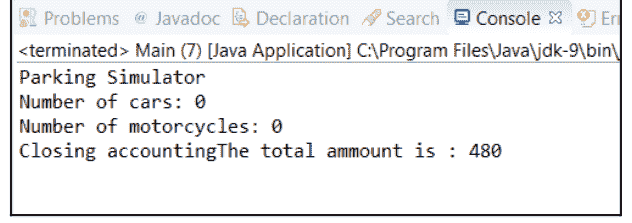
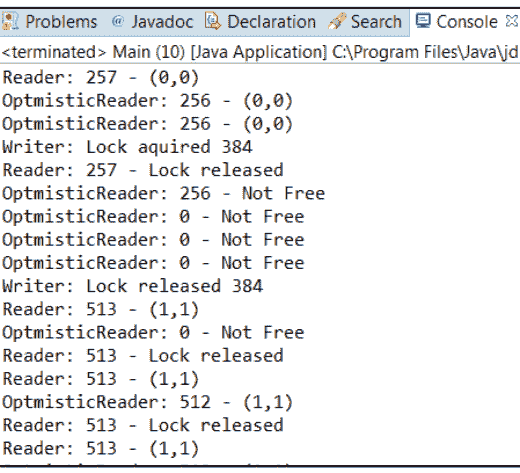

## 第2章：基本线程同步

## 基本线程同步

在本章中，我们将涵盖以下主题：
- 同步一个方法
- 在同步代码中使用条件
- 使用锁同步一段代码
- 使用读写锁同步数据访问
- 在锁中使用多个条件
- 使用 StampedLock 类进行高级锁定

## 引言

并发编程中最常见的情况之一是多个执行线程共享一个资源。在并发应用程序中，多个线程读取或写入相同的数据结构或访问相同的文件或数据库连接是正常的。这些共享资源会引发错误情况或数据不一致，我们必须实现机制来避免这些错误。这些情况称为竞态条件，当不同线程同时访问同一个共享资源时就会发生。因此，最终结果取决于线程执行的顺序，而大多数情况下，结果是不正确的。你也可能遇到更改可见性问题。因此，如果一个线程更改了共享变量的值，更改只会写入该线程的本地缓存；其他线程将无法访问该更改（它们只能看到旧值）。

解决这些问题的方案在于临界区概念。临界区是访问共享资源的一段代码，不能同时由多个线程执行。

为了帮助程序员实现临界区，Java（以及几乎所有编程语言）提供了同步机制。当线程想要访问临界区时，它使用其中一种同步机制来判断是否有其他线程正在执行临界区。如果没有，线程进入临界区。如果有，线程将被同步机制挂起，直到当前执行临界区的线程结束。当多个线程等待线程完成临界区的执行时，JVM 会选择其中一个，其余的等待轮到自己。本章介绍了一些配方，教你如何使用 Java 语言提供的两种基本同步机制：
- `synchronized` 关键字
- `Lock` 接口及其实现

## 同步一个方法

在本配方中，你将学习如何使用 Java 中最基本的同步方法之一，即使用 `synchronized` 关键字来控制对方法或代码块的并发访问。所有 `synchronized` 语句（用于方法或代码块）都使用对象引用。只有一个线程可以执行由同一对象引用保护的方法或代码块。

当你使用 `synchronized` 关键字修饰方法时，对象引用是隐式的。当你在对象的一个或多个方法中使用 `synchronized` 关键字时，只有一个执行线程可以访问所有这些方法。如果另一个线程尝试访问同一对象的声明为 `synchronized` 关键字的方法，它将被挂起，直到第一个线程完成方法的执行。换句话说，每个声明为 `synchronized` 关键字的方法都是一个临界区，而 Java 只允许一次执行对象的一个临界区。在这种情况下，使用的是对象本身，表示为 `this` 关键字。静态方法的行为不同。只有一个执行线程可以访问声明为 `synchronized` 关键字的其中一个静态方法，但不同的线程可以访问该类的对象的其他非静态方法。你必须非常注意这一点，因为如果一个是静态的而另一个不是，两个线程可以访问两个不同的 `synchronized` 方法。如果两个方法更改相同的数据，你可能会出现数据不一致错误。在这种情况下，使用的是类对象。

当你使用 `synchronized` 关键字保护一段代码时，你必须将对象引用作为参数传递。通常，你将使用 `this` 关键字引用执行该方法的对象，但你也可以使用其他对象引用。通常，这些对象将专门为此目的创建。你应该将用于同步的对象保持为私有。例如，如果一个类中有两个由多个线程共享的独立属性，你必须同步对每个变量的访问；然而，如果一个线程访问其中一个属性而另一个访问不同的属性，同时进行不会有问题。请注意，如果你使用对象本身（表示为 `this` 关键字），你可能会干扰其他同步代码（如前所述，`this` 对象用于同步标记为 `synchronized` 关键字的方法）。

在本配方中，你将学习如何使用 `synchronized` 关键字实现一个模拟停车场的应用程序，其中传感器检测以下情况：汽车或摩托车进入或离开停车场，一个存储已停车车辆统计信息的对象，以及一个控制现金流的机制。我们将实现两个版本：一个不使用任何同步机制，我们将看到如何得到错误结果，另一个工作正确，因为它使用了 `synchronized` 关键字的两种变体。

## 准备工作

本配方的示例已使用 Eclipse IDE 实现。如果你使用 Eclipse 或其他 IDE，例如 NetBeans，打开它并创建一个新的 Java 项目。

## 如何操作...

按照以下步骤实现示例：
1. 首先，创建一个不使用任何同步机制的应用程序。创建一个名为 `ParkingCash` 的类，其中有一个内部常量和一个属性，用于存储提供此停车服务所赚取的总金额：

```
public class ParkingCash {
    private static final int cost=2;
    private long cash;

    public ParkingCash() {
        cash=0;
    }
}
```

```
public void motoComeIn() {
    numberMotorcycles++;
}

public void motoGoOut() {
    numberMotorcycles--;
    cash.vehiclePay();
}
```

6. 最后，实现两个方法分别获取停车场中汽车和摩托车的数量。

7. 创建一个名为 Sensor 的类，它将模拟停车场中车辆的移动。它实现 Runnable 接口并有一个 ParkingStats 属性，该属性将在构造函数中初始化：

```
public class Sensor implements Runnable {

    private ParkingStats stats;

    public Sensor(ParkingStats stats) {
        this.stats = stats;
    }
}
```

8. 实现 run() 方法。在此方法中，模拟两辆汽车和一辆摩托车到达然后离开停车场。每个传感器将执行此操作 10 次：

```
@Override
public void run() {
    for (int i = 0; i < 10; i++) {
        stats.carComeIn();
        stats.carComeIn();
        try {
            TimeUnit.MILLISECONDS.sleep(50);
        } catch (InterruptedException e) {
            e.printStackTrace();
        }
        stats.motoComeIn();
        try {
            TimeUnit.MILLISECONDS.sleep(50);
        } catch (InterruptedException e) {
            e.printStackTrace();
        }
    }
}
```


2. 然后，使用 `this` 关键字在 `close()` 方法中添加一个同步代码块：

```java
public void close() {
    System.out.printf("Closing accounting");
    long totalAmount;
    synchronized (this) {
        totalAmount = cash;
        cash = 0;
    }
    System.out.printf("The total amount is : %d", totalAmount);
}
```

3. 现在向 `ParkingStats` 类添加两个新属性，并在类的构造函数中初始化它们：

```java
private final Object controlCars, controlMotorcycles;

public ParkingStats(ParkingCash cash) {
    numberCars = 0;
    numberMotorcycles = 0;
    controlCars = new Object();
    controlMotorcycles = new Object();
    this.cash = cash;
}
```

4. 最后，修改递增和递减汽车和摩托车数量的方法，包含 `synchronized` 关键字。`numberCars` 属性将由 `controlCars` 对象保护，`numberMotorcycles` 属性将由 `controlMotorcycles` 对象保护。你还必须使用关联的引用对象同步 `getNumberCars()` 和 `getNumberMotorcycles()` 方法：

```java
public void carComeIn() {
    synchronized (controlCars) {
        numberCars++;
    }
}
```

```java
public void carGoOut() {
    synchronized (controlCars) {
        numberCars--;
    }
    cash.vehiclePay();
}
```

```java
public void motoComeIn() {
    synchronized (controlMotorcycles) {
        numberMotorcycles++;
    }
}

public void motoGoOut() {
    synchronized (controlMotorcycles) {
        numberMotorcycles--;
    }
    cash.vehiclePay();
}
```

5. 现在执行示例，并查看与上一个版本相比的差异。

## How it works...

以下截图显示了新版本示例的输出。无论你执行多少次，你总是会得到正确的结果：



让我们看看示例中 `synchronized` 关键字的不同用法：

- 首先，我们保护了 `vehiclePay()` 方法。如果两个或多个 `Sensor` 任务同时调用此方法，只有一个会执行它，其余的会等待轮到自己；因此，最终金额总是正确的。
- 我们使用了两个不同的对象来控制对汽车和摩托车计数器的访问。这样，一个 `Sensor` 任务可以修改 `numberCars` 属性，同时另一个 `Sensor` 任务可以修改 `numberMotorcycles` 属性；然而，没有两个 `Sensor` 任务能够同时修改同一个属性，因此计数器的最终值总是正确的。

对于这类情况，Java 提供了 `wait()`、`notify()` 和 `notifyAll()` 方法，这些方法在 `Object` 类中实现。一个线程可以在同步代码块内调用 `wait()` 方法。如果它在同步代码块外调用 `wait()` 方法，JVM 会抛出 `IllegalMonitorStateException` 异常。当线程调用 `wait()` 方法时，JVM 会让线程休眠并释放控制其正在执行的同步代码块的对象，从而允许其他线程执行由该对象保护的其他同步代码块。要唤醒线程，必须在由同一对象保护的代码块内调用 `notify()` 或 `notifyAll()` 方法。

在本教程中，你将学习如何使用 `synchronized` 关键字以及 `wait()`、`notify()` 和 `notifyAll()` 方法来实现生产者-消费者问题。

## Getting ready

本教程的示例使用 Eclipse IDE 实现。如果你使用 Eclipse 或其他 IDE，例如 NetBeans，打开它并创建一个新的 Java 项目。

## How to do it...

按照以下步骤实现示例：

1. 创建一个名为 `EventStorage` 的类。它有两个属性，即一个名为 `maxSize` 的 `int` 属性和一个名为 `storage` 的 `List<Date>` 属性：

```java
public class EventStorage {

    private int maxSize;
    private Queue<Date> storage;
```

2. 实现类的构造函数以初始化类的属性：

```java
public EventStorage() {
    maxSize = 10;
    storage = new LinkedList<>();
}
```

5. 创建一个名为 `Producer` 的类并指定它实现 `Runnable` 接口。它将实现示例的生产者：

```java
public class Producer implements Runnable {
```

6. 声明一个 `EventStorage` 对象并实现类的构造函数以初始化此对象：

```java
private EventStorage storage;

public Producer(EventStorage storage) {
    this.storage = storage;
}
```

7. 实现 `run()` 方法，使其调用 `EventStorage` 对象的 `set()` 方法 100 次：

```java
@Override
public void run() {
    for (int i = 0; i < 100; i++) {
        storage.set();
    }
}
```

8. 创建一个名为 `Consumer` 的类并指定它实现 `Runnable` 接口。它将实现示例的消费者：

```java
public class Consumer implements Runnable {
```

9. 声明一个 `EventStorage` 对象并实现类的构造函数以初始化此对象：

```java
private EventStorage storage;

public Consumer(EventStorage storage) {
    this.storage = storage;
}
```

## How it works...

本示例的关键是 `EventStorage` 类的 `set()` 和 `get()` 方法。首先，`set()` 方法检查 storage 属性中是否有空闲空间。如果已满，它会调用 `wait()` 方法等待空闲空间。当另一个线程调用 `notify()` 方法时，此线程会被唤醒并再次检查条件。`notify()` 方法并不保证条件得到满足。此过程会重复，直到 storage 中有空闲空间并且可以生成新事件并将其存储。

`get()` 方法的行为类似。首先，它检查 storage 属性中是否有事件。如果 storage 为空，它会调用 `wait()` 方法等待事件。当另一个线程调用 `notify()` 方法时，此线程会被唤醒并再次检查条件，直到 storage 中有一些事件。


你必须在 `while` 循环中不断检查条件并调用 `wait()` 方法。条件为 `true` 之前你将无法继续。

如果你运行此示例，你会发现尽管生产者和消费者正在设置和获取事件，但 storage 从未有容量包含超过 10 个事件。

## There's more...

`synchronized` 关键字还有其他重要的用途。参见本教程的 See also 部分，其中解释了此关键字的用法。

## See also

- 本章中的 *Synchronizing a method* 教程

## Synchronizing a block of code with a lock

Java 提供了另一种同步代码块的机制。它比 `synchronized` 关键字更强大、更灵活。它基于 `Lock`（`java.util.concurrent.locks` 包）接口及其实现类（如 `ReentrantLock`）。该机制具有以下优点：

- 它允许你以更灵活的方式构建同步块。使用 `synchronized` 关键字，你只能以结构化方式控制同步代码块。然而，`Lock` 接口允许你获得更复杂的结构来实现你的临界区。
- `Lock` 接口提供了 `synchronized` 关键字之外的附加功能。其中一个新功能由 `tryLock()` 方法实现。此方法尝试获取锁的控制权，如果无法获取，因为它正被另一个线程使用，则返回 `false`。使用 `synchronized` 关键字，如果线程 A 尝试执行同步代码块时线程 B 正在执行它，线程 A 会被挂起，直到线程 B 完成同步代码块的执行。使用锁时，你可以执行 `tryLock()` 方法。此方法返回一个布尔值，指示是否有另一个线程正在运行由此锁保护的代码。
- `ReadWriteLock` 接口允许读写操作的分离，具有多个读取器和仅一个修改器。
- `Lock` 接口比 `synchronized` 关键字提供更好的性能。

`ReentrantLock` 类的构造函数接受一个名为 `fair` 的布尔参数；此参数允许你控制其行为。`false` 值是默认值，称为非公平模式。在此模式下，如果一些线程正在等待锁并且锁必须从这些线程中选择一个来访问临界区，它会随机选择其中任何一个。`true` 值称为公平模式。在此模式下，如果一些线程正在等待锁并且锁必须选择一个来访问临界区，它会选择等待时间最长的线程。请注意，前述行为仅在 `lock()` 和 `unlock()` 方法中使用。由于 `tryLock()` 方法不会让线程休眠如果使用 `Lock` 接口，则 fair 属性不会影响其功能。

在本教程中，你将学习如何使用锁来同步代码块并使用 `Lock` 接口和实现它的 `ReentrantLock` 类创建一个临界区，实现一个模拟打印队列的程序。你还将学习 fair 参数如何影响 `Lock` 的行为。


## 准备工作

本食谱中的示例使用 Eclipse IDE 实现。如果您使用 Eclipse 或其他 IDE，例如 NetBeans，请打开它并创建一个新的 Java 项目。

## 如何做...

按照以下步骤实现示例：

1. 创建一个名为 `PrintQueue` 的类，它将实现打印队列：
```
public class PrintQueue {
```
2. 在构造函数中声明一个 `Lock` 对象并使用 `ReentrantLock` 类的新对象进行初始化。构造函数将接收一个 `Boolean` 参数，我们将使用它来指定 `Lock` 的公平模式：
```
private Lock queueLock;
public PrintQueue(boolean fairMode) {
    queueLock = new ReentrantLock(fairMode);
}
```
3. 实现 `printJob()` 方法。它将接收 `Object` 作为参数并且不会返回任何值：
```
public void printJob(Object document) {
```
4. 在 `printJob()` 方法内部，通过调用 `lock()` 方法获取 `Lock` 对象的控制权：
```
queueLock.lock();
```
5. 然后，包含以下代码以模拟打印文档的过程：
```
try {
    Long duration=(long)(Math.random()*10000);
    System.out.println(Thread.currentThread().getName()+ ": PrintQueue: Printing a Job during \" +
        (duration/1000)+" seconds");
    Thread.sleep(duration);
} catch (InterruptedException e) {
    e.printStackTrace();
}
```
6. 最后，使用 unlock() 方法释放 Lock 对象的控制权：
```
finally {
    queueLock.unlock();
}
```
7. 然后，再次重复相同的过程。printJob() 方法将帮助您获取对锁的访问权，然后再次释放它。这种奇怪的行为将使我们能够更好地看到公平模式和非公平模式之间的差异。我们在 printJob() 方法中包含这段代码：
```
queueLock.lock();
try {
    Long duration = (long) (Math.random() * 10000);
    System.out.printf("%s: PrintQueue: Printing a Job during
        %d seconds\n", Thread.currentThread()
        .getName(), (duration / 1000));
    Thread.sleep(duration);
} catch (InterruptedException e) {
    e.printStackTrace();
} finally {
    queueLock.unlock();
}
```
8. 创建一个名为 Job 的类并指定它实现 Runnable 接口：
```
public class Job implements Runnable {
```
9. 声明 PrintQueue 类的对象并实现该类的构造函数以初始化此对象：
```
private PrintQueue printQueue;

public Job(PrintQueue printQueue){
    this.printQueue=printQueue;
}
```
10. 实现 run() 方法。它使用 PrintQueue 对象将作业发送到打印：
```
@Override
public void run() {
    System.out.printf("%s: Going to print a document\n", Thread.currentThread().getName());
    printQueue.printJob(new Object());
    System.out.printf("%s: The document has been printed\n", Thread.currentThread().getName());
}
```
11. 通过实现名为 Main 的类并向其添加 main() 方法来创建应用程序的主类：
```
public class Main {
    public static void main (String args[]){
```
12. 我们将使用公平模式返回 true 和 false 的锁来测试 PrintQueue 类。我们将使用辅助方法来实现两次测试，以便 main() 方法的代码保持简单：
```
System.out.printf("Running example with fair-mode = false\n");
testPrintQueue(false);
System.out.printf("Running example with fair-mode = true\n");
testPrintQueue(true);
```
13. 创建 testPrintQueue() 方法并在其中创建一个共享的 PrintQueue 对象：
```
private static void testPrintQueue(Boolean fairMode) {
    PrintQueue printQueue=new PrintQueue(fairMode);
```
14. 创建 10 个 Job 对象和 10 个线程来运行它们：
```
Thread thread[]=new Thread[10];
for (int i=0; i<10; i++){
    thread[i]=new Thread(new Job(printQueue),"Thread "+ i);
}
```
3. 声明一个名为 lock 的 ReadWriteLock 对象：
```
private ReadWriteLock lock;
```
4. 实现类的构造函数以初始化三个属性。对于 lock 属性，创建一个新的 ReentrantReadWriteLock 对象：
```
public PricesInfo() {
    price1=1.0;
    price2=2.0;
    lock=new ReentrantReadWriteLock();
}
```
5. 实现返回 price1 属性值的 getPrice1() 方法。它使用读锁来控制对该属性值的访问：
```
public double getPrice1() {
    lock.readLock().lock();
    double value=price1;
    lock.readLock().unlock();
    return value;
}
```
6. 实现返回 price2 属性值的 getPrice2() 方法。它使用读锁来控制对该属性值的访问：
```
public double getPrice2() {
    lock.readLock().lock();
    double value=price2;
    lock.readLock().unlock();
    return value;
}
```
7. 实现建立两个属性值的 setPrices() 方法。它使用写锁来控制对它们的访问。我们将使线程休眠 5 秒。这表明即使它拥有写锁，也没有其他线程获取读锁：
```
public void setPrices(double price1, double price2) {
    lock.writeLock().lock();
    System.out.printf("%s: PricesInfo: Write Lock Adquired.\n", new Date());
    try {
        TimeUnit.SECONDS.sleep(10);
    } catch (InterruptedException e) {
        e.printStackTrace();
}
```
```
}
this.price1=price1;
this.price2=price2;
System.out.printf("%s: PricesInfo: Write Lock Released.\n", new Date());
lock.writeLock().unlock();
}
```
8. 创建一个名为 Reader 的类并指定它实现 Runnable 接口。此类实现 PricesInfo 类属性值的读取器：
```
public class Reader implements Runnable {
```
9. 声明一个 PricesInfo 对象并实现该类的构造函数以初始化此对象：
```
private PricesInfo pricesInfo;

public Reader (PricesInfo pricesInfo){
    this.pricesInfo=pricesInfo;
}
```
10. 实现此类 run() 方法。它读取两次价格值 10 次：
```
@Override
public void run() {
    for (int i=0; i<20; i++){
        System.out.printf("%s: %s: Price 1: %f\n",new Date(),
                    Thread.currentThread().getName(),
                    pricesInfo.getPrice1());
        System.out.printf("%s: %s: Price 2: %f\n",new Date(),
                    Thread.currentThread().getName(),
                    pricesInfo.getPrice2());
    }
}
```
11. 创建一个名为 Writer 的类并指定它实现 Runnable 接口。此类实现 PricesInfo 类属性值的修改器：
```
public class Writer implements Runnable {
```
17. 创建一个 Writer 对象和执行它的线程：
```
Writer writer=new Writer(pricesInfo);
Thread threadWriter=new Thread(writer);
```
18. 启动线程：
```
for (int i=0; i<5; i++){
    threadsReader[i].start();
}
threadWriter.start();
```

## 它是如何工作的...

在下面的屏幕截图中，您可以看到此示例一次执行的部分输出：
```
Mon Aug 29 13:58:01 GMT+01:00 2016: Thread-0: Price 2: 2,000000
Mon Aug 29 13:58:01 GMT+01:00 2016: Thread-2: Price 1: 1,000000
Mon Aug 29 13:58:01 GMT+01:00 2016: Writer: Attempt to modify the prices.
Mon Aug 29 13:58:01 GMT+01:00 2016: Thread-4: Price 1: 1,000000
Mon Aug 29 13:58:01 GMT+01:00 2016: Thread-3: Price 1: 1,000000
Mon Aug 29 13:58:01 GMT+01:00 2016: Thread-1: Price 1: 1,000000
Mon Aug 29 13:58:01 GMT+01:00 2016: PricesInfo: Write Lock Acquired.
Mon Aug 29 13:58:01 GMT+01:00 2016: Thread-2: Price 2: 2,000000
Mon Aug 29 13:58:11 GMT+01:00 2016: PricesInfo: Write Lock Released.
Mon Aug 29 13:58:11 GMT+01:00 2016: Writer: Prices have been modified.
Mon Aug 29 13:58:01 GMT+01:00 2016: Thread-4: Price 2: 5,991554
Mon Aug 29 13:58:11 GMT+01:00 2016: Thread-4: Price 1: 2,259680
Mon Aug 29 13:58:11 GMT+01:00 2016: Thread-4: Price 2: 5,991554
Mon Aug 29 13:58:11 GMT+01:00 2016: Thread-4: Price 1: 2,259680
Mon Aug 29 13:58:11 GMT+01:00 2016: Thread-4: Price 2: 5,991554
Mon Aug 29 13:58:11 GMT+01:00 2016: Thread-4: Price 1: 2,259680
```

在写入者获取写锁时，没有任何读取器任务可以读取数据。您可以在 Write Lock Acquired 消息之后看到读取器任务的一些消息，但它们是在之前执行且尚未在控制台显示的指令。一旦写入器任务释放了锁，读取器任务再次获得对价格信息的访问权限并显示新的价格。


## 准备工作

你应该阅读 *Synchronizing a block of code with a lock* 配方，以便更好地理解本配方。

## 如何做...

按照以下步骤实现示例：

- 1. 首先，实现一个类来模拟文本文件。创建一个名为 `FileMock` 的类，包含两个属性：一个名为 content 的 `String` 数组和一个名为 index 的 `int`。它们将存储文件的内容和将要检索的模拟文件的行：
  
  ```
  public class FileMock {
  
      private String[] content;
      private int index;
  }
  ```
- 2. 实现类的构造函数，用随机字符初始化文件内容：
  
  ```
  public FileMock(int size, int length){
      content = new String[size];
      for (int i = 0; i< size; i++){
          StringBuilder buffer = new StringBuilder(length);
          for (int j = 0; j < length; j++){
              int randomCharacter= (int)Math.random()*255;
              buffer.append((char)randomCharacter);
          }
          content[i] = buffer.toString();
      }
      index=0;
  }
  ```
- 3. 实现 `hasMoreLines()` 方法，如果文件还有更多行需要处理则返回 true，如果已到达模拟文件的末尾则返回 false：
  
  ```
  public boolean hasMoreLines(){
      return index <content.length;
  }
  ```
- 4. 实现 getLine() 方法，返回由 index 属性确定的行并增加其值：

```
public String getLine(){
    if (this.hasMoreLines()) {
        System.out.println("Mock: " + (content.length-index));
        return content[index++];
    }
    return null;
}
```

- 5. 现在实现一个名为 Buffer 的类，它将实现生产者和消费者共享的缓冲区：

```
public class Buffer {
```

- 6. 该类有六个属性：

  - 一个名为 buffer 的 LinkedList<String> 属性，用于存储共享数据。例如：
  
    private final LinkedList<String> buffer;
  - 一个名为 maxSize 的 int 类型，用于存储缓冲区的长度。例如：
  
    private final int maxSize;
  - 一个名为 lock 的 ReentrantLock 对象，用于控制访问修改缓冲区的代码块。例如：
  
    private final ReentrantLock lock;
  - 两个名为 lines 和 space 的 Condition 属性。例如：
  
    private final Condition lines;
  
    private final Condition space;
  - 一个名为 pendingLines 的 boolean 类型，用于指示缓冲区中是否有行。例如：
  
    private boolean pendingLines;

- 7. 实现类的构造函数。它初始化前面描述的所有属性：

```
public Buffer(int maxSize) {
    this.maxSize = maxSize;
    buffer = new LinkedList<>();
    lock = new ReentrantLock();
    lines = lock.newCondition();
    space = lock.newCondition();
    pendingLines =true;
}
```

- 8. 实现 insert() 方法。它接收 String 作为参数并尝试将其存储在缓冲区中。首先，它获取锁的控制权。获得后，它检查缓冲区中是否有空闲空间。如果缓冲区已满，它会在 space 条件中调用 await() 方法等待空闲空间。线程将在另一个线程在 space 条件中调用 signal() 或 signalAll() 方法时被唤醒。发生这种情况时，线程将行存储在缓冲区中并在 lines 条件上调用 signalAll() 方法。正如我们稍后会看到的，此条件将唤醒所有等待缓冲区中行的线程。为了使代码更简单，我们忽略 InterruptedException 异常。在实际情况下，你可能需要处理它：

```
public void insert(String line) {
    lock.lock();
    try {
        while (buffer.size() == maxSize) {
            space.await();
        }
        buffer.offer(line);
        System.out.printf("%s: Inserted Line: %d\n",
                    Thread.currentThread().getName(),
                    buffer.size());
        lines.signalAll();
    } catch (InterruptedException e) {
        e.printStackTrace();
    } finally {
        lock.unlock();
    }
}
```

- 9. 实现 get() 方法。它返回存储在缓冲区中的第一个字符串。首先，它获取锁的控制权。完成后，它检查缓冲区中是否有行。如果缓冲区为空，它会在 lines 条件中调用 await() 方法等待缓冲区中的行。此线程将在另一个线程在 lines 条件中调用 signal() 或 signalAll() 方法时被唤醒。发生这种情况时，该方法获取缓冲区中的第一行，在 space 条件上调用 signalAll() 方法并返回 String：

```
public String get() {
    String line = null;
    lock.lock();
    try {
        while ((buffer.size() == 0) && (hasPendingLines())) {
            lines.await();
        }

        if (hasPendingLines()) {
            line = buffer.poll();
            System.out.printf("%s: Line Readed: %d\n",
                            Thread.currentThread().getName(),
                            buffer.size());
            space.signalAll();
        }
    } catch (InterruptedException e) {
        e.printStackTrace();
    } finally {
        lock.unlock();
    }
    return line;
}
```

- 10. 实现 setPendingLines() 方法，用于设置 pendingLines 属性的值。它将在生产者没有更多行可生产时被调用：

```
public synchronized void setPendingLines(boolean pendingLines) {
    this.pendingLines = pendingLines;
}
```

- 11. 实现 hasPendingLines() 方法。如果还有更多行需要处理则返回 true，否则返回 false：

```
public synchronized boolean hasPendingLines() {
    return pendingLines || buffer.size()>0;
}
```

- 12. 现在轮到生产者了。实现一个名为 Producer 的类并指定它实现 Runnable 接口：

```
public class Producer implements Runnable {
```

- 13. 声明两个属性，即 FileMock 类的一个对象和 Buffer 类的一个对象：

```
private FileMock mock;

private Buffer buffer;
```

- 14. 实现类的构造函数，初始化两个属性：

```
public Producer (FileMock mock, Buffer buffer){
    this.mock = mock;
    this.buffer = buffer;
}
```

- 15. 实现 run() 方法，读取 FileMock 对象中创建的所有行并使用 insert() 方法将它们存储在缓冲区中。完成后，使用 setPendingLines() 方法提醒缓冲区它将不再生成更多行：

```
@Override
public void run() {
    buffer.setPendingLines(true);
    while (mock.hasMoreLines()) {
        String line = mock.getLine();
        buffer.insert(line);
    }
    buffer.setPendingLines(false);
}
```

- 16. 接下来是消费者的回合。实现一个名为 Consumer 的类并指定它实现 Runnable 接口：

```
public class Consumer implements Runnable {
```

- 17. 声明一个 Buffer 对象并实现类的构造函数来初始化它：

```
private Buffer buffer;

public Consumer (Buffer buffer) {
    this.buffer = buffer;
}
```

- 18. 实现 run() 方法。只要缓冲区有待处理行，它就尝试获取一行并处理它：

```
@Override
public void run() {
    while (buffer.hasPendingLines()) {
        String line = buffer.get();
        processLine(line);
    }
}
```

- 19. 实现辅助方法 processLine()。它仅休眠 10 毫秒以模拟对行的某种处理：

```
private void processLine(String line) {
    try {
        Random random = new Random();
        Thread.sleep(random.nextInt(100));
    } catch (InterruptedException e) {
        e.printStackTrace();
    }
}
```

- 20. 通过创建一个名为 Main 的类并向其添加 main() 方法来实现示例的主类。

```
public class Main {

    public static void main(String[] args) {
```

- 21. 创建一个 FileMock 对象：

```
FileMock mock = new FileMock(100, 10);
```


22. 创建一个 Buffer 对象：

```
Buffer buffer = new Buffer(20);
```

23. 创建一个 Producer 对象和运行它的线程：

```
Producer producer = new Producer(mock, buffer);
ProducerThread producerThread = new Thread(producer,"Producer");
```

24. 创建三个 Consumer 对象和运行它们的三个线程：

```
Consumer consumers[] = new Consumer[3];
Thread consumersThreads[] = new Thread[3];

for (int i=0; i<3; i++){
    consumers[i] = new Consumer(buffer);
    consumersThreads[i] = new Thread(consumers[i],"Consumer "+i);
}
```

25. 启动生产者和三个消费者：

```
producerThread.start();
for (int i = 0; i< 3; i++){
    consumersThreads[i].start();
}
```

## 工作原理...

所有 `Condition` 对象都与一个锁关联，并使用 `Lock` 接口中声明的 `newCondition()` 方法创建。在对条件进行任何操作之前，你必须拥有与该条件关联的锁的控制权。因此，对条件的操作必须在持有锁的线程中完成，即先调用 `Lock` 对象的 `lock()` 方法获取锁，然后调用同一个 `Lock` 对象的 `unlock()` 方法释放锁。

当线程调用条件的 `await()` 方法时，它会自动释放锁的控制权，以便另一个线程可以获得该锁并开始执行由该锁保护的另一个临界区。

当线程调用条件的 `signal()` 或 `signalAll()` 方法时，等待该条件的一个或所有线程会被唤醒，但这并不能保证使它们休眠的条件现在为 `true`。因此，你必须将 `await()` 调用放在 while 循环中。在条件为 `true` 之前，你不能离开这个循环。当条件为 `false` 时，你必须再次调用 `await()`。

你必须小心使用 `await()` 和 `signal()`。如果你在某个条件上调用 `await()` 方法，却从未在同一个条件上调用 `signal()` 方法，线程将永远休眠。

线程在调用 `await()` 方法后休眠期间可能被中断，因此你必须处理 `InterruptedException` 异常。

## 更多内容...

`Condition` 接口还有其他版本的 `await()` 方法，如下所示：

- `await(long time, TimeUnit unit)`：此时，线程将休眠，直到：
  - 被中断
  - 另一个线程在该条件上调用 `signal()` 或 `signalAll()` 方法
  - 指定的时间过去

  `TimeUnit` 类是一个枚举，包含以下常量：DAYS、HOURS、MICROSECONDS、MILLISECONDS、MINUTES、NANOSECONDS 和 SECONDS
- `awaitUninterruptibly()`：线程将休眠，直到另一个线程调用 `signal()` 或 `signalAll()` 方法，此过程不能被中断
- `awaitUntil(Date date)`：线程将休眠，直到：
  - 被中断
  - 另一个线程在该条件上调用 `signal()` 或 `signalAll()` 方法
  - 指定的日期到达

你可以将条件与读写锁的 `ReadLock` 和 `WriteLock` 锁一起使用。

## 另请参阅

- 本章中的“使用锁同步代码块”和“使用读写锁同步数据访问”配方

## 使用 StampedLock 类实现高级锁定

`StampedLock` 类提供了一种特殊的锁，不同于 `Lock` 或 `ReadWriteLock` 接口提供的锁。实际上，这个类并没有实现这些接口，但它提供的功能与它们非常相似。

关于这种锁，首先需要注意的是，它的主要目的是作为实现线程安全组件的辅助类，因此在普通应用程序中不会很常用。

StampedLock 锁最重要的特性如下：

- 你可以通过三种不同模式获得锁的控制权：
  - **写入：** 在此模式下，你可以获得锁的独占访问权。没有其他线程能够在此模式下获得锁的控制权。
  - **读取：** 在此模式下，你拥有锁的非独占访问权。其他线程也可以在此模式或乐观读取模式下访问该锁。
  - **乐观读取：** 此时，线程不拥有锁的控制权。其他线程可以以写模式获得锁的控制权。当你以乐观读取模式获得锁并想要访问由它保护的共享数据时，你必须使用 `validate()` 方法来检查是否能够访问这些数据。
- `StampedLock` 类提供了以下方法：
  - 以前述模式之一获取锁的控制权。如果这些方法（`readLock()`、`writeLock()`、`readLockInterruptibly()`）无法获得锁的控制权，当前线程将被挂起，直到获得锁为止。

6. 然后，实现 `OptimisticReader` 任务。`OptimisticReader` 类实现了 `Runnable` 接口。它将有两个属性：一个名为 `position` 的 `Position` 对象和一个名为 `lock` 的 `StampedLock` 对象。它们将在类的构造函数中初始化：

```
public class OptimisticReader implements Runnable {

    private final Position position;
    private final StampedLock lock;

    public OptimisticReader (Position position, StampedLock lock) {
        this.position=position;
        this.lock=lock;
    }
}
```

7. 现在实现 `run()` 方法。首先使用 `tryOptimisticRead()` 方法以乐观读取模式获取锁的戳记。然后，重复循环 100 次。在循环中，使用 `validate()` 方法验证你是否可以访问数据。如果该方法返回 true，则将 position 对象的值写入控制台。否则，在控制台写一条消息，并再次使用 `tryOptimisticRead()` 方法获取另一个戳记。然后，将线程挂起 200 毫秒：

```
@Override
public void run() {
    long stamp;
    for (int i=0; i<100; i++) {
        try {
            stamp=lock.tryOptimisticRead();
            int x = position.getX();
            int y = position.getY();
            if (lock.validate(stamp)) {
                System.out.printf("OptimisticReader: %d - (%d,%d)\n", stamp,x, y);
            } else {
                System.out.printf("OptimisticReader: %d - Not Free\n", stamp);
            }
            TimeUnit.MILLISECONDS.sleep(200);
        } catch (InterruptedException e) {
            e.printStackTrace();
        }
    }
}
```

8. 最后，实现带有 `main()` 方法的 `Main` 类。创建一个 `Position` 对象和一个 `StampedLock` 对象，创建三个线程——每个任务一个——启动这些线程，并等待它们结束：

```
public class Main {

    public static void main(String[] args) {

        Position position=new Position();
        StampedLock lock=new StampedLock();

        Thread threadWriter=new Thread(new Writer(position,lock));
        Thread threadReader=new Thread(new Reader(position, lock));
        Thread threadOptReader=new Thread(new OptimisticReader
            (position, lock));

        threadWriter.start();
        threadReader.start();
        threadOptReader.start();

        try {
            threadWriter.join();
            threadReader.join();
            threadOptReader.join();
        } catch (InterruptedException e) {
            e.printStackTrace();
        }
    }
}
```

### 工作原理...

在本例中，我们测试了可以与 StampedLock 锁一起使用的三种模式。在 `Writer` 任务中，我们使用 `writeLock()` 方法获取锁（以写模式获取锁）。在 `Reader` 任务中，我们使用 `readLock()` 方法获取锁（以读模式获取锁）。最后，在 `OptimisticRead` 任务中，我们首先使用 `tryOptimisticRead()`，然后使用 `validate()` 方法来检查是否可以访问数据。

前两个方法如果无法获得锁的控制权，就会等待，直到获得锁为止。`tryOptimisticRead()` 方法总是返回一个值。如果我们无法使用锁，该值为 0；如果可以使用，则返回一个非 0 值。请记住，在这种情况下，我们总是需要使用 `validate()` 方法来检查我们是否真的可以访问数据。


以下截图显示了程序执行输出的一部分：



在 Writer 任务控制锁时，Reader 也不 OptimisticReader 都无法访问值。Reader 任务在 readLock() 方法中被挂起，而在 OptimisticReader 中，validate() 方法的调用返回 false，tryOptimisticRead() 方法的调用返回 0，表示锁以写模式被另一个线程控制。当 Writer 任务释放锁时，Reader 和 OptimisticReader 任务都将能够访问共享对象的<|message|>。

## 还有更多...

StampedLock 类还有其他你应该知道的方法：

- tryReadLock() 和 tryReadLock(long time, TimeUnit unit)：这些方法尝试以读模式获取锁。如果获取不到，第一个版本会立即返回，第二个版本会等待参数中指定的时间。这些方法还会返回一个必须检查的 stamp（stamp != 0）。

- `tryWriteLock()` 和 `tryWriteLock(long time, TimeUnit unit)`：这些方法尝试以写模式获取锁。如果获取不到，第一个版本会立即返回，第二个版本会等待参数中指定的时间。这些方法还会返回一个必须检查的 stamp（`stamp != 0`）。
- `isReadLocked()` 和 `isWriteLocked()`：这些方法分别在锁当前以读模式或写模式被持有时返回。
- `tryConvertToReadLock(long stamp)`、`tryConvertToWriteLock(long stamp)` 和 `tryConvertToOptimisticRead(long stamp)`：这些方法尝试将作为参数传递的 stamp 转换为方法名中指示的模式。如果可以，它们会返回一个新的 stamp。如果不能，它们会返回 0。
- `unlock(long stamp)`：这会释放锁的相应模式。

## 另请参阅

- 本章中 *Synchronizing a block of code with a lock* 配方
