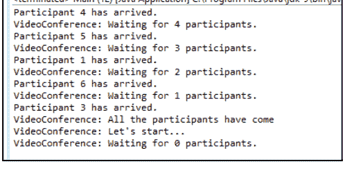
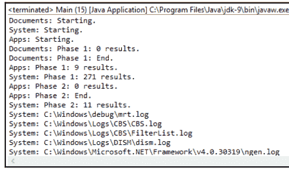
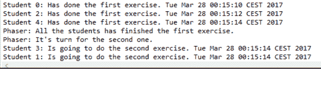
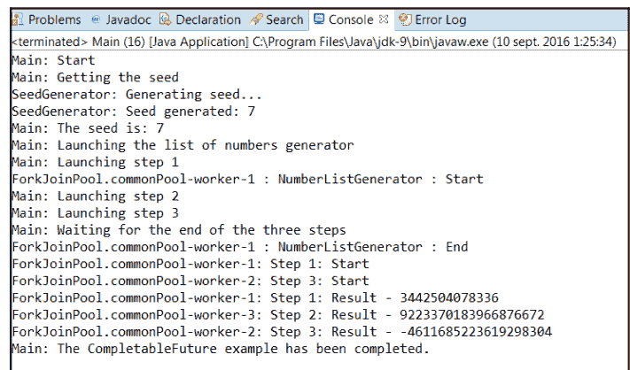

## 第3章：线程同步实用程序

## 线程同步实用程序

在本章中，我们将涵盖以下主题：

- 控制对一个或多个资源副本的并发访问
- 等待多个并发事件
- 在公共点同步任务
- 运行并发分阶段任务
- 控制并发分阶段任务的阶段变更
- 在并发任务之间交换数据
- 异步完成和链接任务

## 引言

在第 2 章《Basic Thread Synchronization》中，你学习了同步和临界区的概念。基本上，当一个以上的并发任务共享一个资源，例如一个对象或对象的属性时，我们就谈论同步。访问此共享资源的代码块称为临界区。

如果你不使用适当的机制，可能会产生不正确的结果、数据不一致或错误条件。因此，我们必须采用 Java 语言提供的同步机制之一来避免这些问题。

## 控制对一个或多个资源副本的并发访问

在本配方中，你将学习如何使用 Java 语言提供的信号量机制。信号量是一个计数器，用于保护对一个或多个共享资源的访问。


信号量的概念由 Edsger Dijkstra 于 1965 年提出，并在 THEOS 操作系统中首次使用。

当线程想要访问其中一个共享资源时，它必须首先获取信号量。如果信号量的内部计数器大于 0，信号量会递减计数器并允许访问共享资源。计数器大于 0 意味着有可用的空闲资源，因此线程可以访问并使用其中一个。

否则，如果计数器为 0，信号量会将线程置于休眠状态，直到计数器大于 0。计数器值为 0 意味着所有共享资源都被其他线程使用，因此想要使用其中一个的线程必须等待直到有空闲。

当线程完成对共享资源的使用后，它必须释放信号量，以便另一个线程可以访问该资源。此操作会增加信号量的内部计数器。

在本配方中，你将学习如何使用 Semaphore 类来保护一个资源的多个副本。你将实现一个示例，其中有一个打印队列，可以在三台不同的打印机上打印文档。

## 准备工作

本配方的示例使用 Eclipse IDE 实现。如果你使用 Eclipse 或其他 IDE，例如 NetBeans，打开它并创建一个新的 Java 项目。

## 如何操作...

按照以下步骤实现示例：

- 1. 创建一个名为 PrintQueue 的类，它将实现打印队列：
- 2. 该类将有三个私有属性。一个名为 semaphore 的信号量，一个名为 freePrinters 的布尔数组，以及一个名为 lockPrinters 的锁，如以下代码片段所示：
- 3. 实现类的构造函数。它初始化类的三个属性，如以下代码片段所示：
- 4. 实现 printJob() 方法，它将模拟文档的打印。它接收一个名为 document 的对象作为参数：
- 5. 首先，printJob() 方法调用 acquire() 方法以获取对信号量的访问。由于此方法可能会抛出 InterruptedException 异常，你必须包含处理它的代码：
- 6. 然后，使用私有方法 getPrinter() 获取分配用于打印此作业的打印机编号：

```
public class PrintQueue {
```

```
private final Semaphore semaphore;
private final boolean freePrinters[];
private final Lock lockPrinters;
```

```
public PrintQueue() {
    semaphore=new Semaphore(3);
    freePrinters=new boolean[3];
    for (int i=0; i<3; i++) {
        freePrinters[i]=true;
    }
    lockPrinters=new ReentrantLock();
}
```

```
public void printJob (Object document) {
```

```
try {
    semaphore.acquire();
```

```
int assignedPrinter=getPrinter();
```

13. 最后，释放 lockPrinters 对象并返回 true 值的索引：

```
} catch (Exception e) {
    e.printStackTrace();
} finally {
    lockPrinters.unlock();
}
return ret;
```

14. 接下来，创建一个名为 Job 的类并指定它实现 Runnable 接口。此类实现了将发送文档到打印机的作业：

```
public class Job implements Runnable {
```

15. 声明一个 PrintQueue 对象。称它为 printQueue：

```
private PrintQueue printQueue;
```

16. 实现类的构造函数。它初始化类中声明的 PrintQueue 对象：

```
public Job(PrintQueue printQueue){
    this.printQueue=printQueue;
}
```

17. 实现 run() 方法：

```
@Override
public void run() {
```

18. 首先，此方法将一条消息写入控制台，显示作业已开始执行：

```
System.out.printf("%s: Going to print a job\n",
    Thread.currentThread().getName());
```

19. 然后，它调用 PrintQueue 对象的 printJob() 方法：

```
printQueue.printJob(new Object());
```

20. 最后，该方法将一条消息写入控制台，显示它已完成执行：

```
System.out.printf("%s: The document has been printed\n",
    Thread.currentThread().getName());
}
```

以下截图显示了此示例执行输出：

```
Mon Sep 05 00:07:27 GMT+01:00 2016 - Thread 0: PrintQueue: Printing a Job in Printer 0 during 8 seconds
Thread 4: Going to print a job
Thread 3: Going to print a job
Thread 2: Going to print a job
Thread 1: Going to print a job
Mon Sep 05 00:07:27 GMT+01:00 2016 - Thread 8: PrintQueue: Printing a Job in Printer 2 during 6 seconds
Mon Sep 05 00:07:27 GMT+01:00 2016 - Thread 10: PrintQueue: Printing a Job in Printer 1 during 7 seconds
Thread 8: The document has been printed
Mon Sep 05 00:07:33 GMT+01:00 2016 - Thread 6: PrintQueue: Printing a Job in Printer 2 during 8 seconds
Thread 10: The document has been printed
Mon Sep 05 00:07:34 GMT+01:00 2016 - Thread 9: PrintQueue: Printing a Job in Printer 1 during 5 seconds
Thread 0: The document has been printed
Mon Sep 05 00:07:35 GMT+01:00 2016 - Thread 5: PrintQueue: Printing a Job in Printer 0 during 1 seconds
```

你可以看到前三个打印作业同时开始。然后，当一台打印机完成其作业时，另一台开始。

## 还有更多...

`Semaphore` 类有 `acquire()` 方法的三个额外版本：

- `acquireUninterruptibly()`：`acquire()` 方法，当信号量的内部计数器为 0 时，会阻塞线程直到信号量被释放。在此期间，线程可能会被中断；如果发生这种情况，该方法将抛出 `InterruptedException` 异常。此版本的 `acquire` 操作会忽略线程的中断并且不抛出任何异常。

- `tryAcquire()`：此方法尝试获取信号量。如果可以，它返回 `true` 值。但如果不能，它返回 `false` 而不是被阻塞并等待信号量释放。基于返回值采取正确行动是你的责任。

- `tryAcquire(long timeout, TimeUnit unit)`：此方法等同于前一个方法，但它会等待信号量参数指定的时间段。如果时间段结束且方法仍未获取信号量，它将返回 `false`。

`acquire()`、`acquireUninterruptibly()`、`tryAcquire()` 和 `release()` 方法还有一个额外的版本，该版本具有 `int` 参数。此参数表示使用它们的线程想要获取或释放的许可数量，即该线程想要从信号量的内部计数器中删除或添加的单元数。


在 `acquire()`、`acquireUninterruptibly()` 和 `tryAcquire()` 方法的情况下，如果计数器的值小于作为参数值传递的数字，线程将被阻塞，直到计数器达到相同的值或更大的值。

## 信号量中的公平性

公平性概念被 Java 语言用于所有可以有各种线程被阻塞并等待同步资源释放的类（例如，信号量）。默认模式称为 **非公平模式**。在此模式下，当同步资源被释放时，其中一个等待线程会被选中并获得该资源；然而，选择是没有任何标准的。公平模式另一方面改变了这种行为，并选择等待时间最长的线程。

如同其他类一样，`Semaphore` 类在其构造函数中接受第二个参数。此参数必须取布尔值。如果你给它一个 false 值，你就是创建一个将在非公平模式下工作的信号量。如果你不使用此参数，你将得到相同的行为。如果你给它一个 true 值，你就是创建一个将在公平模式下工作的信号量。

### See also

- 第 9 章《Testing Concurrent Applications》中 The Monitoring a Lock interface recipe
- 第 2 章《Basic Thread Synchronization》中 The Synchronizing a block of code with a lock recipe

## 等待多个并发事件

Java 并发 API 提供了一个类，允许一个或多个线程等待一组操作完成。它被称为 `CountDownLatch` 类。此类使用一个整数初始化，该整数是线程将等待的操作数。当线程想要等待这些操作的执行时，它使用 `await()` 方法。此方法使线程休眠，直到操作完成。当其中一个操作结束时，它使用 `countDown()` 方法递减 `CountDownLatch` 类的内部计数器。当计数器到达 0 时，该类唤醒所有在 `await()` 方法中休眠的线程。

在本示例中，你将学习如何使用 CountDownLatch 类来实现视频会议系统。视频会议系统应在开始前等待所有参与者的到来。

### Getting ready

本示例使用 Eclipse IDE 实现。如果你使用 Eclipse 或其他 IDE，例如 NetBeans，打开它并创建一个新的 Java 项目。

### How to do it...

按照以下步骤实现示例：

1. 创建一个名为 `Videoconference` 的类并指定它实现 `Runnable` 接口。此类将实现视频会议系统：

```java
public class Videoconference implements Runnable{
```

2. 声明一个名为 `controller` 的 `CountDownLatch` 对象：

```java
private final CountDownLatch controller;
```

3. 实现类的构造函数以初始化 `CountDownLatch` 属性。`Videoconference` 类将等待作为参数接收的参与者数量的到来：

```java
public Videoconference(int number) {
    controller=new CountDownLatch(number);
}
```

4. 实现 `arrive()` 方法。此方法将在每次参与者到达视频会议时被调用。它接收一个名为 `name` 的 `String` 类型作为参数：

```java
public void arrive(String name){
```

5. 首先，它使用接收到的参数写入一条消息：

```java
System.out.printf("%s has arrived.",name);
```

6. 然后，它调用 `CountDownLatch` 对象的 `countDown()` 方法：

```java
controller.countDown();
```

7. 最后，它使用 `CountDownLatch` 对象的 `getCount()` 方法写入另一条消息，其中包含等待到来的参与者数量：

```java
System.out.printf("VideoConference: Waiting for %d participants.\n",controller.getCount());
```

8. 接下来，实现视频会议系统的 main 方法。它是每个 `Runnable` 对象必须具有的 `run()` 方法：

```java
@Override
public void run() {
```

9. 首先，使用 `getCount()` 方法写入一条消息，其中包含视频会议中的参与者数量：

```java
System.out.printf("VideoConference: Initialization: %d participants.\n",controller.getCount());
```

10. 然后，使用 `await()` 方法等待所有参与者。由于此方法可能抛出 `InterruptedException` 异常，你必须包含处理它的代码：

```java
try {
    controller.await();
```

11. 最后，写入一条消息以指示所有参与者已到达：

```java
System.out.printf("VideoConference: All the participants have come\n");
System.out.printf("VideoConference: Let's start...\n");
} catch (InterruptedException e) {
e.printStackTrace();
}
```

12. 接下来，创建 `Participant` 类并指定它实现 `Runnable` 接口。此类代表视频会议中的每个参与者：

```java
public class Participant implements Runnable {
```

13. 声明一个私有 `Videoconference` 属性名为 `conference`：

```java
private Videoconference conference;
```

22. 创建 10 个 `Participant` 对象、运行每个对象的 `Thread` 对象并启动所有线程：

```java
for (int i=0; i<10; i++){
    Participant p=new Participant(conference, "Participant "+i);
    Thread t=new Thread(p);
    t.start();
}
```

### How it works...

`CountDownLatch` 类有三个基本元素：

- 初始化值，确定 `CountDownLatch` 对象等待多少个事件
- `await()` 方法，由等待所有事件完成的线程调用
- `countDown()` 方法，由事件在它们完成执行时调用

当你创建一个 `CountDownLatch` 对象时，它使用构造函数的参数初始化内部计数器。每次线程调用 `countDown()` 方法时，`CountDownLatch` 对象将内部计数器递减一个单位。当内部计数器达到 0 时，`CountDownLatch` 对象唤醒所有在 `await()` 方法中等待的线程。

没有办法重新初始化 `CountDownLatch` 对象的内部计数器或修改其值。一旦计数器初始化，你只能使用前面解释的 `countDown()` 方法来修改其值。当计数器达到 0 时，对 `await()` 方法的所有调用会立即返回，并且对 `countDown()` 方法的所有后续调用都没有效果。

然而，与其他同步方法相比存在一些差异，如下所示：

- `CountDownLatch` 机制不是用来保护共享资源或临界区。它用于将一个或多个线程与各种任务的执行同步。
- 它只允许一次使用。如前所述，一旦 `CountDownLatch` 的计数器到达 0，对其方法的所有调用都没有效果。如果你想再次进行相同的同步，你必须创建一个新对象。

以下屏幕截图显示了示例执行输出：



你可以看到参与者如何到达，并且一旦内部计数器到达 0，CountDownLatch 对象唤醒 Videoconference 对象，该对象写入指示视频会议应开始的消息。

### There's more...

`CountDownLatch` 类有 `await()` 方法的另一个版本，如下所示：

- `await(long time, TimeUnit unit)`: 在此方法中，线程将继续休眠直到被中断，即 `CountDownLatch` 的内部计数器到达 0 或指定的时间过去。`TimeUnit` 类是一个枚举，具有以下常量：`DAYS`、`HOURS`、`MICROSECONDS`、`MILLISECONDS`、`MINUTES`、`NANOSECONDS` 和 `SECONDS`。

## 在公共点同步任务

Java 并发 API 提供了一个同步工具，允许在确定的点同步两个或多个线程。它是 `CyclicBarrier` 类。此类与本章 Waiting for multiple concurrent events 示例中解释的 `CountDownLatch` 类相似，但它有一些差异使其成为更强大的类。


8. 现在实现一个名为 Results 的类。该类将以数组的形式存储所搜索数字在矩阵每一行中出现的次数：

```
public class Results {
```

9. 声明一个名为 data 的私有 int 数组：

```
private final int data[];
```

10. 实现该类的构造函数。此构造函数接收一个整数参数，表示数组的元素个数：

```
public Results(int size){
  data=new int[size];
}
```

11. 实现 setData() 方法。此方法接收数组中的位置和值作为参数，并设置数组中该位置的值：

```
public void setData(int position, int value){
  data[position]=value;
}
```

12. 实现 getData() 方法。此方法返回包含结果的数组：

```
public int[] getData(){
  return data;
}
```

13. 现在你已经有了辅助类，是时候实现线程了。首先，实现 Searcher 类。该类将在随机数字矩阵的指定行中查找一个数字。创建一个名为 Searcher 的类并指定其实现 Runnable 接口：

```
public class Searcher implements Runnable {
```

14. 声明两个私有 int 属性，分别是 firstRow 和 lastRow。这两个属性将确定此对象将在其中查找数字的行子集：

```
private final int firstRow;
private final int lastRow;
```

15. 声明一个名为 mock 的私有 MatrixMock 属性：

```
private final MatrixMock mock;
```

16. 声明一个名为 results 的私有 Results 属性：

```
private final Results results;
```

17. 声明一个名为 number 的私有 int 属性，它将存储我们要查找的数字：

```
private final int number;
```

18. 声明一个名为 barrier 的 CyclicBarrier 对象：

```
private final CyclicBarrier barrier;
```

19. 实现类的构造函数，初始化之前声明的所有属性：

```
public Searcher(int firstRow, int lastRow, MatrixMock mock,
    Results results, int number, CyclicBarrier barrier){
    this.firstRow=firstRow;
    this.lastRow=lastRow;
    this.mock=mock;
    this.results=results;
    this.number=number;
    this.barrier=barrier;
}
```

20. 实现 run() 方法来查找数字。它使用一个名为 counter 的内部变量来存储数字在每一行中出现的次数：

```
@Override
public void run() {
    int counter;
```

21. 在控制台打印一条消息，显示分配给此任务的行：

```
System.out.printf("%s: Processing lines from %d to %d.\n",
    Thread.currentThread().getName(),
    firstRow,lastRow);
```

22. 处理分配给此线程的所有行。对于每一行，统计要搜索的数字出现的次数并将该数字存储在 Results 对象的相应位置中：

```
for (int i=firstRow; i<lastRow; i++) {
    int row[]=mock.getRow(i);
    counter=0;
    for (int j=0; j<row.length; j++) {
        if (row[j]==number) {
            counter++;
        }
    }
    results.setData(i, counter);
}
```

23. 在控制台打印一条消息以指示此对象已完成搜索：

```
System.out.printf("%s: Lines processed.\n",
                Thread.currentThread().getName());
```

24. 调用 CyclicBarrier 对象的 await() 方法并添加必要的代码来处理此方法可能抛出的 InterruptedException 和 BrokenBarrierException 异常：

```
try {
    barrier.await();
} catch (InterruptedException e) {
    e.printStackTrace();
} catch (BrokenBarrierException e) {
    e.printStackTrace();
}
```

25. 现在实现计算矩阵中数字总出现次数的类。此类使用存储矩阵每一行中数字出现次数的 Results 对象来进行计算。创建一个名为 Grouper 的类并指定其实现 Runnable 接口：

```
public class Grouper implements Runnable {
```

26. 声明一个名为 results 的私有 Results 属性：

```
private final Results results;
```

27. 实现类的构造函数以初始化 Results 属性：

```
public Grouper(Results results){
    this.results=results;
}
```

28. 实现 run() 方法来计算结果数组中数字的总出现次数：

```
@Override
public void run() {
```

29. 声明一个 int 变量并向控制台写入一条消息以指示进程开始：

```
int finalResult=0;
System.out.printf("Grouper: Processing results...\n");
```

30. 使用 results 对象的 getData() 方法获取数字在每一行中出现的次数。然后，处理数组中的所有元素并将其值加到 finalResult 变量中：

```
int data[]=results.getData();
for (int number:data){
    finalResult+=number;
}
```

31. 在控制台打印结果：

```
System.out.printf("Grouper: Total result: %d.\n", finalResult);
```

32. 最后，通过创建一个名为 Main 的类并向其添加 main() 方法来实现示例的主类：

```
public class Main {
    public static void main(String[] args) {
```

33. 声明并初始化五个常量以存储应用程序的参数：

```
final int ROWS=10000;
final int NUMBERS=1000;
final int SEARCH=5;
final int PARTICIPANTS=5;
final int LINES_PARTICIPANT=2000;
```

34. 创建一个名为 mock 的 MatrixMock 对象。它将有 10,000 行，每行 1,000 个元素。现在，你将搜索数字五：

```
MatrixMock mock=new MatrixMock(ROWS, NUMBERS,SEARCH);
```

35. 创建一个名为 results 的 Results 对象。它将有 10,000 个元素：

```
Results results=new Results(ROWS);
```

36. 创建一个名为 grouper 的 Grouper 对象：

```
Grouper grouper=new Grouper(results);
```

37. 创建一个名为 barrier 的 CyclicBarrier 对象。此对象将等待五个线程。当这五个线程完成后，它将执行之前创建的 Grouper 对象：

```
CyclicBarrier barrier=new CyclicBarrier(PARTICIPANTS,grouper);
```

38. 创建五个 Searcher 对象、五个用于执行它们的线程并启动这五个线程：

```
Searcher searchers[]=new Searcher[PARTICIPANTS];
for (int i=0; i<PARTICIPANTS; i++){
    searchers[i]=new Searcher(i*LINES_PARTICIPANT,
                            (i*LINES_PARTICIPANT)+LINES_PARTICIPANT,
                            mock, results, 5,barrier);
    Thread thread=new Thread(searchers[i]);
    thread.start();
}
System.out.printf("Main: The main thread has finished.\n");
```

## 还有更多...

`CyclicBarrier` 类还有另一个版本的 `await()` 方法：

- `await(long time, TimeUnit unit)`：在此方法中，线程将继续休眠直到被中断，即 `CyclicBarrier` 的内部计数器到达 0 或指定的时间过去。`TimeUnit` 类是一个枚举，具有以下常量：`DAYS`、`HOURS`、`MICROSECONDS`、`MILLISECONDS`、`MINUTES`、`NANOSECONDS` 和 `SECONDS`。

该类还提供了 `getNumberWaiting()` 方法，该方法返回在 `await()` 方法中被阻塞的线程数，以及 `getParties()` 方法，该方法返回将与 `CyclicBarrier` 同步的任务数。

## 重置 CyclicBarrier 对象

`CyclicBarrier` 类与 `CountDownLatch` 类有一些共同点，但它们也有一些差异。其中最重要的一点是 `CyclicBarrier` 对象可以重置为初始状态，将其内部计数器赋值为初始化时的值。

此重置操作可以使用 `CyclicBarrier` 类的 `reset()` 方法完成。当这种情况发生时，所有在 `await()` 方法中等待的线程都会收到一个 `BrokenBarrierException` 异常。此异常在示例食谱中通过打印堆栈跟踪来处理；然而，在更复杂的应用程序中，它可以执行其他操作，例如重新启动执行或从中断点恢复操作。

## 破损的 CyclicBarrier 对象

`CyclicBarrier` 对象可以处于一种特殊状态，即破损状态。当有多个线程在 `await()` 方法中等待并且其中一个被中断时，被中断的线程会收到一个 `InterruptedException` 异常，但其他线程会收到一个 `BrokenBarrierException` 异常；`CyclicBarrier` 进入破损状态。

`CyclicBarrier` 类提供了 `isBroken()` 方法。如果对象处于破损状态，则返回 `true`；否则返回 `false`。


## 另请参阅

- 本章中 *等待多个并发事件* 的配方

## 运行并发分阶段任务

Java 并发 API 提供的最复杂和强大的功能之一是使用 `Phaser` 类执行并发分阶段任务的能力。当我们有一些分为多个步骤的并发任务时，此机制很有用。`Phaser` 类为我们在每个步骤结束时同步线程提供了一种机制，因此没有线程会在所有线程完成第一步之前开始第二步。

与其他同步工具一样，我们必须使用参与同步操作的任务数量初始化 `Phaser` 类，但我们可以通过增加或减少该数量来动态修改它。

在本配方中，您将学习如何使用 `Phaser` 类同步三个并发任务。这三个任务在三个不同的文件夹及其子文件夹中查找在过去 24 小时内修改过的扩展名为 `.log` 的文件。此任务分为三个步骤：

- 1. 获取分配文件夹及其子文件夹中扩展名为 `.log` 的文件列表。
- 2. 通过删除修改时间超过 24 小时的文件来过滤第一步创建的列表。
- 3. 在控制台中打印结果。

在步骤 1 和步骤 2 结束时，我们检查列表是否有任何元素。如果没有，线程结束其执行并从 `Phaser` 类中删除。

## 准备工作

本配方的示例使用 Eclipse IDE 实现。如果您使用 Eclipse 或其他 IDE，例如 NetBeans，请打开它并创建一个新的 Java 项目。

## 如何做...

按照以下步骤实现示例：

- 1. 创建一个名为 `FileSearch` 的类并指定它实现 `Runnable` 接口。此类实现了在文件夹及其子文件夹中搜索在过去 24 小时内修改过的具有确定扩展名的文件的操作：
  
  ```java
  public class FileSearch implements Runnable {
  ```

- 2. 声明一个私有 `String` 属性来存储搜索操作将开始的文件夹：
  
  ```java
  private final String initPath;
  ```

- 3. 声明另一个私有 `String` 属性来存储我们要查找的文件的扩展名：
  
  ```java
  private final String fileExtension
  ```

- 4. 声明一个私有 `List` 属性来存储我们将找到的具有所需特征的文件的完整路径：
  
  ```java
  private List<String> results;
  ```

- 5. 最后，声明一个私有 `Phaser` 属性来控制任务不同阶段的同步：
  
  ```java
  private Phaser phaser;
  ```

- 6. 接下来，实现类的构造函数，它将初始化类的属性。它接收初始文件夹的完整路径作为参数，文件的扩展名和 `phaser`：
  
  ```java
  public FileSearch(String initPath, String fileExtension,
                    Phaser phaser) {
      this.initPath = initPath;
      this.fileExtension = fileExtension;
      this.phaser=phaser;
      results=new ArrayList<>();
  }
  ```

7. 现在，实现一些将在 run() 方法中使用的辅助方法。第一个是 directoryProcess() 方法。它接收一个 File 对象作为参数并处理其所有文件和子文件夹。对于每个文件夹，该方法将进行递归调用，同时将文件夹作为参数传递。对于每个文件，该方法将调用 fileProcess() 方法：

```
private void directoryProcess(File file) {
    File list[] = file.listFiles();
    if (list != null) {
        for (int i = 0; i < list.length; i++) {
            if (list[i].isDirectory()) {
                directoryProcess(list[i]);
            } else {
                fileProcess(list[i]);
            }
        }
    }
}
```

8. 然后，实现 fileProcess() 方法。它接收一个 File 对象作为参数并检查其扩展名是否等于我们正在查找的扩展名。如果相等，此方法将文件的绝对路径添加到结果列表中：

```
private void fileProcess(File file) {
    if (file.getName().endsWith(fileExtension)) {
        results.add(file.getAbsolutePath());
    }
}
```

9. 现在实现 filterResults() 方法。它不接收任何参数并过滤在第一阶段获得的文件列表；它删除修改时间超过 24 小时的文件。首先，创建一个新的空列表并获取实际日期：

```
private void filterResults() {
    List<String> newResults=new ArrayList<>();
    long actualDate=new Date().getTime();
```

10. 然后，遍历 results 列表中的所有元素。对于结果列表中的每个路径，为文件创建一个 File 对象并获取其最后修改日期：

```
for (int i=0; i<results.size(); i++){
    File file=new File(results.get(i));
```

27. 创建并启动一个线程以执行第一个 FileSearch 对象：

```
Thread systemThread=new Thread(system,"System");
systemThread.start();
```

28. 创建并启动一个线程以执行第二个 FileSearch 对象：

```
Thread appsThread=new Thread(apps,"Apps");
appsThread.start();
```

29. 创建并启动一个线程以执行第三个 FileSearch 对象：

```
Thread documentsThread=new Thread(documents, "Documents");
documentsThread.start();
```

30. 等待三个线程的结束：

```
try {
    systemThread.join();
    appsThread.join();
    documentsThread.join();
} catch (InterruptedException e) {
    e.printStackTrace();
}
```

31. 使用 isFinalized() 方法写入 Phaser 对象的已完成标志的值：

```
System.out.println("Terminated: "+ phaser.isTerminated());
```

## 它是如何工作的...

程序开始创建将控制线程在每个阶段结束时同步的 Phaser 对象。Phaser 的构造函数接收参与者数量作为参数。在我们的例子中，Phaser 有三个参与者。此数字指示 Phaser 在 Phaser 能够更改阶段并唤醒已休眠的线程之前，需要执行 arriveAndAwaitAdvance() 方法的线程数量。

一旦创建了 Phaser，我们就启动三个线程，这些线程使用三个不同的 FileSearch 对象执行。

在本示例中，我们使用 Windows 操作系统的路径。如果您使用其他操作系统，请修改路径以适应您环境中存在的路径，例如 `/var/log`，或类似路径。

`FileSearch` 对象的 `run()` 方法中的第一条指令是对 `Phaser` 对象的 `arriveAndAwaitAdvance()` 方法的调用。如前所述，`Phaser` 知道我们想要同步的线程数量。当线程调用此方法时，`Phaser` 减少必须完成实际阶段的线程数量并将此线程置于休眠状态，直到所有剩余线程完成此阶段为止。在 `run()` 方法开始时调用此方法可确保在所有线程创建之前，没有任何 `FileSearch` 线程开始其工作。

在阶段一和阶段二结束时，我们检查阶段是否生成了结果并且结果列表有元素，或者阶段未生成结果并且列表为空。在第一种情况下，`checkResults()` 方法调用 `arriveAndAwaitAdvance()`，如前所述。在第二种情况下，如果列表为空，线程继续执行就没有意义了，因此它结束其执行。但您必须通知 `Phaser` 对象参与者将减少一个。为此，我们使用了 `arriveAndDeregister()`。这通知 `phaser` 线程已完成实际阶段，但不会参与未来阶段，因此 `phaser` 不必等待它继续。

在 `showInfo()` 方法中实现的阶段三结束时，对 `phaser` 的 `arriveAndAwaitAdvance()` 方法进行调用。通过此调用，我们保证所有线程同时完成。当此方法结束执行时，会调用 `phaser` 的 `arriveAndDeregister()` 方法。通过此调用，我们取消注册 `phaser` 的线程，如前所述，因此当所有线程完成时，`phaser` 将没有参与者。

最后，`main()` 方法等待三个线程完成并调用 `phaser` 的 `isTerminated()` 方法。当 `phaser` 没有参与者时，它进入所谓的终止状态，此方法返回 `true`。由于我们取消注册了 `phaser` 的所有线程，因此它将处于终止状态，此调用将在控制台打印 `true`。

`Phaser` 对象可以处于两种状态：

- **Active：** `Phaser` 在接受新参与者的注册并在每个阶段结束时进行同步时进入此状态。在此状态下，`Phaser` 按本配方中解释的方式工作。此状态在 Java 并发 API 中未提及。


+   - **终止：** 默认情况下，当 `Phaser` 中的所有参与者都已注销，即参与者数量为零时，`Phaser` 进入此状态。此外，当方法 `onAdvance()` 返回 true 时，`Phaser` 也处于终止状态。如果你重写此方法，可以更改默认行为。当 `Phaser` 处于此状态时，同步方法 `arriveAndAwaitAdvance()` 会立即返回，而不执行任何同步操作。

`Phaser` 类的一个显著特点是，你无需处理与 `phaser` 相关的任何方法抛出的异常。与其他同步工具不同，在 `phaser` 中休眠的线程不会响应中断事件，也不会抛出 `InterruptedException` 异常。只有一种例外情况，在下一节中会进行解释。

以下截图显示了示例一次执行的结果：



它显示了执行的头两个阶段。你可以看到 `Apps` 线程如何在第二阶段完成其执行，因为其结果列表为空。当你执行示例时，你会看到某些线程在其他线程之前完成一个阶段，以及它们如何等待所有线程完成一个阶段后再继续进行。

## There's more...

`Phaser` 类提供了与阶段变更相关的其他方法。这些方法如下：

+   - `arrive()`：此方法通知 `Phaser` 类一个参与者已完成实际阶段，但它不应等待其他参与者继续执行。请注意使用此方法，因为它不会与其他线程同步。

## See also

+   - `Chapter 9` 中 *Testing Concurrent Applications* 中的 *Monitoring a Phaser class* 配方

## Controlling phase change in concurrent-phased tasks

`Phaser` 类提供了一个方法，每当 `phaser` 变更阶段时就会执行。它是 `onAdvance()` 方法。它接收两个参数：当前阶段的编号和已注册参与者的数量。它返回一个布尔值 `false`，如果 `Phaser` 继续执行；或值 `true`，如果 `Phaser` 已完成并必须进入终止状态。

此方法的默认实现在已注册参与者数量为零时返回 `true`，否则返回 `false`。但如果你扩展 `Phaser` 类并重写此方法，可以修改此行为。通常，你会在需要从一个阶段推进到下一个阶段时执行某些操作时对此感兴趣。

在本配方中，你将学习如何在实现你自己的 `Phaser` 类版本的 phaser 中控制阶段变更，该版本重写了 `onAdvance()` 方法以在每次阶段变更时执行某些操作。你将实现一次考试的模拟，其中一些学生必须完成三项练习。所有学生都必须完成一项练习后才能进行下一项。

## Getting ready

本配方的示例已使用 Eclipse IDE 实现。如果你使用 Eclipse 或其他 IDE，例如 NetBeans，请打开它并创建一个新的 Java 项目。

## How to do it...

按照以下步骤实现示例：

+   1. 创建一个名为 MyPhaser 的类，并指定它扩展自 Phaser 类：

```
public class MyPhaser extends Phaser {
```

+   2. 重写 onAdvance() 方法。根据 phase 属性的值，我们调用不同的辅助方法。如果 phase 属性等于零，你必须调用 studentsArrived() 方法。如果 phase 等于一，你必须调用 finishFirstExercise() 方法。如果 phase 等于二，你必须调用 finishSecondExercise() 方法。最后，如果 phase 等于三，你必须调用 finishExam() 方法。否则，返回 true 值以指示 phaser 已终止：

```
@Override
protected boolean onAdvance(int phase, int registeredParties) {
    switch (phase) {
        case 0:
            return studentsArrived();
        case 1:
            return finishFirstExercise();
        case 2:
            return finishSecondExercise();
        case 3:
            return finishExam();
        default:
            return true;
    }
}
```

+   3. 实现辅助方法 studentsArrived()。它向控制台写入两条日志消息并返回 false，以指示 phaser 正在继续执行：

```
private boolean studentsArrived() {
    System.out.printf("Phaser: The exam are going to start. The students are ready.\n");
    System.out.printf("Phaser: We have %d students.\n", getRegisteredParties());
    return false;
}
```

14. 实现辅助方法 `doExercise1()`。此方法使当前线程或执行该方法的线程休眠一段随机时间：

```
private void doExercise1() {
    try {
        long duration=(long)(Math.random()*10);
        TimeUnit.SECONDS.sleep(duration);
    } catch (InterruptedException e) {
        e.printStackTrace();
    }
}
```

15. 实现辅助方法 `doExercise2()`。此方法使当前线程或执行该方法的线程休眠一段随机时间：

```
private void doExercise2() {
    try {
        long duration=(long)(Math.random()*10);
        TimeUnit.SECONDS.sleep(duration);
    } catch (InterruptedException e) {
        e.printStackTrace();
    }
}
```

16. 实现辅助方法 `doExercise3()`。此方法使线程休眠一段随机时间：

```
private void doExercise3() {
    try {
        long duration=(long)(Math.random()*10);
        TimeUnit.SECONDS.sleep(duration);
    } catch (InterruptedException e) {
        e.printStackTrace();
    }
}
```

17. 通过创建一个名为 Main 的类并向其添加 `main()` 方法来实现示例的主类：

```
public class Main {
    public static void main(String[] args) {
```

此方法在 Phaser 在进行阶段变更并唤醒所有在 arriveAndAwaitAdvance() 方法中休眠的线程之前被调用。该方法由完成一个阶段的最后一个线程作为 arriveAndAwaitAdvance() 方法代码的一部分调用。该方法接收实际阶段的编号作为参数，其中 0 是第一个阶段的编号，以及已注册参与者的数量。最有用的参数是实际阶段。如果你根据实际阶段执行不同的操作，你必须使用替代结构（if...else 或 switch）来选择要执行的操作。在示例中，我们使用 switch 结构为每次阶段变更选择不同的方法。

onAdvance() 方法返回一个布尔值，指示 phaser 是否已终止。如果 phaser 返回 false，则表示它尚未终止；如果发生这种情况，线程将继续执行其他阶段。如果 phaser 返回 true，则 phaser 仍会唤醒挂起的线程但将 phaser 移至已终止状态。这样，之后对 phaser 的任何方法的调用都会立即返回，并且 isTerminated() 方法将返回 true。

在 Main 类中，当你创建 MyPhaser 对象时，你没有指定 phaser 中参与者的数量。你对创建的每个 Student 对象都调用了 register() 方法以在 phaser 中注册一个参与者。此调用不会在 Student 对象或执行它的线程与 phaser 之间建立关系。实际上，phaser 中参与者的数量只是一个数字。phaser 与参与者之间没有任何关系。

以下截图显示了此示例一次执行的结果：




你可以看到学生们在不同时间完成第一个练习。当他们全部完成第一个练习时，`phaser` 会调用 `onAdvance()` 方法在控制台写入日志消息，然后所有学生同时开始第二个练习。

## See also

- 本章中 *Running concurrent-phased tasks* 配方
- `Chapter 9` 中 *Monitoring a Phaser class* 配方，*Testing Concurrent Applications*

## Exchanging data between concurrent tasks

Java 并发 API 提供了一种同步工具，允许在两个并发任务之间交换数据。更详细地说，`Exchanger` 类允许你定义两个线程之间的同步点。当两个线程到达此点时，它们会交换一个数据结构，使得第一个线程的数据结构传递给第二个线程，反之亦然。

这个类在类似于生产者-消费者问题的情况下可能非常有用。这是一个经典的并发问题，其中你有一个数据公共缓冲区，一个或多个数据生产者，以及一个或多个数据消费者。由于 `Exchanger` 类仅同步两个线程，因此如果你的生产者-消费者问题有一个生产者和一个消费者，你可以使用它。

在本配方中，你将学习如何使用 `Exchanger` 类来解决具有一个生产者和一个消费者的生产者-消费者问题。

## Getting ready

本配方的示例已使用 Eclipse IDE 实现。如果你使用 Eclipse 或其他 IDE，例如 NetBeans，打开它并创建一个新的 Java 项目。

## How to do it...

按照以下步骤实现示例：

- 1. 首先，开始实现生产者。创建一个名为 `Producer` 的类并指定它实现 `Runnable` 接口：
  
  ```
  public class Producer implements Runnable {
  ```
- 2. 声明一个名为 `buffer` 的 `List<String>` 字段。这将是生产者将与消费者交换的数据结构：
  
  ```
  private List<String> buffer;
  ```
- 3. 声明一个名为 `exchanger` 的 `Exchanger<List<String>>` 字段。这将是用于同步生产者和消费者的交换器对象：
  
  ```
  private final Exchanger<List<String>> exchanger;
  ```
- 3. 实现类的构造函数以初始化两个属性：
  
  ```
  public Producer (List<String> buffer, Exchanger<List<String>>
      exchanger){
      this.buffer=buffer;
      this.exchanger=exchanger;
  }
  ```
- 4. 实现 `run()` 方法。在其中，实现 10 次交换循环：
  
  ```
  @Override
  public void run() {
      for (int cycle = 1; cycle <= 10; cycle++){
          System.out.printf("Producer: Cycle %d\n",cycle);
  ```
- 5. 在每个循环中，向缓冲区添加 10 个字符串：
  
  ```
  for (int j=0; j<10; j++){
      String message="Event "+((cycle-1)*10)+j);
      System.out.printf("Producer: %s\n",message);
      buffer.add(message);
  }
  ```

## Thread Synchronization Utilities

12. 在每个循环中，以调用 `exchange()` 方法开始以与生产者同步。消费者需要数据来消费。由于此方法可能抛出 `InterruptedException` 异常，因此你必须添加一些代码来处理它：

```
```java
try {
    buffer=exchanger.exchange(buffer);
} catch (InterruptedException e) {
    e.printStackTrace();
}
```
```

13. 将生产者发送到其缓冲区的 10 个字符串写入控制台并将其从缓冲区中删除以使其为空：

```
```java
System.out.println("Consumer: "+buffer.size());
for (int j=0; j<10; j++) {
    String message=buffer.get(0);
    System.out.println("Consumer: "+message);
    buffer.remove(0);
}
```
```

14. 现在，通过创建一个名为 `Main` 的类并向其添加 `main()` 方法来实现示例的 `main` 类：

```
```java
public class Main {
    public static void main(String[] args) {
```
```

15. 创建两个将由生产者和消费者使用的缓冲区：

```
```java
List<String> buffer1=new ArrayList<>();
List<String> buffer2=new ArrayList<>();
```
```

16. 创建将用于同步生产者和消费者的 `Exchanger` 对象：

```
```java
Exchanger<List<String>> exchanger=new Exchanger<>();
```
```

17. 创建 `Producer` 和 `Consumer` 对象：

```
```java
Producer producer=new Producer(buffer1, exchanger);
Consumer consumer=new Consumer(buffer2, exchanger);
```
```

18. 创建执行生产者和消费者的线程并启动线程：

```
Thread threadProducer=new Thread(producer);
Thread threadConsumer=new Thread(consumer);

threadProducer.start();
threadConsumer.start();
```

## How it works...

消费者以空缓冲区开始并调用 Exchanger 以与生产者同步。它需要数据来消费。生产者以空缓冲区开始其执行。它创建 10 个字符串，将它们存储在缓冲区中，并使用 Exchanger 与消费者同步。

此时，两个线程（生产者和消费者）都在 Exchanger 中，这会更改数据结构。因此，当消费者从 `exchange()` 方法返回时，它将拥有一个包含 10 个字符串的缓冲区。当生产者从 `exchange()` 方法返回时，它将拥有一个空缓冲区以再次填充。此操作将重复 10 次。

如果你执行示例，你将看到生产者和消费者如何并发地完成工作，以及两个对象如何在每一步交换其缓冲区。正如其他同步工具一样，第一个调用 `exchange()` 方法的线程将被置于睡眠状态，直到其他线程到达。

## There's more...

`Exchanger` 类还有另一个版本的 exchange 方法：`exchange(V data, long time, TimeUnit unit)`。其中，V 是在 Phaser 声明中用作参数的类型（在我们的例子中为 `List<String>`）。线程将睡眠直到被中断、另一个线程到达或指定时间过去。在这种情况下，会抛出 `TimeoutException`。`TimeUnit` 类是一个枚举，具有以下常量：`DAYS`、`HOURS`、`MICROSECONDS`、`MILLISECONDS`、`MINUTES`、`NANOSECONDS` 和 `SECONDS`。

## Completing and linking tasks asynchronously

Java 8 Concurrency API 包含一个带有 `CompletableFuture` 类的新同步机制。此类实现了 `Future` 对象和 `CompletionStage` 接口，这赋予了它以下两个特征：

- 作为 `Future` 对象，`CompletableFuture` 对象将在未来某个时间返回结果
- 作为 `CompletionStage` 对象，你可以在一个或多个 `CompletableFuture` 对象完成之后执行更多异步任务

你可以用不同的方式使用 `CompletableFuture` 类：

- 你可以显式地创建一个 `CompletableFuture` 对象并将其用作任务之间的同步点。一个任务将使用 `complete()` 方法建立 `CompletableFuture` 返回的值，而其他任务将使用 `get()` 或 `join()` 方法等待此值。
- 你可以使用 `CompletableFuture` 类的静态方法使用 `runAsync()` 和 `supplyAsync()` 方法执行 `Runnable` 或 `Supplier`。这些方法将返回一个 `CompletableFuture` 对象，当这些任务结束执行时它将被完成。在第二种情况下，`Supplier` 返回的值将是 `CompletableFuture` 的完成值。
- 你可以指定在一個或多個 `CompletableFuture` 对象完成之后以异步方式执行的其他任务。此任务可以实现 `Runnable`、`Function`、`Consumer` 或 `BiConsumer` 接口。

## How to do it...

按照以下步骤实现示例：

- 1. 首先，我们将实现示例中将使用的辅助任务。创建一个名为 `SeedGenerator` 的类，该类实现 `Runnable` 接口。它将有一个 `CompletableFuture` 对象作为属性，并在类的构造函数中初始化：
  
  ```java
  public class SeedGenerator implements Runnable {
      private CompletableFuture<Integer> resultCommunicator;
      public SeedGenerator (CompletableFuture<Integer> completable) {
          this.resultCommunicator=completable;
      }
  }
  ```
- 2. 然后，实现 `run()` 方法。它将使当前线程休眠 5 秒（以模拟长时间操作），计算 1 到 10 之间的随机数，然后使用 `resultCommunicator` 对象的 `complete()` 方法完成 CompletableFuture：
  
  ```java
  @Override
  public void run() {
      System.out.printf("SeedGenerator: Generating seed...\n");
      // Wait 5 seconds
      try {
          TimeUnit.SECONDS.sleep(5);
      } catch (InterruptedException e) {
          e.printStackTrace();
      }
      int seed=(int) Math.rint(Math.random() * 10);
      System.out.printf("SeedGenerator: Seed generated: %d\n", seed);
      resultCommunicator.complete(seed);
  }
  ```
- 3. 创建一个名为 `NumberListGenerator` 的类，该类实现参数化为 `List<Long>` 数据类型的 `Supplier` 接口。这意味着 `Supplier` 接口提供的 `get()` 方法将返回一个大数字列表。此类将有一个整数作为私有属性，该属性将在类的构造函数中初始化：


public class NumberListGenerator implements Supplier<List<Long>> {
    private final int size;
    public NumberListGenerator (int size) {
        this.size=size;
    }
}

4. 然后，实现 get() 方法，该方法将返回一个包含数百万个数字的列表，其大小由 size 参数指定，且为较大的随机数：

```
@Override
public List<Long> get() {
    List<Long> ret = new ArrayList<>();
    System.out.printf("%s : NumberListGenerator : Start\n", Thread.currentThread().getName());
    for (int i=0; i< size*1000000; i++) {
        long number=Math.round(Math.random()*Long.MAX_VALUE);
        ret.add(number);
    }
    System.out.printf("%s : NumberListGenerator : End\n", Thread.currentThread().getName());
    return ret;
}
```

5. 最后，创建一个名为 NumberSelector 的类，该类实现参数化为 List<Long> 和 Long 数据类型的 Function 接口。这意味着 Function 接口提供的 apply() 方法将接收一个大数字列表并返回一个 Long 数字：

```
public class NumberSelector implements Function<List<Long>, Long> {
    @Override
    public Long apply(List<Long> list) {
        System.out.printf("%s: Step 3: Start\n", Thread.currentThread().getName());
        long max=list.stream().max(Long::compare).get();
        long min=list.stream().min(Long::compare).get();
        long result=(max+min)/2;
        System.out.printf("%s: Step 3: Result - %d\n", Thread.currentThread().getName(), result);
        return result;
    }
}
```

6. 现在是时候实现 Main 类和 main() 方法了：

```
public class Main {
    public static void main(String[] args) {
```

7. 首先，创建一个 CompletableFuture 对象和一个 SeedGenerator 任务，并将其作为 Thread 执行：

```
System.out.printf("Main: Start\n");
CompletableFuture<Integer> seedFuture = new CompletableFuture<>();
Thread seedThread = new Thread(new SeedGenerator(seedFuture));
seedThread.start();
```

8. 然后，使用 CompletableFuture 对象的 get() 方法等待 SeedGenerator 任务生成的种子：

```
System.out.printf("Main: Getting the seed\n");
int seed = 0;
try {
    seed = seedFuture.get();
} catch (InterruptedException | ExecutionException e) {
    e.printStackTrace();
}
System.out.printf("Main: The seed is: %d\n", seed);
```

9. 现在创建一个另一个 CompletableFuture 对象来控制 NumberListGenerator 任务的执行，但这次使用静态方法 supplyAsync()：

```
System.out.printf("Main: Launching the list of numbers\n");
NumberListGenerator task = new NumberListGenerator(seed);
CompletableFuture<List<Long>> startFuture = CompletableFuture
    .supplyAsync(task);
```

10. 然后，配置三个并行化的任务，这些任务将基于上一步生成的数字列表进行计算。这三个步骤不能在 NumberListGenerator 任务完成执行之前开始执行，因此我们使用上一步生成的 CompletableFuture 对象和 thenApplyAsync() 方法来配置这些任务。前两个步骤以函数式方式实现，第三个是 NumberSelector 类的对象：

```
System.out.printf("Main: Launching step 1\n");
CompletableFuture<Long> step1Future = startFuture
    .thenApplyAsync(list -> {
        System.out.printf("%s: Step 1: Start\n", Thread.currentThread().getName());
        long selected = 0;
        long selectedDistance = Long.MAX_VALUE;
        long distance;
        for (Long number : list) {
            distance = Math.abs(number - 1000);
            if (distance < selectedDistance) {
                selected = number;
                selectedDistance = distance;
            }
        }
        System.out.printf("%s: Step 1: Result - %d\n", Thread.currentThread().getName(), selected);
        return selected;
    });

System.out.printf("Main: Launching step 2\n");
CompletableFuture<Long> step2Future = startFuture
    .thenApplyAsync(list -> list.stream().max(Long::compare).get());

CompletableFuture<Void> write2Future = step2Future
    .thenAccept(selected -> {
        System.out.printf("%s: Step 2: Result - %d\n", Thread.currentThread().getName(), selected);
    });

System.out.printf("Main: Launching step 3\n");
NumberSelector numberSelector = new NumberSelector();
CompletableFuture<Long> step3Future = startFuture
    .thenApplyAsync(numberSelector);
```

11. 我们使用 CompletableFuture 类的 allOf() 静态方法等待三个并行步骤的完成：

```
System.out.printf("Main: Waiting for the end of the three steps\n");
CompletableFuture<Void> waitFuture = CompletableFuture
    .allOf(step1Future, write2Future, step3Future);
```

12. 此外，我们执行一个最终步骤在控制台写入一条消息：

```
CompletableFuture<Void> finalFuture = waitFuture
    .thenAcceptAsync((param) -> {
        System.out.printf("Main: The CompletableFuture example has been completed.");
    });
finalFuture.join();
```

## 如何工作...

我们可以用 CompletableFuture 对象实现两个主要目的：

- 等待未来会产生的值或事件（创建对象并使用 complete() 和 get() 或 join() 方法）。
- 组织一组任务以确定的顺序执行，以便一个或多个任务不会在其他任务完成执行之前开始执行。

在这个示例中，我们同时使用了 CompletableFuture 类的两种用途。首先，我们创建了该类的一个实例并将其作为参数传递给 SeedGenerator 任务。该任务使用 complete() 方法发送计算出的值，而 main() 方法使用 get() 方法获取该值。get() 方法会使当前线程休眠，直到 CompletableFuture 完成。

然后，我们使用 supplyAsync() 方法生成一个 CompletableFuture 对象。此方法接收 Supplier 接口实现作为参数。Supplier 接口提供 get() 方法，该方法必须返回一个值。supplyAsync() 方法返回 CompletableFuture，当 get() 方法完成执行时它将被完成；完成的<|message|>值是该方法返回的值。返回的 CompletableFuture 对象将由 ForkJoinPool 返回的 static 方法 commonPool() 中的任务执行。

然后，我们使用 thenApplyAsync() 方法链接一些任务。你在 CompletableFuture 对象上调用此方法，并必须传递 Function 接口的实现作为参数，该实现可以直接在代码中使用函数式风格表达，也可以用独立对象表达。一个强大的特性是 CompletableFuture 生成的值将作为参数传递给 Function。也就是说，在我们的例子中，三个步骤都将接收一个随机数字列表作为参数。返回的 CompletableFuture 类将由 ForkJoinPool 返回的 static 方法 commonPool() 中的任务执行。

最后，我们使用了 `CompletableFuture` 类的 `allOf()` 静态方法来等待各种任务的完成。此方法接收一个 `CompletableFuture` 对象的可变列表，并返回一个 `CompletableFuture` 类，当作为参数传递的所有 `CompletableFuture` 类都完成时它将被完成。我们还使用了 `thenAcceptAsync()` 方法作为同步任务的另一种方式，因为此方法接收 `Consumer` 作为参数，该参数在用于调用该方法的 `CompletableFuture` 对象完成时由默认执行器执行。最后，我们使用了 `join()` 方法来等待最后一个 `CompletableFuture` 对象的完成。

以下屏幕截图显示了示例的执行情况。你可以看到任务按我们组织的顺序执行：



## 还有更多...

在本食谱的示例中，我们使用了 `CompletableFuture` 类的 `complete()`、`get()`、`join()`、`supplyAsync()`、`thenApplyAsync()`、`thenAcceptAsync()` 和 `allOf()` 方法。然而，该类还有许多有用的方法，可以提高该类的功能和灵活性。以下是其中最有趣的方法：

- 用于完成 `CompletableFuture` 对象的方法：除了 `complete()` 方法外，`CompletableFuture` 类还提供以下三个方法：
  - `cancel()`：此方法使用 `CancellationException` 异常完成 `CompletableFuture`。
  - `completeAsync()`：此方法使用作为参数传递的 `Supplier` 对象的结果完成 `CompletableFuture`。`Supplier` 对象由默认执行器在不同线程中执行。
  - `completeExceptionally()`：此方法使用作为参数传递的异常完成 `CompletableFuture`。

- 用于执行任务的方法：除了 `supplyAsync()` 方法外，`CompletableFuture` 类还提供以下方法：
  - `runAsync()`：这是 `CompletableFuture` 类的静态方法，它返回一个 `CompletableFuture` 对象。此对象将在作为参数传递的 `Runnable` 接口完成执行时完成。它将以 void 结果完成。

- 用于同步不同任务执行的方法：除了 `allOf()`、`thenAcceptAsync()` 和 `thenApplyAsync()` 方法外，`CompletableFuture` 类还提供以下方法来同步任务的执行：
  - `anyOf()`：这是 `CompletableFuture` 类的静态方法。它接收 `CompletableFuture` 对象列表并返回一个新的 `CompletableFuture` 对象。此对象将以第一个完成的 `CompletableFuture` 参数的结果完成。


- `runAfterBothAsync()`: 此方法接收 `CompletionStage` 和 `Runnable` 对象作为参数，并返回一个新的 `CompletableFuture` 对象。当 `CompletableFuture`（执行调用方）和 `CompletionStage`（作为参数接收）都完成时，`Runnable` 对象将由默认执行器执行，然后返回的 `CompletableFuture` 对象完成。
- `runAfterEitherAsync()`: 此方法与前一个方法类似，但在此情况下，当两者之一（`CompletableFuture` 或 `CompletionStage`）完成时，`Runnable` 接口将被执行。
- `thenAcceptBothAsync()`: 此方法接收 `CompletionStage` 和 `BiConsumer` 对象作为参数并返回 `CompletableFuture`。当 `CompletableFuture`（执行调用方）和 `CompletionStage`（作为参数传递）都完成时，`BiConsumer` 将由默认执行器执行。它接收两个 `CompletionStage` 对象的结果作为参数，但不会返回任何结果。当 `BiConsumer` 完成执行时，返回的 `CompletableFuture` 将在没有结果的情况下完成。
- `thenCombineAsync()`: 此方法接收一个 `CompletionStage` 对象和一个 `BiFunction` 对象作为参数，并返回一个新的 `CompletableFuture` 对象。当 `CompletableFuture`（执行调用方）和 `CompletionStage`（作为参数传递）都完成时，`BiFunction` 对象将被执行；它接收两个对象的完成值并返回一个新结果，该结果将成为返回的 `CompletableFuture` 的完成值。
- `thenComposeAsync()`: 此方法类似于 `thenApplyAsync()`，但当提供的函数也返回 `CompletableFuture` 时很有用。
- `thenRunAsync()`: 此方法类似于 `thenAcceptAsync()` 方法，但在这种情况下，它接收一个 `Runnable` 对象作为参数而不是 `Consumer` 对象。
