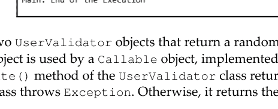
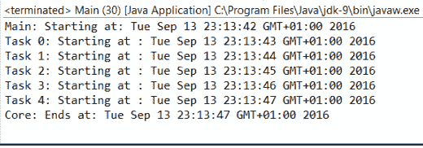
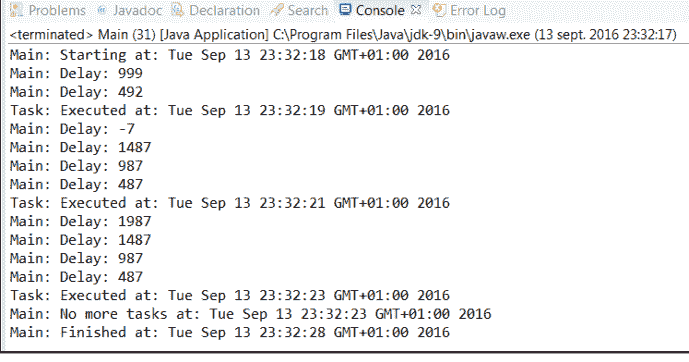
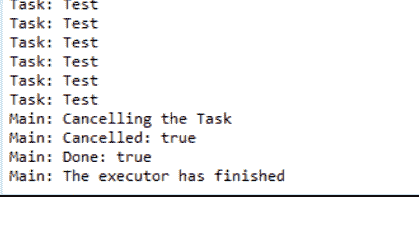

## 第4章：线程执行器

## 线程执行器

在本章中，我们将涵盖以下主题：

- 创建线程执行器并控制其被拒绝的任务
- 在返回结果的执行器中执行任务
- 运行多个任务并处理第一个结果
- 运行多个任务并处理所有结果
- 在延迟后在执行器中运行任务
- 定期在执行器中运行任务
- 在执行器中取消任务
- 控制执行器中任务的完成
- 在执行器中分离任务的启动和结果的处理

### 引言

通常，当你在 Java 中开发一个简单的并发编程应用程序时，首先你会创建一些 `Runnable` 对象，然后创建相应的 `Thread` 对象来执行它们。如果你必须开发一个运行大量并发任务的程序，这种方法会带来以下缺点：

- 你必须实现所有与代码相关的信息来管理 `Thread` 对象（创建、结束和获取结果）。
- 你必须为每个任务创建一个 `Thread` 对象。执行大量任务可能会影响应用程序的吞吐量。
- 你必须有效地控制和管理计算机的资源。如果你创建太多线程，你可能会使系统饱和。

在本教程中，你将学习如何使用 `Executors` 类创建一个新的 `ThreadPoolExecutor` 对象，如何向 `Executor` 发送任务，以及如何控制 `Executor` 类的被拒绝任务。

### 准备工作

你应该阅读 `Chapter 1, Thread Management` 中的 *Creating, running, and setting the characteristics of a thread* 教程，以学习 Java 中线程创建的基本机制。你可以比较两种机制并根据问题选择其中一种。

本教程的示例使用 Eclipse IDE 实现。如果你使用 Eclipse 或其他 IDE，例如 NetBeans，打开它并创建一个新的 Java 项目。

### 如何做...

按照以下步骤实现示例：

1. 首先，实现将由服务器执行的任务。创建一个名为 `Task` 的类，实现 `Runnable` 接口：
2. 声明一个名为 `initDate` 的 `Date` 属性来存储任务的创建日期，以及一个名为 `name` 的 `String` 属性来存储任务的名称：
3. 实现类的构造函数以初始化这两个属性：
4. 实现 `run()` 方法：

```
public class Task implements Runnable {
```

```
private final Date initDate;
private final String name;
```

```
public Task(String name) {
    initDate=new Date();
    this.name=name;
}
```

```
@Override
public void run() {
```

5. 首先，写入 initDate 属性和实际日期，即任务的开始日期：

```
System.out.printf("%s: Task %s: Created on: %s\n",
    Thread.currentThread().getName(),
    name,initDate);
System.out.printf("%s: Task %s: Started on: %s\n",
    Thread.currentThread().getName(),
    name,new Date());
```

6. 然后，让任务休眠一段随机时间：

```
try {
    Long duration=(long)(Math.random()*10);
    System.out.printf("%s: Task %s: Doing a task during %d seconds\n", Thread.currentThread().getName(),
        name,duration);
    TimeUnit.SECONDS.sleep(duration);
} catch (InterruptedException e) {
    e.printStackTrace();
}
```

7. 最后，在控制台中写入任务的完成日期：

```
System.out.printf("%s: Task %s: Finished on: %s\n",
    Thread.currentThread().getName(),
    name,new Date());
```

8. 创建一个名为 RejectedTaskController 的类，实现 RejectedExecutionHandler 接口。实现此接口的 rejectedExecution() 方法。然后写入已被拒绝的任务的名称以及执行器的名称和状态：

```
public class RejectedTaskController implements
    RejectedExecutionHandler {
    @Override
    public void rejectedExecution(Runnable r,
        ThreadPoolExecutor executor) {
        System.out.printf("RejectedTaskController: The task %s has been rejected\n",r.toString());
        System.out.printf("RejectedTaskController: %s\n",
            executor.toString());
        System.out.printf("RejectedTaskController: Terminating: %s\n",
            executor.isTerminating());
        System.out.printf("RejectedTaskController: Terminated: %s\n",
            executor.isTerminated());
    }
```

9. 现在实现将使用执行器执行收到的每个任务的 Server 类。创建一个名为 Server 的类：

```
public class Server {
```

10. 声明一个名为 executor 的 ThreadPoolExecutor 属性：

```
private final ThreadPoolExecutor executor;
```

11. 实现类的构造函数，使用 Executors 类初始化 ThreadPoolExecutor 对象，并为被拒绝的任务建立处理程序：

```
public Server(){
    executor = ( ThreadPoolExecutor ) Executors.newFixedThreadPool(
        Runtime.getRuntime().availableProcessors() );
    RejectedTaskController controller=new
        RejectedTaskController();
    executor.setRejectedExecutionHandler(controller);
}
```

12. 实现 executeTask() 方法。它接收一个 Task 对象作为参数并将其发送到执行器。首先，向控制台写入一条消息，指示有新任务到达：

```
public void executeTask(Task task){
    System.out.printf("Server: A new task has arrived\n");
```

13. 然后，调用执行器的 execute() 方法并将任务发送给它：

```
executor.execute(task);
```

14. 最后，将一些执行器数据写入控制台以查看其状态：

```
System.out.printf("Server: Pool Size: %d\n", executor.getPoolSize());
System.out.printf("Server: Active Count: %d\n", executor.getActiveCount());
System.out.printf("Server: Task Count: %d\n", executor.getTaskCount());
System.out.printf("Server: Completed Tasks: %d\n", executor.getCompletedTaskCount());
```


第一个重要点是在 Server 类的构造函数中创建 ThreadPoolExecutor。ThreadPoolExecutor 类有四个不同的构造函数，但由于其复杂性，Java 并发 API 提供了 Executors 类来构造执行器和其他相关对象。虽然你可以直接使用其构造函数之一创建 ThreadPoolExecutor，但建议你使用 Executors 类。

在这种情况下，你使用 Executors 类的 newFixedThreadPool() 方法创建了一个缓存线程池以创建执行器。此方法创建一个具有最大线程数的执行器。如果发送的任务数超过线程数，剩余的任务将被阻塞，直到有空闲线程可用于处理它们。此方法接收你希望在执行器中拥有的最大线程数作为参数。在我们的例子中，我们使用了 Runtime 类的 availableProcessors() 方法，该方法返回可用于 JVM 的处理器数量。通常，此数字与计算机的核心数相匹配。

线程的重用具有减少线程创建时间这一优势。然而，缓存线程池的缺点是为新任务保留常驻线程。因此，如果你向此执行器发送太多任务，你可能会使系统过载。

一旦创建了执行器，你就可以使用 execute() 方法发送 Runnable 或 Callable 类型的任务以供执行。在这种情况下，你发送了实现了 Runnable 接口的 Task 类的对象。

你还打印了一些关于执行器的日志信息。具体来说，你使用了以下方法：

- getPoolSize(): 此方法返回执行器池中实际的线程数。
- getActiveCount(): 此方法返回正在执行器中执行任务的线程数。
- getTaskCount(): 此方法返回已安排执行的任务数。返回的值仅是一个近似值，因为它会动态变化。
- getCompletedTaskCount(): 此方法返回执行器已完成的任务数。

ThreadPoolExecutor 类以及执行器一般的一个关键方面是，你必须显式地结束它们。如果你不这样做，执行器将继续执行，程序也不会结束。如果执行器没有任务可执行，它会继续等待新任务并且不会结束执行。Java 应用程序不会在所有非守护线程完成执行之前结束。因此，如果你不终止执行器，你的应用程序将永远不会结束。

要指示执行器你希望结束它，请使用 ThreadPoolExecutor 类的 shutdown() 方法。当执行器完成所有挂起任务的执行时，它也会完成自己的执行。在你调用 shutdown() 方法后，如果你尝试向执行器发送另一个任务，它将被拒绝并且执行器将抛出 RejectedExecutionException 异常，除非你已实现了被拒绝任务的管理器，如我们的例子中那样。要管理执行器的被拒绝任务，你需要创建一个实现 RejectedExecutionHandler 接口的类。此接口有一个名为 rejectedExecution() 的方法，具有两个参数：

- 一个存储已被拒绝的任务的 Runnable 对象
- 一个存储拒绝该任务的执行器的 Executor 对象

此方法针对执行器拒绝的每个任务调用。你需要使用 ThreadPoolExecutor 类的 setRejectedExecutionHandler() 方法来设置被拒绝任务的处理程序。

以下屏幕截图显示了此示例执行的一部分：

```
Server: Task Count: 99
Server: Completed Tasks: 0
Server: A new task has arrived
Server: Pool Size: 4
Server: Active Count: 4
Server: Task Count: 100
Server: Completed Tasks: 0
Main: Shutting down the Executor.
Main: Sending another Task.
Server: A new task has arrived
RejectedTaskController: The task com.packtpub.java9.concurrency.cookbook.chapter04.recipe01.task.Task@42dafa95 has been rejected
RejectedTaskController: java.util.concurrent.ThreadPoolExecutor@6500df86[Shutting down, pool size = 4, active threads = 4, queued tasks = 96, completed tasks = 0]
RejectedTaskController: terminating: true
RejectedTaskController: terminated: false
```

请注意，当最后一个任务到达执行器时，池中的线程数和正在执行的线程数都表示为 4。这指的是示例执行的 PC 的核心数，也是 availableProcessors() 方法返回的数字。一旦完成，我们关闭执行器，下一个任务被拒绝。RejectedTaskController 在控制台中写入有关任务和执行器的信息。

## 还有更多...

Executors 类提供了其他方法来创建 ThreadPoolExecutor：

- newCachedThreadPool(): 此方法返回一个 ExecutorService 对象，因此它被强制转换为 ThreadPoolExecutor 以访问其所有方法。你创建的缓存线程池在需要时创建新线程以执行新任务。此外，如果它们已完成正在运行的任务的执行，它会重用现有线程。
- newSingleThreadExecutor(): 这是固定大小线程执行器的极端情况。它创建一个只有一个线程的执行器，因此它一次只能执行一个任务。

ThreadPoolExecutor 类提供了大量方法来获取其状态信息。我们在示例中使用了 getPoolSize()、getActiveCount() 和 getCompletedTaskCount() 方法来获取有关执行器的池大小、线程数和已完成任务数的信息。你也可以使用 getLargestPoolSize() 方法；它返回同时存在于池中的最大线程数。

ThreadPoolExecutor 类还提供了其他与执行器终结相关的方法。这些方法为：

- shutdownNow(): 立即关闭执行器。它不执行挂起的任务。它返回一个包含所有挂起任务的列表。当你调用此方法时正在运行的任务会继续执行，但该方法不会等待其完成。
- isTerminated(): 如果你调用 shutdown() 或 shutdownNow() 方法，此方法返回 true；执行器相应地完成关闭过程。
- isShutdown(): 如果你调用执行器的 shutdown() 方法，此方法返回 true。
- awaitTermination(long timeout, TimeUnit unit): 此方法阻塞调用线程，直到执行器的任务结束或超时发生。TimeUnit 类是一个枚举，具有以下常量：DAYS、HOURS、MICROSECONDS、MILLISECONDS、MINUTES、NANOSECONDS 和 SECONDS。


如果你想等待任务完成，无论其持续时间如何，请使用较大的超时，例如 DAYS。

## 另请参阅

- 第 9 章《测试并发应用程序》中的 Monitoring an Executor 框架配方

## 在返回结果的执行器中执行任务

Executor 框架的一个优点是它允许你运行返回结果的并发任务。Java 并发 API 通过以下两个接口实现这一点：

- Callable: 此接口具有 call() 方法。在此方法中，你必须实现任务的逻辑。Callable 接口是一个参数化接口，意味着你必须指出 call() 方法将返回的数据类型。
- Future: 此接口具有一些方法来获取 Callable 对象生成的结果并管理其状态。

在本配方中，你将学习如何实现返回结果的任务并在执行器上运行它们。

## 准备工作

本配方的示例已使用 Eclipse IDE 实现。如果你使用 Eclipse 或其他 IDE，例如 NetBeans，请打开它并创建一个新的 Java 项目。

## 如何操作...

按照以下步骤实现示例：

- 1. 创建一个名为 FactorialCalculator 的类。指定它实现参数化为 Integer 类型的 Callable 接口：

```
public class FactorialCalculator implements Callable<Integer> {
```


+   2. 声明一个名为 number 的私有 Integer 属性，用于存储此任务在计算中使用的数字：

```
private final Integer number;
```

+   3. 实现类的构造函数以初始化类的属性：

```
public FactorialCalculator(Integer number) {
    this.number=number;
}
```

+   4. 实现 call() 方法。此方法返回 FactorialCalculator 的 number 属性的阶乘：

```
@Override
public Integer call() throws Exception {
```

+   5. 首先，创建并初始化方法中使用的内部变量：

```
int result = 1;
```

+   6. 如果 number 为 0 或 1，则返回 1。否则，计算 number 的阶乘。在两次乘法之间，出于教学目的，让此任务休眠 20 毫秒：

```
if ((number==0) || (number==1)) {
    result=1;
} else {
    for (int i=2; i<=number; i++) {
        result*=i;
        TimeUnit.MILLISECONDS.sleep(20);
    }
}
```

+   7. 将操作结果写入控制台：

```
System.out.printf("%s: %d\n",Thread.currentThread().getName(),
                result);
```

+   8. 返回操作的结果：

```
return result;
```

9. 通过创建名为 Main 的类并向其添加 main() 方法来实现示例的主类：

```
public class Main {
    public static void main(String[] args) {
```

10. 使用 Executors 类的 newFixedThreadPool() 方法创建 ThreadPoolExecutor 来运行任务。将 2 作为参数传递，即执行器中的线程数：

```
ThreadPoolExecutor executor=(ThreadPoolExecutor)Executors
    .newFixedThreadPool(2);
```

11. 创建一个 Future<Integer> 对象列表：

```
List<Future<Integer>> resultList=new ArrayList<>();
```

12. 使用 Random 类创建随机数生成器：

```
Random random=new Random();
```

13. 进行十步循环。在每一步中，我们生成一个随机数：

```
for (int i=0; i<10; i++){
    Integer number= random.nextInt(10);
```

14. 然后，我们创建 FactorialCalculator 对象，将生成的随机数作为参数传递：

```
FactorialCalculator calculator=new FactorialCalculator(number);
```

15. 调用 executor 的 submit() 方法将 FactorialCalculator 任务发送给 executor。此方法返回一个 Future<Integer> 对象来管理任务并最终获取其结果：

```
Future<Integer> result=executor.submit(calculator);
```

16. 将 Future 对象添加到之前创建的列表中：

```
resultList.add(result);
}
```

17. 创建一个 do 循环来监控 executor 的状态：

```
do {
```

24. 最后，调用 executor 的 shutdown() 方法以完成其执行：

```
executor.shutdown();
```

## 如何工作...

在本教程中，你学习了如何使用 Callable 接口启动返回结果的并发任务。你实现了 FactorialCalculator 类，该类实现了以 Integer 作为结果类型的 Callable 接口。因此，call() 方法返回一个 Integer 值。

此示例的另一个关键点是 Main 类。你使用 submit() 方法将 Callable 对象发送到执行器中执行。此方法接收 Callable 对象作为参数，并返回一个 Future 对象，你可以用它来实现两个主要目标：

- 你可以控制任务的状态，可以取消任务并检查它是否已完成。为此，你使用了 isDone() 方法。
- 你可以获取 call() 方法返回的结果。为此，你使用了 get() 方法。此方法会等待直到 Callable 对象完成 call() 方法的执行并返回其结果。如果在 get() 方法等待结果时线程被中断，它会抛出 InterruptedException 异常。如果 call() 方法抛出异常，则 get() 方法也会抛出 ExecutionException 异常。

## 还有更多...

当你调用 Future 对象的 get() 方法，而该对象控制的任务尚未完成时，该方法会阻塞直到任务完成。Future 接口提供了 get() 方法的另一个版本：

- get(long timeout, TimeUnit unit)：此版本的 get 方法，如果任务的结果不可用，会等待指定的时间。如果指定的时间段过去且结果仍不可用，它会抛出 TimeoutException 异常。TimeUnit 类是一个枚举，具有以下常量：DAYS、HOURS、MICROSECONDS、MILLISECONDS、MINUTES、NANOSECONDS 和 SECONDS。

## 另请参阅

- 本章中 创建线程执行器并控制其拒绝的任务、运行多个任务并处理第一个结果 以及 运行多个任务并处理所有结果 教程

## 运行多个任务并处理第一个结果

并发编程中常见的一个问题是，当你有各种可用于解决问题的并发任务，但你只对第一个结果感兴趣时。例如，你想对数组进行排序。你有各种排序算法。你可以全部启动它们并获取第一个排序数组的结果，即对给定数组最快的排序算法。

在本教程中，你将学习如何使用 ThreadPoolExecutor 类实现此场景。你将使用两种机制来尝试并验证用户。如果其中一种机制能够验证用户，则用户将被验证。

## 准备工作

本教程的示例使用 Eclipse IDE 实现。如果你使用 Eclipse 或其他 IDE，例如 NetBeans，请打开它并创建一个新的 Java 项目。

## 如何操作...

按照以下步骤实现示例：

+   1. 创建一个名为 UserValidator 的类，它将实现用户验证过程：

```
public class UserValidator {
```

2. 声明一个名为 name 的私有 String 属性，用于存储用户验证系统的名称：

```
private final String name;
```

3. 实现类的构造函数以初始化其属性：

```
public UserValidator(String name) {
    this.name=name;
}
```

4. 实现 validate() 方法。它接收两个 String 参数，分别是你要验证的用户的姓名和密码：

```
public boolean validate(String name, String password) {
```

5. 创建一个名为 random 的 Random 对象：

```
Random random=new Random();
```

6. 等待一段随机时间以模拟用户验证过程：

```
try {
    long duration=(long)(Math.random()*10);
    System.out.printf("Validator %s: Validating a user during %d seconds\n", this.name,duration);
    TimeUnit.SECONDS.sleep(duration);
} catch (InterruptedException e) {
    return false;
}
```

7. 返回一个随机布尔值。validate() 方法在用户通过验证时返回 true，否则返回 false：

```
return random.nextBoolean();
}
```

8. 实现 getName()。此方法返回 name 属性的值：

```
public String getName() {
    return name;
}
```

9. 现在，创建一个名为 ValidatorTask 的类，它将使用 UserValidation 对象作为并发任务执行验证过程。指定它实现以 String 类为参数的 Callable 接口：

```
public class ValidatorTask implements Callable<String> {
```

10. 声明一个名为 validator 的私有 UserValidator 属性：

```
private final UserValidator validator;
```

11. 声明两个私有 String 属性，名为 user 和 password：

```
private final String user;
private final String password;
```

12. 实现类的构造函数以初始化所有属性：

```
public ValidatorTask(UserValidator validator, String user,
    String password){
    this.validator=validator;
    this.user=user;
    this.password=password;
}
```

13. 实现 call() 方法，它将返回一个 String 对象：

```
@Override
public String call() throws Exception {
```

14. 如果用户未通过 UserValidator 对象验证，则向控制台写入一条消息以指示此情况并抛出 Exception：

```
if (!validator.validate(user, password)) {
    System.out.printf("%s: The user has not been found\n",
        validator.getName());
    throw new Exception("Error validating user");
}
```

15. 否则，向控制台写入一条消息以指示用户已通过验证并返回 UserValidator 对象的名称：

```
System.out.printf("%s: The user has been found\n",
    validator.getName());
return validator.getName();
```


16. 现在通过创建一个名为 Main 的类并向其添加 main() 方法来实现示例的主类：

```
public class Main {
    public static void main(String[] args) {
```

17. 创建两个名为 user 和 password 的 String 对象并用测试值初始化它们：

```
String username="test";
String password="test";
```

18. 创建两个 UserValidator 对象，分别命名为 ldapValidator 和 dbValidator：

```
UserValidator ldapValidator=new UserValidator("LDAP");
UserValidator dbValidator=new UserValidator("DataBase");
```

19. 创建两个 TaskValidator 对象，分别命名为 ldapTask 和 dbTask。分别用 ldapValidator 和 dbValidator 初始化它们：

```
TaskValidator ldapTask=new TaskValidator(ldapValidator,
    username, password);
TaskValidator dbTask=new TaskValidator(dbValidator,
    username,password);
```

20. 创建一个 TaskValidator 对象的列表并将创建的两个对象添加到其中：

```
List<TaskValidator> taskList=new ArrayList<>();
taskList.add(ldapTask);
taskList.add(dbTask);
```

21. 使用 Executors 类的 newCachedThreadPool() 方法创建一个新的 ThreadPoolExecutor 对象以及一个名为 result 的字符串变量：

```
ExecutorService executor=(ExecutorService)Executors
    .newCachedThreadPool();
String result;
```

22. 调用 executor 对象的 invokeAny() 方法。此方法接收 taskList 作为参数并返回 String。同时，它将返回的 String 对象写入控制台：

```
try {
    result = executor.invokeAny(taskList);
    System.out.printf("Main: Result: %s\n",result);
```

```
} catch (InterruptedException e) {
    e.printStackTrace();
} catch (ExecutionException e) {
    e.printStackTrace();
}
```

23. 使用 shutdown() 方法终止 executor 并向控制台写入一条消息以指示程序已结束：

```
executor.shutdown();
System.out.printf("Main: End of the Execution\n");
```

## How it works...

示例的关键在于 Main 类。ThreadPoolExecutor 类的 invokeAny() 方法接收一个任务列表，然后启动它们，并返回第一个完成且未抛出异常的任务的结果。此方法返回与任务的 call() 方法返回的相同数据类型。在本例中，它返回一个 String 值。

以下屏幕截图显示了当其中一个任务验证用户时示例执行输出：



示例有两个 UserValidator 对象，它们返回一个随机的 Boolean 值。每个 UserValidator 对象都被 Callable 对象使用，该对象由 TaskValidator 类实现。如果 UserValidator 类的 validate() 方法返回 false 值，则 TaskValidator 类抛出 Exception。否则，它返回 true 值。

因此，我们有两个任务可以返回 true 值或抛出 Exception。你可能有以下四种可能性：

- 两个任务都返回 true 值。这里，invokeAny() 方法的结果是首先完成的任务的名称。
- 第一个任务返回 true 值而第二个任务抛出 Exception。这里，invokeAny() 方法的结果是第一个任务的名称。
- 第一个任务抛出 Exception 而第二个任务返回 true 值。这里，invokeAny() 方法的结果是第二个任务的名称。
- 两个任务都抛出 Exception。在这种情况下，invokeAny() 方法抛出一个 ExecutionException 异常。

如果你多次运行示例，你将得到四种可能解决方案中的每一种。

以下屏幕截图显示了当两个任务都抛出异常时应用程序的输出：

```
<terminated> Main (79) [Java Application] C:\Program Files\Java\jdk-9\bin\javaw.exe (28 mar. 2017 0:23:40)
Validator DataBase: Validating a user during 4 seconds
Validator LDAP: Validating a user during 2 seconds
LDAP: The user has not been found
DataBase: The user has not been found
java.util.concurrent.ExecutionException: java.lang.Exception: Error validating user
	at java.util.concurrent.FutureTask.report(java.base@9-ea/FutureTask.java:122)
	at java.util.concurrent.FutureTask.get(java.base@9-ea/FutureTask.java:191)
	at java.util.concurrent.AbstractExecutorService.doInvokeAny(java.base@9-ea/AbstractExecutorService.java:199)
	at java.util.concurrent.AbstractExecutorService.invokeAny(java.base@9-ea/AbstractExecutorService.java:220)
	at com.packtpub.java9.concurrency.cookbook.chapter04.recipe03.core.Main.main(Main.java:49)
Caused by: java.lang.Exception: Error validating user
```

## There's more...

ThreadPoolExecutor 类提供了 invokeAny() 方法的另一个版本：

- invokeAny(Collection<? extends Callable<T>> tasks, long timeout, TimeUnit unit)：此方法执行所有任务并返回第一个完成且未抛出异常的任务的结果，如果它在给定的超时时间之前完成。TimeUnit 类是一个枚举，具有以下常量：DAYS、HOURS、MICROSECONDS、MILLISECONDS、MINUTES、NANOSECONDS 和 SECONDS。

## See also

- 本章中的 Running multiple tasks and processing all the results 配方

## Running multiple tasks and processing all the results

Executor 框架允许你在无需担心线程创建和执行的情况下执行并发任务。它为你提供了 Future 类，你可以使用它来控制任何在 executor 中执行的任务的状态并获取其结果。

当你想要等待任务完成时，可以使用以下两种方法：

- Future 接口的 isDone() 方法如果任务已完成其执行则返回 true
- ThreadPoolExecutor 类的 awaitTermination() 方法在调用 shutdown() 方法后使线程休眠，直到所有任务完成其执行

这两种方法有一些缺点。使用第一种方法，你只能控制任务的完成情况。使用第二种方法，你必须关闭 executor 才能等待线程；否则，方法调用会立即返回。

ThreadPoolExecutor 类提供了一种方法，允许你向 executor 发送任务列表并等待列表中所有任务的完成。在本配方中，你将通过实现一个包含 10 个任务执行的示例并在它们完成后打印出结果来学习如何使用此功能。

## Getting ready

本配方的示例是使用 Eclipse IDE 实现的。如果你使用 Eclipse 或其他 IDE，例如 NetBeans，请打开它并创建一个新的 Java 项目。

## How to do it...

按照以下步骤实现示例：

- 1. 创建一个名为 Result 的类来存储本示例并发任务中生成的结果：

```
public class Result {
```

2. 声明两个私有属性，即一个名为 name 的 String 属性和一个名为 value 的 int 属性：

```
private String name;
private int value;
```

3. 实现相应的 get() 和 set() 方法以设置并返回 name 和 value 属性的值：

```
public String getName() {
    return name;
}
public void setName(String name) {
    this.name = name;
}
public int getValue() {
    return value;
}
public void setValue(int value) {
    this.value = value;
}
```

4. 创建一个名为 Task 的类，实现参数化为 Result 类的 Callable 接口：

```
public class Task implements Callable<Result> {
```

5. 声明一个名为 name 的私有 String 属性：

```
private final String name;
```

6. 实现类的构造函数以初始化其属性：

```
public Task(String name) {
    this.name=name;
}
```

7. 实现类的 call() 方法。在本例中，该方法将返回一个 Result 对象：

```
@Override
public Result call() throws Exception {
```

8. 首先，向控制台写入一条消息以指示任务已开始：

```
System.out.printf("%s: Staring\n",this.name);
```


9. 然后，等待一段随机的时间：

```
try {
    long duration=(long)(Math.random()*10);
    System.out.printf("%s: Waiting %d seconds for results.\n", this.name,duration);
    TimeUnit.SECONDS.sleep(duration);
} catch (InterruptedException e) {
    e.printStackTrace();
}
```

10. 为了生成要在 Result 对象中返回的 int 值，计算五个随机数的总和：

```
int value=0;
for (int i=0; i<5; i++) {
    value+=(int)(Math.random()*100);
}
```

11. 创建一个 Result 对象并使用此 Task 对象的名称以及之前执行的操作结果对其进行初始化：

```
Result result=new Result();
result.setName(this.name);
result.setValue(value);
```

12. 向控制台写入一条消息以指示任务已完成：

```
System.out.println(this.name+": Ends");
```

13. 返回 Result 对象：

```
return result;
}
```

14. 最后，通过创建一个名为 Main 的类并向其添加 main() 方法来实现示例的主类：

```
public class Main {

    public static void main(String[] args) {
```

15. 使用 Executors 类的 newCachedThreadPool() 方法创建一个 ThreadPoolExecutor 对象：

```
ExecutorService executor=(ExecutorService)Executors
    .newCachedThreadPool();
```

16. 创建一个 Task 对象列表。创建 10 个 Task 对象并将它们保存在此列表中：

```
List<Task> taskList=new ArrayList<>();
for (int i=0; i<10; i++){
    Task task=new Task("Task-"+i);
    taskList.add(task);
}
```

17. 创建一个 Future 对象列表。这些对象由 Result 类参数化：

```
List<Future<Result>>resultList=null;
```

18. 调用 ThreadPoolExecutor 类的 invokeAll() 方法。此类将返回之前创建的 Future 对象列表：

```
try {
    resultList=executor.invokeAll(taskList);
} catch (InterruptedException e) {
    e.printStackTrace();
}
```

19. 使用 shutdown() 方法完成 executor：

```
executor.shutdown();
```

20. 编写任务的结果处理 Future 对象列表：

```
System.out.println("Main: Printing the results");
for (int i=0; i<resultList.size(); i++){
    Future<Result> future=resultList.get(i);
    try {
        Result result=future.get();
        System.out.println(result.getName()+": "+result.getValue());
    } catch (InterruptedException | ExecutionException e) {
        e.printStackTrace();
    }
}
```

## 它是如何工作的...

在本教程中，你学习了如何将任务列表发送给 executor 并使用 `invokeAll()` 方法等待所有任务完成。此方法接收 `Callable` 对象列表并返回 `Future` 对象列表。此列表将为每个任务包含一个 `Future` 对象。`Future` 对象列表中的第一个对象将是控制 `Callable` 对象列表中第一个任务的对象，第二个对象控制第二个任务，以此类推。

首先需要考虑的一点是，用于声明存储结果对象的列表的 `Future` 接口的参数化数据类型必须与用于参数化 `Callable` 对象的类型兼容。在本例中，你使用了相同的数据类型：`Result` 类。

关于 `invokeAll()` 方法的另一个重要点是，你仅使用 `Future` 对象来获取任务的结果。由于该方法在所有任务完成后才结束，如果你调用返回的 `Future` 对象的 `isDone()` 方法，所有调用都将返回 true 值。

## 还有更多...

`ExecutorService` 类提供了 `invokeAll()` 方法的另一个版本：

- `invokeAll(Collection<? extends Callable<T>> tasks, long timeout, TimeUnit unit)`：此方法执行所有任务，并在所有任务完成时返回其执行结果，即如果它们在给定的超时时间之前完成。`TimeUnit` 类是一个枚举，具有以下常量：`DAYS, HOURS, MICROSECONDS, MILLISECONDS, MINUTES, NANOSECONDS, and SECONDS.`

## 另请参阅

- 本章中 *Executing tasks in an executor that returns a result* 和 *Running multiple tasks and processing the first result* 教程

## 在延迟后在 executor 中运行任务

Executor 框架提供了 ThreadPoolExecutor 类，使用线程池执行 Callable 和 Runnable 任务，这有助于你避免所有线程创建操作。当你将任务发送给 executor 时，它会尽快执行，具体取决于 executor 的配置。存在一些用例，你可能对尽快执行任务不感兴趣。你可能希望在一段时间后执行任务或定期执行。为此目的，Executor 框架提供了 ScheduledExecutorService 接口及其实现，即 ScheduledThreadPoolExecutor 类。

在本教程中，你将学习如何创建 ScheduledThreadPoolExecutor 并使用它在给定时间段后安排任务的执行。

## 准备工作

本教程的示例使用 Eclipse IDE 实现。如果使用 Eclipse 或其他 IDE，例如 NetBeans，请打开它并创建一个新的 Java 项目。

## 如何操作...

按照以下步骤实现示例：

- 1. 创建一个名为 Task 的类，实现由 String 类参数化的 Callable 接口：
  
  ```
  public class Task implements Callable<String> {
  ```
- 2. 声明一个名为 name 的私有 String 属性，用于存储任务的名称：
  
  ```
  private final String name;
  ```
- 3. 实现类的构造函数以初始化 name 属性：
  
  ```
  public Task(String name) {
      this.name=name;
  }
  ```

4. 实现 call() 方法。使用实际日期向控制台写入一条消息并返回一些文本，例如 Hello, world：

```
public String call() throws Exception {
    System.out.printf("%s: Starting at : %s\n",name,new Date());
    return "Hello, world";
}
```

5. 通过创建一个名为 Main 的类并向其添加 main() 方法来实现示例的主类：

```
public class Main {
    public static void main(String[] args) {
```

6. 使用 Executors 类的 newScheduledThreadPool() 方法创建 ScheduledThreadPoolExecutor 类的 executor，并将 1 作为参数传递：

```
ScheduledExecutorService executor=Executors
    .newScheduledThreadPool(1);
```

7. 使用 ScheduledThreadPoolExecutor 实例的 schedule() 方法初始化并启动一些任务（我们这里是五个）：

```
System.out.printf("Main: Starting at: %s\n",new Date());
for (int i=0; i<5; i++) {
    Task task=new Task("Task "+i);
    executor.schedule(task,i+1 , TimeUnit.SECONDS);
}
```

8. 使用 shutdown() 方法请求 executor 完成：

```
executor.shutdown();
```

9. 使用 executor 的 awaitTermination() 方法等待所有任务完成：

```
try {
    executor.awaitTermination(1, TimeUnit.DAYS);
} catch (InterruptedException e) {
    e.printStackTrace();
}
```

10. 写入一条消息以指示程序将结束的时间：

```
System.out.printf("Main: Ends at: %s\n",new Date());
```

## 它是如何工作的...

此示例的关键点是 `Main` 类和 `ScheduledThreadPoolExecutor` 的管理。与 `ThreadPoolExecutor` 类一样，要创建调度 executor，Java 建议你利用 `Executors` 类。在本例中，你使用了 `newScheduledThreadPool()` 方法。你将数字 1 作为参数传递给此方法。此参数指的是你希望在池中拥有的线程数。

要在调度 executor 中在一段时间后执行任务，你必须使用 `schedule()` 方法。此方法接收以下三个参数：

- 你想要执行的任务
- 你希望任务在执行前等待的时间段
- 时间段的单位，指定为 `TimeUnit` 类的常量

在本例中，每个任务将等待与其在任务数组中的位置加一相等的秒数（`TimeUnit.SECONDS`）。

如果你想在给定时间执行任务，计算该日期与当前日期之间的差值，并将该差值用作任务的延迟。

以下屏幕截图显示了此示例执行时的输出：



你可以看到任务如何每秒开始执行一次。所有任务同时发送给 executor，但延迟比前一个任务晚 1 秒。


## 准备工作

本食谱的示例使用 Eclipse IDE 实现。如果您使用 Eclipse 或其他 IDE，例如 NetBeans，请打开它并创建一个新的 Java 项目。

## 如何做...

按照以下步骤实现示例：

- 1. 创建一个名为 `Task` 的类并指定它实现 `Runnable` 接口：
```
public class Task implements Runnable {
```
- 2. 声明一个私有的 `String` 属性 `name`，用于存储任务的名称：
```
private final String name;
```
- 3. 实现类的构造函数以初始化该属性：
```
public Task(String name) {
    this.name=name;
}
```
- 4. 实现 `run()` 方法。使用实际日期向控制台写入一条消息，以验证任务是否在指定时间内执行：
```
@Override
public void run() {
    System.out.printf("%s: Executed at: %s\n",name,new Date());
}
```
- 5. 通过创建一个名为 `Main` 的类并向其中添加 `main()` 方法来实现示例的主类：
```
public class Main {
    public static void main(String[] args) {
```
- 6. 使用 `Executors` 类的 `newScheduledThreadPool()` 方法创建 `ScheduledExecutorService`。将 1 作为参数传递给此方法：
```
ScheduledExecutorService executor=Executors
    .newScheduledThreadPool(1);
```
7. 使用实际日期向控制台写入一条消息：
```
System.out.printf("Main: Starting at: %s\n",new Date());
```
8. 创建一个新的 Task 对象：
```
Task task=new Task("Task");
```
9. 使用 scheduledAtFixRate() 方法将此对象发送到执行器。使用之前创建的任务作为参数：数字一、数字二和常量 TimeUnit.SECONDS。此方法返回一个 ScheduledFuture 对象，您可以使用它来控制任务的状态：
```
ScheduledFuture<?> result=executor.scheduleAtFixedRate(task, 1, 2, TimeUnit.SECONDS);
```
10. 创建一个包含 10 步的循环，以写入任务下一次执行的剩余时间。在循环中，使用 ScheduledFuture 对象的 getDelay() 方法获取下一次执行任务前的毫秒数：
```
for (int i=0; i<10; i++){
    System.out.printf("Main: Delay: %d\n",result
        .getDelay(TimeUnit.MILLISECONDS));
}
```
11. 让线程休眠 500 毫秒。
```
try {
    TimeUnit.MILLISECONDS.sleep(500);
} catch (InterruptedException e) {
    e.printStackTrace();
}
```
12. 使用 shutdown() 方法结束执行器：
```
executor.shutdown();
```
13. 让线程休眠 5 秒以验证周期性任务是否已完成：
```
try {
    TimeUnit.SECONDS.sleep(5);
} catch (InterruptedException e) {
    e.printStackTrace();
}
```
14. 写入一条消息以指示程序结束：
```
System.out.printf("Main: Finished at: %s\n",new Date());
```

## 它是如何工作的...

当您想使用 Executor 框架执行周期性任务时，您需要一个 ScheduledExecutorService 对象。要创建它（与每个执行器一样），Java 建议使用 Executors 类。此类充当执行器对象的工厂。在本例中，您使用了 newScheduledThreadPool() 方法来创建一个 ScheduledExecutorService 对象。此方法接收线程池的线程数作为参数。由于本示例中只有一个任务，因此您将 1 作为参数传递。

一旦您拥有了执行周期性任务所需的执行器，您就将任务发送到执行器。您使用了 scheduledAtFixedRate() 方法。此方法接受四个参数：您想要周期性执行的任务、任务首次执行前的延迟时间、两次执行之间的间隔以及第二和第三个参数的时间单位。它是 TimeUnit 类的常量。TimeUnit 类是一个枚举，具有以下常量：DAYS、HOURS、MICROSECONDS、MILLISECONDS、MINUTES、NANOSECONDS 和 SECONDS。

需要考虑的一个重要点是，两次执行之间的间隔是两次执行开始之间的时间间隔。如果您有一个执行需要 5 秒的周期性任务，并且您设置了 3 秒的间隔，您将同时有两个任务实例在执行。

scheduleAtFixedRate() 方法返回一个 ScheduledFuture 对象，该对象扩展了 Future 接口，具有用于处理计划任务的方法。ScheduledFuture 是一个参数化接口。在本例中，由于您的任务是一个未参数化的 Runnable 对象，因此您必须使用 ? 符号作为参数对其进行参数化。

您使用了 ScheduledFuture 接口的一个方法。getDelay() 方法返回下一次执行任务之前的时间。此方法接收一个 TimeUnit 常量，其中包含您希望接收结果的时间单位。

以下屏幕截图显示了示例执行输出：



您可以看到任务每 2 秒执行一次（以 Task: 为前缀表示），并且每 500 毫秒在控制台写入延迟。这就是主线程被置于休眠状态的时间。当您关闭执行器时，计划任务结束其执行，您不会在控制台看到更多消息。

## 还有更多...

ScheduledThreadPoolExecutor 提供了其他用于安排周期性任务的方法。它是 scheduleWithFixedRate() 方法。它与 scheduledAtFixedRate() 方法具有相同的参数，但有一个值得注意的区别。在 scheduledAtFixedRate() 方法中，第三个参数决定两次执行开始之间的时间间隔。在 scheduleWithFixedRate() 方法中，该参数决定任务一次执行结束与其开始之间的时间间隔。

您还可以使用 shutdown() 方法配置 ScheduledThreadPoolExecutor 类实例的行为。默认行为是调用此方法时计划任务完成。您可以使用 ScheduledThreadPoolExecutor 类的 setContinueExistingPeriodicTasksAfterShutdownPolicy() 方法并使用 true 值来更改此行为。调用 shutdown() 方法后，周期性任务不会结束。

- 2. 通过创建一个名为 Main 的类并向其中添加 main() 方法来实现示例的主类：
```
public class Main {
    public static void main(String[] args) {
```
- 3. 使用 Executors 类的 newCachedThreadPool() 方法创建 ThreadPoolExecutor 对象：
```
ThreadPoolExecutor executor=(ThreadPoolExecutor)Executors
    .newCachedThreadPool();
```
- 4. 创建一个新的 Task 对象：
```
Task task=new Task();
```
- 5. 使用 submit() 方法将任务发送到执行器：
```
System.out.printf("Main: Executing the Task\n");
Future<String> result=executor.submit(task);
```
- 6. 让主任务休眠 2 秒：
```
try {
    TimeUnit.SECONDS.sleep(2);
} catch (InterruptedException e) {
    e.printStackTrace();
}
```
- 7. 使用 submit() 方法返回的 Future 对象 result 的 cancel() 方法取消任务的执行。将 true 值作为 cancel() 方法的参数传递：
```
System.out.printf("Main: Canceling the Task\n");
result.cancel(true);
```
- 8. 将对 isCancelled() 和 isDone() 方法的调用结果写入控制台。这是为了验证任务是否已被取消，因此已完成：
```
System.out.printf("Main: Canceled: %s\n",result.isCancelled());
System.out.printf("Main: Done: %s\n",result.isDone());
```
9. 使用 shutdown() 方法结束执行器并写入一条消息以指示程序的完成：
```
executor.shutdown();
System.out.printf("Main: The executor has finished\n");
```

## 它是如何工作的...

当您想要取消已发送到执行器的任务时，您会使用 Future 接口的 cancel() 方法。根据 cancel() 方法的参数和任务的状态，此方法的行为不同：

- - 如果任务已完成或已被取消，或者由于其他原因无法取消，该方法将返回 false 值，并且任务不会被取消。
- - 如果任务正在等待执行器获取将执行它的 Thread 对象，则任务将被取消，并且永远不会开始执行。如果任务已在运行，则取决于方法参数。cancel() 方法接收一个布尔值作为参数。如果此参数的值为 true 且任务正在运行，则它将被取消。如果参数的值为 false 且任务正在运行，则它不会被取消。

以下屏幕截图显示了此示例执行的输出：



## 还有更多...

如果您使用 Future 对象的 get() 方法来控制已被取消的任务，则 get() 方法将抛出 CancellationException 异常。


### 另请参阅

- 本章中 *在返回结果的执行器中执行任务* 的配方

## 控制执行器中任务的完成

Java API 提供了 `FutureTask` 类作为可取消的异步计算。它实现了 `Runnable` 和 `Future` 接口并提供了 `Future` 接口的基础实现。我们可以使用 `Callable` 或 `Runnable` 对象创建 `FutureTask` 类（`Runnable` 对象不返回结果，因此在这种情况下我们还必须作为参数传递 `Future` 对象将返回的结果）。它提供了取消执行和获取计算结果的方法。它还提供了一个名为 `done()` 的方法，允许你在执行器中执行的任务完成之后执行一些代码。它可用于进行一些后处理操作，例如生成报告、通过电子邮件发送结果或释放某些资源。当 `FutureTask` 类控制的任务执行结束时，该方法会在内部被 `FutureTask` 类调用。该方法在任务的结果被设置并且其状态更改为 `isDone` 之后被调用，无论任务是被取消还是正常完成。

默认情况下，此方法为空。你可以重写 `FutureTask` 类并实现此方法来更改行为。在本配方中，你将学习如何重写此方法以在任务完成之后执行代码。

### 准备工作

本配方的示例使用 Eclipse IDE 实现。如果你使用 Eclipse 或其他 IDE，例如 NetBeans，打开它并创建一个新的 Java 项目。

### 如何做...

按照以下步骤实现示例：

1. 创建一个名为 `ExecutableTask` 的类并指定它实现参数化为 `String` 类的 `Callable` 接口：

```
public class ExecutableTask implements Callable<String> {
```

2. 声明一个名为 name 的私有 String 属性。它将存储任务的名称。实现 getName() 方法以返回此属性的值：

```
private final String name;
public String getName() {
    return name;
}
```

3. 实现类的构造函数以初始化任务的名称：

```
public ExecutableTask(String name){
    this.name=name;
}
```

4. 实现 call() 方法。让任务休眠随机一段时间并返回包含任务名称的消息：

```
@Override
public String call() throws Exception {
    try {
        long duration=(long)(Math.random()*10);
        System.out.printf("%s: Waiting %d seconds for results.\n", this.name,duration);
        TimeUnit.SECONDS.sleep(duration);
    } catch (InterruptedException e) {}
    return "Hello, world. I'm "+name;
}
```

5. 实现一个名为 ResultTask 的类，它扩展了参数化为 String 类的 FutureTask 类：

```
public class ResultTask extends FutureTask<String> {
```

6. 声明一个名为 name 的私有 String 属性。它将存储任务的名称：

```
private final String name;
```

7. 实现类的构造函数。它必须接收一个 Callable 对象作为参数。调用父类的构造函数并使用接收到的任务的属性初始化 name 属性：

```
public ResultTask(ExecutableTask callable) {
    super(callable);
    this.name= callable.getName();
}
```

14. 取消你已发送到执行器的所有任务：

```
for (int i=0; i<resultTasks.length; i++) {
    resultTasks[i].cancel(true);
}
```

15. 使用 ResultTask 对象的 get() 方法将未被取消的那些任务的结果写入控制台：

```
for (int i=0; i<resultTasks.length; i++) {
    try {
        if (!resultTasks[i].isCancelled()) {
            System.out.printf("%s\n",resultTasks[i].get());
        }
    } catch (InterruptedException | ExecutionException e) {
        e.printStackTrace();
    }
}
```

16. 使用 shutdown() 方法结束执行器：

```
executor.shutdown();
}
```

### 工作原理...

当被控制的任务完成执行时，`done()` 方法会被 `FutureTask` 类调用。在此示例中，你实现了一个 Callable 对象，即 ExecutableTask 类，然后实现了一个 FutureTask 类的子类来控制 ExecutableTask 对象的执行。

`done()` 方法在 `FutureTask` 类内部在建立返回值并将任务状态更改为 isDone 之后被调用。你不能更改任务的结果值或更改其状态，但你可以关闭任务使用的资源、写入日志消息或发送通知。`FutureTask` 类可能用于确保特定任务仅运行一次，因为调用其 run() 方法将仅执行一次其包装的 Runnable/Callable 接口（并且结果可以在可用时通过 get 获取）。

### 另请参阅

- 本章中 *在返回结果的执行器中执行任务* 的配方

## 在执行器中分离任务的启动和结果的处理

通常，当你使用执行器执行并发任务时，你会向执行器发送 `Runnable` 或 `Callable` 任务并获取 `Future` 对象来控制该方法。你会遇到需要在一个对象中向执行器发送任务并在另一个对象中处理结果的情况。对于这种情况，Java 并发 API 提供了 `CompletionService` 类。

`CompletionService` 类具有向执行器发送任务的方法以及获取下一个已完成执行任务的 `Future` 对象的方法。内部，它使用 `Executor` 对象来执行任务。这种行为的优点是共享一个 `CompletionService` 对象并向执行器发送任务，以便其他人可以处理结果。限制是第二个对象只能获取已完成执行的任务的 `Future` 对象，因此这些 Future 对象只能用于获取任务的结果。

在本配方中，你将学习如何使用 `CompletionService` 类将任务在执行器中启动的过程与其结果的处理分开。

### 准备工作

本配方的示例使用 Eclipse IDE 实现。如果你使用 Eclipse 或其他 IDE，例如 NetBeans，打开它并创建一个新的 Java 项目。

### 如何做...

按照以下步骤实现示例：

1. 创建一个名为 `ReportGenerator` 的类并指定它实现参数化为 `String` 类的 `Callable` 接口：

```
public class ReportGenerator implements Callable<String> {
```

2. 声明两个名为 sender 和 title 的私有 String 属性。这些属性将表示报告的数据：

```
private final String sender;
private final String title;
```

3. 实现初始化两个属性的类构造函数：

```
public ReportGenerator(String sender, String title){
    this.sender=sender;
    this.title=title;
}
```

4. 实现 call() 方法。首先，让线程休眠随机一段时间：

```
@Override
public String call() throws Exception {
    try {
        long duration=(long)(Math.random()*10);
        System.out.printf("%s:%s: ReportGenerator: Generating a report during %d seconds\n",this.sender, this.title,duration);
        TimeUnit.SECONDS.sleep(duration);
    } catch (InterruptedException e) {
        e.printStackTrace();
    }
}
```

5. 然后，将报告作为包含 sender 和 title 属性的字符串生成并返回该字符串：

```
String ret=sender+": "+title;
return ret;
}
```

6. 创建一个名为 `ReportRequest` 的类并指定它实现 `Runnable` 接口。此类将模拟一些报告请求：

```
public class ReportRequest implements Runnable {
```

7. 声明一个名为 name 的私有 String 属性以存储 ReportRequest 的名称：

```
private final String name;
```


14. 实现类的构造函数以初始化两个属性：

```
public ReportProcessor (CompletionService<String> service){
    this.service=service;
    end=false;
}
```

15. 实现 run() 方法。在 end 属性为 false 时，调用 CompletionService 接口的 poll() 方法来获取下一个由完成服务执行的已完成任务的 Future 对象：

```
@Override
public void run() {
    while (!end){
        try {
            Future<String> result=service.poll(20, TimeUnit.SECONDS);
```

16. 然后，使用 Future 对象的 get() 方法获取任务的结果并将结果写入控制台：

```
if (result!=null) {
    String report=result.get();
    System.out.printf("ReportReceiver: Report Received: %s\n", report);
}
} catch (InterruptedException | ExecutionException e) {
    e.printStackTrace();
}
}
System.out.printf("ReportSender: End\n");
}
```

17. 实现 stopProcessing() 方法以修改 end 属性的值：

```
public void stopProcessing() {
    this.end = true;
}
```

18. 通过创建一个名为 Main 的类并向其添加 main() 方法来实现示例的主类：

```
public class Main {
    public static void main(String[] args) {
```

25. 使用 `shutdown()` 方法完成 executor，并使用 `awaitTermination()` 方法等待任务的最终化：

```
System.out.printf("Main: Shutting down the executor.\n");
executor.shutdown();
try {
    executor.awaitTermination(1, TimeUnit.DAYS);
} catch (InterruptedException e) {
    e.printStackTrace();
}
```

26. 通过将 `ReportSender` 对象的 `end` 属性值设置为 true 来完成其执行：

```
processor.stopProcessing();
System.out.println("Main: Ends");
```

## 如何工作...

在示例的主类中，你使用 `Executors` 类的 `newCachedThreadPool()` 方法创建了 `ThreadPoolExecutor`。然后，你使用该 `Executor` 对象初始化一个 `CompletionService` 对象，因为完成服务使用 executor 来执行其任务。要使用完成服务执行任务，请使用 `submit()` 方法，如 `ReportRequest` 类中所示。

当其中一个任务在完成服务完成其执行时被执行时，服务会将用于控制其执行的 `Future` 对象存储在队列中。`poll()` 方法访问此队列以检查是否有任何任务已完成其执行；如果有，它返回队列的第一个元素，即已完成执行的任务的 `Future` 对象。当 `poll()` 方法返回一个 `Future` 对象时，它会将其从队列中删除。在这种情况下，你向该方法传递了两个属性，以指示你希望等待任务最终化的时间，以防包含已完成任务结果的队列为空。

一旦创建了 `CompletionService` 对象，你就创建了两个 `ReportRequest` 对象，它们执行 `ReportGenerator` 任务，使用之前创建并作为 `ReportRequest` 对象构造函数的参数传递的 `CompletionService` 对象执行 `ReportGenerator` 任务

## 还有更多...

`CompletionService` 类可以执行 `Callable` 或 `Runnable` 任务。在本示例中，你使用了 `Callable`，但你也可以发送 `Runnable` 对象。由于 `Runnable` 对象不产生结果，因此在这种情况下 `CompletionService` 类的理念不适用。

该类还提供了另外两种方法来获取已完成任务的 `Future` 对象。这些方法如下：

- `poll()`：不带参数的 `poll()` 方法版本检查队列中是否有任何 `Future` 对象。如果队列为空，它会立即返回 null。否则，它返回其第一个元素并将其从队列中移除。
- `take()`：此方法不带参数，检查队列中是否有任何 `Future` 对象。如果为空，它会阻塞线程直到队列有元素。如果队列有元素，它会返回并删除其第一个元素。

在我们的例子中，我们使用了带超时的 `poll()` 方法来控制我们希望结束 `ReportProcessor` 任务执行的时机。

## 另请参阅

- 本章中 *Executing tasks in an executor that returns a result* 配方
