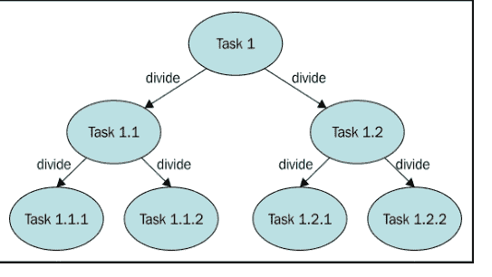
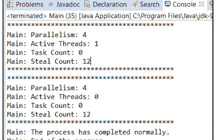
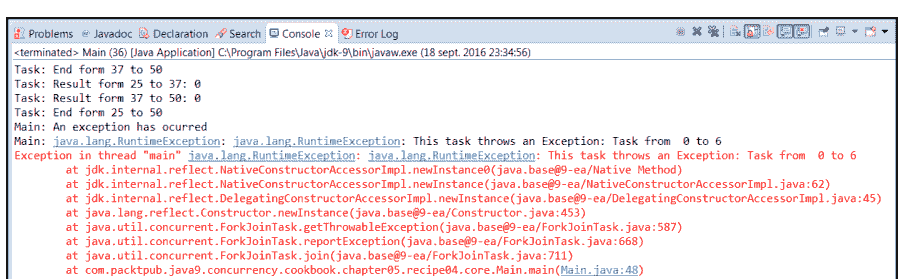
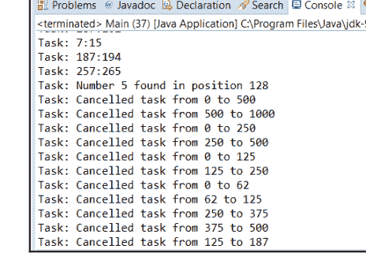

## 第5章：Fork/Join 框架
Fork/Join Framework

在本章中，我们将介绍：

- 创建 fork/join 池
- 加入任务的结果
- 异步运行任务
- 在任务中抛出异常
- 取消任务

### 引言

通常，当你实现一个简单的并发 Java 应用程序时，你会实现一些 `Runnable` 对象，然后是相应的 `Thread` 对象。你在程序中控制这些线程的创建、执行和状态。Java 5 引入了改进，使用了 `Executor` 和 `ExecutorService` 接口以及实现它们的类（例如 `ThreadPoolExecutor` 类）。

**Executor** 框架将任务创建与其执行分离。使用它时，你只需要实现 `Runnable` 对象并使用一个 `Executor` 对象。你将 `Runnable` 任务发送给 executor，它会创建、管理和完成执行这些任务所需的线程。

Java 7 更进一步，包含了一个面向特定类型问题的 `ExecutorService` 接口的额外实现。它是 **fork/join framework**。

该框架旨在解决可使用分而治之技术分解为更小任务的问题。在一个任务内部，你检查要解决的问题的大小，如果它大于既定大小，你就将其分解为使用框架执行的更小任务。如果问题的大小小于既定大小，你就在任务中直接解决问题，然后，可选地返回结果。以下图表总结了这一概念：



没有公式可以确定问题的参考大小，以确定任务是否应被细分，这取决于其特征。你可以使用任务中要处理的元素的数量和执行时间的估计来确定参考大小。测试不同的参考大小以选择最适合你的问题的大小。你可以将 `ForkJoinPool` 视为一种特殊的 `Executor`。

该框架基于以下两个操作：

- **Fork 操作：** 当你将任务分解为更小的任务并使用框架执行它们时。
- **Join 操作：** 当一个任务等待其创建的任务完成时。它用于合并这些任务的结果。

fork/join 与 Executor 框架之间的主要区别是 **work-stealing** 算法。与 Executor 框架不同，当任务使用 join 操作等待其创建的子任务完成时，执行该任务的线程（称为 **worker thread**）会寻找尚未执行的其他任务并开始执行它们。这样，线程就能充分利用其运行时间，从而提高应用程序的性能。

为了实现这一目标，由 fork/join 框架执行的任务具有以下限制：

- 任务只能使用 `fork()` 和 `join()` 操作作为同步机制。如果它们使用其他同步机制，worker 线程在同步操作中时就不能执行其他任务。例如，如果你在 fork/join 框架中使任务休眠，执行该任务的 worker 线程在休眠期间不会执行另一个任务。
- 任务不应执行 I/O 操作，例如在文件中读写数据。
- 任务不能抛出受检异常。它们必须包含处理这些异常所需的代码。

fork/join 框架的核心由以下两个类组成：

- `ForkJoinPool`：此类实现了 `ExecutorService` 接口和 work-stealing 算法。它管理 worker 线程并提供有关任务状态及其执行的信息。
- `ForkJoinTask`：这是将在 `ForkJoinPool` 中执行的任务的基类。它提供了在任务内部执行 `fork()` 和 `join()` 操作的机制以及控制任务状态的方法。通常，为了实现你的 fork/join 任务，你将实现此类三个子类之一：`RecursiveAction` 用于没有返回结果的任务，`RecursiveTask` 用于返回一个结果的任务，以及 `CountedCompleter` 用于在所有子任务完成后启动完成操作的任务。

该框架的大多数功能已包含在 Java 7 中，但 Java 8 在其中加入了次要功能。它包含了一个默认的 `ForkJoinPool` 对象。你可以使用 `ForkJoinPool` 类的静态方法 `commonPool()` 获取它。此默认 fork/join executor 默认将使用由计算机可用处理器决定的线程数。你可以通过更改系统属性 `java.util.concurrent.ForkJoinPool.common.parallelism` 的值来更改此默认行为。此默认池在并发 API 的其他类内部使用。例如，**Parallel Streams** 使用它。Java 8 还包含了前面提到的 `CountedCompleter` 类。

本章介绍了五个配方，展示了如何有效地使用 fork/join 框架。


## 创建 fork/join 池

在本教程中，你将学习如何使用 fork/join 框架的基本元素。这包括以下内容：

- 创建一个 `ForkJoinPool` 对象来执行任务
- 创建一个 `ForkJoinTask` 的子类以在池中执行

在本示例中你将使用的 fork/join 框架的主要特征如下：

- 你将使用默认构造函数创建 `ForkJoinPool`。
- 在任务内部，你将使用 Java API 文档推荐的结构：

```
if (problem size > default size){
    tasks=divide(task);
    execute(tasks);
} else {
    resolve problem using another algorithm;
}
```

- 你将以同步方式执行任务。当一个任务执行两个或更多子任务时，它会等待它们的完成。在这种方式下，执行该任务的线程（称为工作线程）将寻找其他任务来执行，充分利用其执行时间。
- 你将要实现的任务不会返回任何结果，因此你将以 `RecursiveAction` 类作为其实现的基础类。

## 准备工作

本教程中的示例是使用 Eclipse IDE 实现的。如果使用 Eclipse 或其他 IDE，例如 NetBeans，打开它并创建一个新的 Java 项目。

## 如何做...

在本教程中，你将实现一个任务来更新产品列表的价格。初始任务将负责更新列表中的所有元素。你将使用 10 作为参考大小，因此如果一个任务需要更新超过 10 个元素，它会将分配给它的列表部分分成两部分并创建两个任务来更新相应部分中产品的价格。

按照以下步骤实现示例：

- 1. 创建一个名为 Product 的类，它将存储产品的名称和价格：

```
public class Product {
```

- 2. 声明一个名为 name 的私有 String 属性和一个名为 price 的私有 double 属性：

```
private String name;
private double price;
```

- 3. 为这些字段实现 getter 和 setter 方法。它们实现起来非常简单，因此其源代码未包含在内。

- 4. 创建一个名为 ProductListGenerator 的类来生成随机产品列表：

```
public class ProductListGenerator {
```

- 4. 实现 generate() 方法。它接收一个 int 参数作为列表的大小并返回一个 List<Product> 对象，其中包含生成的产品列表：

```
public List<Product> generate (int size) {
```

- 7. 创建一个名为 Task 的类。指定它扩展 RecursiveAction 类：

```
public class Task extends RecursiveAction {
```

- 8. 声明一个名为 products 的私有 List<Product> 属性：

```
private List<Product> products;
```

- 9. 声明两个名为 first 和 last 的私有 int 属性。这些属性将确定该任务需要处理的产品的块：

```
private int first;
private int last;
```

- 10. 声明一个名为 increment 的私有 double 属性来存储产品的价格增量：

```
private double increment;
```

- 11. 实现类的构造函数，它将初始化类的所有属性：

```
public Task (List<Product> products, int first, int last,
    double increment) {
    this.products=products;
    this.first=first;
    this.last=last;
    this.increment=increment;
}
```

- 12. 实现 compute() 方法，它将实现任务的逻辑：

```
@Override
protected void compute() {
```

- 13. 如果 last 和 first 属性的差值小于 10（任务需要更新少于 10 个产品的价格），则使用 updatePrices() 方法增加该组产品的价格：

```
if (last - first<10) {
    updatePrices();
```

- 14. 如果 last 和 first 属性之间的差值大于或等于 10，则创建两个新的 Task 对象，一个处理产品的前半部分，另一个处理后半部分，并在 ForkJoinPool 中使用 invokeAll() 方法执行它们：

```
} else {
    int middle=(last+first)/2;
    System.out.printf("Task: Pending tasks:%s\n",
                    getQueuedTaskCount());
    Task t1=new Task(products, first,middle+1, increment);
    Task t2=new Task(products, middle+1,last, increment);
    invokeAll(t1, t2);
}
```

- 15. 实现 updatePrices() 方法。此方法更新产品列表中位于 first 和 last 属性值之间的位置的产品：

```
private void updatePrices() {
    for (int i=first; i<last; i++){
        Product product=products.get(i);
        product.setPrice(product.getPrice()*(1+increment));
    }
}
```

- 16. 通过创建一个名为 Main 的类并向其中添加 main() 方法来实现示例的主类：

```
public class Main {
    public static void main(String[] args) {
```

- 17. 使用 ProductListGenerator 类创建 10000 个产品的列表：

```
ProductListGenerator generator=new ProductListGenerator();
List<Product> products=generator.generate(10000);
```

- 18. 创建一个新的 Task 对象来更新列表中所有产品的价格。参数 first 的值为 0，last 参数的值为 10000（产品列表的大小）：

```
Task task=new Task(products, 0, products.size(), 0.20);
```

- 19. 使用无参数的构造函数创建 ForkJoinPool 对象：

```
ForkJoinPool pool=new ForkJoinPool();
```

- 20. 使用 execute() 方法在池中执行任务：

```
pool.execute(task);
```

- 21. 实现一个代码块，每五毫秒显示一次池的演变信息，在任务完成执行之前将池的一些参数值写入控制台：

```
do {
    System.out.printf("Main: Thread Count:%d\n", pool.getActiveThreadCount());
    System.out.printf("Main: Thread Steal:%d\n", pool.getStealCount());
    System.out.printf("Main: Parallelism:%d\n", pool.getParallelism());
    try {
        TimeUnit.MILLISECONDS.sleep(5);
    } catch (InterruptedException e) {
        e.printStackTrace();
    }
} while (!task.isDone());
```

- 22. 使用 shutdown() 方法关闭池：

```
pool.shutdown();
```

- 23. 使用 isCompletedNormally() 方法检查任务是否已无错误完成，如果是，则向控制台写入一条消息：

```
if (task.isCompletedNormally()){
    System.out.printf("Main: The process has completed normally.\n");
}
```

- 24. 所有产品在增价后的预期价格为 12。写出所有价格与 12 不同的产品的名称和价格，以检查它们的价格是否都已正确增加：

```
for (int i=0; i<products.size(); i++){
    Product product=products.get(i);
    if (product.getPrice()!=12) {
        System.out.printf("Product %s: %f\n", product.getName(),product.getPrice());
    }
}
```

- 25. 写一条消息以指示程序的结束：

```
System.out.println("Main: End of the program.\n");
```

## 它是如何工作的...

在本示例中，你创建了一个 ForkJoinPool 对象并创建了一个 ForkJoinTask 类的子类，并在池中执行它。要创建 ForkJoinPool 对象，你使用了无参数的构造函数，因此它将使用其默认配置执行。它创建一个线程池，其线程数等于计算机的处理器的数量。当 ForkJoinPool 对象被创建时，这些线程被创建并在池中等待，直到有任务到达供其执行。

由于 Task 类不返回结果，因此它扩展了 RecursiveAction 类。在本教程中，你使用了任务实现的推荐结构。如果任务需要更新超过 10 个产品，它会将该组元素分成两个块，创建两个任务，并将一个块分配给每个任务。你在 Task 类中使用了 first 和 last 属性来了解该任务需要在产品列表中更新的位置范围。你使用了 first 和 last 属性来仅使用一份产品列表的副本，而不是为每个任务创建不同的列表。

要执行任务创建的子任务，它会调用 invokeAll() 方法。这是一个同步调用，任务会在继续（可能完成）其执行之前等待子任务完成。在任务等待其子任务的同时，执行它的工作线程会取出另一个等待执行的任务并执行它。通过这种行为，fork/join 框架比 Runnable 和 Callable 对象本身提供了更高效的任务管理。

ForkJoinTask 类的 invokeAll() 方法是 Executor 和 fork/join 框架之间的主要区别之一。在 Executor 框架中，所有任务都必须发送给执行器，而在这种情况下，任务包括在池内执行和控制任务的方法。你在 Task 类中使用了 invokeAll() 方法，该类扩展了 RecursiveAction 类，后者又扩展了 ForkJoinTask 类。

你使用 execute() 方法向池发送一个唯一的任务来更新所有产品列表。在这种情况下，它是一个异步调用，主线程继续其执行。

你使用了 ForkJoinPool 类的一些方法来检查正在运行的任务的状态和演变。该类包含更多可用于此目的的方法。请参阅第 9 章《Testing Concurrent Applications》中的 Monitoring a fork/join pool 教程，以获取这些方法的完整列表。


最后，像使用 Executor 框架一样，你应该使用 shutdown() 方法来关闭 ForkJoinPool。

下面的截图显示了此示例执行的一部分：



你可以看到任务完成其工作以及产品的价格已更新。

## 还有更多...

ForkJoinPool 类提供了其他方法来执行任务。这些方法如下：

- execute (Runnable task)：这是示例中使用的 execute() 方法的另一个版本。在这种情况下，你将一个 Runnable 任务发送给 ForkJoinPool 类。请注意，ForkJoinPool 类不会对 Runnable 对象使用工作窃取算法。它仅与 ForkJoinTask 对象一起使用。
- invoke(ForkJoinTask<T> task)：虽然 execute() 方法像示例中学习的那样对 ForkJoinPool 类进行异步调用，但 invoke() 方法对 ForkJoinPool 类进行同步调用。此调用不会在作为参数传递的任务完成执行之前返回。
- 你也可以使用 ExecutorService 接口中声明的 invokeAll() 和 invokeAny() 方法。这些方法接收 Callable 对象作为参数。ForkJoinPool 类不会对 Callable 对象使用工作窃取算法，因此最好使用 ThreadPoolExecutor 来执行它们。

ForkJoinTask 类还包括示例中使用的 invokeAll() 方法的其他版本。这些版本如下：

- invokeAll(ForkJoinTask<?>... tasks)：此方法版本使用可变参数列表。你可以向其传递任意数量的 ForkJoinTask 对象作为参数。
- invokeAll(Collection<T> tasks)：此方法版本接受一个集合（例如 ArrayList 对象、LinkedList 对象或 TreeSet 对象）作为参数，其中包含泛型类型 T 的对象。此泛型类型 T 必须是 ForkJoinTask 类或其子类。

尽管 ForkJoinPool 类设计用于执行 ForkJoinTask 对象，你也可以直接执行 Runnable 和 Callable 对象。你也可以使用 ForkJoinTask 类的 adapt() 方法，该方法接受一个 Callable 对象或一个 Runnable 对象并返回一个 ForkJoinTask 对象来执行该任务。

## 另请参阅

- 第 9 章《Testing Concurrent Applications》中的 Monitoring a fork/join pool 配方

## 合并任务的结果

fork/join 框架提供了执行返回结果的任务的能力。这种类型的任务由 RecursiveTask 类实现。此类扩展了 ForkJoinTask 类并实现了 Executor 框架提供的 Future 接口。

在任务内部，你必须使用 Java API 文档推荐的结构：

```
if (problem size > size) {
    tasks=Divide(task);
    execute(tasks);
    joinResults()
    return result;
} else {
    resolve problem;
    return result;
}
```

如果任务必须解决的问题大于预定义的大小，你将问题划分为更多子任务并使用 fork/join 框架执行这些子任务。当它们完成执行后，发起任务获取所有子任务生成的结果，对其进行分组并返回最终结果。最终，当在池中执行的发起任务完成执行时，你将获得其结果，这实际上是整个问题的最终结果。

在本配方中，你将通过开发一个在文档中查找单词的应用程序来学习如何使用 fork/join 框架进行这种问题解决。你将实现以下两种类型的任务：

- 文档任务，它将在文档的一组行中搜索单词
- 行任务，它将在文档的一部分中搜索单词

所有任务都将返回单词在它们处理的文档部分或行中出现的次数。在本配方中，我们将使用 Java Concurrency API 提供的默认 fork/join 池。

## 如何操作...

按照以下步骤实现示例：

1. 创建一个名为 DocumentMock 的类。它将生成一个字符串矩阵来模拟文档：

```
public class DocumentMock {
```

2. 创建一个包含一些单词的字符串数组。此数组将在字符串矩阵的生成中使用：

```
private String words[]={"the","hello","goodbye","packt",
    "java","thread","pool","random",
    "class","main"};
```

3. 实现 generateDocument() 方法。它接收行数、每行单词数以及示例将要查找的单词作为参数。它返回一个字符串矩阵：

```
public String[][] generateDocument(int numLines, int numWords,
    String word){
```

4. 首先，创建生成文档所需的对象——字符串矩阵和用于生成随机数的 Random 对象：

```
int counter=0;
String document[][]=new String[numLines][numWords];
Random random=new Random();
```

5. 用字符串填充数组。将每个位置存储为单词数组中随机位置的字符串，并计算程序将在生成的数组中查找的单词出现的次数。你可以使用此值来检查程序是否正确执行其工作：

```
for (int i=0; i<numLines; i++){
    for (int j=0; j<numWords; j++) {
        int index=random.nextInt(words.length);
        document[i][j]=words[index];
        if (document[i][j].equals(word)) {
            counter++;
        }
    }
}
```

6. 写出单词出现的次数的消息并返回生成的矩阵：

```
System.out.println("DocumentMock: The word appears "+ counter+" times in the document");
return document;
```

7. 创建一个名为 DocumentTask 的类并指定它扩展参数化为 Integer 类的 RecursiveTask 类。此类将实现计算单词在一组行中出现的次数的任务：

```
public class DocumentTask extends RecursiveTask<Integer> {
```

8. 声明一个名为 document 的私有字符串矩阵和两个名为 start 和 end 的私有 int 属性。另声明一个名为 word 的私有 String 属性：

```
private String document[][];
private int start, end;
private String word;
```

9. 实现类的构造函数以初始化其所有属性：

```
public DocumentTask (String document[][], int start, int end, String word){
    this.document=document;
    this.start=start;
    this.end=end;
    this.word=word;
}
```

10. 实现 compute() 方法。如果 end 和 start 属性之间的差值小于 10，则任务通过调用 processLines() 方法计算这些位置之间的行中单词出现的次数：

```
@Override
protected Integer compute() {
    Integer result=null;
    if (end-start<10){
        result=processLines(document, start, end, word);
```

11. 否则，将行组分为两个对象，创建两个新的 DocumentTask 对象来处理这两个组，并使用 invokeAll() 方法在池中执行它们：

```
} else {
    int mid=(start+end)/2;
    DocumentTask task1=new DocumentTask(document,start,mid,word);
    DocumentTask task2=new DocumentTask(document,mid,end,word);
    invokeAll(task1,task2);
```

12. 然后，使用 groupResults() 方法将两个任务返回的值相加。最后，返回任务计算的结果：

```
try {
    result=groupResults(task1.get(),task2.get());
} catch (InterruptedException | ExecutionException e) {
    e.printStackTrace();
}
}
return result;
```

13. 实现 processLines() 方法。它接收字符串矩阵、start 属性、end 属性以及任务正在搜索的 word 属性作为参数：

```
private Integer processLines(String[][] document, int start,
    end,String word) {
```

14. 对于任务必须处理的每一行，创建一个 LineTask 对象来处理整行并将它们存储在任务列表中：

```
List<LineTask> tasks=new ArrayList<LineTask>();
for (int i=start; i<end; i++) {
    LineTask task=new LineTask(document[i], 0,
        document[i].length, word);
    tasks.add(task);
}
```

15. 使用 invokeAll() 方法执行该列表中的所有任务：

```
invokeAll(tasks);
```

16. 将所有这些任务返回的值相加并返回结果：

```
int result=0;
for (int i=0; i<tasks.size(); i++) {
    LineTask task=tasks.get(i);
    try {
        result=result+task.get();
    } catch (InterruptedException | ExecutionException e) {
        e.printStackTrace();
    }
}
return result;
```

17. 实现 groupResults() 方法。它将两个数字相加并返回结果：

```
private Integer groupResults(Integer number1,Integer number2) {
    Integer result;
    result=number1+number2;
    return result;
}


18. 创建一个名为 LineTask 的类并指定它扩展了以 Integer 类为参数的 RecursiveTask 类。此类将实现计算单词在一行中出现次数的任务：

```
public class LineTask extends RecursiveTask<Integer>{
```

19. 声明一个名为 line 的私有 String 数组属性和两个名为 start 和 end 的私有 int 属性。最后，声明一个名为 word 的私有 String 属性：

```
private String line[];
private int start, end;
private String word;
```

20. 实现类的构造函数以初始化其所有属性：

```
public LineTask(String line[],int start,int end,String word) {
    this.line=line;
    this.start=start;
    this.end=end;
    this.word=word;
}
```

21. 实现类的 compute() 方法。如果 end 属性与 start 属性之差小于 100，则任务使用 count() 方法在由 start 和 end 属性确定的行片段中搜索单词：

```
@Override
protected Integer compute() {
    Integer result=null;
    if (end-start<100) {
        result=count(line, start, end, word);
```

22. 否则，将行中的单词组分为两部分，创建两个新的 LineTask 对象来处理这两个组，并使用 invokeAll() 方法在池中执行它们：

```
} else {
    int mid=(start+end)/2;
    LineTask task1=new LineTask(line, start, mid, word);
    LineTask task2=new LineTask(line, mid, end, word);
    invokeAll(task1, task2);
```

23. 然后，使用 groupResults() 方法将两个任务返回的值相加。最后，返回任务计算的结果：

```
try {
    result=groupResults(task1.get(),task2.get());
} catch (InterruptedException | ExecutionException e) {
    e.printStackTrace();
}
return result;
```

24. 实现 count() 方法。它接收包含完整行的字符串数组、start 属性、end 属性以及任务正在搜索的 word 属性作为参数：

```
private Integer count(String[] line, int start, int end,
    String word) {
```

25. 将 start 和 end 属性之间的位置存储的单词与任务正在搜索的 word 属性进行比较，如果相等，则递增计数器变量：

```
int counter;
counter=0;
for (int i=start; i<end; i++){
    if (line[i].equals(word)){
        counter++;
    }
}
```

26. 为减慢示例的执行速度，使任务休眠 10 毫秒：

```
try {
    Thread.sleep(10);
} catch (InterruptedException e) {
    e.printStackTrace();
}
```

27. 返回计数器变量的值：

```
return counter;
```

28. 实现 groupResults() 方法。它将两个数字相加并返回结果：

```
private Integer groupResults(Integer number1,Integer number2) {
    Integer result;
    result=number1+number2;
    return result;
}
```

29. 通过创建一个名为 Main 的类并包含 main() 方法来实现示例的主类：

```
public class Main{
    public static void main(String[] args) {
```

30. 使用 DocumentMock 类创建包含 100 行和每行 1000 个单词的 Document：

```
DocumentMock mock=new DocumentMock();
String[][] document=mock.generateDocument(100, 1000, "the");
```

31. 创建一个新的 DocumentTask 对象以更新整个文档的产品。start 参数取值为 0，end 参数取值为 100：

```
DocumentTask task=new DocumentTask(document, 0, 100, "the");
```

32. 使用 commonPool() 方法获取默认的 ForkJoinPool 执行器，并使用 execute() 方法在其中执行任务：

```
ForkJoinPool commonPool=ForkJoinPool.commonPool();
commonPool.execute(task);
```

33. 实现一个代码块以显示池的进度信息，在任务执行结束前每秒向控制台写入池的一些参数值：

```
do {
    System.out.printf("*******************************\n");
    System.out.printf("*******************************\n");
    System.out.printf("Main: Active Threads: %d\n", commonPool.getActiveThreadCount());
    System.out.printf("Main: Task Count: %d\n", commonPool.getQueuedTaskCount());
    System.out.printf("Main: Steal Count: %d\n", commonPool.getStealCount());
    System.out.printf("*******************************************\n");
    System.out.printf("******\n");
try {
    TimeUnit.SECONDS.sleep(1);
} catch (InterruptedException e) {
    e.printStackTrace();
}
} while (!task.isDone());
```

34. 使用 shutdown() 方法关闭池：

```
pool.shutdown();
```

35. 使用 awaitTermination() 方法等待任务完成：

```
try {
    pool.awaitTermination(1, TimeUnit.DAYS);
} catch (InterruptedException e) {
    e.printStackTrace();
}
```

36. 写入单词在文档中出现的次数。检查该数字是否与 DocumentMock 类写入的数字相同：

```
try {
    System.out.printf("Main: The word appears %d in the\n                    document",task.get());
} catch (InterruptedException | ExecutionException e) {
    e.printStackTrace();
}
```

## 如何工作...

在本示例中，你实现了两种不同的任务：

- DocumentTask：此类任务必须处理由 start 和 end 属性确定的文档的一组行。如果该行集合的大小小于 10，则为每行创建一个 LineTask，并在它们执行完毕后，将这些任务的结果相加并返回总和。如果任务必须处理的行集合大小为 10 或更大，则将其分为两部分并创建两个 DocumentTask 对象来处理这些新集合。当这些任务执行完毕后，任务将它们的结果相加并将该和作为结果返回。

## 另请参阅

- 本章中的 *Creating a fork/join pool* 配方
- 第 9 章 *Testing Concurrent Applications* 中的 *Monitoring a fork/join pool* 配方

## 异步运行任务

当你在 `ForkJoinPool` 中执行 `ForkJoinTask` 时，可以以同步或异步方式执行。当以同步方式执行时，将任务发送到池的方法不会在所发送任务执行完毕前返回。当以异步方式执行时，将任务发送到执行器的该方法会立即返回，因此任务可以继续执行。

你应该意识到这两种方法之间存在很大差异。当使用同步方法时，调用其中一个方法（例如 `invokeAll()` 方法）的任务会暂停，直到它发送到池中的任务执行完毕。这允许 `ForkJoinPool` 类使用工作窃取算法为执行休眠任务的工作线程分配新任务。相反，当使用异步方法（例如 `fork()` 方法）时，任务会继续执行，因此 `ForkJoinPool` 类无法使用工作窃取算法来提高应用程序的性能。在这种情况下，只有当你调用 `join()` 或 `get()` 方法等待任务完成时，`ForkJoinPool` 类才能使用该算法。

除了 `RecursiveAction` 和 `RecursiveTask` 类之外，Java 8 还引入了带有 `CountedCompleter` 类的新 `ForkJoinTask` 类。通过这种类型的任务，你可以包含一个完成操作，该操作将在启动时且没有待处理的子任务时执行。此机制基于类中包含的方法（`onCompletion()` 方法）和待处理任务计数器。

该计数器默认初始化为零，你可以在需要时以原子方式递增它。通常，你会在启动子任务时逐一递增该计数器。最后，当任务执行完毕时，你可以尝试完成任务的执行，从而执行 `onCompletion()` 方法。如果挂起计数大于零，则将其减一。如果为零，则执行 `onCompletion()` 方法，然后尝试完成父任务。


16. 最后，实现 `getResultList()` 方法以返回任务的结果列表。此方法的代码非常简单，因此不会包含在内。

17. 通过创建名为 Main 的类并包含 main() 方法来实现示例的主类：

```
public class Main {
    public static void main(String[] args) {
```

18. 使用默认构造函数创建 ForkJoinPool：

```
ForkJoinPool pool=new ForkJoinPool();
```

19. 创建三个 FolderProcessor 任务。分别使用不同的文件夹路径进行初始化：

```
FolderProcessor system=new FolderProcessor("C:\\Windows",
    "log");
FolderProcessor apps=new FolderProcessor("C:\\Program Files",
    "log");
FolderProcessor documents=new FolderProcessor("C:\\Documents And Settings","log");
```

20. 使用 execute() 方法在池中执行这三个任务：

```
pool.execute(system);
pool.execute(apps);
pool.execute(documents);
```

21. 每秒向控制台写入有关池状态的信息，直到三个任务执行完毕：

```
do {
    System.out.printf("******************************************
    *********(\n");
    System.out.printf("Main: Active Threads: %d\n",
        pool.getActiveThreadCount());
    System.out.printf("Main: Task Count: %d\n",
        pool.getQueuedTaskCount());
    System.out.printf("Main: Steal Count: %d\n",
        pool.getStealCount());
    System.out.printf("******************************************
    *********\n");
    try {
        TimeUnit.SECONDS.sleep(1);
    } catch (InterruptedException e) {
        e.printStackTrace();
    }
}
```

## There's more...

在本示例中，我们使用了 `addToPendingCount()` 方法来增加待处理任务计数器的值，但我们还有其他方法可以更改此计数器的值：

- `setPendingCount()`: 此方法设置待处理任务计数器的值。
- `compareAndSetPendingCount()`: 此方法接收两个参数。第一个是预期值，第二个是新值。如果待处理任务计数器的值等于预期值，则将其值设置为新值。
- `decrementPendingCountUnlessZero()`: 此方法在计数器不等于零的情况下递减待处理任务计数器的值。

`CountedCompleter` 类还包括其他用于管理任务完成的方法。以下是最重要的几个：

- `complete()`: 此方法独立于待处理任务计数器的值执行 `onCompletion()` 方法，并尝试完成其 completer（父）任务。
- `onExceptionalCompletion()`: 当调用了 `completeExceptionally()` 方法或 `compute()` 方法抛出 `Exception` 时执行此方法。重写此方法以包含处理此类异常的代码。

在本示例中，你使用了 `join()` 方法来等待任务完成并获取其结果。你也可以使用以下两种 `get()` 方法的版本来实现此目的：

- `get(long timeout, TimeUnit unit)`: 如果任务结果不可用，此版本的 `get()` 方法会等待指定时间。如果在指定时间内结果仍不可用，则方法返回 `null` 值。`TimeUnit` 类是一个枚举，具有以下常量：`DAYS`、`HOURS`、`MICROSECONDS`、`MILLISECONDS`、`MINUTES`、`NANOSECONDS` 和 `SECONDS`
- `join()` 方法无法被中断。如果中断调用 `join()` 方法的线程，该方法会抛出 `InterruptedException` 异常。

## See also

- 本章中 *Creating a fork/join pool* 配方
- 第 9 章 *Testing Concurrent Applications* 中的 *Monitoring a fork/join pool* 配方

## Throwing exceptions in the tasks

Java 中有两种异常：

- **Checked exceptions**: 这些异常必须在方法的 `throws` 子句中指定或在方法内部捕获。例如，`IOException` 或 `ClassNotFoundException`。
- **Unchecked exceptions**: 这些异常无需指定或捕获。例如，`NumberFormatException`。

你不能在 `ForkJoinTask` 类的 `compute()` 方法中抛出任何 checked 异常，因为该方法在其实现中不包含任何 `throws` 声明。你必须包含处理 checked 异常的必要代码。另一方面，你可以抛出（或由方法或对象在方法内部使用时抛出）unchecked 异常。`ForkJoinTask` 和 `ForkJoinPool` 类的行为与你预期的不同。程序不会结束执行，你也不会在控制台上看到有关异常的任何信息。它就像未被抛出一样被吞没。只有当你调用初始任务的 `get()` 方法时，异常才会被抛出。然而，你可以使用 `ForkJoinTask` 类的一些方法来知道任务是否抛出异常，如果是，则是哪种异常。在本配方中，你将学习如何获取这些信息。

## Getting ready

本配方的示例使用 Eclipse IDE 实现。如果使用 Eclipse 或其他 IDE，例如 NetBeans，请打开它并创建一个新的 Java 项目。

## How to do it...

按照以下步骤实现示例：

1. 创建一个名为 Task 的类。指定它实现参数化为 Integer 类的 RecursiveTask 类：
   
   ```
   public class Task extends RecursiveTask<Integer> {
   ```
2. 声明一个名为 array 的私有 int 数组。它将模拟本示例中要处理的数据数组：
   
   ```
   private int array[];
   ```
3. 声明两个名为 start 和 end 的私有 int 属性。这些属性将确定此任务要处理的数组元素：
   
   ```
   private int start, end;
   ```
4. 实现类的构造函数以初始化其属性：
   
   ```
   public Task(int array[], int start, int end){
       this.array=array;
       this.start=start;
       this.end=end;
   }
   ```
5. 实现任务的 compute() 方法。由于你已将 RecursiveTask 类参数化为 Integer 类，因此此方法必须返回一个 Integer 对象。首先，使用 start 和 end 属性的值向控制台写入一条消息：
   
   ```
   @Override
   protected Integer compute() {
       System.out.printf("Task: Start from %d to %d\n",start,end);
   ```
6. 如果此任务要处理的由 start 和 end 属性确定的元素块大小小于 10，则检查数组中第四个位置的元素（索引号为三）是否在该块中。如果是，则抛出 RuntimeException。然后，让任务休眠一秒：
   
   ```
   if (end-start<10) {
       if ((3>start)&&(3<end)){
           throw new RuntimeException("This task throws an"+
               "Exception: Task from "+start+" to "+end);
   ```

```
}
try {
    TimeUnit.SECONDS.sleep(1);
} catch (InterruptedException e) {
    e.printStackTrace();
}
```

7. 否则（此任务要处理的块大小为 10 或更大），将元素块分为两半，创建两个 Task 对象来处理这些块，并在池中使用 invokeAll() 方法执行它们。然后，我们将这些任务的结果写入控制台：

```
} else {
    int mid=(end+start)/2;
    Task task1=new Task(array,start,mid);
    Task task2=new Task(array,mid,end);
    invokeAll(task1, task2);
    System.out.printf("Task: Result from %d to %d: %d\n",
                    start,mid,task1.join());
    System.out.printf("Task: Result from %d to %d: %d\n",
                    mid,end,task2.join());
}
```

8. 写入一条消息到控制台以指示任务结束，写入 start 和 end 属性的值：

```
System.out.printf("Task: End from %d to %d\n",start,end);
```

9. 返回数字 0 作为任务的结果：

```
return 0;
```

10. 通过创建名为 Main 的类并包含 main() 方法来实现示例的主类：

```
public class Main {
    public static void main(String[] args) {
```

11. 创建一个包含 100 个整数的数组：

```
int array[]=new int[100];
```

12. 创建一个 Task 对象来处理该数组：

```
Task task=new Task(array,0,100);
```


当你执行程序时，异常被抛出，但程序并未停止。在 Main 类中，你使用原始任务调用了 ForkJoinTask 类的 isCompletedAbnormally() 方法。该方法如果该任务或其子任务之一抛出异常则返回 true。你还使用了同一对象的 getException() 方法来获取其抛出的 Exception 对象。

当你在任务中抛出未检查的异常时，它也会影响其父任务（将任务发送到 ForkJoinPool 类的任务）以及其父任务的父任务，依此类推。如果你查看整个程序的输出，你会发现某些任务的完成输出消息不存在。那些任务的开始消息如下：

```
Task: Starting form 0 to 100
Task: Starting form 0 to 50
Task: Starting form 0 to 25
Task: Starting form 0 to 12
Task: Starting form 0 to 6
```

这些任务是抛出异常的任务及其父任务。它们全部异常完成。在使用 ForkJoinPool 和 ForkJoinTask 对象开发程序时，如果你不希望出现此行为，请考虑这一点。

以下屏幕截图显示了此示例的部分执行：



## There's more...

在此示例中，你使用了 `join()` 方法来等待任务完成并获取其结果。你也可以使用以下两种版本的 `get()` 方法来实现此目的：

- `get()`: 此版本的 `get()` 方法如果 `ForkJoinTask` 已完成执行，则返回 `compute()` 方法返回的值，否则等待其完成。
- `get(long timeout, TimeUnit unit)`: 此版本的 `get()` 方法如果任务结果不可用，则等待指定时间。如果指定时间段过去且结果仍不可用，该方法返回 `null` 值。`TimeUnit` 类是一个枚举，具有以下常量：`DAYS`、`HOURS`、`MICROSECONDS`、`MILLISECONDS`、`MINUTES`、`NANOSECONDS` 和 `SECONDS`。

`get()` 和 `join()` 方法之间主要有两个区别：

- `join()` 方法不能被中断。如果你中断调用 `join()` 方法的线程，该方法会抛出 `InterruptedException`。
- 虽然 `get()` 方法如果任务抛出任何未检查的异常会返回 `ExecutionException`，但 `join()` 方法会返回 `RuntimeException`。

如果你不是抛出异常，而是使用 `ForkJoinTask` 类的 `completeExceptionally()` 方法，可以获得与示例中相同的结果。代码如下：

```
Exception e=new Exception("This task throws an Exception: "+
"Task from "+start+" to "+end);
completeExceptionally(e);
```

## See also

- 本章中 *Creating a fork/join pool* 配方

## Canceling a task

当你在 ForkJoinPool 类中执行 ForkJoinTask 对象时，可以在它们开始执行前取消它们。ForkJoinTask 类为此提供了 cancel() 方法。当你想取消任务时，需要注意以下几点：

- ForkJoinPool 类不提供任何取消其正在运行或等待在池中的所有任务的方法
- 当你取消一个任务时，你不会取消该任务已执行的任务

在本配方中，你将实现一个取消 ForkJoinTask 对象的示例。你将在数组中查找一个数字的位置。找到该数字的第一个任务将取消剩余的任务。由于该功能未由 fork/join 框架提供，你将实现一个辅助类来执行此取消操作。

## Getting ready...

本配方的示例使用 Eclipse IDE 实现。如果你使用 Eclipse 或其他 IDE，例如 NetBeans，请打开它并创建一个新的 Java 项目。

## How to do it...

按照以下步骤实现示例：

- 1. 创建一个名为 ArrayGenerator 的类。此类将生成指定大小的随机整数数组。实现一个名为 generateArray() 的方法。它将生成数字数组。它接收数组大小作为参数：

```
public class ArrayGenerator {
    public int[] generateArray(int size) {
        int array[]=new int[size];
        Random random=new Random();
        for (int i=0; i<size; i++){
            array[i]=random.nextInt(10);
        }
        return array;
    }
}
```

- 8. 声明一个名为 numbers 的私有 int 数组：

```
private int numbers[];
```

- 9. 声明两个私有 int 属性，名为 start 和 end。这些属性将确定此任务要处理的数组元素：

```
private int start, end;
```

- 10. 声明一个私有 int 属性，名为 number，用于存储你要查找的数字：

```
private int number;
```

- 11. 声明一个私有 TaskManager 属性，名为 manager。你将使用此对象来取消所有任务：

```
private TaskManager manager;
```

- 12. 声明一个私有 int 常量并将其初始化为 -1。它将在任务未找到数字时作为返回值：

```
private final static int NOT_FOUND=-1;
```

- 13. 实现类的构造函数以初始化其属性：

```
public SearchNumberTask(int numbers[], int start, int end, int number, TaskManager manager){
    this.numbers=numbers;
    this.start=start;
    this.end=end;
    this.number=number;
    this.manager=manager;
}
```

- 14. 实现 compute() 方法。首先通过写入控制台消息指示 start 和 end 属性的值来开始该方法：

```
@Override
protected Integer compute() {
    System.out.println("Task: "+start+":"+end);
```

- 15. 如果 start 和 end 属性之间的差值大于 10（任务要处理超过 10 个数组元素），则调用 launchTasks() 方法将此任务的工作划分为两个子任务：

```
int ret;
if (end-start>10) {
    ret=launchTasks();
```

- 16. 否则，在调用 lookForNumber() 方法的任务要处理的数组块中查找数字：

```
} else {
    ret=lookForNumber();
}
```

- 17. 返回任务的结果：

```
return ret;
```

- 18. 实现 lookForNumber() 方法：

```
private int lookForNumber() {
```

- 19. 对于此任务要处理的元素块中的所有元素，将存储在该元素中的值与你要查找的数字进行比较。如果它们相等，则向控制台写入一条消息，指示在此情况下使用 TaskManager 对象的 cancelTasks() 方法来取消所有任务，并返回找到数字的元素位置：

```
for (int i=start; i<end; i++){
    if (numbers[i]==number) {
        System.out.printf("Task: Number %d found in position %d\n", number,i);
        manager.cancelTasks(this);
        return i;
    }
}
```

- 20. 在循环内部，让任务休眠一秒：

```
try {
    TimeUnit.SECONDS.sleep(1);
} catch (InterruptedException e) {
    e.printStackTrace();
}
}
```

- 27. 通过创建一个名为 Main 的类并包含 main() 方法来实现示例的主类：

```
public class Main {
    public static void main(String[] args) {
```

- 28. 使用 ArrayGenerator 类创建包含 1000 个数字的数组：

```
ArrayGenerator generator=new ArrayGenerator();
int array[]=generator.generateArray(1000);
```

- 29. 创建一个 TaskManager 对象：

```
TaskManager manager=new TaskManager();
```

- 30. 使用默认构造函数创建 ForkJoinPool 对象：

```
ForkJoinPool pool=new ForkJoinPool();
```

- 31. 创建一个 Task 对象来处理之前生成的数组：

```
SearchNumberTask task=new SearchNumberTask (array,0,1000,
    5,manager);
```

- 32. 使用 execute() 方法异步在池中执行任务：

```
pool.execute(task);
```

- 33. 使用 shutdown() 方法关闭池：

```
pool.shutdown();
```

- 34. 使用 ForkJoinPool 类的 awaitTermination() 方法等待任务完成：

```
try {
    pool.awaitTermination(1, TimeUnit.DAYS);
} catch (InterruptedException e) {
    e.printStackTrace();
}
```

- 35. 向控制台写入一条消息，指示程序结束：

```
System.out.printf("Main: The program has finished\n");
```


## 它是如何工作的...

ForkJoinTask 类提供了 cancel() 方法，允许你在任务尚未执行时取消任务。这是一个非常重要的点。如果任务已经开始执行，对 cancel() 方法的调用没有任何效果。该方法接收一个名为 mayInterruptIfRunning 的布尔值参数。这个名字可能会让你认为，如果你将 true 值传递给该方法，即使任务正在运行也会被取消。Java API 文档规定，在 ForkJoinTask 类的默认实现中，该属性没有任何效果。任务只有在尚未开始执行时才会被取消。取消一个任务对被取消任务发送到池中的任务没有任何影响。它们会继续执行。

fork/join 框架的一个限制是它不允许取消 ForkJoinPool 中所有的任务。为克服这一限制，你实现了 TaskManager 类。它存储了所有已发送到池中的任务。它有一个方法可以取消所有已存储的任务。如果任务因正在运行或已完成而无法取消，cancel() 方法会返回 false 值，因此你可以尝试取消所有任务而不用担心可能的连带影响。

在示例中，你实现了一个在数字数组中查找数字的任务。你将问题分解为更小的子问题，正如 fork/join 框架所推荐的那样。你只对数字的一个出现感兴趣，因此一旦找到它，就会取消其他任务。

以下屏幕截图显示了此示例执行的一部分：


