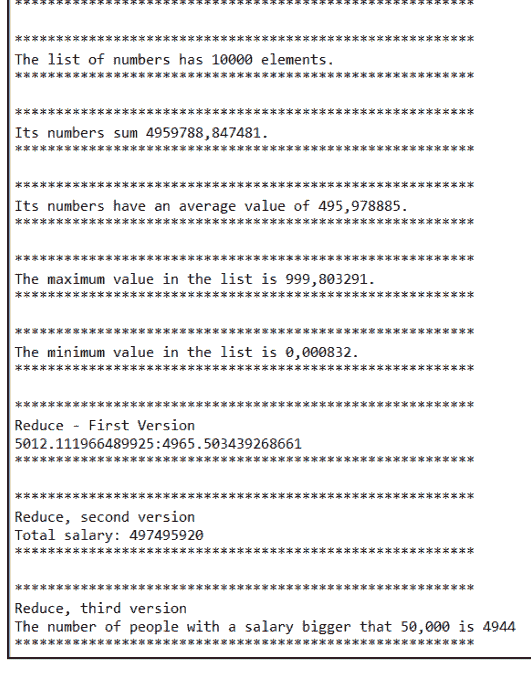
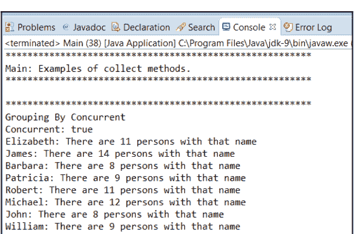
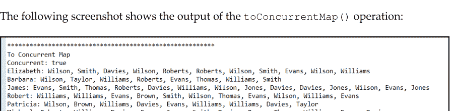
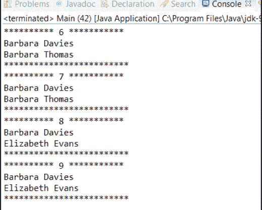
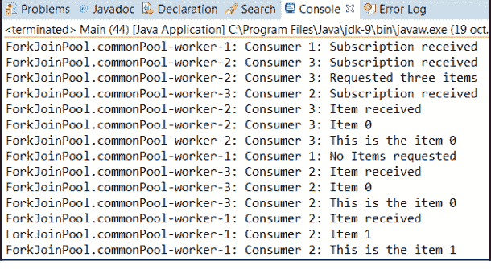

## 第6章：并行和响应式流

## 并行和响应式流

在本章中，我们将介绍以下配方：

- 从不同源创建流
- 减少流的元素
- 收集流的元素
- 对流的每个元素应用操作
- 过滤流的元素
- 转换流的元素
- 对流的元素进行排序
- 验证流元素中的条件
- 使用响应式流进行响应式编程

## 引言

Java 中的 **stream** 是一系列元素，可以通过使用 **lambda expressions** 的声明式操作管道以顺序或并行方式进行处理（映射、过滤、转换、归约和收集）。它在 Java 8 中引入，是该版本最重要的新特性之一，与 lambda 表达式一起。它们改变了你在 Java 中处理大数据集的方式，优化了语言处理这些元素的方式。

流引入了 `Stream`、`DoubleStream`、`IntStream` 和 `LongStream` 接口，一些实用类如 `Collectors` 或 `StreamSupport`，一些类似函数式的接口如 `Collector`，以及不同类中的大量方法，如 `Collection` 接口中的 `stream()` 或 `parallelStream()` 方法，或 `Files` 类中的 `lines()` 方法。

- **惰性：** 中间操作是惰性的。它们在终端操作开始执行之前不会被执行。如果 Java 检测到中间操作对流的一个元素或一组元素的操作不会影响操作最终结果，它可以避免执行该中间操作。
- 流可以有无限数量的元素。存在诸如 `limit()` 或 `findFirst()` 之类的操作，可以用来限制最终计算中使用的元素。由于中间操作是惰性的，无界流可以在有限时间内完成执行。
- 流只能使用一次。正如我们之前提到的，当流的终端操作被执行时，流被视为已消费，不能再次使用。如果需要再次处理相同数据以生成不同的结果，你必须从同一源创建新的 Stream 对象。如果尝试使用已消费的流，你将得到一个异常。
- 你可以在没有任何额外努力的情况下顺序或并行地处理流的元素。你可以多次指定流的执行模式，但只有最后一次会被考虑。你必须注意所选模式。有状态的中间操作不会使用所有并发的可能性。

Java 9 包含了一种新型的流——响应式流——它允许你以异步方式向生产者和消费者传达信息。本章介绍了九个配方，将教你如何创建流并使用它们的所有中间和终端操作，以并行和函数式的方式处理大型数据集合。

## 从不同源创建流

在本配方中，你将学习如何从不同源创建流。你有不同的选项，如下：

- `Collection` 接口的 `parallelStream()` 方法
- `Supplier` 接口
- 预定义的元素集
- `File` 和目录
- 数组
- 随机数生成器
- 两个不同流的连接

你可以从其他源创建 Stream 对象（将在“更多内容”部分描述），但我们认为这些是最有用的。

## 准备工作

本配方的示例已使用 Eclipse IDE 实现。如果你使用 Eclipse 或其他 IDE 如 NetBeans，请打开它并创建一个新的 Java 项目。

## 如何做...

在本配方中我们将实现一个示例，你将学习如何从前面描述的源创建流。按照以下步骤实现示例：

1. 首先，我们将实现一些将在示例中使用的辅助类。创建一个名为 Person 的类，具有六个不同类型的属性：String、int、double 和 Date：

```
public class Person implements Comparable<Person> {
    private int id;
    private String firstName;
    private String lastName;
    private Date birthDate;
    private int salary;
    private double coefficient;
}
```

2. 创建设置和获取这些属性值的方法。实现 compareTo() 方法来比较两个 Person 对象。让我们认为如果两个人的 firstName 和 lastName 相同，则他们是相同的

```
public int compareTo(Person otherPerson) {
    int compareLastNames = this.getLastName().compareTo
        (otherPerson.getLastName());
    if (compareLastNames != 0) {
        return compareLastNames;
    } else {
        return this.getFirstName().compareTo
            (otherPerson.getFirstName());
    }
}
```

3. 然后，创建一个名为 PersonGenerator 的类来创建随机的 Person 对象列表。在此类中实现一个名为 generatePersonList() 的静态方法，该方法接收你想要生成的个人数量并返回一个包含该数量个人的 List<Person> 对象。在这里，我们包含此方法的版本，但请随意更改它：

```
public class PersonGenerator {

    public static List<Person> generatePersonList (int size) {
        List<Person> ret = new ArrayList<>();

        String firstNames[] = {"Mary","Patricia","Linda",
            "Barbara","Elizabeth","James",
            "John","Robert","Michael",
            "William"};
        String lastNames[] = {"Smith","Jones","Taylor",
            "Williams","Brown","Davies",
            "Evans","Wilson","Thomas",
            "Roberts"};

        Random randomGenerator=new Random();
        for (int i=0; i<size; i++) {
            Person person=new Person();
            person.setId(i);
            person.setFirstName(firstNames[randomGenerator
                .nextInt(10)]);
            person.setLastName(lastNames[randomGenerator
                .nextInt(10)]);
            person.setSalary(randomGenerator.nextInt(100000));
            person.setCoefficient(randomGenerator.nextDouble()*10);
            Calendar calendar=Calendar.getInstance();
            calendar.add(Calendar.YEAR, -randomGenerator
                .nextInt(30));
            Date birthDate=calendar.getTime();
            person.setBirthDate(birthDate);
            ret.add(person);
        }
        return ret;
    }
}
```

4. 现在，创建一个名为 MySupplier 的类并指定它实现参数化为 String 类的 Supplier 接口：

```
public class MySupplier implements Supplier<String> {
```


5. 在类的构造函数中声明一个名为 counter 的私有 AtomicInteger 属性并进行初始化：

```
private final AtomicInteger counter;
public MySupplier() {
    counter=new AtomicInteger(0);
}
```

6. 实现 Supplier 接口中定义的 get() 方法。此方法将返回流的下一个元素：

```
@Override
public String get() {
    int value=counter.getAndAdd(1);
    return "String "+value;
}
```

7. 现在，创建一个名为 Main 的类并在其中实现 main() 方法：

```
public class Main {
    public static void main(String[] args) {
```

8. 首先，我们将从一个元素列表创建一个 Stream 对象。创建 PersonGenerator 类来创建 10,000 个 Person 对象的列表，并使用 List 对象的 parallelStream() 方法创建 Stream。然后，使用 Stream 对象的 count() 方法获取 Stream 的元素数量：

```
System.out.printf("From a Collection:\n");
List<Person> persons=PersonGenerator.generatePersonList(10000);
Stream<Person> personStream=persons.parallelStream();
System.out.printf("Number of persons: %d\n", personStream.count();
```

9. 然后，我们将从一个生成器创建一个 Stream。创建一个 MySupplier 类的对象。然后，使用 Stream 类的静态方法 generate()，将创建的对象作为参数传递以创建流。最后，使用 parallel() 方法将创建的流转换为并行流，使用 limit() 方法获取流的前十个元素，并使用 forEach() 方法打印流的元素：

```
System.out.printf("From a Supplier:\n");
Supplier<String> supplier=new MySupplier();
Stream<String> generatorStream=Stream.generate(supplier);
generatorStream.parallel().limit(10).forEach(s->
    System.out.printf("%s\n",s));
```

10. 然后，我们将从预定义的元素列表创建一个流。使用 Stream 类的静态 of() 方法创建 Stream。此方法接收可变数量的参数。在这种情况下，我们将传递三个 String 对象。然后，使用流的 parallel() 方法将其转换为并行流，并使用 forEach() 方法在控制台打印值：

```
System.out.printf("From a predefined set of elements:\n");
Stream<String> elementsStream=Stream.of("Peter","John","Mary");
elementsStream.parallel().forEach(element ->
    System.out.printf("%s\n", element));
```

11. 现在，我们将创建一个流来读取文件中的行。首先，创建一个 BufferedReader 对象来读取要读取的文件。然后，使用 BufferedReader 类的 lines() 方法获取 String 对象的流。此流的每个元素都是文件中的一行。最后，使用 parallel() 方法获取流的并行版本，并使用 count() 方法获取 Stream 的元素数量。我们还必须关闭 BufferedReader 对象：

```
System.out.printf("From a File:\n");
try (BufferedReader br = new BufferedReader(new FileReader("data\\nursery.data"))) {
    Stream<String> fileLines = br.lines();
    System.out.printf("Number of lines in the file: %d\n\n", fileLines.parallel().count());
    System.out.printf("***********************************\n***********************************\n");
    System.out.printf("\n");
    br.close();
} catch (FileNotFoundException e) {
    e.printStackTrace();
} catch (IOException e) {
    e.printStackTrace();
}
```

```
Random random = new Random();
DoubleStream doubleStream = random.doubles(10);
double doubleStreamAverage = doubleStream.parallel().peek
    (d -> System.out.printf("%f :",d))
    .average().getAsDouble();
```

15. 最后，我们将创建一个连接两个流的流。首先，我们使用 Stream 类的 of() 方法创建两个 String 对象的流。然后，我们使用 Stream 类的 concat() 方法将这些流连接成一个唯一的流。最后，我们使用 Stream 类的 parallel() 方法将流转换为并行流，并使用 forEach() 方法将所有元素写入控制台：

```
System.out.printf("Concatenating streams:\n");
Stream<String> stream1 = Stream.of("1", "2", "3", "4");
Stream<String> stream2 = Stream.of("5", "6", "7", "8");
Stream<String> finalStream = Stream.concat(stream1, stream2);
finalStream.parallel().forEach(s -> System.out.printf("%s :", s));
```

## 它是如何工作的...

让我们详细查看在这个示例中创建流时我们使用的所有方法：

- 首先，我们使用了 List 类的 parallelStream() 方法。事实上，此方法在 Collection 接口中定义，因此实现此接口的所有类，例如 ArrayList、LinkedList 或 TreeSet 类都实现了该方法。您可以使用 stream() 方法创建顺序流，或使用 parallelStream() 方法创建并行流。
- 然后，我们使用了 Supplier 接口的实现：MySupplier 类。接口提供了 get() 方法。每次流需要处理一个元素时都会调用此方法。您可以创建一个具有无限数量元素的流，因此您应该使用限制流元素数量的方法，例如 limit() 方法。
- 然后，我们使用了 Stream 类的 of() 方法。这是一个静态方法，接收可变数量的参数并返回一个以这些参数作为元素的 Stream。
- 然后，我们使用了 `BufferedReader` 类的 `lines()` 方法。此方法返回一个流，其中每个元素都是从 `BufferedReader` 读取的一行。我们使用此方法读取文件的所有行，但您也可以将其与其他类型的 `BufferedReader` 一起使用。
- 然后，我们使用了 `Files` 类的 `list()` 方法。此方法接收表示系统文件夹的 `Path` 对象，并返回包含该文件夹中元素的 `Path` 对象的 `Stream`。您必须注意，此方法不是递归的，因此如果文件夹包含一个或多个子文件夹，则不会处理其内容。正如您将在后面的 *There's more* 部分看到的那样，`Files` 类还有其他用于处理流的方法。
- 然后，我们使用了 `Arrays` 类的 `stream()` 方法，该方法接收一个数组并返回一个包含数组元素的 `Stream`。如果数组是 `double`、`int` 或 `long` 类型，则返回 `DoubleStream`、`IntStream` 或 `LongStream` 对象。这些是允许您处理此类数字类型的特殊流。
- 然后，我们生成了一个随机数字流。我们使用了 `Random` 类的 `doubles()` 方法。我们向其传递了我们想要获得的 `Stream` 的大小，但您也可以向其传递您想要获得的最小值和最大值。
- 最后，我们使用了 `Stream` 类的 `concat()` 方法，该方法接收两个流并返回一个包含两者元素的流。

我们还使用了 `Stream` 类的一些方法。其中大多数将在后面更详细地描述，但在这里我们提供它们的基础介绍：

- `count()`: 此方法返回 `Stream` 中的元素数量。它是一个终端操作，返回一个 `long` 数字。
- `limit()`: 此方法接收一个数字作为参数。如果流的元素少于该数字，则返回包含所有元素的流。否则，它返回一个包含参数中指定数量元素的流。它是一个中间操作。
- `forEach()`: 此方法允许您指定将应用于 `Stream` 的每个元素的操作。我们使用此终端操作将一些信息写入控制台。我们为此目的使用了 lambda 表达式。
- `peek()`: 此方法是一个中间操作，允许您对流的每个元素执行操作并返回一个具有相同元素的流。此方法通常用作调试工具。请注意，与所有中间操作一样，这是一个惰性操作，因此它只会对终端操作请求的那些元素执行。
- `average()`: 这是在 `IntStream`、`DoubleStream` 和 `LongStream` 流中声明的方法。它返回一个 `OptionalDouble` 值。`OptionalDouble` 类表示可以有值或没有值的 double 数字。对于空 `Stream`，它不会生成值。
- `parallel()`: 此方法将顺序 `Stream` 转换为并行流。此示例中创建的大多数流都是顺序的，但我们可以使用 `Stream` 类的此方法将它们转换为并行流。

## 还有更多...

Java API 包含创建 `Stream` 对象的其他方法。在本节中，我们列举其中一些方法：

- `Files` 类提供了创建流的更多方法：
  - `find()`: 此方法返回包含在文件夹中或其任何子文件夹中且满足 lambda 表达式中指定条件的 files。
  - `walk()`: 此方法返回一个 `Path` 对象的流，其中包含文件夹及其所有子文件夹的内容。
- `Stream` 类还包括其他静态方法，允许您创建流：
  - `iterate()`: 此方法生成一个流，其元素是通过将一元函数应用于初始元素生成的。流的第一个元素是初始元素，第二个元素是将函数应用于初始元素的結果，第三个元素是将函数应用于第二个元素的結果，以此类推。
- 最后，`String` 类具有 `chars()` 方法。此方法返回一个 `IntStream`，其中包含构成 `String` 的字符的值。


## 另请参阅

现在你已经创建了一个流，就必须处理其元素。本章中的所有配方都提供了有关如何处理流元素的的信息。

## 减少流的元素

**MapReduce** 是一种编程模型，用于在由集群中大量机器工作的分布式环境中使用非常大的数据集进行处理。该编程模型具有以下两种操作：

- **Map**：此操作过滤并转换原始元素，使其更适合归约操作
- **Reduce**：此操作从所有元素生成摘要结果，例如数值之和或平均值

该编程模型在函数式编程世界中已被广泛使用。在 Java 生态系统中，**Apache 软件基金会**的 **Hadoop** 项目提供了该模型的实现。`Stream` 类实现了两种不同的 reduce 操作：

- 纯 reduce 操作，以 `reduce()` 方法的不同版本实现，处理流元素以获得一个值
- 可变归约，以 `collect()` 方法的不同版本实现，处理流元素以生成可变数据结构，例如 `Collection` 或 `StringBuilder`。

在本配方中，你将学习如何使用 `reduce()` 方法的不同版本从值流中生成结果。正如你可能已经想象的那样，`reduce()` 方法是 `Stream` 中的一个终端操作。

## 准备工作

本配方的示例使用 Eclipse IDE 实现。如果使用 Eclipse 或其他 IDE，例如 NetBeans，请打开它并创建一个新的 Java 项目。

## 如何操作...

按照以下步骤实现示例：

- 1. 首先，我们将创建一些辅助类，我们将在示例后面使用它们。查看配方《从不同源创建流》，并在此示例中包含其中使用的 Person 和 PersonGenerator 类。
- 2. 然后，创建一个名为 DoubleGenerator 的类。实现一个名为 generateDoubleList() 的方法来生成双精度数字列表。它接收两个参数，即我们将生成的列表的大小和列表中的最高值。它将生成随机双精度数字列表：
- 3. 实现一个名为 generateStreamFromList() 的方法。此方法接收一个双精度数字的 List 作为参数，并生成一个包含列表元素的 DoubleStream 流。为此，我们将使用 DoubleStream.Builder 类来构造流：
- 4. 创建一个名为 Point 的类，具有两个 double 属性 x 和 y，以及获取和设置其值的 get() 和 set() 方法。此类的代码非常简单，因此不会包含。

```
public class DoubleGenerator {

    public static List<Double> generateDoubleList(int size,
                                                int max) {
        Random random=new Random();
        List<Double> numbers=new ArrayList<>();

        for (int i=0; i<size; i++) {
            double value=random.nextDouble()*max;
            numbers.add(value);
        }
        return numbers;
    }
}
```

```
public static DoubleStream generateStreamFromList(List<Double>
                                                    list) {
    DoubleStream.Builder builder=DoubleStream.builder();

    for (Double number : list) {
        builder.add(number);
    }
    return builder.build();
}
```

5. 创建一个名为 PointGenerator 的类，其中有一个名为 generatePointList() 的方法。此方法接收你想要生成的列表的大小，并返回一个随机 Point 对象的列表：

```
public class PointGenerator {
    public static List<Point> generatePointList (int size) {

        List<Point> ret = new ArrayList<>();
        Random randomGenerator=new Random();
        for (int i=0; i<size; i++) {
            Point point=new Point();
            point.setX(randomGenerator.nextDouble());
            point.setY(randomGenerator.nextDouble());
            ret.add(point);
        }
        return ret;
    }
}
```

6. 现在创建具有 main() 方法的 Main 类。首先，我们将使用 DoubleGenerator 类生成 10,000 个双精度数字的 List：

```
public class Main {
    public static void main(String args[]) {

        List<Double> numbers = DoubleGenerator.generateDoubleList
                                (10000, 1000);
```

7. `Stream` 类和专门的 DoubleStream、IntStream 和 LongStream 类实现了一些专门的 reduce 操作方法。在这种情况下，我们将使用 DoubleGenerator 类生成一个 DoubleStream，并使用 count()、sum()、average()、max() 和 min() 来获得元素的数量、所有元素的总和、所有元素的平均值、流中的最大值和最小值。由于我们只能处理流的元素一次，因此我们必须为每个操作创建一个新的流。请注意，这些方法仅存在于 DoubleStream、IntStream 和 LongStream 类中。`Stream` 类只有 count() 方法。其中一些方法返回一个 optional 对象。请注意该对象可能没有任何值，因此在获取值之前应进行检查：

```
DoubleStream doubleStream = DoubleGenerator
    .generateStreamFromList(numbers);
long numberOfElements = doubleStream.parallel().count();
System.out.printf("The list of numbers has %d elements.\n", numberOfElements);

doubleStream = DoubleGenerator.generateStreamFromList(numbers);
double sum = doubleStream.parallel().sum();
System.out.printf("Its numbers sum %f.\n", sum);

doubleStream = DoubleGenerator.generateStreamFromList(numbers);
double average = doubleStream.parallel().average()
    .getAsDouble();
System.out.printf("Its numbers have an average value of %f.\n", average);

doubleStream = DoubleGenerator.generateStreamFromList(numbers);
double max = doubleStream.parallel().max().getAsDouble();
System.out.printf("The maximum value in the list is %f.\n", max);

doubleStream = DoubleGenerator.generateStreamFromList(numbers);
double min = doubleStream.parallel().min().getAsDouble();
System.out.printf("The minimum value in the list is %f.\n", min);
```

8. 然后，我们将使用 reduce() 方法的第一个版本。此方法接收一个关联的 BinaryOperator 作为参数，该操作符接收两个相同类型的对象并返回该类型的对象。当操作处理完 Stream 的所有元素后，它返回一个参数化为相同类型的 Optional 对象。例如，我们将使用此版本来计算随机 Point 对象列表的两个坐标之和：

```
List<Point> points=PointGenerator.generatePointList(10000);
Optional<Point> point=points.parallelStream().reduce((p1,p2) -> {
    Point p=new Point();
    p.setX(p1.getX()+p2.getX());
    p.setY(p1.getY()+p2.getY());
    return p;
});
System.out.println(point.get().getX()+":"+point.get().getY());
```

9. 然后，我们将使用 reduce() 方法的第二个版本。它与前一个类似，但在这种情况下，除了关联的 BinaryOperator 对象外，它还接收该操作符的标识值（例如求和为 0，乘积为 1）并返回我们正在处理的类型的一个元素。如果流没有值，将返回标识值。在这种情况下，我们使用此版本的 reduce() 方法来计算我们在薪水中需要花费的总金额。我们使用 map() 方法将每个 Person 对象转换为 int 值（其薪水），因此我们的 Stream 对象在执行 reduce() 方法时将具有 int 值。你将在《转换流的元素》配方中获得有关 map() 方法的更多信息：

```
System.out.printf("Reduce, second version\n");
List<Person> persons = PersonGenerator.generatePersonList
(10000);
long totalSalary=persons.parallelStream().map
(p -> p.getSalary()).reduce(0, (s1,s2) -> s1+s2);
System.out.printf("Total salary: %d\n",totalSalary);
```

10. 最后，我们将使用 reduce() 方法的第三个版本。此版本用于 reduce 操作的结果类型与流元素类型不同时。我们必须提供返回类型的标识值、一个累加器，该累加器实现 BiFunction 接口并接收返回类型的对象、流的一个元素以生成返回类型的值，以及一个组合器函数，该函数实现 BinaryOperator 接口并接收两个返回类型的对象以生成该类型的对象。在这种情况下，我们已使用此版本的方法来计算随机人员列表中薪水高于 50,000 的人数：

```
Integer value=0;
value=persons.parallelStream().reduce(value, (n,p) -> {
if (p.getSalary() > 50000) {
return n+1;
} else {
return n;
}
}, (n1,n2) -> n1+n2);
System.out.printf("The number of people with a salary bigger
that 50,000 is %d\n",value);
```


## How it works...

In this example, you learned how to use the different reduce operations provided by Java streams. First, we used some specialized reduce operations provided by the DoubleStream, IntStream and LongStream classes. These operations allow you to count the number of elements of the stream, calculate the sum of all the elements of the stream, calculate the average value of the elements of the stream, and calculate the highest and lowest value of the elements of the stream. If you work with a generic Stream, you will only have the count() method to count the elements of the stream.

Then we used the three versions of the reduce() method provided by the Stream class. The first one receives only one parameter, a BinaryOperator. We specified that operator as a lambda expression and you will normally do that, but you can also use an object of a class that implements the BinaryOperator interface. That operator will receive two elements of the stream and will have to generate a new element of the same type. For example, we receive two Point objects and generate a new Point object. The operation implemented by that BinaryOperator has to be associative, that is to say, the following expression must be true:

(a op b) op c = a op (b op c)

Here op is our BinaryOperator.

This version of the reduce() method returns an Optional object; Optional because if the stream has no elements, there won't be a result value to return and the Optional object will be empty.

The second version of the reduce() method receives an identity value and a BinaryOperator. The BinaryOperator has to be associative as in the other version of the reduce() method. For the identity value, it has to be a true expression:

identity op a = a op identity = a

In this case, the reduce() method returns an element of the same type of elements of the stream. If the stream has no elements, the identity value will be returned.

The last version of the reduce() method is used when we want to return a value of a type different from the elements of the stream. In this case, the method has three parameters, an identity value, an accumulator operator, and a combiner operator. The accumulator operator receives a value of the return type and an element of the stream and generates a new object of the return type.

The *combiner* function receives two objects of the return type to calculate a new object of the return type. The *identity* value is the *identity* value of the return type, and it has to verify the following expression:

combiner (u, accumulator(identity, t)) == accumulator(u, t)

Here, u is an object of the return type and t an element of the stream.

The following screenshot shows the output of an execution of the example:



## There's more...

We have implemented all the parameters of the `reduce()` method as lambda expressions. The first two versions of the `reduce()` method receive a `BinaryOperator` and the third version receives a `BiFunction` and a `BinaryOperator`. If you want to reuse a complex operator, you can implement a class that implements the necessary interface and use an object of that class as the parameter to these and to the other methods of the `Stream` class.

## See also

- The *Creating streams from different sources* recipe in this chapter

## Collecting the elements of a stream

Java streams allow you to process a sequence of elements in a sequential or parallel way. You can create a stream from different data sources, as a `Collection`, a `File` or an `Array` and apply to its elements a sequence of operations normally defined with lambda expressions. Those operations can be divided into two different classes:

- **Intermediate operations**: These operations return other `Stream` as a result and allow you to filter, transform, or sort the elements of the stream
- **Terminal operations**: These operations return a result after processing the elements of the stream

A stream has a source, zero or more intermediate operations, and a terminal operation. The two most important terminal operations are:

- The reduce operation, which allows you to obtain a unique result after processing the elements of the stream. This result usually is a summary of the processed data. The *Reducing the elements of a stream* recipe explains you how to use reduce operations in Java.
- The collect operation that allows you to generate a data structure with the results of processing the elements of the stream. This is also called a mutable reduction operation as the result is a mutable data structure.

In this recipe, we will learn how to execute collect operations in Java streams with the different versions of the `collect()` method and the auxiliary `Collectors` class.

## Getting ready

The example of this recipe has been implemented using the Eclipse IDE. If you use Eclipse or other IDE such as NetBeans, open it and create a new Java project.

## How to do it...

Follow these steps to implement the example:

- 1. First, let's implement some auxiliary classes we will use in the example. Implement the Person class to store some basic data about a person and the PersonGenerator class to generate a random list of persons. You can check the Creating streams from different sources recipe to see the source code of both the classes.
- 2. In that class, override the toString() method with the following code, which returns the first name and the last name of the person:
- 3. Then, create a class named Counter with two attributes: a String attribute named value and an int attribute named counter. Generate the methods to get() and set() the values of both attributes. The source code of this class is very simple, so it won't be included.
- 4. Now, create the Main class with the main() method. Then, create a random List of Person objects using the PersonGenerator class:

```
@Override
public String toString() {
    return firstName + " " + lastName;
}
```

```
public class Main {

    public static void main(String args[]) {
        List<Person> persons = PersonGenerator.generatePersonList
            (100);
```

5. The first collect operation we will implement will generate a Map where the keys will be first name of the person and the values will be a list with all the persons with that first name. To implement this, we use the collect() method of the Stream class and the Collectors.groupingByConcurrent collector. Then, we process all the keys (first names) of the map using the forEach() method and print in the console the number of persons with that key: As parameter of the groupingByConcurrent() method we pass a method reference. We can use this mechanism in a lambda expression if it only calls to an existing method as in this case.

```
Map<String, List<Person>> personsByName = persons
    .parallelStream().collect(Collectors
    .groupingByConcurrent(Person::getFirstName));
personsByName.keySet().forEach(key -> {
    List<Person> listOfPersons = personsByName.get(key);
    System.out.printf("%s: There are %d persons with that name\n",
        key, listOfPersons.size());
```

6. The second collect operation we will implement will concatenate all the names of all the persons in the stream. To implement this operation, we use the toString() method of the Person object, the collect() method, of the Stream class, and the joining() method of the Collectors class that concatenates all the elements of the stream separated by the specified char sequence:

```
String message = persons.parallelStream().map
    (p -> p.toString()).collect(Collectors.joining(","));
System.out.printf("%s\n", message);
```

7. With the next collect operation we'll implement, we will separate the persons on the stream in two groups. The first one will have the persons with a salary greater than 50,000 and the second one will have the others. The result of the operation will be a Map object with a Boolean value as the key and a List of persons as the value. To implement this, we will use the collect() method of the Stream class and the partitioningBy() method of the Collectors class that receives as a parameter a Boolean expression that allows you two divide the elements of the stream in true or false. Then we use the forEach() method to write the number of elements in the generated lists:

```
Map<Boolean, List<Person>> personsBySalary = persons
    .parallelStream().collect(Collectors
    .partitioningBy(p -> p.getSalary() > 50000));
```


```
personsBySalary.keySet().forEach(key -> {
    List<Person> listOfPersons = personsBySalary.get(key);
    System.out.printf("%s: %d \n", key, listOfPersons.size());
});
```

8. 然后，我们将实现一个 collect 操作，它会生成另一个 Map。在这种情况下，键将是人员的名，值将是具有相同名的所有人员的姓拼接成一个 String。为了实现这种行为，我们使用 Stream 类的 collect() 方法和 Collectors 类的 toConcurrentMap() 方法。我们向该方法传递三个参数：一个用于获取键的 lambda 表达式、一个用于获取值的 lambda 表达式，以及一个用于解决最终 Map 中已存在键的情况的 lambda 表达式。然后，我们使用 forEach() 方法处理所有键并写入其关联的值：

```
ConcurrentMap<String, String> nameMap = persons
    .parallelStream().collect(Collectors
    .toConcurrentMap(p -> p.getFirstName(),
                    p -> p.getLastName(),
                    (s1, s2) -> s1 + ", " + s2));
nameMap.forEach((key, value) -> {
    System.out.printf("%s: %s \n", key, value);
});
```

9. 到目前为止，在我们实现的所有 collect() 方法示例中，我们都使用了接收 Collector 接口实现版本的方法。但 collect() 方法还有另一个版本。通过这个版本的 collect() 方法，我们将实现一个 collect 操作，生成一个薪水大于 50,000 的人员的 List。我们向 collect() 方法传递一个用于创建 List 的表达式（List::new 方法）、一个用于处理列表和流元素的 lambda 表达式，以及一个用于处理两个列表的表达式（List::addAll 方法）：

```
List<Person> highSalaryPeople = persons
    .parallelStream().collect(
        ArrayList::new, (list, person) -> {
            if (person.getSalary() > 50000) {
                list.add(person);
            }
        },
        ArrayList::addAll
    );
System.out.printf("High Salary People: %d\n",
                  highSalaryPeople.size());
```

10. 最后，我们将实现一个示例，生成一个 ConcurrentHashMap，其中包含 People 对象列表中出现的名以及每个名出现的次数。我们将使用人员的名作为键，Counter 对象作为值。collect 方法的第一个参数将创建一个新的 ConcurrentHashMap 对象。第二个参数是 BiConsumer 接口的实现，它接收 ConcurrentHashMap 和 Person 作为参数。首先，我们使用 hash 的 computeIfPresent() 方法在人员存在时递增其 Counter。然后，我们使用 hash 的 computeIfAbsent() 方法在人员不存在时插入新的人员名。collect() 方法的第三个参数是 BiConsumer 接口的实现，它接收两个 ConcurrentHashMap 对象，我们使用 merge() 方法处理第二个哈希中的所有元素，如果它们不存在则插入到第一个哈希中，如果存在则递增计数器。

```
System.out.printf("Collect, second example\n");
ConcurrentHashMap<String, Counter> peopleNames = persons
    .parallelStream().collect(
    ConcurrentHashMap::new, (hash, person) -> {
        hash.computeIfPresent(person.getFirstName(), (name, counter) -> {
            counter.increment();
            return counter;
        });
        hash.computeIfAbsent(person.getFirstName(), name -> {
            Counter c=new Counter();
            c.setValue(name);
            return c;
        });
    },
    (hash1, hash2) -> {
        hash2.forEach(10, (key, value) -> {
            hash1.merge(key, value, (v1,v2) -> {
                v1.setCounter(v1.getCounter()+v2.getCounter());
                return v1;
            });
        });
    });

peopleNames.forEach((name, counter) -> {
    System.out.printf("%s: %d\n", name, counter.getCounter());
});
```

## How it works...

正如我们在本食谱的介绍中所提到的，`collect()` 方法允许你对 `Stream` 的元素进行可变归约。我们称之为可变归约，因为流的最终结果将是一个可变的数据结构，例如 `Map` 或 `List`。Java 并发 API 的 `Stream` 类提供了两个版本的 `collect()` 方法。

第一个版本只接收一个参数，即 `Collector` 接口的实现。该接口有七个方法，因此你通常不会自己实现收集器。相反，你将使用工具类 `Collectors`，它有很多方法可以返回可直接使用的 `Collector` 对象用于你的归约操作。在我们的示例中，我们使用了 `Collectors` 类的以下方法：

- `groupingByConcurrent()`：此方法返回一个 `Collector` 对象，它以并发方式对 `Stream` 的元素实现分组操作，生成 `Map` 作为结果数据结构。它接收一个参数表达式，用于从流元素中获取 map 中使用的键的值。它生成的 `Map` 的键类型为参数表达式返回的类型，值将是流元素的 `List`。
- `joining()`：此方法返回一个 `Collector`，它将流的元素连接成 `String`。你可以指定三个 `CharSequence` 对象，分别是元素的分隔符、最终 `String` 的前缀和后缀。
- `partitioningBy()`：此方法返回一个与第一个类似的 `Collector`。它接收一个 `Boolean` 表达式作为参数，并根据元素是否满足表达式将流的元素组织成两组：满足表达式的和不满足的。最终结果将是 `Map`，键为 `Boolean`，值为流元素类型的 `List`。
- `toConcurrentMap()`：此方法返回一个 `Collector`，它以并发方式生成 `ConcurrentMap`。它接收三个参数：
  - 从流元素生成键的表达式
  - 从流元素生成值的表达式
  - 当有两个或多个元素具有相同键时，从两个值生成一个值的表达式

Collector 具有一组 Characteristics 定义其行为，可以为特定收集器定义或不定义。对我们来说，最重要的是 CONCURRENT，它表示收集器是否可以以并发方式工作。如果是这样，我们就不能仅通过创建并行流来利用我们的多核处理器。如果我们使用带有 Collector 的 collect 操作，我们还必须考虑该 Collector 的 CONCURRENT 特性的值。我们只有在以下三个条件都为真时才会有并发归约：

- Stream 是并行的（我们使用了 parallelStream() 或 parallel() 方法）
- 收集器具有 CONCURRENT 特性
- 流是无序的，或者收集器具有 UNORDERED 特性

在我们的例子中，groupingByConcurrent() 和 toConcurrentMap() 返回的收集器具有 CONCURRENT 特性，而 joining() 和 partitionBy() 方法返回的收集器不具有该特性。

然而，还有另一个版本的 collect() 方法可以与并行流一起使用。这个版本的 collect() 方法接收以下三个参数：

- 一个 supplier 函数，生成 collect 操作最终结果类型的数据结构。对于并行流，该函数将被调用的次数与执行操作的线程数一样多。
- 一个 accumulator 函数，接收一个数据结构和流的一个元素并处理该元素。
- 一个 combiner 函数，接收两个数据结构并生成一个唯一的数据结构，类型相同。

你可以使用 lambda 表达式来实现这些函数，但也可以为 supplier 函数实现 Supplier 接口，或为 accumulator 和 combiner 函数实现 BiConsumer 接口（始终使用适当的数据类型进行参数化）。你也可以使用方法引用（Class::Method）如果输入和输出参数合适。例如，我们使用了 List::new 引用作为 supplier 函数，并使用 List::addAll 方法作为 combiner 函数。我们本可以使用 List::add 方法作为 accumulator 函数。你可以使用更多方法作为 collect() 方法的参数。


以下截图显示了 `groupingByConcurrent()` 操作的输出：



以下截图显示了 `toConcurrentMap()` 操作的输出：



## 还有更多...

`Collectors` 类还有许多其他返回 `Collector` 对象的方法，可在 `collect()` 方法中使用。以下是其中最有趣的：

- toList(): 此方法返回的 `Collector` 将 `Stream` 的所有元素分组到 `List` 中。
- toCollection(): 此方法返回的 `Collector` 将 `Stream` 的所有元素分组到 `Collection` 中。此方法将创建 `Collection` 的表达式作为参数传递，该 `Collection` 将在 `Collector` 内部使用，并在其执行结束时返回。
- averagingInt()、averagingLong() 和 averagingDouble(): 这些方法分别返回计算 `int`、`long` 和 `double` 值平均值的 `Collector`。它们接收将流元素转换为 `int`、`long` 或 `double` 的表达式作为参数。这三个方法返回一个 `double` 值。

## 另请参阅

- 本章中的 *Creating streams from different sources* 和 *Reducing the elements of a stream* 配方

## 对流的每个元素应用一个操作

在本配方中，你将学习如何对流的所有元素应用一个操作。我们将使用三种方法：两个终端操作，`forEach()` 和 `forEachOrdered()`，以及一个中间操作，`peek()` 方法。

## 准备工作

本配方的示例使用 Eclipse IDE 实现。如果你使用 Eclipse 或其他 IDE，例如 NetBeans，请打开它并创建一个新的 Java 项目。

## 如何操作...

按照以下步骤实现示例：

- 1. 首先，我们将实现示例中使用的一些辅助类。创建一个名为 `Person` 的类，具有人的基本特征。请查看 *Creating streams from different sources* 配方以查看此类源代码。
- 2. 由于我们将使用依赖于流元素顺序的方法，因此必须在 `Person` 类中重写一些方法。首先，我们将重写比较两个人的 `compareTo()` 方法。我们将使用 `Comparator` 接口创建一个静态 `Comparator` 对象，以比较两个 `Person` 对象使用其名字和姓氏。然后，我们将在 `compareTo()` 方法中使用该比较器：
```
private static Comparator<Person> comparator=Comparator
    .comparing(Person::getLastName)
    .thenComparing(Person::getFirstName);

@Override
public int compareTo(Person otherPerson) {
    return comparator.compare(this, otherPerson);
}
```
- 3. 然后，我们重写确定两个 `Person` 对象是否相等的 `equals()` 方法。如同在 `compareTo()` 方法中所做的那样，我们使用之前创建的静态 `Comparator` 对象。
```
@Override
public boolean equals(Object object) {
    return this.compareTo((Person)object)==0;
}
```
- 4. 最后，我们重写计算 `Person` 对象哈希值的 `hashCode()` 方法。在 Java 中，相等对象必须产生相同的哈希码，因此我们必须重写此方法并使用 `Objects` 类的 `hash()` 方法以及名字和姓氏属性生成 `Person` 对象的哈希码：
```
public int hashCode() {
    String sequence=this.getLastName()+this.getFirstName();
    return sequence.hashCode();
}
```

10. 然后，我们将测试 `forEachOrdered()` 方法如何与 `Person` 对象的流一起工作：
```
persons.parallelStream().sorted().forEachOrdered( p -> {
    System.out.printf("%s, %s\n", p.getLastName(),
        p.getFirstName());
});
```

11. 最后，让我们测试 `peek()` 方法。此方法类似于 `forEach()` 方法，但它是一个中间操作。通常用于日志目的：
```
doubles
    .parallelStream()
    .peek(d -> System.out.printf("Step 1: Number: %f\n",d))
    .peek(d -> System.out.printf("Step 2: Number: %f\n",d))
    .forEach(d -> System.out.printf("Final Step: Number: %f\n",d));
```

## 工作原理...

在本配方中，你学习了如何使用三种方法处理流的所有元素并对其应用操作。这些方法是：

- forEach(): 这是一个终端操作，将操作应用于 `Stream` 的所有元素并返回 `void` 值。它接收作为 lambda 表达式或 `Consumer` 接口实现定义的操作作为参数。对于并行流，操作应用于元素的顺序没有保证。
- forEachOrdered(): 这是一个终端操作，将操作应用于 `Stream` 的所有元素，如果流是有序流，则按流的顺序，并返回 `void` 值。你可以在 `sorted()` 方法之后使用此方法。你首先使用 `sorted()` 方法对流的元素进行排序，然后使用 `forEachOrdered()` 方法以有序方式应用操作。此行为在并行流中也得到保证，但其性能会比无序流的 `forEach()` 方法差。
- peek(): 这是一个中间操作，返回调用该方法的流的相同元素的 `Stream`，并将操作应用于从流中消费的所有元素。应用于元素的操作指定为 lambda 表达式或 `Consumer` 接口的实现。请注意，由于中间操作是惰性的，操作仅在终端操作执行时由流消费元素时才应用于元素。

## 还有更多...

请注意，如果你使用 `sorted` 方法，你必须提供可应用于要排序元素的 `Comparator`，或流的元素必须实现 `Comparable` 接口。在我们的例子中，`Person` 类实现了该接口以及 `compareTo()` 方法，以根据名字和姓氏对流的元素进行排序。

## 另请参阅

- 本章中的 *Creating streams from different sources*、*Reducing the elements of a stream* 和 *Sorting the elements of a stream* 配方

## 过滤流的元素

你将应用于流的最常见操作之一是过滤操作，它选择继续处理的那些元素。在本配方中，你将学习 `Stream` 类提供的用于选择流元素的不同方法。

## 准备工作

本配方的示例使用 Eclipse IDE 实现。如果你使用 Eclipse 或其他 IDE，例如 NetBeans，请打开它并创建一个新的 Java 项目。

## 如何操作...

按照以下步骤实现示例：

- 1. 首先，我们将实现示例中使用的一些辅助类。首先，实现存储人的基本属性的 `Person` 类，以及生成随机 `Person` 对象 `List` 的 `PersonGenerator` 类。请查看配方 *Apply an action to all the elements of a stream* 以查看这两个类的源代码。

2. 然后，我们将使用 `main()` 方法实现 `Main` 类。首先，使用 `PersonGenerator` 类创建一个随机 `Person` 对象的 `List`。使用 `forEach()` 方法打印生成的元素：
```
public class Main {
    public static void main(String[] args) {
        List<Person> persons=PersonGenerator
            .generatePersonList(10);
        persons.parallelStream().forEach(p-> {
            System.out.printf("%s, %s\n", p.getLastName(),
                p.getFirstName());
        });
    }
}
```

3. 然后，我们将使用 `distinct()` 方法消除重复对象。使用 `forEach()` 方法写入通过过滤器的元素：
```
persons.parallelStream().distinct().forEach(p-> {
    System.out.printf("%s, %s\n", p.getLastName(),
        p.getFirstName());
});
```

4. 然后，我们将使用数字数组测试 `distinct()` 方法。创建一个重复其中一些数字的数字数组。使用 `Arrays` 类的 `asList()` 方法将它们转换为 `List`。使用 `parallelStream()` 方法创建并行流，使用 `mapToInt()` 方法将流转换为 `IntStream` 流，使用 `distinct()` 方法删除重复元素，最后使用 `forEach()` 方法将最终元素写入控制台：
```
Integer[] numbers={1,3,2,1,2,2,1,3,3,1,1,3,2,1};
Arrays.asList(numbers).parallelStream().mapToInt(n -> n)
    .distinct().forEach( n -> {
        System.out.printf("Number: %d\n", n);
    });
```


5. 现在，我们将使用 filter 方法和一个以该条件表达的 lambda 表达式谓词，从随机人员列表中获取薪水低于 3,000 的人员。如同其他示例一样，使用 forEach() 方法来写入结果元素：

```
persons.parallelStream().filter(p -> p.getSalary() < 30000)
    .forEach( p -> {
        System.out.printf("%s, %s\n", p.getLastName(),
            p.getFirstName());
    });
```

6. 然后，我们将使用 IntStream 测试 filter() 方法，获取小于二的数字：

```
Arrays.asList(numbers).parallelStream().mapToInt(n -> n)
    .filter( n -> n<2).forEach( n-> {
        System.out.printf("%d\n", n);
    });
```

7. 现在，我们将使用 limit() 方法来限制流中元素的数量。例如，从随机人员列表创建并行流，使用 mapToDouble() 方法将其转换为 DoubleStream，并使用 limit() 方法获取前五个元素：

```
persons.parallelStream().mapToDouble(p -> p.getSalary())
    .sorted().limit(5).forEach(s-> {
        System.out.printf("Limit: %f\n",s);
    });
```

8. 最后，我们将使用 skip() 方法忽略流中的若干元素。从随机人员列表创建并行流，使用 mapToDouble() 方法将其转换为 DoubleStream，并使用 skip() 方法忽略前五个元素：

```
persons.parallelStream().mapToDouble(p -> p.getSalary())
    .sorted().skip(5).forEach(s-> {
        System.out.printf("Skip: %f\n",s);
    });
```

## How it works...

在本教程中，我们使用了四种方法来过滤流中的元素。这些方法为：

- `distinct()`: 此方法根据 `Stream` 类元素的 `equals()` 方法返回当前流的唯一元素。在我们的例子中，我们已使用 `Person` 对象和 `int` 数字测试了此方法。我们已在 `Person` 类中实现了 `equals()` 和 `hashCode()` 方法。如果我们不这样做，`equals()` 方法仅在两个比较的对象持有相同引用时才返回 `true`。请注意此操作是有状态的操作，因此在并行流中不会获得良好的性能（正如 Java 文档所反映的，'... 在并行计算下，包含有状态中间操作的某些管道可能需要在数据上进行多次传递或需要缓冲大量数据...'）。
- `filter()`: 此方法接收 `Predicate` 作为参数。此谓词可以表示为返回 `boolean` 值的 lambda 表达式。`filter()` 方法返回使 `Predicate` 为真的元素的流。
- `limit()`: 此方法接收 `int` 值作为参数，并返回不超过该数量元素的流。此方法在有序并行流中的性能也可能很差，尤其是在想要获取的元素数量很大时，因为该方法将返回流中的第一个元素，这将意味着额外的计算。这种情况在无序流中不会发生，因为在这种情况下，返回哪些元素并不重要。
- `skip()`: 此方法返回在丢弃前几个元素后原始流的元素的流。丢弃元素的数量指定为此方法的参数。此方法与 `limit()` 方法具有相同的性能问题。

## There's more...

流类还有另外两种可用于过滤流元素的方法：

- `dropWhile()`: 此方法接收 `Predicate` 表达式作为参数。它在有序流和无序流中的行为不同。对于有序流，该方法从流中删除匹配谓词的第一个元素。它在元素匹配谓词时删除元素。当它找到不匹配谓词的元素时，它停止删除元素并返回流的其余部分。对于无序流，其行为是不确定的。它删除匹配谓词的元素子集，但未指定将删除哪些元素子集。与其他方法一样，在并行有序流中它可能具有较差的性能。
- `takeWhile()`: 此方法等同于前一个方法，但它获取元素而不是删除它们。

## See also

- 本章中 *Creating streams from different sources*、*Reducing the elements of a stream* 和 *Collecting the elements of a stream* 教程

## Transforming the elements of a stream

你可以使用流的最有用的中间操作之一是允许你转换流元素的那些操作。这些操作接收某一类的元素并返回另一类的元素。你甚至可以更改流的类型并从 `Stream` 生成 `IntStream`、`LongStream` 或 `DoubleStream`。

在本教程中，你将学习如何使用 `Stream` 类提供的转换中间操作将元素转换为不同的类。

## Getting ready

本教程的示例使用 Eclipse IDE 实现。如果你使用 Eclipse 或其他 IDE 如 NetBeans，请打开它并创建一个新的 Java 项目。

## How to do it...

按照以下步骤实现示例：

- 1. 首先，我们将实现示例中使用的一些辅助类。首先，实现 Person 类，它存储一个人的基本属性，以及 PersonGenerator 类，它生成随机 Person 对象的 List。请查看教程 Apply an action to all the elements of a stream 以查看这两个类的源代码。
- 2. 创建一个名为 BasicPerson 的类。此类将有一个名为 name 的 String 属性和一个名为 age 的 long 属性。创建获取和设置这两个属性值的方法。由于此类源代码非常简单，这里不包含。
- 3. 创建另一个辅助类 FileGenerator。此类将有一个名为 generateFile() 的方法，它接收模拟文件的行数并以 String 的 List 形式返回其内容：

```
public class FileGenerator {
    public static List<String> generateFile(int size) {
        List<String> file=new ArrayList<>();
        for (int i=0; i<size; i++) {
            file.add("Lorem ipsum dolor sit amet,
                consectetur adipiscing elit. Morbi lobortis
                cursus venenatis. Mauris tempus elit ut
                malesuada luctus. Interdum et malesuada fames
                ac ante ipsum primis in faucibus. Phasellus
                laoreet sapien eu pulvinar rhoncus. Integer vel
                ultricies leo. Donec vel sagittis nibh.
                Maecenas eu quam non est hendrerit pu");
        }
        return file;
    }
}
```

- 4. 然后，使用 main() 方法创建 Main 类。首先，使用 PersonGenerator 类创建随机 Person 对象的列表：

```
public class Main {
    public static void main(String[] args) {
        // Create list of persons
        List<Person> persons = PersonGenerator.generatePersonList(100);
```

5. 然后，我们将使用 mapToDouble() 方法将 Person 对象的流转换为 double 值的 DoubleStream。使用 parallelStream() 方法创建并行流，然后使用 mapToDouble() 方法，传递作为参数的 lambda 表达式，该表达式接收 Person 对象并返回其薪水，即 double 数字。然后使用 distinct() 方法获取唯一值并使用 forEach() 方法将其写入控制台。我们还使用 count() 方法获取已写入的不同元素的数量：

```
DoubleStream ds = persons.parallelStream().mapToDouble
    (p -> p.getSalary());
ds.distinct().forEach(d -> {
    System.out.printf("Salary: %f\n", d);
});
ds = persons.parallelStream().mapToDouble(p -> p.getSalary());
long size = ds.distinct().count();
System.out.printf("Size: %d\n", size);
```

6. 现在，我们将把流中的 Person 对象转换为 BasicPerson 对象。使用 parallelStream() 方法创建流并使用 map() 方法转换对象。此方法接收作为参数的 lambda 表达式，该表达式接收 Person 对象，创建一个新的 BasicPerson 对象，并设置其属性的值。然后，我们使用 forEach() 方法写入 BasicPerson 对象的属性值：

```
List<BasicPerson> basicPersons = persons.parallelStream().map
    (p -> {
        BasicPerson bp = new BasicPerson();
        bp.setName(p.getFirstName() + " " + p.getLastName());
        bp.setAge(getAge(p.getBirthDate()));
        return bp;
    }).collect(Collectors.toList());

basicPersons.forEach(bp -> {
    System.out.printf("%s: %d\n", bp.getName(), bp.getAge());
});
```


7. 最后，我们将学习如何处理中间操作返回 Stream 的情况。在这种情况下，我们将处理一个流的流，但我们可以使用 `flatMap()` 方法将所有这些 Stream 对象连接成一个唯一的 Stream。使用 `FileGenerator` 类生成包含 100 个元素的 `List<String>`。然后，使用 `parallelStream()` 方法创建一个并行流。我们将使用 `split()` 方法拆分每一行以获取其单词，并使用 `Stream` 类的 `of()` 方法将结果 `Array` 转换为 `Stream`。如果我们使用 `map()` 方法，我们将生成一个流的流，但使用 `flatMap()` 方法我们将获得一个唯一的 `String` 对象流，其中包含整个 `List` 的所有单词。然后，我们使用 `filter()` 方法获取长度大于零的单词，使用 `sorted()` 方法对流进行排序，并使用 `groupingByConcurrent()` 方法将其收集到 `Map` 中，其中键是单词，值是每个单词在流中出现的次数：

```
List<String> file = FileGenerator.generateFile(100);
Map<String, Long> wordCount = file.parallelStream()
    .flatMap(line -> Stream.of(line.split("[ ,.]")))
    .filter(w -> w.length() > 0).sorted()
    .collect(Collectors.groupingByConcurrent(e -> e, Collectors
        .counting()));

wordCount.forEach((k, v) -> {
    System.out.printf("%s: %d\n", k, v);
});
```

8. 最后，我们必须实现之前代码中使用的 `getAge()` 方法。此方法接收 `Person` 对象的出生日期并返回其年龄：

```
private static long getAge(Date birthDate) {
    LocalDate start = birthDate.toInstant()
        .atZone(ZoneId.systemDefault()).toLocalDate();
    LocalDate now = LocalDate.now();
    long ret = ChronoUnit.YEARS.between(start, now);
    return ret;
}
```

## How it works...

在本教程中你学习了如何使用中间操作和一个将源类型转换为目标类型的表达式来转换流中的元素。我们在示例中使用了三种不同的方法：

- `mapToDouble()`：我们使用此方法将对象 `Stream` 转换为元素为 double 数字的 `DoubleStream`。此方法接收 lambda 表达式或 `ToDoubleFunction` 接口的实现作为参数。此表达式接收 `Stream` 的一个元素并必须返回一个 double 值。
- `map()`：当我们需要将 `Stream` 的元素转换为不同类时，可以使用此方法。例如，在我们的例子中，我们将 `Person` 类转换为 `BasicPerson` 类。此方法接收 lambda 表达式或 `Function` 接口的实现作为参数。此表达式必须创建新对象并初始化其属性。
- `flatMap()`：此方法在更复杂的情况下很有用，当你需要处理 `Stream` 的 `Stream` 对象并希望将其转换为唯一的 `Stream` 时。此方法接收 lambda 表达式或 `Function` 接口的实现作为参数，就像 `map()` 函数一样，但在这种情况下，此表达式必须返回一个 `Stream` 对象。`flatMap()` 方法将自动连接所有这些流到一个唯一的 `Stream`。

## There's more...

`Stream` 类提供了其他用于转换 `Stream` 元素的 方法：

- `mapToInt(), mapToLong()`：这些方法与 `mapToDouble()` 方法相同，但它们分别生成 `IntStream` 和 `LongStream` 对象。
- `flatMapToDouble(), flatMapToInt(), flatMapToLong()`：这些方法与 `flatMap()` 方法相同，但它们分别使用 `DoubleStream`、`IntStream` 和 `LongStream`。

## See also

- 本章中 *Creating streams from different sources*、*Reducing the elements of a stream* 和 *Collecting the elements of a stream* 教程

## Sorting the elements of a stream

你希望对 Stream 执行的另一个典型操作是对其元素进行排序。例如，你可能希望按名称、邮政编码或任何其他数值对 Stream 的元素进行排序。

使用流时，我们对所谓的 encounter order 有其他考虑。一些流可能具有定义的 encounter order（取决于 Stream 的来源）。某些操作会按其 encounter 顺序处理流中的元素，例如 `limit()`、`skip()` 等。这使得并行计算对这些方法没有很好的性能。在这些情况下，你可以通过删除排序约束来加快这些方法的执行速度。

在本教程中，你将学习如何对 Stream 的元素进行排序以及如何在不需要 Stream 的 encounter order 的情况下删除排序约束。

## Getting ready

本教程的示例使用 Eclipse IDE 实现。如果你使用 Eclipse 或其他 IDE，例如 NetBeans，请打开它并创建一个新的 Java 项目。

## How to do it...

按照以下步骤实现示例：

- 1. 首先，我们将实现示例中将使用的一些辅助类。首先，实现 `Person` 类，它存储一个人的基本属性，以及 `PersonGenerator` 类，它生成一个随机的 `Person` 对象 `List`。请查看教程 *Apply an action to all the elements of a stream* 以查看这两个类的源代码。
- 2. 现在，使用 `main()` 方法实现 `Main` 类。首先，我们将创建一个 int 数字的 `Array`。然后，我们将使用该数组的 `parallelStream()` 方法创建一个并行流，使用 `sorted()` 方法对数组元素进行排序，并使用 `forEachOrdered()` 方法以有序方式写入元素。请注意，此操作不会使用我们多核处理器的全部功能，因为它必须按指定顺序写入元素：

```
public class Main {
    public static void main args[] {
        int[] numbers={9,8,7,6,5,4,3,2,1,2,3,4,5,6,7,8,9};
        Arrays.stream(numbers).parallel().sorted().forEachOrdered
            (n -> {
        System.out.printf("%d\n", n);
    });
```

3. 现在，让我们尝试使用 `Person` 对象的 `Stream` 应用相同的原则。使用 `PersonGenerator` 类创建 10 个随机的 `Person` 对象列表，并使用相同的 `sorted()` 和 `forEachOrdered()` 方法来查看人员是如何以有序方式写入的：

```
List<Person> persons=PersonGenerator.generatePersonList(10);
persons.parallelStream().sorted().forEachOrdered(p -> {
    System.out.printf("%s, %s\n",p.getLastName(),p.getFirstName());
});
```

4. 最后，我们将看到如何使用 `unordered()` 方法消除数据结构的 encounter order。首先，我们将从我们的随机 `Person` 对象 `List` 创建 `TreeSet`。我们使用 `TreeSet` 因为它在内部对元素进行排序。然后，我们进行一个循环重复操作十次，看看有序和无序操作之间存在差异：

```
TreeSet<Person> personSet=new TreeSet<>(persons);
for (int i=0; i<10; i++) {
```

5. 然后，我们使用 `stream()` 方法从 `PersonSet` 创建一个流，使用 `parallel()` 方法将其转换为并行，使用 `limit()` 方法获取第一个元素，并返回 `Person` 对象，将其收集到列表中并获取第一个元素：

```
Person person= personSet.stream().parallel().limit(1)
    .collect(Collectors.toList()).get(0);
System.out.printf("%s %s\n", person.getFirstName(),
    person.getLastName());
```

6. 现在，我们执行相同的操作，但在 `stream()` 和 `parallel()` 方法之间使用 `unordered()` 方法删除有序约束：

```
person=personSet.stream().unordered().parallel().limit(1)
    .collect(Collectors.toList()).get(0);
System.out.printf("%s %s\n", person.getFirstName(),
    person.getLastName());
```

## How it works...

`Stream` 对象可能根据其来源和之前应用的中间操作而具有 encounter order。此 encounter order 对某些方法必须处理的元素的顺序施加了限制。例如，如果你在具有 encounter order 的 `Stream` 中使用 `limit()` 或 `skip()` 方法，它们将根据该 encounter order 获取并忽略第一个元素。还有其他操作，例如 `forEach()` 方法，不考虑 encounter order。如果你将相同的操作应用于具有 encounter order 的流，结果将始终相同。如果流没有 encounter order，结果可能会有所不同。

当你使用顺序流时，encounter order 对应用程序性能没有任何影响，但对于并行流，它会产生很大影响。根据操作，可能需要多次处理 `Stream` 的元素或在缓冲区中存储大量数据。在这种情况下，使用 `unordered()` 方法删除 encounter order，如本教程中所做的那样，将显著提高应用程序的性能。

另一方面，`sorted()` 方法对 `Stream` 的元素进行排序。如果你使用此方法，`Stream` 的元素必须实现 `Comparable` 接口。否则，你可以传递一个 `Comparator` 作为参数来对元素进行排序。如果你使用此方法，你正在创建一个有序流，因此之前对具有 encounter order 的流所解释的所有内容都适用于结果流。

最后，`forEach()` 方法不考虑流的 encounter order。如果你想考虑此 encounter order，例如在对它们进行排序后按顺序写入流的元素，你可以使用 `forEachOrdered()` 方法。


以下截图显示了示例输出的一部分：



你可以看到，当你在从 `TreeSet` 生成的并行流中调用 `limit(1)` 方法时，你总是会得到相同的结果，因为 Stream API 尊重该结构的 encounter order。但当我们加入对 `unordered()` 方法的调用时，encounter order 不会被考虑，结果应该会有所变化，就像本例中一样。

## 还有更多...

当你使用 `unordered()` 方法时，你并没有执行任何在内部改变数据结构中元素顺序的代码。你只是删除了一个条件，该条件在其他情况下会对某些方法产生影响。带有 `unordered()` 方法的流的结果和同一流不使用该方法的结果可能相等。其使用可能会导致并行流的处理结果不同。例如，如果你尝试使用 `Person` 对象的 `List` 而不是 `personSet` `TreeSet` 来运行我们的示例，你在两种情况下都会始终得到相同的结果。

正如我们之前提到的，`unordered()` 方法的主要目的是删除一个限制并行流性能的约束。

## 另请参阅

- 本章中 Creating streams from different sources, Reducing the elements of a stream 和 Collecting the elements of a stream 配方

## 验证流中元素的条件

Stream 类提供的一个有趣选项是能够检查流中的元素是否满足某个条件。此功能由返回布尔值的终端操作提供。

在本配方中，你将学习 Stream 类提供哪些方法来检查流中元素的条件以及如何使用它们。

## 准备工作

本配方的示例使用 Eclipse IDE 实现。如果你使用 Eclipse 或其他 IDE，例如 NetBeans，请打开它并创建一个新的 Java 项目。

## 如何操作...

按照以下步骤实现示例：

- 1. 首先，我们将实现示例中使用的一些辅助类。首先，实现 Person 类，它存储一个人的基本属性，以及 PersonGenerator 类，它生成一个随机的 Person 对象 List。请查看配方 Apply an action to all the elements of a stream 以查看这两个类的源代码。
- 2. 然后，创建具有 main() 方法的 Main 类。首先，我们将使用 PersonGenerator 类创建一个随机的 Person 对象 List：

```
public class Main {
    public static void main(String[] args) {
        List<Person> persons=PersonGenerator.generatePersonList(10);
```

3. 然后，计算 salary 字段的最大值和最小值以验证我们的所有计算是否正确。我们使用两个流进行计算，第一个使用 map() 和 max() 方法，第二个使用 mapToInt() 和 min() 方法：

```
int maxSalary = persons.parallelStream().map(p -> p.getSalary())
    .max(Integer::compare).get();
int minSalary = persons.parallelStream().mapToInt(p -> p
    .getSalary()).min().getAsInt();
System.out.printf("Salaries are between %d and %d\n", minSalary, maxSalary);
```

4. 现在，我们将测试一些条件。首先，让我们使用 allMatch() 方法和相应的 lambda 表达式验证生成的所有 Person 对象是否都有大于零的薪水：

```
boolean condition;
condition=persons.parallelStream().allMatch
    (p -> p.getSalary() > 0);
System.out.printf("Salary > 0: %b\n", condition);
```

5. 我们重复该条件以测试所有薪水是否大于 10,000 和 30,000。

```
condition=persons.parallelStream().allMatch
    (p -> p.getSalary() > 10000);
System.out.printf("Salary > 10000: %b\n",condition);
condition=persons.parallelStream().allMatch
    (p -> p.getSalary() > 30000);
System.out.printf("Salary > 30000: %b\n",condition);
```

6. 然后，我们使用 anyMatch() 方法测试是否有人的薪水大于 50,000 和 100,000：

```
condition=persons.parallelStream().anyMatch
    (p -> p.getSalary() > 50000);
System.out.printf("Any with salary > 50000: %b\n",condition);
condition=persons.parallelStream().anyMatch
    (p -> p.getSalary() > 100000);
System.out.printf("Any with salary > 100000: %b\n",condition);
```

7. 为了完成这一系列测试，我们使用 noneMatch() 方法验证没有人的薪水大于 100,000

```
condition=persons.parallelStream().noneMatch
    (p -> p.getSalary() > 100000);
System.out.printf("None with salary > 100000: %b\n",condition);
```

8. 之后，我们使用 findAny() 方法获取 Person 对象流的随机元素：

```
Person person = persons.parallelStream().findAny().get();
System.out.printf("Any: %s %s: %d\n", person.getFirstName(),
    person.getLastName(), person.getSalary());
```

9. 然后，我们使用 findFirst() 方法获取 Person 对象流的第一个元素：

```
person = persons.parallelStream().findFirst().get();
System.out.printf("First: %s %s: %d\n", person.getFirstName(),
    person.getLastName(), person.getSalary());
```

10. 最后，我们使用 sorted() 方法按薪水对流进行排序，传递以 lambda 表达式表示的 Comparator，并使用 findFirst() 方法获取，在本例中，薪水最低的 Person 对象：

```
person = persons.parallelStream().sorted((p1,p2) -> {
    return p1.getSalary() - p2.getSalary();
}).findFirst().get();
System.out.printf("First Sorted: %s %s: %d\n",
    person.getFirstName(), person.getLastName(),
    person.getSalary());
```

## 工作原理...

在本配方中，我们使用了三种不同的方法来验证 Stream 元素的条件：

- allMatch(): 此方法是一个终端操作，以 Predicate 接口的实现作为参数，该实现以 lambda 表达式或实现它的对象表示，并返回一个布尔值。如果为 Stream 的所有元素引入的 Predicate 为 true，则返回 true，否则返回 false。
- `anyMatch()`: 此方法是一个终端操作，以 `Predicate` 接口的实现作为参数，该实现以 lambda 表达式或实现它的对象表示，并返回一个 `Boolean` 值。如果 `Predicate` 对 `Stream` 的至少一个元素为 `true`，则返回 `true`，否则返回 `false`。
- `noneMatch()`: 此方法是一个终端操作，以 lambda 表达式或接口实现表示的 `Predicate` 作为参数，并返回一个 `Boolean` 值。如果为 Stream 的所有元素引入的 `Predicate` 为 false，则返回 `true`，否则返回 `false`。

我们还使用了两种方法来获取 Stream 的元素：

- `findAny()`: 此方法是一个终端操作，不接收参数，并返回一个 `Optional` 对象，该对象以 `Stream` 元素的类参数化，并带有 `Stream` 的某个元素。此方法返回的元素没有保证。如果 `Stream` 没有元素，则返回的 `Optional` 对象将为空。
- `findFirst()`: 此方法是一个终端操作，不接收参数，并返回一个以 `Stream` 元素的类参数化的 `Optional`。如果流具有确定的 encounter order，则返回 Stream 的第一个元素；如果流没有 encounter order，则返回任意元素。如果 `Stream` 没有元素，则返回的 `Optional` 将为空。

## 还有更多...

在本配方中我们使用了 Java API 提供的接口和类。`Predicate` 接口是一个函数式接口，通常以 lambda 表达式表示。此表达式将接收 `Stream` 的一个元素并返回一个 `Boolean` 值。如果你想实现一个实现此接口的类，你只需要实现接收参数化类型对象并返回 `Boolean` 值的 `test()` 方法。接口定义了更多方法，但它们具有默认实现。

`Optional` 类用于 Stream 的终端操作可能返回或不返回值时。这样，Java 保证操作将始终返回一个值，即 `Optional` 对象，该对象可能具有一个值，我们可以使用 `get()` 方法获取，也可能是一个空对象，我们可以使用 `isPresent()` 方法检查该条件。如果你使用空的 `Optional` 对象调用 `get()` 方法，将抛出 `NoSuchElementException`。


## 准备工作

本食谱的示例使用 Eclipse IDE 实现。如果您使用 Eclipse 或其他 IDE，例如 NetBeans，请打开它并创建一个新的 Java 项目。

## 如何做...

按照以下步骤实现示例：

- 1. 创建一个名为 `Item` 的类，用于表示从发布者发送给订阅者的信息项。该类有两个 `String` 属性，名为 `title` 和 `content`，以及获取和设置其值的 `get()` 和 `set()` 方法。其源代码非常简单，因此此处不予包含。

- 2. 然后，创建一个名为 `Consumer1` 的类，并指定其实现参数化为 `Item` 类的 `Subscriber` 接口。我们需要实现四个方法。首先，实现 `onComplete()` 方法。它只是向控制台写入一条消息：

```
public class Consumer1 implements Flow.Subscriber<Item> {

    @Override
    public void onComplete() {
        System.out.printf("%s: Consumer 1: Completed\n",
            Thread.currentThread().getName());
    }
}
```

- 3. 然后，我们实现 `onError()` 方法。它只是向控制台写入有关错误的<|message|>息：

```
@Override
public void onError(Throwable exception) {
    System.out.printf("%s: Consumer 1: Error\n",
        Thread.currentThread().getName());
    exception.printStackTrace(System.err);
}
```

- 4. 然后，我们实现 onNext() 方法。它只是向控制台写入有关接收到的项的信息：

```
@Override
public void onNext(Item item) {
    System.out.printf("%s: Consumer 1: Item received\n", Thread.currentThread().getName());
    System.out.printf("%s: Consumer 1: %s\n", Thread.currentThread().getName(), item.getTitle());
    System.out.printf("%s: Consumer 1: %s\n", Thread.currentThread().getName(), item.getContent());
}
```

- 5. 最后，我们实现 onSubscribe() 方法。它只是向控制台写入一条消息，并且不使用 Subscription 对象的 request() 方法请求任何项：

```
@Override
public void onSubscribe(Flow.Subscription subscription) {
    System.out.printf("%s: Consumer 1: Subscription received\n", Thread.currentThread().getName());
    System.out.printf("%s: Consumer 1: No Items requested\n", Thread.currentThread().getName());
}
```

- 6. 现在，是 Consumer2 类的时候了。指定其也实现参数化为 Item 类的 Subscriber 接口。在这种情况下，我们有一个私有的 Subscription 属性来存储订阅对象。onComplete() 和 onError() 方法与 Consumer1 类中的方法等效：

```
public class Consumer2 implements Flow.Subscriber<Item> {

    private Subscription subscription;

    @Override
    public void onComplete() {
        System.out.printf("%s: Consumer 2: Completed\n", Thread.currentThread().getName());
    }
```

```
@Override
public void onError(Throwable exception) {
    System.out.printf("%s: Consumer 2: Error\n",
        Thread.currentThread().getName());
    exception.printStackTrace(System.err);
}
```

- 7. onNext() 方法多了一行用于请求另一个元素：

```
@Override
public void onNext(Item item) {
    System.out.printf("%s: Consumer 2: Item received\n",
        Thread.currentThread().getName());
    System.out.printf("%s: Consumer 2: %s\n",
        Thread.currentThread().getName(),
        item.getTitle());
    System.out.printf("%s: Consumer 2: %s\n",
        Thread.currentThread().getName(),
        item.getContent());
    subscription.request(1);
}
```

- 8. onSubscribe() 方法也多了一行用于请求第一个元素：

```
@Override
public void onSubscribe(Flow.Subscription subscription) {
    System.out.printf("%s: Consumer 2: Subscription received\n",
        Thread.currentThread().getName());
    this.subscription = subscription;
    subscription.request(1);
}
```

- 9. 现在，实现一个名为 Consumer3 的类，并指定其实现参数化为 Item 类的 Subscriber 接口。onComplete() 和 onError() 方法与前几个类中的方法等效：

```
public class Consumer3 implements Flow.Subscriber<Item> {

    @Override
    public void onComplete() {
        System.out.printf("%s: Consumer 3: Completed\n",
            Thread.currentThread().getName());
    }
```

```
@Override
public void onError(Throwable exception) {
    System.out.printf("%s: Consumer 3: Error\n",
        Thread.currentThread().getName());
    exception.printStackTrace(System.err);
}
```

- 10. 在这种情况下，onNext() 方法会向控制台写入有关该项的信息，但不会请求任何元素：

```
@Override
public void onNext(Item item) {
    System.out.printf("%s: Consumer 3: Item received\n",
        Thread.currentThread().getName());
    System.out.printf("%s: Consumer 3: %s\n",
        Thread.currentThread().getName(),
        item.getTitle());
    System.out.printf("%s: Consumer 3: %s\n",
        Thread.currentThread().getName(),
        item.getContent());
}
```

- 11. 在 onSubscribe() 方法中我们请求三个项：

```
@Override
public void onSubscribe(Flow.Subscription subscription) {
    System.out.printf("%s: Consumer 3: Subscription received\n",
        Thread.currentThread().getName());
    System.out.printf("%s: Consumer 3: Requested three items\n",
        Thread.currentThread().getName());
    subscription.request(3);
}
```

- 12. 最后，使用 main() 方法实现 Main 类。首先，创建三个消费者，每个类一个：

```
public class Main {
    public static void main(String[] args) {

        Consumer1 consumer1=new Consumer1();
        Consumer2 consumer2=new Consumer2();
        Consumer3 consumer3=new Consumer3();
```

- 13. 现在，创建一个参数化为 Item 类的 SubmissionPublisher 对象，并使用 subscribe() 方法添加三个消费者：

```
SubmissionPublisher<Item> publisher=new SubmissionPublisher<>();

publisher.subscribe(consumer1);
publisher.subscribe(consumer2);
publisher.subscribe(consumer3);
```

- 14. 现在，创建十个 Item 对象并使用 SubmissionPublisher 对象的 submit() 方法发布它们。每个项之间等待一秒：

```
for (int i=0; i<10; i++) {
    Item item =new Item();
    item.setTitle("Item "+i);
    item.setContent("This is the item "+i);
    publisher.submit(item);
    try {
        TimeUnit.SECONDS.sleep(1);
    } catch (InterruptedException e) {
        e.printStackTrace();
    }
}
```

- 15. 最后，使用 close() 方法关闭发布者：

```
publisher.close();
}
```

## 它是如何工作的...

响应式流的主要目标是提供一种处理具有非阻塞背压的异步数据流的机制。我们希望信息接收者优化其资源。由于该机制是异步的，接收者无需使用资源来查找新元素。当新元素到来时，它们将被调用。非阻塞背压允许接收者在接收者准备好时才消费新元素，因此它们可以使用有界队列来存储传入元素，并且不会被新元素的生产者饱和。

Java 中的响应式流基于三个接口：

- `Flow.Publisher`：该接口只有一个方法：
  - `subscribe()`：该方法接收一个 `Subscriber` 对象作为参数。发布者应在发布 Item 时考虑该订阅者。
- `Flow.Subscriber`：该接口有四个方法：
  - `onComplete()`：当 `Publisher` 完成执行时将调用此方法
  - `onError()`：当出现必须通知订阅者的错误时将调用此方法
  - `onNext()`：当 `Publisher` 有新元素时将调用此方法
  - `onSubscribe()`：当发布者使用 `subscribe()` 方法添加订阅者时将调用此方法
- `Flow.Subscription`：该接口有一个方法：
  - `request()`：该方法由 `Subscriber` 用于向发布者请求元素

请注意，这些只是接口，您可以按自己的意愿实现和使用它们。假设的流程如下：

- 1. 有人调用 `Publisher` 的 `subscribe()` 方法，向其发送一个 `Subscriber`。
- 2. `Publisher` 创建一个 `Subscription` 对象并将其发送到 `Subscriber` 的 `onSubscribe()` 方法。
- 3. `Subscriber` 使用 `Subscription` 的 `request()` 方法向 `Publisher` 请求元素。
- 4. 当发布者有元素要发布时，它会将其发送给所有已请求元素的 `Subscribers`，调用它们的 `onNext()` 方法。
- 5. 当发布者结束执行时，它会调用订阅者的 `onComplete()` 方法。

Java API 提供了实现 Publisher 接口并实现此行为的 `SubmissionPublisher` 类。


以下截图显示了示例的输出，你可以看到响应式流的行为符合预期：



三个 Subscriber 对象接收到它们的 Subscription。由于 Consumer1 没有请求任何 Item，因此它不会接收到它们。Consumer3 请求了三个，因此你在示例的输出中会看到它会接收到那三个 Item 对象。最后，Consumer2 对象会接收到十个 Item 对象以及关于 Publisher 执行结束的通知。

## 还有更多...

还有一个应该与响应式流一起使用的额外接口。它是 Flow.Processor 接口，它组合了 Flow.Publisher 和 Flow.Subscriber 接口。其主要目的是作为发布者和订阅者之间的一個元素，将前者产生的元素转换为后者可以处理<|message|>的格式。你可以有一条链中包含多个处理器，这样其中一个的输出可以由下一个进行处理。

Java 还定义了 Flow 类，其中包含前面解释的四个接口。
