## 第7章：并发集合

## 并发集合

在本章中，我们将涵盖以下主题：

- 使用非阻塞线程安全双端队列
- 使用阻塞线程安全双端队列
- 使用按优先级排序的阻塞线程安全队列
- 使用具有延迟元素的线程安全列表
- 使用线程安全可导航映射
- 使用线程安全 HashMaps
- 使用原子变量
- 使用原子数组
- 使用 volatile 关键字
- 使用变量句柄

### 引言

**数据结构**是编程的基本元素。几乎每个程序都使用一种或多种类型的数据结构来存储和管理数据。Java API 提供了 **Java 集合框架**。它包含接口、类和算法，实现了许多不同的数据结构，你可以在程序中使用它们。

当你需要在并发程序中处理数据集合时，你必须非常小心所选择的实现。大多数集合类不适用于并发应用程序，因为它们无法控制对数据的并发访问。如果一个并发任务共享一个无法与另一个并发任务一起工作的數據结构，你可能会遇到数据不一致错误，从而影响程序的运行。`ArrayList` 类就是这种数据结构的一个例子。

Java 提供了可以在并发程序中无需任何问题或不一致地使用的數據集合进程。基本上，Java 为并发应用程序提供了两种类型的集合：

- **阻塞集合**：这种集合包含添加和删除数据的操作。如果操作不能立即完成，因为集合已满或为空，则发出调用的线程将被阻塞，直到操作可以执行为止。
- **非阻塞集合**：这种集合也包含添加和删除数据的操作。但在这种情况下，如果操作不能立即完成，它会返回一个 `null` 值或抛出异常；发出调用的线程在这里不会被阻塞。

通过本章中的配方，你将学习如何在并发应用程序中使用一些 Java 集合。这些包括：

- 非阻塞双端队列，使用 `ConcurrentLinkedDeque` 类
- 阻塞双端队列，使用 `LinkedBlockingDeque` 类
- 用于生产者和消费者数据的阻塞队列，使用 `LinkedTransferQueue` 类
- 按优先级排序元素的阻塞队列，使用 `PriorityBlockingQueue` 类
- 具有延迟元素的阻塞队列，使用 `DelayQueue` 类
- 非阻塞可导航映射，使用 `ConcurrentSkipListMap` 类
- 非阻塞哈希表，使用 `ConcurrentHashMap` 类
- 原子变量，使用 `AtomicLong` 和 `AtomicIntegerArray` 类
- 用 `volatile` 关键字标记的字段中存储的变量
- 对单个类的字段进行原子操作，使用变量句柄。

### 使用非阻塞线程安全双端队列

“List”被称为最基本的数据集合。它具有不确定的元素数量，你可以从任何位置添加、读取或删除元素。并发列表允许各种线程在同一时间添加或删除列表中的元素，而不会产生任何数据不一致错误。与列表类似，我们有双端队列。双端队列是一种类似于队列的数据结构，但在双端队列中，你可以从前面（头部）或后面（尾部）添加或删除元素。

在本配方中，你将学习如何在并发程序中使用非阻塞双端队列。非阻塞双端队列提供操作，如果不能立即完成（例如，你想从列表中获取一个元素但列表为空），则会抛出异常或返回 null 值，具体取决于操作。Java 7 引入了 ConcurrentLinkedDeque 类，它实现了一个非阻塞并发双端队列。

我们将使用以下两个不同任务实现一个示例：

- 一个向双端队列添加数千个元素的任务
- 一个从双端队列中删除数据的任务

### 准备工作

本配方的示例已使用 Eclipse IDE 实现。如果你使用 Eclipse 或其他 IDE，例如 NetBeans，打开它并创建一个新的 Java 项目。

### 如何操作...

按照以下步骤实现示例：

1. 创建一个名为 AddTask 的类并指定它实现 Runnable 接口：

```
public class AddTask implements Runnable {
```

2. 声明一个私有 ConcurrentLinkedDeque 属性，以 String 类为参数，命名为 list：

```
private final ConcurrentLinkedDeque<String> list;
```

3. 实现类的构造函数以初始化其属性：

```
public AddTask(ConcurrentLinkedDeque<String> list) {
this.list=list;
}
```

4. 实现类的 run() 方法。此方法将有一个 5000 次循环的循环。在每个循环中，我们将取出双端队列的第一个和最后一个元素，因此我们总共将取出 10,000 个元素：

```
@Override
public void run() {
    String name=Thread.currentThread().getName();
    for (int i=0; i<10000; i++){
        list.add(name+": Element "+i);
    }
}
```

5. 创建一个名为 PollTask 的类并指定它实现 Runnable 接口：

```
public class PollTask implements Runnable {
```

6. 声明一个私有 ConcurrentLinkedDeque 属性，以 String 类为参数，命名为 list：

```
private final ConcurrentLinkedDeque<String> list;
```

7. 实现类的构造函数以初始化其属性：

```
public PollTask(ConcurrentLinkedDeque<String> list) {
    this.list=list;
}
```

8. 实现类的 run() 方法。它在一个有 5,000 步的循环中取出双端队列的 10,000 个元素，每一步取出两个元素：

```
@Override
public void run() {
    for (int i=0; i<5000; i++) {
        list.pollFirst();
        list.pollLast();
    }
}
```

9. 通过创建一个名为 Main 的类并向其中添加 main() 方法来实现示例的主类：

```
public class Main {

    public static void main(String[] args) {
```

16. 使用 join() 方法等待线程的结束：

```
for (int i=0; i<threads.length; i++) {
    try {
        threads[i].join();
    } catch (InterruptedException e) {
        e.printStackTrace();
    }
}
```

17. 在控制台中写入列表的大小：

```
System.out.printf("Main: Size of the List: %d\n",list.size());
```

### 它是如何工作的...

在本配方中，我们使用了以 String 类为参数的 ConcurrentLinkedDeque 对象来处理非阻塞并发数据双端队列。以下截图显示了此示例一次执行的输出：

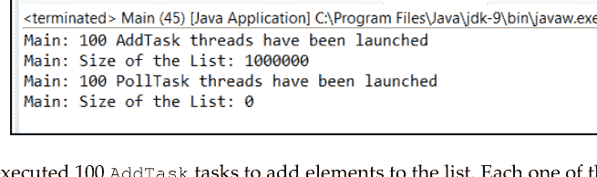

首先，你执行了 100 个 AddTask 任务来向列表添加元素。其中每个任务都使用 add() 方法向列表插入 10,000 个元素。此方法在双端队列末尾添加新元素。当所有任务完成后，你在控制台中写入双端队列的元素数量。此时，双端队列有 1,000,000 个元素。


然后，你执行了 100 个 PollTask 任务来从 deque 中移除元素。这些任务中的每一个都使用 pollFirst() 和 pollLast() 方法从 deque 中移除 10,000 个元素。pollFirst() 方法返回并移除 deque 的第一个元素，而 pollLast() 方法返回并移除 deque 的最后一个元素。如果 deque 为空，它们返回 null 值。当所有任务都完成后，你在控制台中写入了 deque 的元素数量。此时，列表有零个元素。请注意，ConcurrentLinkedDeque 数据结构不允许你添加 null 值。

要写入 deque 中的元素数量，你使用了 size() 方法。你必须注意，如果在有线程向列表添加或删除数据的同时使用它，此方法可能会返回一个不真实的值。该方法必须遍历整个 deque 来计数元素，而列表的内容可能在此操作中发生变化。只有在没有线程修改 deque 时使用它们，你才能保证返回的结果是正确的。

## 还有更多...

ConcurrentLinkedDeque 类提供了更多从 deque 获取元素的方法：

- getFirst() 和 getLast()：这些方法分别返回 deque 的第一个和最后一个元素。它们不会从 deque 中移除返回的元素。如果 deque 为空，它们会抛出 NoSuchElementException 异常。
- peek()、peekFirst() 和 peekLast()：这些方法分别返回 deque 的第一个和最后一个元素。它们不会从 deque 中移除返回的元素。如果 deque 为空，它们返回 null 值。
- remove()、removeFirst() 和 removeLast()：这些方法分别返回 deque 的第一个和最后一个元素。它们也会移除返回的元素。如果 deque 为空，它们会抛出 NoSuchElementException 异常。

## 使用阻塞线程安全 deque

最基本的集合被称为列表。列表有无限数量的元素，你可以从任何位置添加、读取或移除元素。并发列表允许各种线程在同一时间向列表添加或移除元素而不会产生任何数据不一致。类似于列表，我们有 deque。deque 是一种类似于队列的数据结构，但在 deque 中，你可以从前面（头部）或后面（尾部）添加或移除元素。

在本教程中，你将学习如何在并发程序中使用阻塞 deque。阻塞 deque 与非阻塞 deque 的主要区别在于，阻塞 deque 具有插入和删除元素的方法，如果由于列表已满或为空而无法立即执行，则会阻塞发出调用的线程，直到操作可以执行为止。Java 包含实现了阻塞 deque 的 LinkedBlockingDeque 类。

你将使用以下两个任务实现一个示例：

- 一个向 deque 添加数千个元素
- 一个从同一列表大量移除数据

## 准备工作

本教程的示例是使用 Eclipse IDE 实现的。如果你使用 Eclipse 或其他 IDE，例如 NetBeans，请打开它并创建一个新的 Java 项目。

## 如何操作...

按照接下来描述的步骤实现示例：

- 1. 创建一个名为 Client 的类并指定它实现 Runnable 接口：

```
public class Client implements Runnable{
```

- 2. 声明一个私有 LinkedBlockingDeque 属性，以 String 类参数化，命名为 requestList：

```
private final LinkedBlockingDeque<String> requestList;
```

- 3. 实现类的构造函数以初始化其属性：

```
public Client (LinkedBlockingDeque<String> requestList) {
    this.requestList=requestList;
}
```

- 4. 实现 run() 方法。每秒使用 requestList 对象的 put() 方法向 deque 插入五个 String 对象。重复此循环三次：

```
@Override
public void run() {
    for (int i=0; i<3; i++) {
        for (int j=0; j<5; j++) {
            StringBuilder request=new StringBuilder();
            request.append(i);
            request.append(":");
            request.append(j);
            try {
                requestList.put(request.toString());
            } catch (InterruptedException e) {
                e.printStackTrace();
            }
            System.out.printf("Client added: %s at %s.\n",request,
                new Date());
        }
        try {
            TimeUnit.SECONDS.sleep(2);
        } catch (InterruptedException e) {
            e.printStackTrace();
        }
    }
    System.out.printf("Client: End.\n");
}
```

- 5. 通过创建名为 Main 的类并向其添加 main() 方法来创建示例的主类：

```
public class Main {
    public static void main(String[] args) throws Exception {
```

- 6. 声明并创建以 String 类参数化的 LinkedBlockingDeque，命名为 list，指定固定大小为三：

```
LinkedBlockingDeque<String> list=new LinkedBlockingDeque<>(3);
```

- 7. 创建并启动 Thread 对象以执行客户端任务：

```
Client client=new Client(list);
Thread thread=new Thread(client);
thread.start();
```

- 8. 每 300 毫秒使用 list 对象的 take() 方法从列表中获取三个 String 对象。重复此循环五次。将字符串写入控制台：

```
for (int i=0; i<5 ; i++) {
    for (int j=0; j<3; j++) {
        String request=list.take();
        System.out.printf("Main: Removed: %s at %s. Size: %d\n",
                        request,new Date(), list.size());
    }
    TimeUnit.MILLISECONDS.sleep(300);
}
```

- 9. 写入一条消息以指示程序结束：

```
System.out.printf("Main: End of the program.\n");
```

## 它是如何工作的...

在本教程中，你使用了以 String 类参数化的 LinkedBlockingDeque 来处理非阻塞并发数据 deque。

Client 类使用 put() 方法将字符串插入 deque。如果 deque 已满（因为你已使用固定容量创建它），该方法将阻塞其线程的执行，直到列表中有空闲空间为止。

Main 类使用 take() 方法从 deque 获取字符串。如果 deque 为空，该方法将阻塞其线程的执行，直到 deque 中有元素为止。

本示例中使用的 LinkedBlockingDeque 类的两个方法，如果在被阻塞时被中断，则会抛出 InterruptedException 异常。因此，你必须包含必要的代码来捕获此异常。

## 还有更多...

`LinkedBlockingDeque` 类还提供了插入和获取 deque 中元素的 方法，这些方法不是被阻塞，而是抛出异常或返回 `null` 值。这些方法如下：

- `takeFirst()` 和 `takeLast()`：这些分别返回 deque 的第一个和最后一个元素。它们从 deque 中移除返回的元素。如果 deque 为空，它们会阻塞线程直到 deque 中有元素。
- `getFirst()` 和 `getLast()`：这些分别返回 deque 的第一个和最后一个元素。它们不会从 deque 中移除返回的元素。如果 deque 为空，它们会抛出 `NoSuchElementException` 异常。
- `peek(), peekFirst(), and peekLast()`：`peekFirst()` 和 `peekLast()` 方法分别返回 deque 的第一个和最后一个元素。它们不会从 deque 中移除返回的元素。如果 deque 为空，它们返回一个 `null` 值。
- `poll(), pollFirst(), and pollLast()`：`pollFirst()` 和 `pollLast()` 方法分别返回 deque 的第一个和最后一个元素。它们从 deque 中移除返回的元素。如果列表为空，它们返回一个 `null` 值。
- `add(), addFirst(), and addLast()`：`addFirst()` 和 `addLast()` 方法分别将元素添加到第一个和最后一个位置。如果 deque 已满（使用固定容量创建），它们会抛出 `IllegalStateException` 异常。

## 另请参阅

- 本章中的 *Using non-blocking thread-safe deque* 教程

## 使用按优先级排序的阻塞线程安全队列

当你处理数据结构时，你可能会通常感到需要一个有序队列。Java 提供了 `PriorityBlockingQueue`，它具有此功能。


所有要添加到 PriorityBlockingQueue 的元素都必须实现 Comparable 接口；或者，你也可以在队列的构造函数中包含 Comparator。该接口有一个名为 compareTo() 的方法，它接收同一类型的对象。因此你有两个对象需要比较：正在执行该方法的对象和作为参数接收的对象。该方法必须在本地对象小于参数时返回小于零的数字。如果本地对象大于参数，则应返回大于零的数字。如果两个对象相等，则数字必须为零。

PriorityBlockingQueue 在你向其中插入元素时使用 compareTo() 方法来确定插入元素的顺序。较大的元素将根据 compareTo() 方法成为队列的尾部或头部。

PriorityBlockingQueue 的另一个重要特性是它是一个阻塞数据结构。它具有这样的方法：如果无法立即执行操作，则会阻塞线程，直到能够执行为止。

在本教程中，你将通过实现一个示例来学习如何使用 PriorityBlockingQueue 类，在该示例中，你将把具有不同优先级的许多事件存储在同一个列表中，以检查队列是否按你期望的顺序排列。

## 准备工作

本教程的示例使用 Eclipse IDE 实现。如果你使用 Eclipse 或其他 IDE，例如 NetBeans，请打开它并创建一个新的 Java 项目。

## 如何操作...

按照以下步骤实现示例：

- 1. 创建一个名为 Event 的类，并指定它实现参数化为 Event 类的 Comparable 接口：
  
  ```
  public class Event implements Comparable<Event> {
  ```
- 2. 声明一个名为 thread 的私有 int 属性，用于存储创建该事件的线程数：
  
  ```
  private final int thread;
  ```
- 3. 声明一个名为 priority 的私有 int 属性，用于存储事件的优先级：

```
private final int priority;
```

- 4. 实现类的构造函数以初始化其属性：

```
public Event(int thread, int priority){
    this.thread=thread;
    this.priority=priority;
}
```

- 5. 实现 getThread() 方法以返回 thread 属性的值：

```
public int getThread() {
    return thread;
}
```

- 6. 实现 getPriority() 方法以返回 priority 属性的值：

```
public int getPriority() {
    return priority;
}
```

- 7. 实现 compareTo() 方法。它接收 Event 作为参数并比较当前事件的优先级和作为参数接收的事件的优先级。如果当前事件的优先级更大则返回 -1，如果两个优先级相等则返回 0，如果当前事件的优先级更小则返回 1。请注意，这与大多数 Comparator.compareTo() 实现相反：

```
@Override
public int compareTo(Event e) {
    if (this.priority>e.getPriority()) {
        return -1;
    } else if (this.priority<e.getPriority()) {
        return 1;
    } else {
        return 0;
    }
}
```

- 8. 创建一个名为 Task 的类，并指定它实现 Runnable 接口：

```
public class Task implements Runnable {
```

- 9. 声明一个名为 id 的私有 int 属性，用于存储标识任务的编号：

```
private final int id;
```

- 10. 声明一个参数化为 Event 类的私有 PriorityBlockingQueue 属性 named queue，用于存储任务生成的事件：

```
private final PriorityBlockingQueue<Event> queue;
```

- 11. 实现类的构造函数以初始化其属性：

```
public Task(int id, PriorityBlockingQueue<Event> queue) {
    this.id=id;
    this.queue=queue;
}
```

- 12. 实现 run() 方法。它将 1,000 个事件存储到队列中，使用其 ID 来标识创建事件的任务，并为每个事件分配 1 到 1000 之间的不同优先级。使用 add() 方法将事件存储到队列中：

```
@Override
public void run() {
    for (int i=0; i<1000; i++) {
        Event event=new Event(id,i);
        queue.add(event);
    }
}
```

- 13. 通过创建名为 Main 的类并向其中添加 main() 方法来实现示例的主类：

```
public class Main{
    public static void main(String[] args) {
```

- 14. 创建一个参数化为 Event 类的 PriorityBlockingQueue 对象 named queue：

```
PriorityBlockingQueue<Event> queue=new PriorityBlockingQueue<>();
```

- 15. 创建一个包含五个 Thread 对象的数组，用于存储将执行五个任务的线程：

```
Thread taskThreads[]=new Thread[5];
```

- 16. 创建五个 Task 对象。将线程存储在之前创建的数组中：

```
for (int i=0; i<taskThreads.length; i++) {
    Task task=new Task(i,queue);
    taskThreads[i]=new Thread(task);
}
```

- 17. 启动之前创建的五个线程：

```
for (int i=0; i<taskThreads.length ; i++) {
    taskThreads[i].start();
}
```

- 18. 使用 join() 方法等待五个线程的结束：

```
for (int i=0; i<taskThreads.length ; i++) {
    try {
        taskThreads[i].join();
    } catch (InterruptedException e) {
        e.printStackTrace();
    }
}
```

- 19. 在控制台中写入队列的实际大小以及其中存储的事件。使用 poll() 方法从队列中取出事件：

```
System.out.printf("Main: Queue Size: %d\n",queue.size());
for (int i=0; i<taskThreads.length*1000; i++){
    Event event=queue.poll();
    System.out.printf("Thread %s: Priority %d\n", event.getThread(),event.getPriority());
}
```

- 20. 在控制台中写入队列的最终大小的消息：

```
System.out.printf("Main: Queue Size: %d\n",queue.size());
System.out.printf("Main: End of the program\n");
```

## 工作原理...

在本示例中，你使用 PriorityBlockingQueue 实现了一个 Event 对象的优先级队列。如介绍中所述，存储在 PriorityBlockingQueue 中的所有元素都必须实现 Comparable 接口或向队列的构造函数提供 Comparator 对象。在本例中，你使用了第一种方法，因此在 Event 类中实现了 compareTo() 方法。

所有事件都有一个 priority 属性。具有较高 priority 值 的元素将成为队列中的第一个元素。当你实现 compareTo() 方法时，如果执行该方法的事件的优先级高于作为参数传递的事件的优先级，则返回 −1 作为结果。在另一种情况下，如果执行该方法的事件的优先级低于作为参数传递的事件的优先级，则返回 1 作为结果。如果两个对象具有相同的优先级，则 compareTo() 方法返回 0。在这种情况下，PriorityBlockingQueue 类不保证元素的顺序。

我们实现了 Task 类以将 Event 对象添加到优先级队列中。每个任务对象使用 add() 方法向队列添加 1,000 个事件，优先级在 0 到 999 之间。

Main 类的 main() 方法创建五个 Task 对象并在相应的线程中执行它们。当所有线程完成执行后，你将所有元素写入控制台。为了从队列中获取元素，我们使用了 poll() 方法。该方法返回并移除队列中的第一个元素。

以下屏幕截图显示了程序执行输出的一部分：

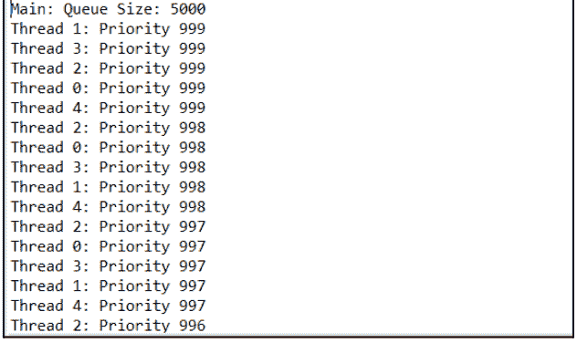

你可以看到队列的大小为 5,000 个元素，并且第一个元素具有最大的优先级值。

## 还有更多...

`PriorityBlockingQueue` 类还有其他有趣的方法。以下是其中一些方法的描述：

- `clear()`: 此方法移除队列中的所有元素。
- `take()`: 此方法返回并移除队列中的第一个元素。如果队列为空，则会阻塞其线程，直到队列中有元素为止。
- `put(E e)`: 这是用于参数化 `PriorityBlockingQueue` 类的类。它将作为参数传递的元素插入队列中。
- `peek()`: 此方法返回队列中的第一个元素但不移除它。

## 另请参阅

- 本章中的 *使用阻塞线程安全双端队列* 教程

## 使用具有延迟元素的线程安全列表

Java API 提供的在并发应用程序中可用的一个有趣的数据结构是在 `DelayQueue` 类中实现的。在此类中，你可以存储具有激活日期的元素。返回或从队列中提取元素的方法将忽略这些数据将在未来出现 的元素。它们对这些方法不可见。为了获得这种行为，你想要存储在 `DelayQueue` 类中的元素需要实现 `Delayed` 接口。此接口允许你使用延迟对象。此接口具有 `getDelay()` 方法，该方法返回元素激活前的剩余时间。此接口强制你实现以下两个方法：

- `compareTo(Delayed o)`: `Delayed` 接口扩展了 `Comparable` 接口。如果执行该方法的对象 的延迟小于作为参数传递的对象，则该方法将返回小于零的值。如果执行该方法的对象 的延迟大于作为参数传递的对象，则返回大于零的值。如果两个对象具有相同的延迟，则返回零。


`getDelay(TimeUnit unit)`: 此方法必须返回到激活日期为止剩余的时间（以单位计），单位由 unit 参数指定。`TimeUnit` 类是一个枚举，包含以下常量：`DAYS, HOURS, MICROSECONDS, MILLISECONDS, MINUTES, NANOSECONDS, and SECONDS.`

在本示例中，你将学习如何通过在其中存储具有不同激活日期的事件来使用 `DelayedQueue` 类。

## Getting ready

本食谱的示例使用 Eclipse IDE 实现。如果您使用 Eclipse 或其他 IDE，例如 NetBeans，请打开它并创建一个新的 Java 项目。

## How to do it...

按照以下步骤实现示例：

- 1. 创建一个名为 `Event` 的类并指定其实现 `Delayed` 接口：
  
  ```
  public class Event implements Delayed {
  ```
- 2. 声明一个名为 `startDate` 的私有 `Date` 属性：
  
  ```
  private final Date startDate;
  ```
- 3. 实现类的构造函数以初始化其属性：
  
  ```
  public Event (Date startDate) {
      this.startDate=startDate;
  }
  ```
- 4. 实现 `compareTo()` 方法。它接收一个 `Delayed` 对象作为参数。返回当前对象的延迟与作为参数传递的对象的延迟之间的差值：
  
  ```
  @Override
  public int compareTo(Delayed o) {
      long result=this.getDelay(TimeUnit.NANOSECONDS)-o.getDelay(TimeUnit.NANOSECONDS);
      if (result<0) {
          return -1;
  } else if (result>0) {
      return 1;
  }
  return 0;
  }
  ```
- 5. 实现 getDelay() 方法。返回对象的开始日期与实际日期之间的差值，单位为作为参数接收的 TimeUnit：

  ```
  public long getDelay(TimeUnit unit) {
      Date now=new Date();
      long diff=startDate.getTime()-now.getTime();
      return unit.convert(diff,TimeUnit.MILLISECONDS);
  }
  ```
- 6. 创建一个名为 Task 的类并指定其实现 Runnable 接口：

  ```
  public class Task implements Runnable {
  ```
- 7. 声明一个名为 id 的私有 int 属性，用于存储标识此任务的数字：

  ```
  private final int id;
  ```
- 8. 声明一个以 Event 类为参数化的私有 DelayQueue 属性 named queue：

  ```
  private final DelayQueue<Event> queue;
  ```
- 9. 实现类的构造函数以初始化其属性：

  ```
  public Task(int id, DelayQueue<Event> queue) {
      this.id=id;
      this.queue=queue;
  }
  ```
- 10. 实现 run() 方法。首先，计算此任务将要创建的事件的激活日期。然后，将等于对象 ID 的秒数添加到实际日期：

  ```
  @Override
  public void run() {
      Date now=new Date();
      Date delay=new Date();
      delay.setTime(now.getTime()+(id*1000));
      System.out.printf("Thread %s: %s\n",id,delay);
  ```
- 11. 使用 add() 方法在队列中存储 100 个事件：

  ```
  for (int i=0; i<100; i++) {
      Event event=new Event(delay);
      queue.add(event);
  }
  ```
- 12. 通过创建名为 Main 的类并向其添加 main() 方法来实现示例的主类：

  ```
  public class Main {
      public static void main(String[] args) throws Exception {
  ```
- 13. 创建一个以 Event 类为参数化的 DelayQueue 对象：

  ```
  DelayQueue<Event> queue=new DelayQueue<>();
  ```
- 14. 创建一个包含五个 Thread 对象的数组来存储您将要执行的任务：

  ```
  Thread threads[]=new Thread[5];
  ```
- 15. 创建五个具有不同 ID 的 Task 对象：

  ```
  for (int i=0; i<threads.length; i++){
      Task task=new Task(i+1, queue);
      threads[i]=new Thread(task);
  }
  ```
- 16. 启动之前创建的全部五个任务：

  ```
  for (int i=0; i<threads.length; i++) {
      threads[i].start();
  }
  ```
- 17. 使用 join() 方法等待线程的结束：

  ```
  for (int i=0; i<threads.length; i++) {
      threads[i].join();
  }
  ```
- 18. 将队列中存储的事件写入控制台。当队列的大小大于零时，使用 poll() 方法获取一个 Event 类。如果它返回 null，则让主线程休眠 500 毫秒以激活更多事件：

  ```
  do {
      int counter=0;
      Event event;
      do {
          event=queue.poll();
          if (event!=null) counter++;
      } while (event!=null);
      System.out.printf("At %s you have read %d events\n", new Date(), counter);
      TimeUnit.MILLISECONDS.sleep(500);
  } while (queue.size()>0);
  }
  ```

## How it works...

在本食谱中，我们实现了 Event 类。此类具有一个唯一的属性，即事件的激活日期，并且它实现了 Delayed 接口。您可以将 Event 对象存储在 DelayQueue 类中。

getDelay() 方法返回激活日期与实际日期之间的纳秒数。两个日期都是 Date 类的对象。您使用了返回日期转换为毫秒的 getTime() 方法。然后，您将此值转换为作为参数接收的 TimeUnit。DelayQueue 类以纳秒为单位工作，但此时对您来说是透明的。

compareTo() 方法如果执行该方法的对象的延迟小于作为参数传递的对象的延迟，则返回小于零的值。如果执行该方法的对象的延迟大于作为参数传递的对象的延迟，则返回大于零的值。如果两个延迟相等，则返回 0。

## There's more...

`DelayQueue` 类还有其他有趣的方法，如下所示：

- `clear()`: 此方法删除队列中的所有元素。
- `offer(E e)`: 这里，E 表示用于参数化 `DelayQueue` 类的类。此方法将作为参数传递的元素插入队列中。
- `peek()`: 此方法检索但不删除队列的第一个元素。
- `take()`: 此方法检索并删除队列的第一个元素。如果没有活动的元素，执行该方法的线程将被阻塞，直到线程获得一些活动元素。

## See also

- 本章中 *Using blocking thread-safe deques* 食谱

## Using thread-safe navigable maps

`ConcurrentNavigableMap` 是一个接口，定义了 Java API 提供的有趣的数据结构，您可以在并发程序中使用。实现 `ConcurrentNavigableMap` 接口的类将元素存储在两个部分中：

- 一个 **key** 唯一标识一个元素
- 定义元素的其余数据，称为 **value**

Java API 还提供了一个实现 `ConcurrentSkipListMap` 的类，它是实现具有 `ConcurrentNavigableMap` 接口行为的非阻塞列表的接口。内部，它使用 **Skip List** 来存储数据。Skip List 是一种基于并行列表的数据结构，允许我们获得与二叉树相关的效率。您可以在 https://en.wikipedia.org/wiki/Skip_list 获取有关 Skip Lists 的更多信息。通过它，您可以获得一个排序的数据结构，而不是排序列表，具有更好的插入、搜索或删除元素的访问时间。


Skip List 由 William Pugh 于 1990 年引入。

当您将元素插入到映射中时，映射使用键对它们进行排序；因此，所有元素都将被排序。键必须实现 `Comparable` 接口，或者您必须向映射的构造函数提供一个 `Comparator` 类。该类还提供方法来获取映射的子映射，以及返回具体元素的方法。

在本食谱中，您将学习如何使用 `ConcurrentSkipListMap` 类来实现联系人映射。

## Getting ready

本食谱的示例使用 Eclipse IDE 实现。如果您使用 Eclipse 或其他 IDE，例如 NetBeans，请打开它并创建一个新的 Java 项目。

## How to do it...

按照以下步骤实现示例：

- 1. 创建一个名为 `Contact` 的类：
  ```
  public class Contact {
  ```
- 2. 声明两个私有 `String` 属性，名为 `name` 和 `phone`：
  ```
  private final String name;
  private final String phone;
  ```
- 3. 实现类的构造函数以初始化其属性：
  ```
  public Contact(String name, String phone) {
      this.name=name;
      this.phone=phone;
  }
  ```
- 4. 实现方法以返回 `name` 和 `phone` 属性的值：
  ```
  public String getName() {
      return name;
  }
  
  public String getPhone() {
      return phone;
  }
  ```


5. 创建一个名为 Task 的类并指定它实现 Runnable 接口：

```
public class Task implements Runnable {
```

6. 声明一个私有 ConcurrentSkipListMap 属性，按 String 和 Contact 类参数化，命名为 map：

```
private final ConcurrentSkipListMap<String, Contact> map;
```

7. 声明一个私有 String 属性命名为 id，用于存储当前任务的 ID：

```
private final String id;
```

8. 实现类的构造函数以存储其属性：

```
public Task (ConcurrentSkipListMap<String, Contact> map,String id){
    this.id=id;
    this.map=map;
}
```

9. 实现 run() 方法。它使用任务的 ID 和递增数字在 map 中存储 1,000 个不同的联系人以创建 Contact 对象。使用 put() 方法将联系人存储在 map 中：

```
@Override
public void run() {
    for (int i=0; i<1000; i++) {
        Contact contact=new Contact(id, String.valueOf(i+1000));
        map.put(id+contact.getPhone(), contact);
    }
}
```

10. 通过创建一个名为 Main 的类并向其添加 main() 方法来实现示例的主类：

```
public class Main {
    public static void main(String[] args) {
```

11. 创建一个按 String 和 Contact 类参数化的 ConcurrentSkipListMap 对象，命名为 map：

```
ConcurrentSkipListMap<String, Contact> map = new
    ConcurrentSkipListMap<>();
```

12. 为 26 个 Thread 对象创建一个数组以存储你要执行的全部 Task 对象：

```
Thread threads[]=new Thread[26];
int counter=0;
```

13. 创建并启动 26 个任务对象，并为每个任务的 ID 分配一个大写字母：

```
for (char i='A'; i<='Z'; i++) {
    Task task=new Task(map, String.valueOf(i));
    threads[counter]=new Thread(task);
    threads[counter].start();
    counter++;
}
```

14. 使用 join() 方法等待线程的结束：

```
for (Thread thread : threads){
    try {
        thread.join();
    } catch (InterruptedException e) {
        e.printStackTrace();
    }
}
```

15. 使用 firstEntry() 方法获取 map 的第一个条目。将其数据写入控制台：

```
System.out.printf("Main: Size of the map: %d\n",map.size());

Map.Entry<String, Contact> element;
Contact contact;

element=map.firstEntry();
contact=element.getValue();
System.out.printf("Main: First Entry: %s: %s\n", contact.getName(), contact.getPhone());
```

16. 使用 lastEntry() 方法获取 map 的最后一个条目。将其数据写入控制台：

```
element=map.lastEntry();
contact=element.getValue();
System.out.printf("Main: Last Entry: %s: %s\n", contact.getName(), contact.getPhone());
```

以下屏幕截图显示了程序执行输出：

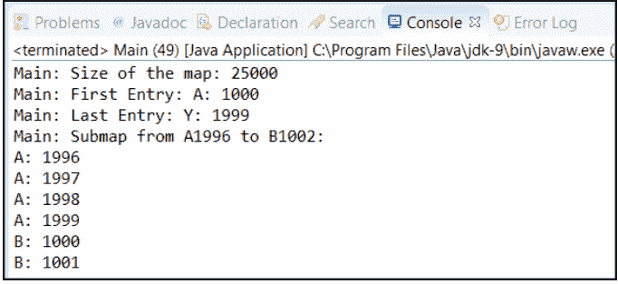

## 还有更多...

ConcurrentSkipListMap 类还有其他有趣的方法。其中一些如下：

- headMap(K toKey)：这里，K 是 ConcurrentSkipListMap 对象参数化中使用的键值的类。此方法返回 map 的第一个元素的子映射，其中元素的键小于作为参数传递的键。
- tailMap(K fromKey)：这里，K 是 ConcurrentSkipListMap 对象参数化中使用的键值的类。此方法返回 map 的最后一个元素的子映射，其中元素的键大于作为参数传递的键。
- putIfAbsent(K key, V Value)：如果 map 中不存在指定的参数键，则此方法插入作为参数指定的值和作为参数指定的键。
- pollLastEntry()：此方法返回并移除 map 的最后一个元素的 Map.Entry 对象。
- replace(K key, V Value)：如果此键存在于 map 中，则此方法替换与作为参数指定的键关联的值。

## 另请参阅

- 本章中 *使用非阻塞线程安全双端队列* 的配方

## 使用线程安全的 HashMaps

哈希表是一种允许你将键映射到值的数据结构。内部通常使用数组存储元素并使用哈希函数根据其键计算元素在数组中的位置。这种数据结构的主要优点是插入、删除和搜索操作在这里非常快，因此在需要执行大量搜索操作的情况下非常有用。

Java API 通过 `Map` 和 `ConcurrentMap` 接口提供了不同的哈希表实现。`ConcurrentMap` 接口为所有操作提供线程安全和原子保证，因此你可以在并发应用程序中使用它们。`ConcurrentHashMap` 类实现了 `ConcurrentMap` 接口并在接口中定义的方法之外添加了一些方法。此类支持以下功能：

- 读取操作的完全并发
- 插入和删除操作的高预期并发

这两个元素（类和接口）是在 Java 5 版本中引入的，但在版本 8 中，开发了许多与流 API 提供的类似的新方法。

在本配方中，你将学习如何在应用程序中使用 `ConcurrentHashMap` 类以及它提供的最重要的方法。

## 准备工作

本配方的示例已使用 Eclipse IDE 实现。如果你使用 Eclipse 或其他 IDE，例如 NetBeans，打开它并创建一个新的 Java 项目。

## 如何操作...

按照以下步骤实现示例：

- 1. 创建一个名为 `Operation` 的类，包含三个属性：一个名为 `user` 的 `String` 属性、一个名为 `operation` 的 `String` 属性和一个名为 `time` 的 `Date` 属性。添加获取和设置属性值的方法。此类的代码非常简单，因此此处不包含。
- 2. 创建一个名为 `HashFiller` 的类。指定它实现 `Runnable` 接口：
- 3. 声明一个私有 `ConcurrentHashMap` 属性命名为 `userHash`。哈希的键将是 `String` 类型，其值将是 `Operation` 对象的 `ConcurrentLinkedDeque` 对象。实现类的构造函数以初始化该属性：
- 4. 实现 `run()` 方法。我们将用 100 个随机的 `Operation` 对象填充 `ConcurrentHashMap`。首先生成随机数据，然后使用 `addOperationToHash()` 方法将对象插入哈希中：

```
public class HashFiller implements Runnable {
```

```
private ConcurrentHashMap<String, ConcurrentLinkedDeque<Operation>>
    userHash;

public HashFiller(ConcurrentHashMap<String, ConcurrentLinkedDeque
    <Operation>> userHash) {
    this.userHash = userHash;
}
```

```
@Override
public void run() {

    Random randomGenerator = new Random();
    for (int i = 0; i < 100; i++) {
        Operation operation = new Operation();
        String user = "USER" + randomGenerator.nextInt(100);
        operation.setUser(user);
        String action = "OP" + randomGenerator.nextInt(10);
        operation.setOperation(action);
        operation.setTime(new Date());

        addOperationToHash(userHash, operation);
    }
}
```

5. 实现 `addOperationToHash()` 方法。它接收哈希和你想要添加的操作作为参数。map 中的键将是分配给操作的用户。我们使用 `computeIfAbsent()` 方法获取与键关联的 `ConcurrentLinkedDeque` 对象。如果键存在，此方法返回与其关联的值。如果不存在，它会执行作为参数传递给此方法的 lambda 表达式以生成值并将其与键关联。在这种情况下，我们生成一个新的 `ConcurrentLinkedDeque` 对象。最后，将操作插入到 deque 中：

```
```java
private void addOperationToHash(ConcurrentHashMap<String,
                                  ConcurrentLinkedDeque<Operation>>
                                  userHash, Operation operation) {

    ConcurrentLinkedDeque<Operation> opList = userHash
        .computeIfAbsent(operation.getUser(),
            user -> new ConcurrentLinkedDeque<>());

    opList.add(operation);
}
```
```

6. 现在实现 `Main` 类并包含 `main()` 方法。首先，声明一个 `ConcurrentHashMap` 对象和一个 `HashFiller` 任务：

```
```java
ConcurrentHashMap<String, ConcurrentLinkedDeque<Operation>>
    userHash = new ConcurrentHashMap<>();
HashFiller hashFiller = new HashFiller(userHash);
```
```

7. 使用 `HashFiller` 类执行 10 个线程并使用 `join()` 方法等待其结束：

```
```java
Thread[] threads = new Thread[10];
for (int i = 0; i < 10; i++) {
    threads[i] = new Thread(hashFiller);
    threads[i].start();
}

for (int i = 0; i < 10; i++) {
    try {
        threads[i].join();
    } catch (InterruptedException e) {
        e.printStackTrace();
    }
}
```


8. 现在，提取 ConcurrentHashMap 的信息。首先，使用 size() 方法提取其中存储的元素数量。然后，使用 forEach() 方法对哈希中存储的所有元素应用一个操作。第一个参数是并行度阈值。这是使操作以并发方式执行所需的最小元素数量。我们指定了值 10，而哈希中有 100 个元素，因此操作将以并行方式执行。lambda 表达式接收两个参数：key 和 value。打印作为值存储的 ConcurrentLinkedDeque 的 key 和 size：

```
System.out.printf("Size: %d\n", userHash.size());

userHash.forEach(10, (user, list) -> {
    System.out.printf("%s: %s: %d\n", Thread.currentThread()
        .getName(), user, list.size());
});
```

9. 然后，使用 forEachEntry() 方法。这与前一个方法类似，但 lambda 表达式接收一个 Entry 对象作为参数，而不是接收两个参数。你可以使用此 entry 对象来获取 key 和 value：

```
userHash.forEachEntry(10, entry -> {
    System.out.printf("%s: %s: %d\n", Thread.currentThread()
        .getName(), entry.getKey(),
    entry.getValue().size());
});
```

10. 然后，使用 search() 方法查找满足指定搜索函数的第一个元素。在我们的例子中，我们搜索操作代码以 1 结尾的操作。如 forEach() 方法一样，我们指定了一个并行度阈值：

```
Operation op = userHash.search(10, (user, list) -> {
    for (Operation operation : list) {
        if (operation.getOperation().endsWith("1")) {
            return operation;
        }
    }
    return null;
});

System.out.printf("The operation we have found is: %s, %s, %s,\n",
            op.getUser(), op.getOperation(), op.getTime());
```

11. 再次使用 `search()` 方法，但这次用它来查找操作数超过 10 的用户：

```
ConcurrentLinkedDeque<Operation> operations = userHash.search(10,
    (user, list) -> {
        if (list.size() > 10) {
            return list;
        }
        return null;
    });

System.out.printf("The user we have found is: %s: %d operations\n",
    operations.getFirst().getUser(),
    operations.size());
```

12. 最后，使用 `reduce()` 方法计算哈希中存储的操作总数：

```
int totalSize = userHash.reduce(10, (user, list) -> {
    return list.size();
}, (n1, n2) -> {
    return n1 + n2;
});

System.out.printf("The total size is: %d\n", totalSize);
```

## How it works...

在本示例中，我们实现了一个使用 `ConcurrentHashMap` 存储用户操作信息的应用程序。内部，哈希表使用 `Operation` 类的 user 属性作为 key，并使用 `ConcurrentLinkedDeque`（一个非阻塞并发列表）作为其 value 来存储与该用户关联的所有操作。

首先，我们使用 10 个不同的线程用一些随机数据填充哈希。为此我们实现了 `HashFiller` 任务。这些任务最大的问题是当你需要在哈希表中插入一个 key 时会发生什么。如果两个线程同时想添加同一个 key，你可能会丢失其中一个线程插入的数据并产生数据竞争条件。为了解决这个问题，我们使用了 `computeIfAbsent()` 方法。

此方法接收一个 key 和一个可以表示为 lambda 表达式的 Function 接口实现；key 和实现作为参数接收。如果 key 存在，该方法返回与 key 关联的值。如果不存在，该方法执行指定的 Function 对象并将 Function 返回的 key 和 value 添加到 HashMap。在我们的例子中，key 不存在，所以我们创建了一个新的 ConcurrentLinkedDeque 类的实例。此方法的最大优点是它以原子方式执行；因此，如果另一个线程尝试执行相同的操作，它将被阻塞直到此操作完成。

然后，在 main() 方法中，我们使用了 ConcurrentHashMap 的其他方法来处理哈希中存储的信息。我们使用了以下方法：

- forEach(): 此方法接收一个可以表示为 lambda 表达式的 BiConsumer 接口实现；它作为参数接收。该表达式的另外两个参数代表我们正在处理的元素的 key 和 value。此方法将表达式应用于 ConcurrentHashMap 中存储的所有元素。
- forEachEntry(): 此方法等同于前一个方法，但这里表达式是 Consumer 接口的实现。它接收一个 Entry 对象作为参数，该对象存储我们正在处理的条目的 key 和 value。这是用另一种方式表达相同功能的方法。
- search(): 此方法接收可以表示为 lambda 表达式的 BiFunction 接口实现；它作为参数接收。此函数还接收我们正在处理的 ConcurrentHashMap 对象条目的 key 和 value 作为参数。它返回 BiFunction 返回的第一个非 null 值。
- reduce(): 此方法接收两个 BiFunction 接口以将 ConcurrentHashMap 的元素归约为一个唯一值。这允许你使用 ConcurrentHashMap 的元素实现 MapReduce 操作。第一个 BiFunction 接口允许你将元素的 key 和 value 转换为唯一值，第二个 BiFunction 接口允许你聚合两个不同元素的数值。

到目前为止描述的所有方法都有一个名为 parallelismThreshold 的第一个参数。此参数被描述为 ...（估计）使此操作以并行方式执行所需的元素数量...，也就是说，如果 ConcurrentHashMap 的元素少于参数中指定的值，则方法以顺序方式执行。相反（就像我们的例子一样），方法以并行方式执行。

## There's more...

ConcurrentHashMap 具有比上一节中指定的更多方法。我们在以下列表中列举了一些方法：

- forEachKey() 和 forEachValue(): 这些方法类似于 forEach() 方法，但在这种情况下，表达式分别处理 ConcurrentHashMap 中存储的 key 和 value。
- searchEntries()、searchKeys() 和 searchValues(): 这些方法类似于前面解释的 search() 方法。然而，在这种情况下，作为参数传递的表达式接收 ConcurrentHashMap 中存储的元素的 Entry 对象、key 或 value。
- reduceEntries()、reduceKeys() 和 reduceValues(): 这些方法类似于前面解释的 reduce() 方法。然而，在这种情况下，作为参数传递的表达式接收 ConcurrentHashMap 中存储的元素的 Entry 对象、key 或 value。
- reduceXXXToDouble()、reduceXXXToLong() 和 reduceXXXToInt(): 这些方法允许你对 ConcurrentHashMap 的元素进行归约，分别生成 double、long 或 int 值。
- computeIfPresent(): 此方法补充了 computeIfAbsent() 方法。在这种情况下，它接收一个 key 和一个可以表示为 lambda 表达式的 BiFunction 接口实现。如果 key 存在于 HashMap 中，该方法应用表达式来计算 key 的新值。BiFunction 接口接收 key 和该 key 的实际值作为参数，并返回新值。
- merge(): 此方法接收 key、value 和可以表示为 lambda 表达式的 BiFunction 接口实现；它们作为参数接收。如果 key 不存在于 ConcurrentHashMap 中，它会在其中插入它并将 value 参数与之关联。如果存在，则执行 BiFunction 以计算与 key 关联的新值。BiFunction 接口接收 key 和其实际值作为参数并返回与 key 关联的新值。
- getOrDefault(): 此方法接收 key 和默认值作为参数。如果 key 存在于 ConcurrentHashMap 中，它返回其关联的值。否则，它返回默认值。


## 另请参阅

- 本章中的 Using thread-safe navigable maps recipe
- 第 6 章 Parallel and Reactive Streams 中的 Reducing the elements of a stream recipe

## 使用原子变量

**原子变量** 在 Java 5 版本中引入，用于提供对单个变量的原子操作。当你使用普通变量时，你在 Java 中实现的每个操作都会被转换为 JVM 在编译程序时可理解的几条 Java 字节码指令。例如，当你给变量赋值时，你在 Java 中只使用一条指令；然而，当你编译此程序时，它会被转换为 JVM 语言中的各种指令。当你使用共享变量的多个线程工作时，这可能导致数据不一致错误。

为避免这些问题，Java 引入了原子变量。当一个线程正在对原子变量执行操作并且如果其他线程想要对同一变量执行操作时，该类的实现包含一种机制来检查操作是否以原子方式完成。基本上，操作获取变量的值，将值更改为局部变量，然后尝试用新值更改旧值。如果旧值仍然相同，则会被替换；如果不是，则方法会重新开始操作。此操作称为 **Compare and Set**。它以以下三个步骤实现变量值的修改：

1. 你获取变量的值，即变量的旧值。
2. 你在临时变量中更改变量的值，即变量的新值。
3. 如果旧值等于变量的实际值，则用新值替换旧值。如果另一个线程更改了变量的值，则旧值可能与实际值不同。

其中一些变量，例如 `LongAccumulator` 类，会接收一个作为参数传递的操作，该操作可以在其某些方法内部执行。这些操作必须没有任何副作用，因为它们在每次值更新时都可能被多次执行。

原子变量不使用锁或其他同步机制来保护对其值的访问。它们的所有操作都基于 Compare and Set。可以保证多个线程可以同时使用原子变量而不会产生数据不一致错误；此外，它们简化了实现。

Java 8 添加了四个新的原子类。首先我们有 `LongAdder` 和 `DoubleAdder` 类；它们存储 `long` 和 `double` 值，这些值会被不同线程频繁更新。你可以使用 `AtomicLong` 类获得与 `LongAdder` 类相同的功能，但前者提供更好的性能。其他两个类是 `LongAccumulator` 和 `DoubleAccumulator`。这些类与前一个类似，但在这里，你需要在构造函数中指定两个参数：

- 计数器的初始值。
- 一个 `LongBinaryOperator` 或 `DoubleBinaryOperator`，可以表示为 lambda 表达式。此表达式接收变量的旧值和你想要应用的增量，并返回变量的新值。

在本教程中，你将学习如何使用原子变量实现一个银行账户和两个不同的任务：一个向账户添加资金，一个从账户中减去资金。你将在示例实现中使用 `AtomicLong` 类。

## 准备工作

本教程的示例已使用 Eclipse IDE 实现。如果你使用 Eclipse 或其他 IDE，例如 NetBeans，请打开它并创建一个新的 Java 项目。

## 如何操作...

按照以下步骤实现示例：

1. 创建一个名为 `Account` 的类来模拟银行账户：

```
public class Account {
```

2. 声明一个名为 `balance` 的私有 `AtomicLong` 属性来存储账户余额。此外，声明一个名为 `operations` 的私有 `LongAdder` 属性和一个名为 `commission` 的私有 `DoubleAccumulator` 属性：

```
private final AtomicLong balance;
private final LongAdder operations;
private final DoubleAccumulator commission;
```

3. 实现类的构造函数以初始化其属性。对于 DoubleAccumulator 类，恒等值是 0，我们使用将参数传递的增量乘以 0.2 的结果来更新实际值：

```
public Account() {
    balance = new AtomicLong();
    operations = new LongAdder();
    commission = new DoubleAccumulator((x,y)-> x+y*0.2, 0);
}
```

4. 实现获取三个属性值的方法：

```
public long getBalance() {
    return balance.get();
}
public long getOperations() {
    return operations.longValue();
}
public double getCommission() {
    return commission.get();
}
```

5. 实现一个名为 setBalance() 的方法来设置 balance 属性的值。我们还必须使用 reset() 方法初始化 operations 和 commission 属性：

```
public void setBalance(long balance) {
    this.balance.set(balance);
    operations.reset();
    commission.reset();
}
```

6. 实现一个名为 addAmount() 的方法来增加 balance 属性的值。此外，使用 LongAdder 类的 increment() 方法增加 operations 属性的值，并使用 accumulate() 方法将 amount 值的 20% 添加到 commission 对象，增加一个单位：

```
public void addAmount(long amount) {
    this.balance.getAndAdd(amount);
    this.operations.increment();
    this.commission.accumulate(amount);
}
```

7. 实现一个名为 subtractAmount() 的方法来减少 balance 属性的值。与 addAmount() 方法一样，我们修改 operations 和 commission 属性的值：

```
public void subtractAmount(long amount) {
    this.balance.getAndAdd(-amount);
    this.operations.increment();
    this.commission.accumulate(amount);
}
```

8. 创建一个名为 Company 的类并指定它实现 Runnable 接口。此类将模拟公司进行的付款：

```
public class Company implements Runnable {
```

9. 声明一个名为 account 的私有 Account 属性：

```
private final Account account;
```

10. 实现类的构造函数以初始化其属性：

```
public Company(Account account) {
    this.account=account;
}
```

11. 实现任务的 run() 方法。使用 account 的 addAmount() 方法使其余额进行 10 次每次 1,000 的增加：

```
@Override
public void run() {
    for (int i=0; i<10; i++){
        account.addAmount(1000);
    }
}
```

12. 创建一个名为 Bank 的类并指定它实现 Runnable 接口。此类将模拟从账户中提取资金：

```
public class Bank implements Runnable {
```

13. 声明一个名为 account 的私有 Account 属性：

```
private final Account account;
```

14. 实现类的构造函数以初始化其属性：

```
public Bank(Account account) {
    this.account=account;
}
```

15. 实现任务的 run() 方法。使用 account 的 subtractAmount() 方法使其余额进行 10 次每次 1,000 的减少：

```
@Override
public void run() {
    for (int i=0; i<10; i++){
        account.subtractAmount(1000);
    }
}
```

16. 通过创建一个名为 Main 的类并向其添加 main() 方法来实现示例的主类：

```
public class Main {
    public static void main(String[] args) {
```

17. 创建一个 Account 对象并将其余额设置为 1000：

```
Account account=new Account();
account.setBalance(1000);
```

18. 创建一个新的 Company 任务和一个执行它的线程：

```
Company company=new Company(account);
Thread companyThread=new Thread(company);
```

19. 创建一个新的 Bank 任务和一个执行它的线程：

```
Bank bank=new Bank(account);
Thread bankThread=new Thread(bank);
```

20. 在控制台中写入账户的初始余额：

```
System.out.printf("Account : Initial Balance: %d\n", account.getBalance());
```

21. 启动线程：

```
companyThread.start();
bankThread.start();
```


22. 使用 join() 方法等待线程完成，并在控制台写入最终余额、操作次数以及账户的累计佣金：

```
try {
    companyThread.join();
    bankThread.join();
    System.out.printf("Account : Final Balance: %d\n", account.getBalance());
    System.out.printf("Account : Number of Operations: %d\n", account.getOperations().intValue());
    System.out.printf("Account : Accumulated commissions: %f\n", account.getCommission().doubleValue());
} catch (InterruptedException e) {
    e.printStackTrace();
}
```

## 它是如何工作的...

这个示例的关键在于 Account 类。在该类中，我们声明了一个名为 balance 的 AtomicLong 变量来存储账户余额，一个名为 operations 的 LongAdder 变量来存储我们对账户进行的[content]

22. 使用 join() 方法等待线程完成，并在控制台写入最终余额、操作次数以及账户的累计佣金：

```
try {
    companyThread.join();
    bankThread.join();
    System.out.printf("Account : Final Balance: %d\n", account.getBalance());
    System.out.printf("Account : Number of Operations: %d\n", account.getOperations().intValue());
    System.out.printf("Account : Accumulated commissions: %f\n", account.getCommission().doubleValue());
} catch (InterruptedException e) {
    e.printStackTrace();
}
```

## 它是如何工作的...

这个示例的关键在于 Account 类。在该类中，我们声明了一个名为 balance 的 AtomicLong 变量来存储账户余额，一个名为 operations 的 LongAdder 变量来存储我们对账户进行的次数，以及一个名为 commission 的 DoubleAccumulator 变量来存储操作的佣金值。在 commission 对象的构造函数中，我们指定值将通过表达式 0.2*y 进行递增。这样，我们希望指定将变量的实际值与 0.2 和传递给 accumulate() 方法的参数值的乘积结果相加。

为了实现返回 balance 属性值的 getBalance() 方法，我们使用了 AtomicLong 类的 get() 方法。为了实现返回操作次数的 long 值的 getOperations() 方法，我们使用了 longValue() 方法。为了实现 getCommission() 方法，我们使用了 DoubleAccumulator 类的 get() 方法。为了实现设置 balance 属性值的 setBalance() 方法，我们使用了 AtomicLong 类的 set() 方法。

为了实现向账户余额添加金额的 addAmount() 方法，我们使用了 AtomicLong 类的 getAndAdd() 方法，该方法返回该值并将其按指定参数值递增。我们还使用了 LongAdder 类的 increment() 方法，该方法将变量值递增一，以及 DoubleAccumulator 类的 accumulate() 方法，以根据指定表达式递增 commission 属性的值。请注意，addAmount() 方法整体上不是原子的，尽管它调用了三个原子操作。

最后，为了实现递减 balance 属性值的 subtractAmount() 方法，我们使用了 getAndAdd() 方法。我们还包含了对 LongAdder 和 DoubleAccumulator 类的 increment() 和 accumulate() 方法的调用。

然后，我们实现了两个不同的任务：

- Company 类模拟一家增加账户余额的公司。该类的每个任务进行 10 次每次 1,000 的递增。
- Bank 类模拟一家银行，银行账户所有者取出其资金。该类的每个任务进行 10 次每次 1,000 的递减。

在 Main 类中，你创建了一个余额为 1,000 的 Account 对象。然后，你执行了一个银行任务和一个公司任务，因此账户的最终余额与初始余额相同。

当你执行程序时，你会看到最终余额与初始余额相同。以下屏幕截图显示了此示例执行时的输出：

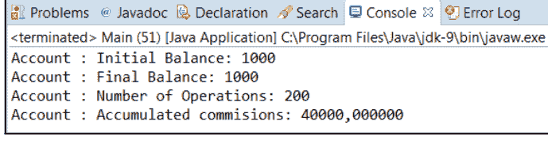

## 还有更多...

如介绍中所述，Java 中还有其他原子类。`AtomicBoolean`、`AtomicInteger` 和 `AtomicReference` 是原子类的其他示例。

`LongAdder` 类提供了其他有趣的方法如下：

- `add()`：按指定参数值递增内部计数器的值
- `decrement()`：将内部计数器递减一
- `reset()`：将内部值重置为零

你也可以使用 `DoubleAdder` 类，它与 `LongAdder` 类似，但没有 `increment()` 和 `decrement()` 方法，并且内部计数器是 `double` 值。

你也可以使用 `LongAccumulator` 类，它与 `DoubleAccumulator` 类似，但内部计数器为 `long`。

## 另请参阅

- `Chapter 2` 中 *Basic Thread Synchronization* 的 *Synchronizing a method* 配方

## 使用原子数组

假设你需要实现一个并发应用程序，该应用程序有一个或多个由多个线程共享的对象。在这种情况下，你必须使用同步机制，例如锁或 `synchronized` 关键字来保护对其属性的访问，以避免数据不一致错误。

这些机制存在以下问题：

- 死锁：这种情况发生在线程被阻塞等待锁，而该锁被其他永远不会释放它的线程锁定。这种情况会阻塞程序，因此它永远不会结束。
- 如果只有一个线程访问共享对象，它必须执行获取和释放锁所需的代码。

为了在这种情况下提供更好的性能，开发了 **compare-and-swap 操作**。该操作以以下三个步骤实现变量值的修改：

1. 你获取变量的值，即变量的旧值。
2. 你在临时变量中更改变量的值，即变量的新值。
3. 如果旧值等于变量的实际值，则用新值替换旧值。旧值可能与实际值不同，如果另一个线程已更改它。

通过这种机制，你不需要使用同步机制，因此避免了死锁并获得了更好的性能。这种机制也有其缺点。操作必须没有副作用，因为它们可能在资源竞争激烈时使用活锁重试；与标准锁相比，它们也更难监控性能。

Java 在 **原子变量** 中实现了这种机制。这些变量提供了 `compareAndSet()` 方法，即 compare-and-swap 操作的实现，以及基于它的其他方法。

Java 还引入了 **原子数组**，为 `integer` 或 `long` 数字的数组提供原子操作。在本配方中，你将学习如何使用 `AtomicIntegerArray` 类来处理原子数组。请注意，如果你使用 `AtomicInteger[]`，它不是线程安全的对象。单个 `AtomicInteger` 对象是线程安全的，但作为数据结构的数组不是。

## 准备工作

本配方的示例使用 Eclipse IDE 实现。如果你使用 Eclipse 或其他 IDE，例如 NetBeans，打开它并创建一个新的 Java 项目。

## 如何操作...

按照以下步骤实现示例：

1. 创建一个名为 `Incrementer` 的类并指定它实现 `Runnable` 接口：

```
public class Incrementer implements Runnable {
```

2. 声明一个私有 AtomicIntegerArray 属性名为 vector 来存储整数数组：

```
private final AtomicIntegerArray vector;
```

3. 实现类的构造函数以初始化其属性：

```
public Incrementer(AtomicIntegerArray vector) {
    this.vector=vector;
}
```

4. 实现 run() 方法。使用 getAndIncrement() 方法递增数组的所有元素：

```
@Override
public void run() {
    for (int i=0; i<vector.length(); i++){
        vector.getAndIncrement(i);
    }
}
```

5. 创建一个名为 Decrementer 的类并指定它实现 Runnable 接口：

```
public class Decrementer implements Runnable {
```

6. 声明一个私有 AtomicIntegerArray 属性名为 vector 来存储整数数组：

```
private AtomicIntegerArray vector;
```

7. 实现类的构造函数以初始化其属性：

```
public Decrementer(AtomicIntegerArray vector) {
    this.vector=vector;
}
```

8. 实现 run() 方法。使用 getAndDecrement() 方法递减数组的所有元素：

```
@Override
public void run() {
    for (int i=0; i<vector.length(); i++) {
        vector.getAndDecrement(i);
    }
}
```


9. 通过创建名为 Main 的类并向其添加 main() 方法来实现示例的主类：

```
public class Main {
    public static void main(String[] args) {
```

10. 声明一个名为 THREADS 的常量并将其值赋为 100。创建一个包含 1,000 个元素的 AtomicIntegerArray 对象：

```
final int THREADS=100;
AtomicIntegerArray vector=new AtomicIntegerArray(1000);
```

11. 创建一个 Incrementer 任务来操作前面创建的原子数组：

```
Incrementer incrementer=new Incrementer(vector);
```

12. 创建一个 Decrementer 任务来操作前面创建的原子数组：

```
Decrementer decrementer=new Decrementer(vector);
```

13. 创建两个数组来存储 100 个 Thread 对象：

```
Thread threadIncrementer[]=new Thread[THREADS];
Thread threadDecrementer[]=new Thread[THREADS];
```

14. 创建并启动 100 个线程来执行 Incrementer 任务，再创建并启动另外 100 个线程来执行 Decrementer 任务。将线程存储在前面创建的数组中：

```
for (int i=0; i<THREADS; i++) {
    threadIncrementer[i]=new Thread(incrementer);
    threadDecrementer[i]=new Thread(decrementer);

    threadIncrementer[i].start();
    threadDecrementer[i].start();
}
```

15. 使用 join() 方法等待线程的结束：

```
for (int i=0; i<100; i++) {
    try {
        threadIncrementer[i].join();
        threadDecrementer[i].join();
```
```
} catch (InterruptedException e) {
    e.printStackTrace();
}
}
```

16. 在控制台中写入与零不同的原子数组元素。使用 get() 方法获取原子数组的元素：

```
int errors=0;
for (int i=0; i<vector.length(); i++) {
    if (vector.get(i)!=0) {
        System.out.println("Vector["+i+"] : "+vector.get(i));
        errors++;
    }
}
if (errors==0) {
    System.out.printf("No errors found\n");
}
```

17. 在控制台中写入一条消息以指示示例的结束：

```
System.out.println("Main: End of the example");
```

## How it works...

在本示例中，你实现了两个不同的任务来操作一个 AtomicIntegerArray 对象：

- Incrementer：此类使用 getAndIncrement() 方法递增数组的所有元素
- Decrementer：此类使用 getAndDecrement() 方法递减数组的所有元素

在 Main 类中，你创建了包含 1,000 个元素的 AtomicIntegerArray，然后执行了 100 个递增器和 100 个递减器任务。在这些任务结束时，如果没有不一致错误，数组的所有元素都必须具有值 0。如果你执行程序，你会看到程序仅向控制台写入最终消息，因为所有元素都为零。

## There's more...

如今，Java 提供了另一个原子数组类。它被称为 `AtomicLongArray` 类，它提供了与 `AtomicIntegerArray` 类相同的 方法。

这些类提供的其他有趣方法有：

- `get(int i)`: 返回参数指定的数组位置的值
- `set(int i, int newValue)`: 设置参数指定的数组位置的值。

## See also

- 本章中的 *Using atomic variables* 配方

## Using the volatile keyword

几乎每个应用程序都会读取和写入计算机的主内存中的数据。出于性能原因，这些操作并非直接在内存中执行。CPU 具有缓存内存系统，因此应用程序将数据写入缓存，然后数据从缓存移动到主内存。

在多线程应用程序中，并发线程在不同的 CPU 或 CPU 内的不同核心中运行。当线程修改存储在内存中的变量时，修改是在其运行的缓存或 CPU 或核心中进行的。但是，没有保证该修改何时到达主内存。如果另一个线程想要读取数据的值，则可能不会读取修改后的值，因为它不在计算机的主内存中。

为了解决这个问题（还有其他解决方案，例如 `synchronized` 关键字），Java 语言包含 `volatile` 关键字。它是一个修饰符，允许你指定变量必须始终从主内存读取并存储到主内存中，而不是 CPU 的缓存中。当其他线程对变量的实际值可见性很重要时，而对该变量的访问顺序并不重要时，你应该使用 volatile 关键字。在这种情况下，`volatile` 关键字会给你更好的性能，因为它不需要获取任何监视器或锁来访问变量。相反，如果对变量的访问顺序很重要，你必须使用另一种同步机制。

在本配方中，你将学习如何使用 volatile 关键字及其使用效果。

## Getting ready

本配方的示例已使用 Eclipse IDE 实现。如果你使用 Eclipse 或其他 IDE，例如 NetBeans，请打开它并创建一个新的 Java 项目。

## How to do it...

按照以下步骤实现示例：

1. 创建一个名为 Flag 的类，其中包含一个公共 Boolean 属性名为 flag，初始化为 true 值：
```
public class Flag {
    public boolean flag=true;
}
```
2. 创建一个名为 VolatileFlag 的类，其中包含一个公共 Boolean 属性名为 flag，初始化为 true 值。我们在该属性的声明中添加 volatile 修饰符：
```
public class VolatileFlag {
    public volatile boolean flag=true;
}
```
3. 创建一个名为 Task 的类并指定其实现 Runnable 接口。它有一个私有 Flag 属性和一个用于初始化它的构造函数：
```
public class Task implements Runnable {
    private Flag flag;
    public Task(Flag flag) {
        this.flag = flag;
    }
}
```
4. 实现此任务的 run() 方法。它将在 flag 属性的值为 true 时递增一个 int 变量。然后，写入变量的最终值：
```
@Override
public void run() {
    int i = 0;
```
```
while (flag.flag) {
    i++;
}
System.out.printf("VolatileTask: Stopped %d - %s\n", i,
        new Date());
}
```

5. 创建一个名为 VolatileTask 的类并指定其实现 Runnable 接口。它有一个私有 VolatileFlag 属性和一个用于初始化它的构造函数：

```
public class VolatileTask implements Runnable {

    private VolatileFlag flag;
    public VolatileTask(VolatileFlag flag) {
        this.flag = flag;
    }
}
```

6. 实现此任务的 run() 方法。它与 Task 类中的方法相同，因此此处不包含：

7. 使用 main() 方法实现 Main 类。首先，创建 VolatileFlag、Flag、VolatileTask 和 Task 类的四个对象：

```
public class Main {

    public static void main(String[] args) {
        VolatileFlag volatileFlag=new VolatileFlag();
        Flag flag=new Flag();

        VolatileTask vt=new VolatileTask(volatileFlag);
        Task t=new Task(flag);
```

8. 然后，创建两个线程来执行任务，启动它们，并让主线程休眠一秒：

```
Thread thread=new Thread(vt);
thread.start();
thread=new Thread(t);
thread.start();

try {
    TimeUnit.SECONDS.sleep(1);
} catch (InterruptedException e) {
    e.printStackTrace();
}
```

9. 然后，将 volatileFlag 变量的值更改为停止 volatileTask 的执行，并让主线程休眠一秒：

```
System.out.printf("Main: Going to stop volatile task: %s\n", new Date());
volatileFlag.flag=false;
System.out.printf("Main: Volatile task stopped: %s\n", new Date());

try {
    TimeUnit.SECONDS.sleep(1);
} catch (InterruptedException e) {
    e.printStackTrace();
}
```

10. 最后，更改 task 对象的值以停止任务的执行，并让主线程休眠一秒：

```
System.out.printf("Main: Going to stop task: %s\n", new Date());
flag.flag=false;
System.out.printf("Main: Volatile stop flag changed: %s\n", new Date());

try {
    TimeUnit.SECONDS.sleep(1);
} catch (InterruptedException e) {
    e.printStackTrace();
}
```

## How it works...

以下屏幕截图显示了示例的输出：

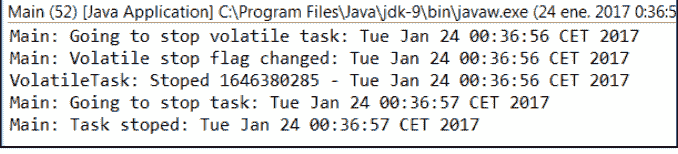


应用程序无法完成执行，因为 `task` 线程尚未结束。当我们更改 `volatileFlag` 的值时——其 `flag` 属性被标记为 `volatile`——新值会被写入主内存，而 `VolatileTask` 会立即访问该值并完成执行。相反，当你更改 `flag` 对象的值时——其 `flag` 属性未被标记为 volatile——新值会存储在主线程的缓存中，任务对象看不到新值，其执行永远不会结束。`volatile` 关键字的重要性不仅在于它要求写入被刷新，还在于它确保读取不会被缓存，并且会从主内存获取最新的值。这非常重要，但经常被忽视。

请注意，`volatile` 关键字保证修改会被写入主内存，但其逆命题并不总是成立。例如，如果你使用一个由多个线程共享的非 volatile 整数值并进行大量修改，你可能能够看到其他线程所做的修改，因为它们已被写入主内存。然而，并不能保证这些更改已从缓存传递到主内存。

## 还有更多...

`volatile` 关键字仅在共享变量的值只由一个线程修改时才有效。如果变量由多个线程修改，`volatile` 关键字并不能保护你免受可能的数据竞争条件。它也不会使诸如 + 或 - 之类的操作成为原子操作。例如，对 volatile 变量使用 ++ 运算符不是线程安全的。

自 Java 5 以来，**Java Memory Model** 对使用 `volatile` 关键字建立了 happens-before 保证。这一事实有两个含义：

- 当你修改一个 volatile 变量时，其值会被发送到主内存。同一线程之前修改的所有变量的值也会被发送。
- 编译器不能为了优化目的而重新排序修改 volatile 变量的语句。它可以重新排序之前的操作和之后的操作，但不能重新排序对 volatile 变量的修改。在这些修改之前发生的更改将对这些指令可见。

## 另请参阅

- 本章中 *Using atomic variables* 和 *Using atomic arrays* 配方

## 使用变量句柄

变量句柄是 Java 9 的一项新功能，允许你获取对变量（属性、静态字段或数组元素）的类型化引用，以便以不同的模式访问它。例如，你可以通过允许对变量进行原子访问来保护对该变量在并发应用程序中的访问。直到现在，你只能通过原子变量获得这种行为，但现在，你可以使用变量句柄在不使用任何同步机制的情况下获得相同的功能。变量句柄还允许你获得对变量的额外访问模式。

在本配方中，你将学习如何获取和使用变量句柄以及使用它所获得的好处。

## 准备工作

本配方的示例已使用 Eclipse IDE 实现。如果你使用 Eclipse 或其他 IDE，例如 NetBeans，请打开它并创建一个新的 Java 项目。

## 如何做...

按照以下步骤实现示例：

- 1. 创建一个名为 `Account` 的类，其中包含两个 double 公共属性 `amount` 和 `unsafeAmount`。实现构造函数以初始化其值：
```
public class Account {
    public double amount;
    public double unsafeAmount;

    public Account() {
        this.amount=0;
        this.unsafeAmount=0;
    }
}
```

- 2. 创建一个名为 `Decrementer` 的类并指定其实现 `Runnable` 接口。它有一个私有的 `Account` 属性，在类的构造函数中初始化：
```
public class Decrementer implements Runnable {
    private Account account;
```

```
public Decrementer(Account account) {
    this.account = account;
}
```

- 3. 实现 run() 方法。此方法将在 amount 和 unsafeAmount 属性上进行 10,000 次递减操作。要修改 amount 属性的值，请使用 VarHandle。使用 MethodHandles 类的 lookup() 方法获取它，然后使用 getAndAdd() 方法修改属性的值。要修改 unsafeAmount 属性，请使用 -= 运算符：
```
@Override
public void run() {
    VarHandle handler;
    try {
        handler = MethodHandles.lookup().in(Account.class)
            .findVarHandle(Account.class, "amount",
                double.class);
        for (int i = 0; i < 10000; i++) {
            handler.getAndAdd(account, -100);
            account.unsafeAmount -= 100;
        }
    } catch (NoSuchFieldException | IllegalAccessException e) {
        e.printStackTrace();
    }
}
```

- 4. 实现一个名为 Incrementer 的类。这将等同于 Decrementer 类，但它会增加账户的值。此类的源代码在此未包含。

- 5. 最后，实现包含 main() 方法的 Main 类。首先，创建一个账户对象：
```
public class Main {
    public static void main(String[] args) {
        Account account = new Account();
```

- 6. 然后，创建一个线程来执行 Incrementer 任务，并创建一个线程来执行 Decrementer 任务。启动它们并使用 join() 方法等待其完成：
```
Thread threadIncrementer = new Thread(new Incrementer(account));
Thread threadDecrementer = new Thread(new Decrementer(account));

threadIncrementer.start();
threadDecrementer.start();
```

```
try {
    threadIncrementer.join();
    threadDecrementer.join();
} catch (InterruptedException e) {
    e.printStackTrace();
}
```

- 7. 最后，将 amount 和 unsafeAmount 属性的值写入控制台：
```
System.out.printf("Safe amount: %f\n", account.amount);
System.out.printf("Unsafe amount: %f\n", account.unsafeAmount);
```

```
}
```

```
}
```

## 它是如何工作的...

以下屏幕截图显示了应用程序执行后的输出：

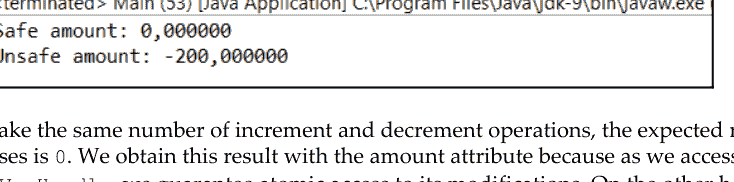

由于你进行了相同数量的递增和递减操作，两种情况下的预期结果都是 0。我们通过 amount 属性获得了此结果，因为我们使用 VarHandle 访问它，从而保证了对其修改的原子访问。另一方面，unsafeAmount 没有预期值。对该值的访问未受保护，我们存在数据竞争条件。

要使用变量句柄，首先我们必须使用 MethodHandles 类的 lookup() 方法获取它，然后是 in() 方法，然后是 findVarHandle() 方法。lookup() 方法返回一个 Lookup 对象，in() 方法返回指定类的 Lookup 对象——在我们的例子中是 Account 类——而 findVarHandle() 为我们想要访问的属性生成 VarHandle。

一旦我们拥有 VarHandle 对象，我们就可以使用不同的方法来使用不同的访问模式。在本示例中，我们使用了 getAndAdd() 方法。此方法保证对属性值的递增进行原子访问。我们向其传递我们想要访问的对象和递增的值。

下一节提供了有关不同访问模式以及每种情况下可使用的方法的更多信息。

## 还有更多...

你可以使用变量句柄对变量有四种不同的访问类型：

- **Read mode**: 这用于获取对变量的读模式访问。你可以使用以下方法：
  - get(): 读取变量的值，就好像它被声明为非 volatile 一样
  - getVolatile(): 读取变量的值，就好像它被声明为 volatile 一样
  - getAcquire(): 读取变量的值并保证以下修改或访问该变量的指令不会在指令之前重新排序以优化目的
  - getOpaque(): 读取变量的值并保证当前线程的指令不会重新排序；不对其他线程提供保证

- **Write mode**: 这用于获取对变量的写访问模式。你可以使用 set()、setVolatile()、setRelease() 和 setOpaque() 方法。它们与前者等效，但具有写访问。

- **Atomic access mode**: 这用于获取与原子变量提供的功能相似的功能，其中包含操作，例如比较并获取变量的值。你可以使用以下方法：
  - compareAndSet(): 如果作为参数传递的预期值等于变量的当前值，则更改变量的值，就好像它被声明为 volatile 变量一样
  - weakCompareAndSet() 和 weakCompareAndSetVolatile(): 可能原子地更改变量的值，就好像它被声明为非 volatile 或 volatile 变量一样，如果作为参数传递的预期值等于变量的当前值


- **数值更新访问模式**：这是以原子方式修改数值。

## 另请参阅
- 本章中 *使用原子变量* 和 *使用原子数组* 的配方

## 第8章：自定义并发类
## 自定义并发类

在本章中，我们将涵盖以下主题：
- 自定义 ThreadPoolExecutor 类
- 实现基于优先级的 Executor 类
- 实现 ThreadFactory 接口以生成自定义线程
- 在 Executor 对象中使用我们的 ThreadFactory
- 自定义在调度线程池中运行的任务
- 实现 ThreadFactory 接口以生成用于 fork/join 框架的自定义线程
- 自定义在 fork/join 框架中运行的任务
- 实现自定义 Lock 类
- 实现基于优先级的传输队列
- 实现你自己的原子对象
- 实现你自己的流生成器
- 实现你自己的异步流

## 简介

Java 并发 API 提供了大量接口和类来实现并发应用程序。它们提供了低级机制，例如 `Thread` 类、`Runnable` 或 `Callable` 接口，或 `synchronized` 关键字。它们还提供了高级机制，例如 Java 7 版本中添加的 `Executor` 框架和 fork/join 框架，或 Java 8 中添加的用于处理大数据集的 `Stream` 框架。尽管如此，你可能会发现自己正在开发一个程序，其中 Java API 的默认配置和/或实现无法满足你的需求。

在这种情况下，你可能需要基于 Java 提供的工具实现你自己的自定义并发工具。基本上，你可以：
- 实现一个接口以提供该接口定义的功能，例如 `ThreadFactory` 接口。
- 重写类的某些方法以将其行为适配到你的需求。例如，重写 `Phaser` 类的 `onAdvance()` 方法，该方法默认不执行任何有用的操作，预期被重写以提供某些功能。

通过本章的配方，你将学习如何在无需从头设计并发框架的情况下更改某些 Java 并发 API 类的行为。你可以将这些配方用作实现你自己的自定义化的初始点。

## 自定义 ThreadPoolExecutor 类

`Executor` 框架是一种允许你将线程创建与其执行分离的机制。它基于 `Executor` 和 `ExecutorService` 接口，以及同时实现这两个接口的 `ThreadPoolExecutor` 类。它有一个内部线程池，并提供方法允许你发送两种任务并在池化线程中执行它们。这些任务是：
- `Runnable` 接口，用于实现不返回结果的任务
- `Callable` 接口，用于实现返回结果的任务

在两种情况下，你只需将任务发送给执行器。执行器使用其池中的一个线程或创建一个新线程来执行这些任务。它还决定任务执行的时刻。

```
System.out.printf("MyExecutor: Running tasks: %d\n", getActiveCount());
System.out.printf("MyExecutor: Pending tasks: %d\n", getQueue().size());
super.shutdown();
}
```

5. 重写 shutdownNow() 方法。在控制台中写入关于已执行、正在运行和待处理任务的信息。然后，使用 super 关键字调用父类的 shutdownNow() 方法：

```
@Override
public List<Runnable> shutdownNow() {
    System.out.printf("MyExecutor: Going to immediately shutdown.\n");
    System.out.printf("MyExecutor: Executed tasks: %d\n", getCompletedTaskCount());
    System.out.printf("MyExecutor: Running tasks: %d\n", getActiveCount());
    System.out.printf("MyExecutor: Pending tasks: %d\n", getQueue().size());
    return super.shutdownNow();
}
```

6. 重写 beforeExecute() 方法。在控制台中写入一条消息，包含将要执行任务的线程名称和任务的哈希码。使用任务的哈希码作为键，将开始日期存储在 HashMap 中：

```
@Override
protected void beforeExecute(Thread t, Runnable r) {
    System.out.printf("MyExecutor: A task is beginning: %s : %s\n", t.getName(), r.hashCode());
    startTimes.put(r, new Date());
}
```

7. 重写 afterExecute() 方法。在控制台中写入任务结果的消息，并在从当前日期减去存储在 HashMap 中的任务开始日期后计算任务的运行时间：

```
@Override
protected void afterExecute(Runnable r, Throwable t) {
    Future<?> result=(Future<?>)r;
    try {
        System.out.printf("***********************************\n");
        System.out.printf("MyExecutor: A task is finishing.\n");
```

```
System.out.printf("MyExecutor: Result: %s\n", result.get());
Date startDate=startTimes.remove(r);
Date finishDate=new Date();
long diff=finishDate.getTime()-startDate.getTime();
System.out.printf("MyExecutor: Duration: %d\n",diff);
System.out.printf("***********************************************\n");
} catch (InterruptedException | ExecutionException e) {
 e.printStackTrace();
}
}
```

8. 创建一个名为 SleepTwoSecondsTask 的类，实现参数化为 String 类的 Callable 接口。实现 call() 方法。将当前线程休眠 2 秒并返回当前日期转换为 String 类型：

```
public class SleepTwoSecondsTask implements Callable<String> {

    public String call() throws Exception {
        TimeUnit.SECONDS.sleep(2);
        return new Date().toString();
    }

}
```

9. 通过创建一个名为 Main 的类并包含 main() 方法来实现示例的主类：

```
public class Main {
    public static void main(String[] args) {
```

10. 创建一个名为 myExecutor 的 MyExecutor 对象：

```
MyExecutor myExecutor=new MyExecutor(4, 8, 1000,
    TimeUnit.MILLISECONDS,
    new LinkedBlockingDeque<Runnable>());
```

11. 创建一个参数化为 String 类的 Future 对象列表，用于存储将发送给执行器的任务的结果对象：

```
List<Future<String>> results=new ArrayList<>();
```

12. 提交 10 个 Task 对象：

```
for (int i=0; i<10; i++) {
    SleepTwoSecondsTask task=new SleepTwoSecondsTask();
    Future<String> result=myExecutor.submit(task);
    results.add(result);
}
```

13. 使用 get() 方法获取前五个任务执行的結果，并在控制台中写入它们：

```
for (int i=0; i<5; i++){
    try {
        String result=results.get(i).get();
        System.out.printf("Main: Result for Task %d : %s\n", i,result);
    } catch (InterruptedException | ExecutionException e) {
        e.printStackTrace();
    }
}
```

14. 使用 shutdown() 方法结束执行器的执行：

```
myExecutor.shutdown();
```

15. 使用 get() 方法获取最后五个任务执行的結果，并在控制台中写入它们：

```
for (int i=5; i<10; i++){
    try {
        String result=results.get(i).get();
        System.out.printf("Main: Result for Task %d : %s\n", i,result);
    } catch (InterruptedException | ExecutionException e) {
        e.printStackTrace();
    }
}
```

16. 使用 awaitTermination() 方法等待执行器的完成：

```
try {
    myExecutor.awaitTermination(1, TimeUnit.DAYS);
} catch (InterruptedException e) {
    e.printStackTrace();
}
```

17. 写入一条消息，指示程序执行的结束：

```
System.out.printf("Main: End of the program.\n");
```

## 它是如何工作的...

在本配方中，我们通过扩展 ThreadPoolExecutor 类并重写其四个方法实现了自定义执行器。beforeExecute() 和 afterExecute() 方法用于计算任务的执行时间。beforeExecute() 方法在任务执行前执行；在这种情况下，我们使用 HashMap 将任务的开始日期存储在其中。afterExecute() 方法在任务执行后执行。你从 HashMap 中获取已完成的任务的 startTime，然后计算实际日期与 startTime 之间的差值以获取任务的执行时间。你还重写了 shutdown() 和 shutdownNow() 方法，以便在控制台中写入执行器中执行的任务的统计信息。这些任务包括：
- 已执行的任务，使用 getCompletedTaskCount() 方法
- 当前时间正在运行的任务，使用 getActiveCount() 方法
- 待处理任务，使用执行器存储待处理任务的阻塞队列的 size() 方法

实现 Callable 接口的 SleepTwoSecondsTask 类使其执行线程休眠 2 秒，而 Main 类在其中向你的执行器发送 10 个任务，使用它和其他类来演示其功能。

执行程序，你将看到程序如何显示每个正在运行任务的时间跨度，以及在调用 shutdown() 方法时执行器的统计信息。

## 另请参阅
- 第 4 章《线程执行器》中的 创建线程执行器并控制其被拒绝的任务 配方
- 本章中 在 Executor 对象中使用我们的 ThreadFactory 配方


## 实现基于优先级的 Executor 类

在 Java 并发 API 的第一个版本中，你必须创建并运行应用程序的所有线程。在 Java 5 版本中，随着 Executor 框架的出现，引入了一种用于并发任务执行的新机制。

使用 Executor 框架，你只需要实现任务并将其发送给执行器即可。执行器负责创建和执行运行你的任务的线程。

在内部，执行器使用阻塞队列来存储待处理的任务。这些任务按照到达执行器的顺序存储。一个可能的替代方案是使用优先级队列来存储新任务。这样，如果有高优先级的任务到达执行器，它将在所有已经等待但优先级相对较低的其他任务之前执行。

在本教程中，你将学习如何适配一个执行器，使其使用优先级队列来存储你发送以供执行的任务。

### 准备工作

本教程的示例使用 Eclipse IDE 实现。如果你使用 Eclipse 或其他 IDE，例如 NetBeans，请打开它并创建一个新的 Java 项目。

### 如何做...

按照以下步骤实现示例：

- 1. 创建一个名为 `MyPriorityTask` 的类，该类实现 `Runnable` 和 `Comparable` 接口，并以 `MyPriorityTask` 类作为参数：

```java
public class MyPriorityTask implements Runnable,
    Comparable<MyPriorityTask> {
```

- 2. 声明一个名为 `priority` 的私有 `int` 属性：

```java
private int priority;
```

- 3. 声明一个名为 name 的私有 String 属性：

```java
private String name;
```

- 4. 实现类的构造函数以初始化其属性：

```java
public MyPriorityTask(String name, int priority) {
    this.name=name;
    this.priority=priority;
}
```

- 5. 实现一个方法来返回 priority 属性的值：

```java
public int getPriority(){
    return priority;
}
```

- 6. 实现 Comparable 接口中声明的 compareTo() 方法。它接收一个 MyPriorityTask 对象作为参数，并比较两个对象的优先级：当前对象和参数对象。你让优先级更高的任务在优先级更低的任务之前执行：

```java
@Override
public int compareTo(MyPriorityTask o) {
    return Integer.compare(o.getPriority(), this.getPriority());
}
```

- 7. 实现 run() 方法。让当前线程休眠 2 秒：

```java
@Override
public void run() {
    System.out.printf("MyPriorityTask: %s Priority : %d\n", name,priority);
    try {
        TimeUnit.SECONDS.sleep(2);
    } catch (InterruptedException e) {
        e.printStackTrace();
        Thread.currentThread().interrupt();
    }
}
```

- 8. 通过创建一个名为 Main 的类并包含 main() 方法来实现示例的主类：

```java
public class Main {
    public static void main(String[] args) {
```

- 9. 创建一个名为 executor 的 ThreadPoolExecutor 对象。使用 PriorityBlockingQueue，以 Runnable 接口作为参数，作为该执行器用于存储其待处理任务的队列：

```java
ThreadPoolExecutor executor=new ThreadPoolExecutor(4,4,1,
    TimeUnit.SECONDS,
    new PriorityBlockingQueue<Runnable>());
```

- 10. 使用循环计数器作为任务的优先级，将 10 个任务发送给执行器。使用 execute() 方法将任务发送给执行器：

```java
for (int i=0; i<10; i++){
    MyPriorityTask task=new MyPriorityTask ("Task "+i,i);
    executor.execute(task);
}
```

- 11. 让当前线程休眠 1 秒：

```java
try {
    TimeUnit.SECONDS.sleep(1);
} catch (InterruptedException e) {
    e.printStackTrace();
}
```

- 12. 使用循环计数器作为任务的优先级，再向执行器发送 10 个任务。使用 execute() 方法将任务发送给执行器：

```java
for (int i=10; i<20; i++) {
    MyPriorityTask task=new MyPriorityTask ("Task "+i,i);
    executor.execute(task);
}
```

- 13. 使用 shutdown() 方法关闭执行器：

```java
executor.shutdown();
```

- 14. 使用 awaitTermination() 方法等待执行器的完成：

```java
try {
    executor.awaitTermination(1, TimeUnit.DAYS);
} catch (InterruptedException e) {
    e.printStackTrace();
}
```

- 15. 在控制台写入一条消息，指示程序的结束：

```java
System.out.printf("Main: End of the program.\n");
```

### 工作原理...

将普通执行器转换为基于优先级的执行器很简单。你只需要传递一个 PriorityBlockingQueue 对象，以 Runnable 接口作为参数。但需要注意的是，存储在优先级队列中的所有对象都必须实现 Comparable 接口。

你实现了 MyPriorityTask 类，该类实现了 Runnable 接口，作为任务，并实现了 Comparable 接口以便存储在优先级队列中。该类有一个 priority 属性，用于存储任务的优先级。如果任务的该属性值更高，它将被更早执行。compareTo() 方法决定了任务在优先级队列中的顺序。在 Main 类中，你向执行器发送了 20 个具有不同优先级的任务。你发送给执行器的第一个任务是首先执行的任务。由于执行器在等待任务时处于空闲状态，它会立即执行第一个任务，一旦它们到达。你使用四个执行线程创建了执行器，因此前四个任务将是首先执行的任务。然后，其余任务将根据其优先级执行。

以下屏幕截图显示了此示例的一次执行：

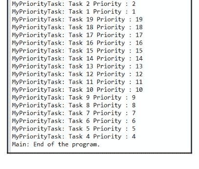

### 还有更多...

你可以配置 Executor 以使用 BlockingQueue 接口的任何实现。一个有趣的实现是 DelayQueue。此类用于存储具有延迟激活的元素。它提供的方法仅返回活动对象。你可以使用此类来实现你自己的 ScheduledThreadPoolExecutor 类版本。

### 另请参阅

- 第 4 章《线程执行器》中的 Creating a thread executor and controlling its rejected tasks 教程
- 本章中的 Customizing the ThreadPoolExecutor class 教程
- 第 7 章《并发集合》中的 Using blocking thread-safe queue ordered by priority 教程

## 实现 ThreadFactory 接口以生成自定义线程

工厂模式是面向对象编程世界中广泛使用的设计模式。它是一种创建型模式，其目标是开发一个类的任务是创建一类或多类对象的类。然后，当我们想要创建一个这些类之一的对象时，我们使用工厂而不是使用 new 运算符。


通过这个工厂，我们集中了对象的创建，从而获得了轻松更改创建对象的类或创建这些对象的方式的优势，考虑到我们在创建具有有限资源的对象的限制。例如，我们只能拥有 N 个类型的对象，并且能够轻松生成关于对象创建的统计数据。

Java 提供了 ThreadFactory 接口来实现 Thread 对象的工厂。Java 并发 API 的一些高级实用程序，例如 Executor 框架或 fork/join 框架，使用线程工厂来创建线程。Java 并发 API 中工厂模式的另一个例子是 Executors 类。它提供了许多方法来创建不同种类的 Executor 对象。在本教程中，你将通过添加新功能来扩展 Thread 类，并实现一个线程工厂类来生成这种新类的线程。

### 准备工作

本教程的示例使用 Eclipse IDE 实现。如果你使用 Eclipse 或其他 IDE，例如 NetBeans，请打开它并创建一个新的 Java 项目。

### 如何做...

按照以下步骤实现示例：

- 1. 创建一个名为 `MyThread` 的类，该类扩展 `Thread` 类：

```java
public class MyThread extends Thread {
```

- 2. 声明三个私有 `Date` 属性，名为 `creationDate`、`startDate` 和 `finishDate`：

```java
private final Date creationDate;
private Date startDate;
private Date finishDate;
```

- 3. 实现类的构造函数。它接收名称和要执行的 `Runnable` 对象作为参数。初始化线程的创建日期：

```java
public MyThread(Runnable target, String name ){
    super(target,name);
    creationDate = new Date();
}
```

- 4. 实现 `run()` 方法。存储线程的开始日期，调用父类的 `run()` 方法，并存储执行的结束日期：

```java
@Override
public void run() {
    setStartDate();
    super.run();
    setFinishDate();
}
```

- 5. 实现一个方法来设置 `startDate` 属性的值：

```java
public synchronized void setStartDate() {
    startDate=new Date();
}
```


6. 实现一个方法来设置 finishDate 属性的值：

```
public synchronized void setFinishDate() {
    finishDate=new Date();
}
```

7. 实现一个名为 getExecutionTime() 的方法，该方法通过 start 和 finish 日期之间的差值计算线程的执行时间：

```
public synchronized long getExecutionTime() {
    return finishDate.getTime()-startDate.getTime();
}
```

8. 重写 toString() 方法以返回线程的创建日期和执行时间：

```
@Override
public synchronized String toString(){
    StringBuilder buffer=new StringBuilder();
    buffer.append(getName());
    buffer.append(": ");
    buffer.append(" Creation Date: ");
    buffer.append(creationDate);
    buffer.append(" : Running time: ");
    buffer.append(getExecutionTime());
    buffer.append(" Milliseconds.");
    return buffer.toString();
}
```

9. 创建一个名为 MyThreadFactory 的类，该类实现 ThreadFactory 接口：

```
public class MyThreadFactory implements ThreadFactory {
```

10. 声明一个名为 counter 的私有 AtomicInteger 属性：

```
private AtomicInteger counter;
```

11. 声明一个名为 prefix 的私有 String 属性：

```
private String prefix;
```

12. 实现类的构造函数以初始化其属性：

```
public MyThreadFactory (String prefix) {
    this.prefix=prefix;
    counter=new AtomicInteger(1);
}
```

13. 实现 newThread() 方法。创建 MyThread 对象并递增 counter 属性：

```
@Override
public Thread newThread(Runnable r) {
    MyThread myThread=new MyThread(r,prefix+"-"+counter
                                .getAndIncrement());
    return myThread;
}
```

14. 创建一个名为 MyTask 的类，该类实现 Runnable 接口。实现 run() 方法。使当前线程休眠 2 秒：

```
public class MyTask implements Runnable {
    @Override
    public void run() {
        try {
            TimeUnit.SECONDS.sleep(2);
        } catch (InterruptedException e) {
            e.printStackTrace();
        }
    }
}
```

15. 通过创建名为 Main 的类并包含 main() 方法来实现示例的主类：

```
public class Main {
    public static void main(String[] args) throws Exception {
```

16. 创建一个 MyThreadFactory 对象：

```
MyThreadFactory myFactory=new MyThreadFactory("MyThreadFactory");
```

17. 创建一个 Task 对象：

```
MyTask task=new MyTask();
```

18. 使用工厂的 newThread() 方法创建一个 MyThread 对象来执行任务：

```
Thread thread=myFactory.newThread(task);
```

19. 启动线程并等待其结束：

```
thread.start();
thread.join();
```

20. 使用 toString() 方法输出线程信息：

```
System.out.printf("Main: Thread information.\n");
System.out.printf("%s\n",thread);
System.out.printf("Main: End of the example.\n");
```

## 它是如何工作的...

在本教程中，你实现了一个自定义的 MyThread 类，该类扩展了 Thread 类。此类具有三个属性，用于存储创建日期、其执行的开始日期和执行的结束日期。利用开始日期和结束日期属性，你实现了 getExecutionTime() 方法，该方法返回线程执行其任务所花费的总时间。最后，你重写了 toString() 方法以生成有关线程的信息。

在你拥有自己的线程类后，你通过实现 ThreadFactory 接口实现了一个工厂来创建该类的对象。如果要将工厂用作独立对象，则不一定必须使用该接口，但如果你想将此工厂与 Java 并发 API 的其他类一起使用，则必须通过实现此接口来构建工厂。ThreadFactory 接口只有一个方法：newThread() 方法。此方法接收一个 Runnable 对象作为参数，并返回一个用于执行 Runnable 对象的 Thread 对象。在你的情况下，你返回了一个 MyThread 对象。

为了检查这两个类，你实现了实现了 Runnable 对象的 MyTask 类。这是要在由 MyThread 对象管理的线程中执行的任务。MyTask 实例会使执行线程休眠 2 秒。

在示例的 main 方法中，你使用 MyThreadFactory 工厂创建了一个 MyThread 对象来执行 Task 对象。如果执行程序，你将看到一条包含已执行线程的开始日期和执行时间的消息。

以下屏幕截图显示了此示例生成的输出：

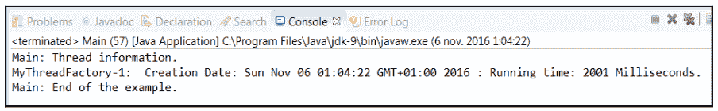

## 还有更多...

Java 并发 API 提供了 `Executors` 类来生成线程执行器，通常是 `ThreadPoolExecutor` 类的对象。你也可以使用此类通过 `defaultThreadFactory()` 方法获得 `ThreadFactory` 接口的最基本实现。此方法生成的工厂生成属于同一 `ThreadGroup` 对象的[content]

6. 实现一个方法来设置 finishDate 属性的值：

```
public synchronized void setFinishDate() {
    finishDate=new Date();
}
```

7. 实现一个名为 getExecutionTime() 的方法，该方法通过 start 和 finish 日期之间的差值计算线程的执行时间：

```
public synchronized long getExecutionTime() {
    return finishDate.getTime()-startDate.getTime();
}
```

8. 重写 toString() 方法以返回线程的创建日期和执行时间：

```
@Override
public synchronized String toString(){
    StringBuilder buffer=new StringBuilder();
    buffer.append(getName());
    buffer.append(": ");
    buffer.append(" Creation Date: ");
    buffer.append(creationDate);
    buffer.append(" : Running time: ");
    buffer.append(getExecutionTime());
    buffer.append(" Milliseconds.");
    return buffer.toString();
}
```

9. 创建一个名为 MyThreadFactory 的类，该类实现 ThreadFactory 接口：

```
public class MyThreadFactory implements ThreadFactory {
```

10. 声明一个名为 counter 的私有 AtomicInteger 属性：

```
private AtomicInteger counter;
```

11. 声明一个名为 prefix 的私有 String 属性：

```
private String prefix;
```

12. 实现类的构造函数以初始化其属性：

```
public MyThreadFactory (String prefix) {
    this.prefix=prefix;
    counter=new AtomicInteger(1);
}
```

13. 实现 newThread() 方法。创建 MyThread 对象并递增 counter 属性：

```
@Override
public Thread newThread(Runnable r) {
    MyThread myThread=new MyThread(r,prefix+"-"+counter
                                .getAndIncrement());
    return myThread;
}
```

14. 创建一个名为 MyTask 的类，该类实现 Runnable 接口。实现 run() 方法。使当前线程休眠 2 秒：

```
public class MyTask implements Runnable {
    @Override
    public void run() {
        try {
            TimeUnit.SECONDS.sleep(2);
        } catch (InterruptedException e) {
            e.printStackTrace();
        }
    }
}
```

15. 通过创建名为 Main 的类并包含 main() 方法来实现示例的主类：

```
public class Main {
    public static void main(String[] args) throws Exception {
```

16. 创建一个 MyThreadFactory 对象：

```
MyThreadFactory myFactory=new MyThreadFactory("MyThreadFactory");
```

17. 创建一个 Task 对象：

```
MyTask task=new MyTask();
```

18. 使用工厂的 newThread() 方法创建一个 MyThread 对象来执行任务：

```
Thread thread=myFactory.newThread(task);
```

19. 启动线程并等待其结束：

```
thread.start();
thread.join();
```

20. 使用 toString() 方法输出线程信息：

```
System.out.printf("Main: Thread information.\n");
System.out.printf("%s\n",thread);
System.out.printf("Main: End of the example.\n");
```

## 它是如何工作的...

在本教程中，你实现了一个自定义的 MyThread 类，该类扩展了 Thread 类。此类具有三个属性，用于存储创建日期、其执行的开始日期和执行的结束日期。利用开始日期和结束日期属性，你实现了 getExecutionTime() 方法，该方法返回线程执行其任务所花费的总时间。最后，你重写了 toString() 方法以生成有关线程的信息。

在你拥有自己的线程类后，你通过实现 ThreadFactory 接口实现了一个工厂来创建该类的对象。如果要将工厂用作独立对象，则不一定必须使用该接口，但如果你想将此工厂与 Java 并发 API 的其他类一起使用，则必须通过实现此接口来构建工厂。ThreadFactory 接口只有一个方法：newThread() 方法。此方法接收一个 Runnable 对象作为参数，并返回一个用于执行 Runnable 对象的 Thread 对象。在你的情况下，你返回了一个 MyThread 对象。

为了检查这两个类，你实现了实现了 Runnable 对象的 MyTask 类。这是要在由 MyThread 对象管理的线程中执行的任务。MyTask 实例会使执行线程休眠 2 秒。

在示例的 main 方法中，你使用 MyThreadFactory 工厂创建了一个 MyThread 对象来执行 Task 对象。如果执行程序，你将看到一条包含已执行线程的开始日期和执行时间的消息。

以下屏幕截图显示了此示例生成的输出：


## 还有更多...

Java 并发 API 提供了 `Executors` 类来生成线程执行器，通常是 `ThreadPoolExecutor` 类的对象。你也可以使用此类通过 `defaultThreadFactory()` 方法获得 `ThreadFactory` 接口的最基本实现。此方法生成的工厂生成属于同一 `ThreadGroup` 对象的 `Thread` 对象。你可以在程序中出于任何目的使用 `ThreadFactory` 接口，而不仅仅是与 Executor 框架相关。

## 在 Executor 对象中使用我们的 ThreadFactory

在上一教程中，我们介绍了工厂模式并提供了如何实现实现 `ThreadFactory` 接口的线程工厂的示例。

Executor 框架是一种允许你分离线程创建和其执行的机制。它基于 `Executor` 和 `ExecutorService` 接口以及同时实现这两个接口的 `ThreadPoolExecutor` 类。它具有内部线程池，并提供方法允许你发送两种类型的任务以在池化线程中执行。这两种类型的任务如下：

- 实现 `Runnable` 接口的类，用于实现不返回结果的任务
- 实现 `Callable` 接口的类，用于实现返回结果的任务

内部，`Executor` 框架使用 `ThreadFactory` 接口来创建它用于生成新线程的线程。在本教程中，你将学习如何实现自己的线程类、创建该类线程的线程工厂，以及如何在执行器中使用此工厂，以便执行器执行你的线程。

## 准备工作

阅读上一教程并实现其示例。

本教程的示例使用 Eclipse IDE 实现。如果使用 Eclipse 或其他 IDE，例如 NetBeans，请打开它并创建一个新的 Java 项目。

## 如何做...

按照以下步骤实现示例：

- 1. 将 `MyThread`、`MyThreadFactory` 和 `MyTask` 类复制到项目中。
  它们是在 *Implementing the ThreadFactory interface to generate custom threads for the fork/join framework* 教程中实现的。你将在本示例中使用它们。
- 2. 通过创建名为 `Main` 的类并包含 `main()` 方法来实现示例的主类：
  ```
  public class Main {
      public static void main(String[] args) throws Exception {
  ```
- 3. 创建一个名为 `threadFactory` 的新的 `MyThreadFactory` 对象：
  ```
  MyThreadFactory threadFactory=new MyThreadFactory
      ("MyThreadFactory");
  ```
- 4. 使用 `Executors` 类的 `newCachedThreadPool()` 方法创建一个新的 `Executor` 对象。将前面创建的工厂对象作为参数传递。新的 `Executor` 对象将使用此工厂创建必要的线程，因此它将执行 `MyThread` 线程：
  ```
  ExecutorService executor=Executors.newCachedThreadPool
      (threadFactory);
  ```
- 5. 创建一个新的 Task 对象并使用 submit() 方法将其发送到执行器：
  
  ```
  MyTask task=new MyTask();
  executor.submit(task);
  ```
- 6. 使用 shutdown() 方法关闭执行器：
  
  ```
  executor.shutdown();
  ```
- 7. 使用 awaitTermination() 方法等待执行器的结束：
  
  ```
  executor.awaitTermination(1, TimeUnit.DAYS);
  ```
- 8. 写入一条消息以指示程序结束：
  
  ```
  System.out.printf("Main: End of the program.\n");
  ```

## 它是如何工作的...

在上一教程的 How it works... 部分中，你有关于 MyThread、MyThreadFactory 和 MyTask 类如何工作的详细解释。

在示例的 main() 方法中，你使用 Executors 类的 newCachedThreadPool() 方法创建了一个 Executor 对象。你将前面创建的工厂对象作为参数传递，因此创建的 Executor 对象将使用该工厂创建它需要的线程并执行 MyThread 类的线程。

执行程序，你将看到一条包含线程开始日期及其执行时间信息的消息。以下屏幕截图显示了此示例生成的输出：

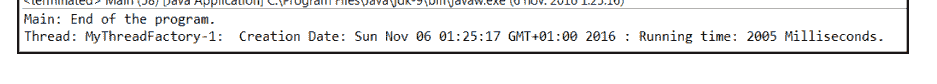

## 另请参阅

- 本章中 *Implementing the ThreadFactory interface to generate custom threads for the fork/join framework* 教程


## 自定义在调度线程池中运行的任务

调度线程池是 `Executor` 框架基本线程池的扩展，允许你将任务的执行调度到一段时间之后执行。它由 `ScheduledThreadPoolExecutor` 类实现，并且允许执行以下两种类型的任务：

- **延迟任务**：这类任务在一段时间后只执行一次
- **周期任务**：这类任务在延迟后执行，然后定期、每隔一段时间执行一次

延迟任务可以执行 `Callable` 和 `Runnable` 对象，但周期任务只能执行 `Runnable` 对象。调度池执行的所有任务都是 `RunnableScheduledFuture` 接口的实现。在本教程中，你将学习如何实现自己的 `RunnableScheduledFuture` 接口实现来执行延迟和周期任务。

## 准备工作

本教程的示例使用 Eclipse IDE 实现。如果你使用 Eclipse 或其他 IDE，例如 NetBeans，打开它并创建一个新的 Java 项目。

## 如何做...

按照以下步骤实现示例：

1. 创建一个名为 `MyScheduledTask` 的类，以泛型类型 V 参数化。它扩展 `FutureTask` 类并实现 `RunnableScheduledFuture` 接口：

```
public class MyScheduledTask<V> extends FutureTask<V>
    implements RunnableScheduledFuture<V> {
```

2. 声明一个名为 task 的私有 RunnableScheduledFuture 属性：
```
private RunnableScheduledFuture<V> task;
```

3. 声明一个名为 executor 的私有 ScheduledThreadPoolExecutor 类：
```
private ScheduledThreadPoolExecutor executor;
```

4. 声明一个名为 period 的私有 long 属性：
```
private long period;
```

5. 声明一个名为 startDate 的私有 long 属性：
```
private long startDate;
```

6. 实现类的构造函数。它接收将由任务执行的 Runnable 对象、该任务将返回的结果、将用于创建 MyScheduledTask 对象的 RunnableScheduledFuture task，以及将执行任务的 ScheduledThreadPoolExecutor 对象。调用其父类的构造函数并存储 task 和 executor 属性：
```
public MyScheduledTask(Runnable runnable, V result,
                        RunnableScheduledFuture<V> task,
                        ScheduledThreadPoolExecutor executor) {
    super(runnable, result);
    this.task=task;
    this.executor=executor;
}
```

7. 实现 getDelay() 方法。如果任务是周期性的并且 startDate 属性的值不为零，则将返回的值计算为 startDate 属性与实际日期之间的差值。否则，返回存储在 task 属性中的原始任务的延迟。不要忘记你必须以作为参数传递的时间单位返回结果：
```
@Override
public long getDelay(TimeUnit unit) {
    if (!isPeriodic()) {
        return task.getDelay(unit);
    } else {
        if (startDate==0){
            return task.getDelay(unit);
        } else {
```
```
Date now=new Date();
long delay=startDate-now.getTime();
return unit.convert(delay, TimeUnit.MILLISECONDS);
}
}
```

8. 实现 compareTo() 方法。调用原始任务的 compareTo() 方法：
```
@Override
public int compareTo(Delayed o) {
    return task.compareTo(o);
}
```

9. 实现 isPeriodic() 方法。调用原始任务的 isPeriodic() 方法：
```
@Override
public boolean isPeriodic() {
    return task.isPeriodic();
}
```

10. 实现 run() 方法。如果是周期任务，你必须使用下一次任务执行的开始日期更新其 startDate 属性。将其计算为实际日期和 period 的总和。然后，再次将任务添加到 ScheduledThreadPoolExecutor 对象的队列中：
```
@Override
public void run() {
    if (isPeriodic() && (!executor.isShutdown())) {
        Date now=new Date();
        startDate=now.getTime()+period;
        executor.getQueue().add(this);
    }
}
```

11. 打印一条消息到控制台显示实际日期。调用 runAndReset() 方法执行任务，然后再次打印一条消息到控制台显示实际日期：
```
System.out.printf("Pre-MyScheduledTask: %s\n",new Date());
System.out.printf("MyScheduledTask: Is Periodic: %s\n", isPeriodic());
super.runAndReset();
System.out.printf("Post-MyScheduledTask: %s\n",new Date());
}
```

12. 实现 setPeriod() 方法来设定此任务的周期：
```
public void setPeriod(long period) {
    this.period=period;
}
```

13. 创建一个名为 MyScheduledThreadPoolExecutor 的类来实现一个执行 MyScheduledTask 任务的 ScheduledThreadPoolExecutor 对象。指定此类扩展 ScheduledThreadPoolExecutor 类：
```
public class MyScheduledThreadPoolExecutor extends
    ScheduledThreadPoolExecutor {
```

14. 实现类的构造函数，它仅调用其父类的构造函数：
```
public MyScheduledThreadPoolExecutor(int corePoolSize) {
    super(corePoolSize);
}
```

15. 实现 decorateTask() 方法。它接收将要执行的 Runnable 对象作为参数，以及将执行此 Runnable 对象的 RunnableScheduledFuture task。创建并返回一个 MyScheduledTask 任务，使用这些对象构造它们：
```
@Override
protected <V> RunnableScheduledFuture<V> decorateTask(
    Runnable runnable,
    RunnableScheduledFuture<V> task) {
    MyScheduledTask<V> myTask=new MyScheduledTask<V>(runnable,
        null, task,this);
    return myTask;
}
```

16. 重写 scheduledAtFixedRate() 方法。调用其父类的方法，将返回的对象转换为 MyScheduledTask 对象，并使用 setPeriod() 方法设定该任务的周期：
```
@Override
public ScheduledFuture<?> scheduleAtFixedRate(Runnable command,
    long initialDelay, long period, TimeUnit unit) {
    ScheduledFuture<?> task= super.scheduleAtFixedRate(command,
        initialDelay, period, unit);
    MyScheduledTask<?> myTask=(MyScheduledTask<?>)task;
    myTask.setPeriod(TimeUnit.MILLISECONDS.convert(period,unit));
```

17. 创建一个名为 Task 的类，实现 Runnable 接口：
```
public class Task implements Runnable {
```

18. 实现 run() 方法。在任务开始时打印一条消息，使当前线程休眠 2 秒，并在任务结束时打印另一条消息：
```
@Override
public void run() {
System.out.printf("Task: Begin.\n");
try {
TimeUnit.SECONDS.sleep(2);
} catch (InterruptedException e) {
e.printStackTrace();
}
System.out.printf("Task: End.\n");
}
```

19. 通过创建名为 Main 的类并包含 main() 方法来实现示例的主类：
```
public class Main {

public static void main(String[] args) throws Exception{
```

20. 创建一个名为 executor 的 MyScheduledThreadPoolExecutor 对象。使用 4 作为参数以在池中拥有两个线程：
```
MyScheduledThreadPoolExecutor executor=new
MyScheduledThreadPoolExecutor(4);
```

21. 创建一个名为 task 的 Task 对象。在控制台写入实际日期：
```
Task task=new Task();
System.out.printf("Main: %s\n",new Date());
```

22. 使用 schedule() 方法向 executor 发送延迟任务。任务将在 1 秒延迟后执行：
```
executor.schedule(task, 1, TimeUnit.SECONDS);
```

23. 使主线程休眠 3 秒：
```
TimeUnit.SECONDS.sleep(3);
```

24. 创建另一个 Task 对象。再次在控制台打印实际日期：
```
task=new Task();
System.out.printf("Main: %s\n",new Date());
```

25. 使用 scheduleAtFixedRate() 方法向 executor 发送周期任务。任务将在 1 秒延迟后执行，然后每 3 秒执行一次：
```
executor.scheduleAtFixedRate(task, 1, 3, TimeUnit.SECONDS);
```

26. 使主线程休眠 10 秒：
```
TimeUnit.SECONDS.sleep(10);
```

27. 使用 shutdown() 方法关闭 executor。使用 awaitTermination() 方法等待 executor 完成：
```
executor.shutdown();
executor.awaitTermination(1, TimeUnit.DAYS);
```

28. 在控制台写入一条消息表示程序结束：
```
System.out.printf("Main: End of the program.\n");
```

## 它是如何工作的...

在本教程中，你实现了 MyScheduledTask 类来实现可在 ScheduledThreadPoolExecutor executor 上执行的自定义任务。此类扩展 FutureTask 类并实现 RunnableScheduledFuture 接口。它实现 RunnableScheduledFuture 接口是因为在调度执行器中执行的所有任务都必须实现此接口并扩展 FutureTask 类。这是因为此类提供了 RunnableScheduledFuture 接口中声明的方法的有效实现。前面提到的所有接口和类都是参数化类，并且它们拥有任务将返回的数据类型。


要在一个调度执行器中使用 MyScheduledTask 任务，你需要在 MyScheduledThreadPoolExecutor 类中重写 decorateTask() 方法。该类扩展了 ScheduledThreadPoolExecutor 执行器，而该方法提供了一种机制，将 ScheduledThreadPoolExecutor 执行器实现的默认调度任务转换为 MyScheduledTask 任务。因此，当你实现自己的调度任务版本时，你必须实现自己的调度执行器版本。


decorateTask() 方法只是使用四个参数创建一个新的 MyScheduledTask 对象。第一个是一个将在任务中执行的 Runnable 对象。第二个是任务将返回的对象。在这种情况下，任务不会返回结果，所以你使用了 null 值。第三个是新对象将在池中替换的任务，最后一个是将会执行任务的执行器。在这种情况下，你使用 this 关键字引用正在创建任务的执行器。

MyScheduledTask 类可以执行延迟和周期性任务。你实现了两个方法，其中包含执行这两种任务所需的所有逻辑。它们是 getDelay() 和 run() 方法。

getDelay() 方法由调度执行器调用，以判断是否需要执行任务。此方法的行为在延迟任务和周期性任务中有所不同。如前所述，MyScheduledClass 类的构造函数接收原本要执行 Runnable 对象的原始 ScheduledRunnableFuture 对象，并将其存储为类的属性，以便访问其方法和数据。当我们执行延迟任务时，getDelay() 方法返回原始任务的延迟；然而，在周期性任务的情况下，getDelay() 方法返回 startDate 属性与实际日期之间的差值。

run() 方法是执行任务的方法。周期性任务的一个特点是，如果你希望任务再次被执行，你必须将任务的下一次执行作为新任务放入执行器的队列中。因此，如果你正在执行周期性任务，你会设定 startDate 属性的值，将其与实际日期和任务执行的周期相加，并再次将任务存储在执行器的队列中。startDate 属性存储下一次任务执行开始的日期。然后，你使用 FutureTask 类提供的 runAndReset() 方法执行任务。在延迟任务的情况下，你不需要将它们放入执行器的队列中，因为它们只能执行一次。

## 自定义并发类

> > 你还必须考虑执行器是否已被关闭。如果是，你就不需要再次将周期性任务存储在执行器的队列中。

最后，你在 MyScheduledThreadPoolExecutor 类中重写了 `scheduleAtFixedRate()` 方法。我们前面提到过，对于周期性任务，你使用任务的周期来设定 `startDate` 属性的值，但你还没有初始化该周期。你必须重写此方法，该方法接收此周期作为参数；这样做是为了将其传递给 `MyScheduledTask` 类，以便它可以使用它。

示例已通过实现 `Runnable` 接口的 `Task` 类完成，它是在调度执行器中执行的任务。示例的主类创建了一个 `MyScheduledThreadPoolExecutor` 执行器，并向其发送以下两个任务：

- 一个延迟任务，将在实际日期后 1 秒执行
- 一个周期性任务，将首次在实际日期后 1 秒执行，然后每 3 秒执行一次

以下屏幕截图显示了此示例的部分执行。你可以检查这两种任务是否正确执行：

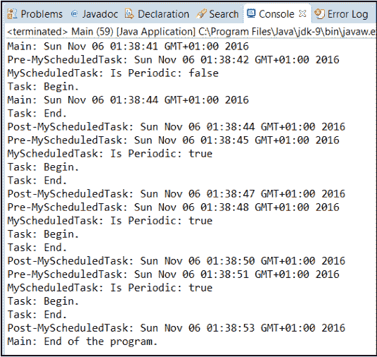

## There's more...

`ScheduledThreadPoolExecutor` 类提供了 `decorateTask()` 方法的另一个版本，该方法接收 `Callable` 对象作为参数，而不是 `Runnable` 对象。

## See also

- `Chapter 4, Thread Executors` 中 *Running a task in an executor after a delay* 和 *Running a task in an executor periodically* 配方

## 实现 ThreadFactory 接口以生成用于 fork/join 框架的自定义线程

Java 9 最有趣的功能之一是 fork/join 框架。它是 `Executor` 和 `ExecutorService` 接口的实现，允许你在不管理执行它们的线程的情况下执行 `Callable` 和 `Runnable` 任务。

此执行器面向执行可以细分为更小部分任务的执行。其主要组件如下：

- 它是一种特殊的任务，由 `ForkJoinTask` 类实现。
- 它提供了将任务划分为子任务（fork 操作）的两个操作，以及等待这些子任务完成（join 操作）。
- 它是一种算法，称为 work-stealing 算法，优化了线程池的使用。当任务等待其子任务时，执行它的线程被用来执行另一个线程。

fork/join 框架的主要类是 `ForkJoinPool` 类。内部，它具有以下两个元素：

- 一个等待执行的任务队列
- 一个执行任务的线程池

ForkJoinWorkerThread 向 Thread 类添加了新方法，例如在线程创建时执行的 onStart() 方法和用于清理线程使用的资源时调用的 onTermination() 方法。ForkJoinPool 类使用 ForkJoinWorkerThreadFactory 接口的实现来创建它使用的 worker 线程。

在本配方中，你将学习如何实现一个自定义 worker 线程以在 ForkJoinPool 类中使用，以及如何使用扩展 ForkJoinPool 类并实现 ForkJoinWorkerThreadFactory 接口的工厂来使用它。

### Getting ready

本配方的示例已使用 Eclipse IDE 实现。如果使用 Eclipse 或其他 IDE，例如 NetBeans，请打开它并创建一个新的 Java 项目。

### How to do it...

按照以下步骤实现示例：

1. 创建一个名为 MyWorkerThread 的类，扩展 ForkJoinWorkerThread 类：
```
public class MyWorkerThread extends ForkJoinWorkerThread {
```
2. 声明并创建一个私有 ThreadLocal 属性，使用 Integer 类作为参数，命名为 taskCounter：
```
private final static ThreadLocal<Integer> taskCounter=
    new ThreadLocal<Integer>();
```
3. 实现类的构造函数：
```
protected MyWorkerThread(ForkJoinPool pool) {
    super(pool);
}
```
4. 重写 onStart() 方法。调用其父类的方法，向控制台打印消息，并将此线程的 taskCounter 属性值设为零：
```
@Override
protected void onStart() {
    super.onStart();
    System.out.printf("MyWorkerThread %d: Initializing task counter.\n", getId());
    taskCounter.set(0);
}
```
5. 重写 onTermination() 方法。在控制台中写入此线程的 taskCounter 属性值：
```
@Override
protected void onTermination(Throwable exception) {
    System.out.printf("MyWorkerThread %d: %d\n", getId(), taskCounter.get());
    super.onTermination(exception);
}
```
6. 实现 addTask() 方法。递增 taskCounter 属性的值：
```
public void addTask(){
    taskCounter.set(taskCounter.get() + 1);
}
```
7. 创建一个名为 MyWorkerThreadFactory 的类，实现 ForkJoinWorkerThreadFactory 接口。实现 newThread() 方法。创建并返回一个 MyWorkerThread 对象：
```
public class MyWorkerThreadFactory implements ForkJoinWorkerThreadFactory {
    @Override
    public ForkJoinWorkerThread newThread(ForkJoinPool pool) {
        return new MyWorkerThread(pool);
    }
}
```
8. 创建一个名为 MyRecursiveTask 的类，扩展使用 Integer 类作为参数的 RecursiveTask 类：
```
public class MyRecursiveTask extends RecursiveTask<Integer> {
```


9. 声明一个名为 array 的私有 int 数组：

```
private int array[];
```

10. 声明两个名为 start 和 end 的私有 int 属性：

```
private int start, end;
```

11. 实现类的构造函数以初始化其属性：

```
public Task(int array[],int start, int end) {
    this.array=array;
    this.start=start;
    this.end=end;
}
```

12. 实现 compute() 方法以对数组中 start 和 end 位置之间的所有元素求和。首先，将执行任务的线程转换为 MyWorkerThread 对象并使用 addTask() 方法递增该线程的任务计数器：

```
@Override
protected Integer compute() {
    Integer ret;
    MyWorkerThread thread=(MyWorkerThread)Thread.currentThread();
    thread.addTask();
```

13. 如果数组中 start 和 end 位置之间的差值高于 100 个元素，我们计算中间位置并创建两个新的 MyRecursiveTask 任务分别处理第一半和第二半。如果差值等于或低于 100，我们计算 start 和 end 位置之间的所有元素的总和：

```
if (end-start>100) {
    int mid=(start+end)/2;
    MyRecursiveTask task1=new MyRecursiveTask(array,start,mid);
    MyRecursiveTask task2=new MyRecursiveTask(array,mid,end);
    invokeAll(task1,task2);
    ret=addResults(task1,task2);
} else {
    int add=0;
    for (int i=start; i<end; i++) {
        add+=array[i];
    }
    ret=add;
}
```

20. 创建一个新的任务对象以对数组的所有元素求和：

```
MyRecursiveTask task=new MyRecursiveTask(array,0,array.length);
```

21. 使用 execute() 方法将任务发送到池中：

```
pool.execute(task);
```

22. 使用 join() 方法等待任务结束：

```
task.join();
```

23. 使用 shutdown() 方法关闭池：

```
pool.shutdown();
```

24. 使用 awaitTermination() 方法等待执行器的完成：

```
pool.awaitTermination(1, TimeUnit.DAYS);
```

25. 使用 get() 方法在控制台写入任务的结果：

```
System.out.printf("Main: Result: %d\n",task.get());
```

26. 在控制台写入表示示例结束的消息：

```
System.out.printf("Main: End of the program\n");
```

## 它是如何工作的...

fork/join 框架使用的线程称为 worker 线程。Java 包含 ForkJoinWorkerThread 类，它扩展了 Thread 类并实现了 fork/join 框架使用的 worker 线程。

在本示例中，你实现了扩展 ForkJoinWorkerThread 类的 MyWorkerThread 类并重写了 ForkJoinWorkerThread 类的两个方法。你的目标是在每个 worker 线程中实现一个任务计数器，以便你可以知道 worker 线程执行了多少个任务。你使用 ThreadLocal 属性实现了计数器。这样，每个线程将以对你程序员透明的方式拥有自己的计数器。

你重写了 ForkJoinWorkerThread 类的 onStart() 方法以初始化任务计数器。当 worker 线程开始执行时调用此方法。你还重写了 onTermination() 方法以将任务计数器的值打印到控制台。当 worker 线程完成执行时调用此方法。此外，你在 MyWorkerThread 类中实现了一个方法。addTask() 方法递增每个线程的任务计数器。

ForkJoinPool 类与 Java 并发 API 中的所有执行器一样，使用工厂创建其线程。因此，如果你想在 ForkJoinPool 类中使用 MyWorkerThread 线程，你必须实现自己的线程工厂。对于 fork/join 框架，此工厂必须实现 ForkJoinPool.ForkJoinWorkerThreadFactory 类。你为此目的实现了 MyWorkerThreadFactory 类。此类只有一个方法，可创建新的 MyWorkerThread 对象。

最后，你只需使用你创建的工厂初始化 ForkJoinPool 类。你在 Main 类中通过使用 ForkJoinPool 类的构造函数完成了此操作。

以下屏幕截图显示了程序输出的一部分：

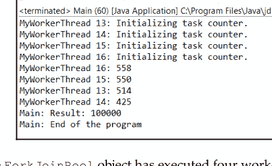

你可以看到 ForkJoinPool 对象已执行了四个 worker 线程，以及每个线程执行了多少个任务。

## 还有更多...

请注意，`ForkJoinWorkerThread` 类提供的 `onTermination()` 方法在线程正常结束或抛出异常时调用。该方法接收一个 `Throwable` 对象作为参数。如果参数取空值，则 worker 线程正常结束；然而，如果参数取一个值，则线程抛出异常。你必须包含必要的代码来处理这种情况。

## 另请参阅

- `Chapter 5, Fork/Join Framework` 中的 *Creating a fork/join pool* 示例
- `Chapter 1, Thread Management` 中的 *Creating threads through a factory* 示例

## 自定义 fork/join 框架中运行的任务

`Executor` 框架将任务创建与其执行分离。使用它时，你只需实现 `Runnable` 对象并使用 `Executor` 对象。你只需将 `Runnable` 任务发送给执行器，它就会创建、管理和完成执行这些任务所需的线程。

Java 9 在 fork/join 框架中提供了一种特殊的执行器类型（在 Java 7 中引入）。该框架旨在解决可使用分而治之技术分解为更小任务的问题。在任务内部，你必须检查要解决的问题的大小；如果它大于已建立的大小，你将问题分解为两个或多个任务并使用框架执行它们。如果问题的大小小于已建立的大小，你将直接在任务中解决该问题；可选地，它会返回一个结果。fork/join 框架实现了工作窃取算法，从而提高了这类问题的整体性能。

fork/join 框架的主类是 `ForkJoinPool` 类。内部，它具有以下两个元素：

- 等待执行的任务队列
- 执行任务的线程池

默认情况下，ForkJoinPool 类执行的任务是 ForkJoinTask 类的对象。你也可以将 Runnable 和 Callable 对象发送到 ForkJoinPool 类，但它们无法利用 fork/join 框架的所有优势。通常，你会将 ForkJoinTask 类的两个子类之一发送到 ForkJoinPool 对象：

- RecursiveAction：如果你的任务不返回结果
- RecursiveTask：如果你的任务返回结果

在本示例中，你将学习如何通过实现扩展 ForkJoinTask 类的任务来实现自己的 fork/join 框架任务。你将要实现的任务测量并在控制台中写入其执行时间，以便你可以控制其演变。你也可以实现自己的 fork/join 任务来写入日志信息、获取任务中使用的资源或后处理任务的结果。

## 如何操作...

按照以下步骤实现示例：

1. 创建一个名为 MyWorkerTask 的类并指定它扩展了参数化为 Void 类型的 ForkJoinTask 类：

```
public abstract class MyWorkerTask extends ForkJoinTask<Void> {
```

2. 声明一个名为 name 的私有 String 属性以存储任务的名称：

```
private String name;
```

3. 实现类的构造函数以初始化其属性：

```
public MyWorkerTask(String name) {
    this.name=name;
}
```

4. 实现 getRawResult() 方法。这是 ForkJoinTask 类的抽象方法之一。由于 MyWorkerTask 任务不会返回任何结果，因此此方法必须返回 null：

```
@Override
public Void getRawResult() {
    return null;
}
```


5. 实现 `setRawResult()` 方法。这是 `ForkJoinTask` 类的另一个抽象方法。由于 `MyWorkerTask` 任务不会返回任何结果，将此方法体留空：

```
@Override
protected void setRawResult(Void value) {

}
```

6. 实现 `exec()` 方法。这是任务的主要方法。在此情况下，将任务的逻辑委托给 `compute()` 方法。计算此方法执行时间并将其写入控制台：

```
@Override
protected boolean exec() {
    Date startDate=new Date();
    compute();
    Date finishDate=new Date();
    long diff=finishDate.getTime()-startDate.getTime();
    System.out.printf("MyWorkerTask: %s : %d Milliseconds to complete.\n",name,diff);
    return true;
}
```

7. 实现 `getName()` 方法以返回任务的名称：

```
public String getName() {
    return name;
}
```

8. 声明抽象方法 `compute()`。如前所述，此方法将实现任务的逻辑，并且必须由 `MyWorkerTask` 类的子类实现：

```
protected abstract void compute();
```

9. 创建一个名为 `Task` 的类并继承 `MyWorkerTask` 类：

```
public class Task extends MyWorkerTask {
```

10. 声明一个名为 `array` 的私有 `int` 值数组：

```
private int array[];
```

11. 实现类的构造函数以初始化其属性：

```
public Task(String name, int array[], int start, int end){
    super(name);
    this.array=array;
    this.start=start;
    this.end=end;
}
```

12. 实现 `compute()` 方法。此方法递增由 `start` 和 `end` 属性确定的数组元素块。如果此元素块多于 100 个元素，则将块分为两部分并创建两个 `Task` 对象来处理每个部分。使用 `invokeAll()` 方法将这些任务发送到池中：

```
protected void compute() {
    if (end-start>100){
        int mid=(end+start)/2;
        Task task1=new Task(this.getName()+"1",array,start,mid);
        Task task2=new Task(this.getName()+"2",array,mid,end);
        invokeAll(task1,task2);
```

13. 如果元素块少于 100 个元素，则使用 `for` 循环递增所有元素：

```
} else {
    for (int i=start; i<end; i++) {
        array[i]++;
    }
}
```

14. 最后，使执行任务的线程休眠 50 毫秒：

```
try {
    Thread.sleep(50);
} catch (InterruptedException e) {
    e.printStackTrace();
}
}
```

15. 接下来，通过创建名为 `Main` 的类并包含 `main()` 方法来实现示例的主类：

```
public class Main {
    public static void main(String[] args) throws Exception {
```

16. 创建一个包含 10,000 个元素的 `int` 数组：

```
int array[]=new int[10000];
```

17. 创建一个名为 `pool` 的 `ForkJoinPool` 对象：

```
ForkJoinPool pool=new ForkJoinPool();
```

18. 创建一个 `Task` 对象以递增数组中的所有元素。构造函数的参数为任务的名称 `Task`、数组对象以及值 0 和 10000，以指示此任务必须处理整个数组：

```
Task task=new Task("Task",array,0,array.length);
```

19. 使用 `execute()` 方法将任务发送到池中：

```
pool.invoke(task);
```

20. 使用 `shutdown()` 方法关闭池：

```
pool.shutdown();
```

21. 在控制台中写入一条消息以指示程序结束：

```
System.out.printf("Main: End of the program.\n");
```

## How it works...

在本教程中，你实现了继承 `ForkJoinTask` 类的 `MyWorkerTask` 类。它是你自己的基类，用于实现可以在 `ForkJoinPool` 执行器中执行的任务，并且可以利用执行器的所有好处，因为它是一种工作窃取算法。此类等同于 `RecursiveAction` 和 `RecursiveTask` 类。

当你扩展 `ForkJoinTask` 类时，必须实现以下三个方法：

- setRawResult(): 此方法用于建立任务的结果。由于你的任务不返回任何结果，请将此方法留空。
- getRawResult(): 此方法用于返回任务的结果。由于你的任务不返回任何结果，此方法返回 `null`。
- `exec()`: 此方法实现任务的逻辑。在此情况下，你将逻辑委托给抽象的 `compute()` 方法（如 `RecursiveAction` 和 `RecursiveTask` 类）。然而，在 `exec()` 方法中，你测量方法执行时间并将其写入控制台。

最后，在示例的主类中，你创建了一个包含 10,000 个元素的数组、一个 `ForkJoinPool` 执行器以及一个用于处理整个数组的 `Task` 对象。执行程序，你将看到不同的任务在执行时在其控制台中写入其执行时间。

## See also

- 第 5 章 Fork/Join Framework 中的 Creating a fork/join pool 教程
- 本章中 Implementing the ThreadFactory interface to generate custom threads for the fork/join framework 教程

## Implementing a custom Lock class

锁是 Java 并发 API 提供的最基本的同步机制之一。它们允许程序员保护代码的关键区，以便一次只有一个线程可以执行该代码块。它提供以下两种操作：

- `lock()`: 当你想要访问关键区时调用此操作。如果有另一个线程正在运行此关键区，其他线程将被阻塞，直到锁唤醒它们以获取对关键区的访问权限。
- `unlock()`: 在关键区结束时调用此操作以允许其他线程访问它。

在 Java 并发 API 中，锁在 `Lock` 接口中声明并在某些类中实现，例如 `ReentrantLock` 类。

在本教程中，你将学习如何通过实现实现 `Lock` 接口的类来实现自己的 `Lock` 对象，以保护关键区。

## Getting ready

本教程的示例使用 Eclipse IDE 实现。如果使用 Eclipse 或其他 IDE，例如 NetBeans，请打开它并创建一个新的 Java 项目。

## How to do it...

按照以下步骤实现示例：

1. 创建一个名为 `MyAbstractQueuedSynchronizer` 的类并扩展 `AbstractQueuedSynchronizer` 类：
```
public class MyAbstractQueuedSynchronizer extends
    AbstractQueuedSynchronizer {
```
2. 声明一个名为 `state` 的私有 `AtomicInteger` 属性：
```
private final AtomicInteger state;
```
3. 实现类的构造函数以初始化其属性：
```
public MyAbstractQueuedSynchronizer() {
    state=new AtomicInteger(0);
}
```
4. 实现 `tryAcquire()` 方法。此方法尝试将 `state` 变量的值从零更改为一。如果成功，则返回 `true` 值；否则返回 `false`：
```
@Override
protected boolean tryAcquire(int arg) {
    return state.compareAndSet(0, 1);
}
```
5. 实现 `tryRelease()` 方法。此方法尝试将 `state` 变量的值从一更改为零。如果成功，则返回 `true`；否则返回 `false`：
```
@Override
protected boolean tryRelease(int arg) {
    return state.compareAndSet(1, 0);
}
```
6. 创建一个名为 `MyLock` 的类并指定其实现 `Lock` 接口：
```
public class MyLock implements Lock{
```
7. 声明一个名为 `sync` 的私有 `AbstractQueuedSynchronizer` 属性：
```
private final AbstractQueuedSynchronizer sync;
```
8. 实现类的构造函数以使用新的 `MyAbstractQueuedSynchronizer` 对象初始化 `sync` 属性：
```
public MyLock() {
    sync=new MyAbstractQueueSynchronizer();
}
```
9. 实现 `lock()` 方法。调用 `sync` 对象的 `acquire()` 方法：
```
@Override
public void lock() {
    sync.acquire(1);
}
```
10. 实现 `lockInterruptibly()` 方法。调用 `sync` 对象的 `acquireInterruptibly()` 方法：
```
@Override
public void lockInterruptibly() throws InterruptedException {
    sync.acquireInterruptibly(1);
}
```
11. 实现 `tryLock()` 方法。调用 `sync` 对象的 `tryAcquireNanos()` 方法：
```
@Override
public boolean tryLock() {
    try {
        return sync.tryAcquireNanos(1, 1000);
    } catch (InterruptedException e) {
        e.printStackTrace();
        Thread.currentThread().interrupt();
        return false;
    }
}
```


12. 实现另一个带有两个参数的 tryLock() 方法：一个名为 time 的 long 参数和一个名为 unit 的 TimeUnit 参数。调用 sync 对象的 tryAcquireNanos() 方法：

```
@Override
public boolean tryLock(long time, TimeUnit unit) throws InterruptedException {
    return sync.tryAcquireNanos(1, TimeUnit.NANOSECONDS
        .convert(time, unit));
}
```

13. 实现 unlock() 方法。调用 sync 对象的 release() 方法：

```
@Override
public void unlock() {
    sync.release(1);
}
```

14. 实现 newCondition() 方法。创建一个 sync 对象的内部类的新对象，即 ConditionObject：

```
@Override
public Condition newCondition() {
    return sync.newCondition();
}
```

15. 创建一个名为 Task 的类并指定其实现 Runnable 接口：

```
public class Task implements Runnable {
```

16. 声明一个名为 lock 的私有 MyLock 属性：

```
private final MyLock lock;
```

17. 声明一个名为 name 的私有 String 属性：

```
private final String name;
```

18. 实现类的构造函数以初始化其属性：

```
public Task(String name, MyLock lock){
    this.lock=lock;
    this.name=name;
}
```

19. 实现类的 run() 方法。获取锁，将线程休眠 2 秒，然后释放锁对象：

```
@Override
public void run() {
    lock.lock();
    System.out.printf("Task: %s: Take the lock\n",name);
    try {
        TimeUnit.SECONDS.sleep(2);
        System.out.printf("Task: %s: Free the lock\n",name);
    } catch (InterruptedException e) {
        e.printStackTrace();
    } finally {
        lock.unlock();
    }
}
```

20. 通过创建名为 Main 的类并包含 main() 方法来实现示例的主类：

```
public class Main {
    public static void main(String[] args) {
```

21. 创建一个名为 lock 的 MyLock 对象：

```
MyLock lock=new MyLock();
```

22. 创建并执行 10 个 Task 任务：

```
for (int i=0; i<10; i++){
    Task task=new Task("Task-"+i,lock);
    Thread thread=new Thread(task);
    thread.start();
}
```

23. 使用 tryLock() 方法尝试获取锁。等待一秒，如果未获取到锁，则写入一条消息并重试：

```
boolean value;
do {
    try {
        value=lock.tryLock(1,TimeUnit.SECONDS);
        if (!value) {
            System.out.printf("Main: Trying to get the Lock\n");
        }
    } catch (InterruptedException e) {
        e.printStackTrace();
    }
    value=false;
} while (!value);
```

24. 写入一条获取到锁的消息并释放它：

```
System.out.printf("Main: Got the lock\n");
lock.unlock();
```

25. 写入一条表示程序结束的消息：

```
System.out.printf("Main: End of the program\n");
```

## 它是如何工作的...

Java 并发 API 提供了一个类，可用于实现具有锁或信号量功能的同步机制。它被称为 AbstractQueuedSynchronizer，顾名思义，它是一个抽象类。它提供操作来控制对临界区的访问并管理等待访问该区的被阻塞线程队列。这些操作基于两个抽象方法：

- tryAcquire()：此方法用于尝试获取对临界区的访问。如果调用它的线程可以访问临界区，则该方法返回 true 值。否则，它返回 false 值。
- tryRelease()：此方法用于尝试释放对临界区的访问。如果调用它的线程可以释放访问，则该方法返回 true 值。否则，它返回 false 值。

在这些方法中，你必须实现用于控制对临界区访问的机制。在这种情况下，你实现了扩展 AbstractQueuedSynchronizer 类的 MyAbstractQueuedSynchronizer 类，并使用 AtomicInteger 变量实现抽象方法来控制对临界区的访问。此变量将在锁空闲时存储值 0，因此线程可以访问临界区，并在锁被占用时存储值 1，因此线程无法访问临界区。

你使用了 AtomicInteger 类提供的 compareAndSet() 方法，该方法尝试将你作为第一个参数指定的值更改为你作为第二个参数指定的值。为了实现 tryAcquire() 方法，你尝试将原子变量的值从零更改为一。同样，为了实现 tryRelease() 方法，你尝试将原子变量的值从一更改为零。

你必须实现 `AtomicInteger` 类，因为 `AbstractQueuedSynchronizer` 类的其他实现（例如 `ReentrantLock` 使用的实现）是作为内部私有类实现的。这是在使用它的类中完成的，因此你无法访问它。

然后，你实现了 `MyLock` 类。此类实现 `Lock` 接口并具有 `MyQueuedSynchronizer` 对象作为属性。为了实现 `Lock` 接口的所有方法，你使用了 `MyQueuedSynchronizer` 对象的方法。

最后，你实现了实现 `Runnable` 接口的 `Task` 类，并使用 `MyLock` 对象获取对临界区的访问。此临界区使线程休眠 2 秒。`main` 类创建一个 `MyLock` 对象并运行 10 个共享锁的 `Task` 对象。`main` 类还使用 `tryLock()` 方法尝试获取对锁的访问。

当你执行示例时，可以看到只有一条线程可以访问临界区，并且当该线程完成后，另一条线程会获得访问权限。

你可以使用自己的 `Lock` 接口来记录其使用情况的日志消息，控制其被锁定的时间，或实现高级同步机制来控制例如对资源的访问，使其仅在特定时间可用。

## 还有更多...

`AbstractQueuedSynchronizer` 类提供了两个可用于管理锁状态的方法。它们是 `getState()` 和 `setState()` 方法。这些方法接收并返回一个整数值，表示锁的状态。你本可以使用它们代替 `AtomicInteger` 属性来存储锁的状态。

Java 并发 API 提供了另一个用于实现同步机制的类。它是 `AbstractQueuedLongSynchronizer` 类，它等同于 `AbstractQueuedSynchronizer`，但使用 long 属性来存储线程的状态。

## 另请参阅

- `Chapter 2`，*Basic Thread Synchronization* 中 *Synchronizing a block of code with locks* 食谱

## 基于优先级的传输队列实现

Java 9 API 提供了多种用于并发应用程序的数据结构。其中，我们想重点介绍以下两种数据结构：

- LinkedTransferQueue：此数据结构被认为用于具有生产者/消费者结构的程序中。在此类应用程序中，你有一个或多个数据生产者和一个或多个数据消费者，并且一个数据结构被所有它们共享。生产者将数据放入数据结构，消费者从中取出。如果数据结构为空，消费者将被阻塞，直到有数据可消费。如果它已满，生产者将被阻塞，直到有空间放置数据。
- PriorityBlockingQueue：在此数据结构中，元素以有序方式存储。它们必须实现 Comparable 接口的 compareTo() 方法。当你将元素插入结构时，它会与结构中的元素进行比较，直到找到其位置。

LinkedTransferQueue 的元素按到达顺序存储，因此先到达的元素先被消费。在你想要开发生产者/消费者程序时，数据按某种优先级而不是到达时间被消费，这可能是这种情况。在本食谱中，你将学习如何实现一个可用于生产者/消费者问题的数据结构，其元素按优先级排序；优先级更高的元素将先被消费。

## 准备工作

本食谱的示例已使用 Eclipse IDE 实现。如果你使用 Eclipse 或其他 IDE，例如 NetBeans，请打开它并创建一个新的 Java 项目。

## 如何操作...

按照以下步骤实现示例：

1. 创建一个名为 MyPriorityTransferQueue 的类，使其扩展 PriorityBlockingQueue 类并实现 TransferQueue 接口：

```
public class MyPriorityTransferQueue<E> extends
    PriorityBlockingQueue<E> implements TransferQueue<E> {
```


+   2. 声明一个名为 counter 的私有 AtomicInteger 属性，用于存储等待消费元素的消费者数量：

```
private final AtomicInteger counter;
```

+   3. 声明一个名为 transferred 的私有 LinkedBlockingQueue 属性：

```
private final LinkedBlockingQueue<E> transferred;
```

+   4. 声明一个名为 lock 的私有 ReentrantLock 属性：

```
private final ReentrantLock lock;
```

+   5. 实现类的构造函数以初始化其属性：

```
public MyPriorityTransferQueue() {
    counter=new AtomicInteger(0);
    lock=new ReentrantLock();
    transferred=new LinkedBlockingQueue<E>();
}
```

+   6. 实现 tryTransfer() 方法。此方法尝试立即将元素发送给等待的消费者，如果可能的话。如果没有消费者在等待，该方法返回 false：

```
@Override
public boolean tryTransfer(E e) {
    boolean value=false;
    try {
        lock.lock();
        if (counter.get() == 0) {
            value = false;
        } else {
            put(e);
            value = true;
        }
    } finally {
        lock.unlock();
    }
    return value;
}
```

7. 实现 transfer() 方法。此方法尝试立即将元素发送给等待的消费者，如果可能的话。如果没有消费者在等待，该方法将元素存储在特殊队列中以发送给第一个尝试获取元素的消费者，并阻塞线程直到元素被消费：

```
@Override
public void transfer(E e) throws InterruptedException {
    lock.lock();
    if (counter.get() != 0) {
        try {
            put(e);
        } finally {
            lock.unlock();
        }
    } else {
        try {
            transferred.add(e);
        } finally {
            lock.unlock();
        }
        synchronized (e) {
            e.wait();
        }
    }
}
```

8. 实现接收三个参数的 tryTransfer() 方法：元素、如果没有消费者则等待的时间、以及用于指定等待时间的单位。如果有消费者在等待，则立即发送元素。否则，将指定的时间转换为毫秒并使用 wait() 方法使线程休眠。当消费者取走元素时，如果线程在 wait() 方法中休眠，则需要使用 notify() 方法唤醒它，如稍后将看到的：

```
@Override
public boolean tryTransfer(E e, long timeout, TimeUnit unit)
        throws InterruptedException {
    lock.lock();
    if (counter.get() != 0) {
        try {
            put(e);
        } finally {
            lock.unlock();
        }
        return true;
    } else {
```

```
long newTimeout=0;
try {
    transferred.add(e);
    newTimeout = TimeUnit.MILLISECONDS.convert(timeout, unit);
} finally {
    lock.unlock();
}
e.wait(newTimeout);
lock.lock();
boolean value;
try {
    if (transferred.contains(e)) {
        transferred.remove(e);
        value = false;
    } else {
        value = true;
    }
} finally {
    lock.unlock();
}
return value;
}
```

9. 实现 hasWaitingConsumer() 方法。使用 counter 属性的值来计算此方法的返回值。如果 counter 的值大于零，则返回 true；否则返回 false：

```
@Override
public boolean hasWaitingConsumer() {
    return (counter.get()!=0);
}
```

10. 实现 getWaitingConsumerCount() 方法。返回 counter 属性的值：

```
@Override
public int getWaitingConsumerCount() {
    return counter.get();
}
```

11. 实现 take() 方法。此方法由消费者在想要消费元素时调用。首先，获取前面定义的锁并增加等待消费者的数量：

```
@Override
public E take() throws InterruptedException {
```

```
lock.lock();
try {
    counter.incrementAndGet();
```

12. 如果 transferred 队列中没有元素，则释放锁并尝试使用 take() 元素从队列中获取元素并再次获取锁。如果队列中没有元素，此方法将使线程休眠直到有元素可供消费：

```
E value=transferred.poll();
if (value==null) {
    lock.unlock();
    value=super.take();
    lock.lock();
```

13. 否则，从 transferred 队列中取出元素并唤醒正在等待消费该元素的线程（如果有）。请注意，你正在同步一个从外部传入到此类对象的对象。你必须保证该对象不会在应用程序的其他部分用于锁定：

```
} else {
    synchronized (value) {
        value.notify();
    }
}
```

14. 最后，递减等待消费者的计数器并释放锁：

```
counter.decrementAndGet();
} finally {
    lock.unlock();
}
return value;
}
```

15. 接下来，实现一个名为 Event 的类，该类扩展了参数化为 Event 类的 Comparable 接口：

```
public class Event implements Comparable<Event> {
```

16. 声明一个名为 thread 的私有 String 属性，用于存储创建事件的线程的名称：

```
private final String thread;
```

17. 声明一个名为 priority 的私有 int 属性，用于存储事件的优先级：

```
private final int priority;
```

18. 实现类的构造函数以初始化其属性：

```
public Event(String thread, int priority){
    this.thread=thread;
    this.priority=priority;
}
```

19. 实现一个方法来返回 thread 属性的值：

```
public String getThread() {
    return thread;
}
```

20. 实现一个方法来返回 priority 属性的值：

```
public int getPriority() {
    return priority;
}
```

21. 实现 compareTo() 方法。此方法比较实际事件与作为参数接收的事件。如果实际事件的优先级高于参数，则返回 -1；如果实际事件的优先级低于参数，则返回 1；如果两个事件的优先级相同，则返回 0。你将按降序获得按优先级排序的列表。优先级更高的事件将首先存储在队列中：

```
public int compareTo(Event e) {
    return Integer.compare(e.priority, this.getPriority());
}
```

22. 实现一个名为 Producer 的类，该类实现 Runnable 接口：

```
public class Producer implements Runnable {
```

23. 声明一个参数化为 Event 类的私有 MyPriorityTransferQueue 属性 named buffer，用于存储此生产者生成的事件：

```
private final MyPriorityTransferQueue<Event> buffer;
```

24. 实现类的构造函数以初始化其属性：

```
public Producer(MyPriorityTransferQueue<Event> buffer) {
    this.buffer=buffer;
}
```

25. 实现类的 run() 方法。使用其创建顺序作为优先级（最新的事件将具有最高优先级）创建 100 个 Event 对象，并使用 put() 方法将它们插入队列：

```
@Override
public void run() {
    for (int i=0; i<100; i++) {
        Event event=new Event(Thread.currentThread().getName(), i);
        buffer.put(event);
    }
}
```

26. 实现一个名为 Consumer 的类，该类实现 Runnable 接口：

```
public class Consumer implements Runnable {
```

27. 声明一个参数化为 Event 类的私有 MyPriorityTransferQueue 属性 named buffer，用于获取此类消费的事件：

```
private final MyPriorityTransferQueue<Event> buffer;
```

28. 实现类的构造函数以初始化其属性：

```
public Consumer(MyPriorityTransferQueue<Event> buffer) {
    this.buffer=buffer;
}
```

29. 实现 run() 方法。它使用 take() 方法消费 1,002 个事件（示例中生成的所有事件）并在控制台中写入生成事件的线程数量及其优先级：

```
@Override
public void run() {
    for (int i=0; i<1002; i++) {
        try {
            Event value=buffer.take();
            System.out.printf("Consumer: %s: %d\n",value.getThread(),
                value.getPriority());
        } catch (InterruptedException e) {
            e.printStackTrace();
        }
    }
}
```


30. 通过创建一个名为 Main 的类并包含 main() 方法来实现示例的主类：

```
public class Main {

    public static void main(String[] args) throws Exception {
```

31. 创建一个名为 buffer 的 MyPriorityTransferQueue 对象：

```
MyPriorityTransferQueue<Event> buffer=new
    MyPriorityTransferQueue<Event>();
```

32. 创建一个 Producer 任务并启动 10 个线程来执行此任务：

```
Producer producer=new Producer(buffer);
Thread producerThreads[]=new Thread[10];
for (int i=0; i<producerThreads.length; i++) {
    producerThreads[i]=new Thread(producer);
    producerThreads[i].start();
}
```

33. 创建并启动一个 Consumer 任务：

```
Consumer consumer=new Consumer(buffer);
Thread consumerThread=new Thread(consumer);
consumerThread.start();
```

34. 在控制台中写入实际的消费者数量：

```
System.out.printf("Main: Buffer: Consumer count: %d\n",
    buffer.getWaitingConsumerCount());
```

35. 使用 transfer() 方法向消费者传输一个事件：

```
Event myEvent=new Event("Core Event",0);
buffer.transfer(myEvent);
System.out.printf("Main: My Event has been transferred.\n");
```

36. 使用 join() 方法等待生产者完成：

```
for (int i=0; i<producerThreads.length; i++) {
    try {
        producerThreads[i].join();
    } catch (InterruptedException e) {
        e.printStackTrace();
    }
}
```

37. 让线程休眠 1 秒：

```
TimeUnit.SECONDS.sleep(1);
```

38. 写入实际的消费者数量：

```
System.out.printf("Main: Buffer: Consumer count: %d\n", buffer.getWaitingConsumerCount());
```

39. 使用 transfer() 方法传输另一个事件：

```
myEvent=new Event("Core Event 2",0);
buffer.transfer(myEvent);
```

40. 使用 join() 方法等待消费者完成：

```
consumerThread.join();
```

41. 写入表示程序结束的消息：

```
System.out.printf("Main: End of the program\n");
```

## 它是如何工作的...

在本示例中，你实现了 MyPriorityTransferQueue 数据结构。它是一种用于生产者/消费者问题的数据结构，但其元素按优先级排序，而不是按到达顺序排序。由于 Java 不允许多重继承，你做出的第一个决定与 MyPriorityTransferQueue 类的基类有关。你扩展该类以使用 PriorityBlockingQueue 中实现的操作，而不是自行实现它们。你还实现了 TransferQueue 接口以添加与生产者/消费者相关的 方法。我们做出这一选择是因为我们认为实现 TransferQueue 接口的方法比 PriorityBlockingQueue 类中实现的方法更容易实现。但是，你可以实现一个扩展自 LinkedTransferQueue 类并实现必要方法的类，以获得你自己的 PriorityBlockingQueue 类版本。

`MyPriorityTransferQueue` 类具有以下三个属性：

- 一个名为 `counter` 的 `AtomicInteger` 属性：该属性存储等待从数据结构中取出元素的消费者数量。当消费者调用 `take()` 操作从数据结构中取出元素时，计数器会递增。当消费者完成 `take()` 操作的执行时，计数器会再次递减。该计数器用于实现 `hasWaitingConsumer()` 和 `getWaitingConsumerCount()` 方法。
- 一个名为 `lock` 的 `ReentrantLock` 属性：该属性用于控制对已实现操作的访问。根据该属性，只允许一个线程使用数据结构。
- 最后，它有一个 `LinkedBlockingQueue` 列表来存储已传输的元素。

你在 `MyPriorityTransferQueue` 中实现了一些方法。所有方法都在 `TransferQueue` 接口中声明，而 `take()` 方法在 `PriorityBlockingQueue` 接口中实现。两者之前已描述过。以下是其余部分的描述：

- `tryTransfer(E e)`：此方法尝试直接将元素发送给消费者。如果有消费者正在等待，它会将元素存储在优先级队列中以便消费者立即消费，然后返回 `true` 值。如果没有人等待，它返回 `false` 值。
- `transfer(E e)`：此方法将元素直接传输给消费者。如果有消费者正在等待，它会将元素存储在优先级队列中以便消费者立即消费。否则，元素会存储在已传输元素的列表中，并且线程会被阻塞直到元素被消费。在线程被置于睡眠期间，你必须释放锁，因为，如果不这样做，你将阻塞队列。
- `tryTransfer(E e, long timeout, TimeUnit unit)`：此方法与 `transfer()` 方法类似，但在此方法中，线程会阻塞由其参数确定的时间段。在线程被置于睡眠期间，你必须释放锁，因为，如果不这样做，你将阻塞队列。
- `take()`：此方法返回下一个要消费的元素。如果已传输元素的列表中有元素，则元素将从列表中取出。否则，它将从优先级队列中取出。

在实现数据结构后，你实现了 Event 类。它是存储在数据结构中的元素的类。Event 类有两个属性来存储生产者的 ID 和事件的优先级，并且它实现了 Comparable 接口，因为这是数据结构的要求。

然后，你实现了 Producer 和 Consumer 类。在示例中，你有 10 个生产者和一个消费者，它们共享同一个缓冲区。每个生产者生成 100 个具有递增优先级的事件，因此优先级更高的事件是最后生成的事件。

示例的主类创建了一个 MyPriorityTransferQueue 对象、10 个生产者和一个消费者，并使用 MyPriorityTransferQueue 缓冲区的 transfer() 方法向缓冲区传输了两个事件。

以下屏幕截图显示了程序执行输出的一部分：

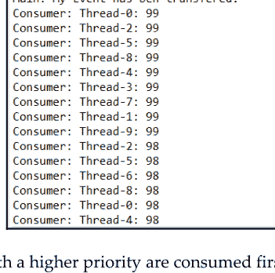

你可以看到优先级更高的事件如何先被消费，以及消费者如何消费已传输的事件。

## 另请参阅

- 第 7 章 *Concurrent Collections* 中 *Using blocking thread-safe queue ordered by priority* 和 *Using blocking thread-safe deques* 示例

## 实现你自己的原子对象

原子变量是在 Java 版本 5 中引入的；它们为单个变量提供原子操作。当线程对原子变量执行操作时，类的实现包含一种机制来检查操作是否以原子方式完成。

在本示例中，你将学习如何扩展原子对象并实现两个遵循原子对象的机制的操作，以保证所有操作都一步完成。

## 准备工作

本示例使用 Eclipse IDE 实现。如果使用 Eclipse 或其他 IDE，例如 NetBeans，请打开它并创建一个新的 Java 项目。

## 如何操作...

按照以下步骤实现示例：

1. 创建一个名为 `ParkingCounter` 的类并指定它扩展 `AtomicInteger` 类：

```
public class ParkingCounter extends AtomicInteger {
```

2. 声明一个私有 int 属性名为 `maxNumber`，用于存储允许进入停车场的汽车的最大数量：

```
private final int maxNumber;
```

3. 实现类的构造函数以初始化其属性：

```
public ParkingCounter(int maxNumber){
    set(0);
    this.maxNumber=maxNumber;
}
```

4. 实现 carIn() 方法。此方法在计数器的值小于已建立的最大值时递增汽车计数器。构造一个无限循环并使用 get() 方法获取内部计数器的值：

```
public boolean carIn() {
    for (;;) {
        int value=get();
```

5. 如果值等于 maxNumber 属性，则计数器不能递增（停车场已满，汽车无法进入）。在这种情况下，方法返回 false 值：

```
if (value==maxNumber) {
    System.out.printf("ParkingCounter: The parking lot is full.\n");
    return false;
```

6. 否则，递增值并使用 compareAndSet() 方法将旧值更改为新值。此方法返回 false 值；计数器未递增，因此你必须重新开始循环。如果它返回 true，则表示更改已完成，然后你返回 true 值：

```
} else {
    int newValue=value+1;
    boolean changed=compareAndSet(value,newValue);
    if (changed) {
        System.out.printf("ParkingCounter: A car has entered.\n");
        return true;
    }
}
}
```

7. 实现 carOut() 方法。此方法在计数器的值大于 0 时递减汽车计数器。构造一个无限循环并使用 get() 方法获取内部计数器的值：

```
public boolean carOut() {
    for (;;) {
        int value=get();
        if (value==0) {
    System.out.printf("ParkingCounter: The parking lot is
                empty.\n");
        return false;
```


} else {
    int newValue=value-1;
    boolean changed=compareAndSet(value,newValue);
    if (changed) {
        System.out.printf("ParkingCounter: A car has gone out.\n");
        return true;
    }
}
}

8. 创建一个名为 Sensor1 的类，实现 Runnable 接口：

```
public class Sensor1 implements Runnable {
```

9. 声明一个名为 counter 的私有 ParkingCounter 属性：

```
private final ParkingCounter counter;
```

10. 实现该类的构造函数以初始化其属性：

```
public Sensor1(ParkingCounter counter) {
    this.counter=counter;
}
```

11. 实现 run() 方法。多次调用 carIn() 和 carOut() 操作：

```
@Override
public void run() {
    counter.carIn();
    counter.carIn();
    counter.carIn();
    counter.carIn();
    counter.carOut();
    counter.carOut();
    counter.carOut();
    counter.carIn();
    counter.carIn();
    counter.carIn();
}
```

12. 创建一个名为 Sensor2 的类，实现 Runnable 接口：

```
public class Sensor2 implements Runnable {
```

13. 声明一个名为 counter 的私有 ParkingCounter 属性：

```
private ParkingCounter counter;
```

14. 实现该类的构造函数以初始化其属性：

```
public Sensor2(ParkingCounter counter) {
    this.counter=counter;
}
```

15. 实现 run() 方法。多次调用 carIn() 和 carOut() 操作：

```
@Override
public void run() {
    counter.carIn();
    counter.carOut();
    counter.carOut();
    counter.carIn();
    counter.carIn();
    counter.carIn();
    counter.carIn();
    counter.carIn();
    counter.carIn();
}
```

16. 通过创建名为 Main 的类并包含 main() 方法来实现示例的主类：

```
public class Main {

    public static void main(String[] args) throws Exception {
```

17. 创建一个名为 counter 的 ParkingCounter 对象：

```
ParkingCounter counter=new ParkingCounter(5);
```

18. 创建并启动 Sensor1 和 Sensor2 任务：

```
Sensor1 sensor1=new Sensor1(counter);
Sensor2 sensor2=new Sensor2(counter);

Thread thread1=new Thread(sensor1);
Thread thread2=new Thread(sensor2);

thread1.start();
thread2.start();
```

19. 等待两个任务的完成：

```
thread1.join();
thread2.join();
```

20. 在控制台中写入计数器的实际值：

```
System.out.printf("Main: Number of cars: %d\n",counter.get());
```

21. 在控制台中写入表示程序结束的消息：

```
System.out.printf("Main: End of the program.\n");
```

## 如何工作...

ParkingCounter 类扩展了 AtomicInteger 类，并提供了两个原子操作：carIn() 和 carOut()。该示例模拟了一个控制停车场内车辆数量的系统。停车场可容纳的车辆数量由 maxNumber 属性表示。

carIn() 操作将停车场内的实际车辆数与最大值进行比较。如果两者相等，则车辆无法进入停车场，方法返回 false 值。否则，它使用原子操作的以下结构：

- 在局部变量中获取原子对象的值。
- 将新值存储在另一个变量中。
- 使用 compareAndSet() 方法尝试用新值替换旧值。如果该方法返回 true，则表示您作为参数发送的旧值就是变量的值；因此，它会更改值。操作以原子方式完成，因为 carIn() 方法返回 true。如果 compareAndSet() 方法返回 false，则表示您作为参数发送的旧值不是变量的值（其他线程已修改它）；因此，操作无法以原子方式完成。操作会重新开始，直到能够以原子方式完成。

carOut() 方法与 carIn() 方法类似。您还实现了两个 Runnable 对象，它们使用 carIn() 和 carOut() 方法来模拟停车活动。当您执行程序时，可以看到停车场的车辆数从未超过最大值。

## 另请参阅

- `Chapter 7` 中 *Concurrent Collections* 的 *Using atomic variables* 配方

## 实现自己的流生成器

流是一个数据序列，允许您以顺序或并行的方式对其应用一系列操作（通常用 lambda 表达式表示），以便过滤、转换、排序、归约或构建新的数据结构。它在 Java 8 中引入，是该版本引入的最重要的功能之一。

流基于 `Stream` 接口以及包含在 `java.util.stream` 包中的一些相关类和接口。它们还促使许多类中引入了新方法，以便从不同的数据结构生成流。您可以从实现 `Collection` 接口的每个数据结构创建 `Stream` 接口：从 `File`、`Directory`、`Array`，以及许多其他来源。

Java 还包含了从您自己的源创建流的不同机制。最重要的是：

- `Supplier` 接口：该接口定义了 `get()` 方法。当 `Stream` 需要处理另一个对象时，它将被调用。您可以使用 `Stream` 类的 `generate()` 静态方法从 `Supplier` 接口创建 `Stream`。请注意，此源可能是无限的，因此您必须使用 `limit()` 或类似方法来限制 `Stream` 中的元素数量。
- `Stream.Builder` 接口：该接口提供 `accept()` 和 `add()` 元素来向 `Stream` 添加元素，以及 `build()` 方法，该方法返回使用之前添加的元素创建的 `Stream` 接口。
- `Spliterator` 接口：该接口定义了遍历和拆分源元素的必要方法。您可以使用 `StreamSupport` 类的 `stream()` 方法生成 `Stream` 接口来处理 `Spliterator` 的元素。

在本章中，您将学习如何实现自己的 `Spliterator` 接口以及如何创建 `Stream` 接口来处理其数据。我们将使用元素矩阵进行工作。正常的 `Stream` 接口应一次处理一个元素，但我们将使用 `Spliterator` 类一次实现一行。

## 准备工作

本配方的示例使用 Eclipse IDE 实现。如果您使用 Eclipse 或其他 IDE，例如 NetBeans，请打开它并创建一个新的 Java 项目。

## 如何操作...

按照以下步骤实现示例：

- 1. 创建一个名为 `Item` 的类来存储矩阵中每个元素的信息。它将有三个私有属性：一个名为 `name` 的 `String` 属性和两个名为 `row` 和 `column` 的整数属性。创建获取和设置这些属性值的方法。此类的代码非常简单，因此此处不包含。
- 2. 创建一个名为 `MySpliterator` 的类。指定它实现参数化为 `Item` 类的 `Spliterator` 接口。此类有四个属性：一个名为 `items` 的 `Item` 对象矩阵和三个名为 `start`、`end` 和 `current` 的整数属性，用于存储此 `Spliterator` 接口将处理的第一个和最后一个元素以及当前正在处理的当前元素。实现该类的构造函数以初始化所有这些属性：
- 3. 实现 `characteristics()`。此方法将返回一个 `int` 值，描述 `Spliterator` 的行为。此值的含义将在后面的 *How it Works...* 部分中解释：

```
public class MySpliterator implements Spliterator<Item> {

    private Item[][] items;
    private int start, end, current;

    public MySpliterator(Item[][] items, int start, int end) {
        this.items=items;
        this.start=start;
        this.end=end;
        this.current=start;
    }
}
```

```
@Override
public int characteristics() {
    return ORDERED | SIZED | SUBSIZED;
}
```


4. 实现 `estimatedSize()`。此方法将返回由此 `Spliterator` 处理的元素数量。我们将通过结束和当前属性之间的差值来计算它：

```
@Override
public long estimateSize() {
    return end - current;
}
```

5. 现在实现 `tryAdvance()`。此方法将被调用以尝试处理 `Spliterator` 的一个元素。`tryAdvance()` 方法的输入参数是一个实现了 `Consumer` 接口的对象。它将由 Stream API 调用，因此我们只需要担心其实现。在我们的例子中，如本章介绍中所述，我们有一个 `Item` 对象的矩阵，我们每次处理一行。接收到的 `Consumer` 函数将处理一个 `Item` 对象。因此，如果 `Spliterator` 接口仍有元素要处理，我们将使用 `Consumer` 函数的 `accept()` 方法处理当前行的所有项目：

```
@Override
public boolean tryAdvance(Consumer<? super Item> consumer) {
    System.out.printf("MySpliterator.tryAdvance.start: %d, %d, %d\n", start,end,current);
    if (current < end) {
        for (int i=0; i<items[current].length; i++) {
            consumer.accept(items[current][i]);
        }
        current++;
        System.out.printf("MySpliterator.tryAdvance.end:true\n");
        return true;
    }
    System.out.printf("MySpliterator.tryAdvance.end:false\n");
    return false;
}
```

6. 现在实现 `forEachRemaining()`。此方法将接收 `Consumer` 接口的实现，并将此函数应用于 `Spliterator` 的剩余元素。在我们的例子中，我们将对所有剩余元素调用 `tryAdvance()` 方法：

```
@Override
public void forEachRemaining(Consumer<? super Item> consumer) {
    System.out.printf("MySpliterator.forEachRemaining.start\n");
    boolean ret;
    do {
```

```
ret=tryAdvance(consumer);
} while (ret);
System.out.printf("MySpliterator.forEachRemaining.end\n");
}
```

7. 最后，实现 trySplit()。此方法将由并行流调用以将 Spliterator 分成两个子集。它将返回一个新的 Spliterator 对象，其中包含将由另一个线程处理的那些元素。当前线程将处理剩余的元素。如果 spliterator 对象无法拆分，则必须返回 null 值。在我们的例子中，我们将计算我们要处理的元素的中间元素。第一半将由当前线程处理，第二半将由另一个线程处理：

```
@Override
public Spliterator<Item> trySplit() {
    System.out.printf("MySpliterator.trySplit.start\n");

    if (end-start<=2) {
        System.out.printf("MySpliterator.trySplit.end\n");
        return null;
    }
    int mid=start+((end-start)/2);
    int newStart=mid;
    int newEnd=end;
    end=mid;
    System.out.printf("MySpliterator.trySplit.end: %d, %d, %d, %d, %d\n",start, mid, end, newStart, newEnd, current);

    return new MySpliterator(items, newStart, newEnd);
}
```

8. 现在实现项目的 Main 类及其 main() 方法。首先，声明并初始化一个包含 10 行和 10 列 Item 对象的矩阵：

```
public class Main {

    public static void main(String[] args) {
        Item[][] items;
        items= new Item[10][10];

        for (int i=0; i<10; i++) {
            for (int j=0; j<10; j++) {
                items[i][j]=new Item();
                items[i][j].setRow(i);
                items[i][j].setColumn(j);
```

```
items[i][j].setName("Item "+i+" "+j);
}
```

9. 然后，创建一个 MySpliterator 对象来处理矩阵的所有元素：

```
MySpliterator mySpliterator=new MySpliterator(items, 0,
    items.length);
```

10. 最后，使用 StreamSupport 类的 stream() 方法从 Spliterator 创建一个流。将 true 值作为第二个参数传递以指示我们的流将是并行的。然后，使用 Stream 类的 forEach() 方法写入每个元素的信息：

```
StreamSupport.stream(mySpliterator, true).forEach( item -> {
    System.out.printf("%s: %s\n",Thread.currentThread()
        .getName(),item.getName());
});
}
```

## How it works...

此示例的主要元素是 Spliterator。此接口定义了可用于处理和划分元素源的方法，例如 Stream 对象的源。你很少需要直接使用 Spliterator 对象。只有当你想要不同的行为时——也就是说，如果你想实现自己的数据结构并从中创建 Stream——才使用 Spliterator 对象。

Spliterator 具有定义其行为的一组特征。它们如下：

- CONCURRENT: 数据源可以安全地并发修改
- DISTINCT: 数据源的所有元素都是不同的
- IMMUTABLE: 数据源中的元素可以添加、删除或替换
- NONNULL: 数据源中没有 null 元素
- ORDERED: 数据源的元素有 encounter 顺序
- SIZED: `estimateSize()` 方法返回的值是 Spliterator 的确切大小
- SORTED: Spliterator 的元素已排序
- SUBSIZED: 在调用 `trySplit()` 方法后，你可以获得 Spliterator 的两个部分的确切大小

在我们的例子中，我们使用 DISTINCT、IMMUTABLE、NONNULL、ORDERED、SIZED 和 SUBSIZED 特征定义了 Spliterator。

然后，我们实现了 Spliterator 接口定义的所有没有默认实现的方法：

- characteristics(): 此方法返回 Spliterator 对象的特征。具体来说，它返回一个整数值，你使用按位或运算符 (|) 在 Spliterator 对象的各个特征之间计算得出。请注意，返回的值应与 Spliterator 对象的实际特征一致。
- estimatedSize(): 此方法返回如果在当前时刻调用 `forEachRemaining()` 方法将要被处理的元素数量。在我们的例子中，我们返回了确切的值，因为我们知道它，但该方法的定义谈论的是估计大小。
- tryAdvance(): 此方法将指定的函数作为参数应用于下一个要处理的元素（如果有），并返回 true。如果没有元素要处理，则返回 false。在我们的例子中，此方法接收了一个处理 Item 对象的 Consumer，但我们一次处理一行 Item 对象。因此我们遍历了该行的所有项目并调用了 Consumer 的 accept() 方法。
- trySplit(): 此方法用于将当前 Spliterator 分成两个不同的部分，以便每个部分可以由不同的线程处理。在理想情况下，你应该将数据源分成两个元素数量相同的半部分。但是，在我们的例子中，我们计算了 start 和 end 索引之间的中间元素并生成了两个元素块。start 到 mid 元素部分由当前 Spliterator 处理，mid 到 end 元素部分由新的 Spliterator 对象处理。如果无法拆分数据源，此方法返回 null 值。在我们的例子中，Spliterator 只有两个元素，因此不会被拆分。

Spliterator 接口的其他方法具有默认实现，但我们重写了 `forEachRemaining()` 方法。此方法将接收的参数函数（Consumer 接口的实现）应用于尚未处理的 Spliterator 元素。我们实现了自己的版本以在控制台中写入消息。我们使用 `tryAdvance()` 方法来处理每个单独的项目。

以下屏幕截图显示了此示例输出的一部分：

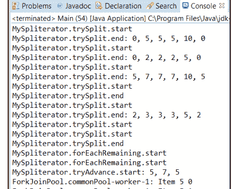

首先，调用 `trySplit()` 方法来划分数据源，然后调用 `forEachRemaining()` 方法来处理由 `trySplit()` 方法生成的每个 Splititerator 的所有元素。

## There's more...

你可以从不同的数据源获得 Splititerator 接口的实现。BaseStream 类提供了 `spliterator()` 方法，该方法返回来自 Stream 元素的 Splititerator。其他数据结构，例如 ConcurrentLinkedDeque、ConcurrentLinkedQueue 或 Collection，也提供 `spliterator()` 方法来获取该接口的实现以处理这些数据结构的元素。

## See also

- 第 6 章《Parallel and Reactive Streams》中的 Creating streams from different sources 配方


## 实现你自己的异步流

Reactive streams (http://www.reactive-streams.org/) 定义了一种提供异步流处理且具有非阻塞背压的机制。

Reactive streams 基于三个要素：

- 它是一个信息的发布者
- 它有一个或多个该信息的订阅者
- 它在发布者和消费者之间提供订阅

Java 9 已包含三个接口——Flow.Publisher、Flow.Subscriber 和 Flow.Subscription——以及一个实用类 SubmissionPublisher，以便我们实现响应式流应用程序。

在本教程中，你将学习如何仅使用三个接口来实现自己的响应式应用程序。需要考虑的是，我们将实现三个要素之间的预期行为。发布者只会向请求了元素的那些订阅者发送元素，并且会以并发的方式进行。但你可以通过修改方法的实现轻松地修改这种行为。

## 准备工作

本教程的示例使用 Eclipse IDE 实现。如果你使用 Eclipse 或其他 IDE，例如 NetBeans，请打开它并创建一个新的 Java 项目。

## 如何操作...

按照以下步骤实现示例：

- 1. 实现一个名为 News 的类。此类实现从发布者发送到订阅者的元素。它将有两个私有 String 属性，名为 title 和 content，以及一个名为 date 的 Date 属性。它还将具有获取和设置这些属性值的方法。此类的源代码非常简单，因此此处不包含。

- 2. 创建一个名为 Consumer 的类并指定它实现参数化为 News 类的 Subscriber 接口。它将有两个私有属性：一个名为 subscription 的 Subscription 对象和一个名为 name 的 String 属性。实现该类的构造函数以初始化 name 属性：

```
public class Consumer implements Subscriber<News> {
    private Subscription subscription;
    private String name;
    public Consumer(String name) {
        this.name=name;
    }
}
```

- 3. 实现 onComplete() 方法。当发布者不再发送任何额外元素时应调用此方法。在我们的例子中，我们只在控制台中写入一条消息：

```
@Override
public void onComplete() {
    System.out.printf("%s - %s: Consumer - Completed\n", name,
        Thread.currentThread().getName());
}
```

- 4. 实现 onError() 方法。当发生错误时，发布者应调用此方法。在我们的例子中，我们只在控制台中写入一条消息：

```
@Override
public void onError(Throwable exception) {
    System.out.printf("%s - %s: Consumer - Error: %s\n", name,
        Thread.currentThread().getName(),
        exception.getMessage());
}
```

- 5. 然后，实现 onNext()。此方法接收一个 News 对象作为参数，并且当他或她向订阅者发送一项时应由发布者调用。在我们的例子中，我们在控制台中写入 News 对象的属性值，并使用 Subscription 对象的 request() 方法请求额外的一项：

```
@Override
public void onNext(News item) {
    System.out.printf("%s - %s: Consumer - News\n", name,
        Thread.currentThread().getName());
```

```
System.out.printf("%s - %s: Title: %s\n", name,
    Thread.currentThread().getName(),
    item.getTitle());
System.out.printf("%s - %s: Content: %s\n", name,
    Thread.currentThread().getName(),
    item.getContent());
System.out.printf("%s - %s: Date: %s\n", name,
    Thread.currentThread().getName(),
    item.getDate());
subscription.request(1);
}
```

- 6. 最后，实现 onSubscription()。此方法将由发布者调用，并且是发布者调用的 Subscriber 的第一个方法。它接收发布者和订阅者之间的 Subscription。在我们的例子中，我们存储 Subscription 对象并使用 request() 方法请求订阅者处理的第一个项目：

```
@Override
public void onSubscribe(Subscription subscription) {
    this.subscription = subscription;
    subscription.request(1);
    System.out.printf("%s: Consumer - Subscription\n",
        Thread.currentThread().getName());
}
```

- 7. 实现一个名为 MySubscription 的类并指定它实现 Subscription 接口。它将有一个名为 canceled 的私有 Boolean 属性和一个名为 requested 的私有整数属性：

```
public class MySubscription implements Subscription {
    private boolean canceled=false;
    private long requested=0;
```

- 8. 实现 Subscription 接口提供的 cancel() 方法以取消发布者和订阅者之间的通信。在我们的例子中，我们将 canceled 属性设置为 true：

```
@Override
public void cancel() {
    canceled=true;
}
```

- 9. 实现 Subscription 接口提供的 request() 方法。此方法由订阅者用来向发布者请求元素。它接收订阅者请求的元素数量作为参数。在我们的例子中，我们增加 requested 属性的值：

```
@Override
public void request(long value) {
    requested+=value;
}
```

- 10. 实现 isCanceled() 方法以获取 canceled 属性的值，实现 getRequested() 方法以获取 requested 属性的值，以及 decreaseRequested() 以减少 requested 属性的值：

```
public boolean isCanceled() {
    return canceled;
}

public long getRequested() {
    return requested;
}

public void decreaseRequested() {
    requested--;
}
```

- 11. 实现一个名为 ConsumerData 的类。此类将由发布者用来存储每个订阅者的信息。它将有一个名为 consumer 的私有 Consumer 属性和一个名为 subscription 的私有 MySubscription 属性。它还将具有获取和设置这些属性值的方法。此类的源代码非常简单，因此此处不包含。

- 12. 实现一个名为 PublisherTask 的类并指定它实现 Runnable 接口。它将有一个名为 consumerData 的私有 ConsumerData 属性和一个名为 news 的私有 News 属性。实现构造函数以初始化这两个属性：

```
public class PublisherTask implements Runnable {

private ConsumerData consumerData;
private News news;

public PublisherTask(ConsumerData consumerData, News news) {
```

```
this.consumerData = consumerData;
this.news = news;
}
```

- 13. 实现 run() 方法。它将获取 ConsumerData 属性的 MySubscription 对象。如果订阅未被取消并且已请求元素（属性值大于 0），我们使用其 onNext() 方法将 News 对象发送给订阅者，然后递减 requested 属性的值：

```
@Override
public void run() {
    MySubscription subscription = consumerData.getSubscription();
    if (!(subscription.isCanceled() && (subscription.getRequested()
        > 0))) {
        consumerData.getConsumer().onNext(news);
        subscription.decreaseRequested();
    }
}
```

- 14. 然后，实现一个名为 MyPublisher 的类并指定它实现参数化为 News 类的 Publisher 接口。它将存储一个 ConsumerData 对象的 ConcurrentLinkedDeque 和一个名为 executor 的 ThreadPoolExecutor 对象。实现该类的构造函数以初始化这两个属性：

```
public class MyPublisher implements Publisher<News> {

    private ConcurrentLinkedDeque<ConsumerData> consumers;
    private ThreadPoolExecutor executor;

    public MyPublisher() {
        consumers=new ConcurrentLinkedDeque<>();
        executor = (ThreadPoolExecutor)Executors.newFixedThreadPool
            (Runtime.getRuntime().availableProcessors());
    }
```

- 15. 现在，实现 subscribe()。此方法将以参数的形式接收想要接收此发布者项目的 Subscriber 对象。我们创建 MySubscription 和 ConsumerData 对象，将 ConsumerData 存储在 ConcurrentLinkedDeque 中，并调用订阅者的 onSubscribe() 方法以将订阅对象发送给 Subscriber 对象：


@Override
public void subscribe(Subscriber<? super News> subscriber) {

    ConsumerData consumerData=new ConsumerData();
    consumerData.setConsumer((Consumer)subscriber);

    MySubscription subscription=new MySubscription();
    consumerData.setSubscription(subscription);

    subscriber.onSubscribe(subscription);

    consumers.add(consumerData);
}

16. 现在实现 publish() 方法。此方法接收一个 News 参数并将其发送给满足之前解释条件的订阅者。为此，我们为每个 Subscriber 创建一个 PublisherTask 方法并将这些任务发送到 executor：

```
public void publish(News news) {
    consumers.forEach( consumerData -> {
        try {
            executor.execute(new PublisherTask(consumerData, news));
        } catch (Exception e) {
            consumerData.getConsumer().onError(e);
        }
    });
}
```

17. 最后，实现示例的 Main 类及其 main() 方法。我们创建一个发布者和两个订阅者并将它们订阅到发布者：

```
public class Main {

    public static void main(String[] args) {

        MyPublisher publisher=new MyPublisher();

        Subscriber<News> consumer1, consumer2;
        consumer1=new Consumer("Consumer 1");
        consumer2=new Consumer("Consumer 2");

        publisher.subscribe(consumer1);
        publisher.subscribe(consumer2);
```

18. 然后，创建一个 News 对象，将其发送给发布者，让主线程休眠一秒，创建另一个 News 对象，并再次将其发送给发布者：

```
System.out.printf("Main: Start\n");

News news=new News();
news.setTitle("My first news");
news.setContent("This is the content");
news.setDate(new Date());

publisher.publish(news);

try {
    TimeUnit.SECONDS.sleep(1);
} catch (InterruptedException e) {
    e.printStackTrace();
}

news=new News();
news.setTitle("My second news");
news.setContent("This is the content of the second news");
news.setDate(new Date());
publisher.publish(news);

System.out.printf("Main: End\n");
}
```

## How it works...

在这个示例中，我们使用 Java 9 API 提供的接口实现了一个发布者和订阅者之间的响应式流通信，并且只遵循了响应式流规范中定义的行为。

我们有一个由 MyPublisher 类实现的发布者和由 Consumer 类实现的订阅者。发布者和订阅者之间存在订阅关系，每个订阅者都由 MySubscription 对象实现。

通信循环始于订阅者调用发布者的 `subscribe()` 方法时。发布者必须在它们之间创建订阅并使用 `onSubscribe()` 方法将该订阅发送给订阅者。订阅者必须使用订阅的 `request()` 方法来表明它已准备好处理发布者发来的更多元素。当发布者发布一个项目时，它将使用它们之间的订阅将其发送给所有已向发布者请求元素的订阅者。

我们添加了所有必要的元素以保证这种行为的并发性。

以下屏幕截图显示了此示例执行时的输出：

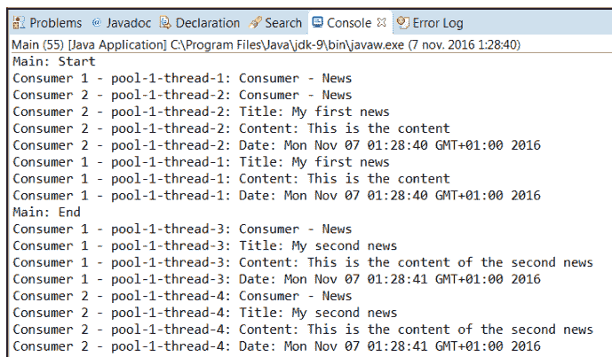

## There's more...

创建使用响应式流的应用程序最简单的方法是使用 `SubmissionPublisher` 类。此类实现了 `Publisher` 接口并提供了作为应用程序发布者部分使用所需的必要方法。

## See also

- *The Reactive programming with reactive streams* recipe in `Chapter 6`, *Parallel and Reactive Streams*
