## 第9章：Testing Concurrent Applications

## Testing Concurrent Applications

本章将涵盖以下主题：

- Monitoring a Lock interface
- Monitoring a Phaser class
- Monitoring an Executor framework
- Monitoring a fork/join pool
- Monitoring a stream
- Writing effective log messages
- Analyzing concurrent code with FindBugs
- Configuring Eclipse for debugging concurrency code
- Configuring NetBeans for debugging concurrency code
- Testing concurrency code with MultithreadedTC
- Monitoring with JConsole

## Introduction

测试应用程序是一项关键任务。在将应用程序准备好供最终用户使用之前，您必须证明其正确性。您使用测试过程来证明已实现正确性并且错误已得到修复。测试是任何软件开发和质量保证流程中的常见任务。您可以在文献中找到大量关于测试流程和可应用于开发的各种方法的资料。也有很多库，例如 JUnit，以及应用程序，例如 Apache JMeter，您可以用它们以自动方式测试 Java 应用程序。测试在并发应用程序开发中甚至更为关键。

并发应用程序有两个或多个线程共享数据结构并相互交互这一事实增加了测试阶段的难度。当您测试并发应用程序时，您将面临的最大问题是线程的执行是非确定性的。您无法保证线程执行的顺序，因此很难重现错误。

## Monitoring a Lock interface

`Lock` 接口是 Java 并发 API 提供的用于同步代码块的基本机制之一。它允许您定义一个 **critical section**。关键区是访问共享资源且不能同时被多个线程执行的代码块。此机制由 `Lock` 接口和 `ReentrantLock` 类实现。

在本教程中，您将学习可以从 `Lock` 对象获取哪些信息以及如何获取这些信息。

## Getting ready

本教程的示例使用 Eclipse IDE 实现。如果您使用 Eclipse 或其他 IDE，例如 NetBeans，请打开它并创建一个新的 Java 项目。

## How to do it...

按照以下步骤实现示例：

- 1. 创建一个名为 MyLock 的类，扩展 ReentrantLock 类：

```
public class MyLock extends ReentrantLock {
```

- 2. 实现 getOwnerName()。此方法返回拥有锁的线程的名称（如果有），使用 Lock 类的受保护方法 getOwner()：

```
public String getOwnerName() {
    if (this.getOwner()==null) {
        return "None";
    }
    return this.getOwner().getName();
}
```

- 3. 实现 getThreads()。此方法返回排队在锁中的线程列表，使用 Lock 类的受保护方法 getQueuedThreads()：

```
public Collection<Thread> getThreads() {
    return this.getQueuedThreads();
}
```

- 4. 创建一个名为 Task 的类，实现 Runnable 接口：

```
public class Task implements Runnable {
```

- 5. 声明一个名为 lock 的私有 Lock 属性：

```
private final Lock lock;
```

- 6. 实现类的构造函数以初始化其属性：

```
public Task (Lock lock) {
    this.lock=lock;
}
```

- 7. 实现 run() 方法。创建一个包含五个步骤的循环：

```
@Override
public void run() {
    for (int i=0; i<5; i++) {
```

- 8. 使用 lock() 方法获取锁并打印一条消息：

```
lock.lock();
System.out.printf("%s: Get the Lock.\n",
                Thread.currentThread().getName());
```

- 9. 让线程休眠 500 毫秒。使用 unlock() 方法释放锁并打印一条消息：

```
try {
    TimeUnit.MILLISECONDS.sleep(500);
    System.out.printf("%s: Free the Lock.\n",
        Thread.currentThread().getName());
} catch (InterruptedException e) {
    e.printStackTrace();
} finally {
    lock.unlock();
}
}
```

- 10. 通过创建一个名为 Main 的类及其 main() 方法来创建示例的主类：

```
public class Main {
    public static void main(String[] args) throws Exception {
```

- 11. 创建一个名为 lock 的 MyLock 对象：

```
MyLock lock=new MyLock();
```

- 12. 创建一个包含五个 Thread 对象的数组：

```
Thread threads[]=new Thread[5];
```

- 13. 创建并启动五个线程以执行五个 Task 对象：

```
for (int i=0; i<5; i++) {
    Task task=new Task(lock);
    threads[i]=new Thread(task);
    threads[i].start();
}
```

- 14. 创建一个包含 15 个步骤的循环：

```
for (int i=0; i<15; i++) {
```

- 15. 在控制台中写入锁的所有者的名称：

```
System.out.printf("Main: Logging the Lock\n");
System.out.printf("***********************\n");
System.out.printf("Lock: Owner : %s\n",lock.getOwnerName());
```


16. 显示等待锁的线程数量和名称：

```java
System.out.printf("Lock: Queued Threads: %s\n", lock.hasQueuedThreads());
if (lock.hasQueuedThreads()) {
    System.out.printf("Lock: Queue Length: %d\n", lock.getQueueLength());
    System.out.printf("Lock: Queued Threads: ");
    Collection<Thread> lockedThreads = lock.getThreads();
    for (Thread lockedThread : lockedThreads) {
        System.out.printf("%s ", lockedThread.getName());
    }
    System.out.printf("\n");
}
```

17. 显示 Lock 对象的公平性和状态信息：

```java
System.out.printf("Lock: Fairness: %s\n", lock.isFair());
System.out.printf("Lock: Locked: %s\n", lock.isLocked());
System.out.printf("**************************\n");
```

18. 让线程休眠 1 秒并关闭循环和类：

```java
TimeUnit.SECONDS.sleep(1);
}
}
```

## How it works...

在本示例中，你实现了继承自 `ReentrantLock` 类的 `MyLock` 类，以返回原本不可用的信息——它是 `ReentrantLock` 类的受保护数据。`MyLock` 类实现的方法如下：

- `getOwnerName()`: 只有一个线程可以执行由 Lock 对象保护的关键区。锁存储正在执行关键区的线程。该线程由 `ReentrantLock` 类的受保护 `getOwner()` 方法返回。
- `getThreads()`: 当一个线程正在执行关键区时，其他尝试进入该关键区的线程会在继续执行该关键区之前被挂起。`ReentrantLock` 类的受保护方法 `getQueuedThreads()` 返回等待执行关键区的线程列表。

我们还使用了 `ReentrantLock` 类中实现的其他方法：

- `hasQueuedThreads()`: 此方法返回一个布尔值，表示是否有线程正在等待获取调用的 `ReentrantLock`。
- `getQueueLength()`: 此方法返回正在等待获取调用的 `ReentrantLock` 的线程数量。
- `isLocked()`: 此方法返回一个布尔值，表示调用的 `ReentrantLock` 是否被某个线程拥有。
- `isFair()`: 此方法返回一个布尔值，表示调用的 `ReentrantLock` 是否已激活公平模式。

## There's more...

`ReentrantLock` 类中还有其他方法可用于获取 `Lock` 对象的相关信息：

- `getHoldCount()`: 这会返回当前线程获取锁的次数。
- `isHeldByCurrentThread()`: 这会返回一个布尔值，表示锁是否由当前线程拥有。

## See also

- 第 2 章《Basic Thread Synchronization》中的 Synchronizing a block of code with a lock 示例
- 第 8 章《Customizing Concurrency Classes》中的 Implementing a custom Lock class 示例

## Monitoring a Phaser class

Java 并发 API 提供的最复杂和强大的功能之一是使用 `Phaser` 类执行并发分阶段任务的能力。当我们有一些分为多个步骤的并发任务时，该机制非常有用。`Phaser` 类提供了在每个步骤结束时同步线程的机制，以便没有线程在所有线程完成第一步之前开始第二步。

在本示例中，你将学习可以获取 `Phaser` 类状态的哪些信息以及如何获取这些信息。

### Getting ready

本示例使用 Eclipse IDE 实现。如果使用 Eclipse 或其他 IDE，例如 NetBeans，请打开它并创建一个新的 Java 项目。

### How to do it...

按照以下步骤实现示例：

1. 创建一个名为 `Task` 的类，实现 `Runnable` 接口：

```java
public class Task implements Runnable {
```

2. 声明一个名为 `time` 的私有 `int` 属性：

```java
private final int time;
```

3. 声明一个名为 `phaser` 的私有 `Phaser` 属性：

```java
private final Phaser phaser;
```

4. 实现类的构造函数以初始化其属性：

```java
public Task(int time, Phaser phaser) {
    this.time = time;
    this.phaser = phaser;
}
```

5. 实现 `run()` 方法。首先，使用 `arrive()` 方法指示 `phaser` 属性任务开始执行：

```java
@Override
public void run() {

    phaser.arrive();
}
```

6. 在控制台写入一条消息表示第一阶段开始。让线程休眠 `time` 属性指定的秒数。在控制台写入一条消息表示第一阶段结束。并使用 `phaser` 属性的 `arriveAndAwaitAdvance()` 方法与剩余任务同步：

```java
System.out.printf("%s: Entering phase 1.\n",
                Thread.currentThread().getName());
try {
    TimeUnit.SECONDS.sleep(time);
} catch (InterruptedException e) {
    e.printStackTrace();
}
System.out.printf("%s: Finishing phase 1.\n",
                Thread.currentThread().getName());
phaser.arriveAndAwaitAdvance();
```

7. 在第二和第三阶段重复此行为。在第三阶段结束时，使用 `arriveAndDeregister()` 方法代替 `arriveAndAwaitAdvance()`：

```java
System.out.printf("%s: Entering phase 2.\n",
                Thread.currentThread().getName());
try {
    TimeUnit.SECONDS.sleep(time);
} catch (InterruptedException e) {
    e.printStackTrace();
}
System.out.printf("%s: Finishing phase 2.\n",
                Thread.currentThread().getName());
phaser.arriveAndAwaitAdvance();

System.out.printf("%s: Entering phase 3.\n",
                Thread.currentThread().getName());
try {
    TimeUnit.SECONDS.sleep(time);
} catch (InterruptedException e) {
    e.printStackTrace();
}

System.out.printf("%s: Finishing phase 3.\n", Thread.currentThread().getName());

phaser.arriveAndDeregister();
```

8. 通过创建名为 `Main` 的类并包含 `main()` 方法来实现示例的主类：

```java
public class Main {

    public static void main(String[] args) throws Exception {
```

9. 创建一个名为 `phaser` 的新 `Phaser` 对象，包含三个参与者：

```java
Phaser phaser = new Phaser(3);
```

10. 创建并启动三个线程以执行三个任务对象：

```java
for (int i = 0; i < 3; i++) {
    Task task = new Task(i + 1, phaser);
    Thread thread = new Thread(task);
    thread.start();
}
```

11. 创建一个包含 10 步的循环以写入 `phaser` 对象的相关信息：

```java
for (int i = 0; i < 10; i++) {
```

12. 写入已注册方、phaser 的阶段、已到达方和未到达方的相关信息：

```java
System.out.printf("*******************\n");
System.out.printf("Main: Phaser Log\n");
System.out.printf("Main: Phaser: Phase: %d\n", phaser.getPhase());
System.out.printf("Main: Phaser: Registered Parties: %d\n", phaser.getRegisteredParties());
System.out.printf("Main: Phaser: Arrived Parties: %d\n", phaser.getArrivedParties());
System.out.printf("Main: Phaser: Unarrived Parties: %d\n", phaser.getUnarrivedParties());
System.out.printf("*******************\n");
```

13. 让线程休眠 1 秒并关闭循环和类：

```java
TimeUnit.SECONDS.sleep(1);
}
}
}
```

### How it works...

在本示例中，我们在 Task 类中实现了一个分阶段任务。此分阶段任务有三个阶段，并使用 Phaser 对象与其他 Task 对象同步。主类启动三个任务，当这些任务执行各自的阶段时，它会向控制台打印 phaser 对象的状态信息。我们使用了以下方法来获取 phaser 对象的状态：

- `getPhase()`: 此方法返回 phaser 对象的实际阶段。
- `getRegisteredParties()`: 此方法返回使用 phaser 对象作为同步机制的任务数量。
- `getArrivedParties()`: 此方法返回已到达实际阶段末端的任务数量。
- `getUnarrivedParties()`: 此方法返回尚未到达实际阶段末端的任务数量。

以下屏幕截图显示了程序输出的一部分：

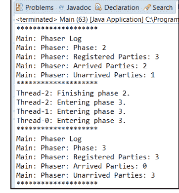


## 另请参阅

- `Chapter 3` 中 *Thread Synchronization Utilities* 的 *Running concurrent-phased tasks* 配方

## 监控 Executor 框架

`Executor` 框架提供了一种机制，将任务的实现与创建和管理线程以执行任务分离。如果您使用 executor，您只需实现 `Runnable` 对象并将其发送给 executor。管理线程是 executor 的责任。当您将任务发送给 executor 时，它会尝试使用池化的线程来执行任务，以避免创建新线程。这种机制由 `Executor` 接口及其实现类提供，例如 `ThreadPoolExecutor` 类。

在本配方中，您将学习可以获得有关 `ThreadPoolExecutor` executor 的状态的哪些信息以及如何获取这些信息。

## 准备工作

本配方的示例使用 Eclipse IDE 实现。如果您使用 Eclipse 或其他 IDE，例如 NetBeans，请打开它并创建一个新的 Java 项目。

## 如何操作...

按照以下步骤实现示例：

- 1. 创建一个名为 `Task` 的类，实现 `Runnable` 接口：

```java
public class Task implements Runnable {
```

- 2. 声明一个名为 `milliseconds` 的私有 `long` 属性：

```java
private final long milliseconds;
```

- 8. 创建一个包含五个步骤的循环。在每个步骤中，通过调用 showLog() 方法写入有关 executor 的信息，并让线程休眠一秒：

```java
for (int i=0; i<5; i++){
    showLog(executor);
    TimeUnit.SECONDS.sleep(1);
}
```

- 9. 使用 shutdown() 方法关闭 executor：

```java
executor.shutdown();
```

- 10. 创建另一个包含五个步骤的循环。在每个步骤中，通过调用 showLog() 方法写入有关 executor 的信息，并让线程休眠一秒：

```java
for (int i=0; i<5; i++){
    showLog(executor);
    TimeUnit.SECONDS.sleep(1);
}
```

- 11. 使用 awaitTermination() 方法等待 executor 的完成：

```java
executor.awaitTermination(1, TimeUnit.DAYS);
```

- 12. 显示指示程序结束的消息：

```java
System.out.printf("Main: End of the program.\n");
}
```

- 13. 实现接收 Executor 作为参数的 showLog() 方法。写入有关池大小、任务数量和 executor 状态的信息：

```java
private static void showLog(ThreadPoolExecutor executor) {
    System.out.printf("**************************");
    System.out.printf("Main: Executor Log");
    System.out.printf("Main: Executor: Core Pool Size: %d\n", executor.getCorePoolSize());
    System.out.printf("Main: Executor: Pool Size: %d\n", executor.getPoolSize());
    System.out.printf("Main: Executor: Active Count: %d\n", executor.getActiveCount());
    System.out.printf("Main: Executor: Task Count: %d\n", executor.getTaskCount());
    System.out.printf("Main: Executor: Completed Task Count: %d\n", executor.getCompletedTaskCount());
    System.out.printf("Main: Executor: Shutdown: %s\n", executor.isShutdown());
    System.out.printf("Main: Executor: Terminating: %s\n", executor.isTerminating());
    System.out.printf("Main: Executor: Terminated: %s\n", executor.isTerminated());
    System.out.printf("**************************\n");
}
```

## 工作原理...

在本配方中，您实现了一个任务，该任务会阻塞其执行线程随机毫秒数的时间。然后，您将 10 个任务发送给 executor，并在等待其完成的同时，将 executor 的状态信息写入控制台。您使用以下方法获取 Executor 对象的状态：

- getCorePoolSize(): 此方法返回一个 int 数值，表示核心线程数。这是 executor 在不执行任何任务时内部线程池中将存在的最小线程数。
- getPoolSize(): 此方法返回一个 int 值，表示内部线程池的实际大小。
- getActiveCount(): 此方法返回一个 int 数值，表示当前正在执行任务的线程数。
- getTaskCount(): 此方法返回一个 long 数值，表示已安排执行的任务数。
- getCompletedTaskCount(): 此方法返回一个 long 数值，表示已被此 executor 执行并已完成执行的任务数。
- isShutdown(): 此方法在调用 executor 的 shutdown() 方法以完成其执行时返回一个 Boolean 值。
- isTerminating(): 此方法在 executor 执行 shutdown() 操作但尚未完成时返回一个 Boolean 值。
- isTerminated(): 此方法在 executor 完成其执行时返回一个 Boolean 值。

## 另请参阅

- `Chapter 4` 中 Thread Executors 的 *Creating a thread executor and controlling its rejected tasks* 配方
- `Chapter 8` 中 Customizing Concurrency Classes 的 *Customizing the ThreadPoolExecutor class and Implementing a priority-based Executor class* 配方

## 监控 fork/join 池

Executor 框架提供了一种机制，允许您将任务实现与创建和管理执行任务的线程分离。Java 9 包含 Executor 框架的扩展，用于解决特定类型的问题，这将提高其他解决方案的性能（直接使用 `Thread` 对象或 Executor 框架）。它是 fork/join 框架。

该框架旨在解决可使用 `fork()` 和 `join()` 操作分解为更小任务的问题。实现此行为的主要类是 `ForkJoinPool`。

在本配方中，您将学习可以获得有关 `ForkJoinPool` 类的哪些信息以及如何获取这些信息。

## 准备工作

本配方的示例使用 Eclipse IDE 实现。如果您使用 Eclipse 或其他 IDE，例如 NetBeans，请打开它并创建一个新的 Java 项目。

## 如何操作...

按照以下步骤实现示例：

- 1. 创建一个名为 `Task` 的类，扩展 `RecursiveAction` 类：

```java
public class Task extends RecursiveAction{
```

- 2. 声明一个名为 array 的私有 int 数组属性，用于存储您想要递增的元素数组：

```java
private final int array[];
```

- 3. 声明两个名为 start 和 end 的私有 int 属性，用于存储此任务要处理的元素的块的开始和结束位置：

```java
private final int start;
private final int end;
```

- 4. 实现类的构造函数以初始化其属性：

```java
public Task (int array[], int start, int end) {
    this.array=array;
    this.start=start;
    this.end=end;
}
```

- 5. 实现 compute() 方法，其中包含任务的主要逻辑。如果任务要处理超过 100 个元素，首先将元素分为两部分，创建两个任务来执行这些部分，使用 fork() 方法启动其执行，最后使用 join() 方法等待其完成：

```java
protected void compute() {
    if (end-start>100) {
        int mid=(start+end)/2;
        Task task1=new Task(array,start,mid);
        Task task2=new Task(array,mid,end);

        task1.fork();
        task2.fork();

        task1.join();
        task2.join();
```

- 6. 如果任务要处理 100 个元素或更少，则通过在每次操作后让线程休眠 5 毫秒来递增元素：

```java
} else {
    for (int i=start; i<end; i++) {
        array[i]++;

        try {
            Thread.sleep(5);
        } catch (InterruptedException e) {
            e.printStackTrace();
        }
    }
}
}
}
```

- 7. 通过创建名为 Main 的类并包含 main() 方法来实现示例的主类：

```java
public class Main {
    public static void main(String[] args) throws Exception {
```

- 8. 创建一个名为 pool 的 ForkJoinPool 对象：

```java
ForkJoinPool pool=new ForkJoinPool();
```

- 9. 创建一个名为 array 的整数数组，包含 10,000 个元素：

```java
int array[]=new int[10000];
```

- 10. 创建一个新的 Task 对象来处理整个数组：

```java
Task task1=new Task(array,0,array.length);
```

- 11. 使用 execute() 方法将任务发送到 pool 执行：

```java
pool.execute(task1);
```

- 12. 如果任务未完成其执行，则调用 showLog() 方法写入有关 ForkJoinPool 类的状态信息并让线程休眠一秒：

```java
while (!task1.isDone()) {
    showLog(pool);
    TimeUnit.SECONDS.sleep(1);
}
```

- 13. 使用 shutdown() 方法关闭 pool：

```java
pool.shutdown();
```


14. 使用 awaitTermination() 方法等待池的完成：

```
pool.awaitTermination(1, TimeUnit.DAYS);
```

15. 调用 showLog() 方法来写入 ForkJoinPool 类的状态信息，并在控制台中写入程序结束的消息：

```
showLog(pool);
System.out.printf("Main: End of the program.\n");
```

16. 实现 showLog() 方法。它接收一个 ForkJoinPool 对象作为参数，并写入其状态以及正在执行的线程和任务的信息：

```
private static void showLog(ForkJoinPool pool) {
    System.out.printf("**************************\n");
    System.out.printf("Main: Fork/Join Pool log\n");
    System.out.printf("Main: Fork/Join Pool: Parallelism: %d\n", pool.getParallelism());
    System.out.printf("Main: Fork/Join Pool: Pool Size: %d\n", pool.getPoolSize());
    System.out.printf("Main: Fork/Join Pool: Active Thread Count: %d\n", pool.getActiveThreadCount());
    System.out.printf("Main: Fork/Join Pool: Running Thread Count: %d\n", pool.getRunningThreadCount());
    System.out.printf("Main: Fork/Join Pool: Queued Submission: %d\n", pool.getQueuedSubmissionCount());
    System.out.printf("Main: Fork/Join Pool: Queued Tasks: %d\n", pool.getQueuedTaskCount());
    System.out.printf("Main: Fork/Join Pool: Queued Submissions: %s\n", pool.hasQueuedSubmissions());
    System.out.printf("Main: Fork/Join Pool: Steal Count: %d\n", pool.getStealCount());
    System.out.printf("Main: Fork/Join Pool: Terminated : %s\n", pool.isTerminated());
    System.out.printf("**************************\n");
}
```

## How it works...

在本教程中，你实现了一个使用 `ForkJoinPool` 类和继承自 `RecursiveAction` 类的 `Task` 类来递增数组元素的任务。这是你可以在 `ForkJoinPool` 类中执行的一个任务之一。当任务处理数组时，你向控制台打印了 `ForkJoinPool` 类的状态信息。你使用了以下方法来获取 `ForkJoinPool` 类的状态：

- `getPoolSize()`: 此方法返回一个 `int` 值，即 `ForkJoinPool` 类内部池的工作线程数
- `getParallelism()`: 此方法返回为池建立的期望并行级别
- `getActiveThreadCount()`: 此方法返回当前正在执行任务的线程数
- `getRunningThreadCount()`: 此方法返回未被任何同步机制阻塞的工作线程数
- `getQueuedSubmissionCount()`: 此方法返回已提交给池但尚未开始执行的任务数
- `getQueuedTaskCount()`: 此方法返回已提交给池且已开始执行的任务数
- `hasQueuedSubmissions()`: 此方法返回一个 `Boolean` 值，表示池是否具有尚未开始执行的排队任务
- `getStealCount()`: 此方法返回一个 `long` 值，指定工作线程从另一个线程窃取任务的次数
- `isTerminated()`: 此方法返回一个 `Boolean` 值，表示 fork/join 池是否已完成执行

## See also

- `Chapter 5` 中 *Fork/Join Framework* 的 *Creating a fork/join pool recipe*
- `Chapter 8` 中 *Customizing Concurrency Classes* 的 *Implementing the ThreadFactory interface to generate custom threads for the fork/join framework* 和 *Customizing tasks running in the fork/join framework* 教程

## Monitoring a stream

Java 中的流是一系列可以被处理的元素，可以在由 lambda 表达式组成的声明式操作管道中并行或顺序地进行处理（映射、过滤、转换、归约和收集）。它在 Java 8 中引入，用于以函数式方式改变处理庞大数据集的方式，使用 lambda 表达式而不是传统的命令式方式。

Stream 接口不像其他并发类那样提供很多用于监控其状态的方法。只有 peek() 方法允许你写入正在处理的元素日志信息。在本教程中，你将学习如何使用此方法来写入流的信息。

## Getting ready

本教程的示例使用 Eclipse IDE 实现。如果你使用 Eclipse 或其他 IDE，例如 NetBeans，打开它并创建一个新的 Java 项目。

## How to do it...

按照以下步骤实现示例：

- 1. 创建一个名为 Main 的类，其中包含 main() 方法。声明两个私有变量，即一个名为 counter 的 AtomicInteger 变量和一个名为 random 的 Random 对象：

```
public class Main {
    public static void main(String[] args) {

        AtomicLong counter = new AtomicLong(0);
        Random random=new Random();
```

- 2. 创建一个包含 1,000 个随机 double 数字的流。创建的流是顺序流。你必须使用 parallel() 方法使其并行，并使用 peek() 方法递增 counter 变量的值并在控制台中写入消息。此后，使用 count() 方法计算数组中的元素数量并将该数字存储在整数变量中。在控制台中写入 counter 变量存储的值和 count() 方法返回的值：

```
long streamCounter = random.doubles(1000).parallel()
    .peek( number -> {
    long actual=counter.incrementAndGet();
    System.out.printf("%d - %f\n", actual, number);
}).count();

System.out.printf("Counter: %d\n", counter.get());
System.out.printf("Stream Counter: %d\n", streamCounter);
```

- 3. 现在，将 counter 变量的值设置为 0。创建一个包含 1,000 个随机 double 数字的另一个流。然后，使用 parallel() 方法将其转换为并行流，并使用 peek() 方法递增 counter 变量的值并在控制台中写入消息。最后，使用 forEach() 方法写入所有数字和 counter 变量的值到控制台：

```
counter.set(0);
random.doubles(1000).parallel().peek(number -> {
    long actual=counter.incrementAndGet();
    System.out.printf("Peek: %d - %f\n", actual,number);
}).forEach( number -> {
    System.out.printf("For Each: %f\n", number);
});

System.out.printf("Counter: %d\n", counter.get());
}
```

## How it works...

在本示例中，我们在两种不同的情况下使用了 peek() 方法来计算通过此流步骤的元素数量并在控制台中写入消息。

如第 6 章 Parallel and Reactive Streams 中所述，Stream 有一个源、零个或多个中间操作以及一个最终操作。在第一种情况下，我们的最终操作是 count() 方法。此方法不需要处理元素来计算返回值，因此 peek() 方法永远不会被执行。你不会在控制台中看到 peek 方法的任何消息，counter 变量的值将为 0。

第二种情况不同。最终操作是 forEach() 方法，在这种情况下，流的所有元素都将被处理。在控制台中，你将看到 peek() 和 forEach() 方法的消息。counter 变量的最终值将为 1,000。

peek() 方法是流的中间操作。与所有中间操作一样，它们是惰性执行的，并且只处理必要的元素。这就是为什么它在第一种情况下永远不会被执行的原因。

## See also

- 第 6 章 Parallel and Reactive Streams 中的 Creating streams from different sources、Reducing the elements of a stream 和 Collecting the elements of a stream 教程

## Writing effective log messages

日志系统是一种允许你将信息写入一个或多个目标的机制。Logger 具有以下组件：

- **一个或多个处理器**：处理器将决定日志消息的目标和格式。你可以将日志消息写入控制台、文件或数据库。
- **一个名称**：通常在类中使用的 Logger 的名称基于类名及其包名。
- **一个级别**：日志消息具有不同的级别，表示其重要性。Logger 也有一个级别来决定它将写入哪些消息。它只写入与其实力相同或更重要的消息。

你应该使用日志系统，原因主要有以下两点：

- 在捕获异常时尽可能多地写入信息。这将帮助你定位错误并解决它。
- 写入程序正在执行的类和方法的信息。

在本教程中，你将学习如何使用 java.util.logging 包提供的类向你的并发应用程序添加日志系统。

## Getting ready

本教程的示例使用 Eclipse IDE 实现。如果你使用 Eclipse 或其他 IDE，例如 NetBeans，打开它并创建一个新的 Java 项目。


## 如何操作...

按照以下步骤实现示例：

1. 创建一个名为 `MyFormatter` 的类，继承 `java.util.logging.Formatter` 类。实现抽象的 `format()` 方法。它接收一个 `LogRecord` 对象作为参数并返回一个包含日志消息的 `String` 对象：

```
public class MyFormatter extends Formatter {
    @Override
    public String format(LogRecord record) {

        StringBuilder sb=new StringBuilder();
        sb.append("["+record.getLevel()+"] - ");
        sb.append(new Date(record.getMillis())+" : ");
        sb.append(record.getSourceClassName()+", "
            +record.getSourceMethodName()+" : ");
        sb.append(record.getMessage()+"\n");
        return sb.toString();
    }
}
```

2. 创建一个名为 `MyLoggerFactory` 的类：

```
public class MyLoggerFactory {
```

3. 声明一个私有静态 `Handler` 属性名为 `handler`：

```
private static Handler handler;
```

4. 实现公共静态方法 `getLogger()` 来创建用于写入日志消息的 `Logger` 对象。它接收一个名为 `name` 的 `String` 参数。我们使用 `synchronized` 关键字同步此方法：

```
public synchronized static Logger getLogger(String name){
```

5. 使用 `Logger` 类的 `getLogger()` 方法获取与作为参数接收的 `name` 关联的 `java.util.logging.Logger`：

```
Logger logger=Logger.getLogger(name);
```

6. 使用 `setLevel()` 方法设置日志级别以写入所有日志消息：

```
logger.setLevel(Level.ALL);
```

7. 如果 `handler` 属性值为 `null`，则创建一个新的 `FileHandler` 对象以将日志消息写入 `recipe6.log` 文件。为此处理器分配一个 `MyFormatter` 对象；使用 `setFormatter()` 方法将其指定为格式化程序：

```
try {
    if (handler==null) {
        handler=new FileHandler("recipe6.log");
        Formatter format=new MyFormatter();
        handler.setFormatter(format);
    }
```

8. 如果 `Logger` 对象没有关联的处理器，则使用 `addHandler()` 方法分配处理器：

```
if (logger.getHandlers().length==0) {
    logger.addHandler(handler);
}
} catch (SecurityException | IOException e) {
    e.printStackTrace();
}
```

9. 返回创建的 `Logger` 对象：

```
return logger;
}
```

10. 创建一个名为 `Task` 的类，实现 `Runnable` 接口。它将是用于测试你的 `Logger` 对象的任务：

```
public class Task implements Runnable {
```

11. 实现 `run()` 方法：

```
@Override
public void run() {
```

12. 首先，声明一个名为 `logger` 的 `Logger` 对象。使用 `MyLoggerFactory` 类的 `getLogger()` 方法初始化它，并将此类名作为参数传递：

```
Logger logger= MyLoggerFactory.getLogger(this.getClass().getName());
```

13. 使用 `entering()` 方法写入指示方法执行开始的日志消息：

```
logger.entering(Thread.currentThread().getName(), "run()");
```

14. 让线程休眠两秒：

```
try {
    TimeUnit.SECONDS.sleep(2);
} catch (InterruptedException e) {
    e.printStackTrace();
}
```

15. 使用 `exiting()` 方法写入指示方法执行结束的日志消息：

```
logger.exiting(Thread.currentThread().getName(), "run()",
        Thread.currentThread());
}
```

16. 通过创建名为 `Main` 的类并包含 `main()` 方法来实现示例的主类：

```
public class Main {
    public static void main(String[] args) {
```

17. 声明一个名为 `logger` 的 `Logger` 对象。使用 `MyLoggerFactory` 类的 `getLogger()` 方法初始化它，并将类名作为参数传递：

```
Logger logger=MyLoggerFactory.getLogger(Main.class.getName());
```

18. 使用 `entering()` 方法写入指示主程序执行开始的日志消息：

```
logger.entering(Main.class.getName(), "main()",args);
```

19. 创建一个 `Thread` 数组来存储五个线程：

```
Thread threads[]=new Thread[5];
```

20. 创建五个 `Task` 对象和五个线程来执行它们。写入日志消息以指示你将启动一个新线程以及你已创建该线程：

```
for (int i=0; i<threads.length; i++) {
    logger.log(Level.INFO,"Launching thread: "+i);
    Task task=new Task();
    threads[i]=new Thread(task);
    logger.log(Level.INFO,"Thread created: "+
                threads[i].getName());
    threads[i].start();
}
```

21. 写入日志消息以指示你已创建线程：

```
logger.log(Level.INFO,"Ten Threads created."+
    "Waiting for its finalization");
```

22. 使用 `join()` 方法等待五个线程的结束。每个线程结束后，写入日志消息指示线程已完成：

```
for (int i=0; i<threads.length; i++) {
    try {
        threads[i].join();
        logger.log(Level.INFO,"Thread has finished its execution",
                    threads[i]);
    } catch (InterruptedException e) {
        logger.log(Level.SEVERE, "Exception", e);
    }
}
```

23. 使用 `exiting()` 方法写入指示主程序执行结束的日志消息：

```
logger.exiting(Main.class.getName(), "main()");
}
```

## 其工作原理...

在本教程中，你使用了 Java 日志 API 提供的 `Logger` 类在并发应用程序中写入日志消息。首先，你实现了 `MyFormatter` 类为日志消息分配格式。该类扩展了 `Formatter` 类，后者声明了抽象的 `format()` 方法。此方法接收包含日志消息所有信息的 `LogRecord` 对象并返回格式化的日志消息。在你的类中，你使用了 `LogRecord` 类的以下方法来获取有关日志消息的信息：

- `getLevel()`: 返回消息的级别
- `getMillis()`: 返回消息发送到 `Logger` 对象的时间
- `getSourceClassName()`: 返回向 `Logger` 发送消息的类的名称
- `getSourceMethodName()`: 返回向 `Logger` 发送消息的方法的名称
- `getMessage()`: 返回日志消息

`MyLoggerFactory` 类实现了静态方法 `getLogger()`。此方法创建 `Logger` 对象并分配 `Handler` 对象以使用 `MyFormatter` 格式化程序将应用程序的日志消息写入 `recipe6.log` 文件。你使用 `Logger` 类的静态方法 `getLogger()` 创建 `Logger` 对象。此方法根据作为参数传递的名称返回不同的对象。你只创建了一个 `Handler` 对象，因此所有 `Logger` 对象都将把日志消息写入同一个文件。你还配置了记录器以写入所有日志消息，而不管其级别。

最后，你实现了一个 `Task` 对象和一个写入日志文件中的不同日志消息的主程序。你使用了以下方法：

- `entering()`: 写入 `FINER` 级别的消息，指示方法已开始执行
- `exiting()`: 写入 `FINER` 级别的消息，指示方法已结束执行
- `log()`: 写入指定级别的消息

## 还有更多...

当你使用日志系统时，必须考虑两个重要点：

- **写入必要的信息**：如果你写入的信息太少，记录器将无用，因为它无法实现其目的。如果你写入大量信息，你将生成庞大且难以管理的日志文件；这将使获取必要信息变得困难。
- **为消息使用适当的级别**：如果你为高级别信息消息或低级别错误消息写入内容，将会混淆查看日志文件的用户。这将使在错误情况下了解发生了什么变得更加困难；或者你将拥有太多信息，使其难以知道错误的主要原因。

还有其他库提供比 `java.util.logging` 包更完整的日志系统，例如 `Log4j` 或 `slf4j` 库。但 `java.util.logging` 包是 Java API 的一部分，其所有方法都是多线程安全的；因此，我们可以在并发应用程序中使用它而不会出现问题。

## 另请参阅

- `Chapter 7`，*Concurrent Collections* 中的 *Using non-blocking thread-safe deques*、*Using blocking thread-safe deques*、*Using blocking thread-safe queues ordered by priority*、*Using thread-safe lists with delayed elements* 和 *Using thread-safe navigable maps* 教程

## 使用 FindBugs 分析并发代码

**静态代码分析工具** 是一组在查找潜在错误的同时分析应用程序源代码的工具。这些工具，例如 Checkstyle、PMD 或 FindBugs，具有一组预定义的好实践规则，并解析源代码以查找违反这些规则的情况。目标是在生产中执行之前尽早发现错误或导致性能不佳的地方。编程语言通常提供此类工具，Java 也不例外。其中一个帮助分析 Java 代码的工具是 FindBugs。它是一个开源工具，包含一系列用于分析 Java 并发代码的规则。


在本教程中，你将学习如何使用此工具分析你的 Java 并发应用程序。

## 开始之前

在开始本教程之前，从项目的网页（http://findbugs.sourceforge.net/）下载 FindBugs。你可以下载独立应用程序或 Eclipse 插件。在本教程中，我使用了独立版本。

截至本文撰写时，FindBugs 的实际版本（3.0.1）不支持 Java 9。你可以从 https://github.com/findbugsproject/findbugs/releases/tag/3.1.0_preview1 下载支持 Java 9 的 3.1.0 预览版。

## 如何操作...

按照以下步骤实现示例：

- 1. 创建一个名为 Task 的类并实现 Runnable 接口：
```
public class Task implements Runnable {
```
- 2. 声明一个名为 lock 的私有 ReentrantLock 属性：
```
private ReentrantLock lock;
```
- 3. 实现类的构造函数：
```
public Task(ReentrantLock lock) {
    this.lock=lock;
}
```
- 4. 实现 run() 方法。获取锁的控制权，让线程休眠 2 秒，然后释放锁：
```
@Override
public void run() {
    lock.lock();
    try {
        TimeUnit.SECONDS.sleep(1);
        lock.unlock();
    } catch (InterruptedException e) {
        e.printStackTrace();
    }
}
```
- 5. 通过创建一个名为 Main 的类并包含 main() 方法来创建示例的主类：
```
public class Main {
    public static void main(String[] args) {
```
- 6. 声明并创建一个名为 lock 的 ReentrantLock 对象：
```
ReentrantLock lock=new ReentrantLock();
```
- 7. 创建 10 个 Task 对象和 10 个线程来执行任务。通过调用 run() 方法启动线程：
```
for (int i=0; i<10; i++) {
    Task task=new Task(lock);
    Thread thread=new Thread(task);
    thread.run();
}
```
- 8. 将项目导出为 .jar 文件。命名为 recipe7.jar。使用 IDE 的菜单选项或 javac 和 .jar 命令来编译和压缩你的应用程序。
- 9. 通过在 Windows 中运行 findbugs.bat 命令或在 Linux 中运行 findbugs.sh 命令来启动 FindBugs 独立应用程序。
- 10. 通过在菜单栏的 File 菜单下点击 New Project 选项来创建一个新项目：

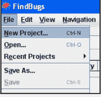

- 11. FindBugs 应用程序显示一个用于配置项目的窗口。在 Project name 字段中，输入 Recipe07。在 Classpath for analysis 字段（jar, ear, war, zip, 或 directory）中，添加包含项目的 .jar 文件。在 Source directories 字段（可选；浏览发现的 bug 时使用的类）中，添加示例源代码的目录。参考以下截图：

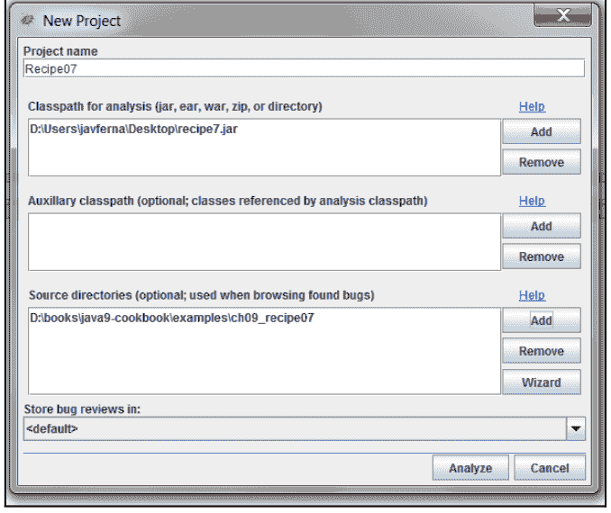

- 12. 点击 **Analyze** 按钮来创建新项目并分析其代码。
- 13. *FindBugs* 应用程序显示代码分析的结果。在这种情况下，它发现了两个 bug。
- 14. 点击其中一个 bug，你将在右侧面板看到 bug 的源代码，并在屏幕底部的面板中看到 bug 的描述。

## 原理...

以下截图显示了 FindBugs 的分析结果：

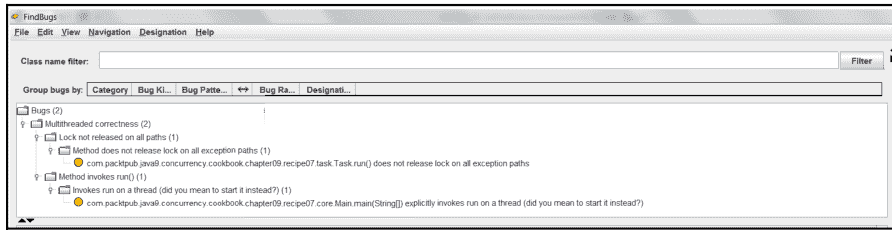

分析在应用程序中检测到以下两个潜在 bug：

- 其中一个 bug 在 `Task` 类的 `run()` 方法中被检测到。如果抛出 `InterruptedException` 异常，任务不会释放锁，因为它不会执行 `unlock()` 方法。这很可能会导致应用程序出现死锁情况。
- 另一个 bug 在 `Main` 类的 `main()` 方法中被检测到，因为你直接调用了线程的 `run()` 方法，而不是调用 `start()` 方法来开始线程的执行。

如果你双击其中一个 bug，你将看到有关它的详细信息。由于你在项目的配置中包含了源代码引用，你还将看到检测到 bug 的源代码。以下截图显示了此情况的示例：

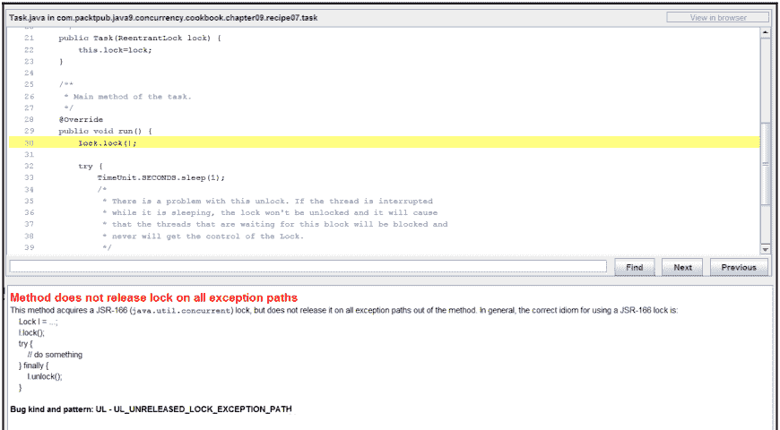

## 还有更多...

请注意，FindBugs 只能检测一些有问题的状况（与并发代码相关或不相关）。例如，如果你在 Task 类的 run() 方法中删除 unlock() 调用并重复分析，FindBugs 不会提醒你你在任务中获取了锁但永远无法释放它。

将静态代码分析工具作为一种辅助手段来提高代码质量，但不要期望它能检测到所有 bug。

## 另请参阅

- 本章中的 *Configuring NetBeans for debugging concurrency code* 教程

## 为调试并发代码配置 Eclipse

如今，几乎每个程序员，无论使用何种编程语言，都使用 IDE 创建他们的应用程序。它们在同一个应用程序中提供了许多有趣的集成功能，例如：

- 项目管理
- 自动代码生成
- 自动文档生成
- 与版本控制系统的集成
- 用于测试应用程序的调试器
- 用于创建项目和应用程序元素的不同向导

IDE 的最有帮助功能之一是调试器。使用它，你可以逐步执行应用程序并分析程序中所有对象和变量的值。

如果你使用 Java，Eclipse 是最受欢迎的 IDE 之一。它具有集成调试器，允许你测试应用程序。默认情况下，当你调试并发应用程序并且调试器找到断点时，它只会停止具有断点的线程，同时允许其他线程继续执行。在本教程中，你将学习如何更改此配置以帮助你测试并发应用程序。

## 开始之前

你必须已安装 Eclipse IDE。打开它并选择一个包含并发应用程序实现的项目，例如，书中实现的一个教程。

## 如何操作...

按照以下步骤实现示例：

- 1. 导航到 Window | Preferences。
- 2. 在左侧菜单中展开 Java 选项。
- 3. 然后，选择 Debug 选项。以下截图说明了该窗口：

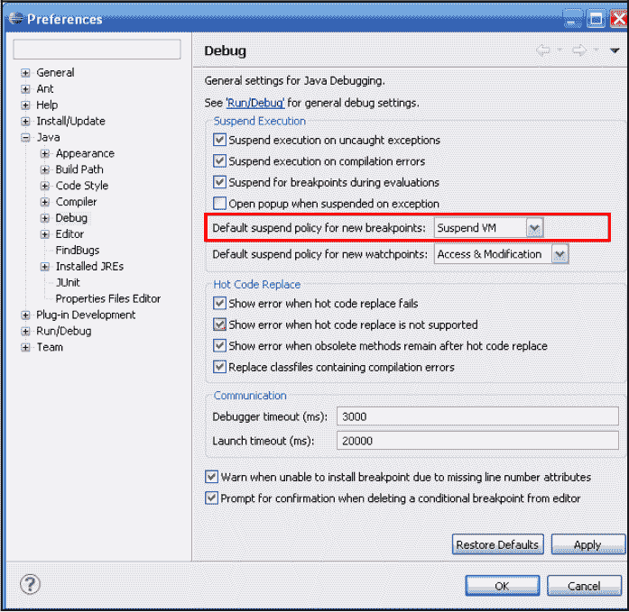

- 4. 将新断点的默认挂起策略的值从 Suspend Thread 更改为 Suspend VM（在截图中用红色标记）。
- 5. 点击 OK 按钮确认更改。

## 原理...

如本教程介绍中所述，默认情况下，当你在 Eclipse 中调试并发 Java 应用程序并且调试过程找到断点时，它只会挂起首先命中断点的线程，但允许其他线程继续执行。以下截图显示了此情况的示例：

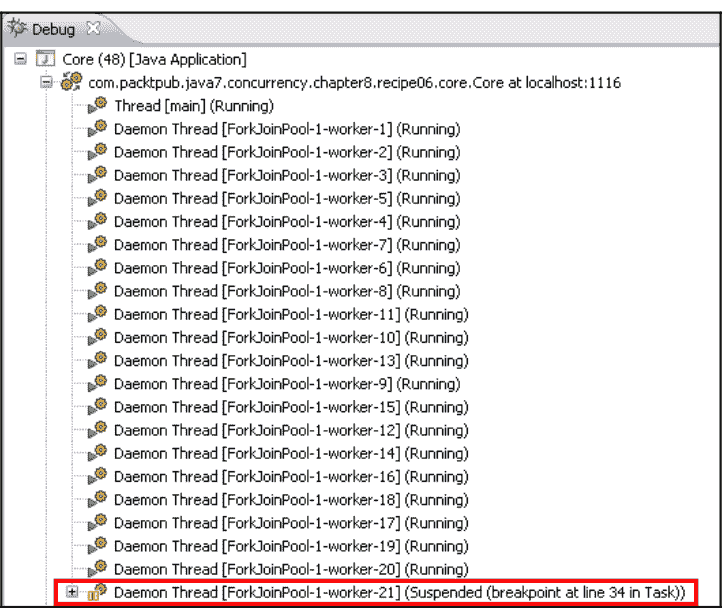

你可以看到只有 **worker-21** 被挂起（在截图中用红色标记），而其他线程正在运行。然而，在调试并发应用程序时，如果你将 **Default suspend policy for new breakpoints** 更改为 **Suspend VM**，所有线程将挂起执行并且调试过程将命中断点。以下截图显示了此情况的示例：

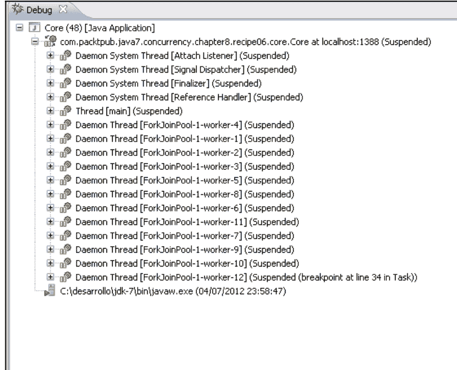

更改后，你可以看到所有线程都被挂起。你可以继续调试任何你想要的线程。选择最适合你需求的挂起策略。

## 为调试并发代码配置 NetBeans

软件对于开发工作正常、符合公司质量标准并且将来可以轻松修改的应用程序（在有限的时间和尽可能低的成本下）是必要的。为了实现这一目标，至关重要的是使用可以集成多个工具（编译器和调试器）的 IDE，以便在一个通用界面下促进应用程序的开发。

如果你使用 Java，NetBeans 是最受欢迎的 IDE 之一。它具有集成调试器，允许你测试你的应用程序。

在本教程中，你将学习如何更改 Netbeans 调试器的配置以帮助你测试并发应用程序。

## 开始之前

你应该已安装 NetBeans IDE。打开它并创建一个新的 Java 项目。

## 如何操作...

按照以下步骤实现示例：

- 1. 创建一个名为 Task1 的类并指定它实现 Runnable 接口：
```
public class Task1 implements Runnable {
```
- 2. 声明两个私有 Lock 属性，名为 lock1 和 lock2：
```
private Lock lock1, lock2;
```
- 3. 实现类的构造函数以初始化其属性：
```
public Task1 (Lock lock1, Lock lock2) {
    this.lock1=lock1;
    this.lock2=lock2;
}
```


4. 实现 `run()` 方法。首先，使用 `lock()` 方法获取 `lock1` 对象的控制权，并在控制台输出一条消息表明已经获取该锁：

```
@Override
public void run() {
    lock1.lock();
    System.out.printf("Task 1: Lock 1 locked\n");
```

5. 然后，使用 `lock()` 方法获取 `lock2` 的控制权，并在控制台输出一条消息表明已经获取该锁：

```
lock2.lock();
System.out.printf("Task 1: Lock 2 locked\n");
```

6. 最后，释放这两个锁对象——先释放 `lock2` 对象，再释放 `lock1` 对象：

```
lock2.unlock();
lock1.unlock();
}
```

7. 创建一个名为 `Task2` 的类，并指定它实现 `Runnable` 接口：

```
public class Task2 implements Runnable{
```

8. 声明两个私有 `Lock` 属性，分别命名为 `lock1` 和 `lock2`：

```
private Lock lock1, lock2;
```

9. 实现该类的构造函数以初始化其属性：

```
public Task2(Lock lock1, Lock lock2) {
    this.lock1=lock1;
    this.lock2=lock2;
}
```

10. 实现 `run()` 方法。首先，使用 `lock()` 方法获取 `lock2` 对象的控制权，并在控制台输出一条消息表明已经获取该锁：

```
@Override
public void run() {
    lock2.lock();
    System.out.printf("Task 2: Lock 2 locked\n");
```

11. 然后，使用 `lock()` 方法获取 `lock1` 的控制权，并在控制台输出一条消息表明已经获取该锁：

```
lock1.lock();
System.out.printf("Task 2: Lock 1 locked\n");
```

12. 最后，释放这两个锁对象——先释放 `lock1`，再释放 `lock2`：

```
lock1.unlock();
lock2.unlock();
}
```

13. 实现示例的主类，创建一个名为 `Main` 的类并向其中添加 `main()` 方法：

```
public class Main {
```

14. 创建两个锁对象，分别命名为 `lock1` 和 `lock2`：

```
Lock lock1, lock2;
lock1=new ReentrantLock();
lock2=new ReentrantLock();
```

15. 创建一个名为 `task1` 的 `Task1` 对象：

```
Task1 task1=new Task1(lock1, lock2);
```

16. 创建一个名为 `task2` 的 `Task2` 对象：

```
Task2 task2=new Task2(lock1, lock2);
```

17. 使用两个线程执行这两个任务：

```
Thread thread1=new Thread(task1);
Thread thread2=new Thread(task2);

thread1.start();
thread2.start();
```

18. 当两个任务都执行完毕时，每隔 500 毫秒在控制台输出一条消息。使用 `isAlive()` 方法检查线程是否已经执行完毕：

```
while ((thread1.isAlive() &&(thread2.isAlive())) {
    System.out.println("Main: The example is"+ "running");
    try {
```

```
TimeUnit.MILLISECONDS.sleep(500);
} catch (InterruptedException ex) {
    ex.printStackTrace();
}
```

19. 在 `Task1` 类的 `run()` 方法的 `printf()` 方法第一次调用处添加一个断点。

20. 调试程序。你会看到 NetBeans 主窗口左上角出现“调试”窗口。下面的截图展示了该窗口，其中包含执行 `Task1` 对象的线程。该线程正在断点处等待。应用程序的其他线程正在运行：

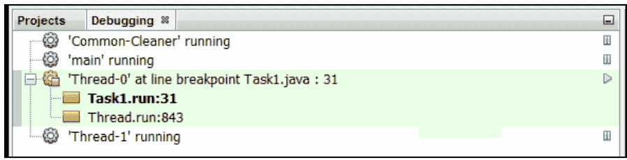

21. 暂停主线程的执行。选中该线程，右键单击它，然后选择“挂起”选项。下面的截图展示了“调试”窗口的新外观。请参阅以下截图：

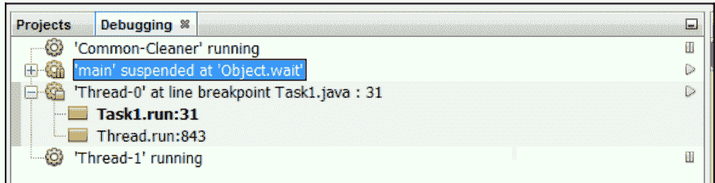

22. 恢复两个已暂停的线程。分别选中每个线程，右键单击它们，然后选择“恢复”选项。

## 工作原理...

在使用 NetBeans 调试并发应用程序时，当调试器命中某个断点，它会挂起命中该断点的线程，并在左上角显示“调试”窗口，其中列出了当前正在运行的线程。你可以使用该窗口通过“暂停”或“恢复”选项来暂停或恢复当前正在运行的线程。你也可以通过“变量”选项卡查看线程的变量或属性值。

NetBeans 还包含一个死锁检测器。当你在“调试”菜单中选择“检查死锁”选项时，NetBeans 会对你正在调试的应用程序进行分析，以确定是否存在死锁情况。本示例展示了一个明显的死锁。第一个线程先获取 `lock1`，然后获取 `lock2`。第二个线程以相反的顺序获取锁。插入的断点引发了死锁，但如果你使用 NetBeans 的死锁检测器，你不会发现任何问题。因此，这个选项应谨慎使用。将两个任务中使用的锁改为 `synchronized` 关键字，并再次调试程序。`Task1` 的代码如下：

```
@Override
public void run() {
    synchronized(lock1) {
        System.out.printf("Task 1: Lock 1 locked\n");
        synchronized(lock2) {
            System.out.printf("Task 1: Lock 2 locked\n");
        }
    }
}
```

`Task2` 类的代码与此类似，但改变了锁的顺序。如果你再次调试示例，你会再次得到一个死锁。然而，在这种情况下，死锁检测器可以检测到它，如下面的截图所示：

## 更多内容...

有一些选项可以控制调试器。从“工具”菜单中选择“选项”。然后选择“杂项”选项和“Java 调试器”选项卡。下面的截图展示了这个窗口：

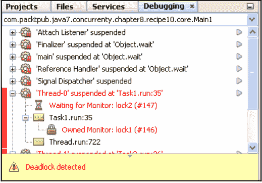

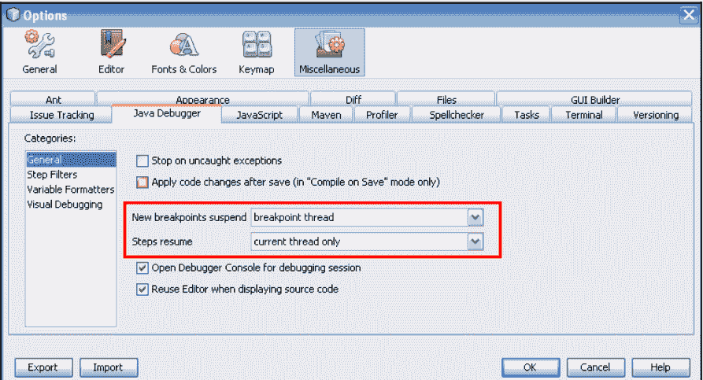

窗口中有两个选项控制着前面描述的行为：

+   - **新断点挂起**：使用此选项，你可以配置 NetBeans 在某个线程中遇到断点时的行为。你可以只挂起命中断点的那个线程，或者挂起应用程序的所有线程。

+   - **步骤恢复**：使用此选项，你可以配置 NetBeans 在恢复线程时的行为。你可以只恢复当前线程，或者恢复所有线程。

这两个选项已在前面展示的截图中标记出来。

## 另请参阅

+   - 本章中的*配置 Eclipse 以调试并发代码*一节

## 使用 MultithreadedTC 测试并发代码

`MultithreadedTC` 是一个用于测试并发应用程序的 Java 库。其主要目标是解决并发应用程序不确定性的问题。你无法控制构成应用程序的不同线程的执行顺序。为此，它包含了一个内部**节拍器**。这些测试线程是作为某个类的方法来实现的。

在本节中，你将学习如何使用 `MultithreadedTC` 库为 `LinkedTransferQueue` 实现一个测试。

## 准备工作

从 https://code.google.com/archive/p/multithreadedtc/ 下载 MultithreadedTC 库，并从 http://junit.org/junit4/ 下载 JUnit 库（版本 4.10）。将 `junit-4.10.jar` 和 `MultithreadedTC-1.01.jar` 文件添加到项目的库中。

## 实现步骤...

按照以下步骤来实现该示例：

+   1. 创建一个名为 `ProducerConsumerTest` 的类，它继承自 `MultithreadedTestCase` 类：
+   
+   ```
+   public class ProducerConsumerTest extends MultithreadedTestCase {
+   ```
+   
+   2. 声明一个私有的 `LinkedTransferQueue` 属性，参数化为 `String` 类，命名为 `queue`：
+   
+   ```
+   private LinkedTransferQueue<String> queue;
+   ```
+   
+   3. 实现 `initialize()` 方法。该方法不接收任何参数，也不返回任何值。它将调用其父类的 `initialize()` 方法，然后初始化 `queue` 属性：
+   
+   ```
+   @Override
+   public void initialize() {
+       super.initialize();
+       queue=new LinkedTransferQueue<String>();
+       System.out.printf("Test: The test has been initialized\n");
+   }
+   ```
+   
+   4. 实现 `thread1()` 方法。它将实现第一个消费者的逻辑。调用队列的 `take()` 方法，然后将返回值输出到控制台：
+   
+   ```
+   public void thread1() throws InterruptedException {
+       String ret=queue.take();
+       System.out.printf("Thread 1: %s\n",ret);
+   }
+   ```
+   
+   5. 实现 `thread2()` 方法。它将实现第二个消费者的逻辑。首先等待第一个线程在 `take()` 方法中休眠。要使线程休眠，请使用 `waitForTick()` 方法。然后，调用队列的 `take()` 方法，并将返回值输出到控制台：
+   
+   ```
+   public void thread2() throws InterruptedException {
+       waitForTick(1);
+       String ret=queue.take();
+       System.out.printf("Thread 2: %s\n",ret);
+   }
+   ```


6. 实现 `thread3()` 方法。它将实现生产者的逻辑。首先等待两个消费者在 `take()` 方法中被阻塞；使用 `waitForTick()` 方法两次阻塞此方法。然后，调用队列的 `put()` 方法在队列中插入两个字符串：

```
public void thread3() {
    waitForTick(1);
    waitForTick(2);
    queue.put("Event 1");
    queue.put("Event 2");
    System.out.printf("Thread 3: Inserted two elements\n");
}
```

7. 最后，实现 `finish()` 方法。在控制台写入一条消息以指示测试已完成执行。使用 `assertEquals()` 方法检查两个事件已被消费（因此队列的大小为 0）：

```
public void finish() {
    super.finish();
    System.out.printf("Test: End\n");
    assertEquals(true, queue.size()==0);
    System.out.printf("Test: Result: The queue is empty\n");
}
```

8. 接下来，通过创建一个名为 `Main` 的类并包含 `main()` 方法来实现示例的主要类：

```
public class Main {
    public static void main(String[] args) throws Throwable {
```

9. 创建一个名为 `test` 的 `ProducerConsumerTest` 对象：

```
ProducerConsumerTest test=new ProducerConsumerTest();
```

10. 使用 `TestFramework` 类的 `runOnce()` 方法执行测试：

```
System.out.printf("Main: Starting the test\n");
TestFramework.runOnce(test);
System.out.printf("Main: The test has finished\n");
```

## 它是如何工作的...

在本教程中，你使用 `MultithreadedTC` 库为 `LinkedTransferQueue` 类实现了一个测试。你可以使用该库及其节拍器为任何并发应用程序或类实现测试。在示例中，你实现了经典的生产者/消费者问题，包含两个消费者和一个生产者。你想要测试的是，缓冲区中引入的第一个 `String` 对象被到达缓冲区的第一个消费者消费，而缓冲区中引入的第二个 `String` 对象被到达缓冲区的第二个消费者消费。

`MultithreadedTC` 库基于 JUnit 库，后者是用于在 Java 中实现单元测试的最常用的库。要使用 `MultithreadedTC` 库实现一个基本测试，你必须扩展 `MultithreadedTestCase` 类。此类扩展了包含检查测试结果的所有方法的 `junit.framework.AssertJUnit` 类。它不扩展 `junit.framework.TestCase` 类，因此你无法将 MultithreadedTC 测试与其他 JUnit 测试集成。

然后，你可以实现以下方法：

- `initialize()`：此方法的实现是可选的。它在你启动测试时执行，因此你可以使用它来初始化在测试中使用的对象。
- `finish()`：此方法的实现是可选的。它在测试完成后执行。你可以使用它来关闭或释放测试期间使用的资源，或检查测试结果。
- 实现测试的方法：这些方法包含你实现的测试的主要逻辑。它们必须以 `thread` 关键字开头，后跟一个字符串，例如 `thread1()`。

为了控制线程执行的顺序，你使用了 `waitForTick()` 方法。此方法接收一个整数值作为参数，并使执行该方法的线程休眠，直到在测试中运行的所有线程都被阻塞。当它们被阻塞时，`MultithreadedTC` 库会恢复由对 `waitForTick()` 方法的调用阻塞的线程。

你作为 `waitForTick()` 方法参数传递的整数用于控制执行顺序。`MultithreadedTC` 库的节拍器有一个内部计数器。当所有线程都被阻塞时，库会将此计数器递增到 `waitForTick()` 调用中指定的下一个数字。

内部地，当 MultithreadedTC 库必须执行测试时，首先它执行 `initialize()` 方法。然后它为以 `thread` 关键字开头的方法创建线程（在你的示例中，方法为 `thread1()`、`thread2()` 和 `thread3()`）。当所有线程完成执行后，它执行 `finish()` 方法。要执行测试，你使用了 `TestFramework` 类的 `runOnce()` 方法。

## 还有更多...

如果 MultithreadedTC 库检测到测试的所有线程都被阻塞，除了在 `waitForTick()` 方法中，测试将被声明为死锁状态并抛出 `java.lang.IllegalStateException` 异常。

## 另请参阅

- 本章中的 Analyzing concurrent code with FindBugs 教程

## 使用 JConsole 进行监控

JConsole 是一个遵循 JMX 规范的监控工具，允许你获取有关应用程序执行的 information，例如线程数、内存使用或类加载。它随 JDK 一起提供，可用于监控本地或远程应用程序。在本教程中，你将学习如何使用此工具监控一个简单的并发应用程序。

## 准备工作

本教程的示例使用 Eclipse IDE 实现。如果使用 Eclipse 或其他 IDE，例如 NetBeans，打开它并创建一个新的 Java 项目。

## 如何操作...

按照以下步骤实现示例：

- 1. 创建一个名为 `Task` 的类并指定 `Runnable` 接口。实现 `run()` 方法以在 100 秒内在控制台写入消息：
- 2. 实现包含 `main()` 方法的 `Main` 类。创建 10 个 `Task` 对象以创建 10 个线程。启动它们并使用 `join()` 方法等待它们的完成：

```
public class Task implements Runnable {

    @Override
    public void run() {

        Date start, end;
        start = new Date();
        do {
            System.out.printf("%s: tick\n",
                    Thread.currentThread().getName());
            end = new Date();
        } while (end.getTime() - start.getTime() < 100000);
    }
}
```

```
public class Main {
    public static void main(String[] args) {

        Thread[] threads = new Thread[10];

        for (int i=0; i<10; i++) {
            Task task=new Task();
            threads[i]=new Thread(task);
            threads[i].start();
        }

        for (int i=0; i<10; i++) {
            try {
                threads[i].join();
            } catch (InterruptedException e) {
                e.printStackTrace();
            }
        }
    }
}
```

3. 打开一个控制台窗口并执行 JConsole 应用程序。它包含在 JDK-9 安装的 bin 目录中：

## 它是如何工作的...

在本教程中，我们实现了一个非常简单的示例：运行 10 个线程 100 秒。这些线程在控制台写入消息。

当你执行 JConsole 时，你会看到一个窗口，显示系统中运行的所有 Java 应用程序。你可以选择想要监控的应用程序。窗口将类似于以下内容：

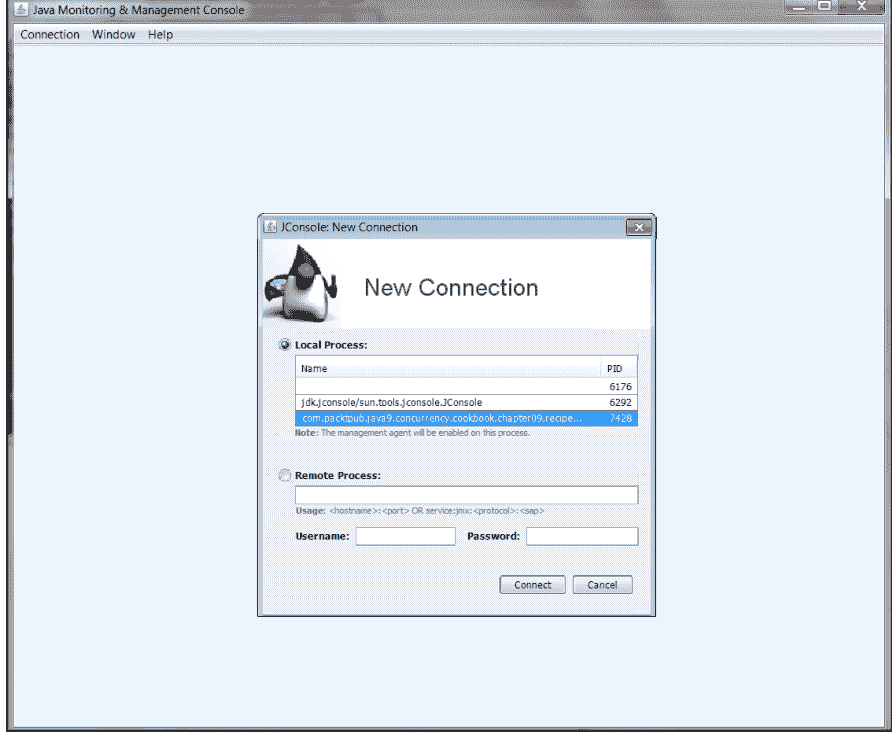

在这种情况下，我们选择我们的示例应用并点击 **Connect** 按钮。然后，你将被要求与应用程序建立不安全连接，显示类似以下对话框：

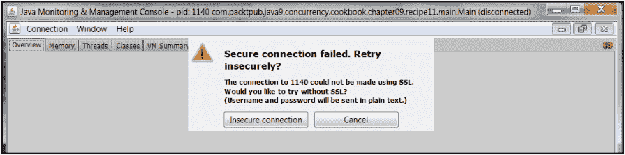

点击 **Insecure connection** 按钮。JConsole 将使用六个标签向你显示有关应用程序的信息：

- **Overview** 标签提供内存使用情况、应用程序中运行的线程数、创建的对象数以及应用程序的 CPU 使用情况的概览。
- **Memory** 标签显示应用程序使用的内存量。它有一个组合框，你可以在其中选择要监控的内存类型（堆、非堆或池）。
- **Threads** 标签显示有关应用程序中线程数的信息以及每个线程的详细信息。
- **Classes** 标签显示有关应用程序中加载的对象数的信息。
- **VM Summary** 标签提供运行应用程序的 JVM 的摘要。
- **MBeans** 标签显示有关应用程序的管理 bean 的信息。


线程选项卡与下图类似：

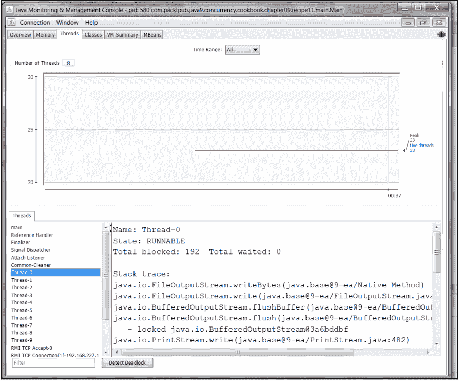

它包含两个不同的部分。在上方部分，你可以看到关于**峰值**线程数（红色线条）和**实时线程数**（蓝色线条）的实时信息。在下方部分，有一个活跃线程的列表。当你选择其中一个线程时，你会看到该线程的详细信息，包括其状态和实际的堆栈跟踪。

## 更多内容...

你可以使用其他应用程序来监控运行 Java 的应用程序。例如，你可以使用 JDK 自带的 VisualVM。你可以从 https://visualvm.github.io 获取关于 VisualVM 的必要信息。

## 参见

- 本章中的*使用 MultithreadedTC 测试并发代码*示例
