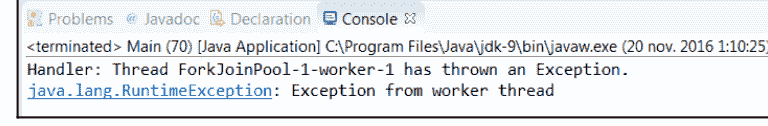

## 第10章：补充信息

## 补充信息

在本章中，我们将介绍以下主题：

- 在 Executor 框架中处理 Runnable 对象的结果
- 处理 ForkJoinPool 类中的未受控异常
- 使用阻塞线程安全队列在生产者和消费者之间通信
- 监控 Thread 类
- 监控 Semaphore 类
- 生成并发随机数

## 简介

本章包含关于 Executor 框架和 fork/join 框架、并发数据结构、监控并发对象以及生成并发随机数的示例。

## 在 Executor 框架中处理 Runnable 对象的结果

Executor 框架允许执行使用 Callable 和 Future 接口返回结果的并发任务。Java 中传统的并发编程基于 Runnable 对象，但这种对象不返回结果。

在本节中，你将学习如何改编一个 Runnable 对象来模拟 Callable 对象，从而允许并发任务返回结果。

## 准备工作

本节示例是使用 Eclipse IDE 实现的。如果你使用 Eclipse 或其他 IDE（如 NetBeans），请打开它并创建一个新的 Java 项目。

## 操作步骤...

执行以下步骤来实现该示例：

- 1. 创建一个名为 FileSearch 的类，并指定它实现 Runnable 接口。该类实现文件搜索操作：

```
public class FileSearch implements Runnable {
```

- 2. 声明两个私有的 String 属性：一个名为 initPath，用于存储搜索操作的初始文件夹；另一个名为 end，用于存储该任务要查找的文件的扩展名：

```
private String initPath;
private String end;
```

- 3. 声明一个名为 results 的私有 List<String> 属性，用于存储该任务找到的文件的完整路径：

```
private List<String> results;
```

- 4. 实现该类的构造函数，以初始化其属性：

```
public FileSearch(String initPath, String end) {
    this.initPath = initPath;
    this.end = end;
    results=new ArrayList<>();
}
```

- 5. 实现 getResults() 方法。该方法返回包含该任务找到的文件的完整路径的列表：

```
public List<String> getResults() {
    return results;
}
```

- 6. 实现 run() 方法。首先，向控制台写入一条日志消息，指示任务正在开始其工作：

```
@Override
public void run() {
    System.out.printf("%s: Starting\n",
        Thread.currentThread().getName());
}
```

- 7. 然后，如果 initPath 属性存储的是一个现有文件夹的名称，则调用辅助方法 directoryProcess() 来处理其中的文件和文件夹：

```
File file = new File(initPath);
if (file.isDirectory()) {
    directoryProcess(file);
}
```

- 8. 实现辅助方法 directoryProcess()，它接收一个 File 对象作为参数。首先，获取参数所指向文件夹的内容：

```
private void directoryProcess(File file) {
    File list[] = file.listFiles();
}
```

- 9. 对于文件夹中的所有元素，如果是文件夹，则递归调用 directoryProcess() 方法；如果是文件，则调用辅助方法 fileProcess()：

```
if (list != null) {
    for (int i = 0; i < list.length; i++) {
        if (list[i].isDirectory()) {
            directoryProcess(list[i]);
        } else {
            fileProcess(list[i]);
        }
    }
}
```

- 10. 实现辅助方法 fileProcess()，它接收一个包含文件完整路径的 File 对象。该方法检查文件扩展名是否与 end 属性中存储的扩展名相同。如果相同，则将文件的完整路径添加到结果列表中：

```
private void fileProcess(File file) {
    if (file.getName().endsWith(end)) {
        results.add(file.getAbsolutePath());
    }
}
```

- 11. 实现一个名为 Task 的类，它继承自 FutureTask 类。你将使用 List<String> 作为参数化类型，因为这是该任务将返回的数据类型：

```
public class Task extends FutureTask<List<String>> {
```

- 12. 声明一个名为 fileSearch 的私有 FileSearch 属性：

```
private FileSearch fileSearch;
```

- 13. 实现该类的构造函数。此构造函数有两个参数：一个名为 runnable 的 Runnable 对象和一个名为 result 的 List<String> 对象。在构造函数中，你必须调用父类的构造函数，并将相同的参数传递给它。然后，存储 runnable 参数，将其转换为 FileSearch 对象：

```
public Task(Runnable runnable, List<String> result) {
    super(runnable, result);
    this.fileSearch=(FileSearch)runnable;
}
```

- 14. 重写 FutureTask 类的 set() 方法：

```
@Override
protected void set(List<String> v) {
```

- 15. 如果它接收到的参数为 null，则在其中存储调用 FileSearch 类的 getResults() 方法的结果：

```
v=fileSearch.getResults();
```

- 16. 然后，调用父类的方法，并将接收到的参数作为参数传递：

```
super.set(v);
```

- 17. 最后，实现示例的主类。创建一个名为 Main 的类并实现 main() 方法：

```
public class Main {
    public static void main(String[] args) {
```

- 18. 调用 Executors 类的 newCachedThreadPool() 方法，创建一个名为 executor 的 ThreadPoolExecutor 对象：

```
ExecutorService executor = Executors.newCachedThreadPool();
```

- 19. 创建三个 FileSearch 对象，每个对象使用不同的初始文件夹。你将查找扩展名为 log 的文件：

```
FileSearch system=new FileSearch("C:\\Windows", "log");
FileSearch apps=new FileSearch("C:\\Program Files","log");
FileSearch documents=new FileSearch("C:\\Documents And Settings","log");
```

- 20. 创建三个 Task 对象以在 executor 中执行搜索操作：

```
Task systemTask=new Task(system,null);
Task appsTask=new Task(apps,null);
Task documentsTask=new Task(documents,null);
```

- 21. 使用 submit() 方法将这些对象发送到 executor 对象。此版本的 submit() 方法返回一个 Future<?> 对象，但你会忽略它。你有一个继承自 FutureTask 类的类来控制此任务的执行：

```
executor.submit(systemTask);
executor.submit(appsTask);
executor.submit(documentsTask);
```

- 22. 调用 executor 对象的 shutdown() 方法，以指示当这三个任务完成时，它应结束执行：

```
executor.shutdown();
```

- 23. 调用 executor 对象的 awaitTermination() 方法，并指定一个较长的等待时间，以确保该方法在三个任务完成之前不会返回：

```
try {
    executor.awaitTermination(1, TimeUnit.DAYS);
} catch (InterruptedException e) {
    e.printStackTrace();
}
```

- 24. 对于每个任务，使用 Task 对象的 get() 方法打印一条包含结果列表大小的消息：

```
try {
    System.out.printf("Main: System Task: Number of Results: %d\n", systemTask.get().size());
    System.out.printf("Main: App Task: Number of Results: %d\n", appsTask.get().size());
    System.out.printf("Main: Documents Task: Number of Results: %d\n",documentsTask.get().size());
} catch (InterruptedException e) {
    e.printStackTrace();
} catch (ExecutionException e) {
    e.printStackTrace();
}
```

## 工作原理...

理解此示例首先要考虑的是 ThreadPoolExecutor 类的 submit() 方法在传递 Callable 对象作为参数与传递 Runnable 对象作为参数时的区别。在第一种情况下，你可以使用该方法返回的 Future 对象来控制任务的状态并获取其结果。但在第二种情况下，当你传递 Runnable 对象时，你只能使用该方法返回的 Future 对象来控制任务的状态。如果你调用该 Future 对象的 get() 方法，你将得到一个 null 值。

为了覆盖此行为，你实现了 Task 类。该类继承自 FutureTask 类，而 FutureTask 类是一个实现 Future 接口和 Runnable 接口的类。当你调用一个返回 Future 对象的方法（例如 submit() 方法）时，你通常会得到一个 FutureTask 对象。因此，你可以使用此类来实现两个目标：


## 附加信息

1. 首先，执行 `Runnable` 对象（在本例中为 `FileSearch` 对象）。

2. 其次，返回此任务生成的结果。为此，你重写了 `Task` 类的 `set()` 方法。内部地，`FutureTask` 类控制其需要执行的任务何时完成。在那一刻，它会调用 `set()` 方法来建立任务的返回值。当你执行一个 `Callable` 对象时，此调用会使用 `call()` 方法返回的值进行调用，但当你执行一个 `Runnable` 对象时，此调用会使用 null 值进行调用。你已将此 null 值更改为 `FileSearch` 对象生成的结果列表。`set()` 方法仅在第一次被调用时才有效。当第一次调用时，它会将任务标记为已完成，后续的调用将不会修改任务的返回值。

在 `Main` 类中，而不是将 `Callable` 或 `Runnable` 对象发送给执行器，你可以发送 `FutureTask` 对象。主要区别在于你使用 `FutureTask` 对象来获取任务的结果，而不是 `submit()` 方法返回的 `Future` 对象。

在这种情况下，你仍然可以使用 `submit()` 方法返回的 `Future` 对象来控制任务的状态，但请记住，由于此任务执行的是 `Runnable` 对象（你已使用实现 `Runnable` 接口的 `FileSearch` 对象初始化了 `FutureTask` 对象），如果你在 `Future` 对象上调用 `get()` 方法，你将得到 null 值。

### 还有更多...

`FutureTask` 类提供了一个未包含在 `Future` 接口中的方法。它是 `setException()` 方法。此方法接收一个 `Throwable` 对象作为参数，并且当调用 `get()` 方法时，将抛出 `ExecutionException`。此调用仅在尚未调用 `FutureTask` 对象的 `set()` 方法时才有效。

### 另请参阅

- *Chapter 4, Thread Executors* 中 *Executing tasks in an executor that returns a result* 食谱
- *Chapter 1, Thread Management* 中 *Creating, running, and setting the characteristics of a thread* 食谱

## 在 ForkJoinPool 类中处理不受控制的异常

fork/join 框架使你能够为 `ForkJoinPool` 类的工作线程抛出的异常设置处理程序。当你使用 `ForkJoinPool` 类时，你应该理解任务和工作线程之间的区别。

要使用 fork/join 框架，你需要实现一个扩展 `ForkJoinTask` 类的任务，或者通常是 `RecursiveAction` 或 `RecursiveTask` 类。任务实现了你希望使用框架并发执行的动作。它们由 `ForkJoinPool` 类中的工作线程执行。一个工作线程将执行各种任务。在 `ForkJoinPool` 类实现的工作窃取算法中，当工作线程正在执行的任务完成执行或它正在等待另一个任务完成时，工作线程会寻找新任务。

在本食谱中，你将学习如何处理工作线程抛出的异常。为使其按以下各项所述工作，你必须实现两个额外的元素：

- 第一个元素是 `ForkJoinWorkerThread` 类的扩展类。此类实现了 `ForkJoinPool` 类的工作线程。你将实现一个基本子类，该子类会抛出异常。
- 第二个元素是用于创建你自己的自定义类型工作线程的工厂。`ForkJoinPool` 类使用工厂来创建其工作线程。你必须实现一个实现 `ForkJoinWorkerThreadFactory` 接口的类，并在 `ForkJoinPool` 类的构造函数中使用该类的对象。创建的 `ForkJoinPool` 对象将使用该工厂来创建工作线程。

### 如何做...

执行以下步骤来实现示例：

1. 首先，实现你自己的工作线程类。创建一个名为 `AlwaysThrowsExceptionWorkerThread` 的类，该类扩展 `ForkJoinWorkerThread` 类：

```java
public class AlwaysThrowsExceptionWorkerThread extends
    ForkJoinWorkerThread {
```

2. 实现该类的构造函数。它接收一个 `ForkJoinPool` 类作为参数并调用其父类的构造函数：

```java
protected AlwaysThrowsExceptionWorkerThread(ForkJoinPool pool) {
    super(pool);
}
```

3. 实现 `onStart()` 方法。这是 `ForkJoinWorkerThread` 类的一个方法，并在工作线程开始执行时执行。实现将在被调用时抛出 `RuntimeException`：

```java
protected void onStart() {
    super.onStart();
    throw new RuntimeException("Exception from worker thread");
}
```

4. 现在，实现创建工作线程所需的工厂。创建一个名为 `AlwaysThrowsExceptionWorkerThreadFactory` 的类，该类实现 `ForkJoinWorkerThreadFactory` 接口：

```java
public class AlwaysThrowsExceptionWorkerThreadFactory implements ForkJoinWorkerThreadFactory {
```

5. 实现 `newThread()` 方法。它接收一个 `ForkJoinPool` 对象作为参数并返回一个 `ForkJoinWorkerThread` 对象。创建一个 `AlwaysThrowsExceptionWorkerThread` 对象并返回它：

```java
@Override
public ForkJoinWorkerThread newThread(ForkJoinPool pool) {
    return new AlwaysThrowsExceptionWorkerThread(pool);
}
```

6. 实现一个将管理工作线程抛出的异常的类。实现一个名为 `Handler` 的类，该类实现 `UncaughtExceptionHandler` 接口：

```java
public class Handler implements UncaughtExceptionHandler {
```

7. 实现 `uncaughtException()` 方法。它接收一个 `Thread` 对象和一个 `Throwable` 对象作为参数，并在工作线程每次抛出异常时由 `ForkJoinPool` 类调用。向控制台写入消息并退出程序：

```java
@Override
public void uncaughtException(Thread t, Throwable e) {
    System.out.printf("Handler: Thread %s has thrown an Exception.\n", t.getName());
    System.out.printf("%s\n", e);
    System.exit(-1);
}
```

8. 现在，实现一个将在 `ForkJoinPool` 执行器中执行的任务。创建一个名为 `OneSecondLongTask` 的类，该类扩展 `RecursiveAction` 类：

```java
public class OneSecondLongTask extends RecursiveAction {
```

9. 实现 `compute()` 方法。它只是让线程在 1 秒后休眠：

```java
@Override
protected void compute() {
    System.out.printf("Task: Starting.\n");
    try {
        TimeUnit.SECONDS.sleep(1);
    } catch (InterruptedException e) {
        e.printStackTrace();
    }
    System.out.printf("Task: Finish.\n");
}
```

10. 现在，实现示例的主类。创建一个名为 `Main` 的类，其中包含 `main()` 方法：

```java
public class Main {
    public static void main(String[] args) {
```

11. 创建一个新的 `OneSecondLongTask` 对象：

```java
OneSecondLongTask task = new OneSecondLongTask();
```

12. 创建一个新的 `Handler` 对象：

```java
Handler handler = new Handler();
```

13. 创建一个新的 `AlwaysThrowsExceptionWorkerThreadFactory` 对象：

```java
AlwaysThrowsExceptionWorkerThreadFactory factory = new AlwaysThrowsExceptionWorkerThreadFactory();
```

14. 创建一个新的 `ForkJoinPool` 对象。将值 2、工厂对象、处理程序对象和值 false 作为参数传递：

```java
ForkJoinPool pool = new ForkJoinPool(2, factory, handler, false);
```

15. 使用 `execute()` 方法在池中执行任务：

```java
pool.execute(task);
```

16. 使用 `shutdown()` 方法关闭池：

```java
pool.shutdown();
```

17. 使用 `awaitTermination()` 方法等待任务完成：

```java
try {
    pool.awaitTermination(1, TimeUnit.DAYS);
} catch (InterruptedException e) {
    e.printStackTrace();
}
```

18. 写入一条指示程序结束的消息：

```java
System.out.printf("Task: Finish.\n");
```

### 它是如何工作的...

在本食谱中，你实现了以下元素：

- **你自己的工作线程类**：你实现了 `AlwaysThrowsExceptionWorkerThread` 类，它扩展了 `ForkJoinWorkerThread` 类，后者实现了 fork/join 池的工作线程。你重写了 `onStart()` 方法。此方法在工作线程开始执行时执行。它只是在被调用时抛出 `RuntimeException`。


- **你自己的线程工厂：** `ForkJoinPool` 类使用工厂创建其工作线程。正如你想要创建一个使用 `AlwaysThrowsExceptionWorkerThreadFactory` 工作线程的 `ForkJoinPool` 对象一样，你已经实现了一个创建它们的工厂。要实现一个工作线程工厂，你需要实现 `ForkJoinWorkerThreadFactory` 接口。该接口只有一个名为 `newThread()` 的方法，它创建工作线程并将其返回给 `ForkJoinPool` 类。
- **一个任务类：** 工作线程执行你发送到 `ForkJoinPool` 执行器的任务。正如你想要启动工作线程的执行，你需要向 `ForkJoinPool` 执行器发送一个任务。该任务休眠一秒，但由于 `AlwaysThrowsExceptionWorkerThread` 线程抛出异常，因此它永远不会被执行。
- **未捕获异常的处理程序类：** 当工作线程抛出异常时，`ForkJoinPool` 类会检查是否已注册异常处理程序。你已为此目的实现了 `Handler` 类。此处理程序实现了 `UncaughtExceptionHandler` 接口，该接口只有一个方法，即 `uncaughtException()` 方法。此方法接收抛出异常的线程和它抛出的异常作为参数。

在 Main 类中，你已将所有这些元素组合在一起。你已将四个参数传递给 `ForkJoinPool` 类的构造函数：并行级别、你想要拥有的活动工作线程数、你在 `ForkJoinPool` 对象中想要使用的 worker thread factory、你想要用于工作线程未捕获异常的处理程序，以及 async 模式。

以下屏幕截图显示了此示例执行的结果：



当你执行程序时，一个工作线程抛出 `RuntimeException` 异常。`ForkJoinPool` 类将其交给你的处理程序，后者又将消息写入控制台并退出程序。任务不会开始执行。

## There's more...

你可以测试此示例的两个有趣变体：

- 如果你在 Handler 类中注释以下行并执行程序，你将在控制台看到大量消息写入。`ForkJoinPool` 类尝试启动一个工作线程来执行任务，并且由于它们总是抛出异常，所以它一次又一次地尝试：

```
System.exit(-1);
```

- 如果你将 `ForkJoinPool` 类构造函数的第三个参数（异常处理程序）更改为 null 值，也会发生类似的情况。在这种情况下，你会看到 JVM 如何在控制台中写入异常。

- 在你实现可能抛出异常的自己的工作线程时，请考虑这一点。

## See also

- `Chapter 5` 中 *Creating a fork/join pool* 的配方，Fork/Join Framework

- `Chapter 8` 中 *Customizing tasks running in the fork/join framework* 和 *Implementing the ThreadFactory interface to generate custom threads for the fork/join framework* 的配方，Customizing Concurrency Classes

## Using a blocking thread-safe queue for communicating with producers and consumers

生产者/消费者问题是并发编程中的一个经典问题。你有一个或多个数据生产者，它们将数据存储在缓冲区中。你还有一个或多个数据消费者，它们从同一个缓冲区中取出数据。生产者和消费者共享同一个缓冲区，因此你必须控制对其的访问以避免数据不一致问题。当缓冲区为空时，消费者等待直到缓冲区有元素。如果缓冲区已满，生产者等待直到缓冲区有空闲空间。

这个问题几乎使用 Java 和其他语言中开发的所有技术和同步机制来实现（请参阅“另请参阅”部分以获取更多信息）。这个问题的优点之一是它可以外推到许多现实世界的情况。

Java 7 Concurrency API 引入了一种面向在这种类型的问题中使用的的数据结构。它是 LinkedTransferQueue 类，其主要特征如下：

- 它是一个阻塞数据结构。线程被阻塞直到操作可以进行，前提是操作立即执行。
- 它的大小没有限制。你可以插入任意多的元素。
- 它是一个参数化类。你必须指出你要存储在列表中的元素的类。

在本配方中，你将学习如何使用 LinkedTransferQueue 类运行大量共享字符串缓冲区的生产者和消费者任务。

## Getting ready

本配方的示例已使用 Eclipse IDE 实现。如果你使用 Eclipse 或其他 IDE，例如 NetBeans，请打开它并创建一个新的 Java 项目。

## How to do it...

执行以下步骤来实现示例：

1. 创建一个名为 Producer 的类并指定它实现 Runnable 接口：
```
public class Producer implements Runnable {
```
2. 声明一个私有 LinkedTransferQueue 属性，使用 String 类参数化并命名为 buffer：
```
private LinkedTransferQueue<String> buffer;
```
3. 声明一个私有 String 属性名为 name 以存储生产者的名称：
```
private String name;
```
4. 实现类的构造函数以初始化其属性：
```
public Producer(String name, LinkedTransferQueue<String> buffer){
    this.name=name;
    this.buffer=buffer;
}
```
5. 实现 run() 方法。使用 buffer 对象的 put() 方法在缓冲区中存储 10,000 个字符串，并向控制台写入一条消息指示方法的结束：
```
@Override
public void run() {
    for (int i=0; i<10000; i++) {
        buffer.put(name+": Element "+i);
    }
    System.out.printf("Producer: %s: Producer done\n",name);
}
```
6. 实现一个名为 Consumer 的类并指定它实现 Runnable 接口：
```
public class Consumer implements Runnable {
```
7. 声明一个私有 LinkedTransferQueue 属性，使用 String 类参数化并命名为 buffer：
```
private LinkedTransferQueue<String> buffer;
```
8. 声明一个私有 String 属性名为 name 以存储消费者的名称：
```
private String name;
```
9. 实现类的构造函数以初始化其属性：
```
public Consumer(String name, LinkedTransferQueue<String> buffer){
    this.name=name;
    this.buffer=buffer;
}
```
10. 实现 run() 方法。使用 buffer 对象的 take() 方法从缓冲区取出 10,000 个字符串，并向控制台写入一条消息指示方法的结束：
```
@Override
public void run() {
    for (int i=0; i<10000; i++){
        try {
            buffer.take();
        } catch (InterruptedException e) {
            e.printStackTrace();
        }
    }
    System.out.printf("Consumer: %s: Consumer done\n",name);
}
```
11. 实现示例的主类。创建一个名为 Main 的类并向其中添加 main() 方法：
```
public class Main {
    public static void main(String[] args) {
```
12. 声明一个名为 THREADS 的常量并将其赋值为 100。创建一个使用 String 类对象的 LinkedTransferQueue 对象并将其命名为 buffer：
```
final int THREADS=100;
LinkedTransferQueue<String> buffer=new LinkedTransferQueue<>();
```
13. 创建一个包含 100 个 Thread 对象的数组以执行 100 个生产者任务：
```
Thread producerThreads[]=new Thread[THREADS];
```
14. 创建一个包含 100 个 Thread 对象的数组以执行 100 个消费者任务：
```
Thread consumerThreads[]=new Thread[THREADS];
```
15. 创建并启动 100 个 Consumer 对象并将线程存储在之前创建的数组中：
```
for (int i=0; i<THREADS; i++){
    Consumer consumer=new Consumer("Consumer "+i,buffer);
    consumerThreads[i]=new Thread(consumer);
    consumerThreads[i].start();
}
```


16. 创建并启动 100 个 Producer 对象并将线程存储在之前创建的数组中：

```
for (int i=0; i<THREADS; i++) {
    Producer producer=new Producer("Producer: "+ i , buffer);
    producerThreads[i]=new Thread(producer);
    producerThreads[i].start();
}
```

17. 使用 join() 方法等待线程的结束：

```
for (int i=0; i<THREADS; i++){
    try {
        producerThreads[i].join();
        consumerThreads[i].join();
    } catch (InterruptedException e) {
        e.printStackTrace();
    }
}
```

18. 使用缓冲区的大小向控制台写入一条消息：

```
System.out.printf("Main: Size of the buffer: %d\n", buffer.size());
System.out.printf("Main: End of the example\n");
```

## How it works...

在本教程中，你使用了参数化为 String 类的 LinkedTransferQueue 类来实现生产者/消费者问题。此 LinkedTransferQueue 类用作缓冲区，用于在生产者和消费者之间共享数据。

你实现了一个 Producer 类，该类使用 put() 方法向缓冲区添加字符串。你执行了 100 个生产者，每个生产者向缓冲区插入 10,000 个字符串，因此你在缓冲区中插入了 1,000,000 个字符串。put() 方法将元素添加到缓冲区的末尾。

你还实现了一个 Consumer 类，该类使用 take() 方法从缓冲区获取字符串。此方法返回并删除缓冲区的第一个元素。如果缓冲区为空，该方法会阻塞发出调用的线程，直到缓冲区中有字符串可供消费。你执行了 100 个消费者，每个消费者从缓冲区获取 10,000 个字符串。

在示例中，首先启动消费者然后启动生产者，因此由于缓冲区为空，所有消费者将被阻塞，直到生产者开始执行并将字符串存储到列表中。

以下屏幕截图显示了此示例执行的部分输出：

```
<terminated> Main (71) [Java Application] C:\Program Files\Java\jdk-9\bin\javaw.exe (20 nov. 2016 1:22:08)
Producer: Producer: 62: Producer done
Producer: Producer: 60: Producer done
Producer: Producer: 57: Producer done
Main: Size of the buffer: 0
Main: End of the example
```

要写入缓冲区的元素数量，你使用了 size() 方法。你必须考虑到，如果在有线程向列表添加或删除数据时使用此方法，该方法可能返回不真实的值。该方法必须遍历整个列表来计数元素，而在此操作期间列表的内容可能会发生变化。只有在没有线程修改列表时使用它，你才能保证返回的结果是正确的。

## There's more...

LinkedTransferQueue 类提供了其他有用的方法。以下是其中的一些：

- getWaitingConsumerCount(): 此方法返回在 take() 方法或 poll (long timeout, TimeUnit unit) 中被阻塞的消费者数量，因为 LinkedTransferQueue 对象为空。
- hasWaitingConsumer(): 此方法如果 LinkedTransferQueue 对象有等待的消费者则返回 true，否则返回 false。
- offer(E e): 此方法将作为参数传递的元素添加到 LinkedTransferQueue 对象的末尾并返回 true 值。E 表示用于参数化 LinkedTransferQueue 类声明的类或其子类。

## Getting ready

本教程的示例使用 Eclipse IDE 实现。如果使用 Eclipse 或其他 IDE，例如 NetBeans，请打开它并创建一个新的 Java 项目。

## How to do it...

执行以下步骤来实现示例：

- 1. 创建一个名为 Task 的类，实现 Runnable 接口：
- 2. 实现 task 的 run() 方法：
- 3. 创建一个包含 100 步的循环：
- 4. 在每一步中，让线程休眠 100 毫秒：
- 5. 在控制台写入线程名称和步骤编号的消息：
- 6. 创建示例的主类。创建一个名为 Main 的类并包含 main() 方法：

```
public class Task implements Runnable {
```

```
@Override
public void run() {
```

```
for (int i=0; i<100; i++) {
```

```
try {
    TimeUnit.MILLISECONDS.sleep(100);
} catch (InterruptedException e) {
    e.printStackTrace();
}
```

```
System.out.printf("%s: %d\n",Thread.currentThread()
    .getName(),i);
}
```

```
public class Main {
    public static void main(String[] args) throws Exception{
```

13. 让线程休眠一秒并关闭循环和类：

```
TimeUnit.SECONDS.sleep(1);
}
}
```

## How it works...

在本教程中，你使用了以下方法来获取有关 Thread 类的信息：

- getId(): 此方法返回线程的 ID。它是一个唯一的 long 数字且不可更改。
- getName(): 此方法返回线程的名称。如果未设置线程的名称，Java 会为其提供默认名称。
- getPriority(): 此方法返回线程的执行优先级。优先级较高的线程优先于优先级较低的线程执行。它是一个 int 值，其值介于 Thread 类的 MIN_PRIORITY 和 MAX_PRIORITY 常量之间。默认情况下，线程以 Thread 类的 NORM_PRIORITY 常量指定的相同优先级创建。
- getState(): 此方法返回线程的状态。它是一个 Thread.State 对象。Thread.State 枚举包含线程的所有可能状态。
- getThreadGroup(): 此方法返回线程的 ThreadGroup 对象。默认情况下，线程属于同一个线程组，但在线程的构造函数中你可以指定不同的线程组。
- getStackTrace(): 此方法返回 StackTraceElement 对象数组。每个对象代表从线程的 run() 方法开始的对方法的调用，并包括调用到实际执行点为止的所有方法。当调用新方法时，会向数组添加一个新的堆栈跟踪元素。当方法完成执行时，其堆栈跟踪元素会从数组中移除。

## There's more...

Thread 类包含其他提供有关其信息的可用方法。这些方法如下：

- `activeCount()`: 此方法返回线程组中活动线程的数量。
- `dumpStack()`: 此方法将线程的堆栈跟踪打印到标准错误输出。

## See also

- 第 1 章 Thread Management 中的 Creating, running, and setting the characteristics of a thread 教程
- 第 8 章 Customizing Concurrency Classes 中的 Using a ThreadFactory interface in an Executor framework 和 Implementing a ThreadFactory interface to generate custom threads for the fork/join framework 教程

## Monitoring a Semaphore class

信号量是一个计数器，用于保护对一个或多个共享资源的访问。


信号量的概念由 Edsger Dijkstra 于 1965 年提出，并在 THEOS 操作系统中首次使用。

当线程想要使用共享资源时，它必须获取信号量。如果信号量的内部计数器大于 0，信号量会递减计数器并允许访问共享资源。如果信号量的计数器为 0，信号量会阻塞线程，直到计数器大于 0。当线程完成使用共享资源后，它必须释放信号量。该操作会增加信号量的内部计数器。

在 Java 中，信号量在 Semaphore 类中实现。

在本教程中，你将学习可以获得有关信号量状态的哪些信息以及如何获取它。

## Getting ready

本教程的示例使用 Eclipse IDE 实现。如果使用 Eclipse 或其他 IDE，例如 NetBeans，请打开它并创建一个新的 Java 项目。

## How to do it...

执行以下步骤来实现示例：

- 1. 创建一个名为 Task 的类，实现 Runnable 接口：
  ```
  public class Task implements Runnable {
  ```
- 2. 声明一个名为 semaphore 的私有 Semaphore 属性：
  ```
  private final Semaphore semaphore;
  ```
- 3. 实现类的构造函数以初始化其属性：
  ```
  public Task(Semaphore semaphore){
      this.semaphore=semaphore;
  }
  ```
- 4. 实现 run() 方法。首先，获取 semaphore 属性的许可并在控制台写入消息以指示该情况：
  ```
  @Override
  public void run() {
      try {
          semaphore.acquire();
          System.out.printf("%s: Get the semaphore.\n",
              Thread.currentThread().getName());
  ```
- 5. 然后，使用 sleep() 方法让线程休眠两秒钟。最后，释放许可并在控制台写入消息以指示该情况：
  ```
  TimeUnit.SECONDS.sleep(2);
  System.out.println(Thread.currentThread().getName()+":
      Release the semaphore.");
  } catch (InterruptedException e) {
      e.printStackTrace();
  } finally {
      semaphore.release();
  }
  ```


6. 实现示例的主类。创建一个名为 Main 的类并包含 main() 方法：

```
public class Main {
    public static void main(String[] args) throws Exception {
```

7. 创建一个名为 semaphore 的 Semaphore 对象，包含三个许可：

```
Semaphore semaphore=new Semaphore(3);
```

8. 创建一个数组来存储 10 个 Thread 对象：

```
Thread threads[]=new Thread[10];
```

9. 创建并启动 10 个 Thread 对象以执行 10 个 Task 对象。启动线程后，让线程休眠 200 毫秒并调用 showLog() 方法写入有关 Semaphore 类的信息：

```
for (int i=0; i<threads.length; i++) {
    Task task=new Task(semaphore);
    threads[i]=new Thread(task);
    threads[i].start();
    
    TimeUnit.MILLISECONDS.sleep(200);
    
    showLog(semaphore);
}
```

10. 实现一个包含五个步骤的循环来调用 showLog() 方法写入有关信号量的信息并让线程休眠 1 秒：

```
for (int i=0; i<5; i++) {
    showLog(semaphore);
    TimeUnit.SECONDS.sleep(1);
}
```

11. 实现 showLog() 方法。它接收一个 Semaphore 对象作为参数。在控制台写入有关信号量的可用许可、排队线程和许可的信息：

```
private static void showLog(Semaphore semaphore) {
    System.out.printf("*******************\n");
    System.out.printf("Main: Semaphore Log\n");
    System.out.printf("Main: Semaphore: Available Permits: %d\n",
        semaphore.availablePermits();
System.out.printf("Main: Semaphore: Queued Threads: %s\n", semaphore.hasQueuedThreads());
System.out.printf("Main: Semaphore: Queue Length: %d\n", semaphore.getQueueLength());
System.out.printf("Main: Semaphore: Fairness: %s\n", semaphore.isFair());
System.out.printf("**************************\n");
}
```

## 如何工作...

在本教程中，您已使用以下方法获取有关信号量的信息：

- `availablePermits()`：此方法返回一个 int 值，即信号量的可用资源数量。
- `hasQueuedThreads()`：此方法返回一个布尔值，表示是否有线程正在等待信号量保护的资源。
- `getQueueLength()`：此方法返回正在等待信号量保护的资源 的线程数量。
- `isFair()`：此方法返回一个布尔值，表示信号量是否激活了公平模式。当公平模式处于活动状态时（此方法返回 true 值），并且锁需要选择另一个线程以便其访问共享资源时，它会选择等待时间最长的线程。如果公平模式处于非活动状态（此方法返回 false 值），则无法保证线程获取共享资源访问权的顺序。

## 另请参阅

- 第 3 章《线程同步实用程序》中“控制对一个或多个资源副本的并发访问”教程

## 生成并发随机数

Java 并发 API 提供了用于在并发应用程序中生成伪随机数的特定类。它是 ThreadLocalRandom 类，并且在 Java 7 版本中新增。它工作方式类似于线程的本地变量。每个想要生成随机数的线程都有一个不同的生成器，但它们都由同一个类以对程序员透明的方式进行管理。通过这种机制，您将获得比使用共享 Random 对象为所有线程生成随机数更好的性能。

在本教程中，您将学习如何在并发应用程序中使用 ThreadLocalRandom 类生成随机数。

## 准备工作

本教程的示例使用 Eclipse IDE 实现。如果您使用 Eclipse 或其他 IDE，例如 NetBeans，请打开它并创建一个新的 Java 项目。

## 如何操作...

按照以下步骤实现示例：

- 1. 创建一个名为 TaskLocalRandom 的类并指定它实现 Runnable 接口：

```
public class TaskLocalRandom implements Runnable {
```

- 2. 实现 run() 方法。获取正在执行此任务的线程的名称并使用 nextInt() 方法向控制台写入 10 个随机整数：

```
@Override
public void run() {
    String name=Thread.currentThread().getName();
    for (int i=0; i<10; i++){
        System.out.printf("%s: %d\n",name,
            ThreadLocalRandom.current().nextInt(10));
    }
}
```

- 3. 通过创建名为 Main 的类并向其添加 main() 方法来实现示例的主类：

```
public class Main {
    public static void main(String[] args) {
```

- 4. 创建一个用于三个 Thread 对象的数组：

```
Thread threads[]=new Thread[3];
```

- 5. 创建并启动三个 TaskLocalRandom 任务。将线程存储在之前创建的数组中：

```
for (int i=0; i<3; i++) {
    TaskLocalRandom task=new TaskLocalRandom();
    threads[i]=new Thread(task);
    threads[i].start();
}
```

## 如何工作...

此示例的关键在于 TaskLocalRandom 类。在类的构造函数中，我们调用 ThreadLocalRandom 类的 current() 方法。这是一个静态方法，它返回与当前线程关联的 ThreadLocalRandom 对象，因此您可以使用该对象生成随机数。如果发出调用的线程尚未关联任何对象，则该类会创建一个新的对象。在这种情况下，您使用此方法来初始化与此任务关联的随机生成器，因此它将在下一次调用该方法时创建。

在 TaskLocalRandom 类的 run() 方法中，调用 current() 方法以获取与此线程关联的随机生成器，您还调用 nextInt() 方法并将数字 10 作为参数传递。此方法将返回 0 到 10 之间的伪随机数。每个任务生成 10 个随机数。

## 还有更多...

`ThreadLocalRandom` 类还提供生成 long、float 和 double 数字以及布尔值的方法。有一些方法允许您提供一个数字作为参数以生成零到该数字之间的随机数。其他方法允许您提供两个参数以生成这两个数字之间的随机数。

## 另请参阅

`Chapter 1`《线程管理》中的 *Using local thread variables* 教程

## 11
