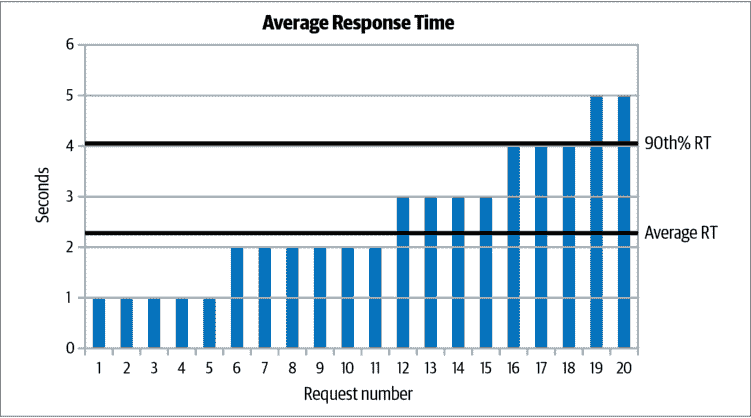
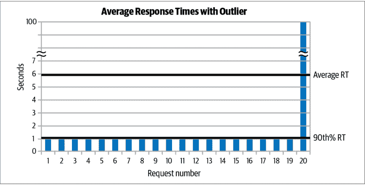

# 第 1 章
## 引言

这是一本关于 Java 性能艺术与科学的书。

这句话中的科学部分并不令人惊讶；关于性能的讨论包括大量数字、测量和分析。大多数性能工程师都有科学背景，应用科学严谨性是实现最大性能的关键部分。

艺术部分呢？性能调优是艺术与科学兼具的观念并不新鲜，但在性能讨论中很少得到明确承认。这部分是因为“艺术”的概念违背了我们的训练。但对一些人来说看起来像艺术的东西，从根本上是基于深厚的知识和经验。据说魔法与足够先进的技术无法区分，显然对圆桌骑士来说，手机看起来会像魔法一样。同样，优秀的性能工程师所产生的工作可能看起来像艺术，但这种艺术实际上是深厚知识、经验和直觉的应用。

本书无法帮助经验和直觉这部分，但可以提供深厚的知识——其观点是，随着时间的推移应用知识将帮助您培养成为一名优秀的 Java 性能工程师所需的技能。目标是让您深入了解 Java 平台的性能方面。

这些知识可分为两个大类。首先是 Java 虚拟机（JVM）本身的性能：JVM 的配置方式会影响程序性能的许多方面。熟悉其他语言的开发人员可能会觉得需要调优有些恼人，但实际上调优 JVM 完全类似于 C++ 程序员在编译期间测试和选择编译器标志，或 PHP 编码者设置 php.ini 文件中的适当变量，等等。

第二个方面是了解 Java 平台的特性如何影响性能。请注意这里使用“平台”一词：某些特性（例如线程和同步）是语言的一部分，而某些特性（例如字符串处理）是标准 Java API 的一部分。虽然 Java 语言和 Java API 之间存在重要区别，但在这种情况下它们将被类似对待。本书涵盖平台的这两个方面。

JVM 的性能很大程度上基于调优标志，而平台的性能则更多地由应用程序代码中使用最佳实践决定。很长一段时间以来，这些被认为是两个独立的专业领域：开发人员编写代码，而性能组测试并推荐性能问题的修复。这从来都不是一个特别有用的区分——任何使用 Java 的人都应同样擅长理解代码在 JVM 中的行为以及可能有助于其性能的调优类型。随着项目转向 DevOps 模式，这种区分开始变得不那么严格。对完整领域的了解将使您的工作具有艺术的光泽。

## 简要大纲

首先，Chapter 2 讨论了测试 Java 应用程序的一般方法，包括 Java 基准测试的陷阱。由于性能分析需要对应用程序正在做什么的可视性，Chapter 3 提供了监控 Java 应用程序可用工具的概述。

然后是时候深入性能了，首先关注常见的调优方面：即时编译（Chapter 4）和垃圾回收（Chapter 5 和 Chapter 6）。剩余章节专注于 Java 平台各个部分的良好实践使用：Java 堆的内存使用（Chapter 7）、本地内存使用（Chapter 8）、线程性能（Chapter 9）、Java 服务器技术（Chapter 10）、数据库访问（Chapter 11）以及通用 Java SE API 提示（Chapter 12）。

附录 A 列出了本书中讨论的所有调优标志，并交叉引用了它们被检查的章节。

## 平台和约定

虽然本书是关于 Java 的性能，但该性能将受到几个因素的影响：当然是 Java 本身的版本，以及它运行的硬件和软件平台。


## Java 平台

本书涵盖了 Oracle HotSpot Java 虚拟机 (JVM) 以及 Java 开发工具包 (JDK) 版本 8 和 11 的性能。这也被称为 Java 标准版 (SE)。Java 运行时环境 (JRE) 是 JDK 的子集，仅包含 JVM，但由于 JDK 中的工具对于性能分析很重要，因此本书的重点是 JDK。实际上，这意味着它还涵盖了源自该技术 OpenJDK 仓库的衍生平台，其中包括来自 AdoptOpenJDK 项目发布的 JVM。严格来说，Oracle 二进制文件需要生产用途的许可证，而 AdoptOpenJDK 二进制文件附带开源许可证。对于我们的目的，我们将把这两个版本视为同一事物，我们将其称为 JDK 或 Java 平台。¹

这些版本经历了各种错误修复版本。截至我撰写本文时，Java 8 的当前版本是 jdk8u222（版本 222），Java 11 的当前版本是 11.0.5。重要的是使用至少这些版本（如果不是更新的版本），尤其是在 Java 8 的情况下。Java 8 的早期版本（大约到 jdk8u60）不包含本书中讨论的许多重要性能增强和功能（特别是关于垃圾回收和 G1 垃圾回收器）。

选择这些 JDK 版本是因为它们获得了 Oracle 的长期支持 (LTS)。Java 社区可以自由开发自己的支持模式，但迄今为止一直遵循 Oracle 的模式。因此这些版本将被支持并可用相当长一段时间：Java 8 至少到 2023 年（通过 AdoptOpenJDK；之后通过扩展的 Oracle 支持合同），Java 11 至少到 2022 年。下一个长期版本预计在 2021 年底发布。

对于过渡版本，关于 Java 11 的讨论显然包括首次在 Java 9 或 Java 10 中提供的功能，即使这些版本既不受 Oracle 也不受社区广泛支持。事实上，当讨论此类功能时，我有些不精确；看起来我可能说功能 X 和 Y 最初包含在 Java 11 中，而它们可能在 Java 9 或 10 中就已可用。Java 11 是携带这些功能的第一个 LTS 版本，这才是重要的部分：由于 Java 9 和 10 并未被使用，功能首次出现的时间并不重要。同样，虽然本书发布时 Java 13 将会发布，但对 Java 12 或 Java 13 的覆盖并不多。你可以在生产中使用这些版本，但只能使用六个月，之后你需要升级到新版本（因此当你阅读本文时，Java 12 已不再受支持，如果 Java 13 受支持，它也将被 Java 14 很快取代）。我们将瞥见这些过渡版本中的一些功能，但由于这些版本不太可能在大多数环境中投入生产，重点仍然放在 Java 8 和 11 上。

1 罕见情况下，两者之间存在差异；例如，AdoptOpenJDK 版本的 Java 在 JDK 11 中包含新的垃圾回收器。我会在出现差异时指出。

其他平台在用。

其他 Java 语言规范的实现是可用的，包括开源实现的分支。AdoptOpenJDK 提供了其中之一（Eclipse OpenJ9），其他供应商也提供其他实现。虽然所有这些平台都必须通过兼容性测试才能使用 Java 名称，但这种兼容性并不总是延伸到本书讨论的主题。这对于调优标志尤其如此。所有 JVM 实现都有一个或多个垃圾回收器，但用于调优每个供应商 GC 实现的标志是产品特定的。因此，虽然本书的概念适用于任何 Java 实现，但特定的标志和建议仅适用于 HotSpot JVM。

这一警告适用于 HotSpot JVM 的早期版本——标志及其默认值会随版本而变化。这里讨论的标志适用于 Java 8（具体为版本 222）和 11（具体为 11.0.5）。后续版本可能会略微更改这些信息中的一些内容。务必查阅发行说明以了解重要更改。

在 API 层面，不同的 JVM 实现兼容性更高，尽管即使在那时，Oracle HotSpot Java 平台中某个特定类的实现方式与替代平台之间也可能存在细微差异。类必须在功能上等效，但实际实现可能会改变。幸运的是，这很少发生，不太可能极大地影响性能。

对于本书的其余部分，术语 *Java* 和 *JVM* 应理解为特指 Oracle HotSpot 实现。严格来说，说“JVM 在首次执行时不会编译代码”是错误的；某些 Java 实现确实在代码首次执行时编译代码。但这种简写比继续写（和阅读）“Oracle HotSpot JVM…”要容易得多。

## JVM 调优标志

除少数例外，JVM 接受两种标志：布尔标志和需要参数的标志。

布尔标志使用以下语法：`-XX:+FlagName` 启用该标志，`-XX:-FlagName` 禁用该标志。

需要参数的标志使用以下语法：`-XX:FlagName=something`，表示将 FlagName 的值设置为 something。在正文中，标志的值通常用表示任意值的 something 来呈现。例如，`-XX:NewRatio=N` 意味着 NewRatio 标志可以设置为任意值 *N*（其中 *N* 的含义是讨论的重点）。

每个标志的默认值在介绍该标志时讨论。该默认值通常基于多个因素的组合：JVM 运行的平台以及 JVM 的其他命令行参数。如有疑问，“基本 VM 信息”第 60 页显示了如何使用 -XX:+PrintFlagsFinal 标志（默认情况下为 false）来确定在特定环境中、给定特定命令行下某个特定标志的默认值。基于环境自动调优标志的过程称为 ergonomics。

从 Oracle 和 AdoptOpenJDK 网站下载的 JVM 称为 JVM 的产品构建。当 JVM 从源代码构建时，可以生成许多构建：调试构建、开发人员构建等。这些构建通常具有额外的功能。特别是，开发人员构建包含更大的调优标志集，以便开发人员可以试验 JVM 使用的各种算法的最微小操作。这些标志在本书中通常不予考虑。

## 硬件平台

本书第一版出版时，硬件格局与今天不同。多核机器很受欢迎，但 32 位平台和单 CPU 平台仍然大量使用。今天使用的其他平台——虚拟机和软件容器——正在兴起。以下是这些平台如何影响本书主题的概述。

### 多核硬件

今天几乎所有机器都有多个执行核心，它们对 JVM（以及任何其他程序）来说表现为多个 CPU。通常，每个核心都启用了超线程。超线程是英特尔偏好的术语，尽管 AMD（和其他公司）使用同时多线程的术语，而一些芯片制造商指的是核心内的硬件线程。这些都是同一回事，我们将把这项技术称为超线程。

从性能角度来看，机器的重要之处在于其核心数量。让我们以一台基本四核机器为例：每个核心在很大程度上可以独立处理，因此四核机器可以实现单核机器四倍的吞吐量。（这当然取决于软件的其他因素。）

在大多数情况下，每个核心将包含两个硬件或超线程。这些线程彼此并不独立：核心一次只能运行其中一个。通常，线程会停滞：例如，它需要从主内存加载一个值，而该过程可能需要几个周期。在只有一个线程的核心中，线程在该点停滞，那些 CPU 周期就被浪费了。在有两个线程的核心中，核心可以切换并执行来自另一个线程的指令。


所以启用超线程的四核机器看起来好像可以同时从八个线程执行指令（即使技术上它每 CPU 周期只能执行四条指令）。对操作系统——从而对 Java 和其他应用程序来说——机器看起来拥有八个 CPU。但从性能角度来看，这些 CPU 并不是平等的。如果我们运行一个 CPU 密集型任务，它会使用一个核心；第二个 CPU 密集型任务会使用第二个核心；依此类推直到四个：我们可以运行四个独立的 CPU 密集型任务并获得四倍的吞吐量提升。

如果我们添加第五个任务，它只能在其他任务停顿时运行，而平均而言这种情况大约发生在 20% 到 40% 的时间里。每个额外的任务都面临同样的挑战。所以添加第五个任务只会带来大约 30% 的性能提升；最终，八个 CPU 会给我们带来大约五到六倍于单核（无超线程）的性能。

你将在接下来的几个章节中看到这个例子。垃圾收集是非常 CPU 密集型任务，因此第 5 章展示了超线程如何影响垃圾收集算法的并行化。第 9 章总体讨论了如何最好地利用 Java 的线程设施，因此你也会在那里看到超线程核心扩展的示例。

## 软件容器

近年来 Java 部署的最大变化是它们现在经常部署在软件容器内。当然，这种变化并不局限于 Java；随着云计算的兴起，这是一个行业趋势。

这里有两个重要的容器。首先是虚拟机，它在虚拟机运行的硬件子集上设置了一个完全隔离的操作系统副本。这是云计算的基础：你的云计算供应商有一个拥有非常大机器的数据中心。这些机器可能拥有多达 128 个核心，尽管由于成本效率的原因它们可能更小。从虚拟机的角度来看，这其实并不重要：虚拟机被授予访问该硬件子集的权限。因此，一个给定的虚拟机可能拥有两个核心（由于通常是超线程，因此有四个 CPU）和 16 GB 内存。

从 Java 的角度来看（以及其他应用程序的角度来看），该虚拟机与具有两个核心和 16 GB 内存的常规机器无法区分。对于调优和性能目的，你只需要以相同的方式考虑它。

第二个值得注意的容器是 Docker 容器。运行在 Docker 容器内的 Java 进程不一定知道自己处于此类容器中（尽管它可以通过检查来推断），但 Docker 容器只是在运行中的操作系统内作为一个进程（可能带有资源限制）存在。因此，它与其他进程的 CPU 和内存使用隔离的方式有些不同。正如你将看到的，Java 处理这种情况的方式在 Java 8 的早期版本（直到更新 192）与 Java 8 的后期版本（以及所有 Java 11 版本）之间有所不同。

## 虚拟机过量订阅

云供应商可以选择在物理机上过量订阅虚拟机。假设物理机有 32 个核心；云供应商通常会选择在该机箱上部署八个 4 核虚拟机，以便每个虚拟机都拥有其期望的四个专用核心。

为了节省成本，供应商可以选择部署 16 个 4 核虚拟机。这里的理论是 16 个虚拟机不太可能同时繁忙；只要有一半处于繁忙状态，就会有足够的物理核心来满足它们的需求。如果太多虚拟机同时繁忙，它们将竞争 CPU 周期，其性能会下降。

同样，云供应商可以选择限制虚拟机使用的 CPU：它们可能允许虚拟机在突发期间消耗其分配的 CPU，但不能长期维持这种使用。这在免费或试用服务中经常看到，在那里你对性能有不同的期望。

这些事情显然会极大地影响性能，但这种影响并不局限于 Java，也不会与虚拟机中运行的其他任何东西不同地影响 Java。

默认情况下，Docker 容器可以自由使用机器的所有资源：它可以使用机器上所有可用的 CPU 和所有可用的内存。如果我们只想使用 Docker 来简化在机器上部署单个应用程序的流程（因此机器上只运行该 Docker 容器），这是可以的。但经常我们希望在机器上部署多个 Docker 容器并限制每个容器的资源。实质上，给定我们具有 16 GB 内存的四核机器，我们可能希望运行两个 Docker 容器，每个容器只能访问两个核心和 8 GB 内存。

配置 Docker 来实现这一点很简单，但在 Java 层面可能会出现复杂情况。许多 Java 资源是根据运行 JVM 的机器大小自动（或符合人体工程学）配置的。这包括默认堆大小和垃圾收集器使用的线程数，详细说明在第 5 章中，以及第 9 章中提到的一些线程池设置。

如果你运行的是较新的 Java 8 版本（更新版本 192 或更高）或 Java 11，JVM 会按你期望的方式处理这个问题：如果将 Docker 容器限制为仅使用两个核心，则基于机器 CPU 计数 ergonomically 设置的值将基于 Docker 容器的限制。同样，默认基于机器内存量的堆和其他设置将基于分配给 Docker 容器的任何内存限制。

在更早的 Java 8 版本中，JVM 对容器将执行的任何限制一无所知：当它检查环境以确定可用内存量以计算其默认堆大小时，它会看到机器上的所有内存（而不是我们更希望看到的 Docker 容器允许使用的内存量）。同样，当它检查有多少 CPU 可用于调优垃圾收集器时，它会看到机器上的所有 CPU，而不是分配给 Docker 容器的 CPU 数量。因此，JVM 将以次优方式运行：它将启动过多的线程并设置过大的堆。线程过多会导致一些性能下降，但这里真正的问题是内存：堆的最大大小可能大于分配给 Docker 容器的内存。当堆增长到该大小时，Docker 容器（从而 JVM）将被终止。

在早期 Java 8 版本中，你可以通过手动设置内存和 CPU 使用的适当值来解决这个问题。随着我们遇到这些调优，我会指出需要为这种情况调整的项目，但最好只是升级到更新的 Java 8 版本（或 Java 11）。

Docker 容器给 Java 带来了一个额外的挑战：Java 提供了丰富的用于诊断性能问题的工具。这些工具在 Docker 容器中通常不可用。我们将在第 3 章中更详细地讨论这个问题。

## 完整的性能故事

本书的重点是如何最好地使用 JVM 和 Java 平台 API 使程序运行更快，但许多外部影响会影响性能。这些影响在讨论中不时出现，但由于它们不是 Java 特有的，因此不一定会详细讨论。JVM 和 Java 平台的性能只是实现快速性能的一小部分。

本节介绍至少与本书涵盖的 Java 调优主题一样重要的外部影响。本书的基于 Java 知识的方法补充了这些影响，但其中许多超出了我们将讨论的范围。

## 编写更好的算法

许多关于 Java 的细节会影响应用程序的性能，并且讨论了很多调优标志。但没有神奇的 -XX:+RunReallyFast 选项。

最终，应用程序的性能取决于它编写得有多好。如果程序遍历数组中的所有元素，JVM 会优化其执行数组边界检查的方式以使循环运行更快，并且它可能会展开循环操作以提供额外的加速。但如果循环的目的是查找特定项目，世界上没有任何优化能使基于数组的代码与使用哈希映射的不同版本一样快。

良好的算法是实现快速性能时最重要的因素。

## 编写更少的代码

有些人为了赚钱写程序，有些人为了好玩，有些人为了回馈社区，但我们所有人都写程序（或在编写程序的团队工作）。很难觉得自己通过精简代码为项目做出了贡献，而且一些经理仍然通过开发者编写的代码量来评估开发者。

我理解这一点，但这里的冲突在于，一个编写精良的小程序会比一个编写精良的大程序运行得更快。这对所有计算机程序都普遍适用，也适用于 Java 程序。需要编译的代码越多，代码运行快速所需的时间就越长。需要分配和丢弃的对象越多，垃圾收集器的工作就越多。分配并保留的对象越多，GC 周期所需的时间就越长。需要从磁盘加载到 JVM 中的类越多，程序启动所需的时间就越长。执行的代码越多，它就越不可能适合机器上的硬件缓存。需要执行的代码越多，执行所需的时间就越长。

我把这称为“千刀万剐”原则。开发者会争辩说他们只是在添加一个非常小的功能，而且花费的时间几乎为零（尤其是如果该功能未被使用）。然后同一项目的其他开发者做出同样的声明，突然性能就下降了几个百分点。该周期在下一个版本中重复，现在程序性能已经下降了 10%。在过程中几次，性能测试可能会达到某个资源阈值——内存使用中的临界点、代码缓存溢出或类似情况。在这些情况下，常规性能测试会捕获该特定条件，性能团队可以修复看似重大的回归。但随着时间的推移，随着小幅回归逐渐累积，修复它们会变得越来越困难。


## 我们最终将输掉这场战争

性能的一个方面可能违反直觉且令人沮丧：每个应用的性能都可能随着时间推移而下降——也就是在应用的每个新版本发布周期中。通常，这种性能差异不会引起注意，因为硬件改进使得新程序能够以可接受的速度运行。

想想看在曾经运行 Windows 95 的同一台电脑上运行 Windows 10 界面会是什么样子。我最喜欢的一台电脑是 Mac Quadra 950，但它无法运行 macOS Sierra（即便能运行，与 Mac OS 7.5 相比也会慢得离谱）。在更小的层面上，Firefox 69.0 似乎比早期版本更快，但这些基本上只是小版本发布。凭借标签式浏览、同步滚动和安全功能，Firefox 远比 Mosaic 强大，但 Mosaic 加载我硬盘上的基本 HTML 文件的速度比 Firefox 69.0 快约 50%。

当然，Mosaic 无法加载几乎所有流行网站的真实 URL；它已经不可能再作为主要浏览器使用了。这也是这里的一般论点的一部分：尤其是在小版本之间，代码可以被优化并运行得更快。作为性能工程师，这正是我们能关注的地方，如果我们擅长本职工作，就能赢得这场战斗。

这是一件好事，也很有价值；我的论点并不是说我们不应该努力改进现有应用的性能。但讽刺依然存在：随着新功能的添加和新标准的采用——这是与竞争程序匹敌的要求——程序可以预期变得更大、更慢。

我并不是提倡你永远不要向产品添加新功能或新代码；显然，增强程序会带来好处。但要注意你所做的取舍，并在可能的时候进行精简。

## 哦，那就过早优化吧

唐纳德·克努斯被广泛认为是创造了术语*过早优化*的人，开发者常用这一术语宣称他们代码的性能并不重要，即使重要，也要等到代码运行后才知道。如果你从未见过这句完整的名言，它是：“我们应该忘记小效率，大约97%的时间里都是如此；过早优化是万恶之源。”³

3 关于这句话最初到底出自谁之口，存在一些争议，是唐纳德·克努斯还是托尼·霍尔，但它出现在克努斯的一篇题为《使用 goto 语句的结构化编程》的文章中。而且从上下文来看，这是在为优化代码辩护，即使这需要像 goto 语句那样不优雅的解决方案。

这条格言的意思是，最终你应该编写干净、直截了当的代码，让它们易于阅读和理解。在这种语境下，优化被理解为采用一些算法和设计上的改动，这些改动会使程序结构复杂化，但能提供更好的性能。这类优化直到对程序的分析表明进行这些优化能带来巨大收益时再做，确实才是最好的。

然而，优化在这个语境中并不意味着要避免那些已知对性能不利的代码结构。每一行代码都涉及一个选择，如果你在两种简单直接的编程方式之间做选择，那就选择性能更好的那种。

在某种程度上，经验丰富的 Java 开发者深深理解这一点（这正是他们的技艺，是他们随着时间逐渐习得的）。看看下面这段代码：

```
log.log(Level.FINE, "I am here, and the value of X is "
    + calcX() + " and Y is " + calcY());
```

这段代码进行的字符串拼接很可能是多余的，因为除非日志级别设置得相当高，否则该消息不会被记录。如果消息没有被打印出来，那么 calcX() 和 calcY() 方法也会被不必要地调用。经验丰富的 Java 开发者会条件反射地拒绝这种写法；有些 IDE 甚至会标记这段代码并建议修改。（不过工具并非完美：NetBeans IDE 会标记这里的字符串拼接，但它建议的改进仍然保留了那些不必要的方法调用。）

这段日志代码最好这样写：

```
if (log.isLoggable(Level.FINE)) {
    log.log(Level.FINE,
        "I am here, and the value of X is {} and Y is {}",
        new Object[]{calcX(), calcY()});
}
```

这完全避免了字符串拼接（消息格式不一定更高效，但更干净），而且除非日志已启用，否则不会发生方法调用或对象数组的分配。

这样编写代码仍然干净且易于阅读；它并不比编写原始代码花费更多力气。好吧，它确实需要多敲几个字符，多一行逻辑。但它并不是那种应该避免的过早优化；而是优秀程序员学会做出的一种选择。

不要让先驱英雄们脱离上下文的教条阻止你进行过早优化；例如，某个应用把响应时间保存在一个列表中，每当有新的响应到来时，它就会处理整个列表以计算第90百分位的响应时间（如果你不熟悉这个术语，请参阅第2章）。

性能问题可能由部署应用的整个系统中的任何一部分引起。通常的分析建议先考虑系统中较新的部分（通常是 JVM 中的应用），但也要准备好审视环境中每一个可能的组件。

另一方面，不要忽视那种初步分析。如果数据库是瓶颈（这里有个提示：确实是），那么调整访问数据库的 Java 应用对整体性能根本不会有帮助。事实上，这可能会适得其反。一般来说，当向一个已经过载的系统中增加负载时，该系统的性能会变得更差。如果 Java 应用中的某些改动使其更高效——这只会增加已经超负荷的数据库的负载——整体


然而，JVM 与系统其他部分之间的交互同样重要——无论这种交互是直接的（例如，最佳的数据库调用方式）还是间接的（例如，优化与大型系统中多个组件共享同一台机器的应用程序的本地内存使用）。本书中的信息也应有助于解决这些方面的性能问题。

## 性能测试方法

本章讨论了从性能测试中获得结果的四个原则：测试真实应用；理解吞吐量、批处理和响应时间；理解可变性；以及尽早且频繁地测试。这些原则构成了后续章节中建议的基础。性能工程的科学性由这些原则涵盖。对应用程序执行性能测试是可以的，但如果没有科学分析作为支撑，这些测试往往会导致错误或不完整的分析。本章介绍了如何确保测试产生有效分析的方法。

后续章节中许多示例都使用一个模拟股票价格系统的通用应用程序；该应用程序也在本章中进行了概述。

### 测试真实应用

第一个原则是测试应在产品实际使用的方式下对实际产品进行。大致来说，用于性能测试的代码可分为三类：微基准测试、宏基准测试和介观基准测试。每种都有其自身的优缺点。包含实际应用程序的类别将提供最佳结果。

### 微基准测试

*微基准测试*是一种旨在测量性能的小单元，以便决定在多个备选实现中哪一个更可取：创建线程的开销与使用线程池的开销、执行一种算术算法的时间与另一种实现的时间等等。

微基准测试乍看之下似乎是个好主意，但使 Java 对开发者具有吸引力的特性——即即时编译和垃圾回收——使得正确编写微基准测试变得困难。

#### 微基准测试必须使用其结果

微基准测试在多种方面与常规程序不同。首先，由于 Java 代码在执行前几次时是解释执行的，因此执行时间越长越快。因此，所有基准测试（不仅是微基准测试）通常都包括一个预热期，在此期间允许 JVM 将代码编译为最佳状态。

该最佳状态可能包含大量优化。例如，这里有一个看似简单的循环，用于测试计算第 50 个斐波那契数的实现：

```java
public void doTest() {
    // Main Loop
    double l;
    for (int i = 0; i < nWarmups; i++) {
        l = fibImpl(50);
    }
    long then = System.currentTimeMillis();
    for (int i = 0; i < nLoops; i++) {
        l = fibImpl(50);
    }
    long now = System.currentTimeMillis();
    System.out.println("Elapsed time: " + (now - then));
}
```

很可能，该时间为 0（或更可能的是，无体的 for 循环的运行时间）。由于 l 的值在任何地方都没有被读取，编译器可以自由地完全跳过其计算。这取决于 fibImpl() 方法中发生了什么，但如果它只是一个简单的算术运算，则可以全部跳过。也有可能只有方法的一部分会被执行，甚至可能产生 l 的错误值；由于该值从未被读取，所以没人会知道。（循环被消除的细节在第 4 章中给出。）

有一种方法可以绕过这个问题：确保每个结果都被读取，而不仅仅是写入。实际上，将 l 的定义从局部变量改为实例变量（使用 volatile 关键字声明）将允许测量该方法的性能。（l 实例变量必须声明为 volatile 的原因可在第 9 章中找到。）

#### 线程化微基准测试

在本例中，即使微基准测试是单线程的，也需要使用 volatile 变量。

在考虑编写线程化微基准测试时要格外小心。当多个线程执行少量代码时，出现同步瓶颈（和其他线程伪影）的可能性很大。线程化微基准测试的结果往往会导致花费大量时间去优化在实际代码中很少出现的同步瓶颈——而这会以解决更紧迫的性能需求为代价。

考虑微基准测试中两个线程调用一个同步方法的情形。大多数执行将在该同步方法内进行，因为基准代码很小。即使总微基准测试中只有 50% 在同步方法内，两个线程同时尝试执行同步方法的几率也很高。因此基准测试运行缓慢，随着添加更多线程，由增加的竞争引起的性能问题会变得更糟。净结果是测试最终衡量的是 JVM 如何处理竞争，而不是微基准测试的目标。

#### 微基准测试必须测试一系列输入

即使如此，仍存在潜在的陷阱。此代码只执行一个操作：计算第 50 个斐波那契数。聪明的编译器可以算出这一点并只执行一次循环——或者至少丢弃循环的一些迭代，因为这些操作是冗余的。

此外，`fibImpl(1000)` 的性能可能与 `fibImpl(1)` 的性能非常不同；如果目标是比较不同实现的性能，则必须考虑一系列输入值。

一系列输入可以是随机的，像这样：

```java
for (int i = 0; i < nLoops; i++) {
    l = fibImpl(random.nextInt());
}
```

这可能不是我们想要的。计算随机数的时间包含在执行循环的时间中，因此测试现在测量的是执行 nLoops 次斐波那契序列的时间，加上生成 nLoops 个随机整数的时间。

最好预先计算输入值：

```java
int[] input = new int[nLoops];
for (int i = 0; i < nLoops; i++) {
    input[i] = random.nextInt();
}
long then = System.currentTimeMillis();
for (int i = 0; i < nLoops; i++) {
    try {
        l = fibImpl(input[i]);
    } catch (IllegalArgumentException iae) {
    }
}
long now = System.currentTimeMillis();
```

#### 微基准测试必须测量正确的输入

你可能已经注意到，现在测试在调用 `fibImpl()` 方法时必须检查异常：输入范围包括负数（没有斐波那契数）和大于 1,476 的数字（其结果无法表示为 `double`）。

当该代码在生产中使用时，这些可能是可能的输入值吗？在本例中，可能不是；在你自己的基准测试中，因情况而异。但请考虑这里的影响：假设你正在测试此操作的两个实现。第一个能够相当快速地计算斐波那契数，但不费心检查其输入参数范围。第二个在输入参数超出范围时立即抛出异常，但随后执行缓慢的递归操作来计算斐波那契数，如下所示：

```java
public double fibImplSlow(int n) {
    if (n < 0) throw new IllegalArgumentException("Must be > 0");
    if (n > 1476) throw new ArithmeticException("Must be < 1476");
    return recursiveFib(n);
}
```

在广泛的输入值范围内将此实现与原始实现进行比较会显示此新实现比原始实现快得多——仅仅因为方法开头处的范围检查。

如果在现实世界中，用户总是会将小于 100 的值传递给该方法，那么这种比较会给出错误的答案。在常见情况下，`fibImpl()` 方法会更快，而正如第 1 章所解释的，我们应该为常见情况进行优化。（这显然是一个人为的例子，而且只需向原始实现添加边界测试即可使其成为更好的实现。在一般情况下，这可能无法实现。）


## 微基准测试代码在生产环境中的行为可能不同

到目前为止，我们所考察的问题可以通过仔细编写微基准测试来克服。其他因素会影响代码被整合到更大程序之后的结果。编译器会使用代码的配置文件反馈来确定在编译方法时采用的最佳优化。配置文件反馈基于哪些方法被频繁调用、调用时的栈深度、其参数的实际类型（包括子类）等等——它取决于代码实际运行的环境。

因此，编译器在微基准测试中对代码的优化方式，经常与在大型应用程序中使用同一代码时的优化方式不同。

微基准测试在垃圾回收方面的行为也可能非常不同。考虑两种微基准测试实现：第一种产生结果很快，但也产生许多短生命周期的对象。第二种稍慢，但产生的短生命周期对象更少。

当我们运行一个小型程序来测试这些时，第一种很可能更快。即使它会触发更多的垃圾回收，但它们会快速丢弃年轻代中的短生命周期对象，而更快的总体时间会使该实现更有利。当我们在多线程同时执行的服务器中运行此代码时，GC 配置文件会看起来不同：多个线程会更快地填满年轻代。因此，在微基准测试情况下被快速丢弃的许多短生命周期对象，在多线程服务器环境中使用时可能会被提升到老年代。这反过来会导致频繁的（且昂贵的）完全 GC。在这种情况下，在完全 GC 中花费的长时间会使第一个实现表现不如第二个“更慢”的实现，而第二个实现产生的垃圾更少。

最后，还有微基准测试实际意味着什么的问题。在此处讨论的此类基准测试中，总体时间差异可能以多次循环的秒为单位来衡量，但每次迭代的差异通常以纳秒为单位来衡量。是的，纳秒会累积，“千刀万剐”式的性能问题很常见。但特别是在回归测试中，请考虑跟踪纳秒级的东西是否有意义。节省每次访问集合时的一两纳秒可能很重要，而该集合将被访问数百万次（例如，参见第 12 章）。对于发生频率较低的操作——例如，REST 调用每个请求可能只发生一次——修复微基准测试发现的纳秒级回归所花费的时间，可能不如用于优化其他操作更有利。

尽管存在所有这些陷阱，微基准测试仍然很受欢迎，以至于 OpenJDK 拥有一个用于开发微基准测试的核心框架：Java 微基准测试工具包（jmh）。jmh 被 JDK 开发者用于为 JDK 构建回归测试

存在应用程序（包括但不限于其他 JVM）时，其性能会大不相同。

这些示例在后面的章节中给出，但这里有一个快速预览：执行 GC 周期时，一种 JVM 会（在其默认配置下）将机器的 CPU 使用率驱动到所有处理器的 100%。如果 CPU 在程序执行期间作为平均值来衡量，使用率可能平均为 40%——但这实际上意味着 CPU 在某些时间 30% 忙碌，在其他时间 100% 忙碌。当 JVM 独立运行时，这可能没问题，但如果 JVM 与其他应用程序并发运行，它将无法在 GC 期间获得机器 CPU 的 100%。其性能将与单独运行时有明显不同。

这也是微基准测试和模块级基准测试无法必然给出应用程序性能全貌的另一个原因。

## 中间基准测试

中间基准测试是介于微基准测试和完整应用程序之间的测试。我与 Java SE 和大型 Java 应用程序的性能开发者合作，每个团队都有他们称之为微基准测试的一组测试。对 Java SE 工程师来说，该术语意味着比第一部分中示例更小的例子：对非常小的东西进行测量。应用程序开发者倾向于将该术语应用于其他事物：衡量性能某一方面的基准，但仍执行大量代码。

应用程序微基准测试的一个例子可能是衡量简单 REST 调用响应从服务器返回的速度。如此请求的代码与传统微基准测试相比是相当可观的：有大量的套接字管理代码、读取请求的代码、写入答案的代码等等。从传统角度来看，这不是微基准测试。

这种测试也不是宏基准测试：没有安全（例如，用户不会登录到应用程序），没有会话管理，也没有使用大量其他应用程序功能。因为它只是实际应用程序的一个子集，所以它处于中间位置——它是中间基准测试。我用这个术语来表示那些做一些实际工作但不是完整应用程序的基准测试。

中间基准测试的陷阱比微基准测试少，且比宏基准测试更容易使用。中间基准测试可能不会包含大量可被编译器优化掉的死代码（除非该死代码存在于应用程序中，在这种情况下优化掉它是件好事）。中间基准测试更容易进行线程化：它们在运行于完整应用程序时仍更可能遇到更多的同步瓶颈，但当在更大硬件系统和更大负载下运行时，那些瓶颈是实际应用程序最终会遇到的。

尽管如此，中间基准测试并不完美。使用此类基准测试比较两个应用程序服务器性能的开发者可能会很容易被误导。考虑表 2-1 所示的两种 REST 服务器的假设响应时间。

*表 2-1. 两种 REST 服务器的假设响应时间*

| Test | Server 1 | Server 2 |
|---|---:|---:|
| Simple REST call | 19 ± 2.1 ms | 50 ± 2.3 ms |
| REST call with authorization | 75 ± 3.4 ms | 50 ± 3.1 ms |

仅使用简单 REST 调用比较两个服务器性能的开发者可能没有意识到服务器 2 会自动为每个请求执行授权。他们可能会得出服务器 1 将提供最快性能的结论。然而，如果他们的应用程序始终需要授权（这是典型的），他们将做出错误的选择，因为服务器 1 执行该授权所需的时间要长得多。

即便如此，中间基准测试为测试全规模应用程序提供了一个合理的替代方案；其性能特征与实际应用程序的性能特征更密切相关，而微基准测试的性能特征则不然。当然，这里存在一个连续体。本章后面的一个部分介绍了用于后续章节许多示例的常见应用程序的概要。该应用程序具有服务器模式（REST 和 Jakarta Enterprise Edition 服务器均可），但这些模式不使用服务器设施如身份验证，并且虽然它可以访问企业资源（即数据库），但在大多数示例中它只是用随机数据代替数据库调用。在批处理模式下，它模仿一些实际的（但快速的）计算：例如，不发生 GUI 或用户交互。

中间基准测试也适用于自动化测试，特别是在模块级别。


## 快速总结

- 在没有适当框架的情况下，编写良好的微基准测试很难。
- 测试整个应用程序是了解代码实际运行方式的唯一方法。
- 通过中间基准测试在模块或操作级别隔离性能提供了一种合理的方法，但不能替代测试完整应用程序。


## 理解吞吐量、批处理和响应时间

第二个原则是理解并为应用程序选择合适的测试指标。性能可以作为吞吐量（RPS）、经过时间（批处理时间）或响应时间来衡量，这三个指标相互关联。理解这些关系可以让你根据应用程序的目标专注于正确的指标。

## 经过时间（批处理）测量

衡量性能最简单的方法是查看完成某项任务需要多长时间。例如，我们可能想要检索 10,000 只股票 25 年的历史记录并计算这些价格的标准差，为一家公司的 50,000 名员工生成薪酬福利报告，或执行 1,000,000 次循环。

在静态编译语言中，这种测试很直接：应用程序被编写，然后测量其执行时间。Java 世界为此增加了一个复杂因素：即时编译。该过程在第 4 章中描述；本质上意味着代码需要几秒钟到几分钟（或更长时间）才能完全优化并以峰值性能运行。出于该原因（和其他原因），Java 的性能研究关注预热期：性能最常在相关代码已执行足够长时间以便被编译和优化之后进行测量。

## 预热应用程序的其他因素

应用程序预热最常被讨论为等待编译器优化相关代码，但其他因素也会影响代码基于其运行时间的性能。

例如，Java（或 Jakarta）持久性 API（JPA）通常会缓存从数据库读取的数据（参见第 11 章）；第二次使用该数据时，操作通常会更快，因为数据可以从缓存中获取，而无需访问数据库。同样，当应用程序读取文件时，操作系统通常会将该文件分页到内存中。随后读取同一文件（例如，在循环中测量性能）的测试第二次运行时会更快，因为数据已驻留在计算机的主内存中，无需从磁盘读取。

总体而言，可能存在许多地方——并非都明显——数据会被缓存，并且预热期很重要。

衡量吞吐量的测试也通常报告请求的平均响应时间。这是一个有趣的信息，但除非报告的吞吐量相同，否则该数字的变化并不能表明性能问题。能够以 0.5 秒响应时间持续 500 OPS 的服务器，其性能优于报告 0.3 秒响应时间但仅 400 OPS 的服务器。

吞吐量测量几乎总是在适当的预热期后进行，特别是因为所测量的不是固定的一组工作。

## 响应时间测试

最后一个常见的测试是衡量 *响应时间* 的测试：从客户端发送请求到收到响应之间经过的时间。

响应时间测试与吞吐量测试（假设后者基于客户端/服务器）之间的区别在于，响应时间测试中的客户端线程在操作之间会休眠一段时间。这被称为 *思考时间*。响应时间测试旨在更紧密地模拟用户行为：用户在浏览器中输入 URL，花时间阅读返回的页面，在页面中点击链接，花时间阅读该页面，依此类推。

当在测试中引入思考时间时，吞吐量变得固定：给定数量的客户端以给定的思考时间执行请求将始终产生相同的 TPS（略有差异；参见以下侧边栏）。此时，重要的测量是请求的响应时间：服务器的有效性基于其对该固定负载的响应速度。

## 思考时间和吞吐量

包含思考时间的客户端测试的吞吐量可以用两种方式衡量。最简单的方法是客户端在请求之间休眠一段时间：

```
while (!done) {
    executeOperation();
    Thread.currentThread().sleep(30*1000);
}
```

在这种情况下，吞吐量在某种程度上取决于响应时间。如果响应时间为 1 秒，则意味着客户端每 31 秒发送一次请求，这将产生 0.032 OPS 的吞吐量。如果响应时间为 2 秒，每个客户端每 32 秒发送一次请求，吞吐量为 0.031 OPS。

另一种替代方案称为 *周期时间*（而不是思考时间）。周期时间将请求之间的总时间设置为 30 秒，因此客户端休眠的时间取决于响应时间：

```
```java
while (!done) {
    time = executeOperation();
    Thread.currentThread().sleep(30*1000 - time);
}
```
```

这种替代方案无论响应时间如何，每客户端都产生固定的 0.033 OPS 吞吐量（假设在此示例中响应时间始终小于 30 秒）。

测试工具中的思考时间通常按设计而变化；它们会平均为特定值，但使用随机变化以更好地模拟用户行为。此外，线程调度永远不是完全实时，因此客户端发送请求之间的实际时间会略有变化。因此，即使使用提供周期时间而不是思考时间的工具，运行之间的报告吞吐量也会略有变化。但如果吞吐量远离预期值，则测试执行中出现了问题。

我们可以以两种方式衡量响应时间。响应时间可以作为平均值报告：各个时间相加后除以请求数。响应时间也可以作为 *百分位请求* 报告；例如，第 90% 响应时间。如果 90% 的响应小于 1.5 秒，而 10% 的响应大于 1.5 秒，则 1.5 秒是第 90% 响应时间。

平均响应时间与百分位响应时间之间的一个区别在于异常值对平均值计算的影响方式：由于它们包含在平均值中，大异常值会对平均响应时间产生很大影响。

*Figure 2-2* 显示了 20 个请求的响应时间图，范围相当典型。响应时间从 1 秒到 5 秒不等。平均响应时间（由 x 轴上的下粗线表示）为 2.35 秒，90% 的响应在 4 秒或更短时间内发生（由 x 轴上的上粗线表示）。

这是一个表现良好的测试的典型场景。异常值会扭曲该分析，如 *Figure 2-3* 所示。

该数据集包含一个巨大的异常值：一个请求花费了一百秒。因此，第 90% 和平均响应时间的位置发生了逆转。平均响应时间高达 5.95 秒，但第 90% 响应时间为 1.0 秒。在这种情况下，应重点关注减少异常值的影响（这将降低平均响应时间）。



*Figure 2-2. Typical set of response times*



*Figure 2-3. Set of response times with an outlier*

异常值可能由于多种原因而发生，并且由于 GC 引入的暂停时间，Java 应用程序更容易出现异常值。¹ 在性能测试中，通常关注第 90% 响应时间（甚至第 95% 或第 99% 响应时间；90% 并没有什么神奇之处）。如果你只能关注一个

> ¹ 并非垃圾回收应被期望引入一百秒的延迟，但对于平均响应时间较小的测试，GC 暂停可能会引入显著的异常值。


对于数值而言，基于百分位的数值是更好的选择，因为在那一项上取得更小的数值将使大多数用户受益。但更好的做法是同时查看平均响应时间和至少一个基于百分位的响应时间，这样就不会漏掉存在较大离群值的情况。

## 负载生成器

目前存在许多开源和商业的负载生成工具。本书中的示例使用的是 Faban，一个开源的、基于 Java 的负载生成器。该代码是 SPEC 组织的 SPECjEnterprise 等商业基准测试所用负载驱动程序的基础。

Faban 附带一个简单程序（fhb），可用于测量简单 URL 的性能：

```
% fhb -W 1000 -r 300/300/60 -c 25  http://host:port/StockServlet?stock=SDO
ops/sec: 8.247
% errors: 0.0
avg. time: 0.022
max time: 0.045
90th %: 0.030
95th %: 0.035
99th %: 0.035
```

该示例测量 25 个客户端（-c 25）向股票 servlet 发起请求（请求股票代码 SDO）；每个请求的周期时间为 1 秒（-W 1000）。该基准测试有 5 分钟（300 秒）的预热期，随后是 5 分钟的测量期和 1 分钟的渐降期（-r 300/300/60）。测试结束后，fhb 会报告该测试的 OPS 和各项响应时间（并且由于该示例包含思考时间，因此响应时间是重要指标，而 OPS 将基本保持不变）。

fhb 非常适合这类简单测试（只需一条命令行）。还有各种更复杂的负载生成工具可用：Apache JMeter、Gatling、Micro Focus LoadRunner 以及其他许多工具。


## 快速总结

- 面向批处理的测试（或任何没有预热期的测试）在 Java 性能测试中并不常用，但可以产生有价值的结果。
- 其他测试可以测量吞吐量或响应时间，具体取决于负载是否以固定速率进入（即基于模拟客户端的思考时间）。

## 理解变异性

第三条原则是理解测试结果如何随时间变化。处理完全相同数据集的程序，每次运行都会产生不同的结果。机器上的后台进程会影响应用程序，程序运行时网络会出现不同程度的拥塞，等等。好的基准测试也不会在每次运行时都处理完全相同的数据集；测试中会包含随机行为，以模拟真实世界。

这就产生了一个问题：当比较两次运行的结果时，差异是由于回归还是测试的随机变异导致的？解决这个问题的方法是多次运行测试并取结果的平均值。然后，当被测代码发生更改时，可以重新运行多次测试，将结果取平均，并比较两个平均值。听起来很容易。

不幸的是，事情并没有那么简单。要判断差异是真正的回归还是随机变异，是很困难的。在这个关键领域，科学是主导，但技巧也会发挥作用。

在比较基准测试结果的平均值时，我们不可能绝对确定平均值之间的差异是真实的还是由随机波动引起的。我们最多只能假设“平均值相同”，然后确定这种说法为真的概率。如果该说法在大概率上是错误的，我们就有理由相信平均值之间存在差异（尽管永远无法 100% 确定）。

对代码进行这类变更测试被称为回归测试。在回归测试中，原始代码称为基线，新代码称为待测版本。以一个批处理程序为例，基线和待测版本各运行三次，得到的时间如表 2-2 所示。

表 2-2：执行两次测试的假设时间

| | 基线 | 待测版本 |
|---|---|---|
| 第一次迭代 | 1.0 秒 | 0.5 秒 |
| 第二次迭代 | 0.8 秒 | 1.25 秒 |
| 第三次迭代 | 1.2 秒 | 0.5 秒 |
| 平均值 | 1 秒 | 0.75 秒 |

待测版本的平均值表明代码性能提升了 25%。我们有多大把握认为该测试确实反映了 25% 的提升？情况看起来不错：三个待测版本值中有两个小于基线平均值，而且提升幅度很大。然而，当使用本节所述的分析方法处理这些结果时，会发现待测版本与基线性能相同的概率为 43%。当观察到这样的数字时，有 43% 的情况下两次测试的底层性能是相同的，只有 57% 的情况下性能是不同的。顺便说一下，这并不等同于说 57% 的情况下性能提升了 25%，但稍后在本节中你会了解更多。

这些概率看起来与预期不同的原因在于结果存在很大的变异性。一般来说，一组结果的变异性越大，就越难判断平均值之间的差异是真实的还是由随机因素导致的。²

这个数字——43%——是基于 Student t 检验得出的，该检验是一种基于序列及其方差的统计分析。³ t 检验会产生一个称为 p 值的数字，它表示该检验的零假设为真的概率。回归测试中的零假设是两次测试性能相同的假设。本例中的 p 值约为 43%，这意味着我们有 43% 的置信度相信这些序列收敛于同一平均值。相反，我们认为序列不收敛于同一平均值的置信度为 57%。

说 57% 的情况下序列不会收敛到同一平均值，这是什么意思？严格来说，这并不意味着我们有 57% 的把握认为结果有 25% 的提升——它只意味着我们有 57% 的把握认为结果不同。可能有 25% 的提升，可能有 125% 的提升；甚至可能待测版本的性能比基线更差。最可能的情况是测试中的差异与已测得的结果相似（尤其是当 p 值下降时），但永远无法获得确定性。

t 检验通常与 α 值一起使用，α 值是一个（某种程度上任意的）阈值，结果在此阈值上被认为具有统计显著性。α 值通常设置为 0.1——这意味着，如果待测版本与基线相同的情况仅占 10%（0.1）（或者反过来说，90% 的情况下待测版本与基线不同），则该结果被认为具有统计显著性。其他常用的 α 值包括 0.05（95%）或 0.01（99%）。如果 p 值大于 1 − α 值，则检验被认为具有统计显著性。

2. 尽管三个数据点使示例更易于理解，但对于任何真实系统而言，它们太少而无法做到准确。

3. 顺便说一下，Student 是首次发表该检验的科学家的笔名；它并不是为了让你想起研究生时代而这样命名的——那时你（至少是我）在统计课上睡着了。

## 统计与语义

呈现 *t* 检验结果的正确方式是像这样表述：待测版本与基线不同的概率为 57%，而该差异的最佳估计为 25%。常见的呈现方式是，结果有 57% 的置信水平表明存在 25% 的提升。尽管这并不完全相同，而且会让统计学家抓狂，但它是一种简单的简写方式，而且相差并不远。概率分析总是涉及不确定性，而准确地表述语义能更好地理解这种不确定性。但尤其是在底层问题已得到充分理解的领域，语义上的简化将不可避免地出现。

因此，在代码中查找回归的正确方法是确定一个统计显著性水平——例如 90%——然后使用 *t* 检验来确定待测版本和基线在该统计显著性水平下是否不同。必须注意理解统计显著性检验失败意味着什么。在该示例中，*p* 值为 0.43；我们不能说在 90% 置信水平下结果具有统计显著性并表明平均值不同。检验不具备统计显著性并不意味着结果不重要；它只是意味着检验没有定论。

## 统计重要性

统计*显著性*并不等于统计*重要性*。一个方差很小、平均值为 1 秒的基线，与一个方差很小、平均值为 1.01 秒的待测版本，其 *p* 值可能为 0.01：结果存在差异的概率为 99%。而差异本身只有 1%。现在假设另一个测试显示待测版本与基线之间存在 10% 的回归，但 *p* 值为 0.2：这在统计上不显著。哪项测试才值得投入最宝贵的资源——额外时间——进行调查？尽管对显示 10% 差异的情况置信度较低，但把时间花在调查该测试上更好（如果可能，首先获取更多数据，看看结果是否确实具有统计显著性）。仅仅因为 1% 的差异更有可能出现，并不意味着它更重要。

检验在统计上无定论的通常原因是样本数据不足。到目前为止，我们的示例查看的是基线和待测版本中各有三个结果的序列。如果再加上三个结果，得到表 2-3 中的数据呢？


表 2-3. 假设时间的样本量增加

|  | 基线 | 样本 |
|---|---|---|
| 第一次迭代 | 1.0 秒 | 0.5 秒 |
| 第二次迭代 | 0.8 秒 | 1.25 秒 |
| 第三次迭代 | 1.2 秒 | 0.5 秒 |
| 第四次迭代 | 1.1 秒 | 0.8 秒 |
| 第五次迭代 | 0.7 秒 | 0.7 秒 |
| 第六次迭代 | 1.2 秒 | 0.75 秒 |
| 平均值 | 1 秒 | 0.75 秒 |

有了额外的數據，p 值從 0.43 下降到 0.11：結果不同的概率已從 57% 上升到 89%。平均值沒有改變；我們只是更有信心認為差異不是由隨機變異造成的。

在達到統計顯著性水平之前不斷運行額外測試並不總是切實可行。嚴格來說，這也不是必要的。決定統計顯著性的 α 值是任意的，即使通常的選擇很常見。p 值為 0.11 在 90% 置信水平內並不具有統計顯著性，但在 89% 置信水平內具有統計顯著性。

回歸測試很重要，但它並不是非黑即白的科學。你不能僅僅查看一系列數字（或其平均值）並做出比較判斷，而不進行一些統計分析來了解這些數字意味著什麼。然而，即使是這種分析也無法得出完全確定的答案，因為概率定律的存在。性能工程師的工作是查看數據，了解概率，並根據所有可用數據確定在哪裡花費時間。


## 快速总结

- 準確判斷兩個測試的結果是否不同，需要進行一定程度的統計分析，以確保所感知的差異不是隨機機會的結果。
- 實現這一點的嚴謹方法是使用 Student’s t-test 來比較結果。
- t 檢驗的數據告訴我們回歸存在的概率，但它並沒有告訴我們哪些回歸應該被忽略，哪些必須被追查。找到這種平衡是性能工程藝術的一部分。

## 尽早测试，经常测试

第四點，也是最後一點，性能愛好者（包括我）喜歡建議將性能測試作為開發週期不可或缺的一部分。在理想的世界中，性能測試將作為代碼簽入中央存儲庫過程的一部分而運行；引入性能回歸的代碼將被阻止簽入。

這種建議與本章中的其他建議之間——以及與現實世界之間——存在一些固有的緊張關係。一個良好的性能測試將涵蓋大量代碼——至少是一個中等大小的 mesobenchmark。它需要重複多次，以建立信心，確保舊代碼和新代碼之間發現的任何差異都是真實差異，而不是隨機變異。在大型項目中，這可能需要幾天或一周的時間，使得在代碼簽入存儲庫之前運行性能測試變得不現實。

典型的開發週期並沒有讓事情變得更容易。項目計劃通常會設定功能凍結日期：所有對代碼的功能更改必須在發布週期的早期階段簽入存儲庫，而週期的其餘時間則用於排除新版本中的任何錯誤（包括性能問題）。這給早期測試帶來了兩個問題：

- 開發人員在時間上受到限制，以滿足計劃的簽入代碼；當計劃在所有初始代碼簽入後才有時間處理時，他們會不願意花時間修復性能問題。在週期早期簽入導致 1% 回歸的開發人員將面臨修復該問題的壓力；而在功能凍結當晚才等待的開發人員可以簽入導致 20% 回歸的代碼並稍後處理。
- 代碼的性能特徵會隨著代碼的變化而變化。這與主張測試完整應用程序（除了可能發生的任何模塊級測試之外）的原則相同：堆使用量會變化，代碼編譯會變化，等等。

儘管存在這些挑戰，但在開發過程中頻繁進行性能測試仍然很重要，即使問題無法立即解決。引入導致 5% 回歸的代碼的開發人員可能有計劃在開發過程中解決該回歸：也許該代碼依賴於尚未集成的功能，當該功能可用時，一點小調整就會使回歸消失。這是一個合理的立場，即使這意味著性能測試必須忍受該 5% 回歸幾週（以及不可避免但無法避免的問題，即該回歸掩蓋了其他回歸）。

另一方面，如果新代碼導致的回歸只能通過架構更改來修復，最好及早發現回歸並解決它，在其餘代碼開始依賴新實現之前。這是一個需要分析技能和通常政治技能的平衡行為。

如果遵循以下準則，早期、頻繁的測試最有用：

## 自動化一切

所有性能測試都應該是腳本化的（或編程的，儘管腳本通常更容易）。腳本必須能夠安裝新代碼，將其配置到完整環境中（創建數據庫連接、設置用戶帳戶等），並運行測試集。但這還沒有結束：腳本必須能夠多次運行測試，對結果進行 t 檢驗分析，並生成報告，顯示結果相同的置信水平，以及如果不同則測量的差異。

自動化必須確保在運行測試之前機器處於已知狀態：它必須檢查沒有意外的進程正在運行，操作系統配置是否正確，等等。性能測試只有在環境從一次運行到另一次運行保持相同的情況下才是可重複的；自動化必須負責這一點。

## 测量一切

自動化必須收集後續分析可能有用的每一個可想像的數據。這包括在整個運行過程中採樣的系統信息：CPU 使用率、磁盤使用率、網絡使用率、內存使用率等。它包括來自應用的日誌——應用程序產生的日誌，以及垃圾收集器的日誌。理想情況下，它可以包括 Java Flight Recorder（JFR）錄製（見第 3 章）或其他低影響的分析信息、週期性線程堆棧，以及其他堆分析數據，如直方圖或完整的堆轉儲（儘管完整的堆轉儲特別佔用大量空間，不一定能長期保存）。

監控信息還必須包括來自系統其他部分（如果適用）的數據：例如，如果程序使用數據庫，則還應包括數據庫機器的系統統計信息以及數據庫的任何診斷輸出（包括性能報告，如 Oracle 的 Automatic Workload Repository，或 AWR 報告）。

這些數據將指導任何被發現的回歸的分析。如果 CPU 使用率增加，就該諮詢分析信息，看看是什麼占用了更多時間。如果 GC 所用時間增加，就該諮詢堆配置文件，看看是什麼消耗了更多內存。如果 CPU 時間和 GC 時間減少，則某處的爭用可能減慢了性能：堆棧數據可以指向特定的同步瓶頸（見第 9 章），JFR 錄製可用於查找應用程序延遲，或數據庫日誌可以指向增加了數據庫爭用的內容。

在弄清楚回歸的來源時，是時候扮演偵探了，數據越多，可追隨的線索就越多。如第 1 章所述，並不一定是 JVM 出現了回歸。測量一切、到處測量，以確保可以進行正確的分析。

## 在目標系統上運行

在單核筆記本電腦上運行的測試與在 72 核機器上運行的測試行為不同。從線程效應的角度來看，這應該很清楚：較大的機器將同時運行更多線程，減少應用程序線程訪問 CPU 的爭用。同時，大型系統將顯示在小型筆記本電腦上不會注意到的同步瓶頸。

其他性能差異同樣重要，即使它們沒有那麼明顯。許多重要的調優標誌是根據 JVM 運行的底層硬件計算其默認值的。代碼從一個平台到另一個平台的編譯方式不同。緩存——軟件和更重要的是硬件——在不同的系統和不同的負載下表現不同。等等……

因此，特定生產環境的性能如果不在預期硬件上測試預期負載，就永遠無法完全了解。可以在較小的硬件上運行較小的測試來進行近似和外推，而在現實世界中，為測試複製生產環境可能非常困難或昂貴。但外推只是預測，即使在最好的情況下，預測也可能錯誤。大規模系統不只是其各個部分的總和，無法替代在目標平台上進行充分的負載測試。


## 快速總結

- 頻繁的性能測試很重要，但它並非在真空中進行；需要考慮與正常開發週期相關的權衡。
- 一個從所有機器和程序收集所有可能統計數據的自動化測試系統將為任何性能回歸提供必要的線索。

## 基準測試示例

本書中的一些示例使用 jmh 提供微基準測試。在本節中，我們將深入研究其中一個微基準測試是如何開發的，作為如何編寫自己的 jmh 基准測試的示例。但本書中的許多示例都是基於 mesobenchmark 的變體——一種足夠複雜的測試，可以練習各種 JVM


功能，但比真实应用更简单。因此在我们探索了 jmh 之后，我们将查看后续章节中使用的 mesobenchmark 的一些常见代码示例，以便这些示例具有一定的上下文。

## Java Microbenchmark Harness

jmh 是一组提供基准测试编写框架的类。*m* 在 jmh 中过去代表 *microbenchmark*，不过现在 jmh 宣称适用于 nano/micro/milli/macro 基准测试。但其典型用法仍然是小型（微）基准测试。尽管 jmh 是与 Java 9 一同宣布的，但它并不真正绑定于任何特定的 Java 版本，且 JDK 中没有工具支持 jmh。构成 jmh 的类库与 JDK 8 及后续版本兼容。

jmh 去除了编写良好基准测试的一些不确定性，但它不是灵丹妙药；你仍然必须理解自己在基准测试什么以及如何编写良好的基准测试代码。但 jmh 的特性旨在使这一过程更容易。

jmh 在书中用于一些示例，包括第 12 章中用于测试影响字符串驻留的 JVM 参数的测试。我们将在此处使用该示例来了解如何使用 jmh 编写基准测试。

可以从头编写 jmh 基准测试，但从 jmh 提供的 main 类开始并只编写基准测试特定的代码会更容易。而且虽然可以通过多种工具（甚至某些 IDE）获取必要的 jmh 类，但基本方法是使用 Maven。以下命令将创建一个 Maven 项目，我们可以向其中添加基准测试代码：

```bash
$ mvn archetype:generate \
    -DinteractiveMode=false \
    -DarchetypeGroupId=org.openjdk.jmh \
    -DarchetypeArtifactId=jmh-java-benchmark-archetype \
    -DgroupId=net.sdo \
    -DartifactId=string-intern-benchmark \
    -Dversion=1.0
```

这将在 *string-intern-benchmark* 目录中创建 Maven 项目；在那里，它会创建具有给定 groupId 名称的目录，以及一个名为 MyBenchmark 的骨架基准测试类。那个名字没有什么特别之处；你可以创建不同的（或多个不同的）类，因为 jmh 会通过查找名为 Benchmark 的注解来确定要测试哪些类。

我们有兴趣测试 `String.intern()` 方法的性能，因此我们要编写的第一个基准测试方法如下所示：

```java
import org.openjdk.jmh.annotations.Benchmark;
import org.openjdk.jmh.infra.Blackhole;

public class MyBenchmark {
```

```java
@Benchmark
public void testIntern(Blackhole bh) {
    for (int i = 0; i < 10000; i++) {
        String s = new String("String to intern " + i);
        String t = s.intern();
        bh.consume(t);
    }
}
```

testIntern() 方法的基本结构应该很清楚：我们正在测试创建 10,000 个驻留字符串所需的时间。此处使用的 Blackhole 类是 jmh 的一个特性，用于解决微基准测试的一个问题：如果操作的返回值未被使用，编译器可以自由地优化掉该操作。因此我们通过将值传递给 Blackhole 的 consume() 方法来确保值被使用。

在此示例中，Blackhole 并非严格必需：我们真正感兴趣的只是调用 intern() 方法的副作用，即将字符串插入到全局哈希表中。这种状态变更即使我们不使用 intern() 方法本身的返回值也无法被编译掉。尽管如此，与其费心推断是否需要消费某个特定值，不如养成确保操作按预期执行并消费计算值的习惯。

编译和运行基准测试：

```
$ mvn package
... output from mvn...
$ java -jar target/benchmarks.jar
### Warmup: 5 iterations, 10 s each
### Measurement: 5 iterations, 10 s each
### Timeout: 10 min per iteration
### Threads: 1 thread, will synchronize iterations
### Benchmark mode: Throughput, ops/time
### Benchmark: net.sdo.MyBenchmark.testIntern

### Run progress: 0.00% complete, ETA 00:08:20
### Fork: 1 of 5
### Warmup Iteration   1: 189.999 ops/s
### Warmup Iteration   2: 170.331 ops/s
### Warmup Iteration   3: 195.393 ops/s
### Warmup Iteration   4: 184.782 ops/s
### Warmup Iteration   5: 158.762 ops/s
Iteration   1: 182.426 ops/s
Iteration   2: 172.446 ops/s
Iteration   3: 166.488 ops/s
Iteration   4: 182.737 ops/s
Iteration   5: 168.755 ops/s

### Run progress: 20.00% complete, ETA 00:06:44
### Fork: 2 of 5
```

```
.... similar output until ...

Result "net.sdo.MyBenchmark.testIntern":
  177.219 ±(99.9%) 10.140 ops/s [Average]
  (min, avg, max) = (155.286, 177.219, 207.970), stdev = 13.537
  CI (99.9%): [167.078, 187.359] (assumes normal distribution)

Benchmark              Mode  Cnt  Score    Error   Units
MyBenchmark.testIntern  thrpt  25   177.219  ± 10.140  ops/s
```

从输出中，我们可以看到 jmh 如何避免了本章前面讨论的陷阱。首先，看到我们执行了 5 次每次 10 秒的预热迭代，然后是 5 次测量迭代（同样每次 10 秒）。预热迭代允许编译器完全优化代码，然后测试框架将仅报告该编译后代码的迭代信息。

然后看到有不同的 fork（共 5 个）。测试框架会重复测试 5 次，每次都在单独的（新分叉的）JVM 中，以便确定结果的可重复性。每个 JVM 都需要预热然后测量代码。像这样带预热和测量区间的分叉测试称为 *trial*。总的来说，每个测试在 5 次预热和 5 次测量周期中花费 100 秒；这会重复 5 次，总执行时间为 8:20 分钟。

最后，我们有汇总输出：平均而言，testIntern() 方法每秒执行 177 次。以 99.9% 的置信区间，我们可以说统计平均值介于 167 到 187 次操作每秒之间。因此 jmh 也帮助我们进行必要的统计分析，以了解特定结果的方差是否在可接受范围内。

## JMH 和参数

通常你希望测试有一定范围的输入；在该示例中，我们想看看驻留 1 个或 10,000 个（也许甚至 100 万个）字符串的效果。与其在 testIntern() 方法中硬编码该值，我们可以引入一个参数：

```
@Param({"1", "10000"})
private int nStrings;

@Benchmark
public void testIntern(Blackhole bh) {
    for (int i = 0; i < nStrings; i++) {
        String s = new String("String to intern " + i);
        String t = s.intern();
        bh.consume(t);
    }
}
```

现在 jmh 将为参数的两个值分别报告结果：

```text
$ java -jar target/benchmarks.jar
...lots of output...
Benchmark                 (nStrings)   Mode  Cnt        Score      Error  Units
MyBenchmark.testMethod          25     thrpt   25  2838957.158 ± 284042.905  ops/s
MyBenchmark.testMethod       10000     thrpt   25      202.829 ±     15.396  ops/s
```

可以预见地，使用 10,000 的循环大小，每秒运行循环的次数减少了 10,000 倍。事实上，10,000 个字符串的结果小于我们可能期望的约 283，这归因于字符串驻留表的扩展方式（在第 12 章使用该基准测试时进行了解释）。

通常在源代码中为参数保留一个简单的单一值用于测试会更容易。当你运行基准测试时，可以为每个参数提供一个值列表，以覆盖 Java 代码中硬编码的值：

```text
$ java -jar target/benchmarks.jar -p nStrings=1,1000000
```

## 比较测试

该基准测试的初衷是弄清楚我们是否可以通过使用不同的 JVM 调优来加快字符串驻留速度。为此，我们将通过在命令行上指定这些参数来使用不同的 JVM 参数运行基准测试：

```text
$ java -jar target/benchmarks.jar
... output from test 1 ...
$ java -jar target/benchmarks.jar -jvmArg -XX:StringTableSize=10000000
... output from test 2 ...
```

然后我们可以手动检查和比较调优对结果造成了什么差异。

更常见的是，你想比较代码的两种实现。字符串驻留很好，但我们能否通过使用简单的哈希映射并自行管理来做得更好？要测试这一点，我们将在类中定义另一个方法并用 Benchmark 注解进行标注。我们对该方法的第一次（且不佳的）尝试如下所示：

```java
private static ConcurrentHashMap<String,String> map = new ConcurrentHashMap<>();
@Benchmark
public void testMap(Blackhole bh) {
    for (int i = 0; i < nStrings; i++) {
        String s = new String("String to intern " + i);
        String t = map.putIfAbsent(s, s);
        bh.consume(t);
    }
}
```

jmh 将通过相同的预热和测量迭代序列运行所有带注解的方法（始终在新分叉的 JVM 中）并生成一个不错的比较结果：

| Benchmark | (nStrings) | Mode | Cnt | Score | Error | Units |
|---|---|---:|---|---:|---:|---:|---|
| MyBenchmark.testIntern | 10000 | thrpt | 25 | 212.301 | ± 207.550 | ops/s |
| MyBenchmark.testMap | 10000 | thrpt | 25 | 352.140 | ± 84.397 | ops/s |


手动管理驻留字符串对象在这里带来了不错的改进（但请注意：按原样编写的基准测试仍存在问题；这并非最终结论）。

## 设置代码

之前的输出为了这种格式而有所缩减，但当你运行 jmh 测试时，在结果打印之前会看到一条很长的警告。这条警告的大意是：“仅仅因为你把一些代码放进了 jmh，不要以为你就写了一个好的基准测试：测试你的代码，确保它测试的是你所期望的内容。”

让我们再看一下基准测试的定义。我们原本想测试驻留 10,000 个字符串需要多长时间，但实际上我们测试的是创建（通过拼接）10,000 个字符串所需的时间，加上驻留结果字符串所需的时间。这些字符串的范围也相当有限：它们都是相同的前 17 个字符后跟一个整数。就像我们为手写的斐波那契微基准测试预先创建输入一样，在这种情况下我们也应该预先创建输入。

有人可能会说，字符串的范围对这个基准测试无关紧要，拼接操作也很次要，因此原始测试是完全准确的。这也许是事实，但要证明这一点需要做一些工作。与其对正在发生的事情进行假设，不如编写一个不存在这些问题的基准测试。

我们还必须深入思考测试中发生的事情。本质上，保存驻留字符串的表是一个缓存：驻留字符串可能已经存在（在这种情况下会返回它），也可能不存在（在这种情况下会插入它）。现在，当我们比较不同实现时，遇到了一个问题：手动管理的并发哈希映射在测试期间从未被清空。这意味着在第一次预热循环期间，字符串被插入到映射中，而在随后的测量循环中，字符串已经存在：测试对缓存的命中率为 100%。

字符串驻留表的工作方式并非如此：字符串驻留表中的键本质上是弱引用。因此，JVM 可能在任何时候清除部分或全部条目（因为驻留字符串在插入表后立即超出作用域）。在这种情况下，缓存命中率是不确定的，但很可能远低于 100%。因此，就目前情况而言，驻留测试将做更多工作，因为它必须更频繁地更新内部字符串表（既要删除条目，然后又要重新添加条目）。

如果我们预先将字符串创建到一个静态数组中，然后对它们进行驻留（或将它们插入哈希映射），这两个问题都可以避免。因为静态数组持有对字符串的引用，字符串表中的引用就不会被清除。这样，两个测试在测量循环期间都会有 100% 的命中率，而且字符串的范围也会更全面。

我们需要在测量周期之外进行此初始化，这可以通过使用 Setup 注解来完成：

```
private static ConcurrentHashMap<String,String> map;
private static String[] strings;

@Setup(Level.Iteration)
public void setup() {
    strings = new String[nStrings];
    for (int i = 0; i < nStrings; i++) {
        strings[i] = makeRandomString();
    }
    map = new ConcurrentHashMap<>();
}

@Benchmark
public void testIntern(Blackhole bh) {
    for (int i = 0; i < nStrings; i++) {
        String t = strings[i].intern();
        bh.consume(t);
    }
}
```

赋予 Setup 注解的 Level 值控制着给定方法的执行时机。Level 可以取以下三个值之一：

- Level.Trial：设置只执行一次，在基准测试代码初始化时。
- Level.Iteration：设置在基准测试的每次迭代（每个测量周期）之前执行。
- Level.Invocation：设置在测试方法每次执行之前执行。

## 设置代码与底层测试

后面章节中的一些 jmh 测试会报告某些特定操作的差异仅有几纳秒。这些测试实际上并不是在测量单个操作并报告耗时多少纳秒；它们是在测量大量操作并报告平均值（在统计方差范围内）。jmh 为我们处理了所有这些。

这引出了一个重要的告诫：当每次调用都需要执行设置代码时，jmh 在进行这种平均调用分析时可能会遇到很大困难。出于这个（以及其他）原因，建议很少使用 Level.Invocation 注解，并且只用于那些本身需要很长时间的测试方法。

对于需要多少次迭代、多少次分叉试验，或者需要多长的执行时间才能获得足够的数据从而使结果像这样清晰，并没有硬性规定。如果你要比较两种差异很小的技术，你将需要更多的迭代和试验。另一方面，如果它们如此接近，也许你最好关注一些对性能影响更大的东西。这又是一个艺术影响科学的地方；在某个时刻，你必须自己决定界限在哪里。

所有这些变量——迭代次数、每个间隔的长度等——都通过标准 jmh 基准测试的命令行参数来控制。以下是最相关的几个：

- `-f 5`：要运行的分叉试验次数（默认值：5）。
- `-wi 5`：每次试验的预热迭代次数（默认值：5）。
- `-i 5`：每次试验的测量迭代次数（默认值：5）。
- `-r 10`：每次迭代的最短时间（以秒为单位）；根据目标方法的实际长度，迭代运行时间可能比这更长。

增加这些参数通常会降低结果的变异性，直到达到你想要的置信区间。相反，对于更稳定的测试，降低这些参数通常会减少运行测试所需的时间。


## 快速总结

- jmh 是一个用于编写微基准测试的框架和工具集，它有助于正确满足此类基准测试的要求。
- jmh 并不能替代对你所测量的代码编写的深入思考；它只是开发过程中的一个有用工具。

## 常见代码示例

本书中的许多示例都基于一个示例应用程序，该应用程序计算股票在一系列日期内的“历史”最高价和最低价，以及该时期内的标准差。这里的“历史”加引号是因为在应用程序中，所有数据都是虚构的；价格和股票代码都是随机生成的。

应用程序中的基本对象是 StockPrice 对象，它表示某只股票在给定日期的价格范围，以及该股票的一组期权价格：

```
public interface StockPrice {
    String getSymbol();
    Date getDate();
    BigDecimal getClosingPrice();
    BigDecimal getHigh();
    BigDecimal getLow();
    BigDecimal getOpeningPrice();
    boolean isYearHigh();
    boolean isYearLow();
    Collection<? extends StockOptionPrice> getOptions();
}
```

示例应用程序通常处理这些价格的集合，代表股票在一段时间内的历史（例如，1 年或 25 年，具体取决于示例）：

```
public interface StockPriceHistory {
    StockPrice getPrice(Date d);
    Collection<StockPrice> getPrices(Date startDate, Date endDate);
    Map<Date, StockPrice> getAllEntries();
    Map<BigDecimal, ArrayList<Date>> getHistogram();
    BigDecimal getAveragePrice();
    Date getFirstDate();
    BigDecimal getHighPrice();
    Date getLastDate();
    BigDecimal getLowPrice();
    BigDecimal getStdDev();
    String getSymbol();
}
```

该类的基本实现从数据库加载一组价格：

```
public class StockPriceHistoryImpl implements StockPriceHistory {
    ...
    public StockPriceHistoryImpl(String s, Date startDate,
        Date endDate, EntityManager em) {
        Date curDate = new Date(startDate.getTime());
        symbol = s;
        while (!curDate.after(endDate)) {
            StockPriceImpl sp = em.find(StockPriceImpl.class,
                new StockPricePK(s, (Date) curDate.clone()));
            if (sp != null) {
                Date d = (Date) curDate.clone();
                if (firstDate == null) {
                    firstDate = d;
                }
                prices.put(d, sp);
                lastDate = d;
            }
        }
    }
```


```
curDate.setTime(curDate.getTime() + msPerDay);
```

```
}
}
...
```

示例的架构设计为可从数据库加载，并且该功能将在第 11 章的示例中使用。然而，为了便于运行示例，大多数情况下它们将使用一个模拟实体管理器，该管理器为系列生成随机数据。从本质上讲，大多数示例都是模块级中基准测试，适用于说明所面临的性能问题——但只有在完整应用程序运行时（例如第 11 章中那样），我们才能了解应用程序的实际性能。

一个需要注意的地方是，因此众多示例都依赖于所使用的随机数生成器的性能。与微基准示例不同，这是有意为之，因为它允许说明 Java 中的多个性能问题。顺便说一下，示例的目标是衡量任意事物的性能，而随机数生成器的性能也符合该目标。这与微基准测试大不相同，在微基准测试中，包含生成随机数的时间会影响整体计算。

示例还严重依赖于 BigDecimal 类的性能，该类用于存储所有数据点。这是在存储货币数据时的一种标准选择；如果货币数据存储为原始 double 对象，则半便士及更小金额的舍入会变得相当成问题。从编写示例的角度来看，这一选择也有用，因为它允许进行一些“业务逻辑”或冗长计算——特别是在计算价格系列的标准偏差时。标准偏差依赖于知道 BigDecimal 数字的平方根。标准 Java API 并未提供此类例程，但示例使用了此方法：

```
public static BigDecimal sqrtB(BigDecimal bd) {
    BigDecimal initial = bd;
    BigDecimal diff;
    do {
        BigDecimal sDivX = bd.divide(initial, 8, RoundingMode.FLOOR);
        BigDecimal sum = sDivX.add(initial);
        BigDecimal div = sum.divide(TWO, 8, RoundingMode.FLOOR);
        diff = div.subtract(initial).abs();
        diff.setScale(8, RoundingMode.FLOOR);
        initial = div;
    } while (diff.compareTo(error) > 0);
    return initial;
}
```

这是一种实现巴比伦方法来估计数字平方根的实现。它不是最高效的实现；特别是，初始猜测
