## A Java Performance Toolbox

性能分析的一切都关乎可见性——了解应用程序内部以及应用程序环境中正在发生的事情。而可见性的一切都关乎工具。因此性能调优的一切都关乎工具。

在第 2 章中，我们研究了采用数据驱动方法进行性能的重要性：必须衡量应用程序的性能并理解这些测量的含义。性能分析也必须以数据为驱动：为了使程序性能更好，你必须拥有程序究竟在做什么的数据。如何获取和理解这些数据是本章的主题。

数百种工具可以提供有关 Java 应用程序正在做什么的信息，而查看所有这些工具是不切实际的。其中许多最重要的工具随 Java 开发工具包（JDK）一起提供，虽然这些工具有其他开源和商业竞争对手，但本章主要关注 JDK 工具，这是基于经验的。

## Operating System Tools and Analysis

程序分析的起点根本不是 Java 特有的：它是随操作系统一起提供的基本监控工具集。在基于 Unix 的系统上，这些是 sar（系统记账报告）及其构成工具，如 vmstat、iostat、prstat 等。Windows 具有图形化资源监视器以及命令行实用程序，如 typeperf。

每当运行性能测试时，都应从操作系统收集数据。至少应收集 CPU、内存和磁盘使用情况的信息；如果程序使用网络，还应收集网络使用情况的信息。如果性能测试是自动化的，这意味着依赖命令行工具（即使在 Windows 上）。但即使测试是交互式运行的，使用能够捕获输出的命令行工具也比盯着 GUI 图表并猜测其含义要好。输出可以在分析时随时进行图表化。

## CPU Usage

让我们首先查看监控 CPU 以及它对 Java 程序的说明。CPU 使用率通常分为两个类别：用户时间和系统时间（Windows 将其称为 *特权时间*）。*用户时间* 是 CPU 执行应用程序代码的时间百分比，而 *系统时间* 是 CPU 执行内核代码的时间百分比。系统时间与应用程序相关；例如，如果应用程序执行 I/O，则内核将执行从磁盘读取文件或将缓冲数据写入网络的代码，等等。任何使用底层系统资源的操作都会导致应用程序使用更多系统时间。

性能的目标是尽可能在尽可能短的时间内将 CPU 使用率提高到尽可能高。这听起来可能有点违反直觉；你一定坐在桌面前看着它挣扎，因为 CPU 利用率达到 100%。那么让我们考虑 CPU 使用率实际上告诉我们什么。

首先要记住的是，CPU 使用率数字是某个时间间隔的平均值——5 秒、30 秒，甚至可能短至 1 秒（但从不真正更短）。假设一个程序执行 10 分钟，其平均 CPU 使用率为 50%。这意味着 CPU 在一半时间内处于空闲状态；如果我们能重构程序使其没有空闲片段（也没有其他瓶颈），我们就可以将性能翻倍，并在 5 分钟内运行（CPU 100% 忙碌）。

如果我们随后改进程序使用的算法并再次将性能翻倍，CPU 在程序完成所需的 2.5 分钟内仍将保持 100%。CPU 使用率数字是程序有效使用 CPU 的指标，因此数字越高越好。

如果我在我的 Linux 桌面上运行 vmstat 1，我会得到一系列行（每秒一行），看起来像这样：

```
% vmstat 1
procs ----------memory---------- ---swap-- -----io---- -system-- ----cpu----
r  b   swpd   free   buff  cache   si   so    bi    bo   in   cs us sy id wa
2  0      0 1797836 1229068 1508276  0    0     0     9 2250 3634 41  3 55  0
2  0      0 1801772 1229076 1508284  0    0     0     8 2304 3683 43  3 54  0
1  0      0 1813552 1229084 1508284  0    0     3    22 2354 3896 42  3 55  0
1  0      0 1819628 1229092 1508292  0    0     0    84 2418 3998 43  2 55  0
```

此示例来自运行具有一个活动线程的应用程序——这使得示例更容易理解——但概念即使在存在多个线程时也适用。

在每秒中，CPU 忙碌 450 毫秒（42% 的时间执行用户代码，3% 的时间执行系统代码）。同样，CPU 空闲 550 毫秒。CPU 可能出于多种原因而空闲：

- 应用程序可能被阻塞在同步原语上，在该锁被释放之前无法执行。
- 应用程序可能在等待某事，例如等待数据库调用的响应返回。
- 应用程序可能无事可做。

这前两种情况始终表明存在可以解决的问题。如果锁的竞争可以减少或数据库可以调优以更快地返回答案，则程序将运行得更快，并且应用程序的平均 CPU 使用率将上升（当然，前提是不会有另一个继续阻塞应用程序的问题）。

第三点是人们经常感到困惑的地方。如果应用程序有事情要做（并且没有因为等待锁或其他资源而被阻止去做），那么 CPU 将花费周期执行应用程序代码。这是一个通用原则，不特定于 Java。假设你编写了一个包含无限循环的简单脚本。当该脚本执行时，它将消耗一个 CPU 的 100%。以下批处理作业将在 Windows 中执行同样的操作：

```
ECHO OFF
:BEGIN
ECHO LOOPING
GOTO BEGIN
REM We never get here...
ECHO DONE
```

考虑如果此脚本没有消耗 100% CPU 会意味着什么。这意味着操作系统有它可以做的事情——它可以再打印一行说 LOOPING——但它选择保持空闲。在这种情况下，保持空闲对任何人都没有帮助，如果我们正在进行有用的（冗长）计算，强迫 CPU 定期空闲意味着我们需要更长时间才能得到答案。

如果你在单 CPU 机器或容器上运行此命令，你可能不会注意到它正在运行。但如果你尝试启动新程序，或衡量另一个应用程序的性能，那么你肯定会看到影响。操作系统擅长对竞争 CPU 周期的程序进行时间片分配，但新程序可用的 CPU 会更少，并且运行会更慢。这种体验有时会让人们认为最好留一些空闲 CPU 周期，以防其他东西需要它们。

但操作系统无法猜测你下一步想做什么；它（默认情况下）会执行它能执行的一切，而不是让 CPU 空闲。


## 限制程序的 CPU 使用

每当有可用的 CPU 周期就运行程序，可以最大限度地提升该程序的性能。但有时你可能并不希望这样。例如，如果你运行 *SETI@home*，它会消耗你机器上所有可用的 CPU 周期。当你不工作时，或者只是浏览网页或撰写文档时，这也许没问题，但在其他情况下可能会妨碍你的工作效率。（更不用说如果你在玩一个 CPU 密集型游戏会发生什么了！）

有几种特定于操作系统的机制可以人为地限制程序使用的 CPU 量——实际上，是强制 CPU 保留空闲周期，以防万一有其他程序可能需要利用这些周期。也可以更改进程的优先级，这样那些后台任务不会从你想要运行的程序中抢占 CPU，但仍然不会让 CPU 周期空闲。这些技术超出了我们的讨论范围（顺带一提，*SETI@home* 允许你进行这些配置；除非你告诉它，否则它并不会真正占用你机器上所有的空闲周期）。

## Java 与单 CPU 使用

回到关于 Java 应用程序的讨论——在这种情况下，周期性的空闲 CPU 意味着什么？这取决于应用程序的类型。如果所讨论的代码是固定工作量的批处理式应用程序，那么你不应该看到空闲的 CPU，因为那意味着没有工作可做。对于批处理任务，提高 CPU 使用率始终是目标，因为任务会完成得更快。如果 CPU 已经处于 100%，你仍然可以寻找优化方法，让工作完成得更快（同时尽量保持 CPU 处于 100%）。

如果测量涉及从某个来源接受请求的服务器式应用程序，则可能会出现空闲时间，因为没有可做的工作：例如，当 Web 服务器已处理完所有未完成的 HTTP 请求并在等待下一个请求时。这时就要用到平均时间了。示例 vmstat 输出是在一个每秒接收一个请求的服务器执行期间获取的。该应用服务器处理该请求花了 450 毫秒——这意味着 CPU 在 450 毫秒内 100% 繁忙，在 550 毫秒内 0% 繁忙。因此报告显示 CPU 繁忙率为 45%。

尽管这种情况通常发生在小到无法直观看到的粒度级别，但在运行基于负载的应用程序时，CPU 的预期行为就是像这样以短脉冲方式运行。如果 CPU 每半秒收到一个请求，处理请求的平均时间为 225 毫秒，那么从报告中也会看到相同的宏观模式。CPU 会繁忙 225 毫秒，空闲 275 毫秒，再次繁忙 225 毫秒，空闲 275 毫秒：平均下来，45% 繁忙，55% 空闲。

如果应用程序经过优化，每个请求只需 400 毫秒，那么整体 CPU 使用率也会降低（到 40%）。这是唯一一种降低 CPU 使用率才有意义的情况——当固定量的负载进入系统且应用程序不受外部资源约束时。另一方面，这种优化也让你有机会向系统添加更多负载，最终提高 CPU 利用率。而且在微观层面，这种情况下的优化仍然是让 CPU 在短时间内达到 100% 使用率（执行请求所需的 400 毫秒）——只是 CPU 峰值持续时间太短，使用大多数工具都无法有效地记录为 100%。

## Java 与多 CPU 使用

这个示例假设了在单个 CPU 上运行单个线程，但在多 CPU 上运行多个线程的一般情况下，概念是相同的。多线程会以有趣的方式扭曲 CPU 的平均值——其中一个示例见第 5 章，该章展示了多个 GC 线程对 CPU 使用率的影响。但总体而言，在多 CPU 机器上，多线程的目标仍然是确保各个线程不被阻塞以提高 CPU 使用率，或者因为线程已完成工作并等待更多工作而（在较长间隔内）降低 CPU 使用率。

在多线程、多 CPU 的情况下，关于 CPU 何时可能空闲有一个重要的补充：即使有工作要做，CPU 也可能空闲。如果程序中没有可用的线程来处理这些工作，就会发生这种情况。典型的情况是应用程序有一个固定大小的线程池来运行各种任务。线程的任务被放入队列中；当线程空闲且队列中有任务时，该线程会拾取该任务并执行它。然而，每个线程一次只能执行一个任务，如果该特定任务阻塞（例如，正在等待数据库的响应），线程在此期间就无法拾取新任务来执行。因此，有时我们可能会遇到这样的情况：有任务要执行（有工作要做），但没有可用的线程来执行它们；结果是 CPU 空闲时间。

在那个具体示例中，应该增加线程池的大小。但是，不要仅仅因为有可用的空闲 CPU，就认为应该增加线程池的大小以完成更多工作。程序可能由于前面提到的其他两个原因而无法获得 CPU 周期——因为锁或外部资源存在瓶颈。在确定行动方案之前，理解程序为何无法获得 CPU 至关重要。（有关此主题的更多详细信息，请参阅第 9 章。）

查看 CPU 使用率是了解应用程序性能的第一步，但也仅此而已：用它来检查代码是否使用了所有预期的 CPU，或者是否指向同步或资源问题。

## CPU 运行队列

Windows 和 Unix 系统都允许你监视可运行的线程数（意味着它们没有被 I/O 阻塞，也没有在睡眠等等）。Unix 系统将其称为运行队列（run queue），一些工具会在输出中包含运行队列长度。这包括前面章节中的 vmstat 输出：每一行的第一个数字就是运行队列的长度。Windows 将这个数字称为处理器队列，并通过 typeperf 等方式报告它：

```
C:> typeperf -si 1 "\System\Processor Queue Length"
"05/11/2019 19:09:42.678", "0.000000"
"05/11/2019 19:09:43.678", "0.000000"
```

这个输出中有一个重要的区别：Unix 系统上的运行队列长度（在示例 vmstat 输出中为 1 或 2）是所有正在运行的线程数，或者是如果有可用 CPU 就可能运行的线程数。在那个示例中，总是至少有一个线程想要运行：执行应用程序工作的那个线程。因此，运行队列长度总是至少为 1。请记住，运行队列代表机器上的所有内容，所以有时会有其他线程（来自完全独立的进程）想要运行，这就是为什么在示例输出中运行队列长度有时为 2。

在 Windows 中，处理器队列长度不包括当前正在运行的线程数。因此，在 typeperf 示例输出中，处理器队列数为 0，即使机器正在运行相同的单线程应用程序，且一个线程始终在执行。

如果要运行的线程多于可用的 CPU，性能就会开始下降。因此，通常你会希望 Windows 上的处理器队列长度为 0，Unix 系统上的处理器队列长度等于（或小于）CPU 数量。这并不是一条硬性规则；系统进程和其他内容会定期出现并短暂地提高该值，但不会造成显著的性能影响。但如果运行队列长度在相当长的时间内过高，则表明机器已过载，你应该考虑减少机器正在做的工作量（要么将作业转移到另一台机器，要么优化代码）。


## 快速总结

- CPU 时间是检查应用程序性能时首先需要关注的内容。
- 优化代码的目标是提高 CPU 使用率（在更短的时间内），而不是降低它。
- 在深入尝试调整应用程序之前，先理解为什么 CPU 使用率很低。


Linux 的一个优点是它会立即告诉我们磁盘已 100% 被占用；同时也会告诉我们进程有 47.89% 的时间花在 iowait 上（即等待磁盘）。

即使在只能获取原始数据的其他系统上，这些数据也能让我们发现问题：完成 I/O 的时间（w_await）为 871 ms，队列长度相当大，磁盘每秒写入 81 MB 数据。这些都表明磁盘 I/O 是一个问题，并且应用程序（或系统中其他部分）的 I/O 量必须减少。

监控磁盘使用率的第二个原因（即使应用程序预计不会执行大量 I/O）是帮助监控系统是否在进行交换。计算机的物理内存是固定的，但它们可以运行一组使用更大虚拟内存量的应用程序。应用程序倾向于保留比实际需要更多的内存，并且通常只操作其内存的一部分。在这两种情况下，操作系统都可以将未使用的内存部分保存在磁盘上，并且仅在需要时才将其分页到物理内存中。

在大多数情况下，这种内存管理效果良好，特别是对于交互式和 GUI 程序（这很好，否则你的笔记本电脑将需要比实际更多的内存）。但对于基于服务器的应用程序来说效果较差，因为这类应用程序往往使用更多的内存。而且它对于任何 Java 应用程序（包括桌面上运行的基于 Swing 的 GUI 应用程序）效果尤其糟糕，原因在于 Java 堆。更多细节请参见第 5 章。

系统工具也可以报告系统是否在进行交换；例如，vmstat 输出中有两列（si 表示换入，so 表示换出），可以提醒我们系统是否正在进行交换。磁盘活动是可能发生交换的另一个指示器。请密切关注这些指标，因为正在交换的系统（将数据页从主内存移动到磁盘，反之亦然）性能会非常差。系统必须经过配置，确保交换永远不会发生。


### 快速总结

- 监控磁盘使用率对所有应用程序都很重要。对于不直接写入磁盘的应用程序，系统交换仍然会影响其性能。
- 写入磁盘的应用程序可能成为瓶颈，原因可能是写入数据效率低下（吞吐量过低），也可能是因为写入的数据过多（吞吐量过高）。

## 网络使用率

如果你运行的应用程序使用网络（例如 REST 服务器），则必须同时监控网络流量。网络使用情况与磁盘流量类似：应用程序可能由于网络使用效率低而导致带宽过低，或者写入特定网络接口的数据总量可能超过该接口的处理能力。

遗憾的是，标准系统工具在监控网络流量方面并不理想，因为它们通常只显示特定网络接口发送和接收的数据包数和字节数。这些信息很有用，但不能告诉我们网络的利用率是过低还是过高。

在 Unix 系统上，基本的网络监控工具是 netstat（在大多数 Linux 发行版中，甚至不包含 netstat，必须单独获取）。在 Windows 上，可以使用 typeperf 在脚本中监控网络使用率——但这里有一个 GUI 具有优势的情况：标准的 Windows 资源监视器会显示一个图表，显示网络使用率的百分比。遗憾的是，在自动化性能测试场景中，GUI 几乎无用。

幸运的是，许多开源和商业工具可以监控网络带宽。在 Unix 系统上，一个流行的命令行工具是 nicstat，它提供每个接口上流量的摘要，包括接口的利用率：

```
% nicstat 5
Time      Int     rKB/s   wKB/s   rPk/s   wPk/s   rAvs    wAvs    %Util   Sat
17:05:17  e1000g1 225.7   176.2   905.0   922.5   255.4   195.6   0.33    0.00
```

e1000g1 接口是 1,000 Mb 接口；在此示例中，它没有被大量占用（0.33%）。此工具（及其他类似工具）的用处在于它会计算接口的利用率。在此输出中，225.7 KB/s 的数据正在被写入，176.2 KB/s 的数据正在通过接口被读取。对于 1,000 Mb 网络进行除法计算，得出 0.33% 的利用率，而 nicstat 工具能够自动确定接口的带宽。

像 typeperf 或 netstat 这样的工具会报告读取和写入的数据量，但要计算网络利用率，你必须确定接口的带宽并在自己的脚本中执行计算。请务必记住，带宽以每秒位数 (bps) 为单位，而工具通常以每秒字节数 (Bps) 为单位进行报告。一个 1,000 兆比特的网络每秒产生 125 兆字节 (MB)。在此示例中，读取了 0.22 MBps，写入了 0.16 MBps；将它们相加并除以 125 得出 0.33% 的利用率。因此，nicstat（或类似工具）并没有什么神奇之处；它们只是使用起来更方便而已。

网络无法维持 100% 的利用率。对于本地以太网，持续利用率超过 40% 表明接口已饱和。如果网络是分组交换的或使用不同的介质，则最大可持续速率将不同；请咨询网络架构师以确定适当的目标。这个目标与 Java 无关，Java 只会使用操作系统的网络参数和接口。


### 快速总结

- 对于基于网络的应用程序，请监控网络以确保它不会成为瓶颈。
- 写入网络的应用程序可能成为瓶颈，原因可能是写入数据效率低下（吞吐量过低），也可能是因为写入的数据过多（吞吐量过高）。

## Java 监控工具

为了深入了解 JVM 本身，需要使用 Java 监控工具。这些工具随 JDK 一起提供：

### jcmd

打印 Java 进程的基本类、线程和 JVM 信息。这适用于在脚本中使用；它的执行方式如下：

```
% jcmd process_id command optional_arguments
```

提供命令 help 将列出所有可能的命令，提供 help <command> 将给出特定命令的语法。

### jconsole

提供 JVM 活动的图形视图，包括线程使用情况、类使用情况和 GC 活动。

### jmap

提供堆转储和有关 JVM 内存使用的其他信息。适用于脚本编写，尽管堆转储必须在后处理工具中使用。

### jinfo

提供对 JVM 系统属性的可见性，并允许动态设置某些系统属性。适用于脚本编写。

### jstack

转储 Java 进程的堆栈。适用于脚本编写。

### jstat

提供有关 GC 和类加载活动的信息。适用于脚本编写。

### jvisualvm

一个 GUI 工具，用于监控 JVM、分析正在运行的应用程序以及分析 JVM 堆转储（这是一种后处理活动，尽管 jvisualvm 也可以从活动程序中获取堆转储）。

所有这些工具都可以很容易地从与 JVM 相同的机器上运行。如果 JVM 在 Docker 容器内运行，则可以通过 docker exec 命令运行非图形工具（即 jconsole 和 jvisualvm 之外的工具），或者使用 nsenter 进入 Docker 容器。但是，这两种情况都假设你已将这些工具安装到 Docker 镜像中，这绝对是推荐的做法。通常会将 Docker 镜像精简到应用程序的必需品，因此只包含 JRE，但在生产环境中迟早需要了解该应用程序的运行情况，因此最好在 Docker 镜像中包含必要的工具（JDK 附带这些工具）。

jconsole 需要相当多的系统资源，因此在生产系统上运行它可能会干扰该系统。你可以设置 jconsole，使其可以在本地运行并连接到远程系统，这样不会干扰远程系统的性能。在生产环境中，这需要安装证书以启用 jconsole 通过 SSL 运行，并设置安全认证系统。

这些工具涵盖以下几个主要领域：

- 基本虚拟机信息
- 线程信息
- 类信息
- 实时 GC 分析
- 堆转储后处理
- 分析 JVM

你可能已经注意到，这里没有一一对应的关系；许多工具在多个领域执行功能。因此，我们不会单独探讨每个工具，而是看看对 Java 很重要的可见性功能领域，并讨论各种工具如何提供这些信息。在此过程中，我们还将讨论其他工具（一些开源，一些商业），它们提供相同的基本功能，但相对于基本的 JDK 工具有一些优势。


## 基本 VM 信息

JVM 工具可以提供正在运行的 JVM 进程的基本信息：它已运行多长时间、使用了哪些 JVM 标志、JVM 系统属性等等：

### 运行时间

JVM 已运行的时间长度可通过以下命令找到：

```
% jcmd process_id VM.uptime
```

### 系统属性

`System.getProperties()` 中的项目集合可通过以下任一命令显示：

```
% jcmd process_id VM.system_properties
```

或

```
% jinfo -sysprops process_id
```

这包括使用 -D 选项在命令行上设置的所有属性、应用程序动态添加的任何属性，以及 JVM 的默认属性集。

### JVM 版本

JVM 的版本获取方式如下：

```
% jcmd process_id VM.version
```

### JVM 命令行

命令行可以在 jconsole 的 VM 摘要选项卡中显示，也可通过 jcmd 显示：

```
% jcmd process_id VM.command_line
```

### JVM 调优标志

应用程序生效的调优标志可通过以下方式获取：

```
% jcmd process_id VM.flags [-all]
```

### 使用调优标志

可以向 JVM 提供大量调优标志，其中许多标志是本书的重点。跟踪这些标志及其默认值可能有点令人生畏；上述最后两个 jcmd 示例在这一点上很有用。command_line 命令显示在命令行上直接指定的标志。flags 命令显示在命令行上设置的标志，以及 JVM 直接设置的某些标志（因为其值是 ergonomically 确定的）。包含 -all 选项会列出 JVM 中的每个标志。

存在数百个 JVM 调优标志，其中大多数晦涩难懂；建议大多数标志永远不要更改（参见第 62 页的“信息过载？”）。弄清楚哪些标志生效是在诊断性能问题时经常进行的任务，而 jcmd 命令可以为正在运行的 JVM 执行此操作。通常，你更愿意弄清楚特定 JVM 的平台特定默认值，在这种情况下，在命令行上使用 -XX:+PrintFlagsFinal 选项更有用。最简单的方法是执行以下命令：

```
% java other_options -XX:+PrintFlagsFinal -version
...Hundreds of lines of output, including...
uintx InitialHeapSize                     := 4169431040    {product}
intx InlineSmallCode                      = 2000           {pd product}
```

你应该包含命令行上打算使用的任何其他选项，因为设置某些选项（特别是在设置与 GC 相关的标志时）会影响其他选项的最终值。这将打印出 JVM 标志的完整列表及其值（与对实时 JVM 使用 jcmd 的 VM.flags -all 选项打印的内容相同）。

这些命令的标志数据以所示的两种方式之一打印。包含输出的第一行中的冒号表示该标志正在使用非默认值。这可能发生在以下原因：

- 该标志的值直接在命令行上指定。
- 其他选项间接更改了该选项。
- JVM ergonomically 计算了默认值。

第二行（没有冒号）表示该值是此版本 JVM 的默认值。某些标志的默认值在不同平台上可能不同，这在输出的最后一列中显示。product 表示该标志的默认设置在所有平台上都是统一的；pd product 表示该标志的默认设置是平台相关的。

最后一列的其他可能值包括 manageable（标志的值可以在运行时动态更改）和 C2 diagnostic（该标志为编译器工程师提供诊断输出以了解编译器的功能）。

查看正在运行应用程序的此信息的另一种方法是使用 jinfo。jinfo 的优点是它允许在程序执行期间更改某些标志值。

以下是如何检索进程中所有标志的值：

```
% jinfo -flags process_id
```

使用 -flags 选项时，jinfo 将提供有关所有标志的信息；否则，它只打印在命令行上指定的标志。这两个命令的输出都没有 -XX:+PrintFlagsFinal 选项的输出那么容易阅读，但 jinfo 还有其他需要记住的功能。

jinfo 可以检查单个标志的值：

```
% jinfo -flag PrintGCDetails process_id
-XX:+PrintGCDetails
```

尽管 jinfo 本身并不指示标志是否可管理，但使用 PrintFlagsFinal 参数识别为可管理的标志可以通过 jinfo 打开或关闭：

```
% jinfo -flag -PrintGCDetails process_id  # 关闭 PrintGCDetails
% jinfo -flag PrintGCDetails process_id
-XX:-PrintGCDetails
```

### 信息过载？

PrintFlagsFinal 命令将打印 JVM 可用的数百个调优标志（例如，在 JDK 8u202 中有 729 个可能的标志）。其中绝大多数标志旨在使支持工程师能够从正在运行的（和行为不端的）应用程序中收集更多信息。在了解到有一个名为 AllocatePrefetchLines 的标志（默认值为 3）后，很容易认为该值可以更改，以便在特定处理器上指令预取可能工作得更好。但这种盲目调优在没有上下文的情况下是无用的；在没有令人信服的理由的情况下，不应更改这些标志中的任何一个。在 AllocatePrefetchLines 标志的情况下，这将包括对应用程序预取性能的了解、运行应用程序的 CPU 的特性，以及更改该数字对 JVM 代码本身的影响。

请注意，在 JDK 8 中，jinfo 可以更改任何标志的值，但这并不意味着 JVM 会响应该更改。例如，大多数影响 GC 算法行为的标志在启动时用于确定收集器将如何行为。通过 jinfo 稍后更改标志不会导致 JVM 更改其行为；它将继续基于算法的初始化方式执行。因此，这种技术仅适用于 PrintFlagsFinal 命令输出中标记为 manageable 的标志。在 JDK 11 中，如果你尝试更改无法更改的标志的值，jinfo 将报告错误。

### 快速总结

- `jcmd` 可用于查找正在运行应用程序的基本 JVM 信息——包括所有调优标志的值。
- 默认标志值可以通过在命令行上包含 `-XX:+PrintFlagsFinal` 来找到。这对于确定特定平台上标志的默认 ergonomic 设置很有用。
- `jinfo` 对于检查（并且在某些情况下更改）单个标志很有用。

### 线程信息

`jconsole` 和 `jvisualvm` 以实时方式显示应用程序中运行的线程数。查看正在运行线程的堆栈以确定它们是否被阻塞可能很有用。堆栈可通过 `jstack` 获取：

```
% jstack process_id
... Lots of output showing each thread's stack ...
```

堆栈信息也可以从 `jcmd` 获取：

```
% jcmd process_id Thread.print
... Lots of output showing each thread's stack ...
```

有关监控线程堆栈的更多详细信息，请参阅第 9 章。

### 类信息

有关应用程序使用的类数量的信息可以从 `jconsole` 或 `jstat` 获取。`jstat` 还可以提供有关类编译的信息。

有关应用程序类使用的更多详细信息，请参阅第 12 章，有关监控类编译的详细信息，请参阅第 4 章。

### 实时 GC 分析

几乎每个监控工具都会报告有关 GC 活动的信息。`jconsole` 显示堆使用情况的实时图表；`jcmd` 允许执行 GC 操作；`jmap` 可以打印堆摘要或有关永久代的信息或创建堆转储；`jstat` 产生大量关于垃圾收集器正在做什么的视图。

有关这些程序如何监控 GC 活动的示例，请参阅第 5 章。


## 堆转储后处理

堆转储可以通过 visualvm GUI 或通过命令行使用 jcmd 或 jmap 来捕获。*堆转储*是堆的快照，可以使用各种工具进行分析，包括 visualvm。堆转储处理是第三方工具传统上领先于 JDK 自带功能的一个领域，因此第 7 章使用第三方工具——Eclipse Memory Analyzer Tool（mat）——来提供如何后处理堆转储的示例。

## 分析工具

*分析器*是性能分析师工具箱中最重要的工具。Java 可用的分析器有很多，每个都有其自身的优缺点。分析是一个通常有意义使用不同工具的领域——特别是如果它们是采样分析器的话。采样分析器往往以不同的方式显示问题，因此一种分析器可能在某些应用程序上更好地定位性能问题，而在其他应用程序上则更差。

许多常见的 Java 分析工具本身是用 Java 编写的，并通过“附加”到要分析的应用程序来工作。这种附加是通过套接字或通过称为 JVM Tool Interface（JVMTI）的原生 Java 接口进行的。然后目标应用程序和分析工具交换有关目标应用程序行为的信息。

这意味着你必须像调整任何其他 Java 应用程序一样注意调整分析工具。特别是，如果被分析的应用程序很大，它可能会向分析工具传输大量数据，因此分析工具必须有足够大的堆来处理数据。让分析工具使用并发 GC 算法运行通常也是一个好主意；分析工具中时机不佳的 Full GC 暂停可能会导致保存数据的缓冲区溢出。

## 采样分析器

分析发生在两种模式之一：采样模式或仪器模式。*采样模式*是分析的基本模式，并且开销最小。这很重要，因为分析的一个陷阱是，通过向应用程序引入测量，你正在改变其性能特征。¹ 限制分析的影响将导致结果更接近应用程序在正常情况下的行为。

不幸的是，采样分析器可能受到各种各样的错误影响。采样分析器的工作方式是计时器定期触发；然后分析器查看每个线程并

> ¹ 尽管如此，你仍必须进行分析：否则你怎么知道程序内部的猫是否还活着？

确定线程正在执行哪个方法。然后该方法被计入自上次计时器触发以来已执行。

最常见的采样错误如图 3-1 所示。此处的线程在执行 methodA（以阴影条显示）和 methodB（以空白条显示）之间交替。如果计时器仅在线程恰好处于 methodB 时触发，分析将报告线程花费所有时间执行 methodB；实际上，methodA 实际花费的时间更多。

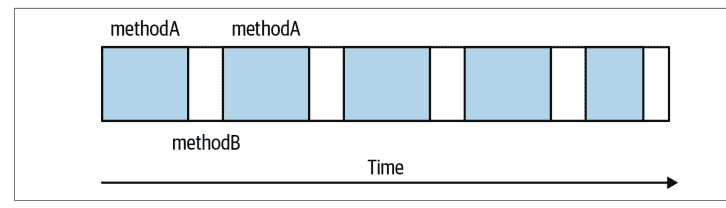

图 3-1. 交替的方法执行

这是最常见的采样错误，但绝不是唯一的一个。最小化此错误的办法是进行更长时间的分析并减少样本之间的时间间隔。减少样本之间的间隔与最小化分析对应用程序的影响的目标相矛盾；这里存在一个平衡。分析工具以不同的方式解决这种平衡，这就是为什么一种分析工具可能报告的数据与其他工具大不相同的原因。

这种类型的错误是所有采样分析器的固有问题，但在许多 Java 分析器（特别是较旧的分析器）中更严重。这是由安全点偏差引起的。在分析器的通用 Java 接口中，只有当线程处于安全点时，分析器才能获取线程的堆栈跟踪。线程在以下情况下会自动进入安全点：

- 被 synchronized 锁阻塞
- 被阻塞等待 I/O
- 被阻塞等待监视器
- 被停放
- 执行 Java Native Interface（JNI）代码（除非它们执行 GC 锁定功能）

此外，JVM 可以设置一个标志，要求线程进入安全点。检查此标志的代码（如果必要则进入安全点）被插入到 JVM 代码的关键位置，包括在某些内存分配期间以及在编译代码中的循环或方法转换处。没有规范说明这些安全点检查何时发生，并且它们在不同版本之间有所变化。

这种安全点偏差对采样分析器的影响可能很深远：因为堆栈只能在线程处于安全点时采样，采样变得甚至更不可靠。在图 3-1 中，随机分析器在没有安全点偏差的情况下不太可能仅在 methodB 执行期间触发线程采样。但有了安全点偏差，更容易看到 methodA 从不进入安全点并且所有工作因此被计入 methodB 的场景。

Java 8 为工具收集堆栈跟踪提供了一种不同的方法（这也是较旧的工具具有安全点偏差而较新的工具往往没有安全点偏差的一个原因，尽管这确实要求较新的工具被重写以使用新机制）。在程序术语中，这是通过使用 AsyncGetCallTrace 接口完成的。使用此接口的分析器通常被称为异步分析器。这里的异步指的是 JVM 提供堆栈信息的方式，而不是分析工具的工作方式；它被称为异步是因为 JVM 可以在任何时间点提供堆栈，而无需等待线程到达（同步）安全点。

因此，使用此异步接口的分析器比其他采样分析器具有更少的采样伪影（尽管它们仍然会受到像图 3-1 那样的错误的影响）。异步接口在 Java 8 中公开，但在那之前作为私有接口就已存在。

图 3-2 显示了一个基本的采样分析，用于衡量提供第 2 章中描述的应用程序的示例股票数据的 REST 服务器的性能。REST 调用配置为返回包含股票对象压缩序列化形式的字节流（第 12 章中我们将探索的一个示例的一部分）。我们将在本节的示例中一直使用该示例程序。

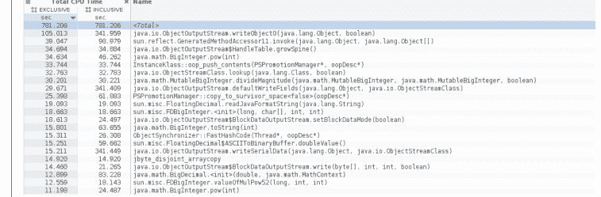

图 3-2. 基于采样的分析

此屏幕截图来自 Oracle Developer Studio 分析器。该工具使用异步分析接口，尽管它通常不被称为异步分析器（可能出于历史原因，因为它在接口还是私有且早于异步分析器术语流行时就开始使用该接口）。它提供了多种数据视图；在该视图中，我们看到消耗最多 CPU 周期的方法。

其中一些方法与对象序列化相关（例如，ObjectOutputStream.writeObject() 方法），许多与计算实际数据相关（例如，Math.pow() 方法）。² 尽管如此，对象序列化主导了此分析；为了提高性能，我们需要改进序列化性能。

请仔细注意最后的陈述：必须改进的是序列化的性能，而不是 writeObject() 方法本身的性能。查看分析时常见的假设是改进必须来自优化分析中排名最高的方法。然而，这种方法通常过于局限。在这种情况下，writeObject() 方法是 JDK 的一部分；如果不重写 JVM，其性能不会得到改进。但我们确实从分析中得知序列化路径是我们性能瓶颈所在。

因此，分析中的前几个方法应指引你去寻找优化的区域。性能工程师不会试图使 JVM 方法更快，但他们可以想办法加快对象序列化总体速度。

我们可以以另外两种方式可视化采样输出；两者都以可视方式显示调用堆栈。最新方法称为火焰图，它是应用程序中调用堆栈的交互式图表。

图 3-3 显示了使用开源 async-profiler 项目的火焰图的一部分。火焰图是使用最多 CPU 的方法的自下而上图表。在此图的这一部分中，getStockObject() 方法占用了所有时间。大约 60% 的时间花费在 writeObject() 调用中，40% 的时间花费在 StockPriceHistoryImpl 对象的构造函数中。类似地，我们可以沿着每个方法的堆栈向上读取并定位我们的性能瓶颈。图表本身是交互式的，因此你可以点击行并查看有关该方法的信息——包括完整名称（在那里被截断）、CPU 周期等。

较老（但仍然有用）的方法是可视化性能的自上而下方法，即调用树。图 3-4 显示了一个示例。

2 你会看到对 native C++ 代码的引用，如 InstanceKlass::oop_push_contents；我们将在下一节中更详细地查看它。


## 插桩分析器

*插桩分析器* 比采样分析器的侵入性强得多，但也能提供更多关于程序内部情况的有用信息。

插桩分析器的工作原理是：在类加载时修改类的字节码序列（插入代码来统计调用次数等等）。它们比采样分析器更可能给应用程序带来性能差异。例如，JVM 会内联小方法（参见第 4 章），这样在执行小方法代码时就无需进行方法调用。编译器会根据代码的大小做出该决定；根据代码被插桩方式的不同，它可能不再具备被内联的资格。这可能会导致插桩分析器高估某些方法的贡献。内联只是编译器根据代码布局做出决策的一个例子；一般来说，代码被插桩（修改）得越多，其执行特征就越可能发生变化。

由于插桩会给代码带来改变，最好将插桩分析器的使用限制在少数几个类上。这意味着它最适合用于第二层分析：采样分析器可以指出某个包或代码段，然后如果需要，可以使用插桩分析器深入分析该代码。

图 3-5 使用插桩分析器（未使用异步接口）来检查示例 REST 服务器。

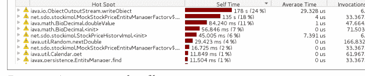

图 3-5：插桩分析结果

这个分析器有几个不同之处。首先，主要时间被归因于 writeObject() 方法，而不是 writeObject0() 方法。这是因为私有方法在插桩时被过滤掉了。其次，出现了一个来自实体管理器的新方法；它之前没有出现，因为在采样场景中它被内联到了构造函数中。

但这种分析结果更重要的是调用计数：我们对那个实体管理器方法执行了高达 3300 万次调用，还执行了 1.66 亿次计算随机数的调用。通过减少这些方法的总调用次数，而不是加快它们的实现，我们可以获得更大的性能影响；但如果没有插桩计数，我们不一定能知道这一点。

这种分析结果是否比采样版本更好？视情况而定；在特定场景下，无法知道哪种分析结果更准确。插桩分析结果的调用计数无疑是准确的，而这些额外信息通常有助于确定代码在哪里花费了更多时间，以及优化哪些内容更有成效。

在本例中，插桩分析和采样分析都指向代码中相同的大致区域：对象序列化。在实践中，不同的分析器有可能指向完全不同的代码区域。分析器是很好的估算工具，但它们只是在做估算：其中有些估算有时会是错误的。


## 快速小结

- 插桩分析器能提供更多关于应用程序的信息，但比采样分析器对应用程序的影响更大。
- 插桩分析器应设置为只对代码的较小部分进行插桩——几个类或包。这样可以限制它们对应用程序性能的影响。

## 阻塞方法与线程时间线

图 3-6 展示了使用另一种插桩分析工具的 REST 服务器：jvisualvm 内置的分析器。现在执行时间主要由 select() 方法主导（其次是 TCPTransport 连接处理器的 run() 方法）。

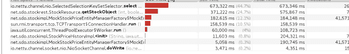

图 3-6：包含阻塞方法的分析结果

这些方法（以及类似的阻塞方法）不消耗 CPU 时间，因此它们不会影响应用程序的整体 CPU 使用率。它们的执行不一定能被优化。应用程序中的线程并不是花 673 秒在 select() 方法中执行代码；而是花 673 秒等待选择事件发生。

因此，大多数分析器不会报告被阻塞的方法；这些线程会显示为空闲。在这个特定示例中，这是一件好事。线程在 `select()` 方法中等待，是因为没有数据流入服务器；它们并非效率低下。这是它们的正常状态。

在其他情况下，你确实希望看到在这些阻塞调用上花费的时间。线程在 `wait()` 方法中花费的时间——等待另一个线程通知它——是许多应用整体执行时间的重要决定因素。大多数基于 Java 的分析器都有过滤器集合和其他选项，可以通过调整来显示或隐藏这些阻塞调用。

另外，检查线程的执行模式通常比查看分析器归因于阻塞方法本身的时间更有成效。**图 3-7** 展示了来自 Oracle Developer Studio 分析工具的线程显示。

*图 3-7：线程时间线分析*

这里的每个水平区域都是一个不同的线程（因此该图显示了九个线程：线程 1.14 到线程 1.22）。彩色（或不同灰度）条表示不同方法的执行；空白区域表示线程未执行的位置。从宏观层面看，可以观察到线程 1.14 执行了代码，然后等待某个事件。

还要注意那些似乎没有线程执行的空白区域。图中只显示了应用程序众多线程中的九个，因此这些线程可能是在等待其他某个线程做某事，或者该线程可能正在执行阻塞的 `read()`（或类似）调用。


## 快速小结

- 被阻塞的线程可能是也可能不是性能问题的根源；有必要检查它们为什么被阻塞。
- 可以通过导致阻塞的方法或线程的时间线分析来识别被阻塞的线程。

## 原生分析器

async-profiler 和 Oracle Developer Studio 等工具除了能分析 Java 代码外，还能分析原生代码。这有两个优点。

首先，重要的操作发生在原生代码中，包括在原生库内部以及原生内存分配过程中。在第 8 章中，我们将使用原生分析器查看一个引发实际问题的原生内存分配示例。使用原生分析器跟踪内存使用情况，迅速定位了根本原因。

其次，我们通常通过分析来查找应用程序代码中的瓶颈，但有时原生代码会出人意料地主导性能。我们通常会通过检查 GC 日志来发现代码在 GC 上花费了太多时间（第 6 章中我们会这样做），但如果我们忽略了这一途径，一个能理解原生代码的分析器会很快让我们看到我们在 GC 上花费了太多时间。类似地，我们通常会将分析范围限制在程序预热后的时间段，但如果编译线程（第 4 章）正在运行并占用过多 CPU，支持原生代码的分析器也会向我们显示这一点。

在查看示例 REST 服务器的火焰图时，为了可读性，我只展示了其中一小部分。图 3-8 显示了完整图形。

此图底部有五个组成部分。前两个（来自 JAX-RS 代码）是应用程序线程和 Java 代码。不过，第三个是进程的 GC，第四个是编译器。³

3 这个特定图同样来自 Oracle Developer Studio 工具，尽管 async-profiler 也产生了完全相同的原生调用集合。

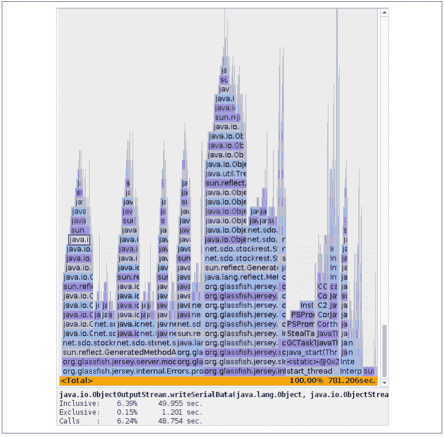

图 3-8：包含原生代码的火焰图

## 快速小结

- 原生分析器既能洞察 JVM 代码，也能洞察应用程序代码。
- 如果原生分析器显示 GC 时间主导了 CPU 使用率，那么调优收集器是正确的做法。然而，如果它显示编译线程占用了大量时间，这通常不会影响应用程序的性能。


## JFR 概述

使用合适的工具，我们就可以深入了解 JFR 的工作原理。此示例使用的是从我们的 REST 服务器记录的长达 6 分钟的 JFR 记录。当记录加载到 Java Mission Control 中时，它首先显示的是一个基本的监控概览（图 3-10）。

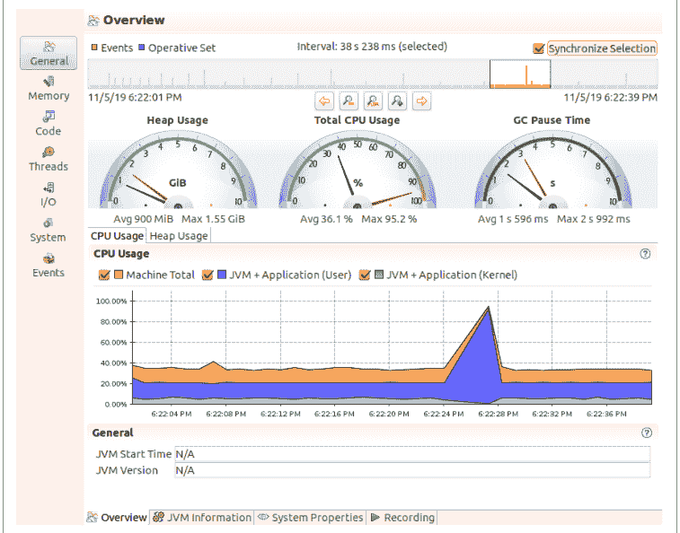

图 3-10. Java Flight Recorder 总体信息

此显示与 Java Mission Control 在进行基本监控时显示的内容相似。显示 CPU 和堆使用情况的仪表上方是一个事件时间线（由一系列垂直条表示）。时间线允许我们放大到感兴趣的特定区域；尽管在此示例中记录持续了 6 分钟，但我将时间线放大到记录末尾附近的 38 秒区间。

CPU 使用情况的此图表更清晰地显示了正在发生的情况：REST 服务器是图表的底部部分（平均使用率约为 20%），而机器的 CPU 使用率为 38%。底部还有其他标签页，允许我们探索有关系统属性以及 JFR 记录是如何制作的信息。窗口左侧纵向排列的图标更有趣：这些图标提供了对应用程序行为的可见性。

## JFR 内存视图

这里收集的信息非常丰富。图 3-11 显示了内存视图中的一个面板。

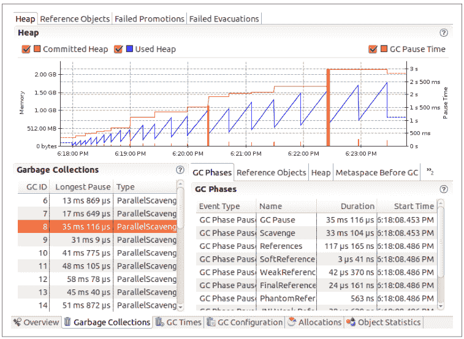

图 3-11. Java Flight Recorder 内存面板

该图表显示内存随着年轻代被清理而相当规律地波动（并且我们看到在此期间堆整体在增长：它从约 340 MB 开始，结束时约为 2 GB）。左下角面板显示了记录期间发生的所有收集，包括其持续时间和收集类型（在此示例中始终为 ParallelScavenge）。当选择其中一个事件时，右下角面板会进一步分解，显示该收集的所有具体阶段以及每个阶段花费的时间。

此页面上的各个标签页提供了大量其他信息：清理了多少引用对象以及数量，是否出现并发收集器的晋升或疏散失败，GC 算法本身的配置（包括代的大小和幸存空间配置），甚至是分配的特定种类对象的相关信息。在阅读第 5 章和第 6 章时，请记住此工具如何诊断其中讨论的问题。如果您需要了解为什么 G1 GC 收集器退出并执行了完整 GC（是否由于晋升失败？），JVM 如何调整老化阈值，或关于 GC 如何以及为何按其行为进行的几乎任何其他数据，JFR 都能告诉您。

## JFR 代码视图

Java Mission Control 中的代码页面显示了记录的基本分析信息（图 3-12）。

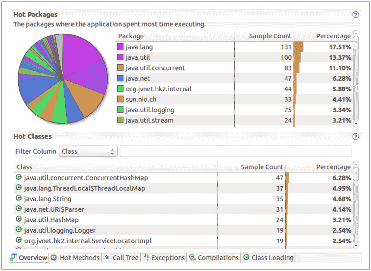

图 3-12. Java Flight Recorder 代码面板

此页面的第一个标签页按包名进行聚合，这是一个许多分析器中都没有的有趣功能。底部，其他标签页呈现了传统的分析视图：被分析代码的热点方法和调用树。

与其它分析器不同，JFR 提供了其他查看代码的方式。异常标签页提供了对应用程序异常处理的视图（第 12 章讨论了为什么过度的异常处理会对性能不利）。其他标签页提供了编译器正在做什么的信息，包括对代码缓存的视图（参见第 4 章）。

另一方面，请注意，这里显示的包在我们之前查看的分析中并没有真正出现；相反，我们之前看到的热点在这里也没有出现。由于其设计具有非常低的开销，JFR 的分析采样（至少在默认配置下）相当低，因此分析结果不如更具侵入性的采样那样准确。

还有其他类似的显示——针对线程、I/O 和系统事件——但在大多数情况下，这些显示只是为 JFR 记录中的实际事件提供了良好的视图。

## JFR 事件概述

JFR 会产生一个事件流并将其保存为记录。到目前为止看到的显示提供了这些事件的视图，但查看事件最强大的方式是在事件面板本身上，如图 3-13 所示。

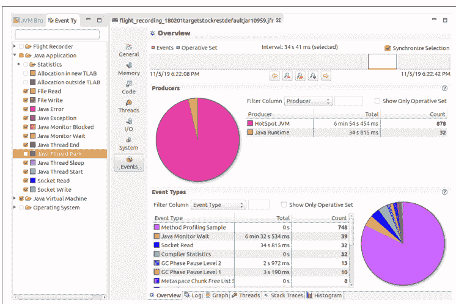

图 3-13. Java Flight Recorder 事件面板

要显示的事件可以在此窗口的左侧面板中进行过滤；在这里，选择了应用程序级和 JVM 级事件。请注意，在制作记录时，最初只包含某些类型的事件：此时我们正在进行后处理过滤（下一节将展示如何过滤记录中包含的事件）。

在此示例的 34 秒间隔内，应用程序产生了 878 个来自 JVM 的事件和 32 个来自 JDK 库的事件，而该期间生成的事件类型显示在窗口底部。当我们用分析器查看此示例时，我们看到了为什么此示例的线程挂起和监视器等待事件会很高；这些可以忽略（并且线程挂起事件在此左侧面板中已被过滤掉）。其他事件呢？

在 34 秒期间，应用程序中的多个线程花费了 34 秒从套接字读取数据。听起来不太好，特别是因为它只会在 JFR 中显示如果套接字读取时间超过 10 毫秒。我们需要进一步查看，这可以通过访问图 3-14 所示的日志标签页来完成。

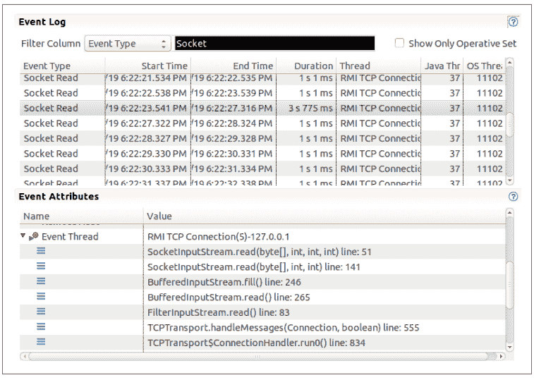

图 3-14. Java Flight Recorder 事件日志面板

查看这些事件涉及的跟踪是值得的，但事实证明有几个线程使用阻塞 I/O 来读取预期会定期到达的管理请求。在这些请求之间——在很长一段时间内——线程在 read() 方法上处于阻塞状态。因此，此处的读取时间是可以接受的：与使用分析器一样，判断大量线程阻塞在 I/O 是否是预期行为还是表明性能问题，取决于您自己。

这就剩下监视器阻塞事件了。如第 9 章所述，锁的竞争经历了两个阶段：首先线程旋转等待锁，然后它使用（在称为锁膨胀的过程中）一些 CPU 和操作系统特定的代码来等待锁。标准分析器可以提示这种情况，因为旋转时间包含在分配给方法的 CPU 时间中。原生分析器可以提供有关受膨胀影响的锁的信息，但这可能不准确。JVM 却可以直接将所有这些数据提供给 JFR。

- **代码缓存**
  - 代码缓存的大小以及其包含的内容
  - 从代码缓存中移除的方法；代码缓存配置
- **代码编译**
  - 哪些方法被编译，栈上替换（OSR）编译（参见第 4 章），以及编译所需的时间
  - 没有特定于 JFR 的内容，但统一了来自多个来源的信息
- **垃圾回收**
  - GC 的时间，包括各个阶段；代的大小
  - 没有特定于 JFR 的内容，但统一了来自多个工具的信息
- **分析**
  - 插装和采样分析
  - 不如真正的分析器那样多，但 JFR 分析提供了良好的高阶概览

## 启用 JFR

JFR 最初是禁用的。要启用它，请在应用程序的命令行中添加标志 `-XX:+FlightRecorder`。这会将 JFR 作为功能启用，但直到记录过程本身被启用，才会制作记录。这可以通过 GUI 或通过命令行发生。

在 Oracle 的 JDK 8 中，您还必须在 FlightRecorder 标志之前指定此标志：
`-XX:+UnlockCommercialFeatures`（默认值：false）。

如果您忘记包含这些标志，请记住您可以使用 `jinfo` 来更改其值并启用 JFR。如果您使用 `jmc` 启动记录，它会在必要时自动在目标 JVM 中更改这些值。

## 通过 Java Mission Control 启用 JFR

通过 Java Mission Control GUI（jmc）启用本地应用程序的记录是最简单的方法。当 jmc 启动时，它会显示当前系统上运行的所有 JVM 进程。JVM 进程以树节点配置显示；展开 Flight Recorder 标签下的节点，即可调出图 3-15 所示的飞行记录器窗口。


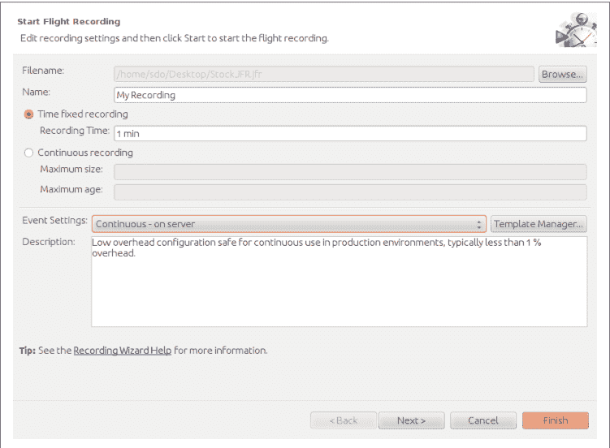

Figure 3-15. JFR Start Flight Recording window

飞行记录以两种模式之一进行：要么固定时长（本例中为 1 分钟），要么连续。 对于连续记录，使用循环缓冲区；缓冲区将包含在期望时长和大小范围内的最新事件。

要执行主动分析——即你将启动一次记录然后生成一些工作，或在 JVM 预热后在负载测试实验期间启动一次记录——应使用固定时长记录。 该记录将很好地表明 JVM 在测试期间的响应情况。

连续记录最适合反应式分析。 这允许 JVM 保留最新事件，然后响应事件转储出记录。 例如，WebLogic 应用服务器可以触发在应用服务器中发生异常事件时转储记录（例如处理时间超过 5 分钟的请求）。 你可以设置自己的监控工具以响应任何类型的事件转储记录。

## Enabling JFR via the command line

启用 JFR（使用 `-XX:+FlightRecorder` 选项）后，有不同的方法来控制实际记录的何时以及如何进行。

在 JDK 8 中，默认记录参数可以在 JVM 启动时通过使用 `-XX:+FlightRecorderOptions=string` 参数进行控制；这对于反应式记录最有用。 该参数中的 `string` 是取自以下选项的逗号分隔的名称-值对列表：

- `name=name` — 用于标识记录的名称。
- `defaultrecording=<true/false>` — 是否初始启动记录。 默认值为 false；对于反应式分析，应将其设置为 true。
- `settings=path` — 包含 JFR 设置的文件名（参见下一节）。
- `delay=time` — 记录应开始前的等待时间（例如，30s，1h）。
- `duration=time` — 记录的时长。
- `filename=path` — 写入记录的文件名。
- `compress=<true/false>` — 是否使用 gzip 压缩记录；默认值为 false。
- `maxage=time` — 在循环缓冲区中保留记录数据的最大时间。
- `maxsize=size` — 记录循环缓冲区的最大大小（例如，1024K，1M）。

`-XX:+FlightRecorderOptions` 仅设置任何选项的默认值；单个记录可以覆盖这些设置。

在 JDK 8 和 JDK 11 中，你可以通过使用 `-XX:+StartFlightRecording=string` 标志并使用类似的逗号分隔选项列表，在程序初始开始时启动 JFR。

在某些情况下，像这样设置默认记录可能很有用，但为了更灵活，所有选项都可以在运行期间通过 `jcmd` 控制。

要启动飞行记录：

```bash
% jcmd process_id JFR.start [options_list]
```

options_list 是一系列逗号分隔的名称-值对，用于控制记录的制作方式。 可能的选项与使用 `-XX:+FlightRecorderOptions=string` 标志在命令行上指定的选项完全相同。

如果已启用连续记录，则当前循环缓冲区中的数据可随时通过以下命令转储到文件中：

```
% jcmd process_id JFR.dump [options_list]
```

选项列表包括以下内容：

- `name=name` — 启动记录时使用的名称（参见 JFR.check 的下一个示例）。
- `filename=path` — 转储文件的存放位置。

可能为给定进程启用了多个 JFR 记录。 要查看可用的记录：

```
% jcmd 21532 JFR.check [verbose]
21532:
Recording 1: name=1 maxsize=250.0MB (running)

Recording 2: name=2 maxsize=250.0MB (running)
```

在此示例中，进程 ID 21532 有两个活动的 JFR 记录，名称为 1 和 2。 该名称可用于在其他 jcmd 命令中标识它们。

最后，要中止正在进行的记录：

```
% jcmd process_id JFR.stop [options_list]
```

该命令接受以下选项：

- `name=name` — 要停止的记录名称。
- `discard=boolean` — 如果为 true，则丢弃数据而不是将其写入之前提供的 filename（如果有）。
- `filename=path` — 将数据写入给定的路径。

在自动性能测试系统中，运行这些命令行工具并生成记录在检查这些运行是否存在回归时很有用。

模板由 jmc 模板管理器管理；你可能已经在图 3-15 中注意到启动模板管理器的按钮。 模板存储在两个位置：`$HOME/.jmc/<release>` 目录下（用户本地）和 `$JAVA_HOME/jre/lib/jfr` 目录中（JVM 全局）。 模板管理器允许你选择全局模板（模板会显示为“on server”），选择本地模板，或定义新模板。 要定义模板，请浏览可用事件，并按需启用或禁用它们，可选地设置事件触发的阈值。

图 3-16 显示文件读取事件已启用，阈值为 15 ms；读取时间超过该值的读取将触发事件。 该事件还已配置为为文件读取事件生成堆栈跟踪。 这会增加开销——这也是为什么为事件获取堆栈跟踪是一个可配置选项的原因。

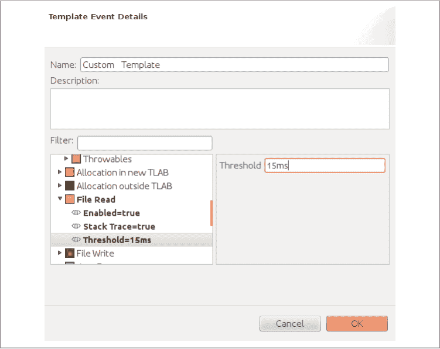

*Figure 3-16. A sample JFR event template*

事件模板是简单的 XML 文件，因此确定模板中启用了哪些事件（及其阈值和堆栈跟踪配置）的最佳方法是读取 XML 文件。 使用 XML 文件还允许在某一台机器上定义本地模板文件，然后将其复制到全局模板目录供团队其他人使用。


## Quick Summary

- Java Flight Recorder 提供了对 JVM 的最佳可见性，因为它内置于 JVM 本身。
- 与所有工具一样，JFR 会给应用程序带来一定程度的开销。 对于常规使用，JFR 可以启用以在低开销下收集大量信息。
- JFR 在性能分析中很有用，但在生产系统上启用时也很实用，这样你就可以检查导致故障的事件。

## Summary

好的工具是良好性能分析的关键；在本章中，我们只是触及了工具可以告诉我们的皮毛。 这里有一些需要牢记的关键点：

- 没有工具是完美的，竞争工具各有相对优势。 Profiler X 可能适合许多应用程序，但在某些情况下它会遗漏 Profiler Y 清楚指出的某些内容。 在方法上始终保持灵活。
- 命令行监控工具可以自动收集重要数据；请确保在自动性能测试中包含收集此监控数据。
- 工具迅速发展：本章中提到的一些工具可能已经过时（或至少已被更新、更优的工具取代）。 在这一领域保持最新非常重要。
