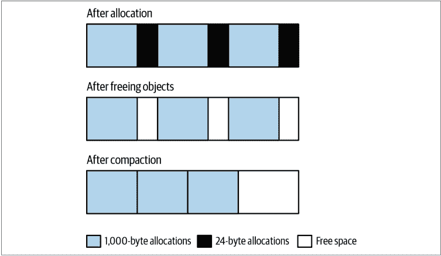
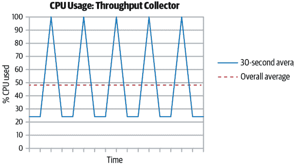
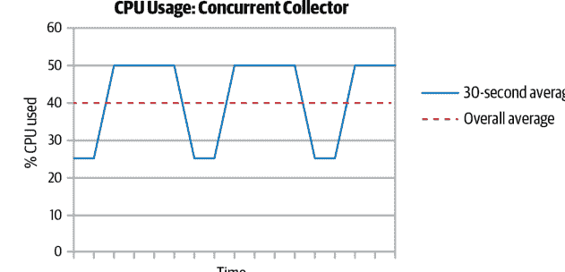
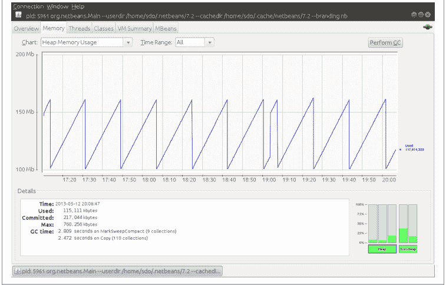

## 垃圾收集简介

本章介绍 JVM 中垃圾收集的基础知识。除了重写代码之外，调整垃圾收集器是提高 Java 应用程序性能所能做的最重要的事情。

由于 Java 应用程序的性能在很大程度上依赖于垃圾收集技术，因此存在相当多的收集器也就不足为奇了。OpenJDK 有三个适用于生产的收集器，另一个在 JDK 11 中已被弃用但在 JDK 8 中仍然非常流行，还有一些实验性收集器（理想情况下）将在未来版本中达到生产就绪状态。其他 Java 实现（如 Open J9 或 Azul JVM）也有自己的收集器。

所有这些收集器的性能特征都大不相同；我们将只关注 OpenJDK 自带的收集器。下一章将对每种收集器进行深入介绍。不过，它们共享基本概念，因此本章将对收集器的工作原理进行基本概述。

## 垃圾收集概述

Java 编程最具吸引力的特性之一是开发人员无需显式管理对象的生命周期：对象在需要时创建，当对象不再使用时，JVM 会自动释放该对象。如果你和我一样，花费大量时间优化 Java 程序的内存使用，那么这整个机制可能看起来像是一个弱点，而不是一个特性（而且我花在讲解 GC 上的时间似乎也印证了这一点）。诚然，这可以说是喜忧参半，但我仍然记得在其他语言中追踪空指针和悬空指针的困难。我坚决认为，调优垃圾收集器远比追踪指针错误更容易（也更省时）。

在基本层面上，GC 包括查找正在使用的对象，并释放与其余对象（即未使用的对象）关联的内存。这有时被描述为查找那些不再有任何引用的对象（暗示引用是通过计数来跟踪的）。不过，这种引用计数方式是不够的。给定一个对象链表，链表中的每个对象（除头节点外）都会被链表中的另一个对象引用——但如果没有对象引用链表的头节点，那么整个链表都没有被使用，可以被释放。如果链表是循环的（例如，链表的尾部指向头部），那么链表中的每个对象都有一个对它的引用——尽管链表中的任何对象实际上都无法被使用，因为没有对象引用链表本身。

因此，引用不能通过计数来动态跟踪；相反，JVM 必须定期搜索堆以查找未使用的对象。它从作为 GC 根的对象开始，这些对象是可以在堆外部访问的对象。主要包括线程栈和系统类。这些对象始终是可到达的，因此 GC 算法会扫描所有通过某个根对象可到达的对象。通过 GC 根可到达的对象是存活对象；其余不可到达的对象是垃圾（即使它们保持对存活对象或彼此之间的引用）。

当 GC 算法找到未使用的对象时，JVM 可以释放这些对象占用的内存，并用它来分配更多对象。然而，仅仅跟踪该空闲内存并将其用于未来的分配通常是不够的；在某个时刻，必须对内存进行压缩以防止内存碎片化。

考虑一个程序的情况：它分配一个 1,000 字节的数组，然后分配一个 24 字节的数组，并在循环中重复该过程。当该过程填满堆时，堆看起来就像**图 5-1** 中的顶行所示：堆已满，不同大小的数组分配交错在一起。

当堆已满时，JVM 将释放未使用的数组。假设所有 24 字节的数组都不再使用，而所有 1,000 字节的数组仍在使用：这就得到**图 5-1** 中的第二行。堆内部有空闲区域，但无法分配任何大于 24 字节的对象——除非 JVM 移动所有 1,000 字节的数组，使它们连续排列，将所有空闲内存留在一个可以按需分配的区域（**图 5-1** 中的第三行）。

实际实现会更详细一些，但 GC 的性能主要由这些基本操作决定：查找未使用的对象、释放其内存以及压缩堆。不同的收集器对这些操作采用不同的方法，尤其是压缩：一些算法将压缩推迟到绝对必要的时候，一些算法一次压缩整个堆区域，还有一些算法通过一次移动少量内存来压缩堆。这些不同的方法正是不同算法具有不同性能特征的原因。



*图 5-1. 收集期间理想化的 GC 堆*

如果在垃圾收集器运行时没有应用程序线程在运行，那么执行这些操作会更简单。Java 程序通常大量使用多线程，垃圾收集器本身也经常运行多个线程。这里的讨论考虑了两个逻辑线程组：执行应用程序逻辑的线程（通常称为*赋值器线程*，因为它们作为应用程序逻辑的一部分在修改对象）和执行 GC 的线程。当 GC 线程跟踪对象引用或在内存中移动对象时，它们必须确保应用程序线程没有使用这些对象。当 GC 移动对象时尤其如此：该操作期间对象的内存位置会改变，因此任何应用程序线程都不能访问该对象。

所有应用程序线程都停止时的停顿称为*停止世界停顿*。这些停顿通常对应用程序性能影响最大，而尽量减少这些停顿是调优 GC 时的一个重要考虑因素。

## 分代垃圾收集器

尽管细节有所不同，大多数垃圾收集器都是通过将堆划分为几代来工作的。它们被称为*老年代（或终身代）*和*年轻代*。年轻代又进一步划分为名为*伊甸园*和*幸存者空间*的区域（尽管有时，*伊甸园*被错误地用来指代整个年轻代）。

划分不同代的理由是许多对象只被使用很短的时间。例如，股票价格计算中对价格与平均价格之差的平方进行求和的循环（标准差计算的一部分）：

```java
sum = new BigDecimal(0);
for (StockPrice sp : prices.values()) {
    BigDecimal diff = sp.getClosingPrice().subtract(averagePrice);
    diff = diff.multiply(diff);
    sum = sum.add(diff);
}
```

与许多 Java 类一样，`BigDecimal` 类是不可变的：该对象表示一个特定数字，无法更改。当对该对象执行算术运算时，会创建一个新对象（通常，之前具有旧值的对象随后会被丢弃）。当这个简单循环针对一年的股价（大约 250 次迭代）执行时，仅在此循环中就会创建 750 个 `BigDecimal` 对象来存储中间值。这些对象在循环的下一次迭代中被丢弃。在 `add()` 和其他方法中，JDK 库代码会创建更多的中间 `BigDecimal`（和其他）对象。最终，在这少量代码中会快速创建并丢弃大量对象。

这类操作在 Java 中很常见，因此垃圾收集器的设计利用了这样一个事实：许多（有时是大多数）对象只是临时使用。这正是分代设计的用武之地。对象首先在年轻代中分配，年轻代是整个堆的子集。当年轻代填满时，垃圾收集器将停止所有应用程序线程并清空年轻代。不再使用的对象被丢弃，仍在使用中的对象被移动到其他地方。此操作称为*次要 GC* 或*年轻 GC*。

这种设计有两个性能优势。首先，由于年轻代只是整个堆的一部分，处理它比处理整个堆更快。应用程序线程停止的时间比一次性处理整个堆要短得多。你可能会看到其中的权衡，因为这也意味着应用程序线程停止的频率比 JVM 等到整个堆填满才执行 GC 时要高；这个权衡将在本章后面详细探讨。不过，就目前而言，即使停顿更频繁，较短的停顿几乎总是一个很大的优势。

第二个优势源于对象在年轻代中的分配方式。对象在伊甸园中分配（伊甸园占年轻代的绝大部分）。当在收集期间清空年轻代时，伊甸园中的所有对象要么被移动，要么被丢弃：未使用的对象可以被丢弃，正在使用的对象被移动到幸存者空间之一或老年代。由于所有幸存对象都会被移动，年轻代会自动


compacted when it is collected: at the end of the collection, eden and one of the survivor spaces are empty, and the objects that remain in the young generation are compacted within the other survivor space.

Common GC algorithms have stop-the-world pauses during collection of the young generation.

As objects are moved to the old generation, eventually it too will fill up, and the JVM will need to find any objects within the old generation that are no longer in use and discard them. This is where GC algorithms have their biggest differences. The simpler algorithms stop all application threads, find the unused objects, free their memory, and then compact the heap. This process is called a *full GC*, and it generally causes a relatively long pause for the application threads.

On the other hand, it is possible—though more computationally complex—to find unused objects while application threads are running. Because the phase where they scan for unused objects can occur without stopping application threads, these algorithms are called *concurrent collectors*. They are also called *low-pause* (and sometimes, incorrectly, *pauseless*) collectors since they minimize the need to stop all the application threads. Concurrent collectors also take different approaches to compacting the old generation.

When using a concurrent collector, an application will typically experience fewer (and much shorter) pauses. The biggest trade-off is that the application will use more CPU overall. Concurrent collectors can also be more difficult to tune in order to get their best performance (though in JDK 11, tuning concurrent collectors like the G1 GC is much easier than in previous releases, which reflects the engineering progress that has been made since the concurrent collectors were first introduced).

As you consider which garbage collector is appropriate for your situation, think about the overall performance goals that must be met. Trade-offs exist in every situation. In an application (such as a REST server) measuring the response time of individual requests, consider these points:

- The individual requests will be impacted by pause times—and more importantly by long pause times for full GCs. If minimizing the effect of pauses on response times is the goal, a concurrent collector may be more appropriate.
- If the average response time is more important than the outliers (i.e., the 90th%) response time, a nonconcurrent collector may yield better results.
- The benefit of avoiding long pause times with a concurrent collector comes at the expense of extra CPU usage. If your machine lacks the spare CPU cycles needed by a concurrent collector, a nonconcurrent collector may be the better choice.

Similarly, the choice of garbage collector in a batch application is guided by the following trade-off:

- If enough CPU is available, using the concurrent collector to avoid full GC pauses will allow the job to finish faster.
- If CPU is limited, the extra CPU consumption of the concurrent collector will cause the batch job to take more time.


## Quick Summary

- GC algorithms generally divide the heap into old and young generations.
- GC algorithms generally employ a stop-the-world approach to clearing objects from the young generation, which is usually a quick operation.
- Minimizing the effect of performing GC in the old generation is a trade-off between pause times and CPU usage.

## GC Algorithms

OpenJDK 12 provides a variety of GC algorithms with varying degrees of support in earlier releases. Table 5-1 lists these algorithms and their status in OpenJDK and Oracle Java releases.

### Table 5-1. Support level of various GC algorithmsᵃ

| GC algorithm | Support in JDK 8 | Support in JDK 11 | Support in JDK 12 |
|---|---|---|---|
| Serial GC | S | S | S |
| Throughput (Parallel) GC | S | S | S |
| G1 GC | S | S | S |
| Concurrent Mark-Sweep (CMS) | S | D | D |
| ZGC | - | E | E |
| Shenandoah | E2 | E2 | E2 |
| Epsilon GC | - | E | E |

ᵃ (S: Fully Supported D: Deprecated E: Experimental E2: Experimental; in OpenJDK builds but not Oracle builds)

A brief description of each algorithm follows; Chapter 6 provides more details on tuning them individually.

## The serial garbage collector

The serial garbage collector is the simplest of the collectors. This is the default collector if the application is running on a client-class machine (32-bit JVMs on Windows) or on a single-processor machine. At one point, the serial collector seemed like it was

destined for the trash can, but containerization has changed that: virtual machines and Docker containers with one core (even a hyper-threaded core that appears as two CPUs) have made this algorithm more relevant again.

The serial collector uses a single thread to process the heap. It will stop all application threads as the heap is processed (for either a minor or full GC). During a full GC, it will fully compact the old generation.

The serial collector is enabled by using the -XX:+UseSerialGC flag (though usually it is the default in those cases where it might be used). Note that unlike with most JVM flags, the serial collector is not disabled by changing the plus sign to a minus sign (i.e., by specifying -XX:-UseSerialGC). On systems where the serial collector is the default, it is disabled by specifying a different GC algorithm.

## The throughput collector

In JDK 8, the throughput collector is the default collector for any 64-bit machine with two or more CPUs. The throughput collector uses multiple threads to collect the young generation, which makes minor GCs much faster than when the serial collector is used. This uses multiple threads to process the old generation as well. Because it uses multiple threads, the throughput collector is often called the parallel collector.

The throughput collector stops all application threads during both minor and full GCs, and it fully compacts the old generation during a full GC. Since it is the default in most situations where it would be used, it needn't be explicitly enabled. To enable it where necessary, use the flag -XX:+UseParallelGC.

Note that old versions of the JVM enabled parallel collection in the young and old generations separately, so you might see references to the flag -XX:+UseParallelOldGC. This flag is obsolete (though it still functions, and you could disable this flag to collect only the young generation in parallel if for some reason you really wanted to).

## The G1 GC collector

The G1 GC (or garbage first garbage collector) uses a concurrent collection strategy to collect the heap with minimal pauses. It is the default collector in JDK 11 and later for 64-bit JVMs on machines with two or more CPUs.

G1 GC divides the heap into regions, but it still considers the heap to have two generations. Some of those regions make up the young generation, and the young generation is still collected by stopping all application threads and moving all objects that are alive into the old generation or the survivor spaces. (This occurs using multiple threads.)

In G1 GC, the old generation is processed by background threads that don’t need to stop the application threads to perform most of their work. Because the old generation is divided into regions, G1 GC can clean up objects from the old generation by copying from one region into another, which means that it (at least partially) compacts the heap during normal processing. This helps keep G1 GC heaps from becoming fragmented, although that is still possible.

The trade-off for avoiding the full GC cycles is CPU time: the (multiple) background threads G1 GC uses to process the old generation must have CPU cycles available at the same time the application threads are running.

G1 GC is enabled by specifying the flag -XX:+UseG1GC. In most cases, it is the default in JDK 11, and it is functional in JDK 8 as well—particularly in later builds of JDK 8, which contains many important bug fixes and performance enhancements that have been back-ported from later releases. Still, as you’ll see when we explore G1 GC in depth, one major performance feature is missing from G1 GC in JDK 8 that can make it unsuitable for that release.

## The CMS collector

The CMS collector was the first concurrent collector. Like other algorithms, CMS stops all application threads during a minor GC, which it performs with multiple threads.

CMS is officially deprecated in JDK 11 and beyond, and its use in JDK 8 is discouraged. From a practical standpoint, the major flaw in CMS is that it has no way to compact the heap during its background processing. If the heap becomes fragmented (which is likely to happen at some point), CMS must stop all application threads and compact the heap, which defeats the purpose of a concurrent collector. Between that and the advent of G1 GC, CMS is no longer recommended.

CMS is enabled by specifying the flag -XX:+UseConcMarkSweepGC, which is false by default. Historically, CMS used to require setting the -XX:+UseParNewGC flag as well (otherwise, the young generation would be collected by a single thread), though that is obsolete.

## Experimental collectors

Garbage collection continues to be fertile ground for JVM engineers, and the latest versions of Java come with the three experimental algorithms mentioned earlier. I’ll have more to say about those in the next chapter; for now, let’s continue with a look at choosing among the three collectors supported in production environments.


## 触发与禁用显式垃圾回收

GC通常在JVM判定需要回收时被触发：新生代满时触发`minor GC`，老年代满时触发`full GC`，或堆开始填满时触发并发GC（如果适用）。

Java提供了一种机制，允许应用程序强制触发GC：`System.gc()`方法。调用该方法几乎总是一个坏主意。这个调用总会触发full GC（即使JVM运行的是G1 GC或CMS），因此应用程序线程将被停止相对较长的时间。并且调用此方法不会让应用程序更高效；它只会让GC比原本更早发生，但这实际上只是转移了性能影响。

凡事皆有例外，尤其是在进行性能监控或基准测试时。对于运行大量代码以适当预热JVM的小型基准测试，在测量周期之前强制触发一次GC可能是合理的。（JMH可选地执行此操作，尽管通常没有必要。）同样，在进行堆分析时，通常最好在获取堆转储之前强制触发一次full GC。大多数获取堆转储的技术无论如何都会执行一次full GC，但您也可以通过其他方式强制触发full GC：可以执行`jcmd <进程id> GC.run`，或者使用`jconsole`连接JVM，然后在Memory面板中点击Perform GC按钮。

另一个例外是远程方法调用（RMI），其分布式垃圾收集器会每小时调用一次`System.gc()`。可以通过为以下两个系统属性设置不同的值来更改该时间间隔：`-Dsun.rmi.dgc.server.gcInterval=N`和`-Dsun.rmi.dgc.client.gcInterval=N`。N的值以毫秒为单位，默认值为3600000（即一小时）。

如果您运行的是错误调用`System.gc()`方法的第三方代码，可以通过在JVM参数中加入`-XX:+DisableExplicitGC`来阻止这些GC；默认情况下，该标志为`false`。像Java EE服务器这样的应用程序通常会加入此参数，以防止RMI的GC调用干扰其运行。


## 快速总结

-   受支持的GC算法在最小化GC对应用程序的影响方面采取了不同的方法。
-   当只有一个CPU可用且额外的GC线程会干扰应用程序时，串行收集器是合理的选择（也是默认选择）。
-   吞吐量收集器是JDK 8中的默认收集器；它能最大化应用程序的总吞吐量，但可能使单个操作经历长时间停顿。
-   G1 GC是JDK 11及更高版本中的默认收集器；它在应用程序线程运行的同时并发收集老年代，从而有可能避免full GC。其设计使其发生full GC的可能性低于CMS。
-   CMS收集器可以在应用程序线程运行的同时并发收集老年代。如果有足够的CPU用于其后台处理，这可以避免应用程序的full GC周期。它已被弃用，取而代之的是G1 GC。

## 选择GC算法

GC算法的选择部分取决于可用的硬件，部分取决于应用程序的特征，还部分取决于应用程序的性能目标。在JDK 11中，G1 GC通常是更好的选择；而在JDK 8中，选择将取决于您的应用程序。

我们将从G1 GC是更好选择的经验法则开始，但凡事皆有例外。就垃圾回收而言，这些例外涉及到应用程序相对于可用硬件所需的CPU周期数量，以及后台G1 GC线程需要执行的处理量。如果您使用的是JDK 8，G1 GC避免full GC的能力也将是一个关键的考虑因素。当G1 GC不是更好的选择时，在吞吐量收集器和串行收集器之间的决策则基于机器上的CPU数量。

### 何时使用（以及避免使用）串行收集器

在单CPU机器上，JVM默认使用串行收集器。这包括具有一个CPU的虚拟机，以及被限制为单CPU的Docker容器。如果您在早期版本的JDK 8中将Docker容器限制为单个CPU，它仍将默认使用吞吐量收集器。在这种环境下，您应该考虑使用串行收集器（即使需要手动设置）。

在这些环境中，串行收集器通常是一个不错的选择，但有时G1 GC会带来更好的结果。这个例子也是理解选择GC算法时涉及的一般权衡的好起点。

G1 GC与其他收集器之间的权衡涉及是否有可用的CPU周期供G1 GC后台线程使用，让我们从一个CPU密集型批处理作业开始。在批处理作业中，CPU将在很长一段时间内100%繁忙，在这种情况下，串行收集器具有显著优势。

表5-2列出了单线程计算10万只股票三年期股票历史数据所需的时间。

**表5-2. 不同GC算法在单CPU上的处理时间**

| GC算法 | 消耗时间 | GC暂停时间 |
|---|---|---|
| 串行 | 434秒 | 79秒 |
| 吞吐量 | 503秒 | 144秒 |
| G1 GC | 501秒 | 97秒 |

当我们比较串行收集器和吞吐量收集器时，单线程垃圾回收的优势最为明显。实际计算所花费的时间是消耗时间减去GC暂停时间。在串行和吞吐量收集器中，该时间基本相同（约355秒），但串行收集器胜出是因为它在垃圾回收上暂停的时间要少得多。特别是，串行收集器的full GC平均耗时505毫秒，而吞吐量收集器需要1，392毫秒。吞吐量收集器的算法有相当多的开销——当两个或更多线程处理堆时，这种开销是值得的，但当只有一个线程可用时，它只会碍事。

现在比较串行收集器和G1 GC。如果消除使用G1 GC时的暂停时间，应用程序需要404秒进行计算——但我们从其他示例中知道，它应该只需要355秒。另外49秒又是什么原因呢？

计算线程可以占用所有可用的CPU周期。与此同时，后台G1 GC线程需要CPU周期来完成它们的工作。由于没有足够的CPU同时满足两者，它们最终会共享CPU：计算线程在某些时候运行，后台G1 GC线程在某些时候运行。最终效果是，计算线程因“后台”G1 GC线程占用CPU而无法运行达49秒之久。

这就是我所说的，当您选择G1 GC时，需要有足够的CPU供其后台线程运行。当一个长期运行的应用程序线程占用唯一可用的CPU时，G1 GC不是一个好的选择。但如果是其他情况呢，比如在资源受限的硬件上运行简单REST请求的微服务？表5-3显示了在单CPU上每秒处理约11个请求的Web服务器的响应时间，这大约占用了可用CPU周期的50%。

*表5-3. 不同GC算法在单CPU上的响应时间*

| GC算法 | 平均响应时间 | 90%响应时间 | 99%响应时间 | CPU利用率 |
|---|---:|---:|---:|---:|
| 串行 | 0.10秒 | 0.18秒 | 0.69秒 | 53% |
| 吞吐量 | 0.16秒 | 0.18秒 | 1.40秒 | 49% |
| G1 GC | 0.13秒 | 0.28秒 | 0.40秒 | 48% |

默认的（串行）算法仍然有最好的平均时间，领先30%。同样，这是因为串行收集器的年轻代收集通常比其他算法更快，因此平均请求受串行收集器的延迟影响更小。

一些不幸的请求会被串行收集器的full GC中断。在这个实验中，串行收集器执行full GC的平均时间为592毫秒，有些甚至长达730毫秒。结果是1%的请求耗时接近700毫秒。

这仍然比吞吐量收集器的表现要好。吞吐量收集器的full GC平均时间为1，192毫秒，最大值为1，510毫秒。因此，吞吐量收集器的99%响应时间是串行收集器的两倍。平均时间也受到这些异常值的影响。

G1 GC则介于两者之间。在平均响应时间方面，它比串行收集器差，因为更简单的串行收集器算法更快。在这种情况下，这主要适用于minor GC，串行收集器的minor GC平均耗时86毫秒，而G1 GC需要141毫秒。因此，平均请求在G1 GC情况下会延迟更长时间。

尽管如此，G1 GC的99%响应时间显著低于串行收集器。在这个例子中，G1 GC能够避免full GC，因此它没有串行收集器的那种超过500毫秒的延迟。

这里有一个优化选择的问题：如果平均响应时间是最重要的目标，那么（默认的）串行收集器是更好的选择。如果您想针对99%响应时间进行优化，G1 GC胜出。这是一个需要判断的决策，但在我看来，平均时间上30毫秒的差异不如99%响应时间上300毫秒的差异重要——因此在这种情况下，G1 GC比平台默认收集器更合理。

这个示例是GC密集型的；特别是，非并发收集器各自都需要执行大量的full GC操作。如果我们调整测试使得


所有对象都可以在不进行完整 GC 的情况下被收集，串行收集器可以与 G1 GC 相匹配，如表 5-4 所示。

### Table 5-4. Response times for a single CPU with different GC algorithms (no full GCs)

| GC algorithm | Average response time | 90th% response time | 99th% response time | CPU utilization |
|---|---|---|---|---|
| Serial | 0.05 second | 0.08 second | 0.11 second | 53% |
| Throughput | 0.08 second | 0.09 second | 0.13 second | 49% |
| G1 GC | 0.05 second | 0.08 second | 0.11 second | 52% |

由于没有完整的 GC，串行收集器相对于 G1 GC 的优势被消除。当 GC 活动很少时，数值都在同一范围内，所有收集器的表现都差不多。另一方面，没有完整的 GC 这种情况不太可能发生，而这正是串行收集器表现最好的情况。只要有足够的 CPU 周期，G1 GC 通常会更好，即使串行收集器是默认选择。

## Single hyper-threaded CPU hardware

如果是一台单核机器或 Docker 容器，其中 CPU 是超线程的（因此 JVM 看起来像是两核机器）会怎样？在这种情况下，JVM 默认不会使用串行收集器——它认为有两颗 CPU，所以在 JDK 8 中默认使用吞吐量收集器，在 JDK 11 中默认使用 G1 GC。但事实证明，在这种硬件上串行收集器也经常有优势。表 5-5 显示了我们在单颗超线程 CPU 上运行之前的批处理实验时的情况。

### Table 5-5. Processing time on a single hyper-threaded CPU for different GC algorithms

| GC algorithm | Elapsed time | Time paused for GC |
|---|---|---|
| Serial | 432 seconds | 82 seconds |
| Throughput | 478 seconds | 117 seconds |
| G1 GC | 476 seconds | 72 seconds |

串行收集器不会运行多个线程，因此其时间与之前的测试基本不变。其他算法有所改进，但没有我们希望的那么多——吞吐量收集器会运行两个线程，但暂停时间并没有减半，而是减少了约 20%。同样，G1 GC 仍然无法为其后台线程获得足够的 CPU 周期。

因此至少在这种情况下——长时间运行的批处理作业且垃圾收集频繁——JVM 的默认选择是不正确的，使用串行收集器会让应用程序表现更好，尽管存在“两个”CPU。如果有两颗真正的 CPU（即两个核心），情况会不同。吞吐量收集器的操作仅需 72 秒，这比串行收集器所需的时间更少。此时串行收集器的用处减弱，因此我们将不再在后续示例中使用它。

关于串行收集器的另一点：如果应用程序的堆非常小（例如 100 MB），即使有多个核心可用，使用串行收集器仍可能表现更好。

## When to use the throughput collector

当机器有多颗 CPU 可用时，GC 算法之间会发生更复杂的交互，但从基本层面看，G1 GC 与吞吐量收集器之间的权衡与我们刚才看到的相同。例如，表 5-6 显示了我们的示例应用程序在四核机器上运行时，使用两个或四个应用程序线程时的情况（核心未超线程）。

### Table 5-6. Batch processing time with different GC algorithms

| Application threads | G1 GC | Throughput |
|---|---|---|
| Two | 410 seconds (60.8%) | 446 seconds (59.7%) |
| Four | 513 seconds (99.5%) | 536 seconds (99.5%) |

表中时间是运行测试所需的秒数，括号内显示的是机器的 CPU 利用率。当有两个应用程序线程时，G1 GC 比吞吐量收集器快得多。主要原因是吞吐量收集器因完整 GC 暂停了 35 秒。G1 GC 能够避免这些收集，代价是 CPU 时间略有增加。

即使有四个应用程序线程，在此示例中 G1 仍然胜出。这里，吞吐量收集器总共暂停应用程序线程 176 秒。G1 GC 仅暂停应用程序线程 88 秒。G1 GC 后台线程确实需要与应用程序线程竞争 CPU 周期，这占用了应用程序线程约 65 秒。但即便如此，G1 GC 仍快了 23 秒。

当应用程序的经过时间是关键时，吞吐量收集器在暂停应用程序线程的时间少于 G1 GC 时会更有优势。这发生在以下一种或多种情况时：

- 没有（或很少）完整 GC。完整 GC 暂停很容易主导应用程序的暂停时间，但如果它们根本不发生，吞吐量收集器就不再处于劣势。
- 老年代通常已满，导致 G1 GC 后台线程工作更多。
- G1 GC 线程缺乏 CPU。

在下一章中，详细介绍了各种算法的工作原理，这些点的原因会更清晰（以及围绕它们调整收集器的方法）。现在，我们来看几个证明这一点的示例。

首先，让我们看一下表 5-7 中的数据。此测试是我们之前用于长计算批处理作业的相同代码，但做了一些修改：多个应用程序线程正在进行计算（本例中为两个），老年代被对象填充以保持 65% 满，且几乎所有对象都可以直接从年轻代收集。此测试在具有四个 CPU（未超线程）的系统上运行，以便 G1 GC 后台线程有足够的 CPU 运行。

### Table 5-7. Batch processing with long-lived objects

| Metric | G1 GC | Throughput |
|---|---|---|
| Elapsed time | 212 seconds | 193 seconds |
| CPU usage | 67% | 51% |
| Young GC pauses | 30 seconds | 13.5 seconds |
| Full GC pauses | 0 seconds | 1.5 seconds |

由于很少有对象晋升到老年代，吞吐量收集器仅暂停应用程序线程 15 秒，其中只有 1.5 秒用于收集老年代。

尽管老年代没有太多新对象晋升进去，但测试会填充老年代，使得 G1 GC 线程会扫描其中的垃圾。这为后台 GC 线程增加了更多工作，并导致 G1 GC 在尝试补偿更满的老年代时对年轻代进行更多收集。最终结果是，在双线程测试中，G1 GC 在暂停应用程序 30 秒——比吞吐量收集器更多。

另一个示例：当 G1 GC 后台线程没有足够的 CPU 运行资源时，吞吐量收集器会表现更好，如表 5-8 所示。

### Table 5-8. Batch processing with busy CPUs

| Metric | G1 GC | Throughput |
|---|---|---|
| Elapsed time | 287 seconds | 267 seconds |
| CPU usage | 99% | 99% |
| Young GC pauses | 80 seconds | 63 seconds |
| Full GC pauses | 0 seconds | 37 seconds |

这与单 CPU 的情况其实没有区别：G1 GC 后台线程与应用程序线程之间的 CPU 竞争意味着应用程序线程在 GC 暂停未发生时也有效地被暂停了。

如果我们更关心交互式处理和响应时间，吞吐量收集器很难击败 G1 GC。如果你的服务器 CPU 周期不足以让 G1 GC 和应用程序线程竞争 CPU，那么 G1 GC 会产生更差的响应时间（类似于我们已经看到的情况）。如果服务器调优后没有完整 GC，那么 G1 GC 和吞吐量收集器通常会产生相似的结果。但吞吐量收集器产生的完整 GC 越多，G1 GC 的平均值、90th% 和 99th% 响应时间就越好。

## Average CPU Usage and GC

仅查看测试期间的平均 CPU 会忽略 GC 周期中发生的有趣情况。吞吐量收集器（默认情况下）在运行时会消耗机器上所有可用的 CPU，因此在两个应用程序线程的测试中 CPU 使用情况的更准确表示如图 5-2 所示。

大部分时间，只有应用程序线程在运行，消耗了总 CPU 的 50%。当 GC 启动时，100% 的 CPU 被消耗。因此，实际的 CPU 使用情况类似于图表中的锯齿状模式，尽管测试期间的平均值报告为虚线直线的数值。



*Figure 5-2. Actual versus average CPU usage (throughput)*

在并发收集器中，后台线程与应用程序线程并发运行时，效果不同。在这种情况下，CPU 图表看起来像图 5-3。




图 5-3. 实际与平均 CPU 使用率（G1 GC）

应用程序线程开始时使用总 CPU 的 50%。最终，它产生了足够的垃圾以触发 G1 GC 后台线程；该线程也消耗一个完整的 CPU，使总使用率上升到 75%。当该线程完成时，CPU 使用率下降到 50%，如此反复。请注意，没有 100% 的峰值 CPU 时段，这有点简化：G1 GC 在年轻代收集期间会出现非常短暂的 100% CPU 使用率峰值，但时间足够短，我们可以忽略它们用于本次讨论。 （这些非常短的峰值对于吞吐量收集器也同样存在。）

并发收集器中可以存在多个后台线程，但效果相似：当这些后台线程运行时，它们会消耗 CPU 并推高长期 CPU 平均值。

当你有一个由 CPU 使用规则触发的监控系统时，这一点很重要：你需要确保 CPU 警报不会因全 GC 中的 100% CPU 使用率峰值或来自后台并发处理线程的更长但较低的峰值而触发。这些峰值是 Java 程序的正常现象。

## 快速总结


- G1 GC 目前是大多数应用程序更好的算法选择。
- 当在单 CPU 机器上运行 CPU 密集型应用程序时，串行收集器是有意义的，即使该单 CPU 是超线程的。对于非 CPU 密集型作业，G1 GC 在此类硬件上仍然会更好。
- 吞吐量收集器在运行 CPU 密集型作业的多 CPU 机器上有意义。即使对于非 CPU 密集型作业，如果吞吐量收集器进行的全 GC 相对较少或老年代通常是满的，吞吐量收集器也可能是更好的选择。

## 基础 GC 调优

尽管 GC 算法在处理堆的方式上有所不同，但它们共享基本配置参数。在许多情况下，这些基本配置足以运行应用程序。

### 堆大小

GC 的第一个基本调优是应用程序堆的大小。高级调优会影响堆代的大小；作为第一步，本节将讨论设置整体堆大小。

像大多数性能问题一样，选择堆大小是平衡的问题。如果堆太小，程序将花费太多时间执行 GC，而没有足够的时间执行应用程序逻辑。但简单地指定一个非常大的堆也不一定是答案。GC 暂停所花费的时间取决于堆的大小，因此随着堆大小的增加，这些暂停的持续时间也会增加。暂停发生的频率会降低，但其持续时间会使整体性能滞后。

使用非常大的堆时还会出现第二个危险。计算机操作系统使用虚拟内存来管理机器的物理内存。一台机器可能有 8 GB 的物理 RAM，但操作系统会使其看起来有更多内存可用。虚拟内存的量取决于操作系统配置，但假设操作系统使其看起来有 16 GB 内存。操作系统通过称为交换（或分页，尽管这两个术语之间存在技术差异，但对于本次讨论不重要）的过程来管理它。你可以加载使用多达 16 GB 内存的程序，操作系统会将这些程序的不活动部分复制到磁盘。当需要这些内存区域时，操作系统会将它们从磁盘复制到 RAM（通常，它首先需要将 RAM 中的某些内容复制到磁盘以腾出空间）。

对于运行大量应用程序的系统来说，这个过程效果很好，因为大多数应用程序同时并不活跃。对于 Java 应用程序来说则不然。如果在该系统上运行一个堆为 12 GB 的 Java 程序，操作系统可以通过将堆的 8 GB 保留在 RAM 中，4 GB 放在磁盘上来处理它（这稍微简化了情况，因为其他程序会使用部分 RAM）。JVM 不会知道这一点；交换由操作系统透明处理。因此，JVM 会高兴地填满它被告知使用的全部 12 GB 堆。这会导致严重的性能损失，因为操作系统会将数据从磁盘交换到 RAM（这本身就是一项昂贵的操作）。

更糟糕的是，交换保证发生的一次是在全 GC 期间，JVM 必须访问整个堆。如果系统在全 GC 期间进行交换，暂停时间将比原本长一个数量级。同样，当你使用 G1 GC 且后台线程扫过堆时，由于从磁盘到主内存的数据复制等待时间过长，它可能会落后——导致昂贵的并发模式失败。

因此，堆大小调整的第一条规则是永远不要指定大于机器物理内存量的堆——如果运行多个 JVM，则适用于所有堆的总和。你还需要为 JVM 的本地内存以及其他应用程序留出一些空间：通常为常见操作系统配置至少留出 1 GB 空间。

堆的大小由两个值控制：初始值（使用 -XmsN 指定）和最大值（-XmxN）。默认值因操作系统、系统 RAM 量和使用的 JVM 而异。命令行上的其他标志也会影响默认值；堆大小是 JVM 核心人体工程学调优之一。

JVM 的目标是根据可用的系统资源找到一个“合理”的堆初始默认值，并在（且仅在）应用程序需要更多内存时将堆增长到“合理”的最大值（基于它花费在执行 GC 上的时间）。如果没有本章和下一章中后面讨论的一些高级调优标志和细节，初始和最大值的默认值如表 5-9 所示。JVM 会为对齐目的而略微向下舍入这些值；打印大小的 GC 日志将显示这些值与本表中的数字不完全相等。

**表 5-9. 默认堆大小**

| 操作系统和 JVM | 初始堆（Xms） | 最大堆（Xmx） |
|---|---|---|
| Linux | Min（512 MB，物理内存的 1/64） | Min（32 GB，物理内存的 1/4） |
| macOS | 64 MB | Min（1 GB，物理内存的 1/4） |
| Windows 32 位客户端 JVM | 16 MB | 256 MB |
| Windows 64 位服务器 JVM | 64 MB | Min（1 GB，物理内存的 1/4） |

在物理内存小于 192 MB 的机器上，最大堆大小将为物理内存的一半（96 MB 或更少）。

请注意，表 5-9 中的值是那些在 JDK 8 更新 192 之前的 Docker 容器中会不正确的调优之一，这些容器指定了内存限制：JVM 将使用机器上的总内存量来计算默认值。在后期的 JDK 8 版本和 JDK 11 中，JVM 将使用容器的内存限制。

为堆设置初始值和最大值允许 JVM 根据工作负载调整其行为。如果 JVM 看到它在初始堆大小下执行了太多 GC，它将不断增加堆，直到 JVM 执行“正确”量的 GC，或者直到堆达到其最大大小。

对于不需要大堆的应用程序，这意味着堆大小根本不需要设置。相反，你为 GC 算法指定性能目标：你愿意容忍的暂停时间、你希望花费在 GC 上的时间百分比等等。细节取决于使用的 GC 算法，并在下一章中讨论（尽管即使那样，默认值也是为广泛的应用程序选择的，因此这些值通常也不需要调优）。

在 JVM 运行在隔离容器中的世界里，你通常需要指定最大堆。在主要运行单个 JVM 的虚拟机上，默认初始堆将仅为分配给虚拟机的内存的四分之一。同样，在具有内存限制的 JDK 11 Docker 容器中，你通常希望堆消耗该内存的大部分（留出前面提到的余量）。这些默认值更适合运行混合应用程序的系统，而不是专门用于特定 JVM 的容器。

没有硬性规定来确定最大堆值的大小（除了不要指定机器无法支持的大小）。一个好的经验法则是将堆大小调整为全 GC 后占用 30%。要计算这一点，请运行应用程序直到它达到稳定状态配置：即它已加载其缓存的任何内容，已创建最大数量的客户端连接等。然后使用 jconsole 连接到应用程序，强制执行一次全 GC，并观察全 GC 完成后使用了多少内存。 （或者，对于吞吐量 GC，如果有可用，可以查阅 GC 日志。）如果你采用这种方法，请确保


size your container (if applicable) to have an additional 0.5–1 GB of memory for non-heap needs of the JVM.

Be aware that automatic sizing of the heap occurs even if you explicitly set the maximum size: the heap will start at its default initial size, and the JVM will grow the heap in order to meet the performance goals of the GC algorithm. There isn't necessarily a memory penalty for specifying a larger heap than is needed: it will grow only enough to meet the GC performance goals.

On the other hand, if you know exactly what size heap the application needs, you may as well set both the initial and maximum values of the heap to that value (e.g., -Xms4096m -Xmx4096m). That makes GC slightly more efficient, because it never needs to figure out whether the heap should be resized.


## Quick Summary

- The JVM will attempt to find a reasonable minimum and maximum heap size based on the machine it is running on.
- Unless the application needs a larger heap than the default, consider tuning the performance goals of a GC algorithm (given in the next chapter) rather than fine-tuning the heap size.

## Sizing the Generations

Once the heap size has been determined, the JVM must decide how much of the heap to allocate to the young generation and how much to allocate to the old generation. The JVM usually does this automatically and usually does a good job in determining the optimal ratio between young and old generations. In some cases, you might hand-tune these values, though mostly this section is here to provide an understanding of how garbage collection works.

The performance implication of different generation sizes should be clear: if there is a relatively larger young generation, young GC pause times will increase, but the young generation will be collected less often, and fewer objects will be promoted into the old generation. But on the other hand, because the old generation is relatively smaller, it will fill up more frequently and do more full GCs. Striking a balance is key.

Different GC algorithms attempt to strike this balance in different ways. However, all GC algorithms use the same set of flags to set the sizes of the generations; this section covers those common flags.

The command-line flags to tune the generation sizes all adjust the size of the young generation; the old generation gets everything that is left over. A variety of flags can be used to size the young generation:

- `-XX:NewRatio=N`
  Set the ratio of the young generation to the old generation.
- `-XX:NewSize=N`
  Set the initial size of the young generation.
- `-XX:MaxNewSize=N`
  Set the maximum size of the young generation.
- `-XmnN`
  Shorthand for setting both `NewSize` and `MaxNewSize` to the same value.

The young generation is first sized by the `NewRatio`, which has a default value of 2. Parameters that affect the sizing of heap spaces are generally specified as ratios; the value is used in an equation to determine the percentage of space affected. The `NewRatio` value is used in this formula:

```
Initial Young Gen Size = Initial Heap Size / (1 + NewRatio)
```

Plugging in the initial size of the heap and the `NewRatio` yields the value that becomes the setting for the young generation. By default, then, the young generation starts out at 33% of the initial heap size.

Alternately, the size of the young generation can be set explicitly by specifying the `NewSize` flag. If that option is set, it will take precedence over the value calculated from the `NewRatio`. There is no default for this flag since the default is to calculate it from `NewRatio`.

As the heap expands, the young generation size will expand as well, up to the maximum size specified by the `MaxNewSize` flag. By default, that maximum is also set using the `NewRatio` value, though it is based on the maximum (rather than initial) heap size.

Tuning the young generation by specifying a range for its minimum and maximum sizes ends up being fairly difficult. When a heap size is fixed (by setting `-Xms` equal to `-Xmx`), it is usually preferable to use `-Xmn` to specify a fixed size for the young generation as well. If an application needs a dynamically sized heap and requires a larger (or smaller) young generation, then focus on setting the `NewRatio` value.

## Adaptive sizing

The sizes of the heap, the generations, and the survivor spaces can vary during execution as the JVM attempts to find the optimal performance according to its policies and tunings. This is a best-effort solution, and it relies on past performance: the assumption is that future GC cycles will look similar to the GC cycles in the recent past. That turns out to be a reasonable assumption for many workloads, and even if the allocation rate suddenly changes, the JVM will readapt its sizes based on the new information.

Adaptive sizing provides benefits in two important ways. First, it means that small applications don’t need to worry about overspecifying the size of their heap. Consider the administrative command-line programs used to adjust the operation of things like a Java NoSQL server—those programs are usually short-lived and use minimal memory resources. These applications will use 64 (or 16) MB of heap even though the default heap could grow to 1 GB. Because of adaptive sizing, applications like that don’t need to be specifically tuned; the platform defaults ensure that they will not use a large amount of memory.

Second, it means that many applications don’t really need to worry about tuning their heap size at all—or if they need a larger heap than the platform default, they can just specify that larger heap and forget about the other details. The JVM can autotune the heap and generation sizes to use an optimal amount of memory, given the GC algorithm’s performance goals. Adaptive sizing is what allows that autotuning to work.

Still, adjusting the sizes takes a small amount of time—which occurs for the most part during a GC pause. If you have taken the time to finely tune GC parameters and the size constraints of the application’s heap, adaptive sizing can be disabled. Disabling adaptive sizing is also useful for applications that go through markedly different phases, if you want to optimally tune GC for one of those phases.

At a global level, adaptive sizing can be disabled by turning off the -XX:-UseAdaptiveSizePolicy flag (which is true by default). With the exception of the survivor spaces (which are examined in detail in the next chapter), adaptive sizing is also effectively turned off if the minimum and maximum heap sizes are set to the same value, and the initial and maximum sizes of the new generation are set to the same value.

To see how the JVM is resizing the spaces in an application, set the -XX:+PrintAdaptiveSizePolicy flag. When a GC is performed, the GC log will contain information detailing how the various generations were resized during a collection.


## Quick Summary

- Within the overall heap size, the sizes of the generations are controlled by how much space is allocated to the young generation.
- The young generation will grow in tandem with the overall heap size, but it can also fluctuate as a percentage of the total heap (based on the initial and maximum size of the young generation).
- Adaptive sizing controls how the JVM alters the ratio of young generation to old generation within the heap.
- Adaptive sizing should generally be kept enabled, since adjusting those generation sizes is how GC algorithms attempt to meet their pause-time goals.
- For finely tuned heaps, adaptive sizing can be disabled for a small performance boost.

## Sizing Metaspace

When the JVM loads classes, it must keep track of certain metadata about those classes. This occupies a separate heap space called the *metaspace*. In older JVMs, this was handled by a different implementation called *permgen*.

To end users, the metaspace is opaque: we know that it holds a bunch of class-related data and that in certain circumstances the size of that region needs to be tuned.

Note that the metaspace does not hold the actual instance of the class (the Class objects), or reflection objects (e.g., Method objects); those are held in the regular heap. Information in the metaspace is used only by the compiler and JVM runtime, and the data it holds is referred to as *class metadata*.

There isn't a good way to calculate in advance the amount of space a particular program needs for its metaspace. The size will be proportional to the number of classes it uses, so bigger applications will need bigger areas. This is another area where changes in JDK technology have made life easier: tuning the permgen used to be fairly common, but tuning the metaspace is fairly rare these days. The main reason is that the default values for the size of the metaspace are very generous. Table 5-10 lists the default initial and maximum sizes.


## 表 5-10. 元空间的默认大小

| JVM | 默认初始大小 | 默认最大大小 |
|---|---|---|
| 32 位客户端 JVM | 12 MB | 无限制 |
| 32 位服务器 JVM | 16 MB | 无限制 |
| 64 位 JVM | 20.75 MB | 无限制 |

元空间的行为类似于常规堆的单独实例。它的大小是动态调整的，基于初始大小 (-XX:MetaspaceSize=N)，并且在需要时增长到最大大小 (-XX:MaxMetaspaceSize=N)。

## 元空间过大？

由于元空间的默认大小是无限制的，应用程序（特别是在 32 位 JVM 中）可能会通过填满元空间而耗尽内存。第 8 章中讨论的 Native Memory Tracking（NMT）工具可以帮助诊断这种情况。如果元空间增长过大，可以将 MaxMetaspaceSize 的值设得更低——但随后当元空间填满时，应用程序最终会得到 OutOfMemoryError。在这种情况下，弄清楚为什么类元数据过大才是真正的解决办法。

调整元空间大小需要一次完整的 GC，因此这是一个昂贵的操作。如果在程序启动期间（加载类时）有大量完整的 GC，通常是因为 permgen 或元空间正在调整大小，因此在这种情况下增加初始大小是一个好主意以改善启动性能。例如，服务器通常指定 128 MB、192 MB 或更大的初始元空间大小。

Java 类可以像其他任何东西一样有资格进行 GC。这在应用程序服务器中很常见，应用程序服务器在每次部署（或重新部署）应用程序时都会创建新的类加载器。然后旧的类加载器不再被引用并且有资格进行 GC，它们所定义的任何类也是如此。与此同时，应用程序的新类将具有新的元数据，因此元空间中必须有空间容纳它们。这通常会导致一次完整的 GC，因为元空间需要增长（或丢弃旧的元数据）。

限制元空间大小的一个原因是防止类加载器泄漏：当应用程序服务器（或其他程序如 IDE）不断定义新的类加载器和类，同时仍保留对旧类加载器的引用时。这有可能填满元空间并在机器上消耗大量内存。另一方面，在这种情况下，实际的类加载器和类对象也仍在主堆中——而该堆很可能会填满并导致 OutOfMemoryError，然后元空间占用的内存才会成为问题。

此外，如果机器上运行多个 JVM，最好限制所有 JVM 中的 GC 线程总数。当它们运行时，GC 线程非常高效，每个线程都会消耗一个 CPU 的 100%（这就是为什么在之前的示例中吞吐量收集器的平均 CPU 使用率高于预期的原因）。在 CPU 数为八个或更少的机器上，GC 将消耗机器上 100% 的 CPU。在 CPU 更多的机器上并且有多个 JVM 时，过多的 GC 线程仍会并行运行。

以一台运行四个 JVM 的 16 核机器为例；每个 JVM 默认会有 13 个 GC 线程。如果四个 JVM 同时执行 GC，机器将有 52 个耗 CPU 的线程争夺 CPU 时间。这会导致相当多的争用；将每个 JVM 限制为四个 GC 线程会更高效。即使所有四个 JVM 同时执行 GC 操作的可能性不大，一个 JVM 使用 13 个线程执行 GC 意味着剩余 JVM 中的应用程序线程现在必须在 13 个 CPU 中的 16 个以 100% 的忙碌执行 GC 任务的机器上竞争 CPU 资源。在这种情况下，给每个 JVM 四个 GC 线程提供了更好的平衡。

请注意，此标志不会设置 G1 GC 使用的后台线程数（尽管它会影响该数量）。详细信息在下一章给出。


## 快速总结

- 所有 GC 算法使用的基本线程数基于机器上的 CPU 数量。
- 当在单台机器上运行多个 JVM 时，该数量会过高并且必须降低。

## GC 工具

由于 GC 是 Java 性能的核心，许多工具监控其性能。了解 GC 对应用程序性能影响的最好方法是熟悉 GC 日志，它记录了程序执行期间的每一次 GC 操作。

GC 日志中的细节因 GC 算法而异，但所有算法的基本日志管理是相同的。然而，JDK 8 与后续版本之间的日志管理并不相同：JDK 11 使用不同的命令行参数来启用和管理 GC 日志。我们将在此处讨论 GC 日志的管理，而有关日志内容的更多细节将在下一章的算法特定调优部分给出。

## 在 JDK 8 中启用 GC 日志记录

JDK 8 提供了多种启用 GC 日志的方法。指定任一标志 -verbose:gc 或 -XX:+PrintGC 将创建简单的 GC 日志（这些标志是彼此的别名，默认情况下日志是禁用的）。-XX:+PrintGCDetails 标志将创建包含更多信息的日志。此标志是推荐的（默认也为 false）；仅使用简单日志很难诊断 GC 发生了什么。

结合详细日志，建议包含 -XX:+PrintGCTimeStamps 或 -XX:+PrintGCDateStamps，以便确定 GC 操作之间的时间。这两个参数的区别在于时间戳相对于 0（基于 JVM 启动时间），而日期戳是实际的日期字符串。这使得日期戳格式化时效率略低，但这是一个不频繁的操作，其影响不太可能被注意到。

GC 日志写入标准输出，尽管该位置可以（并且通常应该）使用 -Xloggc:filename 标志更改。使用 -Xloggc 会自动启用简单的 GC 日志，除非 PrintGCDetails 也已启用。

GC 日志中保留的数据量可以使用日志轮转来限制；这对于可能在几个月内用日志填满磁盘的长期运行服务器很有用。日志文件轮转由以下标志控制：-XX:+UseGCLogFileRotation -XX:NumberOfGCLogFiles=N -XX:GCLogFileSize=N。默认情况下，UseGCLogFileRotation 是禁用的。当该标志启用时，默认文件数为 0（表示无限制），默认日志文件大小为 0（表示无限制）。因此，为了使日志轮转按预期工作，必须为所有这些选项指定值。请注意，日志文件大小将向上舍入到 8 KB，小于该值的大小。

把这些放在一起，一个有用的日志标志集如下：

```
-Xloggc:gc.log -XX:+PrintGCTimeStamps -XX:+UseGCLogFileRotation
-XX:NumberOfGCLogFile=8 -XX:GCLogFileSize=8m
```

这将使用时间戳记录 GC 事件以便与其他日志关联，并将保留的日志限制为八个文件共 64 MB。这种日志记录足够轻量，可以在生产系统上启用。

## 在 JDK 11 中启用 GC 日志记录

JDK 11 及更高版本使用 Java 的新统一日志功能。这意味着所有日志记录——无论是否与 GC 相关——都通过标志 -Xlog 启用。然后你附加各种选项来控制日志记录的执行方式。为了指定类似于 JDK 8 中较长示例的日志记录，你将使用此标志：

```
`-Xlog:gc*:file=gc.log:time:filecount=7,filesize=8M`
```

冒号将命令分为四个部分。你可以运行 `java -Xlog:help` 获取有关可用选项的更多信息，但以下是该字符串的映射方式。

第一个部分（`gc*`）指定应启用日志记录的模块；我们为所有 GC 模块启用日志记录。有选项仅记录特定部分（例如，`gc+age` 将记录有关对象晋升的信息，该主题在下一章中介绍）。这些特定模块在默认日志级别下通常输出有限，因此你可能会使用类似 `gc*,gc+age=debug` 的方式来记录所有 gc 模块的基本（info 级别）消息以及晋升代码的 debug 级别消息。通常，记录所有模块的 info 级别就足够了。

第二个部分设置日志文件的目标。

第三个部分（`time`）是一个装饰器：该装饰器表示以时间戳记录消息，与我们为 JDK 8 指定的相同。可以指定多个装饰器。

最后，第四部分指定输出选项；在此情况下，我们说当日志达到 8 MB 时进行轮转，共保留八个日志。

需要注意的一点是，JDK 8 和 JDK 11 之间日志轮转的处理略有不同。假设我们指定了日志名称 `gc.log` 并且应保留三个文件。在 JDK 8 中，日志将以这种方式写入：

- 开始记录到 *gc.log.0.current*。
- 填满后，重命名为 *gc.log.0* 并开始记录到 *gc.log.1.current*。
- 填满后，重命名为 *gc.log.1* 并开始记录到 *gc.log.2.current*。
- 填满后，重命名为 *gc.log.2*，删除 *gc.log.0*，并开始记录到新的 *gc.log.0.current*。
- 重复此循环。

在 JDK 11 中，日志将以这种方式写入：

- 开始记录到 *gc.log*。
- 填满后，重命名为 *gc.log.0* 并开始新的 *gc.log*。
- 填满后，重命名为 *gc.log.1* 并开始新的 *gc.log*。
- 填满后，重命名为 *gc.log.2* 并开始新的 *gc.log*。
- 填满后，重命名为 *gc.log.0*，删除旧的 *gc.log.0*，并开始新的 *gc.log*。


如果你在想为什么我们在之前的 JDK 11 命令中指定保留七个日志，这就是原因：在这种情况下会有八个活动文件。另请注意，在任何一种情况下，附加到文件上的数字并不能说明文件创建顺序的任何信息。数字在循环中重复使用，因此有一定的顺序，但最旧的日志文件可能是集合中的任何一个。

GC 日志包含特定于每个收集器的大量信息，因此我们将在下一章逐步介绍细节。解析日志以获取有关应用程序的汇总信息也很有用：它有多少次暂停，平均和总共花费了多长时间等等。

不幸的是，解析日志文件的良好开源工具并不多。如同分析器一样，商业厂商已介入提供支持，例如 jClarity（Censum）和 GCeasy 的产品。后者提供了一个用于基本日志解析的免费服务。

要实时监控堆，请使用 jvisualvm 或 jconsole。jconsole 的 Memory 面板显示堆的实时图表，如图 5-4 所示。



图 5-4. 实时堆显示

这个特定视图显示了整个堆，它会周期性地在大约使用 100 MB 和 160 MB 之间循环。jconsole 也可以仅显示 eden、幸存者空间、老年代或永久代。如果我选择 eden 作为要绘制的区域，它会显示类似的模式，因为 eden 在 0 MB 和 60 MB 之间波动（而且，正如你能猜到的，如果我绘制老年代，它将基本上是一条在 100 MB 处的平线）。

对于可脚本化的解决方案，jstat 是首选工具。jstat 提供九个选项来打印有关堆的不同信息；jstat -options 将提供完整列表。一个有用的选项是 -gcutil，它显示在 GC 中花费的时间以及每个 GC 区域当前已填满的百分比。jstat 的其他选项将以 KB 为单位显示 GC 大小。

请记住 jstat 接受一个可选参数——重复命令的毫秒数——因此它可以随着时间的推移监控 GC 对应用程序的影响。以下是每秒重复一次的示例输出：

```
% jstat -gcutil 23461 1000
      S0     S1      E      O      P    YGC   YGCT   FGC   FGCT    GCT
   51.71   0.00  99.12  60.00  99.93     98   1.985     8   2.397  4.382
    0.00  42.08   5.55  60.98  99.93     99   2.016     8   2.397  4.413
    0.00  42.08   6.32  60.98  99.93     99   2.016     8   2.397  4.413
    0.00  42.08  68.06  60.98  99.93     99   2.016     8   2.397  4.413
    0.00  42.08  82.27  60.98  99.93     99   2.016     8   2.397  4.413
    0.00  42.08  96.67  60.98  99.93     99   2.016     8   2.397  4.413
    0.00  42.08  99.30  60.98  99.93     99   2.016     8   2.397  4.413
   44.54   0.00   1.38  60.98  99.93    100   2.042     8   2.397  4.439
   44.54   0.00   1.91  60.98  99.93    100   2.042     8   2.397  4.439
```

当监控进程 ID 23461 开始时，该程序已经执行了 98 次年轻代收集（YGC），总共花费了 1.985 秒（YGCT）。它还执行了八次完全 GC（FGC）需要 2.397 秒（FGCT）；因此 GC 总时间（GCT）为 4.382 秒。

这里显示了年轻代的三个部分：两个幸存者空间（S0 和 S1）和 eden。监控开始时 eden 正在填满（99.12% 已满），因此在下一秒发生了年轻收集：eden 减少到 5.55% 已满，幸存者空间互换位置，并且少量内存被提升到老年代（O），使用量增加到其空间的 60.98%。与典型情况一样，永久代（P）几乎没有变化，因为应用程序已经加载了所有必要的类。

如果你忘记启用 GC 日志记录，这是一个很好的替代方案，可以观察 GC 随时间如何运行。


## 快速总结

- GC 日志是诊断 GC 问题所需的关键数据；应常规收集（即使在生产服务器上）。
- 使用 PrintGCDetails 标志可以获得更好的 GC 日志文件。
- 用于解析和理解 GC 日志的程序很容易获得；它们有助于总结 GC 日志中的数据。
- jstat 可以为正在运行的程序提供良好的 GC 可见性。

## 总结

垃圾收集器的性能是任何 Java 应用程序整体性能的关键特征。对于许多应用程序来说，所需要的唯一调整是选择合适的 GC 算法，如果需要，增加应用程序的堆大小。然后自适应大小将允许 JVM 自动调整其行为，以使用给定的堆提供良好的性能。

更复杂的应用程序将需要额外的调整，特别是针对特定的 GC 算法。如果本章中的简单 GC 设置不能提供应用程序所需的性能，请咨询调优。
