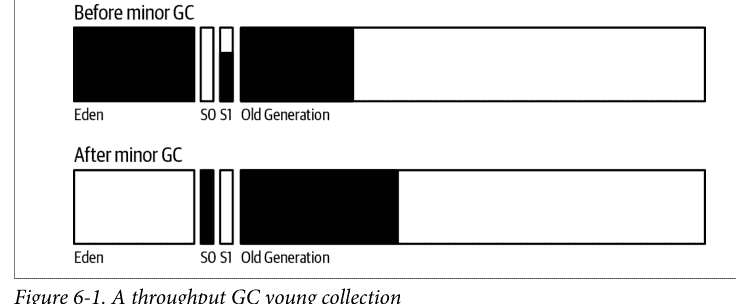
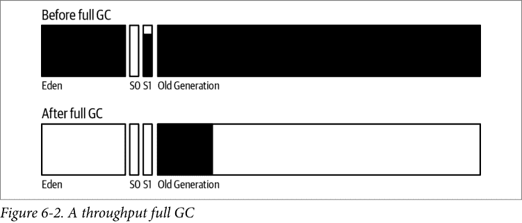
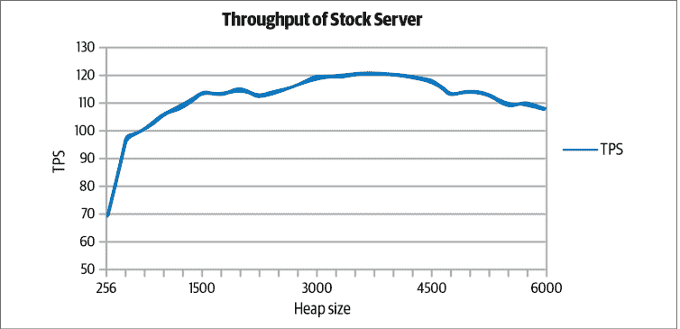
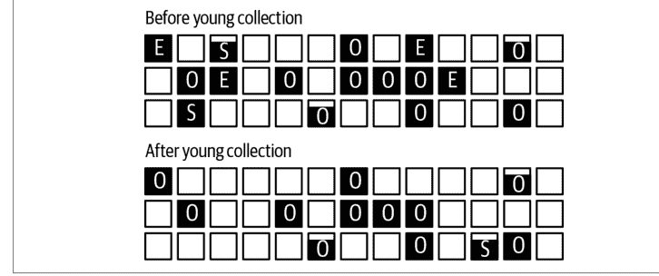
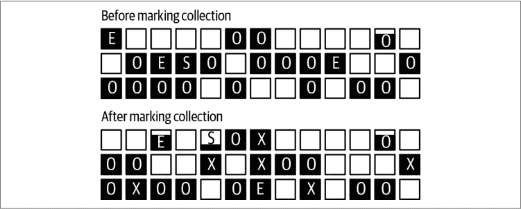
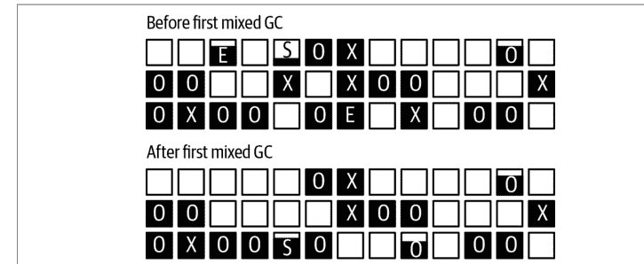
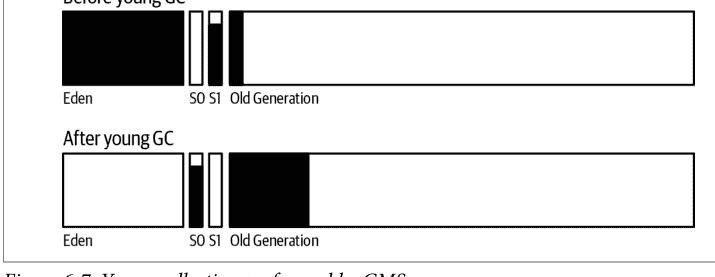
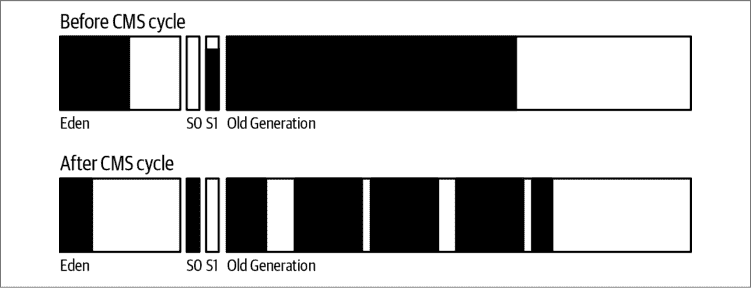
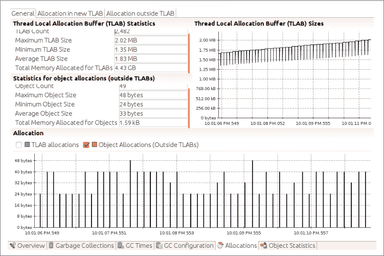
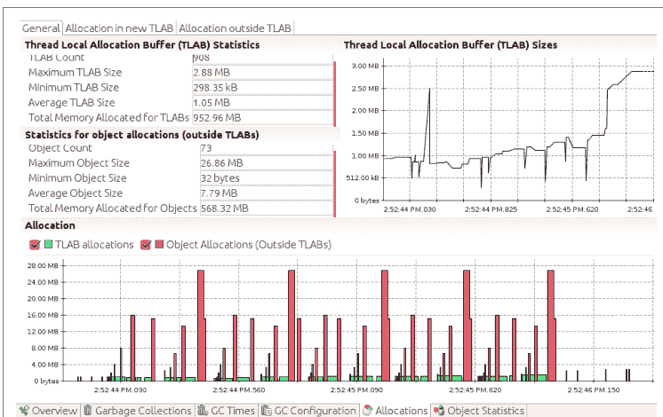

## 垃圾收集算法

第 5 章检查了所有垃圾收集器的一般行为，包括普遍适用于所有 GC 算法的 JVM 标志：如何选择堆大小、代大小、日志记录等等。垃圾收集的基本调优足以满足许多情况。当它们不够用时，就需要检查正在使用的 GC 算法的具体操作，以确定如何更改其参数以最大程度地减少 GC 对应用程序的影响。

调优单个收集器所需的关键信息是该收集器启用时来自 GC 日志的数据。因此，本章首先从其日志输出的角度来看待每种算法，这使我们能够理解 GC 算法的工作原理以及如何调整它以更好地工作。然后每个部分都包括实现更好性能的调优信息。

本章还涵盖了一些新的、实验性的收集器的细节。那些收集器在撰写本文时可能还不是 100% 稳定，但在下一个 LTS 版本的 Java 发布时可能会成为成熟的生产就绪收集器（正如 G1 GC 最初作为实验性收集器开始，现在是 JDK 11 中的默认设置）。

少数不寻常的情况会影响所有 GC 算法的性能：分配非常大的对象、既不短暂也不长寿的对象等等。那些情况在本章末尾介绍。

## 理解吞吐量收集器

我们将通过查看各个垃圾收集器开始，首先是吞吐量收集器。虽然我们已经看到 G1 GC 收集器通常是首选，但吞吐量收集器的细节更容易理解，并且可以为理解事物如何工作奠定更好的基础。

回顾第 5 章，垃圾收集器必须执行三个基本操作：查找未使用的对象、释放其内存并压缩堆。吞吐量收集器在同一个 GC 周期中执行所有这些操作；这些操作一起被称为一次收集。这些收集器可以在一次操作中收集年轻代或老年代。

图 6-1 显示了年轻收集前后的堆。



图 6-1. 吞吐量 GC 年轻收集

年轻收集发生在 eden 填满时。年轻收集将所有对象移出 eden：一些对象被移动到幸存者空间之一（本图中的 S0），一些对象被移动到老年代，老年代现在包含更多对象。当然，许多对象被丢弃，因为它们不再被引用。

因为 eden 在此操作后通常为空，所以认为它已被压缩似乎不寻常，但这里的效果就是如此。

在 JDK 8 GC 日志中，使用 PrintGCDetails 时，吞吐量收集器的 Minor GC 如下所示：

```
17.806: [GC (Allocation Failure) [PSYoungGen: 227983K->14463K(264128K)]
280122K->66610K(613696K), 0.0169320 secs]
[Times: user=0.05 sys=0.00, real=0.02 secs]
```

此 GC 在程序开始后 17.806 秒发生。年轻代中对象现在占用 14,463 KB（14 MB，在幸存者空间中）；GC 之前，它们占用 227,983 KB（227 MB）。¹ 此时年轻代的总大小为 264 MB。

同时，堆的整体占用率（年轻代和老年代）从 280 MB 减少到 66 MB，并且此时整个堆的大小为

1 实际上，227,893 KB 只有 222 MB。为了便于讨论，我在本章中将 KB 缩短 1,000；假装我是一个磁盘制造商。


613 MB。该操作耗时不到 0.02 秒（输出末尾的 0.02 秒实际时间为 0.0169320 秒——四舍五入后）。该程序被收取的 CPU 时间比实际时间更多，因为年轻代回收是由多个线程完成的（在此配置中为四个线程）。

在 JDK 11 中，相同的日志看起来会是这样：

```text
[17.805s][info][gc,start       ] GC(4) Pause Young (Allocation Failure)
[17.806s][info][gc,heap        ] GC(4) PSYoungGen: 227983K->14463K(264128K)
[17.806s][info][gc,heap        ] GC(4) ParOldGen: 28012K->56610K(613696K)
[17.806s][info][gc,metaspace   ] GC(4) Metaspace: 3743K->3743K(1056768K)
[17.806s][info][gc             ] GC(4) Pause Young (Allocation Failure)
                                      496M->79M(857M) 16.932ms
[17.806s][info][gc,cpu        ] GC(4) User=0.05s Sys=0.00s Real=0.02s
```

这里的信息是相同的；只是格式不同。而且该日志条目有多行；之前的日志条目实际上是单行（但在此格式中无法重现）。该日志还打印出 metaspace 大小，但在年轻代回收期间这些大小永远不会改变。metaspace 也未包含在此示例第五行报告的总堆大小中。

图 6-2 显示了完全 GC 前后的堆。



老年代回收会释放年轻代中的所有内容。老年代中仅保留具有活动引用的对象，并且所有这些对象都已进行压缩，使得老年代的开头被占用，而剩余部分为空闲。

GC 日志会这样报告该操作：

```text
64.546: [Full GC (Ergonomics) [PSYoungGen: 15808K->0K(339456K)]
          [ParOldGen: 457753K->392528K(554432K) 473561K->392528K(893888K)
          [Metaspace: 56728K->56728K(115392K)], 1.3367080 secs]
          [Times: user=4.44 sys=0.01, real=1.34 secs]
```

年轻代现在占用 0 字节（其大小为 339 MB）。请注意，图中意味着 survivor 空间也被清空了。老年代中的数据从 457 MB 减少到 392 MB，因此整个堆使用量从 473 MB 减少到 392 MB。metaspace 的大小保持不变；在大多数完全 GC 中不会被回收。（如果 metaspace 用尽空间，JVM 将运行完全 GC 来回收它，你会看到 metaspace 大小发生变化；我稍后会展示这一点。）由于完全 GC 需要做的工作明显更多，因此它花费了 1.3 秒的实际时间，以及 4.4 秒的 CPU 时间（同样是四个并行线程）。

相似的 JDK 11 日志是这个：

```text
[63.205s][info][gc,start       ] GC(13) Pause Full (Ergonomics)
[63.205s][info][gc,phases,start] GC(13) Marking Phase
[63.314s][info][gc,phases      ] GC(13) Marking Phase 109.273ms
[63.314s][info][gc,phases,start] GC(13) Summary Phase
[63.316s][info][gc,phases      ] GC(13) Summary Phase 1.470ms
[63.316s][info][gc,phases,start] GC(13) Adjust Roots
[63.331s][info][gc,phases      ] GC(13) Adjust Roots 14.642ms
[63.331s][info][gc,phases,start] GC(13) Compaction Phase
[63.482s][info][gc,phases      ] GC(13) Compaction Phase 1150.792ms
[64.482s][info][gc,phases,start] GC(13) Post Compact
[64.546s][info][gc,phases      ] GC(13) Post Compact 63.812ms
[64.546s][info][gc,heap        ] GC(13) PSYoungGen: 15808K->0K(339456K)
[64.546s][info][gc,heap        ] GC(13) ParOldGen: 457753K->392528K(554432K)
[64.546s][info][gc,metaspace   ] GC(13) Metaspace: 56728K->56728K(115392K)
[64.546s][info][gc            ] GC(13) Pause Full (Ergonomics)
                                  462M->378M(823M) 1336.708ms
[64.546s][info][gc,cpu        ] GC(13) User=4.446s Sys=0.01s Real=1.34s
```


## 快速总结

- 吞吐量收集器有两个操作：minor 回收和完全 GC，每一个都会标记、释放并压缩目标代。
- 从 GC 日志中获取的计时是确定使用这些收集器的应用程序的 GC 对整体影响的快速方法。

## 自适应和静态堆大小调优

调优吞吐量收集器就是关于暂停时间和在整体堆大小与老年代和年轻代大小之间取得平衡。

这里有两个权衡需要考虑。首先，我们有经典的编程权衡：时间与空间。更大的堆会消耗机器上的更多内存，而消耗这部分内存的好处是（至少在一定程度上）应用程序的吞吐量会更高。

第二个权衡涉及执行 GC 所需的时间。通过增加堆大小可以减少完全 GC 暂停的次数，但这可能会产生适得其反的效果，即由于 GC 时间更长而导致平均响应时间增加。同样，通过为年轻代分配比老年代更多的堆来缩短完全 GC 暂停，但这反过来会增加老年代 GC 回收的频率。

这些权衡的影响如图 6-3 所示。该图显示了使用不同堆大小运行的库存 REST 服务器的最大吞吐量。使用较小的 256 MB 堆时，服务器花费了大量时间在 GC 中（事实上占总时间的 36%）；因此吞吐量受到了限制。随着堆大小的增加，吞吐量迅速增加——直到堆大小设置为 1,500 MB。之后，吞吐量增加的速度较慢：此时应用程序实际上不再受 GC 限制（约 6% 的时间在 GC 中）。收益递减规律开始显现：应用程序可以使用额外的内存来获得吞吐量，但收益变得更加有限。

在堆大小达到 4,500 MB 后，吞吐量开始略微下降。此时，应用程序达到了第二个权衡：额外的内存导致了更长的 GC 周期，而这些更长的周期——即使频率更低——也会降低整体吞吐量。

该图中的数据是通过在 JVM 中禁用自适应大小调整获得的；最小和最大堆大小被设置为相同的值。可以对任何应用程序运行实验并确定堆和代的最佳大小，但通常更容易让 JVM 做出这些决定（这通常会发生，因为自适应大小调整默认是启用的）。



*图 6-3. 不同堆大小下的吞吐量*

吞吐量收集器中的自适应大小调整会调整堆（以及代）的大小以满足其暂停时间目标。这些目标通过以下标志设置：`-XX:MaxGCPauseMillis=N` 和 `-XX:GCTimeRatio=N`。

`MaxGCPauseMillis` 标志指定应用程序愿意容忍的最大暂停时间。可能很诱人将其设置为 0，或一个较小的值比如 50 ms。请注意，该目标适用于 minor 和完全 GC。如果使用非常小的值，应用程序将最终拥有一个非常小的老年代：例如，可以在 50 ms 内清理的老年代。这将导致 JVM 执行非常、非常频繁的完全 GC，性能将很糟糕。所以要现实：将其设置为可以实现的值。默认情况下，此标志未设置。

`GCTimeRatio` 标志指定应用程序愿意花费在 GC 中的时间量（与应用程序级线程应运行的时间相比）。它是一个比率，因此 N 的值需要仔细考虑。该值用于以下等式来确定应用程序线程理想上应运行的时间百分比：

*ThroughputGoal = 1 - 1 / (1 + GCTimeRatio)*

`GCTimeRatio` 的默认值是 99。将该值代入等式得到 0.99，意味着目标是花费 99% 的时间在应用程序处理上，仅花费 1% 的时间在 GC 上。但不要被默认情况下的数字对应关系所混淆。`GCTimeRatio` 为 95 并不意味着 GC 应运行到总时间的 5%：它意味着 GC 应运行到总时间的 1.04%。

更简单的方法是先决定应用程序执行工作的最小时间百分比（比如 95%），然后根据此等式计算 `GCTimeRatio` 的值：

*GCTimeRatio = Throughput / (1 - Throughput)*

对于 95%（0.95）的吞吐量目标，该等式得出 `GCTimeRatio` 为 19。

JVM 使用这两个标志在初始 (`-Xms`) 和最大 (`-Xmx`) 堆大小建立的边界内设置堆的大小。`MaxGCPauseMillis` 标志具有优先权：如果设置了它，年轻代和老年代的大小将被调整直到满足暂停时间目标。一旦发生这种情况，堆的整体大小将被增加直到满足时间比率目标。一旦两个目标都满足，JVM 将尝试减小堆的大小，以便最终得到满足这两个目标的最小可能堆。


由于未默认设置暂停时间目标，自动堆大小调整的通常效果是堆（以及代）大小会增加，直到满足 GCTimeRatio 目标为止。实际上，该标志的默认设置过于乐观。当然你的体验会有所不同，但我更常看到应用程序花费 3% 到 6% 的时间在 GC 中，并且表现相当不错。有时我甚至在内存严重受限的环境中处理应用程序；这些应用程序最终花费 10% 到 15% 的时间在 GC 中。GC 对这些应用程序的性能有实质性影响，但整体性能目标仍然得到满足。

因此最佳设置会根据应用程序目标而变化。在没有其他目标的情况下，我从时间比例 19 开始（GC 占用 5% 的时间）。

表 6-1 显示了这种动态调优对需要小堆且 GC 工作量很少的应用程序的效果（它是库存 REST 服务器，几乎没有长寿命对象）。

## 表 6-1. 动态 GC 调优的效果

| GC 设置 | 最终堆大小 | GC 占用时间百分比 | OPS |
|---|---|---|---|
| Default | 649 MB | 0.9% | 9.2 |
| MaxGCPauseMillis=50ms | 560 MB | 1.0% | 9.2 |
| Xms=Xmx=2048m | 2 GB | 0.04% | 9.2 |

默认情况下，堆的最小大小为 64 MB，最大大小为 2 GB（因为机器有 8 GB 物理内存）。在这种情况下，GCTimeRatio 按预期工作：堆动态调整为 649 MB，此时应用程序花费的总时间约 1% 在 GC 中。

在此情况下设置 MaxGCPauseMillis 标志会开始减小堆大小以满足该暂停时间目标。由于垃圾收集器在此示例中几乎没有工作要做，它成功了，并且仍然只花费总时间的 1% 在 GC 中，同时保持相同的 9.2 OPS 的吞吐量。

最后，请注意更多并不总是更好。完整的 2 GB 堆确实意味着应用程序可以在 GC 上花费更少的时间，但 GC 并不是这里的主要性能因素，因此吞吐量并未增加。像往常一样，花时间优化应用程序的错误区域并没有帮助。

如果将同一应用程序更改为将每个用户的之前 50 个请求保存在全局缓存中（例如 JPA 缓存会这样做），垃圾收集器必须更努力地工作。表 6-2 显示了该情况下的权衡。

## 表 6-2. 堆占用对动态 GC 调优的影响

| GC 设置 | 最终堆大小 | GC 占用时间百分比 | OPS |
|---|---|---|---|
| Default | 1.7 GB | 9.3% | 8.4 |
| MaxGCPauseMillis=50ms | 588 MB | 15.1% | 7.9 |
| Xms=Xmx=2048m | 2 GB | 5.1% | 9.0 |
| Xmx=3560M; MaxGCRatio=19 | 2.1 GB | 8.8% | 9.0 |

在花费大量时间在 GC 的测试中，GC 行为不同。JVM 在此测试中永远无法满足 1% 的吞吐量目标；它尽力适应默认目标并做得相当不错，使用了 1.7 GB 的空间。

当给出不切实际的暂停时间目标时，应用程序行为更差。为了实现 50 ms 的收集时间，堆被保持在 588 MB，但这意味着 GC 现在变得过于频繁。因此，吞吐量显著下降。在此场景中，更好的性能来自指示 JVM 使用整个堆，将初始和最大大小都设置为 2 GB。

最后，表格的最后一行显示了当堆大小合理且我们设置了 5% 的现实时间比例目标时会发生什么。JVM 本身确定大约 2 GB 是最佳堆大小，并且它实现了与手工调优情况相同的吞吐量。


## 快速总结

- 动态堆调优是堆大小调整的一个良好第一步。对于广泛的应用程序，这将是所需的一切，并且动态设置会最小化 JVM 的内存使用。
- 可以静态调整堆大小以获得最大可能的性能。JVM 为合理的一组性能目标确定的大小是该调优的良好起点。

## 了解 G1 垃圾收集器

G1 GC 在堆内的离散区域上运行。每个区域（默认约有 2,048 个）可以属于旧代或新代，并且代区域不必是连续的。拥有旧代中区域的想法是，当并发后台线程查找未引用对象时，一些区域会包含比其他区域更多的垃圾。区域的实际收集仍然需要应用程序线程停止，但 G1 GC 可以专注于大部分是垃圾的区域，并且只需花费一点时间清空这些

区域。这种方法——只清除大部分是垃圾的区域——就是 G1 GC 名称的由来：垃圾优先。

这不适用于年轻代中的区域：在一次年轻 GC 期间，整个年轻代要么被释放，要么被提升（到 survivor 空间或旧代）。尽管如此，年轻代是根据区域定义的，部分原因是如果区域是预定义的，则调整代的大小会变得容易得多。

G1 GC 被称为并发收集器，因为在旧代中对空闲对象的标记与应用程序线程并发进行（即它们被保持运行）。但它并不完全并发，因为标记和压缩年轻代需要停止所有应用程序线程，并且旧代的压缩也发生在应用程序线程停止时进行。

G1 GC 有四个逻辑操作：

- 一次年轻收集
- 一次后台并发标记周期
- 一次混合收集
- 如有必要，一次完整 GC

我们将依次查看这些操作，从图 6-4 所示的 G1 GC 年轻收集开始。



图 6-4. G1 GC 年轻收集

此图中的每个小方块代表一个 G1 GC 区域。每个区域中的数据由黑色区域表示，并且每个区域中的字母标识该区域所属的代（[E]den、[O]ld 代、[S]urvivor 空间）。空区域不属于任何代；G1 GC 根据需要任意使用它们用于任何代。

G1 GC 年轻收集在 eden 填满时触发（在此情况下，在填满四个区域后）。收集后，eden 为空（尽管区域被分配给它，随着应用程序的进行，数据将开始填满）。至少有一个区域被分配给 survivor 空间（本例中部分填满），并且一些数据已移入旧代。

GC 日志以与其它收集器不同的方式说明了 G1 中的此次收集。JDK 8 示例日志使用 `PrintGCDetails` 获取，但 G1 GC 的日志细节更详细。示例仅显示了重要的几行。

以下是年轻代的标准收集：

```
23.430: [GC pause (young), 0.23094400 secs]
...
    [Eden: 1286M(1286M)->0B(1212M)
     Survivors: 78M->152M Heap: 1454M(4096M)->242M(4096M)]
     [Times: user=0.85 sys=0.05, real=0.23 secs]
```

年轻代收集花费了 0.23 秒的实际时间，在此期间 GC 线程消耗了 0.85 秒的 CPU 时间。1,286 MB 的对象从 eden 中移出（其自适应调整为 1,212 MB）；其中 74 MB 移到了 survivor 空间（其大小从 78 MB 增加到 152 MB），其余被释放。我们通过观察总堆占用减少了 1,212 MB 得知它们被释放了。在一般情况下，survivor 空间中的一些对象可能已移至旧代，如果 survivor 空间已满，eden 中的一些对象将直接提升到旧代——在这些情况下，旧代的大小会增加。

JDK 11 中类似的日志如下所示：

```
[23.200s][info   ][gc,start      ] GC(10) Pause Young (Normal)
                                            (G1 Evacuation Pause)
[23.200s][info   ][gc,task       ] GC(10) Using 4 workers of 4 for evacuation
[23.430s][info   ][gc,phases     ] GC(10) Pre Evacuate Collection Set: 0.0ms
[23.430s][info   ][gc,phases     ] GC(10) Evacuate Collection Set: 230.3ms
[23.430s][info   ][gc,phases     ] GC(10) Post Evacuate Collection Set: 0.5ms
[23.430s][info   ][gc,phases     ] GC(10) Other: 0.1ms
[23.430s][info   ][gc,heap       ] GC(10) Eden regions: 643->606(606)
[23.430s][info   ][gc,heap       ] GC(10) Survivor regions: 39->76(76)
[23.430s][info   ][gc,heap       ] GC(10) Old regions: 67->75
[23.430s][info   ][gc,heap       ] GC(10) Humongous regions: 0->0
[23.430s][info   ][gc,metaspace  ] GC(10) Metaspace: 18407K->18407K(1067008K)
[23.430s][info   ][gc             ] GC(10) Pause Young (Normal)
                                            (G1 Evacuation Pause)
                                            1454M(4096M)->242M(4096M) 230.104ms
[23.430s][info   ][gc,cpu        ] GC(10) User=0.85s Sys=0.05s Real=0.23s
```

并发 G1 GC 周期开始和结束如图所示 6-5。




该图表展示了需要观察的三个重要事项。首先，年轻代已改变其占用情况：在并发周期期间将至少存在一个（可能更多）年轻集合。因此，标记周期之前的 eden 区域已被完全释放，并且新的 eden 区域开始被分配。

其次，一些区域现在被标记为 X。这些区域属于老年代（并且请注意它们仍然包含数据）——它们是标记周期判定为主要包含垃圾的区域。

最后，请注意，老年代（由标记为 O 或 X 的区域组成）在周期完成后实际占用更多。这是因为在标记周期期间发生的年轻代收集将数据提升到了老年代。此外，标记周期实际上不会在老年代中释放任何数据：它只是识别出主要为垃圾的区域。这些区域的数据将在后续周期中被释放。

G1 GC 并发周期包含多个阶段，其中一些会停止所有应用线程，一些则不会。第一个阶段称为 *initial-mark*（在 JDK 8 中）或 *concurrent start*（在 JDK 11 中）。该阶段会停止所有应用线程——部分原因是它同时执行一次年轻代收集，并且为后续阶段做好准备。

在 JDK 8 中，它看起来像这样：

```
50.541: [GC pause (G1 Evacuation pause) (young) (initial-mark), 0.27767100 secs]
    ... lots of other data ...
    [Eden: 1220M(1220M)->0B(1220M)
     Survivors: 144M->144M Heap: 3242M(4096M)->2093M(4096M)]
    [Times: user=1.02 sys=0.04, real=0.28 secs]
```

而在 JDK 11 中：

```
[50.261s][info   ][gc,start      ] GC(11) Pause Young (Concurrent Start)
                                      (G1 Evacuation Pause)
[50.261s][info   ][gc,task       ] GC(11) Using 4 workers of 4 for evacuation
```

还请注意，在 JDK 11 的示例中，输出具有相同的 GC 条目——20——与根区域扫描发生的条目相同。我们将操作分解得比 JDK 日志更细：在 JDK 中，整个后台扫描被视为一个操作。我们将其拆分为更细粒度、更符合逻辑的操作，因为例如，根扫描可以在并发标记无法引入暂停时引入暂停。

标记阶段随后是 remarking 阶段和正常的 cleanup 阶段：

```
120.910: [GC remark 120.959:
    [GC ref-PRC, 0.0000890 secs], 0.0718990 secs]
[Times: user=0.23 sys=0.01, real=0.08 secs]
120.985: [GC cleanup 3510M->3434M(4096M), 0.0111040 secs]
    [Times: user=0.04 sys=0.00, real=0.01 secs]

[120.909s][info][gc,start      ] GC(20) Pause Remark
[120.909s][info][gc,stringtable] GC(20) Cleaned string and symbol table,
                            strings: 1369 processed, 0 removed
                            symbols: 17173 processed, 0 removed
[120.985s][info][gc            ] GC(20) Pause Remark 2283M->862M(3666M) 80.412ms
[120.985s][info][gc,cpu        ] GC(20) User=0.23s Sys=0.01s Real=0.08s
```

这些阶段会停止应用线程，尽管通常时间很短。接下来会发生一个并发的额外清理阶段：

```
120.996: [GC concurrent-cleanup-start]
120.996: [GC concurrent-cleanup-end, 0.0004520]

[120.878s][info][gc,start      ] GC(20) Pause Cleanup
[120.879s][info][gc            ] GC(20) Pause Cleanup 1313M->1313M(3666M) 1.192ms
[120.879s][info][gc,cpu        ] GC(20) User=0.00s Sys=0.00s Real=0.00s
[120.879s][info][gc,marking    ] GC(20) Concurrent Cleanup for Next Mark
[120.996s][info][gc,marking    ] GC(20) Concurrent Cleanup for Next Mark
                            117.168ms
[120.996s][info][gc            ] GC(20) Concurrent Cycle 70,177.506ms
```

至此，正常的 G1 GC 后台标记周期已完成——至少就找到垃圾而言。但实际上几乎没有释放任何内存。清理阶段回收了一点内存，但到目前为止 G1 GC 真正做的事情只是识别出主要为垃圾并且可以被回收的老年代区域（图 6-5 中标记为 X 的那些）。

现在 G1 GC 执行一系列混合 GC。它们被称为混合，因为它们执行正常的年轻代收集，同时也收集来自后台扫描的某些标记区域。混合 GC 的效果如图 6-6 所示。

与年轻代收集一样，G1 GC 完全清空了 eden 并调整了 survivor 空间。此外，其中两个标记区域已被收集。这些区域已知主要包含垃圾，因此其中很大一部分被释放。这些区域中的任何存活数据都被移动到另一个区域（就像年轻代中的存活数据被移动到老年代的区域中一样）。这就是 G1 GC 紧凑老年代的方式——以这种方式移动对象本质上是在 G1 GC 进行过程中压缩堆。



图 6-6. G1 GC 执行的混合 GC

混合 GC 操作在日志中通常如下所示：

```
79.826: [GC pause (mixed), 0.26161600 secs]
....
 [Eden: 1222M(1222M)->0B(1220M)
 Survivors: 142M->144M Heap: 3200M(4096M)->1964M(4096M)]
 [Times: user=1.01 sys=0.00, real=0.26 secs]
```

```
[3.800s][info][gc,start    ] GC(24) Pause Young (Mixed) (G1 Evacuation Pause)
[3.800s][info][gc,task     ] GC(24) Using 4 workers of 4 for evacuation
[3.800s][info][gc,phases   ] GC(24)  Pre Evacuate Collection Set: 0.2ms
[3.825s][info][gc,phases   ] GC(24) Evacuate Collection Set: 250.3ms
[3.826s][info][gc,phases   ] GC(24) Post Evacuate Collection Set: 0.3ms
[3.826s][info][gc,phases   ] GC(24) Other: 0.4ms
[3.826s][info][gc,heap     ] GC(24) Eden regions: 1222->0(1220)
[3.826s][info][gc,heap     ] GC(24) Survivor regions: 142->144(144)
[3.826s][info][gc,heap     ] GC(24) Old regions: 1834->1820
[3.826s][info][gc,heap     ] GC(24) Humongous regions: 4->4
[3.826s][info][gc,metaspace] GC(24) Metaspace: 3750K->3750K(1056768K)
[3.826s][info][gc         ] GC(24) Pause Young (Mixed) (G1 Evacuation Pause)
 3791M->3791M(3983M) 124.390ms
[3.826s][info][gc,cpu      ] GC(24) User=1.01s Sys=0.00s Real=0.26s
[3.826s][info][gc,start    ] GC(25) Pause Young (Mixed) (G1 Evacuation Pause)
```

请注意，整个堆使用量减少的不仅仅是从 eden 移除的 1,222 MB。那部分差异（16 MB）看起来很小，但请记住，部分 survivor 空间在同一时间被提升到了老年代；此外，每个混合 GC 仅清理目标老年代区域的一部分。

随着我们继续，你会看到确保混合 GC 清理足够内存以防止未来并发失败是很重要的。

在 JDK 11 中，第一个混合 GC 被标记为 `Prepared Mixed` 并紧跟在并发清理之后。

混合 GC 周期将继续，直到（几乎）所有标记区域都被收集，此时 G1 GC 将恢复常规的年轻 GC 周期。最终，G1 GC 将启动另一个并发周期以确定老年代中应下次释放的区域。

尽管混合 GC 周期通常会显示 `(Mixed)` 作为 GC 原因，但在并发周期之后，年轻代收集有时会被正常标记（即 G1 Evacuation Pause）。如果并发周期发现老年代中可以完全释放的区域，这些区域会在常规的年轻代疏散暂停期间被回收。从技术上讲，这在收集器的实现中不是混合周期。但在逻辑上它是：对象正从年轻代中释放或提升到老年代，同时垃圾对象（实际上是区域）正从老年代中释放。

如果一切顺利，这就是你在 GC 日志中会看到的全部 GC 活动。但有一些失败情况需要考虑。

有时你会在日志中观察到一次 full GC，这表明更多的调优（包括可能更多的堆空间）将有利于应用性能。这主要在四种情况下被触发：

## *并发模式失败*

G1 GC 启动标记周期，但在周期完成前老年代已填满。在这种情况下，G1 GC 会中止标记周期：

```
51.408: [GC concurrent-mark-start]
65.473: [Full GC 4095M->1395M(4096M), 6.1963770 secs]
        [Times: user=7.87 sys=0.00, real=6.20 secs]
71.669: [GC concurrent-mark-abort]

[51.408][info][gc,marking    ] GC(30) Concurrent Mark From Roots
...
[65.473][info][gc            ] GC(32) Pause Full (G1 Evacuation Pause)
                                      4095M->1305M(4096M) 60,196.377

...
[71.669][info][gc,marking    ] GC(30) Concurrent Mark From Roots 191ms
[71.669][info][gc,marking    ] GC(30) Concurrent Mark Abort
```

此失败意味着应增加堆大小，G1 GC 后台处理必须更早开始，或周期必须调优以运行得更快（例如通过使用额外的后台线程）。如何做到这一点将在后面详细介绍。


## 晋升失败

G1 GC 已完成一个标记周期，并开始执行混合 GC 来清理老年代区域。在它清理出足够空间之前，有太多对象从年轻代晋升，导致老年代仍然空间不足。在日志中，一次混合 GC 后紧接着出现一次 Full GC：

```
2226.224: [GC pause (mixed)
    2226.440: [SoftReference, 0 refs, 0.000060 secs]
    2226.441: [WeakReference, 0 refs, 0.000020 secs]
    2226.441: [FinalReference, 0 refs, 0.000010 secs]
    2226.441: [PhantomReference, 0 refs, 0.0000010 secs]
    2226.441: [JNI Weak Reference, 0.000030 secs]
        (to-space exhausted), 0.2390040 secs]
....
    [Eden: 0.0B(400.0M)->0.0B(400.0M)
    Survivors: 0.0B->0.0B Heap: 2006.4M(2048.0M)->2006.4M(2048.0M)]
    [Times: user=1.70 sys=0.04, real=0.26 secs]
2226.510: [Full GC (Allocation Failure)
    2227.519: [SoftReference, 4329 refs, 0.0005520 secs]
    2227.520: [WeakReference, 12646 refs, 0.0010510 secs]
    2227.521: [FinalReference, 7538 refs, 0.0005660 secs]
    2227.521: [PhantomReference, 168 refs, 0.0000120 secs]
    2227.521: [JNI Weak Reference, 0.000020 secs]
        2006M->907M(2048M), 4.1615450 secs]
    [Times: user=6.76 sys=0.01, real=4.16 secs]

[2226.224s][info][gc      ] GC(26) Pause Young (Mixed)
                    (G1 Evacuation Pause)
                    2048M->2006M(2048M) 26.129ms
...
[2226.510s][info][gc,start    ] GC(27) Pause Full (G1 Evacuation Pause)
```

这种失败意味着混合收集需要更快地发生；每次年轻代收集需要处理老年代中更多的区域。

## 疏散失败

在执行年轻代收集时，幸存区（survivor spaces）和老年代没有足够空间来容纳所有存活对象。这在 GC 日志中表现为一种特定类型的年轻代 GC：

```
60.238: [GC pause (young) (to-space overflow), 0.4154690 secs]

[60.238s][info][gc,start      ] GC(28) Pause Young (Concurrent Start)
                    (G1 Evacuation Pause)
[60.238s][info][gc,task       ] GC(28) Using 4 workers of 4
                    for evacuation
[60.238s][info][gc            ] GC(28) To-space exhausted
```

这表明堆已基本填满或碎片化。G1 GC 会尝试补偿，但你可以预期这会以糟糕的结局收场：JVM 将不得不执行 Full GC。克服这一问题的简单方法是增大堆大小，不过第 182 页“高级调优”（Advanced Tunings）中给出了一些可能的解决方案。

## 巨型对象分配失败

分配非常大的对象的应用程序可能会触发 G1 GC 中的另一种 Full GC；更多细节（包括如何避免）参见第 192 页“G1 GC 对巨型对象的分配”。在 JDK 8 中，如果不借助特殊的日志参数，无法诊断这种情况；但在 JDK 11 中，可以通过如下日志显示：

```
```text
[3023.091s][info][gc,start      ] GC(54) Pause Full (G1 Humongous Allocation)
```
```

## 元数据 GC 阈值

正如我提到的，元空间（metaspace）本质上是一个独立的堆，独立于主堆进行收集。它不是通过 G1 GC 收集的，但在 JDK 8 中当它需要被收集时，G1 GC 会在主堆上执行一次 Full GC（紧接着一次年轻代收集）：

```
```text
0.0535: [GC (Metadata GC Threshold) [PSYoungGen: 34113K->20388K(291328K)]
    73838K->60121K(794112K), 0.0282912 secs]
    [Times: user=0.05 sys=0.01, real=0.03 secs]
0.0566: [Full GC (Metadata GC Threshold) [PSYoungGen: 20388K->0K(291328K)]
    [ParOldGen: 39732K->46178K(584192K), 60121K->46178K(875520K),
    [Metaspace: 59040K->59036K(1101824K)], 0.1121237 secs]
    [Times: user=0.28 sys=0.01, real=0.11 secs]
```
```

在 JDK 11 中，元空间可以在不触发 Full GC 的情况下进行收集/调整大小。


## 快速总结

- G1 有多个周期（以及并发周期内的多个阶段）。一个调优良好的运行 G1 的 JVM 应该只经历年轻代、混合和并发 GC 周期。
- G1 的某些并发阶段会发生较小的停顿。
- 如有必要，应对 G1 进行调优，以避免 Full GC 周期。

## 调优 G1 GC

调优 G1 GC 的主要目标是确保不会因并发模式或疏散失败而最终触发 Full GC。用于避免 Full GC 的技术也可用于频繁的年轻代 GC 必须等待根区域扫描完成的情况。

在 JDK 8 中，防止 Full GC 的调优至关重要，因为在 JDK 8 中 G1 GC 执行 Full GC 时使用单线程。这会产生比平时更长的停顿时间。在 JDK 11 中，Full GC 由多线程执行，停顿时间更短（基本上与吞吐量收集器的 Full GC 停顿时间相同）。这一差异是使用 G1 GC 时最好升级到 JDK 11 的原因之一（不过，一个避免了 Full GC 的 JDK 8 应用也能表现得很好）。

其次，调优可以最大限度地减少过程中出现的停顿。

以下是避免 Full GC 的一些选项：

- 增加老年代的大小，可以通过增大整体堆空间或调整各代之间的比例来实现。
- 增加后台线程数（假设有足够的 CPU）。
- 更频繁地执行 G1 GC 后台活动。
- 增加混合 GC 周期中完成的工作量。

这里可以应用很多调优手段，但 G1 GC 的目标之一就是它不需要过多调优。为此，G1 GC 主要通过一个标志来进行调优：即与调优吞吐量收集器相同的 `-XX:MaxGCPauseMillis=N` 标志。

与吞吐量收集器不同，该标志在 G1 GC 中有一个默认值：200 毫秒。如果 G1 GC 的任何停止世界阶段（stop-the-world）的停顿开始超过该值，G1 GC 会尝试补偿——调整年轻代与老年代的比例、调整堆大小、更早开始后台处理、改变晋升阈值，以及（最重要的是）在混合 GC 周期中处理更多或更少的老年代区域。

这里有一些权衡：如果减小该值，年轻代大小将收缩以达到停顿时间目标，但年轻代 GC 会更频繁。此外，混合 GC 期间可收集的老年代区域数量会减少以达到停顿时间目标，这增加了并发模式失败的风险。

如果设置停顿时间目标不能阻止 Full GC 的发生，则可以单独调整这些不同方面。调整 G1 GC 的堆大小与其他 GC 算法的方式相同。

## 调优 G1 后台线程

你可以将 G1 GC 的并发标记视为与应用线程赛跑：G1 GC 必须比应用向老年代晋升新数据更快地清理老年代。为此，可以尝试增加后台标记线程数（假设机器上有足够的 CPU）。

G1 GC 使用两组线程。第一组由你在第 5 章首次看到的 `-XX:ParallelGCThreads=N` 标志控制。该值影响应用线程停止时用于各阶段的线程数：年轻代和混合收集，以及并发重新标记阶段中必须停止线程的阶段。第二个标志是 `-XX:ConcGCThreads=N`，它影响用于并发重新标记的线程数。

`ConcGCThreads` 标志的默认值定义如下：

```
ConcGCThreads = (ParallelGCThreads + 2) / 4
```

该除法是基于整数的，因此最多 5 个并行线程时会有 1 个后台扫描线程，6 到 9 个并行线程时会有 2 个后台扫描线程，依此类推。

增加后台扫描线程数将使并发周期更短，这应该能让 G1 GC 更容易在混合 GC 周期内完成老年代的清理，而不会在其它线程再次将其填满之前。与往常一样，这假设 CPU 周期可用；否则，扫描线程会抢占应用的 CPU，从而实际上引入停顿，正如我们在第 5 章中将串行收集器与 G1 GC 进行比较时所看到的那样。

## 调优 G1 GC 使其更频繁（或不那么频繁）地运行

如果 G1 GC 更早开始后台标记周期，它也能赢得这场竞赛。该周期在堆达到由 `-XX:InitiatingHeapOccupancyPercent=N` 指定的占用率时开始，该值的默认值为 45。该百分比指的是整个堆，而不仅仅是老年代。

`InitiatingHeapOccupancyPercent` 的值是恒定的；G1 GC 在尝试达到暂停时间目标时永远不会改变该数字。如果将该值设置得过高，应用最终将执行 Full GC，因为并发阶段没有足够时间在堆的其余部分填满之前完成。如果将该值设置得过低，应用将执行比原本更多的后台 GC 处理。

当然，在某个时刻，这些后台线程必须运行，因此可以推测硬件有足够的 CPU 来容纳它们。但是，如果它们运行得过于频繁，可能会带来显著的惩罚，因为那些会停止应用线程的并发阶段会产生更多的小停顿。这些停顿会快速累积，因此应避免过于频繁地为 G1 GC 执行后台清扫。检查一次并发周期后的堆大小，并确保 `InitiatingHeapOccupancyPercent` 的值设置得高于该值。


## 调优 G1 GC 混合 GC 周期

在一次并发周期之后，G1 GC 必须等到老年代中所有先前标记的区域都被收集完，才能开始新的并发周期。因此，让 G1 GC 更早开始标记周期的另一种方法是在混合 GC 周期中处理更多区域（这样最终混合 GC 周期的数量就会减少）。

混合 GC 所做的工作量取决于三个因素。第一个因素是一开始就有多少区域被认定为大部分是垃圾对象。这一点无法直接改变：在混合 GC 期间，一个区域如果含有 85% 的垃圾对象，就会被声明为符合收集条件。

第二个因素是 G1 GC 处理这些区域的最大混合 GC 周期数，该值由标志 `-XX:G1MixedGCCountTarget=N` 指定。默认值为 8；降低该值有助于克服提升失败（代价是混合 GC 周期中的暂停时间变长）。

另一方面，如果混合 GC 的暂停时间过长，可以增大该值，以便在混合 GC 期间完成更少的工作。但务必注意，增大该值不能使下一次 G1 GC 并发周期延迟过久，否则可能导致并发模式失败。

最后，第三个因素是 GC 暂停的理想最大时长（即由 `MaxGCPauseMillis` 指定的值）。`G1MixedGCCountTarget` 标志指定的混合周期数是一个上限；如果暂停目标内还有富余时间，G1 GC 将收集超过八分之一（或任何已指定比例）的已标记老年代区域。增大 `MaxGCPauseMillis` 标志的值可让每次混合 GC 收集更多的老年代区域，进而让 G1 GC 能够更早开始下一个并发周期。


## 快速总结

- G1 GC 调优应从设置合理的暂停时间目标开始。
- 如果之后完整 GC 仍然是个问题，并且堆大小无法增大，则可以针对特定的失败应用特定的调优：
    - 为了让后台线程运行得更频繁，调整 InitiatingHeapOccupancyPercent。
    - 如果有额外的 CPU 可用，可通过 ConcGCThreads 标志调整线程数。
    - 为防止提升失败，请减小 G1MixedGCCountTarget 的值。

## 理解 CMS 收集器

尽管 CMS 收集器已被弃用，但在当前的 JDK 构建中仍然可用。因此本节介绍如何对其进行调优，以及它为何被弃用。

CMS 有三个基本操作：

- 收集年轻代（停止所有应用程序线程）
- 运行并发周期来清理老年代中的数据
- 如有必要，执行完整 GC 以压缩老年代

CMS 对年轻代的收集如图 6-7 所示。



图 6-7. CMS 执行的年轻代收集

CMS 年轻代收集类似于吞吐量优先的年轻代收集：数据从 Eden 区移入一个幸存者空间（如果幸存者空间填满，则移入老年代）。

CMS 的 GC 日志条目也类似（这里仅展示 JDK 8 日志格式）：

```
89.853: [GC 89.853: [ParNew: 629120K->69888K(629120K), 0.1218970 secs]
       1303940K->772142K(2027264K), 0.1220900 secs]
       [Times: user=0.42 sys=0.02, real=0.12 secs]
```

年轻代当前的大小为 629 MB；收集后，其中 69 MB 仍然保留（在幸存者空间中）。类似地，整个堆的大小为 2,027 MB，收集后占据 772 MB。整个过程耗时 0.12 秒，尽管并行 GC 线程累计消耗了 0.42 秒的 CPU 时间。

图 6-8 展示了一个并发周期。

CMS 根据堆的占用率启动并发周期。当堆足够满时，会启动那些遍历堆并移除对象的后台线程。周期结束时，堆看起来就像该图底部一行所示。请注意，老年代没有被压缩：有些区域分配了对象，有些区域是空闲的。当年轻代收集将对象从 Eden 区移入老年代时，JVM 会尝试使用这些空闲区域来存放对象。通常这些对象无法放入任何一个空闲区域，这就是为什么 CMS 周期之后，堆的高水位线会更高。



*图 6-8. CMS 执行的并发收集*

在 GC 日志中，这个周期表现为多个阶段。尽管并发周期的大部分时间使用后台线程，但有些阶段会引入短暂的停顿，此时所有应用程序线程都会停止。

并发周期从初始标记阶段开始，该阶段会停止所有应用程序线程：

```
89.976: [GC [1 CMS-initial-mark: 702254K(1398144K)]
772530K(2027264K), 0.0830120 secs]
[Times: user=0.08 sys=0.00, real=0.08 secs]
```

该阶段负责查找堆中的所有 GC 根对象。第一组数字显示，对象当前占用了老年代 1,398 MB 中的 702 MB；第二组数字显示，整个 2,027 MB 堆的占用量为 772 MB。在 CMS 周期的这一阶段，应用程序线程停止了 0.08 秒。

下一阶段是标记阶段，它不会停止应用程序线程。该阶段在 GC 日志中由以下行表示：

```
90.059: [CMS-concurrent-mark-start]
90.887: [CMS-concurrent-mark: 0.823/0.828 secs]
[Times: user=1.11 sys=0.00, real=0.83 secs]
```

标记阶段耗时 0.83 秒（以及 1.11 秒的 CPU 时间）。由于它只是一个标记阶段，没有对堆占用率做任何改变，因此没有显示相关数据。如果有数据，它很可能会显示在这 0.83 秒期间年轻代分配对象导致的堆增长，因为应用程序线程一直在继续运行。

接下来是预清理阶段，该阶段同样与应用程序线程并发运行：

```
90.887: [CMS-concurrent-preclean-start]
90.892: [CMS-concurrent-preclean: 0.005/0.005 secs]
[Times: user=0.01 sys=0.00, real=0.01 secs]
```

下一个阶段是重新标记阶段，但它涉及多个操作：

```
90.892: [CMS-concurrent-abortable-preclean-start]
92.392: [GC 92.392: [ParNew: 629120K->69888K(629120K), 0.1289040 secs]
1331374K->803967K(2027264K), 0.1290200 secs]
[Times: user=0.44 sys=0.01, real=0.12 secs]
94.473: [CMS-concurrent-abortable-preclean: 3.451/3.581 secs]
[Times: user=5.03 sys=0.03, real=3.58 secs]
```

```
94.474: [GC[YG occupancy: 466937 K (629120 K)]
94.474: [Rescan (parallel) , 0.1850000 secs]
94.659: [weak refs processing, 0.0000370 secs]
94.659: [scrub string table, 0.0011530 secs]
[1 CMS-remark: 734079K(1398144K)]
1201017K(2027264K), 0.1863430 secs]
[Times: user=0.60 sys=0.01, real=0.18 secs]
```

等等，CMS 不是刚刚执行了预清理阶段吗？这个可中止的预清理阶段是怎么回事？

使用可中止的预清理阶段是因为重新标记阶段（严格来说，这是该输出中的最后一条记录）不是并发的——它会停止所有应用程序线程。CMS 希望避免出现年轻代收集之后紧接着重新标记阶段的情况，因为那样的话，应用程序线程会被连续两次停顿操作所停止。这里的目标是通过防止连续停顿来最小化暂停时长。

因此，可中止的预清理阶段会一直等待，直到年轻代大约填满 50%。理论上，这正好是两次年轻代收集的中点，让 CMS 有最大可能避免连续停顿。在本例中，可中止的预清理阶段从 90.8 秒开始，等待约 1.5 秒后常规年轻代收集发生（日志中的 92.392 秒）。CMS 会根据过去的行为来计算下一次年轻代收集可能发生的时间——在本例中，CMS 计算大约会在 4.2 秒后发生。于是在 2.1 秒后（即 94.4 秒），CMS 结束预清理阶段（CMS 将其称为中止该阶段，尽管这是该阶段被停止的唯一方式）。最后，CMS 执行重新标记阶段，该阶段使应用程序线程暂停了 0.18 秒（在可中止的预清理阶段期间，应用程序线程没有被暂停）。

接下来是另一个并发阶段——清除阶段：

```
94.661: [CMS-concurrent-sweep-start]
95.223: [GC 95.223: [ParNew: 629120K->69888K(629120K), 0.1322530 secs]
999428K->472094K(2027264K), 0.1323690 secs]
[Times: user=0.43 sys=0.00, real=0.13 secs]
95.474: [CMS-concurrent-sweep: 0.680/0.813 secs]
[Times: user=1.45 sys=0.00, real=0.82 secs]
```

这个阶段耗时 0.82 秒，并与应用程序线程并发运行。它还恰好被一次年轻代收集打断。这次年轻代收集与清除阶段无关，留在这里是为了举例说明年轻代收集可以与老年代收集阶段同时发生。在图 6-8 中，请注意年轻代的状态在并发收集期间发生了变化——在清除阶段可能发生了任意次数的年轻代收集（而且由于可中止的预清理阶段，至少会有一次年轻代收集）。

接下来是并发重置阶段：

```
95.474: [CMS-concurrent-reset-start]
95.479: [CMS-concurrent-reset: 0.005/0.005 secs]
[Times: user=0.00 sys=0.00, real=0.00 secs]
```

这是最后一个并发阶段；CMS 周期完成，老年代中发现的未引用对象现在已被释放（结果就是图 6-8 所示的堆）。遗憾的是，日志没有提供关于释放了多少对象的信息；重置行也不提供任何堆占用率信息。若要了解这一点，请看下一次年轻代收集：

```
98.049: [GC 98.049: [ParNew: 629120K->69888K(629120K), 0.1487040 secs]
1031326K->504955K(2027264K), 0.1488730 secs]
```


现在比较 CMS 周期开始前 89.853 秒时老年代的占用情况，当时大约为 703 MB（此时整个堆占用 772 MB，其中包括幸存空间中的 69 MB，因此老年代消耗了剩余的 703 MB）。在 98.049 秒的这次收集时，老年代占用约为 504 MB；因此 CMS 周期清理了约 199 MB 的内存。

如果一切顺利，这些是 CMS 将运行的唯一周期，也是 CMS GC 日志中会出现<|start|>的唯一日志消息。但还有另外三条消息需要留意，它们表明 CMS 出现了问题。第一个是并发模式失败：

```
267.006: [GC 267.006: [ParNew: 629120K->629120K(629120K), 0.0000200 secs]
267.006: [CMS267.350: [CMS-concurrent-mark: 2.683/2.804 secs]
[Times: user=4.81 sys=0.02, real=2.80 secs]
(concurrent mode failure):
1378132K->1366755K(1398144K), 5.6213320 secs]
2007252K->1366755K(2027264K),
[CMS Perm : 57231K->57222K(95548K)], 5.6215150 secs]
[Times: user=5.63 sys=0.00, real=5.62 secs]
```

当发生年轻代收集且老年代没有足够的空间容纳所有预期晋升的对象时，CMS 会执行本质上相当于一次完全 GC 的操作。所有应用线程都被停止，老年代会被清理掉所有死亡对象，使其占用降至 1,366 MB——该操作使应用线程暂停了整整 5.6 秒。该操作是单线程的，这也是它耗时很长的一个原因（也是并发模式失败随着堆增大而变得更糟的一个原因）。

这种并发模式失败是 CMS 被弃用的主要原因之一。G1 GC 也可能出现并发模式失败，但在回退到完全 GC 时，该完全 GC 在 JDK 11 中会并行执行（尽管 JDK 8 中不会）。CMS 完全 GC 的执行时间会长很多倍，因为它必须在单个线程中执行。²

第二个问题发生在老年代有足够空间容纳晋升对象，但空闲空间碎片化导致晋升失败时：

```
6043.903: [GC 6043.903:
[ParNew (promotion failed): 614254K->629120K(629120K), 0.1619839 secs]
6044.217: [CMS: 1342523K->1336533K(2027264K), 30.7884210 secs]
2004251K->1336533K(1398144K),
[CMS Perm : 57231K->57231K(95548K)], 28.1361340 secs]
[Times: user=28.13 sys=0.38, real=28.13 secs]
```

这里，CMS 开始了一次年轻代收集并假设存在足够的空间来容纳所有晋升对象（否则它会声明并发模式失败）。该假设被证明是错误的：由于老年代碎片化（或可能性更小的是，待晋升的内存量比 CMS 预期更大），CMS 无法晋升对象。

因此，在年轻代收集的中途（此时所有线程已停止），CMS 收集并压缩了整个老年代。好消息是，随着堆被压缩，碎片化问题已得到解决（至少暂时如此）。但这带来了高昂的 28 秒暂停时间。该时间比 CMS 发生并发模式失败时更长，因为整个堆被压缩了；并发模式失败只是释放了堆中的对象。此时堆的状态与吞吐量收集器的完全 GC 结束时相同（图 6-2）：年轻代完全为空，老年代已被压缩。

2 也可以做类似的工作使 CMS 完全 GC 以并行线程运行，但 G1 GC 的工作被优先考虑。

最后，CMS 日志中可能会显示一次完全 GC，而没有任何通常的并发 GC 消息：

```
279.803: [Full GC 279.803:
    [CMS: 88569K->68870K(1398144K), 0.6714090 secs]
    558070K->68870K(2027264K),
    [CMS Perm : 81919K->77654K(81920K)],
    0.6716570 secs]
```

这发生在元空间已填满并需要被收集时。CMS 不会收集元空间，因此如果它填满，就需要完全 GC 来丢弃任何未引用的类。182 页的“高级调优”展示了如何克服此问题。

## 快速总结


- CMS 有几种 GC 操作，但预期的操作是 minor GC 和并发周期。
- CMS 中的并发模式失败和晋升失败代价高昂；应尽可能调优 CMS 以避免这些情况。
- 默认情况下，CMS 不会收集元空间。

## 调优以解决并发模式失败

调优 CMS 的主要关注点是确保不会发生并发模式或晋升失败。如 CMS GC 日志所示，并发模式失败发生的原因是 CMS 没有及时清理老年代：当年轻代收集到来时，CMS 计算出没有足够的空间将这些对象晋升到老年代，于是先收集老年代。

老年代最初是通过将对象紧挨着放置来填满的。当老年代填满到一定程度（默认 70%）时，并发周期开始，后台 CMS 线程开始扫描老年代寻找垃圾。此时竞赛开始：CMS 必须在老年代剩余的 30% 填满之前完成扫描老年代并释放对象的操作。如果并发周期输掉了这场竞赛，CMS 将会发生并发模式失败。

我们可以尝试以多种方式避免此失败：

- 使老年代更大，要么通过调整新生代与老年代的比例，要么通过增加整个堆空间。
- 更频繁地运行后台线程。
- 使用更多的后台线程。

## 自适应大小调整和 CMS

CMS 使用 `MaxGCPauseMillis=N` 和 `GCTimeRatio=N` 设置来确定堆和代的大小。

CMS 方法的一个显著区别是，除非发生完全 GC，否则年轻代永远不会被调整大小。由于 CMS 的目标是永远不进行完全收集，这意味着经过良好调优的 CMS 应用永远不会调整其年轻代的大小。

在程序启动期间，并发模式失败可能很频繁，因为 CMS 会自适应地调整堆和元空间的大小。给 CMS 一个更大的初始堆大小（以及更大的元空间）是一个好主意，这是为了防止这些失败而使堆变大的一种特殊情况。

如果有更多内存可用，更好的解决方案是增加堆的大小。否则，改变后台线程的运行方式。

## 更频繁地运行后台线程

让 CMS 赢得竞赛的一种方法是更早地启动并发周期。如果并发周期在老年代填满 60% 时启动，CMS 完成的机会就比在老年代填满 70% 时启动时更好。实现此目的最简单的方法是设置这两个标志：

- `-XX:CMSInitiatingOccupancyFraction=N`
- `-XX:+UseCMSInitiatingOccupancyOnly`

同时使用这两个标志也使 CMS 更易于理解：如果两者都设置，CMS 仅根据老年代填满的百分比来确定何时启动后台线程。（请注意，与 G1 GC 不同，这里占用的比例仅指老年代，而不是整个堆。）

默认情况下，`UseCMSInitiatingOccupancyOnly` 标志为 false，CMS 使用更复杂的算法来确定何时启动后台线程。如果后台线程需要更早启动，最好以最简单的方式启动它并将 `UseCMSInitiatingOccupancyOnly` 标志设置为 true。

调整 `CMSInitiatingOccupancyFraction` 的值可能需要几次迭代。如果启用了 `UseCMSInitiatingOccupancyOnly`，`CMSInitiatingOccupancyFraction` 的默认值是 70：当老年代占用 70% 时启动 CMS 周期。

给定应用的更好值可以在 GC 日志中找到，通过弄清楚失败的 CMS 周期最初何时开始。找到日志中的并发模式失败，然后回溯到最近一次 CMS 周期开始的时间。CMS-initial-mark 行将显示 CMS 周期开始时老年代有多满：

```
89.976: [GC [1 CMS-initial-mark: 702254K(1398144K)]
        772530K(2027264K), 0.0830120 secs]
        [Times: user=0.08 sys=0.00, real=0.08 secs]
```

在此示例中，这相当于约 50%（702 MB / 1,398 MB）。这还不够早，因此 `CMSInitiatingOccupancyFraction` 需要设置为低于 50 的值。（尽管该标志的默认值是 70，但由于未设置 `UseCMSInitiatingOccupancyOnly` 标志，此示例在老年代 50% 满时启动了 CMS 线程。）

这里的诱惑是简单地将值设置为 0 或其他较小数字，以便后台 CMS 周期一直运行。这通常不被鼓励，但只要你意识到所做的权衡，它可能仍然可行。

第一个权衡在于 CPU 时间：CMS 后台线程将持续运行，它们消耗相当多的 CPU——每个后台 CMS 线程将消耗 100% 的一个 CPU。当多个 CMS 线程同时运行时，也会出现非常短暂的突发，导致整机的总 CPU 飙升。如果这些线程不必要地运行，就会浪费 CPU 资源。

另一方面，使用这些 CPU 周期不一定是问题。后台 CMS 线程有时必须运行，即使在最佳情况下也是如此。因此，机器必须始终有足够的 CPU 周期来运行这些 CMS 线程。所以在配置机器时，必须计划该 CPU 使用。

第二个权衡更为重要，涉及暂停。如 GC 日志所示，CMS 周期的某些阶段会停止所有应用线程。CMS 被使用的主要原因是为了限制 GC 暂停的影响，因此更频繁地运行 CMS


在第 5 章开头。如果 JVM 在该循环中途执行 GC，其中一些短命的 BigDecimal 对象会很不幸：它们刚刚被创建并正在使用，因此不能被释放——但它们活不到足以证明将其移动到老年代的合理性。

这就是年轻代被划分为两个 survivor 空间和 eden 的原因。这种设置允许对象在仍处于年轻代时有额外的机会被回收，而不是被晋升到（并填满）老年代。

当年轻代被回收且 JVM 发现某个对象仍然存活时，该对象会被移动到一个 survivor 空间，而不是移动到老年代。在第一次年轻代回收期间，对象会从 eden 移动到 survivor space 0。在下一次回收期间，存活的对象会从 survivor space 0 和 eden 都移动到 survivor space 1。此时，eden 和 survivor space 0 完全为空。下一次回收会将 survivor space 1 和 eden 中的存活对象移动到 survivor space 0，以此类推。（survivor 空间也称为 *to* 和 *from* 空间；在每次回收期间，对象会从 from 空间移动到 to 空间。*from* 和 *to* 只是指针，在每次回收时在两个 survivor 空间之间切换。）

显然这不能无限持续，否则永远不会有对象被移动到老年代。对象会在两种情况下被移动到老年代。首先，survivor 空间相当小。当目标 survivor 空间在一次年轻回收期间填满时，eden 中剩余的存活对象会直接移动到老年代。其次，对象可以在 survivor 空间中停留的 GC 周期数是有限的。该限制称为 *tenuring threshold*。

调优会影响这两种情况。survivor 空间占用年轻代分配的一部分，与堆的其他区域一样，JVM 会动态调整其大小。survivor 空间的初始大小由 `-XX:InitialSurvivorRatio=N` 标志决定，该标志用于以下公式：

```
survivor_space_size = new_size / (initial_survivor_ratio + 2)
```

对于默认的初始 survivor ratio 为 8，每个 survivor 空间将占用年轻代的 10%。

JVM 可能会将 survivor 空间大小增加到由 `-XX:MinSurvivorRatio=N` 标志设定的最大值。该标志用于以下公式：

```
maximum_survivor_space_size = new_size / (min_survivor_ratio + 2)
```

默认情况下，该值为 3，这意味着 survivor 空间的最大大小将为年轻代的 20%。再次注意，该值是一个比例，因此比例的最小值给出 survivor 空间的最大大小。名称因此有点违反直觉。

要将 survivor 空间保持在固定大小，请将 SurvivorRatio 设置为所需值并禁用 UseAdaptiveSizePolicy 标志（不过请记住，禁用自适应大小将同时适用于老年代和新年代）。

JVM 根据 GC 后 survivor 空间有多满来决定是否增加或减少 survivor 空间的大小（受定义比例的限制）。survivor 空间将被调整大小，使其在 GC 后默认填满 50%。该值可以用 -XX:TargetSurvivorRatio=N 标志更改。

最后，问题是对象在 survivor 空间之间乒乓多少次 GC 周期后会被移动到老年代。答案由 tenuring threshold 决定。JVM 会持续计算它认为最佳的 tenuring threshold。阈值从 `-XX:InitialTenuringThreshold=N` 标志指定的值开始（对于 throughput 和 G1 GC 收集器，默认值为 7，对于 CMS 为 6）。JVM 最终会确定一个介于 1 和 `-XX:MaxTenuringThreshold=N` 标志指定的值之间的阈值；对于 throughput 和 G1 GC 收集器，默认最大阈值为 15，对于 CMS 为 6。

## Always and Never Tenure

tenuring threshold 总是会在 1 和 MaxTenuringThreshold 之间取值。即使 JVM 启动时初始 tenuring threshold 等于最大 tenuring threshold，JVM 也可能降低该值。

两个标志可以在极端情况下规避这种行为。如果你知道在年轻回收后存活的对象将始终存在很长时间，可以指定 -XX:+AlwaysTenure（默认 false），这本质上等同于将 MaxTenuringThreshold 设置为 0。这是一种罕见的情况；这意味着对象将始终被晋升到老年代而不是存储在 survivor 空间中。

第二个标志是 -XX:+NeverTenure（默认也为 false）。该标志影响两件事：它表现得好像初始和最大 tenuring thresholds 为无穷大，并且阻止 JVM 将该阈值调低。换句话说，只要 survivor 空间有空间，就永远不会有对象被晋升到老年代。

鉴于所有这些，在什么情况下可能调整哪些值？查看 tenuring 统计信息很有帮助；这些信息不会使用我们迄今为止使用的 GC 日志命令打印出来。

在 JDK 8 中，可以通过包含标志 -XX:+PrintTenuringDistribution（默认 false）将 tenuring 分布添加到 GC 日志中。在 JDK 11 中，它是通过在 Xlog 参数中包含 age*=debug 或 age*=trace 添加的。

最重要的是要查看 survivor 空间是否太小，以至于在 minor GC 期间，对象会直接从 eden 晋升到老年代。避免这种情况的原因是短命对象最终会填满老年代，导致 full GC 过于频繁地发生。

在 throughput 收集器生成的 GC 日志中，该条件的唯一提示是以下行：

```
Desired survivor size 39059456 bytes, new threshold 1 (max 15)
                [PSYoungGen: 657856K->35712K(660864K)]
                165987K->1073807K(2059008K), 0.0095400 secs]
                [Times: user=0.32 sys=0.00, real=0.09 secs]
```

使用 age*=debug 的 JDK 11 日志类似；它会在回收期间打印所需的 survivor 大小。

这里单个 survivor 空间的期望大小为 39 MB，而年轻代为 660 MB：JVM 计算出两个 survivor 空间应占年轻代的约 11%。但悬而未决的问题是这是否足够大以防止溢出。该日志没有明确答案，但 JVM 已将 tenuring threshold 调整为 1 这一事实表明，它已确定无论如何都会直接将大多数对象晋升到老年代，因此它已将 tenuring threshold 最小化。该应用程序可能在未充分使用 survivor 空间的情况下直接晋升到老年代。

当使用 G1 GC 时，在 JDK 8 日志中可以获得更有信息量的输出：

```
Desired survivor size 35782656 bytes, new threshold 2 (max 6)
  - age  1:   33291392 bytes,   33291392 total
  - age  2:    4098176 bytes,   37389568 total
```

在 JDK 11 中，通过在日志配置中包含 age*=trace 来获取该信息。

期望的 survivor 空间与前一个示例相似——35 MB——但输出还显示了 survivor 空间中所有对象的大小。需要晋升 37 MB 的数据，survivor 空间确实溢出了。

是否可以改善这种情况取决于应用程序。如果对象将活得比再经历几次 GC 周期更久，它们最终无论如何都会进入老年代，因此调整 survivor 空间和 tenuring threshold 并不会真正有帮助。但如果对象在再经历几次 GC 周期后就会消失，可以通过使 survivor 空间更高效来获得一些性能提升。

如果增加 survivor 空间的大小（通过降低 survivor ratio），内存将从年轻代的 eden 部分中夺走。那里是对象实际分配的地方，这意味着在发生 minor GC 之前可分配的对象更少。因此该选项通常不推荐。


另一种可能性是增大年轻代的大小。在这种情况下这可能会适得其反：对象可能更少地晋升到老年代，但由于老年代更小，应用程序可能会更频繁地进行 Full GC。

如果可以整体增大堆的大小，年轻代和幸存者空间都可以获得更多内存，这将是最好的解决方案。一个好的做法是增大堆大小（或至少增大年轻代大小）并减小幸存者比例。这样幸存者空间的增大幅度会超过 Eden 的增大幅度。应用程序最终应该与之前有大致相同数量的年轻代收集次数。不过 Full GC 应该会减少，因为晋升到老年代的对象会更少（再次假设对象在再经过几次 GC 周期后将不再存活）。

如果幸存者空间的大小已调整为永不溢出，对象只有在达到 MaxTenuringThreshold 后才会被晋升到老年代。该值可以增大以使对象在幸存者空间中再保留几个年轻 GC 周期。但请注意，如果提升阈值且对象在幸存者空间中停留更久，未来年轻收集时幸存者空间中的可用空间会更少：此时幸存者空间溢出并直接开始晋升到老年代的可能性更大。


## 快速总结

- 幸存者空间旨在允许对象（特别是刚分配的对象）在年轻代中保留几个 GC 周期。这增加了对象在被晋升到老年代之前被释放的概率。
- 如果幸存者空间太小，对象将被直接晋升到老年代，这反过来会导致更多的老年代 GC。
- 处理这种情况的最佳方法是增大堆的大小（或至少增大年轻代）并允许 JVM 处理幸存者空间。
- 在极少数情况下，调整晋升阈值或幸存者空间大小可以防止对象晋升到老年代。

## 分配大对象

本节详细描述 JVM 如何分配对象。这是有趣的背景信息，对于频繁创建大量大对象的应用程序也很重要。在此上下文中，大是一个相对术语；正如你将看到的，它取决于 JVM 内部某种缓冲区的大小。

该缓冲区被称为线程本地分配缓冲区（TLAB）。TLAB 大小是所有 GC 算法的考虑因素，而 G1 GC 对非常大的对象还有额外的考虑（同样是一个相对术语——对于 2 GB 的堆，对象大于 512 MB）。非常大的对象对 G1 GC 的影响可能很重要——TLAB 大小（用于克服使用任何收集器时的 somewhat 大对象）相当不常见，但 G1 GC 区域大小（用于克服使用 G1 时的非常大的对象）更常见。

### 线程本地分配缓冲区

第 5 章讨论了对象如何在 Eden 中分配；这允许更快的分配（特别是对于快速丢弃的对象）。

事实证明，Eden 中分配如此快速的一个原因是每个线程都有一个专用的区域来分配对象——线程本地分配缓冲区，或 TLAB。当对象直接在 Eden 等共享空间中分配时，需要一些同步来管理该空间内的空闲空间指针。通过为每个线程设置自己的专用分配区域，线程在分配对象时无需执行任何同步。³

通常，TLAB 的使用对开发人员和最终用户是透明的：TLAB 默认启用，JVM 管理其大小和使用方式。关于 TLAB 重要的是要认识到它们的大小很小，因此大对象无法在 TLAB 内分配。大对象必须直接从堆分配，这需要额外的时间，因为需要同步。

随着 TLAB 填满，特定大小的对象将无法再在其中分配。此时，JVM 有选择。一个选项是“退役”TLAB 并为该线程分配一个新的。由于 TLAB 只是 Eden 内的一个区段，已退役的 TLAB 将在下一次年轻收集时被清理并随后可重用。或者，JVM 可以直接在堆上分配对象并保留现有的 TLAB（至少直到线程向 TLAB 中分配更多对象）。假设 TLAB 为 100 KB，已分配 75 KB。如果需要新的 30 KB 分配，可以退役 TLAB，这会浪费 25 KB 的 Eden 空间。或者 30 KB 对象可以直接从堆分配，线程可以希望下一个分配的对象能放入 TLAB 中仍剩余的 25 KB 空间。

参数可以控制此行为（如本节后面所述），但关键是 TLAB 的大小至关重要。默认情况下，TLAB 的大小基于三个因素：应用程序中的线程数、Eden 的大小以及线程的分配速率。

³ 这是线程本地变量可以防止锁竞争的一种变体（参见第 9 章）。

因此，两类应用程序可能从调整 TLAB 参数中受益：分配大量大对象的应用程序，以及相对于 Eden 大小具有相对较多线程的应用程序。默认情况下启用 TLAB；可以通过指定 `-XX:-UseTLAB` 禁用，但它们带来的性能提升如此之大，以至于禁用它们总是坏主意。

由于 TLAB 大小的计算部分基于线程的分配速率，因此不可能明确预测应用程序的最佳 TLAB 大小。相反，我们可以监控 TLAB 分配以查看是否有任何分配发生在 TLAB 之外。如果有大量分配发生在 TLAB 之外，我们有两个选择：减小正在分配的对象的大小或调整 TLAB 大小参数。

监控 TLAB 分配是 Java Flight Recorder 比其他工具更强大的另一个案例。图 6-9 显示了 JFR 记录中 TLAB 分配屏幕的示例。



*Figure 6-9. View of TLABs in Java Flight Recorder*

在这次记录选定的 5 秒内，有 49 个对象在 TLAB 之外分配；这些对象的最大大小为 48 字节。由于最小 TLAB 大小为 1.35 MB，我们知道这些对象之所以在堆上分配只是因为分配时 TLAB 已满：它们并非因大小而直接在堆上分配。在年轻 GC 即将发生之前这是典型的（随着 Eden——以及从 Eden 中划分的 TLAB——填满）。

此期间的总分配量为 1.59 KB；在此示例中，分配数量和大小都不是令人担忧的原因。一些对象总会在 TLAB 之外分配，尤其是在 Eden 接近年轻收集时。将其与图 6-10 进行比较，该图显示了大量分配发生在 TLAB 之外。



Figure 6-10. Excessive allocation occurring outside TLABs

在此次记录期间，TLAB 内部分配的总内存为 952.96 MB，而 TLAB 外部对象分配的总内存为 568.32 MB。这是一个通过更改应用程序以使用更小的对象或调整 JVM 以在更大的 TLAB 中分配这些对象可以产生有益效果的案例。请注意，其他选项卡可以显示实际在 TLAB 之外分配的对象；我们甚至可以安排获取这些对象分配时的堆栈。如果 TLAB 分配存在问题，JFR 会迅速定位它。

在 JFR 之外，最好的查看方法是监控 TLAB 分配，通过在 JDK 8 的命令行中添加 -XX:+PrintTLAB 标志，或在 JDK 11 的日志配置中包含 tlab*=trace（提供以下信息以及更多信息）。然后，在每次年轻收集时，GC 日志将包含两种类型的行：描述每个线程的 TLAB 使用情况的每线程行，以及描述 JVM 整体 TLAB 使用情况的汇总行。

每线程行看起来像这样：


TLAB: gc thread: 0x00007f3c10b8f800 [id: 18519] desired_size: 221KB
  slow allocs: 8  refill waste: 3536B alloc: 0.01613    11058KB
  refills: 73 waste  0.1% gc: 10368B slow: 2112B fast: 0B

The gc in this output means that the line was printed during GC; the thread itself is a regular application thread. The size of this thread’s TLAB is 221 KB. Since the last young collection, it allocated eight objects from the heap (slow allocs); that was 1.6% (0.01613) of the total amount of allocation done by this thread, and it amounted to 11,058 KB. 0.1% of the TLAB being “wasted,” which comes from three things: 10,336 bytes were free in the TLAB when the current GC cycle started; 2,112 bytes were free in other (retired) TLABs, and 0 bytes were allocated via a special “fast” allocator.

After the TLAB data for each thread has been printed, the JVM provides a line of summary data (this data is provided in JDK 11 by configuring the log for tlab*=debug):

```
TLAB totals: thrds: 66  refills: 3234 max: 105
          slow allocs: 406 max 14 waste:  1.1% gc: 7519856B
          max: 211464B slow: 120016B max: 4808B fast: 0B max: 0B
```

In this case, 66 threads performed some sort of allocation since the last young collection. Among those threads, they refilled their TLABs 3,234 times; the most any particular thread refilled its TLAB was 105. Overall, 406 allocations were made to the heap (with a maximum of 14 done by one thread), and 1.1% of the TLABs were wasted from the free space in retired TLABs.

In the per thread data, if threads show many allocations outside TLABs, consider resizing them.

## Sizing TLABs

Applications that spend a lot of time allocating objects outside TLABs will benefit from changes that can move the allocation to a TLAB. If only a few specific object types are always allocated outside a TLAB, programmatic changes are the best solution.

Otherwise—or if programmatic changes are not possible—you can attempt to resize the TLABs to fit the application use case. Because the TLAB size is based on the size of eden, adjusting the new size parameters will automatically increase the size of the TLABs.

The size of the TLABs can be set explicitly using the flag -XX:TLABSize=N (the default value, 0, means to use the dynamic calculation previously described). That flag sets only the initial size of the TLABs; to prevent resizing at each GC, add -XX:-ResizeTLAB (the default for that flag is true). This is the easiest (and, frankly, the only useful) option for exploring the performance of adjusting the TLABs.

When a new object does not fit in the current TLAB (but would fit within a new empty TLAB), the JVM has a decision to make: whether to allocate the object in the heap or whether to retire the current TLAB and allocate a new one. That decision is based on several parameters. In the TLAB logging output, the refill waste value gives the current threshold for that decision: if the TLAB cannot accommodate a new object that is larger than that value, the new object will be allocated in the heap. If the object in question is smaller than that value, the TLAB will be retired.

That value is dynamic, but it begins by default at 1% of the TLAB size—or, specifically, at the value specified by `-XX:TLABWasteTargetPercent=N`. As each allocation is done outside the heap, that value is increased by the value of `-XX:TLABWasteIncrement=N` (the default is 4). This prevents a thread from reaching the threshold in the TLAB and continually allocating objects in the heap: as the target percentage increases, the chances of the TLAB being retired also increases. Adjusting the TLABWasteTargetPercent value also adjusts the size of the TLAB, so while it is possible to play with this value, its effect is not always predictable.

Finally, when TLAB resizing is in effect, the minimum size of a TLAB can be specified with `-XX:MinTLABSize=N` (the default is 2 KB). The maximum size of a TLAB is slightly less than 1 GB (the maximum space that can be occupied by an array of integers, rounded down for object alignment purposes) and cannot be changed.


## Quick Summary

- Applications that allocate a lot of large objects may need to tune the TLABs (though often using smaller objects in the application is a better approach).

## Humongous objects

Objects that are allocated outside a TLAB are still allocated within eden when possible. If the object cannot fit within eden, it must be allocated directly in the old generation. That prevents the normal GC life cycle for that object, so if it is short-lived, GC is negatively affected. There’s little to do in that case other than change the application so that it doesn’t need those short-lived huge objects.

Humongous objects are treated differently in G1 GC, however: G1 will allocate them in the old generation if they are bigger than a G1 region. So applications that use a lot of humongous objects in G1 GC may need special tuning to compensate for that.

## G1 GC region sizes

G1 GC divides the heap into regions, each of which has a fixed size. The region size is not dynamic; it is determined at startup based on the minimum size of the heap (the value of Xms). The minimum region size is 1 MB. If the minimum heap size is greater than 2 GB, the size of the regions will be set according to this formula (using log base 2):

```
region_size = 1 << log(Initial Heap Size / 2048);
```

In short, the region size is the smallest power of 2 such that there are close to 2,048 regions when the initial heap size is divided. Some minimum and maximum constraints are in use here too; the region size is always at least 1 MB and never more than 32 MB. Table 6-3 sorts out all the possibilities.

Table 6-3. Default G1 region sizes

| Heap size | Default G1 region size |
|---|---|
| Less than 4 GB | 1 MB |
| Between 4 GB and 8 GB | 2 MB |
| Between 8 GB and 16 GB | 4 MB |
| Between 16 GB and 32 GB | 8 MB |
| Between 32 GB and 64 GB | 16 MB |
| Larger than 64 GB | 32 MB |

The size of a G1 region can be set with the -XX:G1HeapRegionSize=N flag (the default is nominally 0, meaning to use the dynamic value just described). The value given here should be a power of 2 (e.g., 1 MB or 2 MB); otherwise, it is rounded down to the nearest power of 2.

## G1 Region Sizes and Large Heaps

Normally, the G1 GC region size needs to be tuned only to handle humongous object allocation, but it might need to be tuned in one other case.

Consider an application that specifies a very large heap range; -Xms2G -Xmx32G, for example. In that case, the region size will be 1 MB. When the heap is fully expanded, there will be 32,000 G1 GC regions. That is a lot of separate regions to process; the G1 GC algorithm is designed around the idea that the number of regions is closer to 2,048. Increasing the size of the G1 GC region will make G1 GC a little more efficient in this example; select a value so that there will be close to 2,048 regions at the expected heap size.

## G1 GC allocation of humongous objects

If the G1 GC region size is 1 MB and a program allocates an array of 2 million bytes, the array will not fit within a single G1 GC region. But these humongous objects must be allocated in contiguous G1 GC regions. If the G1 GC region size is 1 MB, then to allocate a 3.1 MB array, G1 GC must find four regions within the old generation in which to allocate the array. (The rest of the last region will remain empty, wasting 0.9 MB of space.) This defeats the way G1 GC normally performs compaction, which is to free arbitrary regions based on how full they are.

In fact, G1 GC defines a humongous object as one that is half of the region size, so allocating an array of 512 KB (plus 1 byte) will, in this case, trigger the humongous allocation we’re discussing.

Because the humongous object is allocated directly in the old generation, it cannot be freed during a young collection. So if the object is short-lived, this also defeats the generational design of the collector. The humongous object will be collected during the concurrent G1 GC cycle. On the bright side, the humongous object can be freed quickly because it is the only object in the regions it occupies. Humongous objects are freed during the cleanup phase of the concurrent cycle (rather than during a mixed GC).

Increasing the size of a G1 GC region so that all objects the program will allocate can fit within a single G1 GC region can make G1 GC more efficient. This means having a G1 region size of twice the largest object’s size plus 1 byte.

Humongous allocation used to be a far bigger problem in G1 GC because finding the necessary regions to allocate the object would usually require a full GC (and because such full GCs were not parallelized). Improvements in G1 GC in JDK 8u60 (and in all JDK 11 builds) minimize this issue so it isn’t necessarily the critical problem it sometimes used to be.


## Quick Summary

- G1 regions are sized in powers of 2, starting at 1 MB.
- Heaps that have a very different maximum size than initial size will have too many G1 regions; the G1 region size should be increased in that case.
- Applications that allocate objects larger than half the size of a G1 region should increase the G1 region size so that the objects can fit within a G1 region. An application must allocate an object that is at least 512 KB for this to apply (since the smallest G1 region is 1 MB).

## AggressiveHeap

The AggressiveHeap flag (by default, false), was introduced in an early version of Java as an attempt to make it easier to set a variety of command-line arguments—arguments that would be appropriate for a very large machine with a lot of memory


## 编译策略

JVM 附带多种可供选择的 JIT 编译算法。当前的默认算法一度有些实验性质，但如今已是推荐策略。

### 在 Full GC 前禁用年轻代 GC

将 `ScavengeBeforeFullGC` 设置为 false 意味着：当发生 Full GC 时，JVM 不会在 Full GC 之前执行年轻代 GC。这通常不是好事，因为这意味着年轻代中可回收的垃圾对象可能会阻碍老年代对象被回收。显然，曾有一段时间（至少在某些基准测试中）该设置是有意义的，但一般建议不要去修改这个标志。

### 将 GC 线程绑定到 CPU

将列表中的最后一个标志设置为 true，意味着每个并行 GC 线程都会（使用操作系统特定的调用）绑定到一个特定的 CPU。在有限的情况下——当机器上只有 GC 线程在运行，并且堆非常大时——这是有意义的。在一般情况下，GC 线程能够在任何可用的 CPU 上运行会更好。

与所有调优一样，效果可能因人而异；如果你仔细测试了 `AggressiveHeap` 标志并发现它确实能提升性能，那当然可以使用它。只是要意识到它在后台做了什么，并注意：每当 JVM 升级时，都需要重新评估该标志的相对收益。


### 快速小结

- `AggressiveHeap` 标志是一种遗留的尝试，旨在将堆参数设置为适合在大型机器上运行的单个 JVM 的值。
- 该标志所设置的值不会随着 JVM 技术的改进而调整，因此从长远来看，它的用处值得怀疑（尽管它仍然经常被使用）。

### 完全控制堆大小

第 138 页的“堆大小设置”讨论了堆的初始最小大小和最大大小的默认值。这些值取决于机器上的内存量以及所使用的 JVM，而且那里给出的数据存在许多边界情况。如果你对默认堆大小计算的完整细节感兴趣，本节会进行解释。这些细节包括底层调优标志；在某些情况下，调整这些计算的方式（而不是简单地设置堆大小）可能更方便。例如，当你希望使用一组通用（但经过调整）的自适应堆大小来运行多个 JVM 时，就可能出现这种情况。总的来说，本节真正的目标是补全这些默认值是如何被选定的解释。

默认大小基于机器上的内存量，可以通过 -XX:MaxRAM=N 标志进行设置。通常，该值由 JVM 通过查看机器上的内存量来计算。不过，对于 32 位 Windows 服务器，JVM 会将 MaxRAM 限制为 4 GB；对于 64 位 JVM，限制为 128 GB。最大堆大小是 MaxRAM 的四分之一。这就是为什么默认堆大小会变化：如果机器上的物理内存小于 MaxRAM，默认堆大小就是该物理内存的四分之一。但即使可用内存达到数百 GB，JVM 默认使用的堆最多也只有 32 GB，即 128 GB 的四分之一。

默认最大堆的计算公式实际上如下：

```
Default Xmx = MaxRAM / MaxRAMFraction
```

因此，也可以通过调整 -XX:MaxRAMFraction=N 标志的值来设置默认最大堆，该标志默认为 4。最后，为了让事情更有趣，还可以设置 -XX:ErgoHeapSizeLimit=N 标志，作为 JVM 应使用的最大默认值。该值默认是 0（表示忽略它）；否则，如果该限制小于 MaxRAM / MaxRAMFraction，就会使用该限制。

另一方面，在物理内存非常小的机器上，JVM 需要确保为操作系统保留足够的内存。因此，在只有 192 MB 内存的机器上，JVM 会将最大堆限制为 96 MB 或更小。该计算基于 -XX:MinRAMFraction=N 标志的值，其默认为 2：

```
if ((96 MB * MinRAMFraction) > Physical Memory) {
    Default Xmx = Physical Memory / MinRAMFraction;
}
```

初始堆大小的选择与之类似，但涉及的复杂情况较少。初始堆大小的值确定方式如下：

```
Default Xms = MaxRAM / InitialRAMFraction
```

从默认最小堆大小可以得出结论，`InitialRAMFraction` 标志的默认值是 64。这里有一个需要注意的地方：如果该值小于 5 MB——严格来说，是小于 -XX:OldSize=N（默认 4 MB）与 -XX:NewSize=N（默认 1 MB）所指定的值之和。在这种情况下，旧代和新代大小之和会被用作初始堆大小。

### 快速小结

- 在大多数机器上，默认初始堆大小和最大堆大小的计算相当直接。
- 但在边缘情况下，这些计算可能相当复杂。

### 实验性 GC 算法

在 JDK 8 和 JDK 11 的多 CPU 生产环境 VM 中，你可以根据应用需求使用 G1 GC 或吞吐量收集器。在小型机器上，如果串行收集器适合你的硬件，则可以使用它。这些是受生产环境支持的收集器。

JDK 12 引入了新的收集器。虽然这些收集器未必已做好生产准备，但我们将对它们做一番了解，以用于实验目的。

### 并发压缩：ZGC 与 Shenandoah

现有的并发收集器并不是完全并发的。G1 GC 和 CMS 都没有对年轻代进行并发收集：释放年轻代需要停止所有应用线程。而且这两个收集器都不进行并发压缩。在 G1 GC 中，老年代通过混合 GC 周期的效果来压缩：在目标区域内，未被释放的对象会被压缩到空白区域。在 CMS 中，当老年代碎片化到无法进行新分配时，会对其进行压缩。年轻代收集也会通过将存活对象移动到 survivor 空间或老年代来压缩堆中该部分。

在压缩过程中，对象会在内存中移动位置。这正是 JVM 在该操作期间停止所有应用线程的主要原因——如果已知应用线程已停止，更新内存引用的算法就会简单得多。因此，应用程序的暂停时间主要花在移动对象和确保指向对象的引用保持最新上。

有两个实验性收集器旨在解决这个问题。第一个是 Z 垃圾收集器，即 ZGC；第二个是 Shenandoah 垃圾收集器。ZGC 最早出现在 JDK 11 中；Shenandoah GC 最早出现在 JDK 12 中，但现在已被移植到 JDK 8 和 JDK 11。来自 AdoptOpenJDK（或你自己从源代码编译）的 JVM 构建包含这两个收集器；来自 Oracle 的构建仅包含 ZGC。

要使用这些收集器，你必须指定 `-XX:+UnlockExperimentalVMOptions` 标志（默认情况下为 false）。然后，指定 `-XX:+UseZGC` 或 `-XX:+UseShenandoahGC` 来替代其他 GC 算法。与其他 GC 算法一样，它们也有几个调优旋钮，但这些旋钮会随着算法的开发而变化，因此目前我们先使用默认参数运行。（而且这两个收集器的目标都是在极少调优的情况下运行。）

尽管它们采用的方法不同，但两个收集器都允许对堆进行并发压缩，这意味着可以在不停止所有应用线程的情况下移动堆中的对象。这有两个主要影响。

首先，堆不再分代（也就是说，不再有年轻代和老年代，只有一个单一的堆）。年轻代背后的理念是，回收堆的一小部分比回收整个堆更快，而且其中许多（理想情况下是大多数）对象都是垃圾。因此，年轻代在大部分时间里允许更短的暂停时间。如果收集期间不需要暂停应用线程，那么对年轻代的需求就会消失，因此这些算法不再需要将堆划分为各个代。

其次，可以预期应用线程执行操作的延迟会降低（至少在许多情况下是这样）。考虑一个通常需要 200 毫秒执行的 REST 调用；如果该调用被 G1 GC 中的一次年轻代收集中断，而该收集耗时 500 毫秒，那么用户将看到该 REST 调用耗时 700 毫秒。当然，大多数调用不会遇到这种情况，但有些会，而这些异常值会影响系统的整体性能。由于不需要停止应用线程，并发压缩收集器不会遇到这些同样的异常值。

这在某种程度上简化了情况。回想一下关于 G1 GC 的讨论，堆区域中标记空闲对象的后台线程有时会有短暂的暂停。因此，G1 GC 有三种类型的暂停：Full GC 时相对较长的暂停（好吧，理想情况下你已经调优得足够好，不会发生这种情况）、年轻代 GC 时较短的暂停（包括释放并压缩部分老年代的混合收集），以及标记线程非常短暂的暂停。

ZGC 和 Shenandoah 都有类似的后一种暂停；在短时间内，所有应用线程都会被停止。这些收集器的目标是让这些暂停时间非常短，大约在 10 毫秒量级。

这些收集器还会在单个线程操作上引入延迟。具体细节因算法而异，但简而言之，应用线程对对象的访问受屏障保护。如果对象恰好正处于移动过程中，应用线程会在屏障处等待，直到移动完成。（同样，如果应用线程正在访问该对象，GC 线程必须在屏障处等待，直到它可以重定位该对象。）实际上，这有点像在对象引用上加锁，但“加锁”这个词会让这个过程显得比实际沉重得多。总体来说，这对应用程序吞吐量的影响很小。


concurrent compacting collectors have that same advantage over the throughput collector, and a similar (but smaller) advantage over G1 GC.

## No Collection: Epsilon GC

JDK 11 also contains a collector that does nothing: the *epsilon collector*. When you use this collector, objects are never freed from the heap, and when the heap fills up, you will get an out-of-memory error.

Traditional programs will not be able to use this collector, of course. It is really designed for internal JDK testing but can conceivably be useful in two situations:

- Very short-lived programs
- Programs carefully written to reuse memory and never perform new allocations

That second category is useful in some embedded environments with limited memory. That sort of programming is specialized; we won’t consider it here. But the first case holds interesting possibilities.

Consider the case of a program that allocates an array list of 4,096 elements, each of which is a 0.5 MB byte array. The time to run that program with various collectors is shown in Table 6-6. Default GC tunings are used in this example.

*Table 6-6. Performance metrics of a small allocation-based program*

| Collector | Time | Heap required |
|---|---|---|
| Throughput GC | 2.3 s | 3,072 MB |
| G1 GC | 3.24 s | 4,096 MB |
| Epsilon | 1.6 s | 2,052 MB |

Disabling garbage collection is a significant advantage in this case, yielding a 30% improvement. And the other collectors require significant memory overhead: like the other experimental collectors we’ve seen, the epsilon collector is not generational (because the objects cannot be freed, there’s no need to set up a separate space to be able to free them quickly). So for this test that produces an object of about 2 GB, the total heap required for the epsilon collector is just over that; we can run that case with -Xmx2052m. The throughput collector needs one-third more memory to hold its young generation, while G1 GC needs even more memory to set up all its regions.

To use this collector, you again specify the -XX:+UnlockExperimentalVMOptions flag with -XX:+UseEpsilonGC.

Running with this collector is risky unless you are certain that the program will never need more memory than you provide it. But in those cases, it can give a nice performance boost.

## Summary

The past two chapters have spent a lot of time delving into the details of how GC (and its various algorithms) work. If GC is taking longer than you’d like, knowing how all of that works should aid you in taking the necessary steps to improve things.

Now that you understand all the details, let’s take a step back to determine an approach to choosing and tuning a garbage collector. Here’s a quick set of questions to ask yourself to help put everything in context:

- *Can your application tolerate some full GC pauses?*  
  If not, G1 GC is the algorithm of choice. Even if you can tolerate some full pauses, G1 GC will often be better than parallel GC unless your application is CPU bound.
  
- *Are you getting the performance you need with the default settings?*  
  Try the default settings first. As GC technology matures, the ergonomic (automatic) tuning gets better all the time. If you’re not getting the performance you need, make sure that GC is your problem. Look at the GC logs and see how much time you’re spending in GC and how frequently the long pauses occur. For a busy application, if you’re spending 3% or less time in GC, you’re not going to get a lot out of tuning (though you can always try to reduce outliers if that is your goal).
  
- *Are the pause times that you have somewhat close to your goal?*  
  If they are, adjusting the maximum pause time may be all you need. If they aren’t, you need to do something else. If the pause times are too large but your throughput is OK, you can reduce the size of the young generation (and for full GC pauses, the old generation); you’ll get more, but shorter, pauses.
  
- *Is throughput lagging even though GC pause times are short?*  
  You need to increase the size of the heap (or at least the young generation). More isn’t always better: bigger heaps lead to longer pause times. Even with a concurrent collector, a bigger heap means a bigger young generation by default, so you’ll see longer pause times for young collections. But if you can, increase the heap size, or at least the relative sizes of the generations.
  
- *Are you using a concurrent collector and seeing full GCs due to concurrent-mode failures?*  
  If you have available CPU, try increasing the number of concurrent GC threads or starting the background sweep sooner by adjusting `InitiatingHeapOccupancyPercent`. For G1, the concurrent cycle won’t start if there are pending mixed GCs; try reducing the mixed GC count target.

*Are you using a concurrent collector and seeing full GCs due to promotion failures?*

In G1 GC, an evacuation failure (to-space overflow) indicates that the heap is fragmented, but that can usually be solved if G1 GC performs its background sweeping sooner and mixed GCs faster. Try increasing the number of concurrent G1 threads, adjusting `InitiatingHeapOccupancyPercent`, or reducing the mixed GC count target.
