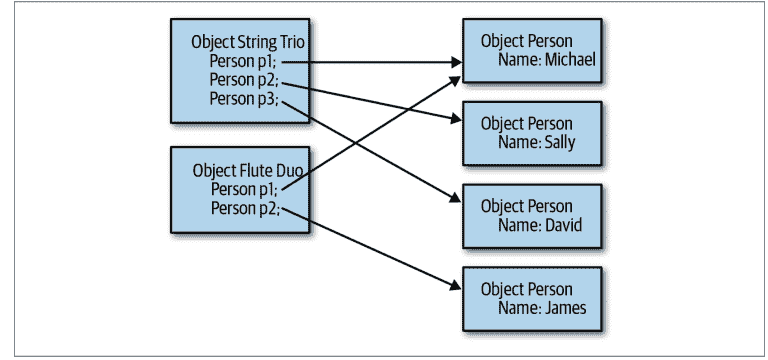
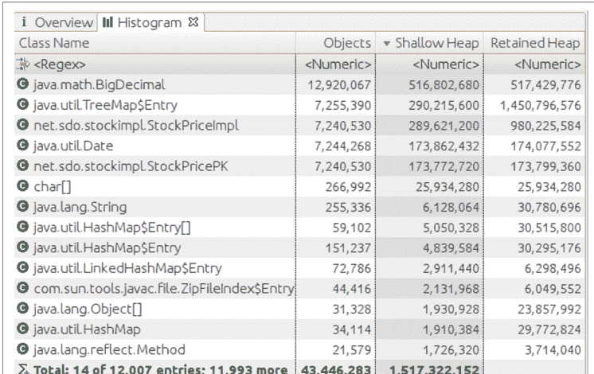
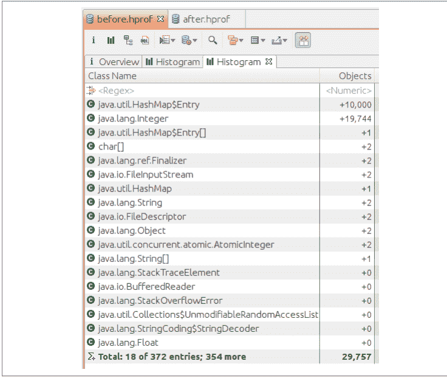
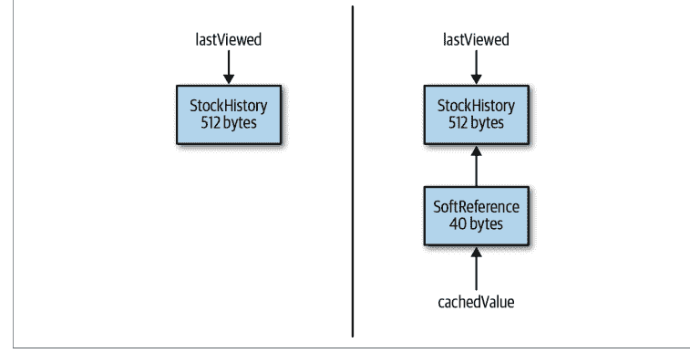
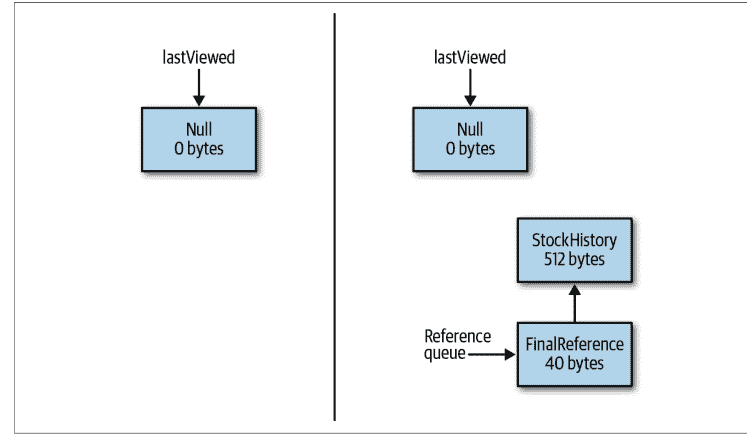

## Heap Memory Best Practices

Chapters 5 and 6 discussed the details of how to tune the garbage collector so that it has as little effect on a program as possible. Tuning the garbage collector is important, but often better performance gains can be made by utilizing better programming practices. This chapter discusses some of the best-practice approaches to using heap memory in Java.

We have two conflicting goals here. The first general rule is to create objects sparingly and to discard them as quickly as possible. Using less memory is the best way to improve the efficiency of the garbage collector. On the other hand, frequently re-creating some kinds of objects can lead to worse overall performance (even if GC performance improves). If those objects are instead reused, programs can see substantial performance gains. Objects can be reused in a variety of ways, including thread-local variables, special object references, and object pools. Reusing objects means they will be long-lived and impact the garbage collector, but when they are reused judiciously, overall performance will improve.

This chapter discusses both approaches and the trade-offs between them. First, though, we’ll look into tools for understanding what is happening inside the heap.

### Heap Analysis

GC logs and the tools discussed in Chapter 5 are great at understanding the impact GC has on an application, but for additional visibility, we must look into the heap itself. The tools discussed in this section provide insight into the objects that the application is currently using.

Most of the time, these tools operate only on live objects in the heap—objects that will be reclaimed during the next full GC cycle are not included in the tools’ output. In some cases, tools accomplish that by forcing a full GC, so the application behavior

can be affected after the tool is used. In other cases, the tools walk through the heap and report live data without freeing objects along the way. In either case, though, the tools require time and machine resources; they are generally not useful during measurement of a program’s execution.

### Heap Histograms

Reducing memory use is an important goal, but as with most performance topics, it helps to target efforts to maximize the available benefits. Later in this chapter, you’ll see an example around lazily initializing a Calendar object. That will save 640 bytes in the heap, but if the application always initializes one such object, no measurable difference in performance will occur. Analysis must be performed to know which kinds of objects are consuming large amounts of memory.

The easiest way to do that is via a *heap histogram*. Histograms are a quick way to look at the number of objects within an application without doing a full heap dump (since heap dumps can take a while to analyze, and they consume a large amount of disk space). If a few particular object types are responsible for creating memory pressure in an application, a heap histogram is a quick way to find that.

Heap histograms can be obtained by using jcmd (here with process ID 8898):

```
```text
% jcmd 8898 GC.class_histogram
8898:

 num     #instances          #bytes  class name
----------------------------------------------
   1:       789087        31563480  java.math.BigDecimal
   2:       172361        14548968  [C
   3:        13224        13857704  [B
   4:       184570         5906240  java.util.HashMap$Node
   5:        14848         4188296  [I
   6:       172720         4145280  java.lang.String
   7:        34217         3127184  [Ljava.util.HashMap$Node;
   8:        38555         2131640  [Ljava.lang.Object;
   9:        41753         2004144  java.util.HashMap
  10:        16213         1816472  java.lang.Class
```
```

In a histogram, we can usually expect to see character arrays ([C) and String objects near the top, as these are the most commonly created Java objects. Byte arrays ([B) and object arrays ([Ljava.lang.Object;) are also common, since classloaders store their data in those structures. If you’re unfamiliar with this syntax, it is described in the Java Native Interface (JNI) documentation.

In this example, the inclusion of the BigDecimal class is something to pursue: we know the sample code produces a lot of transient BigDecimal objects, but having so many stay around in the heap is not what we might ordinarily expect. The output from GC.class_histogram includes only live objects, as the command normally


## mat

开源的 EclipseLink Memory Analyzer 工具（mat）可以加载一个或多个堆转储并对其进行分析。它可以生成报告，指出问题可能出现的位置，并且也可以用于浏览堆并对堆执行类似 SQL 的查询。

对堆进行首次分析通常涉及保留内存。对象的保留内存是指如果该对象本身有资格被回收，将会释放的内存量。在图 7-1 中，String Trio 对象的保留内存包括该对象占用的内存以及 Sally 和 David 对象占用的内存。它不包括 Michael 对象使用的内存，因为该对象有另一个引用，如果释放 String Trio，它也不会有资格进行 GC。



图 7-1. 保留内存的对象图

## Shallow, Retained, and Deep Object Sizes

内存分析的另外两个有用术语是 shallow 和 deep。对象的浅层大小是对象本身的大小。如果对象包含对另一个对象的引用，则 4 或 8 字节的引用会被包含在内，但目标对象的大小则不包含在内。

对象的深层大小包括其引用的对象的大小。对象深层大小与对象保留内存之间的差异在于其他共享的对象。在图 7-1 中，Flute Duo 对象的深层大小包括 Michael 对象所占用的空间，而 Flute Duo 对象的保留大小则不包括。



图 7-3. Memory Analyzer 中的直方图视图

直方图会聚合相同类型的对象，在此示例中，很明显由七百万个 TreeMap$Entry 对象保留的 1.4 GB 内存是关键所在。即使不知道程序中发生了什么，使用 Memory Analyzer 的功能来追踪这些对象，查看是什么在持有它们，也是相当直接的。

堆分析工具提供了一种方法来查找特定对象（或在此情况下是一组对象）的 GC 根——尽管直接跳转到 GC 根并不一定有帮助。GC 根是持有静态、全局引用的系统对象，该引用（通过其他对象的长链）指向所讨论的对象。通常，这些引用来自系统或引导类路径上加载的类的静态变量。这包括 Thread 类和所有活动线程；线程通过其线程本地变量或通过其目标 Runnable 对象的引用（或在 Thread 类的子类情况下，子类拥有的任何其他引用）保留对象。

在某些情况下，了解目标对象的 GC 根是有帮助的，但如果对象有多个引用，它将拥有许多 GC 根。这里的引用是反向的树结构。假设有两个对象引用了特定的 TreeMap$Entry 对象。其中每个对象可能被另外两个对象引用，每个对象又可能被另外三个对象引用，依此类推。随着追溯根的过程，引用会爆炸，这意味着任何给定对象很可能存在多个 GC 根。

## Out-of-Memory Errors

JVM 在以下情况下会抛出 *out-of-memory* 错误：

- JVM 没有可用的本地内存。
- metaspace 内存不足。
- Java 堆本身内存不足：应用程序无法为给定的堆大小创建任何额外对象。
- JVM 花费太多时间执行 GC。

最后两种情况——涉及 Java 堆本身——更为常见，但不要仅从 out-of-memory 错误就断定堆是问题所在。有必要查看 out-of-memory 错误发生的原因（该原因属于异常输出的一部分）。

## Out of native memory

此列表中的第一种情况——JVM 没有可用的本地内存——发生的原因为与堆完全无关。在 32 位 JVM 中，进程的最大大小为 4 GB（某些 Windows 版本为 3 GB，某些旧版 Linux 约为 3.5 GB）。指定非常大的堆——比如 3.8 GB——会使应用程序大小非常接近该限制。即使在 64 位 JVM 中，操作系统也可能没有足够的虚拟内存来满足 JVM 的请求。

本主题将在第 8 章中更全面地介绍。请注意，如果 out-of-memory 错误的消息讨论的是本地内存的分配，那么堆调优就不是答案：你需要查看错误中提到的本地内存问题。例如，以下消息告诉你线程栈的本地内存已耗尽：

```
Exception in thread "main" java.lang.OutOfMemoryError:
unable to create new native thread
```

然而，请注意，JVM 有时会为与内存无关的事情发出此错误。用户通常对可运行的线程数有约束；此约束可能由操作系统或容器施加。例如，在 Linux 中，用户通常只能创建 1,024 个进程（你可以通过运行 `ulimit -u` 检查该值）。尝试创建第 1,025 个线程将抛出同样的 OutOfMemoryError，声称内存不足以创建本地线程，而实际上，操作系统对进程数量的限制导致了该错误。

## Out of metaspace memory

超出 metaspace 内存的错误也与堆无关——它发生是因为 metaspace 本地内存已满。由于 metaspace 默认没有最大大小，因此此错误通常发生在你选择设置最大大小的情况下（原因将在本节中变得清晰）。

此错误可能有两个根本原因：第一个很简单，即应用程序使用的类多于分配给 metaspace 的容量（参见第 144 页的“Sizing Metaspace”）。第二个情况更棘手：它涉及类加载器内存泄漏。这最常发生在动态加载类的服务器中。一个这样的例子是 Java EE 应用服务器。部署到应用服务器的每个应用程序都在自己的类加载器中运行（这提供了隔离，以便一个应用程序的类不会与另一个应用程序的类共享——也不会相互干扰）。在开发过程中，每次应用程序更改时，都必须重新部署：为加载新类而创建新的类加载器，旧的类加载器被允许超出作用域。一旦类加载器超出作用域，类元数据就可以被回收。

如果旧的类加载器未超出作用域，类元数据就无法被释放，最终 metaspace 将填满并抛出 out-of-memory 错误。在这种情况下，增加 metaspace 的大小会有帮助，但最终只会推迟错误。

如果这种情况发生在应用服务器环境中，几乎无能为力，只能联系应用服务器厂商让他们修复泄漏。如果你编写自己的应用程序并创建并丢弃大量类加载器，请确保类加载器本身被正确丢弃（特别是，确保没有任何线程将其上下文类加载器设置为其中一个临时类加载器）。要调试这种情况，前面描述的堆转储分析很有帮助：在直方图中，找到 ClassLoader 类的所有实例，并追踪它们的 GC 根以查看是什么在持有它们。

识别这种情况的关键再次在于 out-of-memory 错误的完整文本输出。如果 metaspace 已满，错误文本将如下所示：

```
Exception in thread "main" java.lang.OutOfMemoryError: Metaspace
```

顺便说一下，类加载器泄漏是应该考虑设置 metaspace 最大大小的原因之一。如果不设界限，存在类加载器泄漏的系统将消耗机器上的所有内存。

## Out-of-heap memory

当堆本身内存不足时，错误消息如下所示：

```
Exception in thread "main" java.lang.OutOfMemoryError: Java heap space
```


触发内存不足条件的常见情况与我们刚才讨论的元空间示例类似。应用程序可能只是需要更多的堆空间：它持有的存活对象数量无法放入为其配置的堆空间中。或者，应用程序可能存在内存泄漏：它持续分配额外的对象而不允许其他对象超出作用域。在第一种情况下，增加堆大小将解决问题；在第二种情况下，增加堆大小只会推迟错误的发生。

在任何一种情况下，都需要进行堆转储分析来找出消耗最多内存的是什么；然后可以着重减少这些对象的数量（或大小）。如果应用程序存在内存泄漏，请间隔几分钟连续获取堆转储并进行比较。MAT 已内置此功能：如果同时打开两个堆转储，MAT 具有在两个堆之间计算直方图差异的选项。

## 自动堆转储

内存不足错误可能以不可预测的方式发生，使得很难知道何时获取堆转储。几个 JVM 标志可以帮助：

```
-XX:+HeapDumpOnOutOfMemoryError
```

打开此标志（默认情况下为 false）将导致 JVM 在抛出内存不足错误时创建堆转储。

```
-XX:HeapDumpPath=<path>
```

这指定了堆转储将被写入的位置；默认值为应用程序当前工作目录中的 `java_pid<pid>.hprof`。路径可以指定目录（在这种情况下使用默认文件名）或要生成的实际文件名。

```
-XX:+HeapDumpAfterFullGC
```

这会在运行完整 GC 后生成堆转储。

```
-XX:+HeapDumpBeforeFullGC
```

这会在运行完整 GC 之前生成堆转储。

当生成多个堆转储时（例如因为发生了多次完整 GC），会在堆转储文件名后附加序列号。

如果应用程序由于堆空间而不可预测地抛出内存不足错误，并且您需要在该点获取堆转储以分析失败原因，请尝试打开这些标志。只需注意，获取堆转储会延长暂停的持续时间，因为代表堆的数据将被写入磁盘。

图 7-5 显示了由集合类引起的经典 Java 内存泄漏案例——在本例中为 HashMap。（集合类是最常见的内存泄漏原因：应用程序将项目插入集合中但从未释放它们。）这是一个比较直方图视图：它显示了两个堆转储中对象数量的差异。例如，与基线相比，目标堆转储中出现了 19,744 个更多的 Integer 对象。

克服这种情况的最佳方法是更改应用程序逻辑，以便在不再需要时主动从集合中丢弃项目。或者，使用弱引用或软引用的集合可以在应用程序中没有其他内容引用它们时自动丢弃项目，但这些集合会带来成本（本章后面会讨论）。



图 7-5. 直方图比较

通常当抛出这种异常时，JVM 不会退出，因为异常仅影响 JVM 中的单个线程。让我们看一个执行计算的具有两个线程的 JVM。其中一个线程可能会收到 OutOfMemoryError。默认情况下，该线程的线程处理程序将打印出堆栈跟踪，并且该线程将退出。

但 JVM 仍有另一个活动线程，因此 JVM 不会退出。而且由于遇到错误的线程已终止，因此在未来的 GC 周期中可能现在可以回收相当多的内存：该终止线程引用的所有对象，而这些对象未被任何其他线程引用。因此，存活的线程将能够继续执行，并且通常会有足够的堆内存来完成其任务。

使用线程池处理请求的服务器框架的工作方式基本相同。它们通常会捕获错误并防止线程终止，但这不会影响本讨论；线程正在执行的请求相关的内存仍然有资格被回收。

因此，只有当它导致 JVM 中最后一个非守护线程终止时，此错误才会对 JVM 造成致命影响。在服务器框架中永远不会出现这种情况，在具有多个线程的独立程序中也经常不会出现这种情况。而且通常效果很好，因为与活动请求相关的内存通常会有资格被回收。

如果您希望在堆内存耗尽时 JVM 退出，可以设置 `-XX:+ExitOnOutOfMemoryError` 标志，默认情况下为 false。

## GC overhead limit reached

前面案例中描述的恢复假设当线程收到内存不足错误时，与该线程正在处理的内容相关的内存将有资格被回收，并且 JVM 可以恢复。这并不总是正确的，这就引出了 JVM 抛出内存不足错误的最后一种情况：当它确定花费太多时间执行 GC 时：

```
Exception in thread "main" java.lang.OutOfMemoryError: GC overhead limit exceeded
```

当满足以下所有条件时，会抛出此错误：

- 在完整 GC 中花费的时间超过 `-XX:GCTimeLimit=N` 标志指定的值。默认值是 98（即如果 98% 的时间花费在 GC 上）。
- 完整 GC 回收的内存量小于 `-XX:GCHeapFreeLimit=N` 标志指定的值。默认值是 2，意味着如果完整 GC 期间释放的堆小于 2%，则满足此条件。
- 前两个条件在连续五个完整 GC 周期中一直成立（该值不可调）。
- `-XX:+UseGCOverheadLimit` 标志的值为 true（默认情况下为 true）。

请注意，必须满足全部四个条件。常见的情况是，在不会抛出内存不足错误的应用程序中会出现超过五次连续的完整 GC。这是因为即使应用程序花费 98% 的时间执行完整 GC，它在每次 GC 期间释放的堆可能仍超过 2%。在这种情况下，请考虑增加 GCHeapFreeLimit 的值。

请注意，作为最后的努力以释放内存，如果前两个条件在连续四个完整 GC 周期中成立，则在第五次完整 GC 周期之前，JVM 中的所有软引用将被释放。这通常可以防止错误发生，因为第五次周期可能释放超过 2% 的堆（假设应用程序使用软引用）。


## 快速总结

- 内存不足错误因多种原因而抛出；不要假设堆空间是问题所在。
- 对于元空间和常规堆，内存不足错误最常见的原因是内存泄漏；堆分析工具可以帮助找到泄漏的根本原因。

## 使用更少的内存

在 Java 中更有效地使用内存的第一种方法是使用更少的堆内存。这一说法应该不会令人惊讶：使用更少的内存意味着堆填满的频率会降低，需要更少的 GC 周期。效果可能会倍增：年轻代收集次数减少意味着对象的晋升年龄增加的频率降低——意味着对象被提升到老年代的可能性更小。因此，完整 GC 周期（或并发 GC 周期）的数量将会减少。而且如果这些完整 GC 周期可以清理更多内存，它们发生的频率也会降低。

本节探讨了三种使用更少内存的方法：减小对象大小、使用对象的延迟初始化以及使用规范对象。

### 减小对象大小

对象占用一定的堆内存，因此使用更少内存的最简单方法是使对象更小。鉴于运行程序的机器的内存限制，可能无法将堆大小增加 10%，但将堆中一半对象的大小减少 20% 可以达到同样的目标。如第 12 章所述，Java 11 对 String 对象有这样的优化，这意味着 Java 11 的用户通常可以将最大堆设置得比 Java 8 中所需小 25%——对 GC 或性能没有影响。


对象的大小可以通过（显然）减少它所持有的实例变量的数量来降低，以及（不那么显然）减少这些变量本身的大小。表7-1给出了所有Java类型的实例变量的大小。

## 表7-1：Java实例变量的大小（字节）

| 类型 | 大小 |
|---|---:|
| byte | 1 |
| char | 2 |
| short | 2 |
| int | 4 |
| float | 4 |
| long | 8 |
| double | 8 |
| 引用 | 8（在32位Windows JVM上为4）¹ |

¹ 更多详情参见第246页的“Compressed Oops”。

这里的引用类型指的是对任意一种Java对象——类或数组实例——的引用。该空间仅用于存储引用本身。包含对其他对象引用的对象的大小，取决于我们考虑的是对象的浅大小、深大小还是保留大小，但该大小也包括一些不可见的对象头字段。对于常规对象，在32位JVM上对象头字段的大小为8字节，在64位JVM上为16字节（与堆大小无关）。对于数组，在32位JVM或堆小于32 GB的64位JVM上，对象头字段的大小为16字节，否则为24字节。

例如，考虑以下类定义：

```
public class A {
    private int i;
}

public class B {
    private int i;
    private Locale l = Locale.US;
}

public class C {
    private int i;
    private ConcurrentHashMap chm = new ConcurrentHashMap();
}
```

这些对象单个实例的实际大小（在堆大小小于32 GB的64位JVM上）见表7-2。

## 表7-2：简单对象的大小（字节）

|  | 浅大小 | 深大小 | 保留大小 |
|---|---|---|---|
| A | 16 | 16 | 16 |
| B | 24 | 216 | 24 |
| C | 24 | 200 | 200 |

在类B中，定义Locale引用会给对象大小增加8字节，但至少在该示例中，Locale对象是在其他类之间共享的。如果类永远不需要Locale对象，那么包含该实例变量只会浪费引用所需的额外字节。不过，如果应用程序创建大量类B的实例，这些字节就会累积起来。

另一方面，定义并创建一个ConcurrentHashMap会消耗引用该对象所需的额外字节，再加上哈希映射对象本身所需的额外字节。如果哈希映射从未被使用，类C的实例就是一种浪费。

只定义必要的实例变量是在对象中节省空间的一种方法。不那么明显的情况涉及使用更小的数据类型。如果一个类需要跟踪八种可能状态之一，它可以使用byte而不是int——可能节省3字节。使用float代替double、int代替long等，可以帮助节省内存，尤其是在频繁实例化的类中。正如第12章讨论的，使用大小合适的集合（或使用简单实例变量代替集合）也能实现类似的内存节省。

## 对象对齐与对象大小

表7-2中提到的类都包含一个讨论中未提及的额外整数字段。为什么会有这个字段？

事实上，该变量的作用是为了让对这些类的讨论更易于理解：类B比类A多8字节，这正如我们所预期（并且使这一观点更清晰）。

这掩盖了一个重要细节：对象大小总是被填充为8字节的倍数。如果没有类A中i的定义，A的实例仍然会消耗16字节——这4字节只是用于将对象大小填充为8的倍数，而不是用于保存对i的引用。如果没有i的定义，类B的实例将只消耗16字节——与A相同，尽管B多了一个对象引用。这种填充也是为什么B的实例比A的实例大8字节的原因，尽管它只多了一个（4字节的）引用。

JVM还会对字节数不均匀的对象进行填充，以便该对象的数组能够与底层架构最佳的任意地址边界整齐对齐。

> 因此，消除对象中的一些实例字段或减小某些字段的大小可能有益也可能无益，但没有理由不去这样做。
> 
> OpenJDK项目有一个单独的可下载工具，称为`jol`，可用于计算对象大小。

消除对象中的实例字段有助于使对象更小，但存在一个灰色地带：对于那些保存基于若干数据计算结果的字段，该如何处理？这是经典的计算机科学时间与空间的权衡：是花费内存（空间）来存储该值更好，还是花费时间（CPU周期）按需计算该值更好？不过在Java中，这种权衡同样适用于CPU时间，因为额外的内存可能导致GC消耗更多CPU周期。

例如，`String`的哈希码是通过对涉及字符串中每个字符的等式求和来计算的；计算起来比较耗时。因此，`String`类将该值存储在实例变量中，以便哈希码只需计算一次：最终，重用该值几乎总是比不存储它所带来的任何内存节省产生更好的性能。另一方面，大多数类的`toString()`方法不会在实例变量中缓存对象的字符串表示，因为那会同时消耗实例变量和它所引用的字符串的内存。相反，计算新字符串所需的时间通常比保留字符串引用所需的内存带来更好的性能。（此外，`String`的哈希值使用频繁，而对象的`toString()`表示通常很少使用。）

这绝对是一种“效果因人而异”的情况，在时间/空间连续体上，究竟应该用内存缓存值还是重新计算值，取决于许多因素。如果目标是减少GC，那么天平将更多地偏向重新计算。

## 快速总结


- 减小对象大小通常可以提高GC的效率。
- 对象的大小并不总是显而易见的：对象会被填充以适合8字节边界，并且对象引用的大小在32位和64位JVM之间有所不同。
- 即使是`null`实例变量也会消耗对象类内的空间。

```
public class ArrayList {
    private Object[] elementData = new Object[16];
    int index = 0;
    public void add(Object o) {
        ensureCapacity();
        elementData[index++] = o;
    }
    private void ensureCapacity() {
        if (index == elementData.length) {
            ...reallocate array and copy old data in...
        }
    }
}
```

几年前，这个类被修改为延迟初始化elementData数组。但由于ensureCapacity()方法原本就需要检查数组大小，该类的常用方法没有遭受性能损失：用于检查初始化的代码与用于检查数组是否需要扩容的代码是相同的。新代码使用一个静态的、共享的零长度数组，因此性能保持不变：

```
public class ArrayList {
    private static final Object[] EMPTY_ELEMENTDATA = {} ;
    private Object[] elementData = EMPTY_ELEMENTDATA;
}
```

这意味着ensureCapacity()方法（基本上）可以保持不变，因为index和elementData.length都将从0开始。

当相关代码必须是线程安全的时，延迟初始化会变得更加复杂。作为第一步，最简单的做法是直接加上传统的同步：

```
public class CalDateInitialization {
    private Calendar calendar;
    private DateFormat df;

    private synchronized void report(Writer w) {
        if (calendar == null) {
            calendar = Calendar.getInstance();
            df = DateFormat.getDateInstance();
        }
        w.write("\n" + df.format(calendar.getTime()) + ": " + this);
    }
}
```

在解决方案中引入同步，带来了同步可能成为性能瓶颈的可能性。这种情况应该很少见。延迟初始化的性能收益仅当相关对象很少初始化这些字段时才会出现——因为如果它通常初始化这些字段，实际上并没有节省内存。因此，同步会成为延迟初始化的瓶颈


当一个不常用的代码路径突然被大量线程同时使用时，就会出现字段的同步问题。这种情况并非不可能，但也不是最常见的场景。

要解决这种同步瓶颈，只有当懒加载的变量本身是线程安全时才有可能。`DateFormat` 对象不是线程安全的，所以在当前示例中，锁是否包含 `Calendar` 对象其实并不重要：如果懒加载的对象突然被大量使用，那么无论怎样，围绕 `DateFormat` 对象所需的同步都会成为问题。线程安全的代码应当如下所示：

```
public class CalDateInitialization {
    private Calendar calendar;
    private DateFormat df;

    private void report(Writer w) {
        synchronizedCalendarInit();
        synchronized(df) {
            w.write("On " + df.format(calendar.getTime()) + ": " + this);
        }
    }
}
```

对于涉及非线程安全的实例变量的懒加载，可以始终围绕该变量进行同步（例如，使用前面展示的同步版本的方法）。

考虑一个稍微不同的示例，其中有一个大型 `ConcurrentHashMap` 被懒加载：

```
public class CHMInitialization {
    private ConcurrentHashMap chm;

    public void doOperation() {
        synchronized(this) {
            if (chm == null) {
                chm = new ConcurrentHashMap();
                ... code to populate the map ...
            }
        }
        ...use the chm...
    }
}
```

由于多个线程可以安全地访问 `ConcurrentHashMap`，本例中的额外同步属于少数会被正确使用的懒加载引入同步瓶颈的情况之一。（不过，这样的瓶颈仍然应该很少见；如果对哈希映射的访问如此频繁，请考虑懒加载是否真的节省了什么。）该瓶颈可以使用双重检查锁定的惯用法来解决：

```
public class CHMInitialization {
    private volatile ConcurrentHashMap instanceChm;

    public void doOperation() {
        ConcurrentHashMap chm = instanceChm;
        if (chm == null) {
            synchronized(this) {
                chm = instanceChm;
                if (chm == null) {
                    chm = new ConcurrentHashMap();
                    ... code to populate the map
                    instanceChm = chm;
                }
            }
        }
        ...use the chm...
    }
}
```

存在重要的线程问题：实例变量必须声明为 `volatile`，并且将实例变量赋值给局部变量会带来一点性能上的好处。更多细节将在第 9 章中给出；在那些对线程代码进行懒加载有意义的少数情况下，这就是应该遵循的设计模式。

## 急切去初始化

与懒加载变量相对应的是急切地去初始化它们，即将它们的值设置为 `null`。这样可以让相关对象更快地被垃圾收集器回收。虽然理论上这听起来是件好事，但仅适用于有限的情况。

一个适合懒加载的变量似乎也适合急切去初始化：在前面的示例中，`Calendar` 和 `DateFormat` 对象可以在 `report()` 方法完成后设置为 `null`。但是，如果该变量不会在后续方法调用（或类中的其他地方）中使用，那么一开始就没有理由将其设为实例变量。只需在方法中创建局部变量，当方法完成时，局部变量将超出作用域，垃圾收集器就可以释放它。

关于不需要急切去初始化变量的规则，常见的例外出现在像 Java 集合框架这样的类中：这些类长期持有对数据的引用，然后被告知所持有的数据不再需要。以 JDK 中 `ArrayList` 类的 `remove()` 方法实现为例（部分代码已简化）：

```
public E remove(int index) {
    E oldValue = elementData(index);
    int numMoved = size - index - 1;
    if (numMoved > 0)
```

因此，没有理由避免设计和使用的不可变对象，即使这些对象不能被修改而必须重新创建，看起来可能有点适得其反。但在处理这些对象时，一个经常可行的优化是避免创建同一对象的重复副本。

最好的例子是 `Boolean` 类。任何 Java 应用程序只需要两个 `Boolean` 实例：一个用于 `true`，一个用于 `false`。不幸的是，`Boolean` 类的设计很糟糕。因为它有一个公共构造函数，应用程序可以根据需要创建任意多的这类对象，尽管它们与两个规范的 `Boolean` 对象之一完全相同。更好的设计应该是让 `Boolean` 类只拥有私有构造函数，并通过静态方法根据参数返回 `Boolean.TRUE` 或 `Boolean.FALSE`。如果您的自定义不可变类也能遵循这种模型，就可以防止它们增加应用程序的堆使用量。（理想情况下，显然您永远不应该创建 `Boolean` 对象；只需要在必要时使用 `Boolean.TRUE` 或 `Boolean.FALSE` 即可。）

不可变对象的这种单一表示被称为对象的规范版本。

## 创建规范对象

即使某个特定类的对象世界实际上是无限的，使用规范值也常常能节省内存。JDK 为最常见的不可变对象提供了一个工具：字符串可以调用 `intern()` 方法来找到字符串的规范版本。字符串驻留的更多细节将在第 12 章中讨论；目前我们先来看如何为自定义类实现同样的事情。

要将对象规范化，需要创建一个存储规范版本对象的映射。为防止内存泄漏，请确保映射中的对象是弱引用的。这样的类骨架如下所示：

```
public class ImmutableObject {
    private static WeakHashMap<ImmutableObject, ImmutableObject>
        map = new WeakHashMap();

    public ImmutableObject canonicalVersion(ImmutableObject io) {
        synchronized(map) {
            ImmutableObject canonicalVersion = map.get(io);
            if (canonicalVersion == null) {
                map.put(io, new WeakReference(io));
                canonicalVersion = io;
            }
            return canonicalVersion;
        }
    }
}
```

在线程环境中，同步可能会成为瓶颈。如果坚持使用 JDK 类，没有简单的解决方案，因为它们没有提供支持弱引用的并发哈希映射。不过，已经有提案向 JDK 添加 `CustomConcurrentHashMap`——最初是作为 Java 规范请求（JSR）166 的一部分——并且您可以找到许多第三方实现。


## 快速总结

-   不可变对象提供了特殊生命周期管理的可能性：规范化。
-   通过规范化消除不可变对象的重复副本，可以大大减少应用程序使用的堆空间。

## 对象生命周期管理

本章讨论的内存管理的第二个广泛主题是对象生命周期管理。在大多数情况下，Java 试图最大限度地减少开发人员在管理对象生命周期方面所需投入的精力：开发人员在需要时创建对象，当不再需要时，对象超出作用域并被垃圾收集器释放。

有时这种正常的生命周期并非最优。某些对象的创建成本很高，管理这些对象的生命周期将提高应用程序的效率，即使这需要垃圾收集器付出额外的工作。本节探讨何时以及如何更改对象的正常生命周期，无论是通过重用对象还是通过维护对它们的特殊引用。

### 对象重用

对象重用通常通过两种方式实现：对象池和线程局部变量。世界各地的 GC 工程师现在都在抱怨，因为这两种技术都会妨碍 GC 的效率。特别是对象池，因此在 GC 圈子里广泛不受欢迎；不过，对象池在开发圈子里也因许多其他原因而广泛不受欢迎。

在某个层面上，这种立场的原因似乎很明显：被重用的对象会在堆中长时间存在。如果堆中有大量对象，那么创建新对象的空间就会减少，因此 GC 操作会更加频繁。但这只是故事的一部分。


正如你在第 6 章中所看到的，当一个对象被创建时，它会被分配在 eden 区。它会在 survivor 空间之间来回移动，经历几次年轻代 GC 之后，最终才会被晋升到老年代。每次新创建（或最近创建）的池化对象被处理时，GC 算法都必须执行一些工作来复制它并调整对它的引用，直到它最终进入老年代。

虽然这看起来像是结束，但一旦对象被晋升到老年代，它仍可能导致更严重的性能问题。执行一次 Full GC 所需的时间与老年代中仍然存活的对象数量成正比。存活数据的量比堆的大小更重要；处理一个存活对象很少的 3 GB 老年代，比处理一个 75% 的对象都存活的 1 GB 老年代要快。

## GC 效率

堆中存活数据的量究竟在多大程度上影响 GC 时间？答案可能超过一个数量级。

以下是我在标准四核 Linux 系统上使用 4 GB 堆进行测试的 GC 日志输出（其中 1 GB 是新一代的固定大小）：

```
[Full GC [PSYoungGen: 786432K->786431K(917504K)]
    [ParOldGen: 3145727K->3145727K(3145728K)]
    3932159K->3932159K(4063232K)
    [PSPermGen: 2349K->2349K(21248K)], 0.5432730 secs]
    [Times: user=1.72 sys=0.01, real=0.54 secs]
...
[Full GC [PSYoungGen: 786432K->0K(917504K)]
    [ParOldGen: 3145727K->210K(3145728K)]
    3932159K->210K(4063232K)
    [PSPermGen: 2349K->2349K(21248K)], 0.0687770 secs]
    [Times: user=0.08 sys=0.00, real=0.07 secs]
...
[Full GC [PSYoungGen: 349567K->349567K(699072K)]
    [ParOldGen: 3145727K->3145727K(3145728K)]
    3495295K->3495295K(3844800K)
    [PSPermGen: 2349K->2349K(21248K)], 0.7228880 secs]
    [Times: user=2.41 sys=0.01, real=0.73 secs]
```

注意中间的输出：应用程序清除了对老年代中事物的大部分引用，因此 GC 后的老年代中的数据只有 210 KB。该操作仅用了 70 毫秒。在其他情况下，堆中的大部分数据仍然存活；几乎没有从堆中移除数据的 Full GC 操作耗时在 540 毫秒到 730 毫秒之间。而且幸运的是，此次测试中运行着四个 GC 线程。在单核系统上，此示例中的短暂 GC 耗时 80 毫秒，而长时间的 GC 需要 2,410 毫秒（超过 30 倍）。

使用并发收集器并避免 Full GC 并不能让情况好多少，因为并发收集器的标记阶段所需的时间同样取决于仍然存活的数据量。而且对于 CMS 来说尤其如此，池中的对象可能在不同时间被晋升，从而增加了因碎片化导致并发失败的几率。总的来说，对象在堆中保留的时间越长，GC 的效率就越低。

所以：对象重用是不好的。现在我们可以讨论如何以及何时重用对象。

JDK 提供了一些常见的对象池：线程池，在第 9 章中讨论，以及软引用。*软引用*，将在本节后面讨论，本质上是一个可重用对象的庞大池。Java 服务器 meanwhile 依赖对象池来连接数据库和其他资源。对于线程本地值的情况也类似；JDK 充满了使用线程本地变量来避免重新分配某些类型对象的类。很明显，即使是 Java 专家也理解在某些情况下需要对象重用。

重用对象的理由是许多对象的初始化成本很高，而重用它们比增加 GC 时间的权衡更有效。这对于诸如 JDBC 连接池之类的东西来说肯定是正确的：创建网络连接，并且可能登录并建立数据库会话，这都是昂贵的。在这种情况下，对象池是一个巨大的性能提升。线程被池化以节省创建线程所需的时间；随机数生成器作为线程本地变量提供以节省为其播种所需的时间；等等。

这些示例共有的一个特征是初始化对象需要很长时间。在 Java 中，对象*分配*是快速且廉价的（并且反对对象重用的论点往往集中在方程的这一部分）。对象*初始化*性能取决于对象。你应该只考虑重用初始化成本非常高的对象，并且只有在初始化这些对象的成本是程序中主导操作之一时才考虑。

这些示例共有的另一个特征是共享对象的数量往往很小，这最大限度地减少了它们对 GC 操作的影响：数量不足以减慢这些 GC 周期。池中只有几个对象不会对 GC 效率产生太大影响；用池化对象填满堆会显著减慢 GC。

以下是 JDK 和 Java 程序重用对象的一些示例（以及原因）：

- *线程池*
  - 线程初始化成本很高。
- *JDBC 池*
  - 数据库连接初始化成本很高。

## 大数组

Java 要求在分配数组时，必须将数组中的所有单个元素初始化为默认值（null、0 或 false，具体取决于情况）。对于大数组来说，这可能非常耗时。

## 原生 NIO 缓冲区

分配一个直接的 java.nio.Buffer（通过调用 allocateDirect() 方法返回的缓冲区）无论缓冲区大小如何都是昂贵的操作。最好创建一个大的缓冲区，并通过切片出所需的部分来管理缓冲区，然后将其归还以供未来操作重用。

## 安全类

MessageDigest、Signature 和其他安全算法的实例初始化成本很高。

## 字符串编码器和解码器对象

JDK 中的各种类会创建并重用这些对象。对于大多数情况，这些也是软引用，正如你将在下一节中看到的那样。

## StringBuilder 助手

BigDecimal 类在计算中间结果时会重用一个 StringBuilder 对象。

## 随机数生成器

Random 或（尤其是）SecureRandom 类的实例播种成本很高。

## 从 DNS 查找获得的名称

网络查找成本很高。

## ZIP 编码器和解码器

有趣的是，这些初始化并不特别昂贵。它们释放起来却很昂贵，因为它们依赖于对象终结来确保它们使用的本地内存也被释放。有关更多详细信息，请参阅第 239 页的“终结器和终结引用”。

两种选项（对象池和线程本地变量）在性能上有差异。让我们更详细地看一下这些差异。

## 对象池

对象池因多种原因而不受欢迎，其中只有一部分与性能有关。它们可能难以正确调整大小。它们还把对象管理的负担重新放回程序员身上：程序员不能简单地让对象超出作用域，而必须记住将对象归还到池中。

这里的重点是对象池的性能，它受以下因素影响：

*GC 影响*

正如你所见，持有大量对象会降低（有时会大幅降低）GC 的效率。

*同步*

对象池不可避免地是同步的，如果对象经常被移除和替换，池可能会产生大量争用。结果是访问池可能比初始化新对象更慢。

*节流*

池的这种性能影响可能是有益的：池允许对稀缺资源的访问进行节流。正如第 2 章所讨论的，如果你尝试将系统负载增加到其处理能力之外，性能会下降。这就是线程池重要的原因之一。如果同时运行的线程太多，CPU 会不堪重负，性能会下降（第 9 章中给出了一个示例）。

这一原则同样适用于远程系统访问，并且在 JDBC 连接中经常看到。如果向数据库建立的 JDBC 连接超过其处理能力，数据库的性能会下降。在这些情况下，最好通过限制池的大小来限制资源（例如 JDBC 连接）的数量——即使这意味着应用程序中的线程必须等待空闲资源。

## 线程本地变量

通过将对象存储为*线程本地变量*来重用对象会带来各种性能权衡：

*生命周期管理*

线程本地变量比池中的对象更容易、更便宜地管理。这两种技术都需要你获取初始对象：你从池中签出它，或者你在线程本地对象上调用 `get()` 方法。但对象池要求你在用完对象后将其归还（否则其他人就无法使用它）。线程本地对象在线程内始终可用，无需显式归还。

*基数*

线程本地变量通常在线程数量和保存（重用）的对象数量之间存在一对一的对应关系。这并不严格成立。线程对变量的副本要到线程第一次使用它时才创建，因此保存的对象数量可能少于线程数量。但


there cannot be any more saved objects than threads, and much of the time it ends up being the same number.

On the other hand, an object pool may be sized arbitrarily. If a request sometimes needs one JDBC connection and sometimes needs two, the JDBC pool can be sized accordingly (with, say, 12 connections for 8 threads). Thread-local variables cannot do this effectively; nor can they throttle access to a resource (unless the number of threads itself serves as the throttle).

## Synchronization

Thread-local variables need no synchronization since they can be used only within a single thread; the thread-local get() method is relatively fast. (This wasn’t always the case; in early versions of Java, obtaining a thread-local variable was expensive. If you shied away from thread-local variables because of bad performance in the past, reconsider their use in current versions of Java.)

Synchronization brings up an interesting point, because the performance benefit of thread-local objects is often couched in terms of saving synchronization costs (rather than in the savings from reusing an object). For example, Java supplies a ThreadLocalRandom class; that class (rather than a single Random instance) is used in the sample stock applications. Otherwise, many of the examples throughout the book would encounter a synchronization bottleneck on the next() method of the single Random object. Using a thread-local object is a good way to avoid synchronization bottlenecks, since only one thread can ever use that object.

However, that synchronization problem would have been solved just as easily if the examples had simply created a new instance of the Random class each time one was needed. Solving the synchronization problem that way would not have helped the overall performance, though: it is expensive to initialize a Random object, and continually creating instances of that class would have had worse performance than the synchronization bottleneck from many threads sharing one instance of the class.

Better performance comes from using the ThreadLocalRandom class, as shown in Table 7-3. This example calculates the time required to create 10,000 random numbers in each of four threads under three scenarios:

- Each thread constructs a new Random object to calculate the 10,000 numbers.
- All threads share a common, static Random object.
- All threads share a common, static ThreadLocalRandom object.

*Table 7-3. Effect of ThreadLocal Random on generating 10,000 random numbers*

| Operation | Elapsed time |
|---|---|
| create new Random | 134 ± 0.01 microseconds |
| ThreadLocalRandom | 52.0 ± 0.01 microseconds |
| Share Random | 3,763 ± 200 microseconds |

Microbenchmarking threads that contend on a lock is always unreliable. In the last row of this table, the threads are almost always contending for the lock on the Random object; in a real application, the amount of contention would be much less. Still, you can expect to see some contention with a shared object, while creating a new object every time is more than two times as expensive as using the ThreadLocalRandom object.

The lesson here—and in general for object reuse—is that when initialization of objects takes a long time, don’t be afraid to explore object pooling or thread-local variables to reuse those expensive-to-create objects. As always, though, strike a balance: large object pools of generic classes will most certainly lead to more performance issues than they solve. Leave these techniques to classes that are expensive to initialize and for when the number of the reused objects will be small.


**Quick Summary**

- Object reuse is discouraged as a general-purpose operation but may be appropriate for small groups of objects that are expensive to initialize.
- Trade-offs exist between reusing an object via an object pool or using a thread-local variable. In general, thread-local variables are easier to work with, assuming that a one-to-one correspondence between threads and reusable objects is desired.

## Soft, Weak, and Other References

Soft and weak references in Java also allow objects to be reused, though as developers, we don’t always think of it in those terms. These kinds of references—which we will generally refer to as *indefinite references*—are more frequently used to cache the result of a long calculation or a database lookup rather than to reuse a simple object. For example, in the stock server, an indirect reference could be used to cache the result of the getHistory() method (which entails either a lengthy calculation or a long database call). That result is just an object, and when it is cached via an indefinite reference, we are simply reusing the object because it is otherwise expensive to initialize.

## A Note on Terminology

Discussing soft and weak references can be confusing because so much of the terminology uses similar words. Here’s a quick primer on that terminology:

*Reference*

A reference (or object reference) is any kind of reference: strong, weak, soft, and so on. An ordinary instance variable that refers to an object is a strong reference.

*Indefinite reference*

This is the term I use for any special kind of references (e.g., soft or weak). An indefinite reference is actually an instance of an object (e.g., an instance of the SoftReference class).

*Referent*

Indefinite references work by embedding another reference (almost always a strong reference) within an instance of the indefinite reference class. The encapsulated object is called the referent.

Still, to many programmers this “feels” different. In fact, even the terminology reflects that: no one speaks of “caching” a thread for reuse, but we will explore the reuse of indefinite references in terms of caching the result of database operations.

The advantage to an indefinite reference over an object pool or a thread-local variable is that indefinite references will be (eventually) reclaimed by the garbage collector. If an object pool contains the last 10,000 stock lookups that have been performed and the heap starts running low, the application is out of luck: whatever heap space remains after those 10,000 elements are stored is all the remaining heap the application can use. If those lookups are stored via indefinite references, the JVM can free up some space (depending on the type of reference), giving better GC throughput.

The disadvantage is that indefinite references have a slightly greater effect on the efficiency of the garbage collector. Figure 7-6 shows a side-by-side comparison of the memory used without and with an indefinite reference (in this case, a soft reference).

The object being cached occupies 512 bytes. On the left, that’s all the memory consumed (absent the memory for the instance variable pointing to the object). On the right, the object is being cached inside a SoftReference object, which adds 40 bytes of memory consumption. Indefinite references are just like any other object: they consume memory, and other things (the cachedValue variable on the right side of the diagram) reference them strongly.

So the first impact on the garbage collector is that indefinite references cause the application to use more memory. A second, bigger impact on the garbage collector is that it takes at least two GC cycles for the indefinite reference object to be reclaimed by the garbage collector.



Figure 7-6. Memory allocated by indefinite reference

Figure 7-7 shows what happens when a referent is no longer strongly referenced (i.e., the lastViewed variable has been set to null). If no references to the StockHistory object exist, it is freed during the next GC that processes the generation where that object resides. So the left side of the diagram now consumes 0 bytes.

On the right side of the diagram, memory is still consumed. The exact point at which the referent gets freed varies by the type of the indefinite reference, but for now let’s take the case of a soft reference. The referent will stick around until the JVM decides that the object has not been used recently enough. When that happens, the first GC cycle frees the referent—but not the indefinite reference object itself. The application ends up with the memory state shown in Figure 7-8.


图 7-7：非确定性引用跨 GC 周期保留内存

图 7-8：非确定性引用不会被立即清除

非确定性引用对象本身现在（至少）有两个指向它的强引用：应用程序创建的原始强引用，以及 JVM 在引用队列上创建的一个新强引用。在垃圾回收器回收非确定性引用对象本身之前，必须清除所有这些强引用。

通常，这种清理由处理引用队列的代码完成。该代码会收到队列中有新对象的通知，并立即移除指向该对象的所有强引用。然后，在下一个 GC 周期中，非确定性引用对象（referent）就会被释放。在最坏的情况下，引用队列不会立即被处理，可能需要经过多个 GC 周期才能完成全部清理。不过，即使在最好的情况下，非确定性引用也必须经过两个 GC 周期才能被释放。

根据非确定性引用的类型不同，这个通用算法存在一些重要的变体，但所有非确定性引用都在某种程度上承受这种代价。

## GC 日志与引用处理

当运行一个使用大量非确定性引用的应用程序时，请考虑添加 -XX:+PrintReferenceGC 标志（默认情况下为 false）。这可以让你看到处理这些引用所花费的时间：

```
[GC[SoftReference, 0 refs, 0.0000060 secs]
[WeakReference, 238425 refs, 0.0236510 secs]
[FinalReference, 4 refs, 0.0000160 secs]
[PhantomReference, 0 refs, 0.0000010 secs]
[JNI Weak Reference, 0.0000020 secs]
[PSYoungGen: 271630K->17566K(305856K)]
271630K->17566K(1004928K), 0.0797140 secs]
[Times: user=0.16 sys=0.01, real=0.08 secs]
```

在本例中，使用 238,425 个弱引用为年轻代回收增加了 23 ms。

## 软引用

当所讨论的对象在未来有很大机会被再次使用，但你又希望在对象最近未被使用过时让垃圾回收器将其回收（计算时还会考虑堆可用内存的大小），此时会使用软引用。软引用本质上是一个大型的最近最少使用（LRU）对象池。要从软引用获得良好性能，关键在于确保它们能被及时清除。

这里有一个例子。股票服务器可以建立一个以股票代码（或股票代码和日期）为键的全局股票历史缓存。当收到一个查询 TPKS 从 2019 年 9 月 1 日到 2019 年 12 月 31 日股票历史的请求时，可以查询缓存，看类似请求的结果是否已经存在。

缓存这些数据的原因是，某些条目的请求往往比其他条目更频繁。如果 TPKS 是被请求最多的股票，可以预期它会一直留在软引用缓存中。另一方面，对 KENG 的一次性请求会在缓存中保留一段时间，但最终会被回收。这也解释了随时间变化的请求模式：一批针对 DNLD 的请求可以复用第一个请求的结果。随着用户意识到 DNLD 是一项糟糕的投资，这些缓存条目最终会从堆中老化淘汰。

软引用究竟在何时被释放？首先，被引用对象（referent）必须没有被其他地方的强引用。如果软引用是唯一剩下的引用，那么只有在软引用最近未被访问过的情况下，被引用对象才会在下一个 GC 周期中被释放。具体来说，其计算方式类似于下面的伪代码：

```
long ms = SoftRefLRUPolicyMSPerMB * AmountOfFreeMemoryInMB;
if (now - last_access_to_reference > ms)
    free the reference
```

这段代码有两个关键值。第一个值由 -XX:SoftRefLRUPolicyMSPerMB=N 标志设置，其默认值为 1,000。

第二个值是堆中的可用内存量（在 GC 周期完成后）。堆中的可用内存是根据堆的最大可能大小减去已使用量来计算的。

那么这一切是如何运作的呢？以一个使用 4 GB 堆的 JVM 为例。在一次完整 GC（或并发周期）之后，堆可能已占用 50%；因此可用堆为 2 GB。SoftRefLRUPolicyMSPerMB 的默认值（1,000）意味着任何在过去 2,048 秒（2,048,000 毫秒）内未被使用过的软引用都将被清除：可用堆为 2,048（以 MB 为单位），再乘以 1,000：

```
long ms = 2048000; // 1000 * 2048
if (System.currentTimeMillis() - last_access_to_reference_in_ms > ms)
    free the reference
```

如果 4 GB 堆已占用 75%，则回收最近 1,024 秒内未被访问过的对象，以此类推。

为了更频繁地回收软引用，请降低 SoftRefLRUPolicyMSPerMB 标志的值。将该值设置为 500，意味着一个 4 GB 堆已使用 75% 的 JVM 将回收过去 512 秒内未被访问过的对象。

如果堆很快被软引用填满，通常有必要调整这个标志。假设堆有 2 GB 可用空间，应用程序开始创建软引用。如果它在不到 2,048 秒（大约 34 分钟）内创建了 1.7 GB 的软引用，那么这些软引用中没有一个有资格被回收。堆中只剩下 300 MB 的空间留给其他对象；结果 GC 会频繁发生（导致整体性能不佳）。

如果 JVM 完全耗尽内存或开始严重抖动，它将清除所有软引用，因为另一种选择是抛出 `OutOfMemoryError`。不抛出错误固然是好事，但不加区分地丢弃所有缓存结果可能并不理想。因此，另一个需要降低 `SoftRefLRUPolicyMSPerMB` 值的时机是，当引用处理的 GC 日志显示有大量软引用被意外清除时。正如第 214 页“[已到达 GC 开销限制](#)”中所讨论的，只有在连续四次完整 GC 周期之后（并且如果其他因素也适用），这种情况才会发生。

在另一个极端，一个长期运行的应用程序如果满足两个条件，可以考虑提高该值：

- 有大量可用堆空间。
- 软引用很少被访问。

这是一种不常见的情况。它类似于前面关于设置 GC 策略所讨论的某种情况：你可能会认为，如果提高了软引用策略值，就是在告诉 JVM 只在万不得已时才丢弃软引用。确实如此，但你也同时告诉 JVM 不要在堆中为正常操作留出任何余量，最终你可能会把过多时间花在 GC 上。

因此要告诫的是，不要使用太多软引用，因为它们很容易填满整个堆。这一告诫比反对创建实例过多的对象池的告诫更加强烈：当对象数量不太多时，软引用才能发挥良好作用。否则，请考虑使用有界大小的更传统对象池，并以 LRU 缓存的方式实现。

## 弱引用

当所讨论的被引用对象会被多个线程同时使用时，应该使用*弱引用*。否则，弱引用很可能会被垃圾回收器回收：仅被弱引用的对象在每个 GC 周期都会被回收。

这意味着弱引用永远不会进入图 7-7 中（针对软引用）所示的状态。当强引用被移除后，弱引用会立即被释放。因此，程序状态直接从图 7-6 变为图 7-8。

不过，这里有趣的效果在于弱引用最终在堆中的位置。引用对象与其他 Java 对象一样：它们在年轻代中创建，最终晋升到老年代。如果弱引用的被引用对象在弱引用本身仍在年轻代时被释放，弱引用将很快（在下一次 minor GC 时）被释放。（这假设

reference queue is quickly processed for the object in question.) 如果被引用对象在弱引用被提升到老年代之前一直存在，那么该弱引用将不会在下一次并发或完全 GC 周期之前被释放。

以股票服务器的缓存为例，假设我们知道如果某个特定客户端访问了 TPKS，他们几乎肯定会再次访问它。基于客户端连接以强引用方式保留该股票的值是有意义的：它会一直为他们保留，只要他们注销，连接就会被清除，内存也会被回收。

现在当另一个用户过来需要 TPKS 的数据时，他们会如何找到它？由于对象在内存中的某个地方，我们不想再次查找它，但基于连接的缓存对这个第二用户不起作用。因此，除了基于连接对 TPKS 数据保持强引用外，在全局缓存中对该数据保持弱引用也是有意义的。现在第二用户将能够找到 TPKS 数据——前提是第一个用户尚未关闭其连接。（这是“堆分析”第 203 页中使用的场景，其中数据有两个引用，并且通过查看保留内存最大的对象很难找到。）

这就是所谓的并发访问。就像我们对 JVM 说：“嘿，只要其他人对这个对象感兴趣，就告诉我它在哪里，但如果他们不再需要它，就把它扔掉，我会自己重新创建它。”将其与软引用进行比较，软引用本质上说的是：“嘿，只要内存足够并且看起来有人偶尔访问它，就尽量保留它。”

不理解这种区别是使用弱引用时最常见的性能问题。不要犯这样的错误，以为弱引用就像软引用一样，只是释放得更快：软引用的对象通常可用数分钟甚至数小时，但弱引用的对象仅在它的被引用对象仍然存在时可用（以 GC 下一次周期清除它为准）。

## 不定引用和集合

集合类经常是 Java 中内存泄漏的来源：应用程序将对象放入（例如）HashMap 对象中并且从不将其移除。随着时间的推移，哈希映射会变得越来越大，消耗堆内存。

开发人员喜欢处理这种情况的一种方法是使用持有不定引用的集合类。JDK 提供了两个这样的类：WeakHashMap 和 WeakIdentityMap。基于软引用（和其他引用）的自定义集合类可从许多第三方来源获得（包括 JSR 166 的示例实现，例如用于创建和存储规范对象的示例）。

使用这些类很方便，但请注意它们有两个成本。首先，正如本节所述，不定引用会对垃圾收集器产生负面影响。其次，类本身必须定期执行操作以清除集合中所有未引用的数据（即该类负责处理其存储的不定引用的引用队列）。

例如，WeakHashMap 类对其键使用弱引用。当弱引用的键不再可用时，WeakHashMap 代码必须清除映射中曾经与该键关联的值。该操作在每次引用映射时执行：弱键的引用队列会被处理，并且引用队列上任何键关联的值都会从映射中移除。

这有两个性能影响。首先，弱引用及其关联的值实际上要等到映射再次被使用时才会释放。因此，如果映射很少使用，与映射关联的内存不会像期望的那样快速释放。

其次，映射上操作的性能是不可预测的。通常，哈希映射上的操作很快；这就是哈希映射如此受欢迎的原因。GC 之后立即对 WeakHashMap 的操作必须处理引用队列；该操作不再具有固定的、较短的时间。因此，即使键被释放的频率不是很高，性能也难以预测。更糟的是，如果映射中的键被频繁释放，WeakHashMap 的性能会很差。

基于不定引用的集合可能很有用，但应谨慎使用。如果可行，请让应用程序自行管理集合。

## Finalizers 和 final 引用

每个 Java 类都有一个从 Object 类继承的 finalize() 方法；该方法可用于在对象符合 GC 条件后清理数据。这听起来像是一个不错的功能，并且在少数情况下是必需的。实际上，它被证明是一个坏主意，你应该尽量不使用此方法。

Finalizers 很糟糕，以至于 finalize() 方法在 JDK 11 中已被弃用（尽管在 JDK 8 中未弃用）。我们将在本节的其余部分深入探讨 finalizers 为什么很糟糕，但首先，有一点动机。Finalizers 最初是在 Java 中引入的，以解决 JVM 管理对象生命周期时可能出现的问题。在像 C++ 这样的语言中，你必须在不再需要对象时显式销毁它，对象的析构函数可以清理该对象的状态。在 Java 中，当对象随着超出作用域而自动回收时，finalizer 就充当了析构函数。

例如，JDK 在其操作 ZIP 文件的类中使用 finalizer，因为打开 ZIP 文件使用分配本地内存的本地代码。当 ZIP 文件关闭时，该内存会被释放，但如果开发人员忘记调用 close() 方法会怎样？finalizer 可以确保即使开发人员忘记了，也会调用 close() 方法。

JDK 8 中的众多类都像这样使用 finalizers，但在 JDK 11 中，它们都使用不同的机制：Cleaner 对象。它们将在下一节中讨论。如果你有自己的代码并且想使用 finalizer（或运行在 JDK 8 上，其中清理器机制不可用），请继续阅读以了解如何应对它们。

Finalizers 在功能上很糟糕，在性能上也很糟糕。Finalizers 实际上是不定引用的一个特例：JVM 使用一个私有引用类（java.lang.ref.Finalizer，它本身是 java.lang.ref.FinalReference）来跟踪定义了 finalize() 方法的对象。当具有 finalize() 方法的对象被分配时，JVM 会分配两个对象：对象本身以及使用该对象作为其被引用对象的 Finalizer 引用。

与其他不定引用一样，在不定引用对象可以被释放之前至少需要两个 GC 周期。然而，这里的惩罚比其他不定引用类型大得多。当软引用或弱引用的被引用对象符合 GC 条件时，被引用对象本身会立即被释放；这会导致前面图 7-8 中显示的内存使用情况。弱或软引用被放置在引用队列上，但引用对象不再引用任何内容（即其 get() 方法返回 null 而不是原始被引用对象）。对于软引用和弱引用来说，两个周期的 GC 惩罚仅适用于引用对象本身（而不是被引用对象）。

对于 final 引用来说并非如此。Finalizer 类的实现必须能够访问被引用对象以调用其 finalize() 方法，因此当 finalizer 引用被放置在其引用队列上时，被引用对象不能被释放。当 finalizer 的被引用对象符合收集条件时，程序状态如图所示 图 7-9。

当引用队列处理 finalizer 时，Finalizer 对象（通常）会从队列中移除，然后符合收集条件。只有在那时，被引用对象也会被释放。这就是为什么 finalizers 对 GC 的性能影响比其他不定引用大得多——被引用对象消耗的内存可能比不定引用对象消耗的内存更重要。




图 7-9：终结器引用会保留更多内存

这就导致了终结器在功能上的问题：`finalize()` 方法可能会无意中创建一个指向被引用对象的新强引用。这同样会造成 GC 性能损失：现在，被引用对象只有在不再被强引用之后，才会被释放。而且在功能上会引发一个大问题，因为当下一次该被引用对象符合被回收条件时，它的 `finalize()` 方法不会被调用，预期的清理工作也就不会发生。这类错误足以成为尽可能少用终结器的理由。

因此，作为一条规则，如果你处于无法避免使用终结器的情况，请确保对象访问的内存保持在最低限度。

有一种替代终结器的方案，可以至少避免其中一些问题——特别是能让被引用对象在正常的 GC 操作中被释放。实现方式很简单：使用另一种类型的非强引用，而不是隐式地使用终结器引用。

有时人们会推荐使用另一种非强引用类型来实现这一目的：`PhantomReference` 类。（事实上，JDK 11 就是这么做的，如果你使用的是 JDK 11，`Cleaner` 对象会比这里展示的示例更容易使用，而该示例实际上只在 JDK 8 中有效。）这是一个不错的选择，因为当被引用对象不再被强引用后，引用对象会相对较快地被清理，而且在调试时，引用的用途也很明确。不过，使用弱引用也能达到同样的目的（而且弱引用可以在更多场景中使用）。在某些情况下，如果软引用的缓存语义与应用需求匹配，也可以使用软引用。

要创建替代终结器的机制，你必须创建非强引用类的子类，用于保存在被引用对象被收集后需要清理的信息。然后，在引用对象的方法中执行清理（而不是在被引用类的 `finalize()` 方法中定义清理逻辑）。

下面是一个使用弱引用的类的概要。这里的构造函数分配了原生资源。在正常使用情况下，`setClosed()` 方法会被调用，从而清理原生内存。

```
private static class CleanupFinalizer extends WeakReference {

    private static ReferenceQueue<CleanupFinalizer> finRefQueue;
    private static HashSet<CleanupFinalizer> pendingRefs = new HashSet<>();

    private boolean closed = false;

    public CleanupFinalizer(Object o) {
        super(o, finRefQueue);
        allocateNative();
        pendingRefs.add(this);
    }

    public void setClosed() {
        closed = true;
        doNativeCleanup();
    }

    public void cleanup() {
        if (!closed) {
            doNativeCleanup();
        }
    }

    private native void allocateNative();
    private native void doNativeCleanup();
}
```

不过，这个弱引用也被放入一个引用队列。当引用从队列中取出时，它可以检查原生内存是否已被清理（如果没有清理，则执行清理）。

引用队列的处理发生在守护线程中：

```
static {
    finRefQueue = new ReferenceQueue<>();
    Runnable r = new Runnable() {
        public void run() {
            CleanupFinalizer fr;
            while (true) {
                try {
                    fr = (CleanupFinalizer) finRefQueue.remove();
                    fr.cleanup();
```
```
pendingRefs.remove(fr);\n} catch (Exception ex) {\n    Logger.getLogger(\n        CleanupFinalizer.class.getName()).\n        log(Level.SEVERE, null, ex);\n}\n}\n}\n};\nThread t = new Thread(r);\nt.setDaemon(true);\nt.start();\n}
```

所有这些都位于一个私有的静态内部类中，对使用实际类的开发者不可见，该类看起来像这样：

```
public class CleanupExample {\n    private CleanupFinalizer cf;\n    private HashMap data = new HashMap();\n\n    public CleanupExample() {\n        cf = new CleanupFinalizer(this);\n    }\n\n    ...methods to put things into the hashmap...\n\n    public void close() {\n        data = null;\n        cf.setClosed();\n    }\n}
```

开发者构造这个对象的方式与构造其他任何对象无异。他们被告知要调用 `close()` 方法，该方法会清理原生内存——但如果他们没调用，也没关系。弱引用仍然在后台存在，因此当内部类处理弱引用时，`CleanupFinalizer` 类仍有自己的机会来清理那块内存。

这个示例中有一个棘手之处：需要维护 `pendingRefs` 这个弱引用集合。如果没有它，弱引用本身会在有机会被放入引用队列之前就被回收。

这个示例克服了传统终结器的两个限制：它提供了更好的性能，因为与被引用对象相关的内存（此例中的数据哈希表）会在被引用对象被收集后立即释放（而不是在 `finalize()` 方法中才释放）；而且被引用对象不可能在清理代码中被复活，因为它已经被收集了。

尽管如此，适用于终结器的其他异议也同样适用于这段代码：你无法确保垃圾收集器一定会释放被引用对象，也无法确保引用队列线程会处理队列中的任何特定对象。如果这类对象数量很大，处理引用队列将会代价高昂。和所有非强引用一样，这个示例仍应谨慎使用。

## 终结器队列

*终结器队列*是当被引用对象符合 GC 条件时用于处理 `Finalizer` 引用的引用队列。

在进行堆转储分析时，通常最好确保终结器队列中没有对象：这些对象反正都即将被释放，因此将它们从堆转储中移除，可以更容易地看到堆中发生的其他情况。你可以通过执行以下命令来促使终结器队列被处理：

```
```shell
% jcmd process_id GC.run_finalization
```
```

要监控终结器队列，判断它是否可能对应用造成问题，可以在 jconsole 的“VM Summary”选项卡上查看其大小（实时更新）。脚本可以通过运行以下命令来收集该信息：

```
```shell
% jmap -finalizerinfo process_id
```
```

## Cleaner 对象

在 JDK 11 中，使用新的 `java.lang.ref.Cleaner` 类来代替 `finalize()` 方法要容易得多。该类使用 `PhantomReference` 类来获取对象不再被强引用时通知。这与我在 JDK 8 中建议使用的 `CleanupFinalizer` 类思路相同，但由于它是 JDK 的核心功能，开发者无需操心设置线程处理或自己的引用：他们只需向 cleaner 注册相应需要处理的对象，剩下的交给核心库即可。

从性能角度来看，这里的关键难点在于找到“合适”的注册对象。Cleaner 会对注册对象保持强引用，因此仅凭这个对象，它永远不会变成“幻象可达”。相反，你应该创建一个影子对象并注册它。

作为示例，我们来看看 `java.util.zip.Inflater` 类。这个类需要某种清理机制，因为它必须释放处理期间分配的原生内存。当调用 `end()` 方法时会执行这段清理代码，开发者被鼓励在完成对象使用后调用该方法。但当对象被丢弃时，我们必须确保 `end()` 方法已被调用；否则就会导致原生内存泄漏。¹

用伪代码表示，`Inflater` 类如下：

```
public class java.util.zip.Inflater {
    private static class InflaterZStreamRef implements Runnable {
        private long addr;
        private final Cleanable cleanable;
        InflaterZStreamRef(Inflater owner, long addr) {
            this.addr = addr;
            cleanable = CleanerFactory.cleaner().register(owner, this);
        }

        void clean() {
            cleanable.clean();
        }

        private static native void freeNativeMemory(long addr);
        public synchronized void run() {
            freeNativeMemory(addr);
        }
    }

    private InflaterZStreamRef zsRef;

    public Inflater() {
        this.zsRef = new InflaterZStreamRef(this, allocateNativeMemory());
    }

    public void end() {
        synchronized(zsRef) {
            zsRef.clean();
        }
    }
}
```

这段代码比实际实现要简单，实际实现（出于兼容性原因）必须跟踪那些可能覆盖 `end()` 方法的子类，而且原生内存分配自然也更复杂。这里要理解的重点是：内部类提供了一个 Cleaner 可以强引用的对象。同时注册到 cleaner 的外部类（持有者）参数提供了触发条件：当它仅剩幻象可达时，cleaner 就会被触发，并利用保存的强引用作为钩子来执行清理。

¹ 如果没有及时调用 `end()` 方法，而是依赖 GC 来释放原生内存，我们仍然会有原生内存泄漏的表象；更多细节参见第 8 章。


这里有一个折中方案：如果存在 35 位 oop 呢？那么指针就可以引用 32 GB 的内存（2³⁵），并且在堆中占用的空间仍然比 64 位引用少。问题在于没有 35 位寄存器可以存储此类引用。不过，JVM 可以假设引用的最后 3 位全为 0。现在每个引用都可以用 32 位存储在堆中。当引用存储到 64 位寄存器中时，JVM 可以将其左移 3 位（末尾添加三个零）。当引用从寄存器保存时，JVM 可以将其右移 3 位，丢弃末尾的零。

这样 JVM 就拥有了可以在堆中仅使用 32 位就引用 32 GB 内存的指针。然而，这也意味着 JVM 无法访问地址不可被 8 整除的任何对象，因为压缩后的 oop 的地址末尾总是三个零。第一个可能的 oop 是 0x1，移位后变为 0x8。下一个 oop 是 0x2，移位后变为 0x10（16）。因此对象必须位于 8 字节边界上。

事实证明，JVM 中的对象已经在 8 字节边界上对齐；这对大多数处理器来说是最优对齐方式。因此使用压缩 oop 并不会造成损失。如果 JVM 中的第一个对象存储在位置 0 并占用 57 字节，下一个对象将被存储在位置 64——浪费了 7 字节无法分配的内存。这种内存权衡是值得的（并且无论是否使用压缩 oop 都会发生），因为在 8 字节对齐的情况下可以更快地访问对象。

但这就是 JVM 不会尝试模拟可以访问 64 GB 内存的 36 位引用的原因。在这种情况下，对象必须在 16 字节边界上对齐，而从堆中存储压缩指针所节省的空间将被内存对齐对象之间浪费的内存量所抵消。

这有两点含义。首先，对于堆大小在 4 GB 到 32 GB 之间的情况，使用压缩 oop。压缩 oop 使用 -XX:+UseCompressedOops 标志启用；只要最大堆大小小于 32 GB，它们就会默认启用。（在第 215 页的“Reducing Object Size”中提到，在具有 32 GB 堆的 64 位 JVM 上，对象引用的大小为 4 字节——这是默认情况，因为压缩 oop 默认启用。）

其次，使用 31 GB 堆和压缩 oop 的程序通常比使用 33 GB 堆的程序更快。尽管 33 GB 堆更大，但该堆中指针使用的额外空间意味着更大的堆会进行更频繁的 GC 周期并导致性能变差。

因此，最好使用小于 32 GB 的堆，或使用比 32 GB 大出几个 GB 的堆。一旦向堆中添加额外内存以弥补未压缩引用占用的空间，GC 周期次数就会减少。没有硬性规则可以指出在缓解未压缩 oop 的 GC 影响之前需要多少内存——但鉴于平均堆的 20% 可能会用于对象引用，计划至少使用 38 GB 是一个不错的起点。


### Quick Summary

- Compressed oops are enabled by default whenever they are most useful.
- A 31 GB heap using compressed oops will often outperform slightly larger heaps that are too big to use compressed oops.

### Summary

Fast Java programs depend crucially on memory management. Tuning GC is important, but to obtain maximum performance, memory must be utilized effectively within applications.

For a while, hardware trends tended to dissuade developers from thinking about memory: if my laptop has 16 GB of memory, how concerned need I be with an object that has an extra, unused 8-byte object reference? In a cloud world of memory-limited containers, that concern is again obvious. Still, even when we run applications with large heaps on large hardware, it's easy to forget that the normal time/space trade-off of programming can swing to a time/space-and-time trade-off: using too much space in the heap can make things slower by requiring more GC. In Java, managing the heap is always important.

Much of that management centers around when and how to use special memory techniques: object pools, thread-local variables, and indefinite references. Judicious use of these techniques can vastly improve the performance of an application, but overuse of them can just as easily degrade performance. In limited quantities—when the number of objects in question is small and bounded—the use of these memory techniques can be quite effective.
